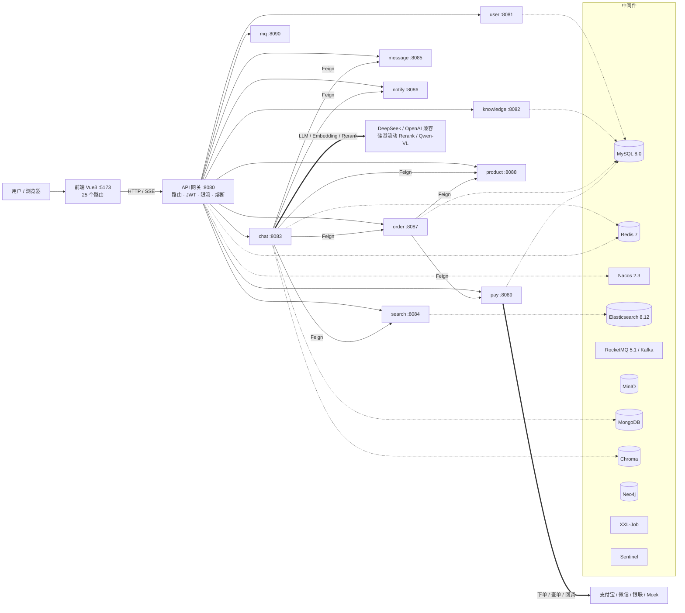
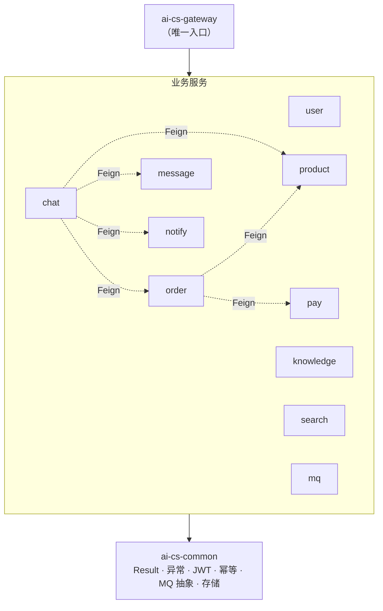
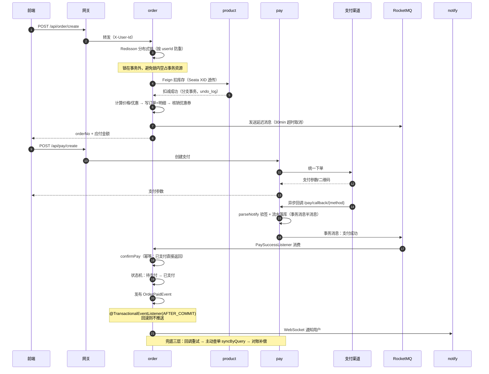
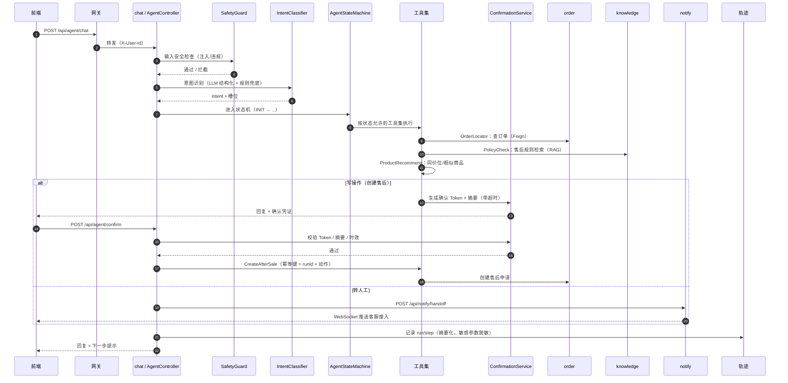
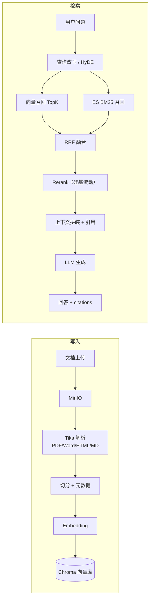
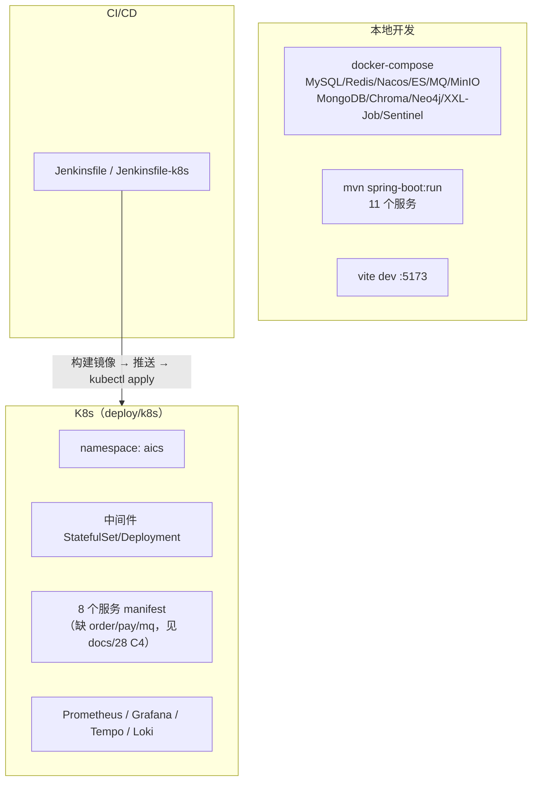

# 00 - 项目总览与架构图

> **文档状态：✅ 现行** | 建立：2026-10-18 | 配套：[docs 索引](README.md)、[19-求职与面试总纲](../learning-docs/19-求职与面试总纲/README.md)
>
> 用途：一份能讲 3 分钟的**系统全景**。面试第一问"介绍下你的项目"、简历的"项目一页纸"、新人接手，
> 都从这一篇开始。所有图都是 Mermaid，改代码后可直接改文本。

---

## 一、一句话定位

> 一个 **12 模块的 Spring Cloud 微服务系统**，主线是「AI 智能客服 + 电商交易」：
> AI 侧能对话、查知识库、走售后 Agent；交易侧有商品、购物车、订单、支付、售后退款，两条线通过 Feign 打通。

**三块能讲深的能力**：

| 能力 | 关键词 | 证据 |
|---|---|---|
| 流量入口 | 网关路由、JWT 鉴权、Redis 分布式令牌桶、最少连接负载均衡、熔断 | [RouteConfig](../ai-cs-gateway/src/main/java/com/aics/gateway/config/RouteConfig.java)、[LeastConnectionsLoadBalancer](../ai-cs-gateway/src/main/java/com/aics/gateway/loadbalancer/LeastConnectionsLoadBalancer.java) |
| 交易一致性 | 分布式锁、Seata AT、幂等、状态机、事务消息、补偿对账 | [OrderServiceImpl](../ai-cs-order/src/main/java/com/aics/order/service/impl/OrderServiceImpl.java)、[PayNotifyService](../ai-cs-pay/src/main/java/com/aics/pay/service/PayNotifyService.java) |
| AI 工程化 | Spring AI、RAG（混合检索/Rerank/溯源）、Agent 状态机、模型路由、可观测 | [ai-cs-chat](../ai-cs-chat/src/main/java/com/aics/chat/) |

---

## 二、系统上下文图

**这张图能回答**：系统边界在哪、哪些是自研、外部依赖是什么、单点在哪。

---

## 三、模块依赖图

**规则**（与 [CLAUDE.md](../CLAUDE.md) 一致）：

1. 服务之间**不直接依赖 jar**，只通过网关或 Feign/HTTP 调用；
2. `common` 不依赖任何业务模块（避免循环依赖）；
3. 网关只做「路由 + 鉴权 + 限流 + 熔断」，不写业务逻辑。

**这张图能回答**："为什么这么拆""拆完怎么保证不互相拖死"。

---

## 四、模块与端口

| 模块 | 端口 | 职责 | 关键类 |
|---|---|---|---|
| ai-cs-gateway | 8080 | 路由、JWT、限流、熔断、CORS | `RateLimitFilter`、`RouteConfig` |
| ai-cs-user | 8081 | 注册登录、用户查询、分库分表 | `UserIdLast4ModShardingAlgorithm` |
| ai-cs-knowledge | 8082 | 知识文档、向量化、FAQ、知识运营 | `KnowledgeServiceImpl` |
| ai-cs-chat | 8083 | 对话、RAG、Agent、模型路由、可观测 | `ChatController`、`AgentController` |
| ai-cs-search | 8084 | ES 检索、Canal CDC 索引、混合检索 | `HybridSearchServiceImpl` |
| ai-cs-message | 8085 | 会话/消息、Agent 轨迹、LLM 用量、评测 | `MessageController`、`AgentTraceController` |
| ai-cs-notify | 8086 | WebSocket 推送、转人工通知 | `NotifyController` |
| ai-cs-order | 8087 | 购物车、订单、状态机、售后 | `OrderServiceImpl`、`OrderStateMachineConfig` |
| ai-cs-product | 8088 | 商品、库存、分类、推荐 | `ProductController` |
| ai-cs-pay | 8089 | 四渠道支付、回调、补偿 | `PayChannelFactory`、`PayNotifyService` |
| ai-cs-mq | 8090 | MQ 消费、工单闭环、死信重推 | `WorkOrderController` |
| ai-cs-common | — | 统一返回/异常/JWT/幂等/存储/MQ 抽象 | `com.aics.common.*` |

> 另有 `ai-cs-py-chat`（FastAPI :8000，独立于网关）与 `ai-cs-frontend`（Vue :5173）、`ai-cs-frontend-react`（React 迁移版）。

---

## 五、核心链路一：下单 → 支付 → 回调 → 对账

**这张图能回答**：

- "支付回调丢了怎么办？" → 渠道重试 + `syncByQuery` 主动查单 + 补偿对账；
- "消息重复消费怎么办？" → `confirmPay` 幂等 + 状态机只允许合法迁移；
- "为什么用事务消息不直接 Feign？" → 本地流水落库与消息发送原子化，避免"钱到了订单没改"。

---

## 六、核心链路二：Agent 一轮对话

**这张图能回答**："Agent 跑飞了怎么办"——状态机限定每步可用的工具、写操作必须二次确认、步数/超时上限、全程轨迹可审计。

---

## 七、核心链路三：RAG（写入与检索）

**这张图能回答**："RAG 召回不准怎么优化"——改写、混合检索、Rerank、引用溯源、评估集（20 条 golden case）。

---

## 八、部署拓扑

---

## 九、怎么用这几张图（面试脚本）

| 时长 | 讲什么 | 用哪张图 |
|---|---|---|
| 30 秒 | "12 模块，AI 客服 + 电商交易两条主线，三块能力：网关流量、交易一致性、AI 工程化" | 第二节上下文图 |
| 3 分钟 | 背景 → 挑战（一致性/可溯源/写操作安全）→ 方案（三层兜底/状态机/确认）→ 结果 | 第二 + 五 + 六节 |
| 10 分钟 | 架构 → 一条主链路 → 一个难点 → 一个取舍 → 一个反思 | 第五或第六节 |

**取舍素材**（面试官最爱问）：

- 为什么消息最终一致而不是全链路 Seata AT？
- 为什么 Agent 用状态机而不是纯 ReAct 循环？
- 为什么网关限流按用户而不是全局？

---

## 十、维护规则

1. 改模块/端口/依赖关系 → 同步改第二、三、四节；
2. 改主链路 → 同步改对应时序图；
3. 图里的每个组件都必须能在仓库里找到（类名或配置），**不画没有落地的组件**；
4. 新增图优先用 Mermaid（可 diff、可 review），不提交截图。
