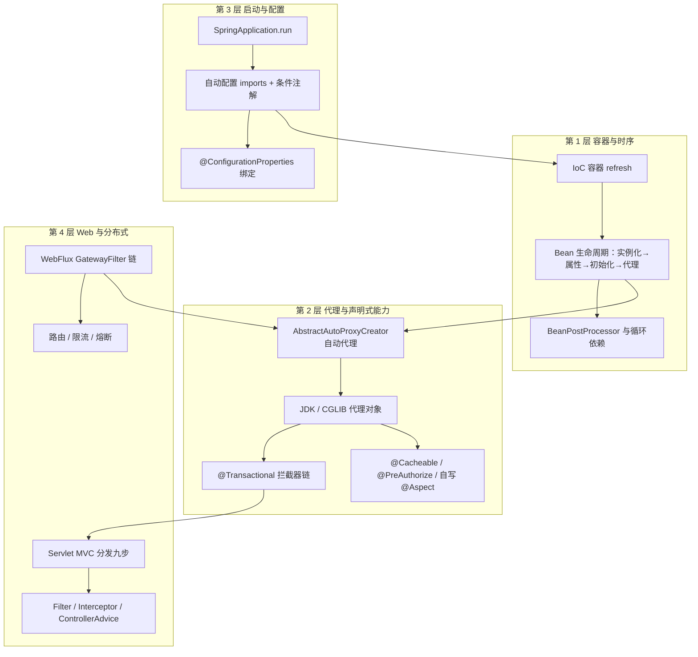
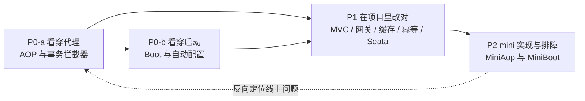
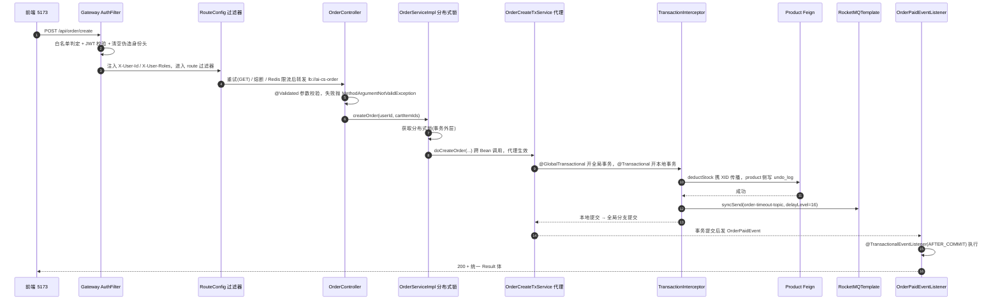

# 00.1 Spring 技术栈补全计划：把"注解为什么没生效"变成能回答的问题

> **一句话结论**：本仓 521 个 main 源文件里，`@Transactional` 只有 8 处、`@GlobalTransactional` 只有 1 处、`@Aspect` 只有 1 处、缓存注解合计 7 处——数量这么少，却要撑起 11 个服务的下单、支付与缓存一致性；这份计划按"能讲清原理 → 能在项目里改对 → 能自己写 mini 实现/排障"三段，把这些"少而关键"的注解逐个钉到源码行号上。
> **阅读前置**：会写 `@RestController`、知道什么是 Bean 和依赖注入即可；不需要读过 Spring 源码，但需要能跑 `pwsh` 命令与 `grep` 级别检索。
> **依据与篇幅**：Spring Framework 7.1.0 / Spring Boot 4.2.0 真实源码摘录（`24-源码分析/assets/source`，905 份）与本仓 `ai-cs-*` 代码当次核对的行号；全篇约 490 行，预计阅读 40 分钟，按阶段动手约 34 小时。

## 0. 这份计划解决什么问题

### 现象一：事务"看起来生效了"，其实是注解被代理绕过了

订单创建是本仓唯一同时挂本地事务与分布式事务的地方：

```java
@GlobalTransactional(rollbackFor = Exception.class, name = "order-create")
@Transactional(rollbackFor = Exception.class)
public OrderVO doCreateOrder(Long userId, List<Long> cartItemIds, Long couponId, String paymentMethod) {
```

这两个注解放进同一个方法，本身就说明作者踩过坑——`ai-cs-order/src/main/java/com/aics/order/service/impl/OrderCreateTxService.java#L34-L45` 的类注释写得很直白：`@Transactional` 与 `@GlobalTransactional` 都依赖 Spring 代理，如果在 `OrderServiceImpl` 里 `this.doCreateOrder(...)` 自调用，代理被绕过，**两个注解一起静默失效**；这个问题由 `OrderCreateTxWiringTest` 复现并回归。

排障时会暴露的问题是：日志里 `订单创建成功: orderNo=...` 照常打印（同一文件 `#L156`），数据库里却出现"库存扣了、订单没落库"，或者"本地回滚了、Feign 分支没回滚"。面试被追问"为什么把方法拆到另一个类里"时，如果只答"避免循环依赖"，基本等于没答。

### 现象二：项目里有两个 ObjectMapper，而不是一个

`ai-cs-common/src/main/java/com/aics/common/autoconfigure/Jackson2AutoConfiguration.java#L10-L11` 的注释点明了事实：Spring Boot 4 默认提供 Jackson 3 的 `tools.jackson` `JsonMapper`，**与 Jackson 2 的 `com.fasterxml.jackson.databind.ObjectMapper` 不是同一类型**。所以 common 里额外造了一个 Jackson 2 的 Bean：

```java
@AutoConfiguration
@ConditionalOnClass(ObjectMapper.class)
public class Jackson2AutoConfiguration {

    @Bean
    @ConditionalOnMissingBean(ObjectMapper.class)
    public ObjectMapper jackson2ObjectMapper() {
        return new ObjectMapper();
    }
}
```

而消费方确实在用 Jackson 2：`ai-cs-user/src/main/java/com/aics/user/security/UserSecurityConfig.java#L3` import 的是 `com.fasterxml.jackson.databind.ObjectMapper`，并在 `#L47-L57` 用它手写 401/403 响应体。于是"接口返回的 JSON 是谁序列化的"这个问题有两个答案：正常返回值走 MVC 的 `HttpMessageConverter`（Boot 4 上是 Jackson 3），异常兜底体走你手写的 Jackson 2 实例。

排障时的表现很典型：给某个 DTO 加了一个 Jackson 2 的 `@JsonFormat`，主接口没变化，只有安全兜底响应变了；或者反过来——调了 `spring.jackson.*` 配置，手写那条路径完全不理你。

### 现象三：注解数量与它承担的责任严重不成比例

把 main 源码扫一遍（命令与真实输出见 §1.3）：`@Aspect` 全仓**只有 1 处**（`IdempotentAspect`），`@Aspect` 之外的手写切面为零；`@Cacheable` 只有 2 处、`@CacheEvict` 5 处，全部集中在 `ai-cs-product/src/main/java/com/aics/product/service/impl/ProductServiceImpl.java`；`WebMvcConfigurer` 全仓只有 1 个（`ai-cs-chat/src/main/java/com/aics/chat/config/ObservabilityWebConfig.java#L26`），`@Async`、`@Retryable` 是 **0 处**。

这意味着：这些注解一旦失效，既没有编译期错误，也不会有启动期报错。Redis 挂了、变量名对不上、key 解析成空串，全部只体现为"行为不对"——而这正是 `IdempotentAspect` 自己承认的边界（`ai-cs-common/src/main/java/com/aics/common/idempotent/IdempotentAspect.java#L20-L28`：去重层是加速挡，权威在业务状态检查与 DB 唯一键）。

这些现象指向同一件事：**Spring 的注解不是"声明即生效"，而是"一个代理对象 + 一条拦截器链 + 一个明确时机"的产物**；不知道这三件事，注解就是运气，排障只能靠猜。

## 1. 能力地图

### 1.1 四层依赖：从容器到治理



> **读图说明**：最关键的是 `A2 --> B1` 这条箭头——代理不是独立机制，而是 Bean 初始化末尾由 `BeanPostProcessor` 织进去的，所以"你在哪个对象上调用方法"决定注解生不生效；`C2 --> A1` 说明自动配置也不是"启动时一次性读完"，它发生在 refresh 内部被 `ImportSelector` 拉进来的阶段。最容易看错的是 `B2 --> B3`：把它理解成"AOP 是切面自己的事"就会漏掉"容器里放的是代理对象、不是你写的那个对象"，进而在自调用、`this.` 调用、`private` 方法上反复踩坑。看错 `D3 --> B1` 则会以为网关与自己写的业务切面是两套机制，实际上两者共用同一套代理与拦截器世界观。

### 1.2 成熟度表：哪些能在本项目里验证，哪些只能读源码

| 主题 | 本项目有没有真实落地（可点开核对） | 对应文档 | 掌握判定标准 |
| --- | --- | --- | --- |
| IoC 容器启动时序 | 无自定义，全部交给 Boot；但每个服务的启动都走这条链 | [16-IoC容器与Bean生命周期](../02-Spring微服务/16-IoC容器与Bean生命周期.md)、[refresh 容器启动全流程](../24-源码分析/01-Spring框架/01-IoC容器与Bean生命周期/01-refresh-容器启动全流程.md) | 能默写 refresh 里 `invokeBeanFactoryPostProcessors → registerBeanPostProcessors → finishBeanFactoryInitialization` 三段的先后与各自作用 |
| Bean 生命周期与延迟取 Bean | `ai-cs-chat/src/main/java/com/aics/chat/config/SpringAiConfig.java#L171-L204`（`@Bean @Primary` + `ObjectProvider<VectorCacheStore>` 才决定要不要包缓存） | 同上 | 能解释为什么这里用 `ObjectProvider` 而不是直接注入（避免强制初始化与循环依赖） |
| 自动配置机制 | `ai-cs-common/src/main/resources/META-INF/spring/org.springframework.boot.autoconfigure.AutoConfiguration.imports`（6 条）+ 6 个 `@AutoConfiguration` 类，行数与注解数一一对应 | [10-自定义Starter与自动装配](../02-Spring微服务/10-自定义Starter与自动装配.md)、[enableautoconfiguration 自动配置全链路](../24-源码分析/02-SpringBoot/02-自动配置/01-enableautoconfiguration-自动配置全链路.md) | 能说出 imports 文件的**完整路径**与被读到的那个方法名 |
| 条件注解与顺序 | `Jackson2AutoConfiguration.java#L13-L14`、`CommonWebAutoConfiguration.java#L12-L13`、`IdempotentAutoConfiguration.java#L20-L23` | [自定义 starter 与条件注解](../24-源码分析/02-SpringBoot/02-自动配置/02-自定义starter与条件注解.md) | 能预测"业务方自己声明同名 Bean 时谁赢"，并说明凭哪一行注解得出的结论 |
| 属性绑定 | 21 处 `@ConfigurationProperties`（如 `ai-cs-gateway/src/main/java/com/aics/gateway/config/RateLimitProperties.java`、`ai-cs-common/src/main/java/com/aics/common/idempotent/IdempotentProperties.java`） | [configurationproperties 属性绑定原理](../24-源码分析/02-SpringBoot/04-配置与属性绑定/01-configurationproperties-属性绑定原理.md) | 能说清绑定发生在 Bean 创建后的哪个回调里、类型不对时什么时候报错 |
| 统一异常处理 | `ai-cs-common/src/main/java/com/aics/common/exception/GlobalExceptionHandler.java#L27-L154`（`@RestControllerAdvice` + 11 个 `@ExceptionHandler`） | [17-SpringMVC请求全链路与参数校验](../02-Spring微服务/17-SpringMVC请求全链路与参数校验.md) | 能给定一个异常类型，直接说出最终 HTTP 状态码，并指出由哪个分支决定 |
| Jackson 2 / 3 共存 | `ai-cs-common/src/main/java/com/aics/common/autoconfigure/Jackson2AutoConfiguration.java`；消费方 `ai-cs-user/src/main/java/com/aics/user/security/UserSecurityConfig.java#L47-L57` | [01-SpringBoot核心原理](../02-Spring微服务/01-SpringBoot核心原理.md) | 能指出"哪个响应体由哪个 ObjectMapper 序列化"，不靠猜 |
| 手写 AOP 切面 | `ai-cs-common/src/main/java/com/aics/common/idempotent/IdempotentAspect.java#L49-L74`（全仓唯一 `@Aspect`） | [15-SpringAOP与声明式事务原理](../02-Spring微服务/15-SpringAOP与声明式事务原理.md)、[aop 原理与自动代理创建](../24-源码分析/01-Spring框架/02-AOP与代理/01-aop-原理与自动代理创建.md) | 能画出 `@Around` 与 `@Transactional` 同时存在时谁包谁，并解释 fail-open 的取舍 |
| 声明式事务 | order 模块 5 处（`OrderCreateTxService.java#L79`、`OrderServiceImpl.java#L98/L116/L167/L179`），全仓共 8 处 | [transactional 事务拦截器与传播行为](../24-源码分析/01-Spring框架/03-事务管理/01-transactional-事务拦截器与传播行为.md)、[事务失效场景与源码原因](../24-源码分析/01-Spring框架/03-事务管理/02-事务失效场景与源码原因.md) | 给定一段同类自调用代码，能判断会不会失效、失效在 `invokeWithinTransaction` 的哪一步 |
| 分布式事务双层 | `ai-cs-order/src/main/java/com/aics/order/service/impl/OrderCreateTxService.java#L78-L95` | [06-Seata分布式事务AT模式](../02-Spring微服务/06-Seata分布式事务AT模式.md)、[07-服务调用统一与SeataXID传播](../02-Spring微服务/07-服务调用统一与SeataXID传播.md) | 能说清 XID 从哪进、随什么传播、product 侧 undo_log 谁写、MQ 为什么不在全局事务里 |
| 事务事件 | `ai-cs-order/src/main/java/com/aics/order/event/OrderPaidEventListener.java#L30` | [09-SpringCache与事务领域事件](../02-Spring微服务/09-SpringCache与事务领域事件.md) | 能区分 `@EventListener` 与 `AFTER_COMMIT` 的触发时刻差多少 |
| 缓存抽象 | `ai-cs-product/src/main/java/com/aics/product/service/impl/ProductServiceImpl.java#L109`（`@Cacheable(sync = true)`）、`#L119`、`#L244`、`#L256` | [09-SpringCache与事务领域事件](../02-Spring微服务/09-SpringCache与事务领域事件.md) | 能解释 `sync = true` 解决了什么、`@CacheEvict` 为什么可能先删后写 |
| 方法级安全 | `ai-cs-user/src/main/java/com/aics/user/security/UserSecurityConfig.java#L21-L45`、`HeaderAuthenticationFilter.java#L25-L56`、`ai-cs-user/src/main/java/com/aics/user/controller/UserController.java#L43`（全仓仅 2 处 `@PreAuthorize`） | [prepostauthorize 与代理](../24-源码分析/05-SpringSecurity/02-授权与方法级安全/02-methodsecurity-prepostauthorize-与-代理.md) | 能画出"网关鉴权 → 可信头 → SecurityContext → `@PreAuthorize`"这条信任边界的断点在哪 |
| WebFlux 过滤器链 | `ai-cs-gateway/src/main/java/com/aics/gateway/filter/AuthFilter.java#L42-L174`、`ai-cs-gateway/src/main/java/com/aics/gateway/config/RouteConfig.java#L60-L187` | [04-SpringCloudGateway网关](../02-Spring微服务/04-SpringCloudGateway网关.md)、[route 路由断言与过滤器链](../24-源码分析/04-SpringCloud/04-网关Gateway/01-route-路由断言与过滤器链.md) | 能说 `getOrder()` 返回值改变时，`AuthFilter` 与限流/熔断的先后怎么变 |
| MVC 拦截器 | 全仓唯一一份：`ai-cs-chat/src/main/java/com/aics/chat/observability/TraceInterceptor.java#L26-L85` + `ai-cs-chat/src/main/java/com/aics/chat/config/ObservabilityWebConfig.java#L34-L39` | [17-SpringMVC请求全链路与参数校验](../02-Spring微服务/17-SpringMVC请求全链路与参数校验.md)、[拦截器与异常处理](../24-源码分析/01-Spring框架/04-SpringMVC/04-拦截器与异常处理-interceptor与controlleradvice.md) | 能说清 `preHandle` / `afterCompletion` 与 Filter 的调用次数、异常可见性差别 |
| Spring AI 装配 | `ai-cs-chat/src/main/java/com/aics/chat/config/SpringAiConfig.java#L95-L289`（`@Primary EmbeddingModel`、`ToolCallbackProvider`、`QuestionAnswerAdvisor`） | 官方文档（Spring AI 2.1.0 reference）+ [01-ChatClient与模型抽象](../24-源码分析/06-SpringAI/01-ChatClient与模型抽象/README.md) | 能解释为什么要 `exclude = OpenAiEmbeddingAutoConfiguration.class`，不 exclude 会出几个 `EmbeddingModel` |
| `@Async` / `@Retryable` | **0 处落地**，只能读源码 | [aop 实战与坑位](../24-源码分析/01-Spring框架/02-AOP与代理/04-aop-实战-自定义注解切面与坑位.md) | 本项只要求"能说出线程池与代理的两个坑"，不要求项目里有证据 |
| 自己写 mini 实现 | A 级可运行：`24-源码分析/examples/mini-frameworks`（MiniIoC / MiniAop / MiniMvc / MiniBoot） | [手写 MiniAop 代理](../24-源码分析/07-源码方法论与附录/01-手写迷你实现/02-手写miniaop代理.md) | 能改坏一处（比如去掉 `BeanPostProcessor` 返回代理那句）并预言报什么错 |

这张表要读出的结论只有一句：**本专题大部分主题在本项目里有真实落地可以验证，少数（`@Async`/`@Retryable`、AOT、完整 Security）没有，只能读源码——不要拿"读过"当"做过"。**

### 1.3 三组实测数字（可以直接复现）

文档规模与注解密度不是拍脑袋写的，下面两条命令都可以在仓库根 30 秒内跑完。

```powershell
cd D:\Projects\Persion\ai-customer-service\learning-docs
$f = Get-ChildItem -Recurse -Filter *.md | Where-Object { $_.FullName -notmatch '24-源码分析' }
"正文篇数 = " + $f.Count
"总行数   = " + (($f | ForEach-Object { (Get-Content $_.FullName | Measure-Object -Line).Lines } | Measure-Object -Sum).Sum)
"24 源码摘录 = " + (Get-ChildItem '24-源码分析\assets\source' -Filter *.md).Count
```

```text
正文篇数 = 310
总行数   = 83670
24 源码摘录 = 905
```

怎么读：310 篇 / 83670 行是"22 个内容模块 + 24-源码分析之外"的规模；905 是 A 级证据池的大小——**你的每一个源码结论都应该能在这个池子里找到对应文件**。同一轮还量到：`02-Spring微服务` 正文 18 篇 / 10162 行、`01-Java基础` 正文 8 篇 / 4275 行，这两个模块已按新范式重写完毕，其余模块仍是旧稿，所以本专题的文档成熟度可以直接标"已补完 19 篇 + 24 里的 Spring 分册"。

```powershell
cd D:\Projects\Persion\ai-customer-service
$java = Get-ChildItem -Path .\ai-cs-*\src\main\java -Recurse -Filter *.java
"main java 文件数 = " + $java.Count
foreach ($p in '^\s*@Transactional','^\s*@GlobalTransactional','^\s*@Aspect','^\s*@Cacheable','^\s*@CacheEvict','^\s*@ConfigurationProperties','^\s*@AutoConfiguration','^\s*@Validated','^\s*@PreAuthorize','^\s*@Async','^\s*@Retryable') { "{0,-34}{1}" -f $p, ($java | Select-String -Pattern $p).Count }
```

```text
main java 文件数 = 521
^\s*@Transactional                8
^\s*@GlobalTransactional          1
^\s*@Aspect                       1
^\s*@Cacheable                    2
^\s*@CacheEvict                   5
^\s*@ConfigurationProperties      21
^\s*@AutoConfiguration            6
^\s*@Validated                    13
^\s*@PreAuthorize                 2
^\s*@Async                        0
^\s*@Retryable                    0
```

怎么读：正则加了 `^\s*` 是为了**只统计行首注解**，把 javadoc 里 `{@code @Transactional}` 这类提及排除掉（不加会多数出几处，旧稿的偏差常来自这里）。`@AutoConfiguration` 6 与 imports 文件的 6 行完全对上，可以互相印证；`@Async`、`@Retryable` 为 0 说明"异步与重试"在本仓没有可验证的落地，只能读源码。

### 1.4 读者画像与起点自测

从哪个阶段进，取决于你现在缺哪一层证据，而不是取决于你读了多久。**不要从 P0-a 一路顺读到 P2**——那是 34 小时里最贵的一段浪费。

| 你是谁 | 建议入口 | 可以跳过 |
| --- | --- | --- |
| 刚接手本仓、能写 CRUD 但没排查过事务问题 | P0-a 全做 + §9 练习 1、2、7 | §8 只挑第 5、9 两问 |
| 写过 `@Aspect` 却说不清"代理是谁创建的、什么时候替换的" | 先读 `### 2.1` 的三条锚点，再回 P0-a | 1.3 的两组统计命令 |
| 要面试/答辩，要求每条结论都能落到行号 | §4 时序 + §7 时效表 + §8 十六问 | P2 的 mini 实现 |
| 维护 common / gateway 这类公共模块 | P0-b 与 P1 全做 | 订单/支付相关的 §4 细节 |

起点自测：下面五个问题答出四个以上，说明你已经可以跳到 P1，把时间花在"改对"而不是"看懂"上。

1. `@Transactional` 与 `@GlobalTransactional` 标在同一个方法上，哪一个先开启事务？
2. Boot 4 的自动配置清单文件叫什么、放在哪个目录、本仓现在有几条？
3. `@Cacheable(sync = true)` 与不加 `sync` 的差别是什么？
4. 把网关 `AuthFilter#getOrder()` 的返回值改小，鉴权是提前还是延后，容易踩到什么？
5. `@RestControllerAdvice` 能接住 `Filter` 里抛出的异常吗？

答不出的那几条，正好对应 §2 缺口表里的一行——按行补，不要按章节补。

## 2. 缺口诊断

| 缺口 | 不补的后果 | 触发场景 | 自测方法 |
| --- | --- | --- | --- |
| 代理机制没吃透（自调用 / `private` / `final`） | `@Transactional`、`@GlobalTransactional`、`@Cacheable` 一起静默失效，出现"扣了库存没订单" | 同类方法互调，例如把 `doCreateOrder` 收回 `OrderServiceImpl` | 读 `ai-cs-order/src/main/java/com/aics/order/service/impl/OrderCreateTxService.java#L34-L45`，再看 `OrderCreateTxWiringTest` 断言什么；现象层面对照 `日志有"订单创建成功"但库里无数据` |
| 只记 `rollbackFor` 不理解异常分类 | 检查型异常不回滚，脏数据留在库里 | Feign 抛 `IOException`、第三方 SDK 抛受检异常 | 给 `OrderServiceImpl` 某个 `@Transactional` 方法手动抛 `Exception` 与 `RuntimeException` 各一次，看 `TransactionAspectSupport` 的两个分支走哪边 |
| 分布式事务边界模糊（MQ / Redis 不是 Seata 资源） | 全局回滚后 MQ 消息已发、缓存已清，下游读到"幽灵订单" | 下单后 30 分钟超时关单链路 | 读 `OrderCreateTxService.java#L87-L95` 的注释，再看 `#L144-L146` 的 `syncSend` 位置——它在本地事务提交**之前**发出 |
| 自动配置顺序与条件判断靠猜 | 自己声明的 Bean 被覆盖，或自己的自动配置根本不生效 | common 里新增第 7 个 `@AutoConfiguration` 类 | 启动任一服务时加 `--debug` 看 `CONDITIONS EVALUATION REPORT`；报错原文 `No auto configuration classes found in META-INF/spring/...` 来自 `AutoConfigurationImportSelector`（锚点见下） |
| 属性绑定与校验时机不清 | 配置写错静默用默认值，线上才暴露 | 改 `aics.idempotent.*`、`RateLimitProperties` 这类业务前缀 | 给对应 `@ConfigurationProperties` 类加一条 `@NotBlank` 并故意留空，看是启动失败还是静默通过 |
| Jackson 2 / 3 双实例认知缺失 | 调 `spring.jackson.*` 只影响一半响应；自定义序列化器写错位置 | 统一响应体格式调整、时间格式统一 | 在 `GlobalExceptionHandler` 抛一次业务异常，对比正常接口返回体的 key 顺序与时间格式 |
| 网关过滤器链与阻塞调用 | 网关线程池被拖垮，一个慢鉴权拖全站 | `AuthFilter` 里做远程校验 / Redis 同步调用 | 读 `AuthFilter.java#L106-L169`，列出这 60 行里有没有 I/O；再看 `#L172-L174` 的 `getOrder()` |
| 信任边界只做了一半 | 绕过网关直连 8081 并自带 `X-User-Id`，直接获得身份 | 服务端口被暴露 / 内网横向移动 | 读 `ai-cs-user/src/main/java/com/aics/user/security/HeaderAuthenticationFilter.java#L34-L49`：它**只搬运头部，不校验 JWT**；对应安全前提写在同一文件 javadoc |
| 缓存与事务的顺序 | 事务还没提交就清了缓存，别的线程把旧值写回缓存 | 商品详情更新 + 高并发读 | 读 `ProductServiceImpl.java#L119`，判断它在事务提交前还是后执行；再看业务上有没有二次读 |
| Spring AI 装配关系不清 | 出现两个 `EmbeddingModel` 时"随机"用一个，向量维度不一致直接炸检索 | 换 embedding 模型、加新 starter | 看 `ai-cs-chat/src/main/java/com/aics/chat/ChatApplication.java` 的 `exclude` 那行，删掉它再启动（单测环境）观察报错 |

统计一下：上表 10 行里有 9 行能落到本仓具体行号，只有"自动配置顺序"需要借 `--debug` 报告判断——这正好说明本专题的证据密度足够支撑"在项目里改对"这一阶段。

### 2.1 三条源码锚点：把三个争议点钉死在行号上

缺口表里有三行最容易变成"各说各话"：事务在哪一步失效、Bean 为什么没被代理、自动配置为什么没加载。这三处不需要背结论，读三段源码即可；三份摘录都在 A 级证据池里，路径可以用 `Test-Path learning-docs\24-源码分析\assets\source\TransactionAspectSupport.java.md` 当场验证（注意摘录文件名带 `.java.md` 后缀，只写 `.java` 是查不到的）。

**锚点一：事务的分界只有四行** —— [[源码:TransactionAspectSupport.java.md#L363-L380]]

`createTransactionIfNecessary(ptm, txAttr, joinpointIdentification)` 开事务，`invocation.proceedWithInvocation()` 执行目标方法，`catch (Throwable ex)` 里 `completeTransactionAfterThrowing(txInfo, invocation, ex)` 之后再 `throw ex`，`finally` 只做 `cleanupTransactionInfo(txInfo)`。

逐句读能读出三件事：

1. **清理与回滚是两件事**。`finally` 只解绑线程上的 `TransactionInfo`，回滚在上面的 `catch` 里已经做完了。所以"日志显示已回滚但线程还挂着事务"和"线程清理了但数据没回滚"是两种完全不同的故障，别混着猜。
2. **异常分类判断不在这一段**。是否回滚取决于 `completeTransactionAfterThrowing` 内部的 `txAttr.rollbackOn(...)`；同一方法 `#L382-L392` 还处理了返回值是 `Future` 的情况——异步任务里抛的异常要 `future.get()` 才能拿到，否则事务"正常提交"。
3. **这段代码能进来，前提是已经拿到代理**。所以自调用失效不是这里的分支写错，而是根本走不到这一行。这条把缺口表第一行和 §6.1 钉在同一处证据上。

事务管理器怎么选在更上面：[[源码:TransactionAspectSupport.java.md#L333-L339]] 先取 `TransactionAttributeSource`、再取 `txAttr`、最后 `determineTransactionManager(...)`——顺序是"先看注解、后定管理器"，这就是为什么多数据源时"方法上没写 `@Transactional` 却报找不到事务管理器"。

**锚点二：代理是在 Bean 初始化之后被"换掉"的** —— [[源码:AbstractAutoProxyCreator.java.md#L321-L341]]

`wrapIfNecessary` 有三个早退分支：已处理过、已判定为不需要代理（缓存里是 `FALSE`）、以及 `isInfrastructureClass(...) || shouldSkip(...)` 的基础设施类。真正创建代理只在 `specificInterceptors != DO_NOT_PROXY` 时发生，调用 `createProxy(bean.getClass(), beanName, specificInterceptors, new SingletonTargetSource(bean))`（`#L337-L338`），返回的 `proxy` 顶替了原来那个 Bean。

两个判据要带走：

1. 容器里放的是**代理对象**，`SingletonTargetSource` 包着的才是原始实例；因此类内部 `this` 永远是原始实例，跨不过代理。
2. `private` / `final` 方法失效不是因为"注解没被识别"，而是生成代理时那类方法无法被覆写；`createProxy` 定义在同文件 `#L428`，再往下才分 JDK 与 CGLIB 两条路。

**锚点三：自动配置的入口只有一个方法** —— [[源码:AutoConfigurationImportSelector.java.md#L130-L143]]

`getAutoConfigurationEntry` 把整条链讲完了：`isEnabled(...)` 判开关 → `getCandidateConfigurations(...)` 取候选 → `removeDuplicates` 去重 → `getExclusions` 取排除项 → `checkExcludedClasses` 校验 → `removeAll(exclusions)` → `getConfigurationClassFilter().filter(...)` 按条件过滤 → `fireAutoConfigurationImportEvents` 发事件。

两个工程结论：

1. 候选来源写死在 `getCandidateConfigurations`（同文件 `#L188-L196`）：`ImportCandidates.load(...)` 读的就是 `META-INF/spring/org.springframework.boot.autoconfigure.AutoConfiguration.imports`，读不到就抛 `No auto configuration classes found in META-INF/spring/...imports`。本仓 common 的自动装配只有这一个可能"静默失效"的入口，出问题先数 imports 文件的行数。
2. `filter(...)` 之后才轮到 `@ConditionalOnMissingBean` 这类条件，所以"我的 `@Bean` 被官方覆盖"永远是**顺序 + 条件**问题，不是注解本身写错。

三段读完后回看缺口表：能落到行号的行从 9 行变成 10 行；剩下的"属性绑定失败时机"在 [configurationproperties 属性绑定原理](../24-源码分析/02-SpringBoot/04-配置与属性绑定/01-configurationproperties-属性绑定原理.md) 里有逐分支的 A 级证据。

## 3. 补全路线

四个阶段，前两个都属 P0（不看懂就没法往下），第三个 P1，第四个 P2。阶段之间不是线性——P1 的动作会反复用到 P0 的结论。

| 阶段 | 目标能力 | 学哪些文档 | 项目落地动作 | 验收标准 | 预计投入 |
| --- | --- | --- | --- | --- | --- |
| **P0-a 看穿代理** | 能从一个注解追到代理对象与拦截器链 | [15-SpringAOP与声明式事务原理](../02-Spring微服务/15-SpringAOP与声明式事务原理.md)、[16-IoC容器与Bean生命周期](../02-Spring微服务/16-IoC容器与Bean生命周期.md)、24 的 [AOP 四篇](../24-源码分析/01-Spring框架/02-AOP与代理/README.md) 与 [事务三篇](../24-源码分析/01-Spring框架/03-事务管理/README.md) | 不动业务代码，只在测试目录写一个"故意自调用"的反例，断言事务没生效 | 能对着 `TransactionAspectSupport.java#L363-L379` 说出"失效发生在拿到代理之前"；单测在失败态下打印出预期缺失的回滚 | 6~8 小时 |
| **P0-b 看穿启动** | 能解释"这个 Bean 为什么被创建/为什么没被创建" | [01-SpringBoot核心原理](../02-Spring微服务/01-SpringBoot核心原理.md)、[10-自定义Starter与自动装配](../02-Spring微服务/10-自定义Starter与自动装配.md)、24 的 [启动全流程](../24-源码分析/02-SpringBoot/01-启动原理/01-springapplication-run-启动全流程.md)、[自动配置全链路](../24-源码分析/02-SpringBoot/02-自动配置/01-enableautoconfiguration-自动配置全链路.md)、[属性绑定原理](../24-源码分析/02-SpringBoot/04-配置与属性绑定/01-configurationproperties-属性绑定原理.md) | 在 common 里加一个只有 `@ConfigurationProperties` + 一个 `@Bean` 的最小自动配置（用 `@ConditionalOnProperty` 控制开关），并登记进 imports 文件 | `--debug` 的条件报告里能查到你的类名与"matched"；关掉开关后 Bean 消失 | 6 小时 |
| **P1 在项目里改对** | 能在真实链路上改一处并证明它生效 | [17-SpringMVC请求全链路与参数校验](../02-Spring微服务/17-SpringMVC请求全链路与参数校验.md)、[04-SpringCloudGateway网关](../02-Spring微服务/04-SpringCloudGateway网关.md)、[09-SpringCache与事务领域事件](../02-Spring微服务/09-SpringCache与事务领域事件.md)、[14-分布式幂等设计](../02-Spring微服务/14-分布式幂等设计.md)、[06-Seata分布式事务AT模式](../02-Spring微服务/06-Seata分布式事务AT模式.md)、[07-服务调用统一与SeataXID传播](../02-Spring微服务/07-服务调用统一与SeataXID传播.md) | 三选一：① 给 `TraceInterceptor` 的路径圈定加一个入口；② 给 `RouteConfig` 加一条 route 并配统一降级；③ 给某个 `@CacheEvict` 标注 `beforeInvocation` 并写清理由 | 改完能拿出一次真实请求的证据链（响应头 / 日志关键字 / 缓存 key 变化），并能解释"不改也曾经能用"的原因 | 10 小时 |
| **P2 自己写 mini 实现 / 排障** | 能不用框架复现核心机制，从而反向定位线上问题 | 24 的 [手写 MiniIoC](../24-源码分析/07-源码方法论与附录/01-手写迷你实现/01-手写miniioc容器.md)~[手写 MiniBoot](../24-源码分析/07-源码方法论与附录/01-手写迷你实现/04-手写miniboot自动配置.md)、[代理方式 jdk 与 cglib](../24-源码分析/01-Spring框架/02-AOP与代理/02-代理方式-jdk与cglib.md)、[18-Spring面试专练与追问链](../02-Spring微服务/18-Spring面试专练与追问链.md) | 在 `examples/mini-frameworks` 的 MiniAop 上加一个最小 `@MyTransactional`：进方法前 `setAutoCommit(false)`、异常回滚、正常提交 | `javac` + `java` 跑通；再故意在 MiniAop 里跳过"返回代理"那一步，能预言并观察到注解失效 | 12 小时 |

阶段之间有一条硬约束：**P0-a 没过，不要去改 P1 里的任何事务代码**。原因是本仓事务点只有 8 处，每一处都在订单/支付主链路上，改错的代价远高于多读两篇文档。



> **读图说明**：主路径是 A→C，不是 B→C。要改事务、缓存、幂等这三类代码，门槛在代理与拦截器链上；把 B→C 当成主路径是最常见的误读——先花 6 小时背启动流程，回到代码里仍然解释不了"为什么这段方法没进拦截器"。虚线 D→A 表示 mini 实现不是终点：它的价值是把 P0 的结论用两百行代码再证一次，证不出来说明 P0 只是记住了结论。

## 4. 一次真实落地的执行时序

把"补上这个能力后"的下单请求画出来——这条链上每一步都对应本计划的一个主题，任何一步缺失都会留下可观测的痕迹。



> **读图说明**：盯住第 6 步与第 8 步。第 8 步是整张图的转折点——只有 `OS -> TX` 是**跨 Bean 调用**，代理才有机会插入拦截器；如果把它改成 `OS` 内部 `this.doCreateOrder(...)`，第 9~13 步会全部"看起来跑过了"，实际没有任何事务语义。第二个要盯的是第 12 步在 13 步**之前**：消息在本地提交前就发出去了，这正是 `OrderCreateTxService.java#L144-L146` 的真实位置，也是"为什么消费侧要先查订单"的原因。最容易看错的是第 15 步：把 `AFTER_COMMIT` 当成普通 `@EventListener`，就会在事务未提交时发通知，下游可能读不到订单。

哪一步没做会出现什么：

- 第 2 步不做（不清 `X-User-Id`），前端可自带身份头穿透到下游；`AuthFilter.java#L112-L121` 就是为这个写的。
- 第 5 步不做（去掉 `@Validated`），参数错误会一路走到兜底 `Exception` 分支变成 500，而不是 `GlobalExceptionHandler.java#L44-L52` 的 400。
- 第 8 步退化成自调用，`@GlobalTransactional` 与 `@Transactional` 一起失效，正是 `OrderCreateTxService.java#L34-L45` 记录的历史故障。
- 第 10 步 XID 没传，product 侧不写 undo_log，TC 二阶段无法反向补偿，只能落"库存永久少 1"。
- 第 12 步把 `syncSend` 挪到提交后，则事务回滚时消息已发；挪到更前，则消费侧查不到订单——两边都必须靠"消费幂等 + 状态校验"兜住。

## 5. 优先级与取舍

| 决定 | 具体内容 | 理由 | 代价 / 风险 |
| --- | --- | --- | --- |
| **做** | 代理与事务时序（P0-a） | 全仓 8 处 `@Transactional` + 1 处 `@GlobalTransactional` 都在主链路，失效代价最高且无告警 | 6~8 小时，纯阅读 + 一个反例单测 |
| **做** | 自动配置与条件注解（P0-b） | common 已有 6 条 imports，任何新公共能力都要走这条路；顺序错了很难查 | 需要在 common 里加一个"陪跑"配置类，可能引起一次讨论 |
| **做** | MVC 异常与参数校验、网关过滤器链（P1） | 这两处决定"用户看到什么错误"和"全站抗不抗压" | 改动集中在 common 与 gateway，需要回归 11 个服务的响应体 |
| **不做** | 从零通读 Spring 全部源码 | 905 份摘录里与本仓相关的不到 1/5，其余读完也没有落地场景 | 时间成本极高，收益无法验证 |
| **不做** | 重写 MVC / 自研 WebFlux | Boot 4 + Spring Framework 7 的默认实现已覆盖本仓所有需求 | 一旦自研，AOT、可观测、安全全部要自己维护 |
| **不做** | OAuth2 授权服务器、完整 Spring Security 体系 | 本仓只有 `ai-cs-user` 一个模块引入 security，认证在外置网关 | 与现网拓扑不符，投入产出比最低 |
| **延后** | AOT / Native Image | `24-源码分析/02-SpringBoot/06-AOT与GraalVM` 已标注边界有限，本仓未做 native 构建 | 等有容器启动时延硬指标时再评估 |
| **延后** | `@Async` 与 `@Retryable` 治理 | 落地数为 0，没有可验证场景；要引入需先定线程池与拒绝策略 | 引入后要补隔离与监控，属于新增能力的成本 |
| **延后** | Spring StateMachine / Spring AI 深层机制 | 前者在 [12-订单状态机治理](../02-Spring微服务/12-订单状态机治理.md) 已覆盖到够用，后者归 AI 专题 | 与本文档专题重叠度低，避免重复写 |

**本计划刻意不覆盖什么**（避免与兄弟计划打架）：

- 中间件本身的原理（Redis 持久化、RocketMQ 存储、ES 段合并）——见同目录 [02-中间件补全开发计划](02-中间件补全开发计划.md)。
- 服务治理的配置面（Nacos 集群、Sentinel 规则持久化、Seata TC 部署）——见 [03-微服务治理补全开发计划](03-微服务治理补全开发计划.md)。
- 语言层基础（集合、并发、JVM）——见 [04-Java基础补全开发计划](04-Java基础补全开发计划.md) 与 [01-Java基础](../01-Java基础/README.md)。
- Spring AI 的 RAG/Agent 设计——见 [05-AI集成](../05-AI集成)。
- 本文档也不做"学习进度打卡"，不写"第几批补全"这类流水账：判据是**能不能观察到行为改变**，不是读完了哪几篇。

## 6. 常见误区与自己怎么验

### 6.1 误区：加了 `@Transactional` 就有事务

为什么错：注解本身没有行为，行为在代理拦截器里；同类自调用、`private` 方法、`final` 类都是"拿不到代理"的路径。本仓把 `doCreateOrder` 单独拆类，正是为了绕开这一点（`OrderCreateTxService.java#L34-L45`）。

怎么自证：在测试目录写一个自调用用例并断言回滚缺失；或在 `TransactionInterceptor#invoke` 上打断点，观察自调用时断点**根本不进**。

### 6.2 误区：`@GlobalTransactional` 会把一切回滚

为什么错：Seata 只接管"资源"——数据库连接。MQ、Redis、Feign 之外的外部调用不在全局事务里。本仓注释直接写明"MQ 不是 Seata 资源"，靠消费侧幂等兜底（`OrderCreateTxService.java#L87-L95`）。

怎么自证：读 `#L144-L146`，确认 `syncSend` 在本地提交前；再让后续步骤抛异常，观察消息是否已经发出（在消费端日志里看时间戳是否早于异常）。

### 6.3 误区：项目里只有一个 `ObjectMapper`

为什么错：Boot 4 默认给了 Jackson 3 的 `JsonMapper`，common 又补了一个 Jackson 2 的 `ObjectMapper`，两者是不同类型（`Jackson2AutoConfiguration.java#L10-L21`）。

怎么自证：在两个位置各打一行日志 `mapper.getClass().getName()`——`UserSecurityConfig` 手写的 401 响应与任意正常接口返回，比较 `ObjectMapper` / `tools.jackson.databind.json.JsonMapper` 的实际类型名。

### 6.4 误区：`@ConditionalOnMissingBean` 一定让我赢

为什么错：条件是"评估时"的结论，评估顺序由 imports 文件里的登记顺序与自动配置排序决定；业务方 Bean 先在容器里注册与否，决定条件真假。本仓 imports 有 6 条，`Jackson2AutoConfiguration` 排在最后一行。

怎么自证：启动时加 `--debug`，在 `CONDITIONS EVALUATION REPORT` 里搜你的类名，看 `matched` 与 `did not match` 的原因行；报错原文 `No auto configuration classes found in META-INF/spring/...` 就是这条链断了的信号。

### 6.5 误区：`@CacheEvict` 之后缓存一定干净

为什么错：默认在方法返回后删，而方法返回时事务可能还没提交；并发读会把旧值重新写回。本仓用的是 `@CacheEvict(cacheNames = ..., key = "#id")` 默认行为（`ProductServiceImpl.java#L119`）。

怎么自证：在 `@CacheEvict` 方法上加一行 `log.info`，在事务提交回调里再加一行，比时间戳；或直接看缓存 key 的 TTL 变化与第二次读到的值。

### 6.6 误区：网关鉴权过了，服务就安全

为什么错：`HeaderAuthenticationFilter` **只搬运头部，不校验 JWT**（`HeaderAuthenticationFilter.java#L34-L49`），它的安全前提写在同文件 javadoc 里——服务端口不允许外部直连。

怎么自证：`curl -H "X-User-Id: 1" -H "X-User-Roles: ADMIN" http://localhost:8081/...`（本地环境），若返回 200 说明边界靠网络而非代码；把 `Get-ChildItem -Path .\ai-cs-user\src\main\java -Recurse -Filter *.java | Select-String -Pattern '^\s*@PreAuthorize'` 跑一遍，计数是 2——方法级授权覆盖面很窄，越权防护主要压在"端口不对外"这个前提上。

### 6.7 误区：`--debug` 里的 Bean 都在，就说明装配正确

为什么错：装配正确 ≠ 代理正确 ≠ 时机正确。`IdempotentAspect` 的 key 解析结果为空时会抛 `IllegalArgumentException`（`IdempotentAspect.java#L98-L100`），Redis 异常时又 fail-open 放行（`#L62-L65`）——这两件事在启动报告里完全看不见。

怎么自证：搜日志关键字 `幂等组件 Redis 异常，fail-open 放行`；或在 `resolveKey` 返回值上打断点，把参数名为空的用例跑一遍。

### 6.8 误区：注解数量对得上，就说明这套能力到位了

为什么错：数量只能说明覆盖面，不能说明掌握度。全仓 `@Transactional` 8 处、`@PreAuthorize` 2 处、`@Aspect` 1 处——少，但都在主链路，失效代价最高；反过来 `@ConfigurationProperties` 有 21 处，说明属性绑定是高频动作，可真正被验证过的绑定行为（宽松绑定怎么匹配、`@Validated` 失败是在绑定末尾抛还是启动时抛）一条都没被项目证过，只能靠 [属性绑定原理](../24-源码分析/02-SpringBoot/04-配置与属性绑定/01-configurationproperties-属性绑定原理.md) 的分支解释。

怎么自证：用 `Get-ChildItem -Path .\ai-cs-*\src\main\java -Recurse -Filter *.java | Select-String -Pattern '^\s*@ConfigurationProperties'` 数出那 21 个类，随机挑 3 个，把字段名与 yml 里的 key 互相推导一遍；推不出来就说明"宽松绑定"只记住了名字。再挑 `IdempotentAspect` 那 1 个切面，说清它在事务内还是事务外占位——说不出就是只数了注解、没读语义。

## 7. ⚠️ 版本与时效

| 结论 | 依赖的版本或前提 | 什么情况下会失效 | 怎么复核 |
| --- | --- | --- | --- |
| Boot 4 默认 Jackson 3（`tools.jackson`），Jackson 2 的 `ObjectMapper` 需自建 | Spring Boot ≥ 4.0；本仓 4.2.0 | 回退到 Boot 3，或 Spring 官方恢复 Jackson 2 默认 | `Get-ChildItem .\ai-cs-common\src\main\java -Recurse -Filter *.java \| Select-String -Pattern 'tools\.jackson'`——实测只有 1 处命中（`Jackson2AutoConfiguration` 的 javadoc 说明），说明业务代码还没直接用 Jackson 3；若哪天这个计数变大，`Jackson2AutoConfiguration` 就该重新评估是否还要存在 |
| `spring-boot-starter-web` 已 deprecated，应用 `spring-boot-starter-webmvc` | Spring Boot ≥ 4.0 | 版本回退；或 starter 名称再次调整 | 各 `ai-cs-*/pom.xml` 里搜 `spring-boot-starter-web` 的闭合标签 |
| 自动配置靠 `META-INF/spring/...AutoConfiguration.imports`，不再用 `spring.factories` | Boot ≥ 2.7 起的机制，Boot 4 沿用 | 自定义 starter 写法回到 `spring.factories`（当前不会自愈，会静默不加载） | 数 imports 文件行数：现在是 6 行；与 `@AutoConfiguration` 注解数（实测 6）对比 |
| `@GlobalTransactional` 与 `@Transactional` 可同方法叠加，但**必须跨 Bean 调用** | Spring 代理机制 + Seata 2.x 拦截器 | 有人把方法收回同类的自调用路径；或改用 `AopContext.currentProxy()` 之外的方案 | 跑 `OrderCreateTxWiringTest`；或看 `OrderCreateTxService` 是否仍由 `OrderServiceImpl` 注入调用 |
| Seata 版本存在**文档基线 2.7.0 与属性 `seata.version=1.7.1` 不一致** | `ai-cs-order` 依赖声明 | 有人按文档改了 pom 却没验证解析结果 | `mvn -pl ai-cs-order dependency:tree -Dincludes=io.seata` 看实际解析版本，别用记忆里的版本号 |
| `TransactionAspectSupport.invokeWithinTransaction` 是事务的总入口 | Spring Framework 7.1.0 源码摘录 | 升级 Framework 后方法拆分/改名（7.x 已把响应式支持收进同一个方法） | 重跑锚点核对：`Test-Path learning-docs\24-源码分析\assets\source\TransactionAspectSupport.java.md`，再按 `#L333` 找方法 |
| `@EnableMethodSecurity` 是方法级安全的开关（旧 `@EnableGlobalMethodSecurity` 已废） | Spring Security ≥ 6，本仓 7.2.0 | 有人照老文章写 `@EnableGlobalMethodSecurity`，会直接不生效 | `ai-cs-user/src/main/java/com/aics/user/security/UserSecurityConfig.java#L22` 那行注解就是当前写法 |
| Spring AI 的 `ChatClient` / `Advisor` / `ToolCallbackProvider` API 在 2.1.0 可用 | Spring AI 2.1.0 | 升级大版本后 builder 方法名变化 | 以 `ai-cs-chat/src/main/java/com/aics/chat/config/SpringAiConfig.java#L222-L289` 为当前写法基准，对照官方 reference |

## 8. 面试与答辩问与答

1. 为什么 `@Transactional` 在同类方法自调用时不生效？失效发生在哪一步？
2. `TransactionAspectSupport#invokeWithinTransaction` 里 `createTransactionIfNecessary` 到 `commitTransactionAfterReturning` 之间，异常处理与清理各在哪个块里？
3. `rollbackFor` 默认只对 `RuntimeException` 生效，这条规则在源码里由谁判断？
4. 同一个方法上同时有 `@GlobalTransactional` 与 `@Transactional`，谁包谁？两个事务管理器怎么选？
5. Seata AT 模式下 XID 是怎么从 order 传到 product 的？undo_log 由谁写、什么时候写？
6. 为什么下单的超时消息要在本地事务提交前发？这样做的代价是什么、怎么兜底？
7. `@TransactionalEventListener` 与 `@EventListener` 的触发时刻差在哪？`AFTER_COMMIT` 与 `AFTER_COMPLETION` 又差在哪？
8. `BeanPostProcessor` 与 `BeanFactoryPostProcessor` 的区别是什么？代理对象是在哪个回调里被替换的？
9. 自动配置类是怎么被发现和加载的？`@ConditionalOnMissingBean` 的判断依据是"容器里有没有"还是"配置类里声明了没有"？
10. Boot 4 为什么会出现 Jackson 2 与 Jackson 3 两个 `ObjectMapper`？`HttpMessageConverter` 用的是哪一个？
11. 网关的 `GlobalFilter` 与 `GatewayFilter` 有什么区别？`getOrder()` 返回 `Ordered.HIGHEST_PRECEDENCE + 100` 意味着它在限流、熔断之前还是之后？
12. `@PreAuthorize` 的鉴权发生在过滤器和 DispatcherServlet 之间，还是在 Controller 方法调用时？它靠什么代理实现？
13. `@Cacheable(sync = true)` 解决了什么并发问题？`@CacheEvict` 与事务提交的先后怎么保证？
14. 统一异常处理为什么用 `@RestControllerAdvice` 而不是 Filter？它接管不了哪些异常？
15. 参数校验失败的异常是在进 Controller 方法体之前抛的，还是在方法体里抛的？为什么它会被 `GlobalExceptionHandler` 接住，而不是被网关的兜底接住？
16. 项目里已经有 `@Primary` 的 `EmbeddingModel`，为什么还要 `exclude` 掉官方自动配置？两个都留在容器里会发生什么？

## 9. 动手练习

1. **复现代理绕过**：在 `ai-cs-order` 的测试目录写一个类，让 `OrderServiceImpl` 内部 `this.xxx()` 调用一个带 `@Transactional` 的方法并抛异常。
   验收标准＝能在日志里观察到"没有回滚日志/没有 rollback 记录"，且把调用改成跨 Bean 后同一条用例开始出现回滚。
2. **读一遍事务总入口**：打开 `TransactionAspectSupport` 摘录的 `#L333-L379`，把 6 个动作标注到纸上（取属性、定管理器、开事务、执行、异常处理、清理）。
   验收标准＝能不看源码说出"清理在 `finally`、提交在 try 之后的正常路径"，并指出 `txAttr == null` 时会发生什么。
3. **加一个最小自动配置**：在 `ai-cs-common` 里加一个 `@AutoConfiguration` 类，用一个 `@ConditionalOnProperty` 开关控制一个 `@Bean`，并登记到 imports 文件第 7 行。
   验收标准＝`--debug` 的 `CONDITIONS EVALUATION REPORT` 里能找到你的类名且 `matched`；把开关设成 `false` 后 Bean 消失、相关注入报错。
4. **画一次网关过滤器顺序**：把 `AuthFilter.getOrder()` 的返回值临时改成 `Ordered.LOWEST_PRECEDENCE`，观察限流/熔断与鉴权的先后变化。
   验收标准＝能说出"白名单请求是否还会被限流"，并给出一次带 `429` 或 `401` 的真实响应作为证据。
5. **对比两个 ObjectMapper**：在 `UserSecurityConfig` 的 `writeError` 与任意正常 Controller 返回值处各打一条类型日志。
   验收标准＝日志里出现两个不同的类名，并能解释 `spring.jackson.*` 只影响其中一个。
6. **mini 事务**：在 `24-源码分析/examples/mini-frameworks` 的 MiniAop 上加一个 `@MyTransactional`，用 `Connection.setAutoCommit(false)` 模拟。
   验收标准＝`javac` + `java` 跑通；把"返回代理"那一步注释掉后，能预言并观察到注解失效。
7. **核对一条证据链**：任选本文档一条 B 级引用，用 `Get-Content` 定位到行号并截图/记录输出。
   验收标准＝你记录的行号与本文档标注完全一致；不一致就说明文档过期，应提 issue 而不是照抄。

## 小结

- 本专题的核心不是"注解怎么用"，而是三个问题：**谁的代理、在哪一刻、对谁生效**。
- 全仓 `@Transactional` 8 处、`@GlobalTransactional` 1 处、`@Aspect` 1 处、缓存注解 7 处——少，但全在主链路，所以失效代价最高、可观测性最差。
- 订单创建那一对注解是天然的教材：`OrderCreateTxService` 为什么要单独拆类，就写在它自己的类注释里（`#L34-L45`）。
- 自动配置的可验证入口是 imports 文件（实测 6 行）与 `--debug` 条件报告；属性绑定的可验证入口是 `@ConfigurationProperties`（实测 21 处）。
- Web 层有两条完全不同的路：Servlet 的 `DispatcherServlet` 九步 + 拦截器（全仓仅 1 个 `HandlerInterceptor`），和 WebFlux 的 `GlobalFilter` 链（`AuthFilter` 一条）。
- 少数主题在本仓没有落地（`@Async`、`@Retryable`、AOT、完整 Security 体系），只能读源码——这些不纳入"能改对"的验收。
- 可操作归纳：**先做完 P0-a 的那一个反例单测，再动任何一行事务代码**；判断自己是否学会的标准，是能不能用一次真实请求的日志/响应把它证出来，而不是"读过了"。

## 自测题

**1. `@Transactional` 加在同类方法上，由 A 方法调用 B 方法时，为什么 B 的事务不生效？**

<details><summary>参考答案</summary>因为 Spring 只把代理对象放进容器，A 里 `this.b()` 用的是原始对象引用，不经过代理，`TransactionInterceptor` 根本没有插入点。本仓在 `OrderCreateTxService` 里把方法拆到独立 Bean，就是为了让调用跨代理边界。</details>

**2. `TransactionAspectSupport#invokeWithinTransaction` 里，异常分支与清理分支分别在哪个关键字块里？**

<details><summary>参考答案</summary>异常在 `catch (Throwable ex)` 里先 `completeTransactionAfterThrowing` 再重新抛出，清理在 `finally` 里调用 `cleanupTransactionInfo`。这样保证无论成功失败都会解绑线程上的事务信息。</details>

**3. `rollbackFor` 不写时，抛出受检异常会回滚吗？**

<details><summary>参考答案</summary>不会。默认只在 `RuntimeException` 与 `Error` 上回滚，受检异常会走提交路径。本仓每个 `@Transactional` 都显式写了 `rollbackFor = Exception.class`，就是为了避免这个默认规则带来的"异常吞掉数据提交"。</details>

**4. 同一个方法上 `@GlobalTransactional` 与 `@Transactional` 同时存在，谁包谁？**

<details><summary>参考答案</summary>两者都是代理层的拦截器，最终形成嵌套：全局事务先开，本地事务作为分支加入。本仓把它们放在 `OrderCreateTxService#doCreateOrder` 上（`#L78-L79`），并保证该方法是跨 Bean 调用的。</details>

**5. XID 是怎么从 order 传到 product 的？**

<details><summary>参考答案</summary>全局事务开启后 XID 绑定在当前线程，Feign 调用时由 Seata 的请求拦截器写入请求头，product 侧解析后绑定到自己的分支事务并写 `undo_log`。二阶段回滚时 TC 按 `undo_log` 反向补偿；这条链写在 `OrderCreateTxService.java#L87-L95` 的注释里。</details>

**6. 为什么说 MQ 不在 Seata 的全局事务里？本仓怎么兜底？**

<details><summary>参考答案</summary>Seata 只管理数据库资源，消息发送不是可回滚的分支。本仓在本地提交前就 `syncSend`（`#L144-L146`），靠消费侧"查不到订单直接返回"的幂等逻辑兜底，代价是可能产生一次空消费。</details>

**7. `@TransactionalEventListener(AFTER_COMMIT)` 和普通 `@EventListener` 差在哪？**

<details><summary>参考答案</summary>`@EventListener` 在事件发布当下同步执行，此时事务还没提交；`AFTER_COMMIT` 由事务同步回调触发，只有真正提交后才执行。本仓订单支付事件用的就是后者（`OrderPaidEventListener.java#L30`），避免下游读到未提交数据。</details>

**8. 自动配置类是被哪个方法读出来的？读的是哪个文件？**

<details><summary>参考答案</summary>`AutoConfigurationImportSelector#getAutoConfigurationEntry` 调用 `getCandidateConfigurations`，后者用 `ImportCandidates.load` 读 `META-INF/spring/org.springframework.boot.autoconfigure.AutoConfiguration.imports`。本仓 common 的这份文件当前是 6 行。</details>

**9. `@ConditionalOnMissingBean` 判断的是"容器里有没有"还是"配置类里声明没声明"？**

<details><summary>参考答案</summary>判断的是容器里当前是否已注册该类型的 Bean，所以它受注册顺序影响，只能保证"不会有两个"，不能保证"一定用你的"。这也是 common 里 `Jackson2AutoConfiguration` 排最后一行仍能生效的原因——业务方通常不自建 Jackson 2 的 `ObjectMapper`。</details>

**10. 为什么 Boot 4 项目里会出现两个 JSON 序列化器？业务接口用哪个？**

<details><summary>参考答案</summary>Boot 4 默认装配 Jackson 3（`tools.jackson`），而大量业务代码仍 import Jackson 2 的 `com.fasterxml.jackson.databind.ObjectMapper`，所以 common 额外补了一个。正常返回值由 MVC 的 `HttpMessageConverter`（Jackson 3）序列化，手写响应体的地方（如 `UserSecurityConfig#writeError`）用的是 Jackson 2 实例。</details>

**11. 网关 `AuthFilter` 的 `getOrder()` 返回 `HIGHEST_PRECEDENCE + 100`，有什么实际影响？**

<details><summary>参考答案</summary>它决定鉴权在过滤器链中的位置，越靠前越早拒绝非法请求、越省下游开销；改变这个值会让鉴权与限流/熔断的先后关系变化，进而影响"未认证请求是否计入限流配额"。改之前必须确认白名单与限流键的前提条件。</details>

**12. `@PreAuthorize` 的鉴权在哪一层执行？**

<details><summary>参考答案</summary>在方法调用时由代理拦截执行（`@EnableMethodSecurity` 开启后由方法级拦截器判断），不在 Servlet Filter 里。所以它依赖"调用经过代理"这个前提，也依赖 `SecurityContext` 里已经有 `Authentication`——本仓由 `HeaderAuthenticationFilter` 把可信头转成 `Authentication`。</details>

**13. `HeaderAuthenticationFilter` 不校验 JWT，那它的安全前提是什么？**

<details><summary>参考答案</summary>前提是请求只能来自网关：网关 `AuthFilter` 校验 JWT 或 API Key 后写入 `X-User-*`，并对白名单请求主动清空这些头（`AuthFilter.java#L112-L121`）。因此服务端口不能对外暴露，否则直连并伪造头部即可获得身份。</details>

**14. `@Cacheable(sync = true)` 解决的是什么问题？`@CacheEvict` 有没有类似隐患？**

<details><summary>参考答案</summary>`sync = true` 让同一个 key 的并发穿透只放一个线程去查库，其余等待结果，避免缓存击穿。`@CacheEvict` 默认在方法返回后删除，此时事务可能尚未提交，存在"删了又被读回旧值"的窗口，本仓 `ProductServiceImpl` 的多处 `@CacheEvict` 都属这种默认行为。</details>

**15. 统一异常处理为什么接不住 Filter 里抛的异常？**

<details><summary>参考答案</summary>`@RestControllerAdvice` 是 MVC 层的机制，由 `HandlerExceptionResolver` 在 `DispatcherServlet` 内部处理；Filter 在 `DispatcherServlet` 之前执行，抛出时还没进入 MVC 的处理链。网关侧因此只能手写 JSON 响应体（`AuthFilter.java#L237-L242`）。</details>
