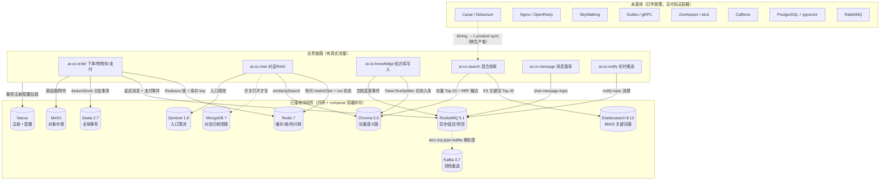
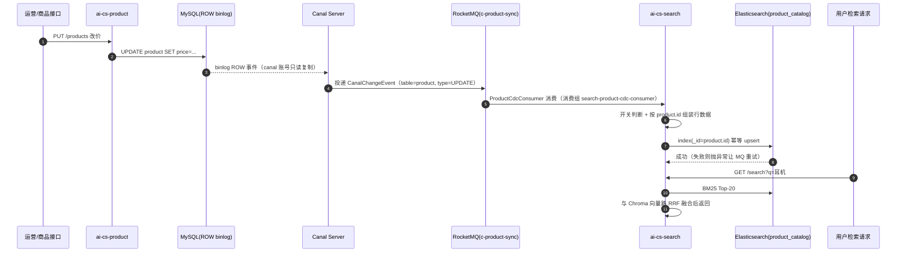

# 02-中间件补全开发计划（能用对 → 能调优 → 能排障）

> **一句话结论**：本项目中间件的"代码覆盖度"已经很高（能数出 8 个 `@RocketMQMessageListener`、7 处 `@Cacheable/@CacheEvict`、1 套 ES+Chroma 混合检索），缺的不是依赖而是**闭环**——打开开关、产生流量、看到指标与日志、出故障能自证。本计划把 19 个中间件按"已落地有流量 / 半落地没流量 / 明确不引入"分成三档，按 P0 能用对 → P1 能调优 → P2 能排障推进。
> **阅读前置**：先读 [04-中间件/README.md](../04-中间件/README.md) 的引入决策表（哪些中间件本项目刻意不用、为什么），再读 [01-Java基础/README.md](../01-Java基础/README.md) 的 JVM 与线程基础；Redis 数据结构不熟先看 [01-Redis缓存实战.md](../04-中间件/01-Redis缓存实战.md)。
> **证据基线**：Spring Boot 4.2.0 / Spring Cloud Alibaba 2025.1.0.0 / RocketMQ 5.1 / Redis 7 / Elasticsearch 8.12 / Chroma 0.5，镜像版本见 §7 的实测清单；预计阅读 55 分钟。

## 0. 这份计划解决什么问题

**现象一：知识库文档改了，搜索还是旧结果。** 搜索侧确实写好了 CDC 消费端——`ai-cs-search/src/main/java/com/aics/search/cdc/ProductCdcConsumer.java#L23-L29` 订阅 `c-product-sync`、索引 `product_catalog`，并用 `@Value("${aics.cdc.product.enabled:false}")` 默认关闭。但在全仓搜索 `c-product-sync`，除了这个消费端和它的测试，**找不到任何生产者**：Canal Server 没落地，`deploy/mysql/canal-init.sql#L1-L3` 只是准备好了复制账号。于是"商品改价 → ES 索引更新"这条链在本地永远是空的，代码在、数据不动。

**现象二：对话审计"接了 MongoDB"，但按 userId 查不到记录。** 归档服务由 `@ConditionalOnProperty(prefix = "aics.chat.mongo-archive", name = "enabled", havingValue = "true")` 决定是否装配（`ai-cs-chat/src/main/java/com/aics/chat/history/mongo/MongoChatHistoryArchiveService.java#L19-L20`），默认不装；即便打开，`extractUserId` 目前 `return null`（同文件 `#L35`）；归档失败只 `log.warn("Mongo 对话归档失败（不阻断对话）")`（同文件 `#L29`）。三件事叠加的结论是：Mongo 在本项目是**可选旁路**，不是审计数据源，把它当数据源排障必然扑空。

**现象三：限流规则重启就没了、延迟消息也不是精确 30 分钟。** 限流走代码注册，`ai-cs-chat/src/main/java/com/aics/chat/config/SentinelFlowConfig.java#L13-L21` 的类注释自己写明"内存模式重启即失，可改 Nacos 数据源持久化"；订单超时靠 `rocketMQTemplate.syncSend("order-timeout-topic", …, 5000, 16)`（`ai-cs-order/src/main/java/com/aics/order/service/impl/OrderCreateTxService.java#L143-L146`），`16` 是 RocketMQ 默认延迟**档位**里的 30 分钟，不是 30 分钟定时器——想要 31 分钟只能跳到 1 小时档。

这些现象指向同一件事：**中间件不缺代码，缺"打开 → 产生流量 → 观察 → 自证"的验证闭环**。所以本计划不新增任何中间件依赖，只做三件事：把已有中间件的开关与流量对齐、把调优参数落到可复核的配置、把排障路径固化成命令与日志关键字。

## 1. 能力地图

本专题的能力分三层：业务链路（谁在用）、已落地中间件（代码与容器都在）、未落地中间件（只有文档）。学习顺序不是按知识分类，而是按"你能不能在本项目里指到一行代码"。



> **读图说明**：关键在两类箭头的差别——**实线**是已经能在 `ai-cs-*` 里找到调用点的链路，**虚线**是"设计好但没打通"或"可替换"的链路。最容易看错的是中间那根 `RMQ -.-> KFK`：它不是负载均衡，而是 `aics.mq.type` 二选一的实现替换，同一时刻只有一个 `MessagePublisher` Bean 生效；另一根 `CDCF -.-> SRC` 如果被读成实线，就会误以为商品索引是自动同步的，这正是 §0 现象一。

成熟度不看文档多少篇，只看两件事：**本项目能不能指到真实代码**、**能不能观察到运行现象**。

| 中间件 | 本项目真实落地（证据） | 对应文档 | 掌握判定标准 |
| --- | --- | --- | --- |
| Redis | 有流量：`ai-cs-order/src/main/java/com/aics/order/lock/OrderCreateLockService.java#L45-L49`（Redisson 锁）、`ai-cs-product/src/main/java/com/aics/product/config/ProductCacheConfig.java#L27-L44`（两级 TTL）、`ai-cs-chat/src/main/java/com/aics/chat/cache/HotQaCacheService.java#L97-L99`（ZSet 频次） | [01-Redis缓存实战.md](../04-中间件/01-Redis缓存实战.md)、[07-Redisson分布式锁.md](../04-中间件/07-Redisson分布式锁.md) | 能说出本项目 4 类 key 的命名与 TTL，能用 `redis-cli` 验证命中与淘汰 |
| RocketMQ | 有流量：`ai-cs-message/src/main/java/com/aics/message/consumer/ChatMessageConsumer.java#L30-L33`、`ai-cs-mq/src/main/java/com/aics/mq/consumer/WorkOrderDlqListener.java#L33-L37`（死信）、`ai-cs-order/src/main/java/com/aics/order/service/impl/OrderCreateTxService.java#L143-L146`（延迟消息） | [02-RocketMQ消息队列.md](../04-中间件/02-RocketMQ消息队列.md)、[08-RocketMQ事务消息与死信队列.md](../04-中间件/08-RocketMQ事务消息与死信队列.md) | 能画出"生产 → broker → 消费组 → 重试 → DLQ"全链，能解释重试次数与 `%DLQ%` 命名 |
| Kafka | 有流量（双栈）：`ai-cs-mq/src/main/java/com/aics/mq/consumer/kafka/WorkOrderKafkaListener.java#L34-L36`、`ai-cs-common/src/main/java/com/aics/common/mq/MessagePublisherAutoConfiguration.java#L59-L81`（无原生延迟 → 进程内调度） | [12-Kafka与RocketMQ双栈切换.md](../04-中间件/12-Kafka与RocketMQ双栈切换.md) | 能说清两栈在分区、消费组、延迟消息上的语义差异，并能指出切换点在哪一行 |
| Elasticsearch | 有流量：`ai-cs-search/src/main/java/com/aics/search/hybrid/HybridSearchServiceImpl.java#L50-L71`（BM25 路 + 降级）、`ai-cs-search/src/main/java/com/aics/search/config/ElasticsearchConfig.java#L35-L48`（手工构造 Client） | [03-Elasticsearch搜索引擎.md](../04-中间件/03-Elasticsearch搜索引擎.md) | 能解释 `_id` 幂等 upsert、分词与 BM25、以及 ES 路异常时为何降级为纯向量 |
| MinIO | 有流量：`ai-cs-common/src/main/java/com/aics/common/storage/FileStorageService.java#L44-L65`（UUID 化 objectName + ensureBucket） | [04-MinIO对象存储.md](../04-中间件/04-MinIO对象存储.md) | 能说清 bucket/object 命名、预签名 URL 与"文件走存储不走数据库"的边界 |
| MongoDB | 半落地（默认关闭旁路）：`ai-cs-chat/src/main/java/com/aics/chat/history/mongo/MongoChatHistoryArchiveService.java#L19-L29` | [10-MongoDB对话审计归档.md](../04-中间件/10-MongoDB对话审计归档.md) | 能解释为什么归档失败不阻断对话，以及 `extractUserId` 为 null 时查询会怎样 |
| Canal | 半落地（只有消费端）：`ai-cs-search/src/main/java/com/aics/search/cdc/ProductCdcConsumer.java#L23-L30`、`deploy/mysql/canal-init.sql#L1-L3` | [11-CanalCDC商品索引同步.md](../04-中间件/11-CanalCDC商品索引同步.md) | 能说清 binlog ROW 模式、canal 账号最小权限、以及 doc id 幂等策略 |
| Debezium | **未落地，仅原理掌握** | [19-Debezium与Canal的CDC对比.md](../04-中间件/19-Debezium与Canal的CDC对比.md) | 能对比两者部署形态与 Kafka Connect 依赖，不需会部署 |
| Caffeine | **未落地，仅原理掌握**（仅作 `ai-cs-order/eff-order.xml#L326-L327` 传递依赖出现） | [17-Caffeine本地缓存与两级缓存.md](../04-中间件/17-Caffeine本地缓存与两级缓存.md) | 能说清 L1/L2 一致性与击穿防护，能解释本项目为何只做 Redis 单级 |
| Nacos | 有流量：`ai-cs-chat/src/main/resources/application.yml#L17-L31`（注册中心 + `spring.config.import` 拉配置） | [09-AI与治理中间件部署.md](../04-中间件/09-AI与治理中间件部署.md)、[22-Eureka与Consul注册中心对照.md](../04-中间件/22-Eureka与Consul注册中心对照.md) | 能说清注册与配置两条链路各自的数据结构、以及 `optional:` 前缀的容错含义 |
| Sentinel | 有流量（代码注册）：`ai-cs-chat/src/main/java/com/aics/chat/config/SentinelFlowConfig.java#L25-L37` | [06-Sentinel限流与熔断降级.md](../04-中间件/06-Sentinel限流与熔断降级.md) | 能解释 QPS 阈值 + WARM_UP 预热的实际曲线，以及规则为何重启丢失 |
| Seata | 有流量：`ai-cs-order/src/main/java/com/aics/order/service/impl/OrderCreateTxService.java#L78-L79`（`@GlobalTransactional` + `@Transactional`） | [06-Seata分布式事务AT模式.md](../02-Spring微服务/06-Seata分布式事务AT模式.md)、[07-服务调用统一与SeataXID传播.md](../02-Spring微服务/07-服务调用统一与SeataXID传播.md) | 能说清 XID 传播、undo_log 补偿、以及 MQ 不是 Seata 资源时怎么兜底 |
| Nginx | **未落地，仅原理掌握**（`deploy` 下只有 `deploy/redis/redis.conf`，无任何 nginx 配置） | [13-Nginx与OpenResty反向代理.md](../04-中间件/13-Nginx与OpenResty反向代理.md)、[23-Nginx应用实战与域名IP配置.md](../04-中间件/23-Nginx应用实战与域名IP配置.md) | 能写反向代理 + 限流 + 上游健康检查配置，能解释为何本项目把入口交给网关 |
| SkyWalking | **未落地，仅原理掌握**（可观测性走 Micrometer/OTel：`ai-cs-gateway/pom.xml#L111-L118`） | [14-SkyWalking链路追踪.md](../04-中间件/14-SkyWalking链路追踪.md)、[04-Prometheus可观测性.md](../07-运维部署/04-Prometheus可观测性.md) | 能说清 Span/Trace 模型与探针式 vs SDK 式埋点的差别 |
| Dubbo | **未落地，仅原理掌握**（服务间调用用 OpenFeign） | [15-Dubbo与RPC框架.md](../04-中间件/15-Dubbo与RPC框架.md) | 能说清注册发现 + 负载均衡 + 序列化三要素，能对比 HTTP 与 RPC 的边界 |
| gRPC | **未落地，仅原理掌握**（`py-chat` 侧评估中） | [18-gRPC与Protobuf跨语言调用.md](../04-中间件/18-gRPC与Protobuf跨语言调用.md) | 能说清 Protobuf 兼容规则与 HTTP/2 多路复用，能说明为什么跨语言才值得引入 |
| ZooKeeper | **未落地，仅原理掌握**（选主可用 K8s Lease 替代） | [16-ZooKeeper与etcd分布式协调.md](../04-中间件/16-ZooKeeper与etcd分布式协调.md) | 能说清 ZAB、临时顺序节点做锁、Watch 一次性语义 |
| RabbitMQ | **未落地，仅原理掌握**（见 §5：C 类决策，只学不引） | [21-RabbitMQ概念模型与AMQP协议.md](../04-中间件/21-RabbitMQ概念模型与AMQP协议.md) | 能画出 Exchange/Queue/Binding 与 ACK、死信、TTL 的组合用法 |
| PostgreSQL + pgvector | **未落地，仅原理掌握**（向量库当前用 Chroma，`ai-cs-knowledge/pom.xml#L64-L71`） | [20-PostgreSQL与pgvector.md](../04-中间件/20-PostgreSQL与pgvector.md) | 能说清 IVFFlat/HNSW 索引差别与"能不能一套库搞定关系 + 向量"的取舍 |

19 项里 **8 项有真实流量、2 项半落地、9 项纯原理**。这个分布决定了下面的路线：半落地和纯原理的中间件只排"读 + 单次实验"，不再投入工程时间；有流量的 8 项才是本计划的主战场。

### 谁在调它们：组件责任与框架入口

成熟度表回答"有没有落地"，这张表回答"落地在哪个入口"——排障时先认门，再进库。

| 组件 | 在本项目承担的责任 | 入口（谁在调它） |
| --- | --- | --- |
| Redis | 商品详情/分类缓存、下单互斥锁、库存 key、热问榜、Agent run 状态 | `@Cacheable` 经 Spring Cache 代理；`RedissonClient`；`StringRedisTemplate` |
| RocketMQ | 对话落库、订单超时延迟、支付通知、文档增量同步、死信兜底 | `RocketMQTemplate` 生产；`@RocketMQMessageListener` 消费 |
| Kafka | 同一 `MessagePublisher` 契约的第二实现 | `KafkaMessagePublisher` + `@KafkaListener` |
| Elasticsearch | 关键词路检索与商品目录索引 | 手工构造的 `ElasticsearchClient` Bean |
| Chroma | 知识库向量的写入与相似检索 | Spring AI `VectorStore` |
| MinIO | 商品图/附件对象存储 | `FileStorageService`（封装 `MinioClient`） |
| MongoDB | 对话审计归档（旁路、默认关闭） | `ChatMessageArchiveRepository` |
| Nacos | 服务注册发现 + 配置拉取 | `NacosServiceRegistry`（注册）、`spring.config.import`（配置） |
| Sentinel | 入口 QPS 限流 | `FlowRuleManager.loadRules` 注册规则，入口资源处拦截 |
| Seata | 下单链路的全局事务与分支补偿 | `@GlobalTransactional` 代理 |

再往下追一层，下面三个框架入口值得直接读源码，因为它们决定了"配了却不生效"的判定点。

Sentinel 的判定发生在规则遍历里，任一规则不通过就抛 `FlowException`——所以"限流没触发"通常不是阈值写错，而是资源名对不上：

```java (src: FlowRuleChecker.java.md#L49-L56)
        Collection<FlowRule> rules = ruleProvider.apply(resource.getName());
        if (rules != null) {
            for (FlowRule rule : rules) {
                if (!canPassCheck(rule, context, node, count, prioritized)) {
                    throw new FlowException(rule.getLimitApp(), rule);
                }
            }
        }
```

`ruleProvider.apply(resource.getName())` 按**资源名**索引规则：`SentinelFlowConfig` 里注册的名字与业务调用处的名字必须逐字一致，差一个字符规则就恒不命中，表现就是"配了等于没配"。再往下，判定最终落到 `TrafficShapingController`——单机走 `passLocalCheck`、集群走 `passClusterCheck`，WARM_UP 与匀速排队是不同实现，见 [[源码:FlowRuleChecker.java.md#L78-L86]]。

服务注册的出口只有 `namingService.registerInstance` 一处：

```java (src: NacosServiceRegistry.java.md#L67-L74)
		NamingService namingService = namingService();
		String serviceId = registration.getServiceId();
		String group = nacosDiscoveryProperties.getGroup();

		Instance instance = getNacosInstanceFromRegistration(registration);

		try {
			namingService.registerInstance(serviceId, group, instance);
```

注意 `group` 来自 `nacosDiscoveryProperties.getGroup()`：两端 group 不一致时注册照样成功，但调用方永远发现不到实例，故障现象是"Feign 找不到服务"而不是"Nacos 连不上"——这两者的排查方向完全不同。

向量侧之所以能换实现而不动业务代码，是因为 `VectorStore` 本身只是一个极窄的接口：

```java (src: VectorStore.java.md#L40-L51)
public interface VectorStore extends DocumentWriter, VectorStoreRetriever {

	default String getName() {
		return this.getClass().getSimpleName();
	}

	/**
	 * Adds list of {@link Document}s to the vector store.
	 * @param documents the documents to store. Throws an exception if the
	 * underlying provider checks for duplicate IDs.
	 */
	void add(List<Document> documents);
```

`KnowledgeVectorService` 只依赖这个接口（切块 → `vectorStore.add(chunks)` → 按 `documentId` 过滤删除），所以 Chroma 换 pgvector 的改动边界被压在一个类里；反过来，`add` 的注释也说明幂等责任在 provider：检查重复 ID 的实现遇到重复向量化会抛异常，而不是静默覆盖。

入口数量不靠数文档，靠数注解：

```powershell
Get-ChildItem -Recurse -Path ai-cs-* -Filter *.java | Where-Object { $_.FullName -notmatch '\\target\\' } | Select-String -Pattern '@RocketMQMessageListener' | ForEach-Object { $_.Path.Replace((Get-Location).Path + '\','') + ':' + $_.LineNumber }
```

```text
ai-cs-knowledge\src\main\java\com\aics\knowledge\mq\KnowledgeSyncConsumer.java:34
ai-cs-message\src\main\java\com\aics\message\consumer\ChatMessageConsumer.java:30
ai-cs-mq\src\main\java\com\aics\mq\consumer\WorkOrderDlqListener.java:33
ai-cs-mq\src\main\java\com\aics\mq\consumer\WorkOrderListener.java:33
ai-cs-notify\src\main\java\com\aics\notify\consumer\OrderNotifyConsumer.java:20
ai-cs-notify\src\main\java\com\aics\notify\consumer\OrderNotifyConsumer.java:25
ai-cs-order\src\main\java\com\aics\order\listener\OrderTimeoutListener.java:18
ai-cs-order\src\main\java\com\aics\order\listener\PaySuccessListener.java:27
ai-cs-search\src\main\java\com\aics\search\cdc\ProductCdcConsumer.java:23
```

怎么读：9 行命中、去重后是 **8 个消费者类**——`OrderNotifyConsumer` 出现两次，20 行是类注释里的字样、25 行才是真注解，这种"注释命中"是统计虚高最常见的来源。把关键字换成 `@Cacheable|@CacheEvict` 只剩 7 行，且全部落在 `ProductServiceImpl`：说明缓存治理的战场只有一个类，§6 的排查也因此只需盯一处。

## 2. 缺口诊断

缺口不是"没学"，而是"学了也验证不了"。下表每一行都能在代码里指到位置，也都能用一条命令或一条日志自证。

| 缺口 | 不补的后果 | 触发场景 | 自测方法 |
| --- | --- | --- | --- |
| CDC 链路缺生产者：`ai-cs-search/src/main/java/com/aics/search/cdc/ProductCdcConsumer.java#L23` 订阅 `c-product-sync`，全仓无发送方 | 商品/文档变更后索引不更新，搜索返回旧价旧标题，且**没有任何报错**（消费端不报错，只是没消息） | 改了商品价再搜"耳机"，看到旧价格；或知识库新增文档后 RAG 检索不到 | `Select-String -Path ai-cs-search/src/main/java/com/aics/search/cdc/ProductCdcConsumer.java -Pattern 'c-product-sync'` 然后全仓搜同一字符串，只有消费端命中即为证 |
| CDC 消费端默认关闭：`@Value("${aics.cdc.product.enabled:false}")`（同文件 `#L29`） | 即使补了生产者，不配开关仍然空转，容易误判为"链路不通" | 联调时改索引没反应，日志里连一条 `CDC` 关键字都没有 | 检查启动日志是否出现该 Bean 的处理记录；断点打在 `ProductCdcConsumer` 的消费方法首行 |
| Mongo 归档默认关闭 + userId 取不到：`ai-cs-chat/src/main/java/com/aics/chat/history/mongo/MongoChatHistoryArchiveService.java#L19-L20`、`#L35` | 审计查询按 userId 过滤永远 0 条；结论被误读成"Mongo 写入失败" | 想查某个用户的历史对话做对账 | 打开开关后查 Mongo 集合文档数；再断点看 `extractUserId` 返回值 |
| 归档异常被吞：同文件 `#L29` 只 `log.warn` | 归档链路坏了没人知道，直到要用审计数据才发现断档 | Mongo 容器未启动、连接串写错 | 停掉 Mongo 容器再发一轮对话，`log.warn("Mongo 对话归档失败")` 是关键日志关键字 |
| Sentinel 规则内存态：`ai-cs-chat/src/main/java/com/aics/chat/config/SentinelFlowConfig.java#L25-L37` | 重启后限流消失，压测"通过"但上线被打穿 | 发版后 QPS 突增，日志里没有 `BlockException` | 重启前跑一次压测看是否被限；重启后再跑，行为变了即为证 |
| 延迟消息档位化：`ai-cs-order/src/main/java/com/aics/order/service/impl/OrderCreateTxService.java#L143-L146` | 业务想"31 分钟取消"时只能选 1 小时档，超时取消变慢；跨档跳变让测试用例时好时坏 | 订单超时策略从 30 分钟改成 45 分钟 | 断点看 `syncSend` 的第 4 个参数（delayLevel），对照 broker 的 `messageDelayLevel` 配置 |
| Kafka 分支延迟语义降级：`ai-cs-common/src/main/java/com/aics/common/mq/MessagePublisherAutoConfiguration.java#L78-L81` | 切到 Kafka 后"30 分钟延迟"变成进程内定时任务，重启即丢，超时订单永不取消 | 用 `aics.mq.type=kafka` 起服务后重启 | 切换配置再重启，观察 `order-timeout-topic` 是否有消费者收到消息 |
| 缓存无本地一级：全仓无 Caffeine，只有 Redis 单级（`ProductCacheConfig` 的 TTL 直连 Redis） | 热点 key 每次都走网络，Redis 抖动直接放大成接口 RT 抖动；没有击穿保护 | 大促时商品详情页 QPS 升高，Redis 出现慢查询 | 断点打在 `ProductServiceImpl` 的 `@Cacheable` 方法；对比开启/不开启缓存的 RT |
| ES 路静默降级：`ai-cs-search/src/main/java/com/aics/search/hybrid/HybridSearchServiceImpl.java#L56-L63` | 检索质量下降但接口仍返回 200，只有日志里一行 `ES 路无结果/异常，降级为仅向量结果` | ES 容器挂了或索引名写错 | `log` 里搜"降级为仅向量结果"；或直接调用检索接口看 `esRank` 是否全为空 |
| 死信只落库不告警：`ai-cs-mq/src/main/java/com/aics/mq/consumer/WorkOrderDlqListener.java#L33-L37` 写入 `mq_fail_record` | 死信堆积无人处理，工单静默丢失 | 下游消费者连续异常超过重试次数 | 查 `mq_fail_record` 表中 PENDING 记录数；调 `/mq/dead-letter` 接口观测 |

诊断顺序固定为：**先看开关（配置项默认值）→ 再看生产者（有没有发送方）→ 再看消费端（消费组与重试）→ 最后看下游（索引/表/推送）**。跳过前两步直接查下游，是这个专题最常见的时间浪费。

## 3. 补全路线

路线按"能用对 → 能调优 → 能排障"三阶段推进，外加一个收尾的持续运维阶段。每一阶段的验收标准都要求**可观察**，不接受"看完了"。

| 阶段 | 目标能力 | 学哪些文档 | 项目落地动作 | 验收标准 | 预计投入 |
| --- | --- | --- | --- | --- | --- |
| P0 能用对（第 1 周） | 说清本项目 Redis / RocketMQ / ES / Chroma 各 4 类用法，并能指出对应代码行 | [01-Redis缓存实战.md](../04-中间件/01-Redis缓存实战.md)、[02-RocketMQ消息队列.md](../04-中间件/02-RocketMQ消息队列.md)、[03-Elasticsearch搜索引擎.md](../04-中间件/03-Elasticsearch搜索引擎.md)、[07-Redisson分布式锁.md](../04-中间件/07-Redisson分布式锁.md) | 在 `deploy` 侧起 Redis + RocketMQ + ES + Chroma；打开 `aics.cdc.product.enabled=true`，用一条手工消息验证 `ProductCdcConsumer` 能写入 ES | ES 里 `product_catalog` 能按手工消息的 doc id 查到文档；`redis-cli --scan --pattern 'product:detail*'` 有 key | 3 天 |
| P0 能用对（第 1 周，续） | 全局事务与入口限流能自证 | [06-Seata分布式事务AT模式.md](../02-Spring微服务/06-Seata分布式事务AT模式.md)、[07-服务调用统一与SeataXID传播.md](../02-Spring微服务/07-服务调用统一与SeataXID传播.md)、[06-Sentinel限流与熔断降级.md](../04-中间件/06-Sentinel限流与熔断降级.md) | 造一次 `deductStock` 失败（把库存改小）观察全局回滚；对 chat 接口打满 QPS 观察 WARM_UP 曲线 | 订单表无残留、`undo_log` 有回滚记录；限流触发时响应与日志可辨 | 2 天 |
| P1 能调优（第 2~3 周） | 知道每个中间件的"第一个该调的参数"及其依据 | [12-Kafka与RocketMQ双栈切换.md](../04-中间件/12-Kafka与RocketMQ双栈切换.md)、[17-Caffeine本地缓存与两级缓存.md](../04-中间件/17-Caffeine本地缓存与两级缓存.md)、[07-线程池调优与背压.md](../12-性能工程/07-线程池调优与背压.md)、[02-容量规划与性能预算.md](../13-稳定性工程/02-容量规划与性能预算.md) | 给 Redis 加 `maxmemory`/淘汰策略复核（当前 `deploy/redis/redis.conf#L9-L10` 为 256mb + allkeys-lru）；为商品详情缓存加 TTL 抖动；给消费线程数与批量参数定基线 | 压测前后 `INFO memory` 的 `evicted_keys`、`keyspace_hits/misses` 有可解释变化；接口 P95 有记录 | 5 天 |
| P1 能调优（第 2~3 周，续） | 检索与向量侧的口径调优 | [11-CanalCDC商品索引同步.md](../04-中间件/11-CanalCDC商品索引同步.md)、[20-PostgreSQL与pgvector.md](../04-中间件/20-PostgreSQL与pgvector.md)、[04-CDC与实时同步链路.md](../14-数据工程与OLAP/04-CDC与实时同步链路.md) | 调整 RRF 常数与两路 Top-K（当前 `RRF_K = 60`、各取 Top-20），记录召回变化；验证 ES 路降级时的结果质量 | 同一批 query 的前 5 条结果在调参前后有可比对的差异记录 | 3 天 |
| P2 能排障（第 4 周） | 面对 5 类典型故障能 10 分钟内定位到中间件层 | [08-RocketMQ事务消息与死信队列.md](../04-中间件/08-RocketMQ事务消息与死信队列.md)、[10-MongoDB对话审计归档.md](../04-中间件/10-MongoDB对话审计归档.md)、[04-Prometheus可观测性.md](../07-运维部署/04-Prometheus可观测性.md)、[07-Loki日志聚合.md](../07-运维部署/07-Loki日志聚合.md)、[05-降级预案与开关治理.md](../13-稳定性工程/05-降级预案与开关治理.md) | 建立《中间件故障速查》：死信堆积、缓存雪崩、ES 降级、向量库不可用、MQ 重试风暴各一条处置动作 | 每条速查都能在演练中复现并按步骤恢复 | 5 天 |
| P2+ 持续 | 把排障动作变成演练与看板 | [03-故障演练与混沌工程.md](../13-稳定性工程/03-故障演练与混沌工程.md)、[08-性能问题定位方法论.md](../12-性能工程/08-性能问题定位方法论.md) | 每季度一次中间件故障演练（停 Redis / 停 ES / 停 Mongo），记录 MTTR | 演练报告里每类故障有实际耗时与阻断点 | 每季度 1 天 |

路线里有两条硬约束：**先开开关再谈链路**（否则所有 CDC/Mongo 相关内容都是空谈），**先有基线再谈调优**（没有 `INFO memory`、P95、召回率基线，"调优"就是猜）。

### 每阶段的验收清单

阶段表说"做什么"，清单说"怎么算做完了"。每一条都要求能在终端输出或日志里看到，不接受"看完了、理解了"。

P0 能用对：

- [ ] 不看文档画出任一 MQ 链路的四段：生产者 → topic → 消费组 → 下游表/索引
- [ ] 说出本项目 4 类 Redis key 的命名前缀与 TTL 出处（缓存 / 锁 / 库存 / 热榜）
- [ ] 手工投一条 `c-product-sync` 消息后，`product_catalog` 能按该 id 查到文档
- [ ] 解释 `@GlobalTransactional` 与 `@Transactional` 同时出现时的分工（两个注解叠加在同一个方法上不是冗余）
- [ ] 说清 Sentinel 规则为何重启即失，以及持久化要接什么数据源

P1 能调优：

- [ ] 给出 Redis 基线三件套：`used_memory`、`evicted_keys`、`keyspace_hits/misses`
- [ ] 压测前后各留一份基线，并指名变化来自哪个参数
- [ ] 说清消费线程数、批量拉取、并发消费对吞吐与重复消费的影响方向
- [ ] 用固定 query 集合记录调参前后的前 5 条检索结果差异

P2 能排障：

- [ ] 五类故障各配"一条命令 + 一条日志关键字 + 一个回滚动作"
- [ ] 至少完成 1 次演练，并记录实测 MTTR
- [ ] 能区分"中间件挂了"与"降级已生效"（ES 故障时接口仍 200，这是最容易误判为正常的情形）

清单里 P0 的第三条是整个专题的分水岭：这条勾不上，说明只在读文档，链路并没有真正打通。

## 4. 一次真实落地的执行时序

以 §0 现象一的补全为例：补上 Canal 生产者之后，运营改一次商品价，会怎么走到搜索结果里。这张图是**目标态**，图中第 4~6 步是当前缺的部分。



> **读图说明**：最关键的是第 6 步和第 8 步——第 6 步的 `_id=product.id` 决定了幂等性（重复投递只是覆盖同一文档），第 8 步失败必须 `throw` 而不是吞掉，否则 RocketMQ 不会重试、索引永久落后。最容易被看错的是第 3 步：Canal 读的是 **binlog**，不是业务表轮询，所以它看不到"事务未提交"的中间状态，也不会因为 `UPDATE` 影响 0 行就发事件。

逐步失败会看到什么，是排障时最省时间的表：

| 步骤没做/做错 | 现象（可观察） | 定位动作 |
| --- | --- | --- |
| 第 3 步 Canal 未启动 | 改价后一切正常，只是搜索结果不变；MQ 里 `c-product-sync` 无任何消息 | 看 RocketMQ 控制台该 topic 的消息量；看 `deploy/mysql/canal-init.sql` 对应账号能否登录 |
| 第 4 步 binlog 格式不是 ROW | Canal 起不来或报位点解析错误 | 查 `deploy/k8s/mysql.yaml#L30-L32` 的 `log-bin` / `binlog-format` |
| 第 5 步消费端开关为 false | 消息在 broker 里堆积但无人消费，消费组进度不动 | 断点 `ProductCdcConsumer` 首个判断分支；或临时把它打 `INFO` 日志 |
| 第 6 步 doc id 用了自增主键以外的字段 | 同一商品出现多条文档，搜索重复结果 | `GET product_catalog/_search` 按标题聚合，看是否多条 |
| 第 8 步异常被 catch 吞掉 | 索引静默落后，MQ 重试计数不增长 | 观察消费组重试次数与 `IllegalStateException` 日志（`ProductCdcConsumer.java#L63`） |
| 第 10 步 ES 路异常 | 接口仍 200，但 `esRank` 全空、结果只剩向量路 | 搜日志"降级为仅向量结果"（`HybridSearchServiceImpl.java#L56-L63`） |

把图里缺的那几步落到文件，就能看出工作量到底有多大：

| 环节 | 代码 / 配置位置 | 现在做到哪一步 |
| --- | --- | --- |
| 消费端装饰与开关 | `ai-cs-search/src/main/java/com/aics/search/cdc/ProductCdcConsumer.java#L23-L30` | 已完成 |
| 幂等 upsert / delete | `ai-cs-search/src/main/java/com/aics/search/cdc/ProductCdcConsumer.java#L49-L59` | 已完成 |
| 失败抛异常触发重试 | `ai-cs-search/src/main/java/com/aics/search/cdc/ProductCdcConsumer.java#L63` | 已完成 |
| 事件结构定义 | `ai-cs-search/src/main/java/com/aics/search/cdc/CanalChangeEvent.java` | 已完成 |
| binlog 与复制账号 | `deploy/k8s/mysql.yaml#L30-L32`、`deploy/mysql/canal-init.sql#L1-L3` | 已完成（配置层） |
| Canal Server 与事件投递 | 仓内无对应文件 | **缺失**——本计划唯一需要新建的部分 |
| 消费端开关打开 | `aics.cdc.product.enabled`，代码默认 false | **缺失**——需要配置 |

七行里五行是"已有代码、待验证"，只有第六、七行真的要动手：这也是把这条链路排进 P0 而不是排进"重构"的原因。

## 5. 优先级与取舍

中间件最容易走偏的地方是"看到什么火就引什么"。本项目已经做过一轮引入决策（见 [04-中间件/README.md](../04-中间件/README.md)），本计划沿用并在下面把取舍写死。

| 决策 | 中间件 / 动作 | 理由 | 代价（认了） |
| --- | --- | --- | --- |
| 做 | Redis 缓存与锁的调优、淘汰策略复核、bigkey 治理 | 下单与商品详情是主链路，抖动直接掉单 | 需要一次压测窗口与 Redis 只读账号 |
| 做 | RocketMQ 死信与重试演练、延迟消息档位核对 | 已有 8 个消费者在跑，DLQ 不演练等于没有兜底 | 演练期间需停一个消费者组 |
| 做 | ES + Chroma 双路检索的口径与降级验证 | 检索质量是产品竞争力，且 ES 降级是静默的 | 需要一批固定 query 做回归 |
| 做 | Canal 消费端的端到端验证（仅本地手工消息） | 消费端代码已存在，缺的只是"证明它能工作" | 不投入生产 Canal 集群运维 |
| 延后 | Mongo 归档真正开启（先补 `extractUserId`） | 归档是旁路，`extractUserId` 返回 null 就开了也没用 | 审计能力推迟一个迭代 |
| 延后 | Kafka 全量切换 | 双栈抽象已就绪，但无业务压力；切了还要承担延迟语义变化 | 只保留单测与 mq 模块验证 |
| 延后 | 两级缓存（引入 Caffeine） | 单级 Redis 尚能满足当前 QPS，引入 L1 会带来一致性成本 | 热点 key 仍受网络 RT 影响 |
| 不做 | RabbitMQ | **明确不引入**（C 类决策）：已有 RocketMQ + Kafka 双栈，第三种 MQ 只增加运维面，不带来新能力；本专题只学 AMQP 概念模型与 Exchange/Binding 语义 | 面试被问 RabbitMQ 时只能讲原理，讲不了项目实践 |
| 不做 | Dubbo / gRPC | 服务间调用已统一 OpenFeign，引入 RPC 框架等于重做通信层 | 高并发下的序列化开销无法靠 RPC 优化 |
| 不做 | ZooKeeper / etcd | 无选主、无分布式配置需求，Nacos 已覆盖配置与注册 | 需要选主时要临时补方案（可用 K8s Lease） |
| 不做 | SkyWalking | 可观测性已走 Micrometer + OTel → Tempo，再加一套探针等于双份埋点 | 没有开箱的 UI 拓扑图 |
| 不做 | PostgreSQL + pgvector | 当前 Chroma 满足 RAG 需求；迁 pgvector 是数据平台级决策 | 关系数据与向量仍需两套存储 |
| 不做 | Debezium | 与 Canal 同类，只在一个都没落地时才有选择意义，只做对比学习 | 若将来换 Debezium，Canal 文档经验部分作废 |
| 不做 | 自建 Nginx | 入口已由网关承担，生产若需要反向代理优先用 K8s Ingress | 无自建四层/七层调优经验 |

**本计划刻意不覆盖的东西**：MySQL 索引与执行计划（属 [03-数据库与ORM/README.md](../03-数据库与ORM/README.md)）、K8s 部署与发布策略（属 [16-云原生与GitOps/README.md](../16-云原生与GitOps/README.md)）、HTTP/WebSocket 协议细节（属 [05-SSE与WebSocket实时通信.md](../04-中间件/05-SSE与WebSocket实时通信.md)）、框架源码级实现（属 [24-源码分析/README.md](../24-源码分析/README.md)）。跨进这些领域只会让"中间件排障"变成"全栈猜谜"。

## 6. 常见误区与自己怎么验

| 误区 | 为什么错 | 怎么自证（命令 / 断点 / 日志关键字） |
| --- | --- | --- |
| "compose 里起了 Redis 就等于缓存生效" | 缓存生效要三个条件同时成立：`@EnableCaching` 装配、`@Cacheable` 打在**代理调用**的方法上、序列化器能反序列化 | 看 `ai-cs-product/src/main/java/com/aics/product/config/ProductCacheConfig.java#L24` 的 `@EnableCaching`；跑 `redis-cli --scan --pattern 'product:detail*'`；断点打在 `ProductServiceImpl` 的 `getById` 入口 |
| "Mongo 接了就能查审计" | 默认 `@ConditionalOnProperty` 不装配，且 `extractUserId` 返回 null，按用户查必然 0 条 | 打开开关后 `db.chat_message_archive.countDocuments()`；断点 `MongoChatHistoryArchiveService#extractUserId`；关键字 `Mongo 对话归档失败` |
| "CDC 消费端在就说明索引同步了" | 消费端默认关闭，且全仓无 `c-product-sync` 生产者，链路上游是空的 | 全仓搜 `c-product-sync`：只有 `ProductCdcConsumer` 与其测试命中；再看 RocketMQ 该 topic 消息数是否恒为 0 |
| "delayLevel 16 就是精确 30 分钟" | 16 只是默认延迟表里的一个档位，跳档是 1 小时；且 broker 端按档位调度，不保证秒级准时 | 断点 `OrderCreateTxService` 的 `syncSend` 第 4 参数；核对 broker `messageDelayLevel` 配置 |
| "Kafka 就是把 RocketMQ 换个依赖" | Kafka 无原生延迟消息，实现里降级成进程内 `TaskScheduler`，重启丢消息；消费组/分区语义也不同 | 读 `ai-cs-common/src/main/java/com/aics/common/mq/MessagePublisherAutoConfiguration.java#L78-L81`；设 `aics.mq.type=kafka` 后重启，观察超时消息是否消失 |
| "ES 慢就加节点" | 本项目 ES 路失败会**静默降级**成纯向量，接口照样 200，加节点治不了降级 | 日志关键字"ES 路无结果/异常，降级为仅向量结果"；打 `HybridSearchServiceImpl#esSearch` 断点看异常 |
| "Sentinel 规则配上去就一直在" | 代码注册是内存态，重启即失；规则持久化要么接 Nacos 数据源，要么外置推送 | 重启服务后用压测对比触发阈值；或读 `SentinelFlowConfig` 类注释与 `FlowRuleManager.loadRules` 调用点 |
| "死信队列会自动兜底" | `WorkOrderDlqListener` 只是把死信写入 `mq_fail_record`（PENDING），没有任何重投触发器 | 查 `mq_fail_record` 里 PENDING 条数；调 `/mq/dead-letter` 接口看返回 |

## 7. ⚠️ 版本与时效

中间件是最容易"凭记忆写版本"的领域。下表每条都给了复核命令，跑一遍就能知道结论是否还成立（`docker-compose.yml` 实测输出见 §7 末尾）。

| 结论 | 依赖的版本或前提 | 什么情况下会失效 | 怎么复核 |
| --- | --- | --- | --- |
| Boot 4 的 Web 起步依赖是 `spring-boot-starter-webmvc`，`spring-boot-starter-web` 已 deprecated | Spring Boot 4.2.0 | 回到 Boot 3.x 项目或依赖仍指向旧 starter | 在各模块 `pom.xml` 搜 `starter-web`，比对是否出现 `starter-webmvc` |
| Boot 4 默认 Jackson 3（`tools.jackson`），Redis 缓存序列化器需重新验证读回 | Spring Data Redis 与 Jackson 3 组合 | 序列化器内部仍用旧 ObjectMapper，升级后缓存读回抛类型/解析异常 | 清空 `product:detail*` 后热一次商品详情，再读回看是否命中且字段完整 |
| Redis 淘汰策略已在配置里显式声明：`maxmemory 256mb` + `allkeys-lru` | `deploy/redis/redis.conf` | 换机器/换镜像（`redis:7` 之外的版本）不挂这份配置 | `Get-Content deploy/redis/redis.conf`；或容器内 `redis-cli CONFIG GET maxmemory-policy` |
| RocketMQ 延迟级别是固定档位表，`delayLevel=16` 对应默认的 30 分钟 | broker 的 `messageDelayLevel` 未被改写 | 自定义了 `messageDelayLevel`，级别与时长映射整体改变 | 查 broker 配置项 `messageDelayLevel`，与 `RocketMqMessagePublisher` 的档位数组对齐 |
| Nacos 客户端走 3.x，但 `docker-compose.yml` 仍钉 `nacos/nacos-server:v2.3.2` | Spring Cloud Alibaba 2025.1.0.0 + Nacos 3.3.0 服务端 | 客户端/服务端版本错配，注册或配置推送行为不一致 | `Select-String -Path docker-compose.yml -Pattern 'nacos'`，确认镜像标签后再决定是否升级 |
| Sentinel core 为 1.8.10，Dashboard 镜像为 `bladex/sentinel-dashboard:1.8.6` | Sentinel 1.8.x 系列 | 升级 core 后 Dashboard 规则结构可能不兼容 | 比对 pom 的 `spring-cloud-starter-alibaba-sentinel` 版本与 compose 中 dashboard 标签 |
| ES 客户端版本与 `elasticsearch-java` 一致（8.12.x），Client 手工构造 | Spring Boot BOM 管理 ES 版本 | BOM 升级到 9.x 后 `RestClientTransport` 构造方式变化 | 看 `ai-cs-search/pom.xml` 中 `elasticsearch-java` 是否仍无显式版本（由 BOM 管） |
| 向量库是 Chroma，`spring-ai-starter-vector-store-chroma` 提供 `VectorStore` 实现 | Spring AI 2.1.0 | Spring AI 大版本升级后 starter 命名或 `VectorStore` 接口方法签名变化（如 `add`/`upsert`） | 看 `ai-cs-knowledge/pom.xml#L64-L71`；编译期若能过则接口未破坏 |
| Kafka 镜像 3.7.1，无原生延迟消息支持 | apache/kafka 3.7.1 | 升级到支持延迟队列的版本或改用其他方案 | compose 中 `apache/kafka` 标签 + `KafkaMessagePublisher` 的 `sendDelayed` 实现 |
| Seata AT 的补偿依赖各分支库存在 `undo_log` 表 | Seata 2.7.0 AT 模式 + 仓内 `deploy/mysql/seata-undo-log.sql` | 新库或新 schema 未执行该脚本时，分支回滚找不到镜像数据，全局事务卡住 | 在各业务库执行 `SHOW TABLES LIKE 'undo_log'`；核对初始化脚本是否包含 `deploy/mysql/seata-undo-log.sql` |
| Chroma 集合维度由 embedding 模型决定 | Spring AI 2.1.0 + `chromadb/chroma:0.5.20`，且 Embedding 由 `SpringAiConfig` 手动提供（`application.yml` 已排除自动装配） | 换 embedding 模型后旧集合维度不匹配，向量写入被拒绝 | 换模型前后各跑一次 `KnowledgeVectorService#vectorize`，失败即证明需要重建集合 |
| 旧文档曾写 Nacos 2.3.2 / RocketMQ 5.1.4 / Spring Cloud 2023.0.1 | 旧稿基于 Boot 3 时代 | 基线已升至 Cloud 2026.0.0 / SCA 2025.1.0.0 | 以本文件与 `docker-compose.yml` 实测为准，旧稿数字一律作废 |

实测命令与真实输出（PowerShell，仓库根执行，秒级返回）：

```powershell
Select-String -Path docker-compose.yml -Pattern '^\s+image:' | ForEach-Object { "L$($_.LineNumber): $($_.Line.Trim())" }
```

```text
L12: image: mysql:8.0
L38: image: redis:7
L57: image: nacos/nacos-server:v2.3.2
L87: image: elasticsearch:8.12.0
L111: image: apache/rocketmq:5.1.4
L129: image: apache/rocketmq:5.1.4
L152: image: quay.io/minio/minio:latest
L175: image: mongo:7.0
L195: image: chromadb/chroma:0.5.20
L212: image: neo4j:5-community
L236: image: xuxueli/xxl-job-admin:2.4.1
L260: image: bladex/sentinel-dashboard:1.8.6
L280: image: apache/kafka:3.7.1
L323: image: apache/kafka:3.7.1
```

怎么读这份输出：一是**镜像标签就是事实基线**，`nacos-server:v2.3.2` 与本文基线 Nacos 3.3.0 的差异必须当成待办而不是笔误；二是 `minio/minio:latest` 是唯一没有钉版本的镜像，属于可复现性风险；三是 `kafka` 与 `kafka-init` 共用同一标签，说明它们是同一个集群的初始化与运行容器。

再看一份更容易被忽略的配置事实——缓存与锁共用同一个 Redis，内存上限只有 256MB：

```powershell
Get-Content deploy\redis\redis.conf | Select-String -Pattern 'maxmemory|appendonly|appendfsync|^save|maxclients|slowlog-log' | ForEach-Object { $_.Line }
```

```text
appendonly yes
appendfilename "appendonly.aof"
appendfsync everysec
save 900 1
save 300 10
save 60 10000
maxmemory 256mb
maxmemory-policy allkeys-lru
maxclients 10000
slowlog-log-slower-than 10000
```

怎么读：`allkeys-lru` 表示**所有 key** 都可能被淘汰，而 `lock:order:create:*` 与业务缓存同处一库——内存打满时锁 key 也可能先被淘汰，互斥性随之失效；这一条把 §6 里"Redis 抖动放大成接口 RT 抖动"从猜测变成了具体机制。同一份输出里 `appendonly yes` + `appendfsync everysec` 说明持久化是 AOF 每秒刷盘，宕机最多丢 1 秒写入，`save 900 1` 那三条是 RDB 快照的补充。这三个参数就是 P1 阶段第一个要复核的对象，改动前请先留存基线。

## 8. 面试与答辩问与答

1. 你们项目用了哪些中间件？请按"有真实流量 / 只有代码 / 只有文档"三档说一遍。
2. Redis 在本项目有几类 key？分别用什么数据结构、TTL 多少、为什么不统一？
3. `@Cacheable` 打在同类内部调用的方法上会怎样？你怎么证明？
4. Redisson 的 `tryLock(0, TimeUnit.SECONDS)` 为什么第一个参数是 0？不设 leaseTime 时锁怎么续期？
5. 看门狗续期的前提是什么？进程被 kill -9 之后锁会怎样？
6. RocketMQ 的消费重试与死信队列怎么配合？`%DLQ%` 后面的名字由什么决定？
7. 死信消息落库之后，谁负责重投？如果没有重投，这套兜底算完整吗？
8. 延迟消息为什么不能用 `delayLevel` 做精确定时？业务要 45 分钟超时你怎么办？
9. Kafka 与 RocketMQ 在本项目的差异点在哪几个坐标上？切换开关落在哪个类的哪个注解上？
10. Elasticsearch 的 `_id` 用什么？如果重复投递同一条 CDC 消息，索引里会发生什么？
11. 混合检索为什么要 RRF 而不是分数加权？`RRF_K` 调大调小的效果差别？
12. ES 路挂了接口为什么还返回 200？这种降级在什么场景下是危险的？
13. Seata AT 模式下 `undo_log` 是谁写的？MQ 消息为什么不参与全局事务？
14. Nacos 的 `spring.config.import: optional:nacos:...` 里 `optional:` 去掉会怎样？
15. 你说你们没用 RabbitMQ / Dubbo / ZooKeeper，那如果明天要引入，你的判断依据是什么？
16. 中间件故障排查，你的第一步永远是什么？为什么不是先看数据库和业务日志？

## 9. 动手练习

1. **让 CDC 消费端真的跑一次。** 在 `deploy` 起 RocketMQ + ES，把 `aics.cdc.product.enabled` 置为 true，手工往 `c-product-sync` 投一条 `CanalChangeEvent`（table=product、type=UPDATE）。验收标准＝`GET product_catalog/_doc/{id}` 能查到刚投的商品行，且重复投一次文档数仍是 1。
2. **造一次缓存命中与失效。** 连续调两次商品详情接口，再调一次更新接口，再调详情。验收标准＝`redis-cli --scan --pattern 'product:detail*'` 能看到 key；更新后该 key 消失（`@CacheEvict` 生效）；第二次详情调用 RT 明显低于第一次。
3. **验证 Redisson 锁的快速失败。** 两个线程并发下单同一 userId，其中一个 sleep 后再放行。验收标准＝后到者收到"您有订单正在创建中，请勿重复提交"，且 Redis 中 `lock:order:create:{userId}` 在业务结束后被删除。
4. **观察 Sentinel 预热曲线。** 对 chat 发送接口做 30 秒匀速压测。验收标准＝前几秒通过率低于稳态（WARM_UP 生效），日志/监控能看出被限流的请求数；重启服务后再压一次，阈值行为改变（规则是内存态）。
5. **演练死信。** 让 `WorkOrderListener` 的处理逻辑连续抛异常超过重试次数。验收标准＝死信进入 `%DLQ%work-order-consumer-group`，`mq_fail_record` 出现 PENDING 记录，且同 `msg_id` 重复投递不产生第二条记录。
6. **验证全局事务回滚。** 把某商品库存改成 1，然后下单数量 2。验收标准＝下单失败返回库存不足，订单表无新记录，`undo_log` 中出现该分支的回滚记录。
7. **验证 Mongo 归档旁路。** 打开 `aics.chat.mongo-archive.enabled`，发一轮对话后查集合；再停掉 Mongo 容器发一轮。验收标准＝前者集合文档数增加；后者对话**仍然成功**，日志出现"不阻断对话"的 warn。
8. **验证延迟消息档位。** 把订单超时从 30 分钟改成 45 分钟，观察实际消息投递时间。验收标准＝能说出它落在哪个 delayLevel、与 45 分钟的偏差是多少，并解释为什么不精确。

## 小结

- 本项目的中间件问题是**闭环问题不是覆盖问题**：8 个 RocketMQ 消费者、7 处缓存注解、1 套 ES+Chroma 混合检索都在，缺的是"打开开关 → 见流量 → 见指标 → 能自证"。
- 19 项中间件按证据分三档：8 项有真实流量（Redis / RocketMQ / Kafka / Elasticsearch / MinIO / Nacos / Sentinel / Seata）、2 项半落地（Canal 只有消费端、MongoDB 归档是默认关闭的旁路）、9 项纯原理（Debezium / Caffeine / Nginx / SkyWalking / Dubbo / gRPC / ZooKeeper / RabbitMQ / PostgreSQL+pgvector）。
- 最隐蔽的故障是**静默降级**：ES 路异常降级为纯向量、Mongo 归档失败只 warn、CDC 没生产者就永远没消息——三者都不报错，只能用日志关键字与计数发现。
- 版本是最容易写错的部分：`docker-compose.yml` 里 `nacos-server:v2.3.2`、`sentinel-dashboard:1.8.6` 与本文基线不一致，属于待办而非笔误；结论必须每次用命令复核。
- 取舍比学习更重要：RabbitMQ/Dubbo/ZooKeeper/SkyWalking 本项目**刻意不用**，理由是没有新增能力只有新增运维面，学它们的目标是"能对比能答辩"，不是"能上线"。
- 排障顺序固定为四步：开关默认值 → 有无生产者 → 消费组与重试 → 下游落地情况；跳过前两步直接查下游是最大的时间浪费。
- 可操作归纳：**任何中间件结论，要么能给出一行 `ai-cs-*` 里的代码位置，要么能给出一条可复现命令与真实输出；两者都给不出，就当它不存在。**

## 自测题

**1. 为什么说"本项目中间件不缺代码，缺闭环"？用三个证据说明。**
<details><summary>参考答案</summary>
证据一：`c-product-sync` 全仓只有消费端 `ProductCdcConsumer`，没有生产者，链路永远空转。证据二：Mongo 归档被 `@ConditionalOnProperty` 默认关闭且 `extractUserId` 返回 null。证据三：Sentinel 规则代码注册在内存，重启即失。三者都是"代码在、流量或验证不在"。
</details>

**2. `ProductCdcConsumer` 的幂等靠什么实现？重复投递会发生什么？**
<details><summary>参考答案</summary>
靠把 ES 文档 `_id` 固定成 `product.id`（`ProductCdcConsumer.java#L49-L59`），写入走 index upsert。重复投递同一商品事件只是覆盖同一文档，不产生重复记录；DELETE 或 `deleted=1` 走 delete 并吞掉"文档不存在"异常。
</details>

**3. Redisson 的 `tryLock(0, TimeUnit.SECONDS)` 中 0 的含义，以及不设 leaseTime 的后果？**
<details><summary>参考答案</summary>
0 是 waitTime，表示拿不到锁立即返回 false、不排队等待，因此可以直接抛"请勿重复提交"。未指定 leaseTime 时启用看门狗，默认锁 30 秒、每 10 秒续期一次，只要持有线程还活着锁不会过期。
</details>

**4. 如果进程被 kill -9，看门狗还续期吗？锁会怎样？**
<details><summary>参考答案</summary>
不会。看门狗依赖持有锁的 JVM 内部调度线程续期，进程被杀后续期停止，锁在最后一次租期到期（默认 30 秒内）自动释放。这正是"不设 leaseTime"比"设死 30 分钟"更安全的原因。
</details>

**5. `ProductCacheConfig` 里为什么给 `product:detail` 30 分钟、`product:categories` 10 分钟、默认 20 分钟？**
<details><summary>参考答案</summary>
按数据的变更频率与一致性要求分层：商品详情变更是主动 `@CacheEvict` 驱动的，可以给较长 TTL 兜底；分类列表变更少但影响面大，给短 TTL；默认 20 分钟是给未显式声明的缓存兜底。分页列表明确不缓存，因为参数组合基数高、库存高频变化导致命中率低。
</details>

**6. ES 关键词路失败时接口为什么仍是 200？这种降级的风险是什么？**
<details><summary>参考答案</summary>
`HybridSearchServiceImpl` 在两路都有结果才做 RRF 融合，ES 路异常或无结果时降级为仅向量结果并打日志（`#L56-L63`）。风险是**质量下降无告警**：接口可用性与线上观感正常，但精确词（型号、SKU）召回显著变差，只能靠日志关键字发现。
</details>

**7. 混合检索为什么用 RRF 而不是分数加权？`RRF_K` 的作用？**
<details><summary>参考答案</summary>
BM25 分值与向量相似度分属不同量纲，加权需要归一化且不稳定；RRF 只看排名不看分数（本项目 `RRF_K = 60`），跨量纲天然可比。`RRF_K` 越大，排名靠后的结果权重差异被抹平得越多，融合更"平均"、更保守。
</details>

**8. `delayLevel = 16` 与"30 分钟后取消订单"是什么关系？业务要 45 分钟怎么办？**
<details><summary>参考答案</summary>
16 是 RocketMQ 默认延迟档位表里对应 30 分钟的一档，是固定阶梯而非任意时长定时器；档位由 broker 的 `messageDelayLevel` 决定。要 45 分钟只能跳到 1 小时档，或用"30 分钟延迟 + 到点校验再投 15 分钟"的两段式方案，或改用调度框架。
</details>

**9. Kafka 分支下"延迟消息"是怎么实现的？为什么这是风险点？**
<details><summary>参考答案</summary>
Kafka 无原生延迟消息，`MessagePublisherAutoConfiguration` 在 Kafka 分支注入 `aicsKafkaDelayScheduler`（单线程 `ThreadPoolTaskScheduler`，`#L78-L81`），延迟投递靠进程内定时任务。风险是进程重启或调度线程异常时延迟任务丢失，超时订单永远不会被取消。
</details>

**10. Seata AT 模式下，`undo_log` 由谁写？MQ 为什么不能纳入全局事务？**
<details><summary>参考答案</summary>
由分支事务所在服务的数据源代理写入（本项目是 product 侧 `deductStock` 调用链），提交前记录前镜像，二阶段回滚时据此前镜像反向补偿。MQ 不是 Seata 的事务资源，`syncSend` 在全局回滚时不会撤回已发消息，所以消费侧必须幂等兜底——`OrderTimeoutListener` 查不到订单直接返回就是这层兜底。
</details>

**11. Sentinel 规则配在代码里有什么问题？怎么持久化？**
<details><summary>参考答案</summary>
`FlowRuleManager.loadRules` 是内存态，重启即失，多实例之间也不共享。持久化需要接 Nacos 数据源（引入 `sentinel-datasource-nacos`）或在 Dashboard 推送后落库；本项目 `SentinelFlowConfig` 类注释已明确记录这个待办，且分工上 Sentinel 只管入口限流、熔断交给 Resilience4j。
</details>

**12. 排查"商品改价后搜索结果没变"，你的四步顺序是什么？**
<details><summary>参考答案</summary>
第一步看开关：`aics.cdc.product.enabled` 是否 true；第二步看有无生产者：RocketMQ 的 `c-product-sync` 是否有消息（本项目此刻没有，因为 Canal 未落地）；第三步看消费组进度与重试；第四步才看 ES 索引内容与 doc id 是否重复。顺序颠倒会浪费大量时间在 ES 侧。
</details>

**13. 为什么 `nacos/nacos-server:v2.3.2` 出现在 compose 里，本文却把 Nacos 基线写成 3.3.0？**
<details><summary>参考答案</summary>
3.3.0 是 Spring Cloud Alibaba 2025.1.0.0 对应的服务端基线，而 compose 里钉的镜像尚未升级，两者不一致，属于待办事项而非笔误。核对方式是 `Select-String -Path docker-compose.yml -Pattern 'nacos'`，升级前需验证客户端与服务端版本兼容性。
</details>

**14. 如果同事说"我们用了 MongoDB 做审计"，你怎么礼貌地质疑？**
<details><summary>参考答案</summary>
先问三件事：开关 `aics.chat.mongo-archive.enabled` 是否为 true、`extractUserId` 是否已返回真实 userId、归档失败是否有告警（当前只有 `log.warn` 且不阻断对话）。三点任一不成立，Mongo 就只是"可选旁路"，不能当审计数据源使用。
</details>
