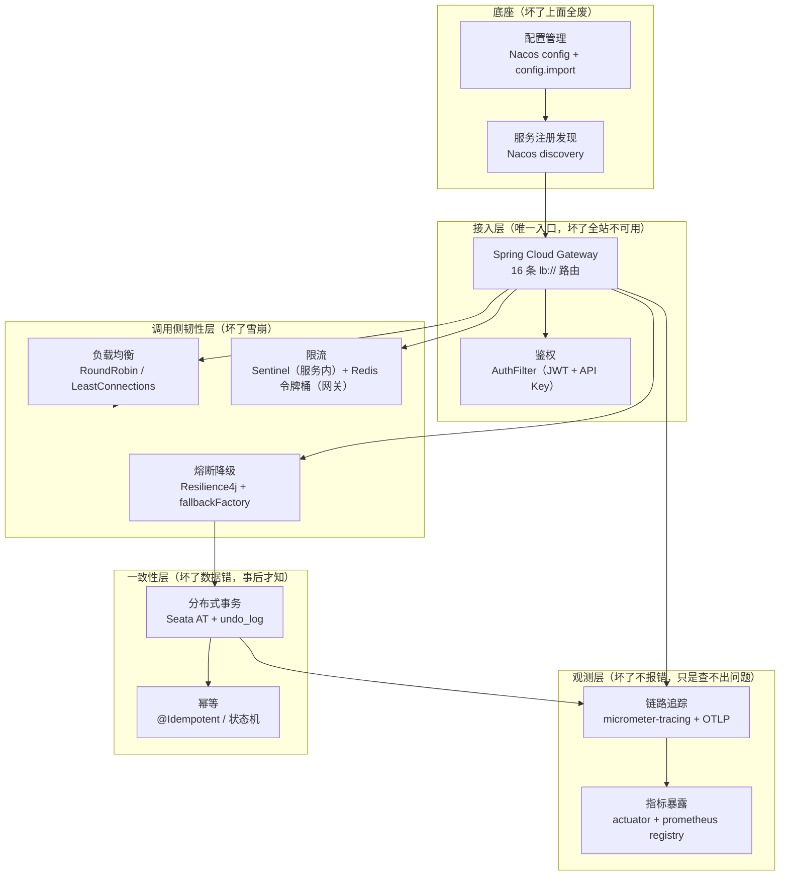
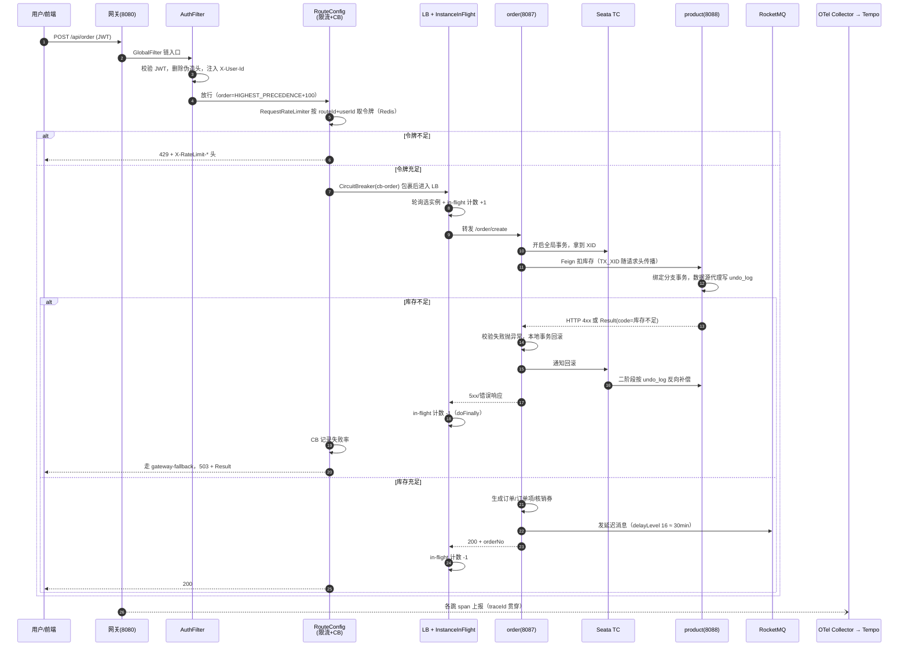

# 微服务治理补全开发计划：从"能跑通"到"能扛事"

> **一句话结论**：本项目的微服务治理是"骨架齐全、连接件没拧紧"——服务发现、网关、限流、熔断、分布式事务、链路追踪、幂等的代码都真实存在，但配置层与异常契约上有 4 处已实测确认的硬缺口，会让治理能力在真实故障下**静默失效**；这份计划按 P0→P2 四阶段把它们逐个补上，每阶段都给了可复现的验收动作。
>
> **阅读前置**：读完 `02-Spring微服务` 的 02~08 篇（架构、Nacos、Gateway、Seata、Feign 熔断、幂等），能看懂 `@ConfigurationProperties`、`GlobalFilter`、`@GlobalTransactional` 三个注解的语义；不了解 Spring Cloud 的话先读 [02-SpringCloud微服务架构.md](../02-Spring微服务/02-SpringCloud微服务架构.md)。
>
> **依据与预计阅读**：本项目源码（行号均为本轮 Read 核对）、`24-源码分析/assets/source/` 内的 Spring Cloud Gateway 5.1.0 / LoadBalancer 5.1.0 / SCA 2025.1.0.0 源码摘录、以及本轮实跑的 pwsh 命令输出。全文约 40 分钟，动手练习另需 2~3 小时。

---

## 0. 这份计划解决什么问题

先说三个真实发生过的现象，它们都不是"不会用"，而是"以为已经配好了"。

**现象一：订单服务的配置里有两个 `cloud` 键，系统却看起来一切正常。**

`ai-cs-order/src/main/resources/application.yml` 第 10 行是 `spring.cloud.nacos.*`，第 25 行又出现一个 `spring.cloud.openfeign.circuitbreaker.enabled`。YAML 规范里同一个 mapping 下重复的键是非法结构，Spring Boot 4 加载 `application.yml` 时走 `YamlPropertySourceLoader`，重复键会直接抛 `DuplicateKeyException`。这条债最阴的地方是：它不报"配置错了"，而是报在**引导阶段**，一眼看不出跟 25 行那个 `cloud:` 有关。实测该文件是 11 个服务里唯一命中的（`cloud=2`，其余 10 个都是 `cloud=1`）。

**现象二：notify 服务少 import 了一个 dataId，Nacos 上改配置等于没改。**

`ai-cs-notify/src/main/resources/application.yml` 第 21~23 行只写了 `- optional:nacos:aics-shared.yml`，没有 `- optional:nacos:ai-cs-notify.yml`；其余 10 个服务的 import 列表都是"共享配置 + 自己的 dataId"两行。后果是：运维在 Nacos 控制台把 `ai-cs-notify.yml` 的内容改完、点发布、看到"发布成功"，通知服务这边**一个字节都没变**，因为压根没订阅这个 dataId。而且 `optional:` 前缀保证它连报错都不会有。

**现象三：库存不足时，订单照样创建成功。**

这条最贵。链路是这样断的：

1. `ai-cs-product` 扣库存失败时抛 `BusinessException(PRODUCT_STOCK_INSUFFICIENT)`（`ai-cs-product/src/main/java/com/aics/product/service/impl/ProductServiceImpl.java#L204-L207`）；
2. 兜到 `ai-cs-common/src/main/java/com/aics/common/exception/GlobalExceptionHandler.java#L35-L39` 的 `handleBusinessException`——它是这个类里**唯一没有 `@ResponseStatus` 的处理器**（对比同文件 L44-L52 的参数校验分支都标了 `@ResponseStatus(HttpStatus.BAD_REQUEST)`），所以 HTTP 状态码是 **200**，业务错误码只写在响应体 `Result.code` 里；
3. 订单侧 `OrderCreateTxService` 第 94 行 `productClient.deductStock(item.getProductId(), item.getQuantity());` 的**返回值被丢弃**，没人检查 `Result.getCode()`；
4. Feign 收到 200，不抛 `FeignException`；调用方也没抛异常 → `@GlobalTransactional` 认为分支全部成功 → 全局提交 → 库存没扣，订单成立。

> 这些现象指向同一件事：**治理能力的"零件"都装了，但零件之间的契约（配置键、订阅关系、HTTP 状态码、返回值）没有对齐；而微服务治理恰恰是 100% 由契约驱动的能力——契约错一处，整条治理链就静默降级成"看起来在工作"。**

---

## 1. 能力地图

治理能力不是十个平级名词，它分四层：底座（注册/配置）→ 接入（网关）→ 调用侧（负载均衡/熔断/限流）→ 一致性（事务/幂等）→ 观测（追踪/指标）。下层坏掉，上层的所有配置都是装饰。



> **读图说明**：看三条主箭头。①`ND --> GW`：网关里 16 条路由全是 `lb://ai-cs-xxx`（`ai-cs-gateway/src/main/java/com/aics/gateway/config/RouteConfig.java#L60-L149`），注册中心拿不到实例，网关连"转发到哪"都不知道，后面所有限流/熔断配置都不会被触发——如果你把这张图看成"网关自己不依赖注册中心"，就会得出"先做限流再做注册"的错误排期。②`CB --> ST`：熔断降级产出的异常是分布式事务回滚的触发源之一，一旦 fallback **假成功**（返回 `Result.fail` 而不抛异常），`ST` 就永远收不到回滚信号。③`TR --> MT`：追踪与指标是两条独立管道，只配了 tracing 不等于能被 Prometheus 抓取。

### 1.1 成熟度表（逐项给本项目证据）

"真实落地"一栏只写仓库里能 Read 到的文件与行号；"掌握判定标准"是你能做到才算学会的可验证动作，不是"了解即可"。

| 主题 | 本项目有没有真实落地 | 对应文档 | 掌握判定标准 |
| --- | --- | --- | --- |
| 服务注册与发现 | **有**。11 个服务 `spring.cloud.nacos.discovery`，如 `ai-cs-order/src/main/resources/application.yml#L10-L15`；网关全部用 `lb://` 路由 | [03-Nacos注册与配置中心.md](../02-Spring微服务/03-Nacos注册与配置中心.md)、[01-nacos-服务注册与发现源码.md](../24-源码分析/04-SpringCloud/02-注册中心Nacos/01-nacos-服务注册与发现源码.md) | 能说出"注册→心跳→订阅拉取→本地缓存"四环，并在 Nacos 控制台数出 11 个服务实例；能解释 `kill -9` 与优雅停机下线的差别 |
| 配置管理 | **有，但 notify 有缺口**。`spring.config.import` 见 `ai-cs-order/src/main/resources/application.yml#L21-L24`；notify 缺自身 dataId，见 `ai-cs-notify/src/main/resources/application.yml#L21-L23` | [03-Nacos注册与配置中心.md](../02-Spring微服务/03-Nacos注册与配置中心.md)、[01-config-client-配置拉取原理.md](../24-源码分析/04-SpringCloud/05-配置中心与Bus/01-config-client-配置拉取原理.md) | 能区分 `spring.config.import` 与旧 `bootstrap.yml` 的加载时机；能解释 `optional:` 前缀为什么让错误变成静默；能说清 `@ConfigurationProperties` 重绑定与 `@RefreshScope` 的适用面 |
| 网关鉴权 | **有**。`ai-cs-gateway/src/main/java/com/aics/gateway/filter/AuthFilter.java#L106-L169`，白名单 `#L83-L96`，API Key 常量时间比较 `#L188-L221` | [04-SpringCloudGateway网关.md](../02-Spring微服务/04-SpringCloudGateway网关.md)、[03-SpringSecurity微服务两层安全模型.md](../09-安全与设计模式/03-SpringSecurity微服务两层安全模型.md) | 能画出网关过滤器顺序（AuthFilter `HIGHEST_PRECEDENCE + 100` → RateLimitFilter `+150`）；能解释白名单分支为什么要先删客户端伪造的 `X-User-Id` |
| 网关限流 | **有**。分布式令牌桶 `ai-cs-gateway/src/main/java/com/aics/gateway/config/RouteConfig.java#L50-L54`；本地内存限流备用 `RateLimitFilter.java#L50-L60`；参数字段 `RateLimitProperties.java#L28-L46` | [06-Sentinel限流与熔断降级.md](../04-中间件/06-Sentinel限流与熔断降级.md)、[02-predicate与filter-常用断言与限流.md](../24-源码分析/04-SpringCloud/04-网关Gateway/02-predicate与filter-常用断言与限流.md) | 能说出 `replenishRate` 与 `burstCapacity` 各限制什么；知道 `burstCapacity < replenishRate` 会在**启动时**断言失败（见 §2.4）；能解释本地内存限流为什么多实例部署形同虚设 |
| 负载均衡 | **有**。`LoadBalancerConfig.java#L33-L54` 按开关注册最少连接均衡器；在途计数 `InstanceInFlightFilter.java#L34-L52` | [01-loadbalancer-负载均衡与轮询策略源码.md](../24-源码分析/04-SpringCloud/03-负载均衡与调用/01-loadbalancer-负载均衡与轮询策略源码.md) | 能解释轮询的 `pos % instances.size()` 与"单实例不移动游标"（见 §2.4）；能解释为何在途计数过滤器必须排在 `10150 + 1` |
| 熔断降级 | **有**。每路由独立 CB 名 + `forward:/gateway-fallback`，`RouteConfig.java#L174-L187`；降级端点 `GatewayFallbackController.java#L20-L24`；Feign 降级三分法 `ai-cs-order/src/main/java/com/aics/order/client/fallback/ProductClientFallbackFactory.java#L28-L53` | [08-Feign熔断与降级语义.md](../02-Spring微服务/08-Feign熔断与降级语义.md)、[01-circuitbreaker-抽象与resilience4j.md](../24-源码分析/04-SpringCloud/06-熔断限流与容错/01-circuitbreaker-抽象与resilience4j.md) | 能说出"关键写抛异常、读抛异常、尽力而为写返回 fail 不抛"三种降级语义的取舍；能解释共享 CB 名会导致"一个服务挂、全站熔断" |
| 分布式事务（Seata AT） | **有，但回滚判定有缺口**。`ai-cs-order/src/main/java/com/aics/order/service/impl/OrderCreateTxService.java#L78-L95`；分支侧 `ai-cs-product/pom.xml#L125-L134`；undo_log 表 `deploy/mysql/seata-undo-log.sql` | [06-Seata分布式事务AT模式.md](../02-Spring微服务/06-Seata分布式事务AT模式.md)、[07-服务调用统一与SeataXID传播.md](../02-Spring微服务/07-服务调用统一与SeataXID传播.md)、[01-分布式事务-seata-at模式源码.md](../24-源码分析/04-SpringCloud/07-分布式事务与链路追踪/01-分布式事务-seata-at模式源码.md) | 能说出分支事务成立的三个条件（XID 传播 + 下游 MVC 拦截器绑定 + 下游数据源代理）；能解释 undo_log 二阶段反向补偿；能指出本项目"返回值不校验"如何绕过回滚 |
| 幂等 | **组件有，业务侧 0 使用点**。`IdempotentAspect.java#L49-L75`（SET NX EX + fail-open）；生产代码里 `@Idempotent` 命中数为 0；实际靠状态机兜底 `ai-cs-pay/src/main/java/com/aics/pay/service/impl/PayTransactionServiceImpl.java#L53-L67` | [14-分布式幂等设计.md](../02-Spring微服务/14-分布式幂等设计.md)、[07-Redisson分布式锁.md](../04-中间件/07-Redisson分布式锁.md) | 能解释"Redis 占位是加速挡、DB 唯一键/状态是权威"；能说出 fail-open 的代价与被降级时的观测手段 |
| 链路追踪 | **有，且不是 SkyWalking**。11 个服务 `management.tracing` + `management.otlp.tracing.endpoint`（如 `ai-cs-order/src/main/resources/application.yml#L61-L67`）；后端栈 `deploy/docker-compose/docker-compose-observability.yml` + `deploy/observability/otel-collector.yaml` + `deploy/observability/tempo.yaml` | [02-链路追踪-micrometer-tracing-and-otel.md](../24-源码分析/04-SpringCloud/07-分布式事务与链路追踪/02-链路追踪-micrometer-tracing-and-otel.md)、[14-SkyWalking链路追踪.md](../04-中间件/14-SkyWalking链路追踪.md)（作对照） | 能说出 traceId 如何跨 Feign（请求头）与 MQ（消息属性）传播；能解释 OTLP/4318 与 SkyWalking agent 探针是两套完全不同的接法 |
| 灰度发布 | **没有落地**。网关 16 条路由都是单目标 `lb://`，仓库内 `Weight|gray|canary` 检索命中 0 | [01-route-路由断言与过滤器链.md](../24-源码分析/04-SpringCloud/04-网关Gateway/01-route-路由断言与过滤器链.md)、[05-降级预案与开关治理.md](../13-稳定性工程/05-降级预案与开关治理.md) | 能写出 `Weight` 路由（同 group 两条路由 + 权重）并解释框架用随机数落在权重区间选路（见 §6.6 的 A 级摘录） |
| 可观测指标 | **半成品**。依赖齐全：`ai-cs-chat/pom.xml#L209-L222`、`ai-cs-gateway/pom.xml#L90-L108`；但 11 个 yml 里 `exposure|endpoints.|prometheus` 命中 **0** → `/actuator/prometheus` 默认不暴露 | [04-Prometheus可观测性.md](../07-运维部署/04-Prometheus可观测性.md) | 能说出 Boot 默认只暴露 `health`；能补出 `management.endpoints.web.exposure.include=health,info,prometheus` 并用 curl 验证指标出现 |

---

## 2. 缺口诊断

十一行缺口，按"会不会在真实故障中静默失效"排序。**每一行都给可自己跑的自测方法**，不需要启动服务。

| # | 缺口 | 不补的后果 | 触发场景 | 自测方法 |
| --- | --- | --- | --- | --- |
| 1 | `ai-cs-order/src/main/resources/application.yml` 第 10 行与第 25 行**重复 `cloud:` 键** | YAML 结构非法，启动期 `YamlPropertySourceLoader` 抛 `DuplicateKeyException`；即使当前版本侥幸容忍，第 25~31 行的 `openfeign.circuitbreaker.enabled` 也可能整体失效 → Feign 不被熔断包裹 | 换 Spring Boot 小版本、换配置加载器、CI 里用严格 YAML 解析 | 见 §2.1 命令，期待输出仅 order 命中 `cloud=2` |
| 2 | `ai-cs-notify/src/main/resources/application.yml` 缺 `optional:nacos:ai-cs-notify.yml` | 该服务永不订阅自己的 dataId，Nacos 发布成功但进程内配置不变；排障时"改了没生效"会怀疑到 Nacos 网络/namespace 上，浪费数小时 | 想给通知服务单独调 RocketMQ `consumer.group` 或采样率 | 见 §2.2 命令，期待只有 notify `own-yml=NO` |
| 3 | `GlobalExceptionHandler.handleBusinessException` **无 `@ResponseStatus`** + `OrderCreateTxService#L94` **丢弃返回值** | 业务失败以 HTTP 200 返回 → Feign 不抛异常 → 分支事务被判成功 → 全局提交 → **超卖/订单与库存不一致** | 并发秒杀、库存临界、商品下架 | 见 §2.3：Read 两个文件对比 `@ResponseStatus` 的有无；或单测断言 Feign 客户端在 `code != 200` 时抛异常 |
| 4 | 11 处 pom 仍声明 deprecated 的 `spring-boot-starter-web` | Boot 4 起该类已 deprecated（WebMVC 场景应为 `spring-boot-starter-webmvc`），升级路径上会被迫一次性改；且与 gateway 已用的新坐标混用，团队对新坐标认知不一致 | 下次 Spring Boot 大版本升级、依赖仲裁冲突 | 见 §2.5 命令，期待计数 `11` |
| 5 | 全服务**未暴露 actuator 指标端点** | Prometheus 抓不到 `/actuator/prometheus`（404）；没有 `http_server_requests_*`、没有 JVM/连接池指标 → 熔断/限流是否真的生效只能靠日志猜 | 压测后想看限流命中率、想看 Feign 超时分布 | 见 §2.6 命令，期待 `matches=0` |
| 6 | **灰度发布能力为 0** | 新版本只能停机切换或全量发布；出错时无法按比例回退；面试问"你怎么做灰度"只能答概念 | 提示词/模型版本迭代、RAG 策略调整 | 在 `ai-cs-gateway` 检索 `Weight|gray|canary`，命中 0 即确认 |
| 7 | 订单号 `generateOrderNo()` 单机自增（时间戳 + `AtomicInteger % 10000`，`OrderCreateTxService.java#L160-L164`） | 多实例同一秒内并发下单会撞号；撞号后 DB 唯一键抛错，用户看到"系统异常" | 双实例部署 + 压测 | Read 该行，确认自增来源是进程内 `AtomicInteger`；对照 [04-分布式ID规范.md](../03-数据库与ORM/04-分布式ID规范.md) |
| 8 | 本地内存限流开关仍在（`RateLimitProperties.java#L23-L28` 默认 `enabled=false`） | 团队照旧以为"网关限流已开启"，实际全靠 `RouteConfig` 的 Redis 令牌桶；Redis 挂了以为有兜底，实际没有 | Redis 故障、单机临时替换部署 | 读 `ai-cs-gateway/src/main/resources/application.yml#L36-L46` 的注释与 `enabled: false`，确认兜底是"手动改回 true" |
| 9 | **MQ 不是 Seata 资源**，延迟消息在全局回滚后依然存在 | 30 分钟后的超时关单消息会去关一张不存在的订单（当前靠消费端 `cancelExpiredOrder` 查不到就返回兜底） | 下单失败但延迟消息已发出 | Read `OrderCreateTxService.java#L144-L146`（`delayLevel 16`）与其上方注释 |
| 10 | 幂等组件**无生产使用点**（`@Idempotent` 只在测试与 javadoc 出现） | 支付回调/创建订单等重复提交场景只有状态机兜底；状态机是"读后判断"，并发重复请求仍有窗口 | 渠道重复回调、用户连点、Feign 重试 | 全仓检索 `@Idempotent`，main 源码命中 0 |
| 11 | 追踪只到 traces，**没有 metrics/logs 与 traceId 关联** | 定位问题只能"先看 Tempo 找 trace，再去日志系统按时间戳猜" | 线上慢请求排障 | 11 个 yml 中 `prometheus` 命中 0；日志侧无 traceId 注入配置（可对照 [07-Loki日志聚合.md](../07-运维部署/07-Loki日志聚合.md)） |

### 2.1 缺口 1 的现场证据：重复 `cloud` 键

```powershell
Get-ChildItem ai-cs-*\src\main\resources\application.yml | ForEach-Object {
  $cloud = @(Select-String -Path $_.FullName -Pattern '^  cloud:')
  $rel = $_.FullName.Replace((Get-Location).Path + '\', '').Replace('\', '/')
  "{0,-48} cloud={1} at L{2}" -f $rel, $cloud.Count, (($cloud | ForEach-Object { $_.LineNumber }) -join ',')
}
```

真实输出（11 行，只摘关键 3 行）：

```text
ai-cs-chat/src/main/resources/application.yml     cloud=1 at L16
ai-cs-notify/src/main/resources/application.yml   cloud=1 at L10
ai-cs-order/src/main/resources/application.yml    cloud=2 at L10,25
```

**怎么读**：`cloud=2` 就是问题本身——同一个 `spring:` 下出现两个 `cloud:` 子键。`at L10,25` 告诉你两处位置，第 25 行那个是后来追加 Feign 熔断开关时"另起一段"贴进去的，没注意它和 L10 是同一个父键。修复方式是把 L25~L31 的 `openfeign` 块并回 L10 那个 `cloud:` 下面，缩进降低一级。

### 2.2 缺口 2 的现场证据：少订阅一个 dataId

```powershell
Get-ChildItem ai-cs-*\src\main\resources\application.yml | ForEach-Object {
  $svc = (Get-Item $_.Directory).Parent.Parent.Parent.Name
  $imports = @(Select-String -Path $_.FullName -Pattern 'optional:nacos:([A-Za-z0-9\-]+)\.yml' |
    ForEach-Object { $_.Matches[0].Groups[1].Value })
  "{0,-48} imports=[{1}]" -f $_.FullName.Replace((Get-Location).Path + '\', '').Replace('\', '/'), ($imports -join ',')
}
```

真实输出（节选）：

```text
ai-cs-chat/src/main/resources/application.yml      imports=[aics-shared,ai-cs-chat]
ai-cs-notify/src/main/resources/application.yml    imports=[aics-shared]
ai-cs-order/src/main/resources/application.yml     imports=[aics-shared,ai-cs-order]
```

**怎么读**：其余 10 个服务的 import 列表都是两元素，只有 notify 少一个。判断依据不是"看代码风格"，而是"dataId 名字是否等于模块名"这条仓库内约定。

### 2.3 缺口 3 的现场证据：HTTP 200 吞掉业务失败

`ai-cs-common/src/main/java/com/aics/common/exception/GlobalExceptionHandler.java` 共 11 个 `@ExceptionHandler`，其中只有 `handleBusinessException`（L35-L39）没有状态码注解：

```java
@ExceptionHandler(BusinessException.class)
public Result<Void> handleBusinessException(BusinessException e, HttpServletRequest request) {
    log.warn("业务异常 [{}] {}: code={}, msg={}", request.getMethod(), request.getRequestURI(), e.getCode(), e.getMessage());
    return Result.fail(e.getCode(), e.getMessage());
}
```

对照同文件 L44-L52 的参数校验分支，它标了 `@ResponseStatus(HttpStatus.BAD_REQUEST)`。差异的含义是：前者响应行是 `HTTP/1.1 200`，后者是 `HTTP/1.1 400`。Feign 的默认 `ErrorDecoder` 只在非 2xx 时构造异常，所以 200 的"业务失败"对调用方来说**与成功无法区分**。

再叠加订单侧 `ai-cs-order/src/main/java/com/aics/order/service/impl/OrderCreateTxService.java#L93-L95`：

```java
for (CartItem item : cartItems) {
    productClient.deductStock(item.getProductId(), item.getQuantity());
}
```

`deductStock` 声明返回 `Result<Void>`（`ai-cs-order/src/main/java/com/aics/order/client/ProductClient.java#L35-L36`），但这里的返回值没有被接收、也没有校验 `code`。两条叠起来就构成"分支事务假成功"。

### 2.4 缺口背后的框架语义（A 级证据）

为什么这些"小事"会变成"能力失效"，答案在原框架的实现里。限流参数写错不是"效果差一点"，而是启动直接失败：

```java (src: RedisRateLimiter.java.md#L350-L357)
		public Config setBurstCapacity(long burstCapacity) {
			Assert.isTrue(burstCapacity >= this.replenishRate, "BurstCapacity(" + burstCapacity
					+ ") must be greater than or equal than replenishRate(" + this.replenishRate + ")");
			Assert.isTrue(burstCapacity <= REDIS_LUA_MAX_SAFE_INTEGER, "BurstCapacity(" + burstCapacity
					+ ") must not exceed the maximum allowed value of " + REDIS_LUA_MAX_SAFE_INTEGER);
			this.burstCapacity = burstCapacity;
			return this;
		}
```

这段同时说明两件事：`burstCapacity` 必须 ≥ `replenishRate`，且不得超过 Redis Lua 的安全整数上限；本项目 `ai-cs-gateway/src/main/resources/application.yml#L48-L49` 的 `replenish-rate: 5 / burst-capacity: 10` 正好满足，但任何人把 burst 调成 3 都会在启动期炸掉而不是"限流弱一点"。

限流命中后到底返回什么，也由框架决定：

```java (src: RequestRateLimiterGatewayFilterFactory.java.md#L132-L149)
			return limiter.isAllowed(routeId, key).flatMap(response -> {

				for (Map.Entry<String, String> header : response.getHeaders().entrySet()) {
					exchange.getResponse().getHeaders().add(header.getKey(), header.getValue());
				}

				if (response.isAllowed()) {
					return chain.filter(exchange);
				}

				if (throwLimit) {
					return Mono.error(HttpClientErrorException.create(config.getStatusCode(), "Too Many Requests",
							exchange.getResponse().getHeaders(), null, null));
				}

				setResponseStatus(exchange, config.getStatusCode());
				return exchange.getResponse().setComplete();
			});
```

关键点：`limiter.isAllowed` 是**按 `routeId + key`** 判定的，所以配额天然按路由隔离；`response.getHeaders()` 里的 `X-RateLimit-Remaining` 等头会先写回响应，再决定放行还是 429。看不懂这段就会误以为限流是"全局一个桶"。

负载均衡的轮询语义同样有细节：

```java (src: RoundRobinLoadBalancer.java.md#L99-L120)
	private Response<ServiceInstance> getInstanceResponse(List<ServiceInstance> instances) {
		if (instances.isEmpty()) {
			if (log.isWarnEnabled()) {
				log.warn("No servers available for service: " + serviceId);
			}
			return new EmptyResponse();
		}

		// Do not move position when there is only 1 instance, especially some suppliers
		// have already filtered instances
		if (instances.size() == 1) {
			return new DefaultResponse(instances.get(0));
		}

		// Ignore the sign bit, this allows pos to loop sequentially from 0 to
		// Integer.MAX_VALUE
		int pos = this.position.incrementAndGet() & Integer.MAX_VALUE;

		ServiceInstance instance = instances.get(pos % instances.size());

		return new DefaultResponse(instance);
	}
```

`& Integer.MAX_VALUE` 是为了让游标永不为负（溢出后回绕）；`instances.size() == 1` 直接返回、不动游标，所以"单实例时游标不动"不是 bug。`No servers available for service: ai-cs-product` 这条告警正是从这里发出——它是 `02-Spring微服务` 里记录过的真实症状来源。

### 2.5 缺口 4 的现场证据：deprecated starter

```powershell
(Get-ChildItem -Recurse -Filter pom.xml |
  Select-String -Pattern '<artifactId>spring-boot-starter-web</artifactId>').Count
```

真实输出 `11`，命中文件：`ai-cs-chat/pom.xml#22`、`ai-cs-common/pom.xml#22`、`ai-cs-knowledge/pom.xml#22`、`ai-cs-message/pom.xml#22`、`ai-cs-mq/pom.xml#19`、`ai-cs-notify/pom.xml#22`、`ai-cs-order/pom.xml#24`、`ai-cs-pay/pom.xml#26`、`ai-cs-product/pom.xml#22`、`ai-cs-search/pom.xml#22`、`ai-cs-user/pom.xml#22`。已迁移的写法可参照 `ai-cs-gateway/pom.xml#L50`（`spring-boot-starter-webmvc`）与 `ai-cs-user/pom.xml#L107`（`spring-boot-starter-webmvc-test`）。

**怎么读**：计数是 11 而不是 10，说明连 `ai-cs-common` 这个非可运行模块也在声明 Web 依赖——common 若只提供工具类与异常处理，其实只需要 `spring-web`/`jakarta.servlet-api` 级别的依赖，这也是顺带要评估的点。

### 2.6 缺口 5 的现场证据：指标端点没暴露

```powershell
(Get-ChildItem ai-cs-*\src\main\resources\application.yml |
  Select-String -Pattern 'exposure|endpoints\.|prometheus').Count
```

真实输出 `0`。依赖侧却齐备（`ai-cs-chat/pom.xml#L209-L222` 同时含 `spring-boot-starter-actuator` 与 `micrometer-registry-prometheus`）。**怎么读**：`0` 意味着没有任何服务改过 `management.endpoints.web.exposure.include`，Boot 默认只暴露 `health`（无认证场景），所以 `/actuator/prometheus` 会 404——"依赖装了"不等于"端点开了"，这是可观测性最常见的半成品状态。

---

## 3. 补全路线

四阶段，P0 只修"会静默失效"的契约，P2 才是新能力。每阶段都给"验收标准"，做完必须能观察到现象。

| 阶段 | 目标能力 | 学哪些文档 | 项目落地动作 | 验收标准 | 预计投入 |
| --- | --- | --- | --- | --- | --- |
| **P0 止血：配置与异常契约** | 让治理链的每条契约都能"错就炸" | [03-Nacos注册与配置中心.md](../02-Spring微服务/03-Nacos注册与配置中心.md)、[07-服务调用统一与SeataXID传播.md](../02-Spring微服务/07-服务调用统一与SeataXID传播.md)、[01-config-client-配置拉取原理.md](../24-源码分析/04-SpringCloud/05-配置中心与Bus/01-config-client-配置拉取原理.md) | ① 合并 order 的重复 `cloud:` 键；② notify 补 `optional:nacos:ai-cs-notify.yml`；③ `handleBusinessException` 加 `@ResponseStatus`（或给 Feign 配 `ErrorDecoder` 把 `code != 200` 转异常）；④ `deductStock` 校验 `Result.getCode()`；⑤ 11 处 pom 换 `spring-boot-starter-webmvc` | ① 命令复跑 `cloud=1`；② notify 输出 `own-list=[aics-shared,ai-cs-notify]`；③ 新增单测：product 返回 `code=PRODUCT_STOCK_INSUFFICIENT` 时 order 抛异常且全局事务回滚；④ `mvn -pl ai-cs-order test` 绿；⑤ starter 计数为 `0` | 1.5~2 人日 |
| **P1 韧性闭环：限流/熔断可观测** | 让"是否真的限流/熔断了"可被数字证实 | [06-Sentinel限流与熔断降级.md](../04-中间件/06-Sentinel限流与熔断降级.md)、[02-predicate与filter-常用断言与限流.md](../24-源码分析/04-SpringCloud/04-网关Gateway/02-predicate与filter-常用断言与限流.md)、[02-sentinel-限流降级原理.md](../24-源码分析/04-SpringCloud/06-熔断限流与容错/02-sentinel-限流降级原理.md)、[04-Prometheus可观测性.md](../07-运维部署/04-Prometheus可观测性.md) | ① 全服务加 `management.endpoints.web.exposure.include=health,info,prometheus`；② Prometheus 加抓取任务；③ Sentinel 规则从代码注册迁到 Nacos 持久化（当前 `ai-cs-chat/src/main/java/com/aics/chat/config/SentinelFlowConfig.java#L30-L44` 重启即丢）；④ 网关 429/503 加计数器指标 | ① `curl -s localhost:8081/actuator/prometheus \| grep -c http_server_requests` > 0；② 压 12 QPS 打到 `/chat/send`（阈值 10）出现 `chatSendBlocked` 日志；③ 停掉 product 后网关返回 503 且响应体是 `Result` 结构 | 3~4 人日 |
| **P2 一致性：事务 + 幂等 + 对账** | 让"失败真的回滚、重复真的只生效一次" | [06-Seata分布式事务AT模式.md](../02-Spring微服务/06-Seata分布式事务AT模式.md)、[14-分布式幂等设计.md](../02-Spring微服务/14-分布式幂等设计.md)、[01-分布式事务-seata-at模式源码.md](../24-源码分析/04-SpringCloud/07-分布式事务与链路追踪/01-分布式事务-seata-at模式源码.md)、[04-分布式ID规范.md](../03-数据库与ORM/04-分布式ID规范.md) | ① 支付回调与创建订单挂上 `@Idempotent`（组件已就绪：`ai-cs-common/src/main/java/com/aics/common/idempotent/IdempotentAspect.java#L49-L75`）；② 订单号改雪花/号段；③ 加库存-订单对账任务；④ 用 `deploy/mysql/seata-undo-log.sql` 校验 undo_log 生成 | ① 手动让 product 抛库存不足，检查 order 无订单、product 库存未变、undo_log 有补偿记录；② 同一 `orderNo` 连发两次回调，第二次返回 409 且日志有 `幂等 key` 占位；③ 双实例并发 200 单，订单号 0 冲突 | 4~6 人日 |
| **P2+ 灰度与容量** | 新版本可按比例放量并快速回退 | [01-route-路由断言与过滤器链.md](../24-源码分析/04-SpringCloud/04-网关Gateway/01-route-路由断言与过滤器链.md)、[05-降级预案与开关治理.md](../13-稳定性工程/05-降级预案与开关治理.md)、[06-优雅停机与零丢失滚动更新.md](../07-运维部署/06-优雅停机与零丢失滚动更新.md)、[07-线程池调优与背压.md](../12-性能工程/07-线程池调优与背压.md) | ① 网关加 `Weight` 路由组 + 灰度头断言；② 用现有 `server.shutdown: graceful`（`ai-cs-order/src/main/resources/application.yml#L2`）做滚动发布演练；③ LLM 调用线程池隔离 | ① 权重 9:1 时统计 100 次请求，灰度实例命中 5~15 次；② 滚动重启期间 5xx 计数为 0；③ 慢依赖拖不垮网关线程 | 3~5 人日 |

**路线为什么这样排**：P0 全是"改配置/改契约"，投入最小但消除的是最贵的风险（超卖、静默不生效）；P1 有前置依赖——没有指标暴露，P1 的验收无法执行；P2 的 Seata 修复依赖 P0 第 ③④ 项（异常真的能抛到全局事务边界）才有意义。跳过 P0 直接做灰度，等于在会超卖的系统上做流量切分。

---

## 4. 一次真实落地的执行时序

把 P0+P1 全部补上后，一次"AI 客服帮我下单"的请求会这样走。这张图的重点是**每一跳都有治理动作在起作用**，而不是"请求穿过了几个组件"。



> **读图说明**：盯三个分支点。①`alt 令牌不足`：限流是**最外层**判定，它在选实例之前发生，所以被限流的请求不会占用下游线程——如果顺序反过来（先选实例再限流），限流就变成了"帮下游挡了一半流量但仍然打满连接"。②`alt 库存不足`里 `O->>O: 校验失败抛异常` 这一跳是 P0 第 ③④ 项的成果，它没做则 `O->>TC: 通知回滚` 根本不会发生，图的后半段全是死代码。③`L->>L: in-flight 计数 -1` 挂在 `doFinally` 上（`InstanceInFlightFilter.java#L44-L46`），漏掉它则最少连接算法会永远认为该实例繁忙。

**哪一步没做会出现什么后果**：

| 缺失环节 | 直接现象 | 为什么不明显 |
| --- | --- | --- |
| 第 3 步（删伪造头） | 客户端自带 `X-User-Id: 1` 就能越权访问他人订单 | 功能测试全部通过，只有安全测试能发现 |
| 第 5 步（按 routeId+userId 限流） | 多实例部署下每台各放 5 QPS，总配额翻倍 | 单机压测完全正常 |
| 第 6 步（CB 按路由独立命名） | 一个服务变慢导致全站 503 | 排障时只看到"大面积 503"，看不到"共享 CB 名"这个根因 |
| 第 10 步（XID 传播） | product 的分支事务游离在全局事务外，回滚撤不掉已扣库存 | 只有"跨服务失败"场景才暴露，正常路径 100% 通过 |
| 第 13 步（返回值校验） | 业务失败被当成功提交（本项目当前状态） | 日志里既没有 ERROR 也没有异常栈 |
| 第 15 步（undo_log 补偿） | 一阶段已提交的数据撤不回来 | 需要 deliberate 制造失败才能验证 |
| 第 17 步（in-flight 减一） | 最少连接均衡器长期偏离真实负载 | 只有开启 `least-connections` 才生效，默认轮询无感知 |
| 第 20 步（span 上报） | 出事时无法还原调用链，只能按时间戳猜 | 业务功能完全正常 |

---

## 5. 优先级与取舍

| 决策 | 内容 | 理由 | 代价 |
| --- | --- | --- | --- |
| **做（P0）** | 重复 `cloud` 键、notify import、业务异常状态码、`deductStock` 返回值、11 处 deprecated starter | 全部是"一处改动、一条链路从失效变有效"的高杠杆项；且都能用不启动服务的方式验证 | 需要一次跨模块提交，触及 5 个模块的 pom/yml，review 面较大 |
| **做（P1）** | 指标端点暴露 + Prometheus 抓取 + Sentinel 规则持久化 | 没有数字证据，"治理做没做"永远靠口头声明；Sentinel 规则重启即丢是明确的可用性缺陷 | 引入 Prometheus/Grafana 运维成本；规则持久化要动 Nacos 命名约定 |
| **做（P2）** | Seata 回滚闭环、`@Idempotent` 落到生产、订单号去单机化、对账任务 | 涉及钱与库存，错误代价最高 | 改造面最大，需要构造故障演练（对照 [03-故障演练与混沌工程.md](../13-稳定性工程/03-故障演练与混沌工程.md)） |
| **延后** | 灰度发布（Weight 路由 + 灰度头） | 当前单版本部署，灰度收益小于其"流量切分做错会放大故障"的风险；先把 P0/P1 的契约修好 | 版本迭代只能全量发布；面试问到灰度只能讲方案不能讲落地 |
| **不做** | 引入服务网格（Istio）、Dubbo、ZooKeeper/etcd 替换 Nacos | 与本项目"Spring Cloud Alibaba 全家桶 + 单体演进"的技术选型冲突；引入后治理逻辑会从应用层迁到 sidecar，学习路径与本仓库源码分析脱节 | 保留多语言（Python 服务）场景下的治理一致性缺口，靠网关统一入口缓解 |
| **不做** | Seata TCC / SAGA 模式落地 | AT 已覆盖本项目"下单扣库存"的写场景；TCC 需要为每个参与方写 try/confirm/cancel 三套接口，投入产出比低 | 长事务、跨外部渠道（支付渠道）场景没有补偿式方案，只能靠对账 |
| **不做** | Sentinel 集群流控（Token Server） | 需要独立部署 token server 并保证高可用，本项目网关已有 Redis 分布式限流承担"总量控制"职责 | 服务内限流仍是单机阈值，多实例下总配额随实例数线性放大 |

**本计划刻意不覆盖什么**：①服务网格与 sidecar 治理；②多集群/异地多活的流量调度（见 [04-高可用架构模式.md](../13-稳定性工程/04-高可用架构模式.md)，属容量专题）；③消息队列侧的治理（重试/死信/顺序消息）已在 [02-中间件补全开发计划.md](02-中间件补全开发计划.md) 覆盖；④安全治理（认证授权细粒度、密钥轮换）见 [03-SpringSecurity微服务两层安全模型.md](../09-安全与设计模式/03-SpringSecurity微服务两层安全模型.md)；⑤AI 侧的模型路由与降级（prompt 版本、模型 fallback）不属本专题。

---

## 6. 常见误区与自己怎么验

**误区 1：Nacos 上发布成功了，服务就拿到了新配置。**
错在把"发布"当成"订阅"。进程只订阅 `spring.config.import` 里列出的 dataId；本项目 notify 就漏了自己的 dataId（§2.2）。自证：改完配置后看日志有没有 `Refresh keys changed` 或具体组件重建日志；比日志更硬的办法是查 `@ConfigurationProperties` 绑定的值是否变化（例如改 `aics.gateway.rate-limit.requests`，观察下一个 429 的阈值）。

**误区 2：网关有 `RateLimitFilter`，所以限流一定生效。**
`RateLimitFilter` 受 `aics.gateway.rate-limit.enabled` 控制，而 `ai-cs-gateway/src/main/resources/application.yml#L40` 写的是 `enabled: false`，默认走 `RouteConfig` 的 Redis 令牌桶。自证：`curl -i` 打超过 `replenish-rate` 的并发，看响应头有没有 `X-RateLimit-Remaining`（分布式令牌桶会写）与状态码 429；再看日志关键字 `请求触发限流`（`RateLimitFilter.java#L60`）是否出现——它在 `enabled: false` 下永远不会打印。

**误区 3：Feign 配了 `fallbackFactory` 就等于降级安全。**
`ai-cs-order/src/main/java/com/aics/order/client/fallback/ProductClientFallbackFactory.java#L42-L45` 的 `restoreStock` 是"记日志 + 返回 `Result.fail`、不抛异常"，这在关单主流程里是**刻意**的（不能让回补失败阻断退券），但如果同样的写法用在 `deductStock` 上就是超卖。自证：断点打在 `create(Throwable cause)`（L31），或搜日志 `商品服务调用降级`；然后对照三个方法各自的语义注释，确认"哪些方法允许假成功"。

**误区 4：业务异常返回 HTTP 200、错误码放 body 里，是"前端友好"的设计。**
对浏览器友好，对**服务间调用**是灾难：Feign 不抛异常（§2.3）。自证：看 `GlobalExceptionHandler.java#L35-L39` 有没有 `@ResponseStatus`；再写一个单测用 `MockWebServer`/`WireMock` 返回 `{"code":500,"message":"库存不足"}` 且状态 200，断言 `order` 侧是否抛异常——当前断言会失败，这就是待修的 bug。

**误区 5：CircuitBreaker 名字随便写，或者所有路由共用一个。**
`RouteConfig.java#L174-L187` 给每条路由传了独立名字（`cb-user`、`cb-chat`、`cb-order`…），因为 CB 的滑动窗口按 name 隔离；共用会让"ai-cs-product 慢"直接熔断 gateway→user 的流量。自证：临时把两条路由的 `setName` 改成同一个字符串，人为让一条下游超时，观察另一条是否也返回 503。

**误区 6：Seata 回滚能把延迟消息也撤了。**
MQ 不是 Seata 资源。`OrderCreateTxService.java#L144-L146` 的 `syncSend` 在全局事务提交前就发出去了（`delayLevel 16` ≈ 30 分钟）。自证：读这段上方注释，再顺着消费链看两跳——`ai-cs-order/src/main/java/com/aics/order/listener/OrderTimeoutListener.java#L27-L33` 的 `onMessage` 只把消息转成领域事件（不判断订单是否存在），真正的兜底在 `ai-cs-order/src/main/java/com/aics/order/service/impl/OrderServiceImpl.java#L157-L162`：`if (order == null || !OrderStatus.PENDING_PAY.getCode().equals(order.getStatus())) { return; }`。也就是说回滚掉的订单号 30 分钟后进来时，末尾这行 `return` 把它吞掉了——这是"靠消费端幂等兜底"的原话证据，不是设计上的补偿。

**误区 7：有 traceId 就叫可观测。**
本项目只配了 traces（OTLP → Collector → Tempo），metrics 端点未暴露（§2.6），日志里也没有 traceId 关联。自证：`curl -s localhost:8083/actuator/prometheus` 返回 404；对照 §2.6 的 `matches=0`。

---

## 7. ⚠️ 版本与时效

| 结论 | 依赖的版本或前提 | 什么情况下会失效 | 怎么复核 |
| --- | --- | --- | --- |
| 11 处 pom 用的 `spring-boot-starter-web` 已 deprecated，应换 `spring-boot-starter-webmvc` | Spring Boot 4.2.0（根 `pom.xml#L39`）；Boot 4 起更名 | 回退到 Boot 3.x 时旧坐标仍是正解，本结论不成立 | 跑 §2.5 的命令；`0` 表示已清 |
| 网关过滤器顺序 `10150` 是框架常量，本项目在途计数取 `10150 + 1` | `spring-cloud-gateway-server-webflux:5.1.0`（`24-源码分析/assets/source/ReactiveLoadBalancerClientFilter.java.md` 头部声明来源） | 升级 Gateway 大版本后常量可能变化，硬编码 `10151` 会错位 | 读 `ReactiveLoadBalancerClientFilter.java#L70` 的常量值，与 `InstanceInFlightFilter.java#L49-L52` 的表达式比对 |
| `burstCapacity` 必须 ≥ `replenishRate`，且 ≤ Redis Lua 安全整数 | 同上的 Gateway 5.1.0 的 `RedisRateLimiter` | 自定义 `RateLimiter` 实现（如自研 Lua）会重新定义约束 | 读 §2.4 第一段摘录（A 级），或启动即验证：把 burst 调小看是否抛 `IllegalArgumentException` |
| 链路追踪是 micrometer-tracing + OTLP/4318，**不是 SkyWalking agent** | 11 个服务的 `management.otlp.tracing.endpoint` + `deploy/observability/otel-collector.yaml` | 若改为 SkyWalking，需要 agent 挂载（`-javaagent`），yml 配置项完全不同 | 全仓检索 `skywalking|SW_AGENT`，命中 0 则确认当前栈是 OTel；对照 [14-SkyWalking链路追踪.md](../04-中间件/14-SkyWalking链路追踪.md) 的接法差异 |
| Seata 相关代码按 AT 模式与 XID 传播编写 | 根 `pom.xml#L52` 声明 `seata.version` = **1.7.1**，而本仓库事实基线记的是 Seata 2.7.0 | 两处版本号不一致，升级/降级时 `seata-http`、`seata-spring-boot-starter` 的坐标与配置键可能变 | 读根 `pom.xml#L52` 实际值，再核对 `ai-cs-product/pom.xml#L125-L134` 的 `seata-http` 版本来源，必要时以 `dependency:tree` 为准 |
| Boot 4 默认 Jackson 3（`tools.jackson` 包名） | Spring Boot 4.2.0 | 任何显式引入 Jackson 2 的自定义 `ObjectMapper`/序列化器在 Boot 4 下需要改用新包名 | 检索源码里 `com.fasterxml.jackson` 的 import 数量；网关手写 401 JSON（`AuthFilter.java#L237-L242`）绕开了序列化器，是当前没暴露该问题的一个原因 |
| Nacos 需存在 `aics` namespace，且 `aics-shared.yml` 已发布 | Nacos 3.3.0；各服务 `namespace: aics`、`file-extension: yml` | namespace 不存在时 `optional:` 前缀让导入静默失败，服务仍能启动但缺共享配置 | 在 Nacos 控制台核对 namespace 与 dataId 列表；或临时去掉 `optional:` 观察启动是否报错 |
| 网关 16 条路由的 CB 名与 `forward:/gateway-fallback` 端点绑定 | `RouteConfig.java#L60-L149` + `GatewayFallbackController.java#L20-L24` | 改端点路径或删 Controller 会让熔断降级返回 500 而非 503 | 人为停一个下游服务，看返回体是否为 `Result` 结构、状态码 503 |

---

## 8. 面试与答辩问与答

只列问题——每题都应该能讲 2 分钟，且能落到本项目的行号上。

1. 你说服务注册用的是 Nacos，那实例从注册到被网关选中有哪几个环节？本地缓存过期期间调用会怎样？
2. `spring.config.import` 和老的 `bootstrap.yml` 有什么区别？为什么 Boot 2.4 之后要改？`optional:` 前缀的代价是什么？
3. `@ConfigurationProperties` 在 Nacos 配置变更后为什么不需要 `@RefreshScope`，而 `@Value` 需要？
4. 网关鉴权为什么放在 GlobalFilter 而不是 Spring Security 的过滤器链里？两者同时存在时谁先执行？
5. 网关透传 `X-User-Id` 给下游，下游凭什么信任这个头？如果绕过网关直连服务端口会发生什么？
6. 分布式限流和单机限流的差别在哪？Redis 令牌桶的 `replenishRate` 和 `burstCapacity` 分别限制什么？为什么 burst 不能小于 replenish？
7. 为什么给每条路由配独立的 CircuitBreaker 名字？共用一个会出现什么现象？
8. Resilience4j 和 Sentinel 在你们项目里各自负责什么？为什么不是一个组件全包？
9. 负载均衡用轮询和最少连接，实际差异在哪？在途计数为什么必须在负载均衡过滤器之后加一、并且用 `doFinally` 减一？
10. Seata AT 的一阶段和二阶段分别做了什么？undo_log 里存的是什么？分支事务成立的三个必要条件是什么？
11. 全局事务回滚时，已经发出去的 MQ 消息怎么处理？为什么说"MQ 不是 Seata 资源"？
12. 你的幂等是怎么做的？Redis 占位和数据库唯一键谁是权威？Redis 挂掉时 fail-open 还是 fail-close，为什么？
13. 业务异常返回 HTTP 200 会引发什么问题？Feign 的 `ErrorDecoder` 在其中扮演什么角色？
14. 链路追踪里 traceId 怎么跨服务、跨 MQ 传播？采样率 1.0 在生产上有什么问题？
15. 你怎么证明限流/熔断真的生效了？给一个能复现的验证方案。
16. 灰度发布你会怎么在网关实现？权重路由的随机数命中区间是怎么算的？

---

## 9. 动手练习

每条都给"验收标准＝能观察到什么"，观察不到就是没做成。

1. **修掉重复 `cloud` 键并证明它不再重复。**
   合并 `ai-cs-order/src/main/resources/application.yml` 第 25~31 行到第 10 行的 `cloud:` 下（缩进降一级）。
   验收标准：`Select-String -Path ai-cs-order\src\main\resources\application.yml -Pattern '^  cloud:'` 只返回 1 行；且该文件里 `openfeign` 仍在 `cloud` 之下（`Select-String -Pattern 'openfeign'` 的行号落在 `cloud:` 之后）。

2. **给 notify 补齐 dataId 订阅，并制造一次"改配置生效"的观察。**
   在 `ai-cs-notify/src/main/resources/application.yml#L21-L23` 追加 `- optional:nacos:ai-cs-notify.yml`。
   验收标准：§2.2 的命令输出从 `imports=[aics-shared]` 变成 `imports=[aics-shared,ai-cs-notify]`；在 Nacos 发布一个 `logging.level.com.aics.notify: debug`，重启后日志级别变化（或 `curl /actuator/env` 能看到该键）。

3. **让"库存不足"真的能中断下单（这是本计划最重要的一条）。**
   两选一或都做：给 `handleBusinessException` 加 `@ResponseStatus`（注意不能一律 500，应按 `ResultCode` 映射）；或给 Feign 加 `ErrorDecoder` 把 `code != 200` 转成 `BusinessException`；并在 `OrderCreateTxService.java#L93-L95` 校验返回值。
   验收标准：新单测构造 product 返回 `Result.fail(PRODUCT_STOCK_INSUFFICIENT)`，断言 `doCreateOrder` 抛异常；手动制造库存不足时，`mysql` 里 `undo_log` 出现该分支的补偿记录、product 库存回滚、order 表无该订单号。

4. **把指标端点打开并抓到一条真实指标。**
   在任一服务（如 `ai-cs-order`）yml 加 `management.endpoints.web.exposure.include: health,info,prometheus`。
   验收标准：`curl -s localhost:8087/actuator/prometheus | Select-String 'http_server_requests_seconds_count'` 有输出；改动前同一命令 404 或空。

5. **用网关验证限流是"按用户"而非"全局"。**
   把 `aics.gateway.rate-limit.replenish-rate` 临时改成 1、`burst-capacity` 改成 1，用带 `X-User-Id: A` 与 `X-User-Id: B`（或两个不同 JWT）交替请求同一路由。
   验收标准：A 触发 429 后 B 仍返回 200；响应头出现 `X-RateLimit-Remaining`；日志出现限流告警。恢复配置后再跑一次确认 429 消失。

6. **验证 429/503 的响应体是统一结构。**
   停掉 `ai-cs-product`，请求一条经过 `cb-product` 的路由（例如商品详情）。
   验收标准：返回 503（不是 500），响应体是 `Result` 的 `{code,message,data,timestamp}` 结构；日志里能看到 CB 打开与 `forward:/gateway-fallback` 的痕迹。

7. **把 `@Idempotent` 真正用到支付回调上。**
   在 `PayCallbackController` 的回调方法上加 `@Idempotent(key = "'pay:callback:' + #orderNo", ttlSeconds = 60)`。
   验收标准：同一 `orderNo` 连续两次回调，第二次返回 `code=409` 且日志出现幂等 key；把 Redis 停掉后再调一次，日志出现 `幂等组件 Redis 异常，fail-open 放行`（验证降级语义符合预期）。

8. **做一次优雅停机演练。**
   保留现有 `server.shutdown: graceful`（`ai-cs-order/src/main/resources/application.yml#L2`），滚动重启 `/order` 路由后台持续压测。
   验收标准：整个过程 5xx 计数为 0；Nacos 控制台在停机瞬间先看到实例下线，之后才没有响应。

---

## 小结

- 微服务治理的失效**几乎都不是"没写代码"，而是"契约没对齐"**：重复的 YAML 键、少一行的 import、缺失的 `@ResponseStatus`、被丢弃的返回值。本项目四类硬缺口全部属于这一类。
- 判断"治理能力是否真落地"的唯一标准是**能不能观察到现象**：能抓到指标、能复现 429、能制造回滚；观察不到就是没落地，配了注解也不算。
- 本项目的治理底座是合格的（11 个服务全部接 Nacos、16 条路由全部 `lb://` + CB + 令牌桶、Seata AT 与 XID 传播代码完整），短板集中在"最后一公里"：配置订阅、异常状态码、返回值校验、指标暴露。
- 排期顺序不可倒置：P0（契约）→ P1（可观测，让 P0/P1 可验证）→ P2（一致性与灰度）。没有 P0 的灰度是在会超卖的系统上切流量。
- 三个必背的框架语义：`RedisRateLimiter` 要求 `burstCapacity >= replenishRate` 否则启动失败；`RequestRateLimiter` 按 `routeId + key` 计量；`RoundRobinLoadBalancer` 用 `pos % size` 且单实例不动游标。
- 分布式事务与幂等是两套防线：Seata 保证"要么全成要么全回滚"，幂等保证"重复执行只生效一次"；MQ 不在这条防线内，只能靠消费端幂等兜底。
- **可操作归纳**：本周只做一件事——把 §9 练习 3 做完（异常能抛、返回值能查、回滚能验），它一条就消除本项目最贵的风险；下一条是 §9 练习 4（打开指标端点），因为它是 P1 全部验收动作的前置。

---

## 自测题

**1. 为什么 `application.yml` 里重复的 `cloud:` 键会导致启动异常，而不是"后一个覆盖前一个"？**

<details><summary>参考答案</summary>
YAML 规范规定同一 mapping 下键必须唯一，重复键是非法文档；Spring Boot 4 的 `YamlPropertySourceLoader` 在解析时用严格模式，遇到重复键抛 `DuplicateKeyException`。这与 Properties 文件"后写覆盖先写"的语义完全不同，所以不能靠"顺序"兜底。
</details>

**2. 本项目 11 个服务里，哪个服务的 Nacos 配置订阅不完整？怎么用一条命令发现？**

<details><summary>参考答案</summary>
`ai-cs-notify`，它的 `spring.config.import` 只有 `optional:nacos:aics-shared.yml`，缺 `optional:nacos:ai-cs-notify.yml`。发现方式是对 11 个 `application.yml` 提取 `optional:nacos:xxx.yml` 中的 dataId，比对是否等于模块名（§2.2 的命令）。
</details>

**3. `optional:` 前缀在这里是好事还是坏事？**

<details><summary>参考答案</summary>
它是双刃：好处是 Nacos 不可用时服务仍能启动（本地开发、离线环境友好）；坏处是 dataId 拼错、namespace 不存在、配置缺失全部静默跳过，错误被延迟到"配置不生效"这种业务现象上。生产上应对关键 dataId 去掉 `optional:`，或加启动自检。
</details>

**4. `GlobalExceptionHandler` 里哪个处理器缺少 `@ResponseStatus`，造成什么后果？**

<details><summary>参考答案</summary>
`handleBusinessException`（L35-L39）缺 `@ResponseStatus`，业务异常以 HTTP 200 返回，错误码只写在响应体。后果是 Feign 默认 `ErrorDecoder` 不认为这是错误，调用方不抛异常，Seata 分支事务被判成功。
</details>

**5. 为什么"`deductStock` 返回值被丢弃"和"业务异常返回 200"是两个必须同时修的问题？**

<details><summary>参考答案</summary>
只修状态码：下游若返回 200 但 body 里 `code` 非 0（例如部分成功、部分失败的业务语义），调用方仍感知不到。只修返回值校验：下游若因为别的原因返回 200 空 body，同样需要异常路径兜底。两者是"传输层"与"应用层"两道关，缺一道就留一个假成功口子。
</details>

**6. `RedisRateLimiter` 的 `replenishRate` 与 `burstCapacity` 分别限制什么？配置反了会怎样？**

<details><summary>参考答案</summary>
`replenishRate` 是每用户每秒补充的令牌数（长期平均 QPS 上限），`burstCapacity` 是桶容量（允许的瞬时突发上限）。`burstCapacity < replenishRate` 时 `setBurstCapacity` 的 `Assert.isTrue` 失败，启动即抛异常，不会"限流弱一点"。
</details>

**7. 网关的 `RequestRateLimiter` 是按什么维度计量的？为什么这个维度很重要？**

<details><summary>参考答案</summary>
按 `routeId + key` 计量，`key` 由 `KeyResolver` 决定，本项目 `RouteConfig.java#L155-L167` 优先取可信 `X-User-Id`（`u:` 前缀），回退客户端 IP（`ip:` 前缀）。按路由隔离意味着"下单接口被刷"不会连带把商品查询也限死；按用户隔离意味着单个恶意用户耗尽不了全站配额。
</details>

**8. 为什么每条路由要用独立的 CircuitBreaker 名字？**

<details><summary>参考答案</summary>
CB 的滑动窗口按 name 隔离，失败率统计互不影响。共用一个名字时，任何一条下游变慢都会把共享窗口的失败率打满，导致其他健康路由一起进入 open 状态，表现为"一个服务挂、全站 503"。`RouteConfig.java#L174-L187` 给 16 条路由分别传了 `cb-xxx`。
</details>

**9. `InstanceInFlightFilter` 的 order 为什么是 `LOAD_BALANCER_CLIENT_FILTER_ORDER + 1`？**

<details><summary>参考答案</summary>
因为只有在 `ReactiveLoadBalancerClientFilter`（order 10150）执行之后，exchange 里才有 `GATEWAY_LOADBALANCER_RESPONSE_ATTR`，从而知道"这次请求被分到了哪个实例"。提前执行则拿不到实例，统计会漏。减一动作必须挂在 `doFinally` 上，覆盖正常、异常、客户端断开三种终结路径。
</details>

**10. Seata AT 的分支事务成立需要哪三个条件？本项目在哪几个文件里分别满足？**

<details><summary>参考答案</summary>
①调用方 XID 传播（`ai-cs-order/src/main/java/com/aics/order/client/ProductClient.java#L18-L24` 说明由 `SeataFeignRequestInterceptor` 写 `TX_XID` 头）；②下游 MVC 拦截器绑定（product 侧由 `seata-http` 的 `JakartaSeataWebMvcConfigurer` 完成，见 `ai-cs-product/pom.xml#L130-L134`）；③下游数据源代理生成 undo_log（`data-source-proxy-mode: AT`）。三者缺一则分支游离在全局事务外。
</details>

**11. 为什么说 MQ 不是 Seata 资源？全局回滚后已发出的延迟消息怎么办？**

<details><summary>参考答案</summary>
Seata 只能协调注册为分支事务的资源（数据库通过数据源代理）。RocketMQ 消息发出即投递，无法被二阶段回滚。本项目的兜底是消费侧幂等：`cancelExpiredOrder` 查不到该订单就直接返回，所以"回滚后消息仍在"不产生脏写，只是浪费一次消费。
</details>

**12. `IdempotentAspect` 的 fail-open 意味着什么？什么场景下这个选择是错的？**

<details><summary>参考答案</summary>
Redis 异常时记 warn 日志并放行（`IdempotentAspect.java#L62-L65`），保证去重组件不成为业务单点。代价是去重失效。对"资金类重复扣款"这类场景 fail-open 是危险的，应改为 fail-close 或依赖 DB 唯一键强制兜底——本项目的权威防线确实是数据库状态（`PayTransactionServiceImpl.java#L53-L67` 的 `markSuccess` 先查状态）。
</details>

**13. 本项目的链路追踪用的是 SkyWalking 吗？证据是什么？**

<details><summary>参考答案</summary>
不是。11 个服务的 yml 配的是 `management.tracing.sampling.probability` 与 `management.otlp.tracing.endpoint`（默认 `http://127.0.0.1:4318/v1/traces`），后端是 `deploy/observability/otel-collector.yaml` + `deploy/observability/tempo.yaml`，全仓检索 `skywalking` 命中 0。SkyWalking 走 `-javaagent` 探针，配置项与接入方式完全不同。
</details>

**14. 现在能否用 Prometheus 抓到本项目的 JVM/HTTP 指标？为什么？**

<details><summary>参考答案</summary>
不能。虽然每个服务都声明了 `spring-boot-starter-actuator` 与 `micrometer-registry-prometheus`，但 11 个 `application.yml` 中 `exposure|endpoints.|prometheus` 命中数为 0，即未配置 `management.endpoints.web.exposure.include`，Boot 默认只暴露 `health`，`/actuator/prometheus` 返回 404。
</details>

**15. 本项目做灰度发布缺什么？在网关层实现权重灰度需要哪两个组件配合？**

<details><summary>参考答案</summary>
当前 16 条路由都是单目标 `lb://`，没有权重与分组，仓库内 `Weight|gray|canary` 命中 0。网关层实现需要 `WeightRoutePredicateFactory`（同 group 声明权重）与 `WeightCalculatorWebFilter`（每请求取随机数落在权重累积区间内选路由）配合，`WeightCalculatorWebFilter.java#L247-L278` 展示了"随机数 r 与 ranges 比较决定 routeId"的过程。
</details>

**16. 为什么"把网关限流顺序放在选实例之后"是错的？**

<details><summary>参考答案</summary>
先选实例再限流，被限掉的请求已经占用了负载均衡的槽位与在途计数，下游连接仍可能被打满；而且限流配额与实例数量耦合，扩容会变相提高总配额。正确顺序是限流在最外层判定，只有通过的请求才进入 LB 与 CB。
</details>
