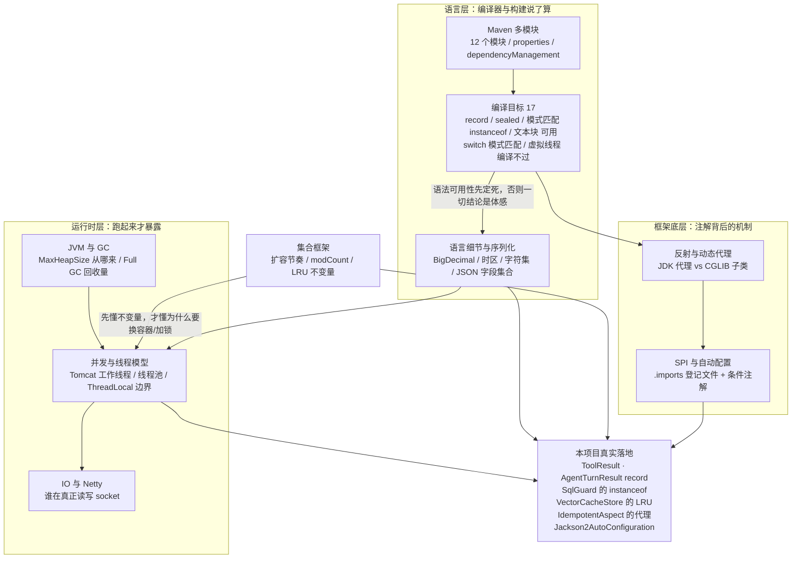
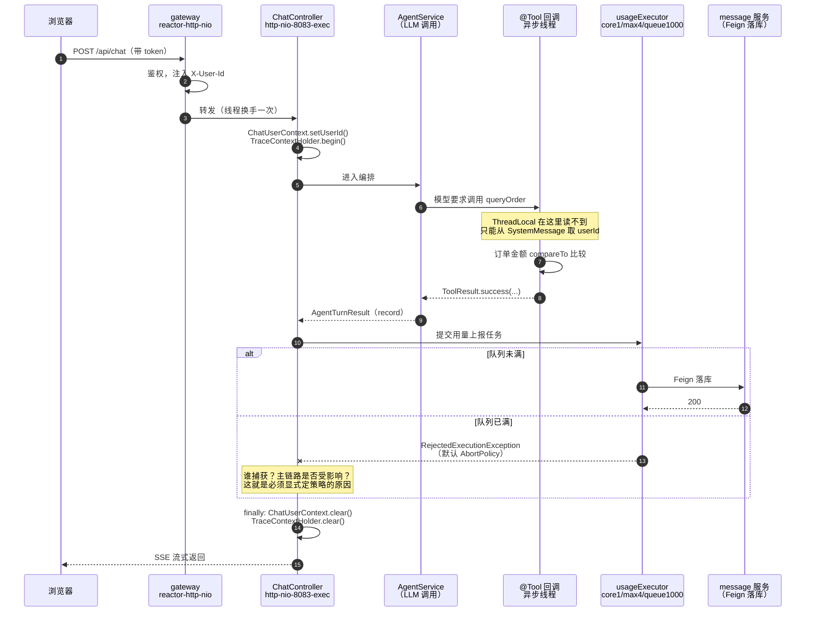

# 04-Java基础补全开发计划

> **一句话结论**：本项目在「Java 基础」上的缺口不是没学过 API，而是有三类机制从没被钉死过——**编译目标只有 17**、**上下文载体是会被复用的线程**、**金额与时区没有唯一写法**；这份计划把它们拆成语言层 → 运行时层 → 框架底层三段，每段都以「能跑出什么输出 / 能复现什么异常」作为验收。
> **阅读前置**：能跑 `mvn -o -pl ai-cs-chat test`；知道 `@Service`、`@Transactional` 大概是什么；手边有 JDK 17（本地实测 `openjdk 17.0.19`，Temurin）。**不需要**读过任何 JDK 或 Spring 源码。
> **依据与投入**：A 级 3 段（[24-源码分析](../24-源码分析/README.md) 的 `assets/source` 摘录）+ B 级 30 余处本项目真实文件行号 + C 级 8 组可复现命令与输出；正文 8 篇合计 5283 行（[01-Java基础](../01-Java基础/README.md)）。本计划按三段落地约 8~12 天，只读规划本身约 40 分钟。

## 0. 这份计划解决什么问题

先说三个本项目里真实发生过的、且都不是「不会写代码」导致的缺口。

**现象一：上下文的生命周期靠人的纪律维持，不靠机制。**

`ai-cs-chat/src/main/java/com/aics/chat/util/ChatUserContext.java#L14-L21` 的 javadoc 自己写了两条警告：Tomcat 线程会被复用，不 `clear()` 就让下一个请求读到上个用户的 ID（越权）；ThreadLocal 不能跨线程，异步执行的 `@Tool` 读不到用户身份。而 `ai-cs-chat/src/main/java/com/aics/chat/service/impl/ChatServiceImpl.java#L98-L105` 记着更硬的事实：Tool Calling 在异步线程执行，**ThreadLocal 不可用**，只好把 userId 塞进 `SystemMessage` 让模型带过去。同一个仓库里还有 `ai-cs-chat/src/main/java/com/aics/chat/observability/TraceContextHolder.java#L25` 和 `ai-cs-chat/src/main/java/com/aics/chat/rag/eval/LlmJudgeService.java#L54` 两处独立的 ThreadLocal——三份「记得清理」的约定，谁漏一处都不报错，只是数据串了。

**现象二：线程池只配了三个数，剩下两件事从没验证过。**

`ai-cs-chat/src/main/java/com/aics/chat/config/ObservabilityExecutorConfig.java#L27-L59` 里两个线程池都只设了 core / max / queue 与线程名前缀，`#L33` 的注释直说「拒绝策略默认 AbortPolicy，队列满时报错由调用方捕获告警」——但全仓 `setRejectedExecutionHandler` 一个命中都没有（C 级 §4.2 有命令与输出），也就是「队列满之后谁捕获、主链路会不会被拖垮」从来没有被验证过一次。

**现象三：金额与时区没有唯一写法，靠每次写代码时自觉。**

金额比较在项目里同一个仓里既有正确写法也有需要解释的地方：`ai-cs-chat/src/main/java/com/aics/chat/agent/tool/ProductRecommendTool.java#L54`、`ai-cs-chat/src/main/java/com/aics/chat/observability/QuotaService.java#L65`、`ai-cs-chat/src/main/java/com/aics/chat/service/OrderQueryService.java#L100` 都用 `compareTo`，测试里还要专门写注释解释「为什么不能用 equals 断言」——`ai-cs-message/src/test/java/com/aics/message/service/ModelUsageQuotaServiceTest.java#L61`。时间侧则相反：主代码里 `LocalDateTime.now()` 出现 **64 次**，而全仓 `spring.jackson.time-zone` **0 处**、显式 `serverTimezone` 只出现在 `ai-cs-mq/src/main/resources/application.yml#L27` 一条 JDBC URL 上——服务进程用什么时区，取决于部署机器的默认值。

**这些现象指向同一件事**：本项目的 Java 基础缺口不是「知识点没背」，而是三条机制没有落到能自证的动作上——**编译器只认 17**（哪些语法根本不存在）、**线程会被复用**（上下文必须显式搬运和清理）、**元信息会静默丢失**（有效位数、时区、字符集、字段集合）。补全计划因此不按「章节」排，而按这三条机制的判定方式排。

## 1. 能力地图



> **读图说明**：图里三层不是「学习顺序」，是**判定成本**的三层。语言层的结论由编译器给出（`javac` 一跑就有 0 error 或 `cannot find symbol`），所以它必须是地基；运行时层的结论只能靠观测（`jstat`、线程栈、异常栈）；框架底层的结论要靠「这次调用有没有经过代理」这类断点验证。**最容易看错的一条箭头**是 `A1 --> C1`：17 上有 `record`、`instanceof` 模式匹配、文本块，但**没有** `switch` 模式匹配、**没有**虚拟线程，所以「语法糖支撑并发」这条隐含假设在本项目里不成立——并发篇讲的是 Tomcat 工作线程 + 线程池 + 异步边界，跟语法无关。另一条容易看错的是 `SET --> B2`：集合篇在这里的作用是「不变量」（扩容倍数、`modCount` 记账、LRU 的访问序），不是「换个线程安全容器就没事了」。

**八篇专题的成熟度与本项目落地对照**（文档全部已按新范式重写，落地情况逐项给文件）：

| 主题 | 本项目有没有真实落地（B 级文件） | 对应文档 | 证据类型 | 掌握判定标准（做不到就是没掌握） |
| --- | --- | --- | --- | --- |
| Java 17 语言特性 | `ai-cs-chat/src/main/java/com/aics/chat/agent/tool/ToolResult.java#L10-L19`（`record` + 嵌套 `enum`）、`ai-cs-chat/src/main/java/com/aics/chat/agent/model/AgentTurnResult.java#L21-L25`（12 组件 `record`） | [01-Java17核心特性](../01-Java基础/01-Java17核心特性.md) | B + C（`javac` 实测） | 能当场分清「17 可用 / 21 才有」，并把一个 DTO 改 `record` 后说清哪个框架会因此读不到值 |
| Maven 多模块 | `pom.xml#L14-L27`（12 个 `<module>`）、`ai-cs-gateway/pom.xml#L45-L53`（排除 `spring-boot-starter-webmvc`） | [02-Maven多模块管理](../01-Java基础/02-Maven多模块管理.md) | B + C（**无 A 级**：`assets/source` 不收录 Maven 本体） | 能跑 `dependency:tree` 指出同一 artifact 的两个版本，并说出最终生效的是哪个 |
| JVM 与 GC | **仓库内未固化任何堆/GC 参数**，只在 Dockerfile 透传：`ai-cs-chat/Dockerfile#L21` 的 `java ${JAVA_OPTS:-} -jar app.jar` | [03-JVM内存模型与GC实战](../01-Java基础/03-JVM内存模型与GC实战.md) | A（容器/启动侧摘录）+ B + C（`jstat` / `-Xlog:gc`） | 能用 `jstat -gc <pid> 1000` 连续采样，指出「FGC 涨而 OU 不降」这一组信号 |
| 并发与线程模型 | `ai-cs-chat/src/main/java/com/aics/chat/config/ObservabilityExecutorConfig.java#L27-L59`、`ChatUserContext.java#L26`、`TraceContextHolder.java#L25`、`LlmJudgeService.java#L54` | [04-并发编程进阶](../01-Java基础/04-并发编程进阶.md) | A（`SecurityContextHolder` 摘录）+ B + C | 能画出一次请求的线程归属，并指出上下文在哪一步必须显式搬运 |
| 集合框架 | `ai-cs-chat/src/main/java/com/aics/chat/cache/VectorCacheStore.java#L44-L54`（`accessOrder=true` 的 `LinkedHashMap` + `removeEldestEntry`） | [05-集合框架与源码](../01-Java基础/05-集合框架与源码.md) | B + C（真实异常栈） | 能解释这段 L1 缓存为什么是 LRU、`synchronizedMap` 冻住的到底是什么 |
| 反射 / 代理 / SPI | `ai-cs-common/src/main/java/com/aics/common/idempotent/IdempotentAspect.java#L49-L75`（`@Around` 切面）、`ai-cs-common/src/main/java/com/aics/common/autoconfigure/Jackson2AutoConfiguration.java#L13-L21`（`@AutoConfiguration` + 条件注解） | [06-反射动态代理与SPI](../01-Java基础/06-反射动态代理与SPI.md) | A（`DefaultAopProxyFactory` / `ImportCandidates` 摘录）+ B | 能说出「注解没生效」的四类根因，并对每个根因给一个验证动作 |
| IO 与 Netty | `ai-cs-gateway/pom.xml#L19-L22`（`spring-cloud-starter-gateway-server-webflux`，即 reactor-netty 事件循环）、`ai-cs-gateway/pom.xml#L45-L53`（网关侧排除 MVC） | [07-IO模型与Netty基础](../01-Java基础/07-IO模型与Netty基础.md) | A + B + C（17.0.19 / Win11 实测） | 能说清网关 `reactor-http-nio-*` 与下游 `http-nio-8083-exec-*` 各管哪一段，中间为什么可以「换手」 |
| 语言级细节与序列化 | `ai-cs-common/src/main/java/com/aics/common/autoconfigure/Jackson2AutoConfiguration.java#L9-L21`（Boot 4 的 Jackson 3 与 Jackson 2 双栈）、`ai-cs-product/src/main/java/com/aics/product/config/ProductCacheConfig.java#L35`（`GenericJackson2JsonRedisSerializer`）、金额 `compareTo` 三处 | [08-语言级细节与序列化](../01-Java基础/08-语言级细节与序列化.md) | A + B（28 处）+ C | 能写出金额、时间、字符集、JSON 四条统一口径，并说明各自的失效点 |

**文档成熟度如实说明**：`learning-docs` 全库实测 **1331 个 `.md` / 398,014 行**（C 级命令见 §3 末尾），其中 `24-源码分析` 独占 1021 个文件、289,355 行，其 `assets/source` 收录 **905 份**框架源码摘录——这是本计划 A 级证据的唯一来源。

| 模块 | 文件数 | 行数 | 状态 |
| --- | --- | --- | --- |
| `01-Java基础` | 9（8 篇 + README） | 5543 | **已按新范式重写**，本计划第 3 节全部指向这里 |
| `02-Spring微服务` | 19（18 篇 + README） | 12784 | **已按新范式重写**，与 06 篇的「代理/自动配置」互为上下游 |
| `24-源码分析` | 1021 | 289355 | 已建成，A 级摘录的来源 |
| `00-学习路线总览` | 6 | 1907 | 本页所在目录，五份计划互为分工 |
| `03` ~ `23`、`常见业务相关` | 合计 291 | 合计 78,536 | **仍是旧稿**，引用前需按新范式重核 |

> 上表两行合计之外的数字（`tools`/`_templates` 等）不计入模块统计；总数 1331 = 表内各模块之和，可直接相加核对。

### 1.1 三条机制的一手证据（A 级：`assets/source` 摘录）

上表的「掌握判定标准」不能只靠自说自话，下列三段摘录说明这三条机制不是本项目的土办法，而是框架自己的默认选择——因此「为什么本项目也这么写」和「为什么这样写会踩坑」都有同一个出处。

**证据一：上下文放在当前执行线程，是 Spring Security 的默认策略**

[[源码:SecurityContextHolder.java.md#L26-L47]]

```java (src: SecurityContextHolder.java.md#L26-L47)
/**
 * Associates a given {@link SecurityContext} with the current execution thread.
 * <p>
 * This class provides a series of static methods that delegate to an instance of
 * {@link org.springframework.security.core.context.SecurityContextHolderStrategy}. The
 * purpose of the class is to provide a convenient way to specify the strategy that should
 * be used for a given JVM. This is a JVM-wide setting, since everything in this class is
 * <code>static</code> to facilitate ease of use in calling code.
 * <p>
 * To specify which strategy should be used, you must provide a mode setting. A mode
 * setting is one of the three valid <code>MODE_</code> settings defined as
 * <code>static final</code> fields, or a fully qualified classname to a concrete
 * implementation of
 * {@link org.springframework.security.core.context.SecurityContextHolderStrategy} that
 * provides a public no-argument constructor.
 * <p>
 * There are two ways to specify the desired strategy mode <code>String</code>. The first
 * is to specify it via the system property keyed on {@link #SYSTEM_PROPERTY}. The second
 * is to call {@link #setStrategyName(String)} before using the class. If neither approach
 * is used, the class will default to using {@link #MODE_THREADLOCAL}, which is backwards
 * compatible, has fewer JVM incompatibilities and is appropriate on servers (whereas
 * {@link #MODE_GLOBAL} is definitely inappropriate for server use).
```

怎么读：最后三行是全部重点——默认 `MODE_THREADLOCAL`，理由是「向后兼容、JVM 兼容性问题少、适合服务端」，同时明确否掉了 `MODE_GLOBAL`。这解释了为什么 `ChatUserContext` / `TraceContextHolder` 都选 ThreadLocal 而不是别的容器：这是服务端上下文的行业默认解。但同一段话也解释了风险来源——既然是「当前执行线程」，那么线程被复用时上下文就跟着串，**框架不替你清理**，清理责任落在业务代码的 `finally` 上（对应 §0 现象一与 §4 时序图最后一步）。

**证据二：用 JDK 代理还是 CGLIB，由一个方法里的三个条件决定**

[[源码:DefaultAopProxyFactory.java.md#L59-L76]]

```java (src: DefaultAopProxyFactory.java.md#L59-L76)
	@Override
	public AopProxy createAopProxy(AdvisedSupport config) throws AopConfigException {
		if (config.isOptimize() || config.isProxyTargetClass() || !config.hasUserSuppliedInterfaces()) {
			Class<?> targetClass = config.getTargetClass();
			if (targetClass == null && config.getProxiedInterfaces().length == 0) {
				throw new AopConfigException("TargetSource cannot determine target class: " +
						"Either an interface or a target is required for proxy creation.");
			}
			if (targetClass == null || targetClass.isInterface() ||
					Proxy.isProxyClass(targetClass) || ClassUtils.isLambdaClass(targetClass)) {
				return new JdkDynamicAopProxy(config);
			}
			return new ObjenesisCglibAopProxy(config);
		}
		else {
			return new JdkDynamicAopProxy(config);
		}
	}
```

怎么读：`#L61` 的三个条件（`isOptimize()` / `isProxyTargetClass()` / 没有用户提供接口）任一为真就进 CGLIB 分支；进分支后 `#L67-L69` 又把「目标本身是接口或 Lambda 类」退回 JDK 代理。这条链解释了 §6 里「`final` 类为什么天然怕 CGLIB」——CGLIB 靠继承生成子类，`final` 类没有子类可生；也解释了为什么 `IdempotentAspect.java#L49-L75` 的切面只对**经过代理的调用**生效。

**证据三：自动配置不是「扫出来的」，是读登记文件读出来的**

[[源码:ImportCandidates.java.md#L59-L80]]

```java (src: ImportCandidates.java.md#L59-L80)
	/**
	 * Loads the names of import candidates from the classpath. The names of the import
	 * candidates are stored in files named
	 * {@code META-INF/spring/full-qualified-annotation-name.imports} on the classpath.
	 * Every line contains the full qualified name of the candidate class. Comments are
	 * supported using the # character.
	 * @param annotation annotation to load
	 * @param classLoader class loader to use for loading
	 * @return list of names of annotated classes
	 */
	public static ImportCandidates load(Class<?> annotation, @Nullable ClassLoader classLoader) {
		Assert.notNull(annotation, "'annotation' must not be null");
		ClassLoader classLoaderToUse = decideClassloader(classLoader);
		String location = String.format(LOCATION, annotation.getName());
		Enumeration<URL> urls = findUrlsInClasspath(classLoaderToUse, location);
		List<String> importCandidates = new ArrayList<>();
		while (urls.hasMoreElements()) {
			URL url = urls.nextElement();
			importCandidates.addAll(readCandidateConfigurations(url));
		}
		return new ImportCandidates(importCandidates);
	}
```

怎么读：`#L72-L73` 那两行说明机制——把注解全限定名拼进一个固定路径（`META-INF/spring/<注解全名>.imports`），然后在类路径上**枚举所有同名文件**并合并。这解释了两件事：一是 `Jackson2AutoConfiguration.java#L13-L21` 为什么写了 `@AutoConfiguration` 还要有登记文件才生效；二是多模块项目里「同一个 `.imports` 出现在多个 jar 中」为什么不会互相覆盖（`#L75-L78` 是逐个 URL 累加，不是取最后一个）。

## 2. 缺口诊断

判断「是不是真缺口」的标准只有一条：**不补它，会出现一个不报错但行为错误的现象**。下表按这条标准筛出 10 项，每项都指到本项目的真实位置。

| 缺口 | 不补的后果 | 触发场景 | 自测方法 |
| --- | --- | --- | --- |
| ThreadLocal 生命周期没人兜底 | 下一个请求读到上个请求的 userId → 越权查询；或读到上个用例的 token 计数 | 高并发下 Tomcat 线程复用；`ChatUserContext.java#L14-L21` 的 javadoc 把风险写在注释里而不是代码里 | 用单线程线程池连跑两个任务、第一个不 `remove()`，看第二个读到什么（C 级 §4.2 T1） |
| 线程池拒绝策略从未显式配置 | 队列满时抛 `RejectedExecutionException`；抛在谁手里、主链路是否被拖垮，无人验证 | 用量上报队列 1000 满（`ObservabilityExecutorConfig.java#L33-L34`）；message 服务变慢时最可能先撞上 | `Get-ChildItem -Recurse -Filter *.java \| Select-String 'setRejectedExecutionHandler'`，本项目 0 命中（§4.2） |
| 异步边界上下文搬运靠聪明 | 异步线程里 `getUserId()` 返回 `null`，工具方法查错用户或直接 NPE | Tool Calling 回调、SSE 流式链路（`ChatServiceImpl.java#L98-L105`） | 在 `@Tool` 方法首行打条件断点 `ChatUserContext.getUserId() == null` |
| 金额用 `equals` 比较 | `1.0` 与 `1.00` 判不相等，等值判断静默走错分支 | 优惠金额、配额金额比较（`QuotaService.java#L65`、`OrderQueryService.java#L100`） | 跑 C 级 §4.2 T2，`equals` 输出 `false`、`compareTo` 输出 `0` |
| `BigDecimal.divide` 未指定精度 | 抛 `ArithmeticException: Non-terminating decimal expansion`，运行期才炸 | 单价分摊、均摊优惠、汇率换算 | 同上，`10 / 3` 直接抛异常 |
| 跨时区时间没有统一口径 | 落库时间与前端显示差 8 小时；跨服务日期边界对不上 | 主代码 64 处 `LocalDateTime.now()` 取 JVM 默认时区，全仓 0 处 `time-zone` 配置 | `java -Duser.timezone=UTC` 启动后对比同一段逻辑的输出 |
| 误以为虚拟线程可用 | 写了 `Thread.ofVirtual()`，CI 报 `cannot find symbol`，被当成「依赖没下全」去删 `~/.m2` | 看到「Boot 3.2+ 一键开关 `spring.threads.virtual.enabled`」的旧资料 | `pom.xml#L30` 是 `17`；全仓 `threads.virtual` / `Thread.ofVirtual` **0 命中**（§4.2） |
| 集合不变量（`modCount` / LRU / 同步包装）理解错 | 遍历时 `remove` 抛 `ConcurrentModificationException`；或以为 `synchronizedMap` 让复合操作也原子 | `VectorCacheStore.java#L44-L54` 的 LRU 与「检查后写入」的复合操作 | 断点停在 `removeEldestEntry`，观察淘汰顺序是否符合访问序 |
| `record` 与反射框架的边界不清 | DTO 改成 `record` 后 MyBatis / Binder 映射出 `null`（没有无参构造器与 setter） | 新代码层在写 `record`（`ToolResult.java#L10`、`AgentTurnResult.java#L21`），旧映射还在 | 把 `AgentTurnResult` 当查询结果类跑一次映射，看字段是否全 `null` |
| 代理边界（自调用 / `final` / `private`）没验证 | `@Transactional`、`@Async`、自定义切面写上没反应；幂等键没占位 | `IdempotentAspect.java#L49-L75` 只对经过代理的调用生效 | 断点看 `joinPoint.getTarget().getClass().getName()` 是否含 `$$SpringCGLIB$$` |
| Jackson 2 / 3 双栈混用 | 自己 `new ObjectMapper()` 与容器里的 `JsonMapper` 配置不一致，字段名、日期格式在两条链路上不同 | Boot 4 默认 Jackson 3（`tools.jackson`），而业务代码仍 `import com.fasterxml.jackson.databind.ObjectMapper`（38 个文件、47 处 import） | 见 `Jackson2AutoConfiguration.java#L9-L21` 的注释：Boot 4 的 `JsonMapper` 与此 `ObjectMapper` 不是同一类型 |

## 3. 补全路线

三段不是按「难易」排的，是按**结论的判定方式**排的：语言层靠编译器判定，运行时层靠观测判定，框架底层靠断点判定。前一段没过，后一段的结论只能算体感。

| 阶段 | 目标能力 | 学哪些文档 | 项目落地动作 | 验收标准（能观察到什么） | 预计投入 |
| --- | --- | --- | --- | --- | --- |
| **P0 语言层** | 把「哪些语法在 17 上存在」「版本从谁那里来」「金额/时间/JSON 的唯一写法」钉死 | [01-Java17核心特性](../01-Java基础/01-Java17核心特性.md)、[02-Maven多模块管理](../01-Java基础/02-Maven多模块管理.md)、[05-集合框架与源码](../01-Java基础/05-集合框架与源码.md)、[08-语言级细节与序列化](../01-Java基础/08-语言级细节与序列化.md) | ①在 `ai-cs-chat` 内补一份「DTO 是否可用 record」清单；②把金额比较统一到 `compareTo` 并在 PR 描述里写明；③给 `VectorCacheStore` 的 L1 缓存补一条容量边界测试 | ①独立 `.java` 里写 `Thread.ofVirtual()` 用 `javac` 编译，输出 `error: cannot find symbol` + `location: class Thread`；②`dependency:tree -Dverbose` 输出里点名同一 artifact 的两个版本；③跑出一次 `equals` 判 `false`、`compareTo` 判 `0` | 3~4 天 |
| **P1 运行时层（JVM / 并发 / IO）** | 能判断「线程被谁占住」「堆被谁撑大」「事件循环有没有被堵」 | [03-JVM内存模型与GC实战](../01-Java基础/03-JVM内存模型与GC实战.md)、[04-并发编程进阶](../01-Java基础/04-并发编程进阶.md)、[07-IO模型与Netty基础](../01-Java基础/07-IO模型与Netty基础.md) | ①给 `ObservabilityExecutorConfig` 两个线程池显式写死拒绝策略（`CallerRunsPolicy` 或带计数的自定义策略）并补测试；②把 `ChatUserContext` / `TraceContextHolder` 的清理动作收进同一个 `finally`（或做成交互器统一管理）；③在 `ChatServiceImpl` 的异步分支上显式搬运上下文，禁止依赖 ThreadLocal | ①`jstat -gc <pid> 1000` 连续 10 次，指出 `FGC` 与 `OU` 两列的组合含义；②用单线程线程池复现 ThreadLocal 串数据，两次输出同一个线程名且 userId 相同；③线程池队列打满时日志里出现被拒绝的计数（而不是无声丢弃或整条链路 500） | 3~4 天 |
| **P2 框架底层（反射 / 代理 / SPI）** | 能回答「注解为什么生效 / 为什么不生效」「自动配置是怎么被发现的」 | [06-反射动态代理与SPI](../01-Java基础/06-反射动态代理与SPI.md)，深入看 [24-源码分析/01-Spring框架/02-AOP与代理/02-代理方式-jdk与cglib](../24-源码分析/01-Spring框架/02-AOP与代理/02-代理方式-jdk与cglib.md)、[24-源码分析/02-SpringBoot/02-自动配置/01-enableautoconfiguration-自动配置全链路](../24-源码分析/02-SpringBoot/02-自动配置/01-enableautoconfiguration-自动配置全链路.md) | ①在 `IdempotentAspect` 上验证「自调用不过代理」并写成单测；②`Jackson2AutoConfiguration` 补一条「容器里是否真的存在两种 ObjectMapper」的断言 | ①断点看到 `$$SpringCGLIB$$` 后缀，或在自调用路径上看到切面完全没进；②启动日志/断点里同时看到 `tools.jackson.databind.json.JsonMapper` 与 `com.fasterxml.jackson.databind.ObjectMapper` 两个 Bean | 2~4 天 |

**为什么不是「按 01…08 编号读」**：01 篇的结论依赖 `pom.xml#L30` 的 `17`，02 篇解释这个 `17` 从哪来，所以先 02 后 01 更省时间；08 篇的金额与时区结论必须在 01 篇的「元信息」框架下才不散；03 与 07 都在 P1，但它们依赖 04 的线程模型结论——先读 03 再读 04，会得到一堆「知道 G1 参数、不知道谁在分配」的孤立知识。

**这条路线刻意避开的事**：不排「读 24 源码」为前置（那是 P2 的延伸阅读，不是 P0/P1 的门槛），也不排「JDK 调优实战」（那是 [12-性能工程](../12-性能工程/README.md) 的活）。**盘点数据是本轮实测**，不是沿用旧稿：

```powershell
# 在 learning-docs 目录下执行：按顶层目录统计 md 数量与总行数
Get-ChildItem -Directory | Where-Object { $_.Name -notmatch '^(tools|assets|_templates)$' } | ForEach-Object {
  $fs = Get-ChildItem $_.FullName -Recurse -File -Filter *.md
  $ln = ($fs | ForEach-Object { (Get-Content $_.FullName).Count } | Measure-Object -Sum).Sum
  "{0,-24} files={1,-5} lines={2}" -f $_.Name, $fs.Count, $ln
}
```

```text
01-Java基础                  files=9     lines=5543
02-Spring微服务               files=19    lines=12784
03-数据库与ORM                files=11    lines=1632
24-源码分析                   files=1021  lines=289355
00-学习路线总览                files=6     lines=1907
```

怎么读：这三个数字是本计划排期的依据而不是装饰——`01-Java基础` 5543 行（8 篇 + README）说明 P0 的教材已经齐了，缺的只是「落到本项目」的动作；`24-源码分析` 1021 个文件说明 A 级证据足够，不需要再抓源码；`03-数据库与ORM` 只有 1632 行说明 SQL / ORM 那一层不在本计划的覆盖范围内（见 §5）。

## 4. 一次真实落地的执行时序

把 P1 的两条落地（上下文搬运 + 拒绝策略）叠到一条真实链路上，就是下面这张图：用户发一条「我要退货」，chat 服务走 Agent 编排，工具在异步线程里查订单，用量异步上报。



> **读图说明**：重点看三处「不需要箭头但必须存在」的动作。第一处是第 4 步的两个 `set/begin`——它们把身份与 traceId 写进**当前 Servlet 工作线程**，从第 6 步开始就靠不住了：工具回调已经换到别的线程（图里的 Note），因此第 7 步读 ThreadLocal 必然拿到 `null`，这正是 `ChatServiceImpl.java#L98-L105` 把 userId 塞进 `SystemMessage` 的原因。第二处是第 11 步到第 14 步的 `alt` 分支——默认 `AbortPolicy` 会把异常抛回**提交任务的线程**，也就是那次请求自己的线程，所以「谁捕获」这个问题有确定答案：没人捕获就会变成一次 500。第三处是最后一步 `finally` 里的两次 `clear()`，它必须和前面的 `set/begin` 成对出现，否则第 16 步把线程还给 Tomcat 之后，下一个请求就在同一个线程上继承脏数据（对应 §2 第 1 行与 §6 误区三）。

**哪一步没做，会出现什么后果**：

| 漏掉的步骤 | 现象 | 为什么不容易发现 |
| --- | --- | --- |
| 第 4 步只 `set` 不 `clear` | 下一个请求读到上个用户的 `userId`，越权查到别人的订单 | 单测串行执行、线程不回收，本地永远复现不出来（C 级 §4.2 T1 用单线程池才能复现） |
| 第 7 步仍去读 ThreadLocal | 工具方法拿到 `null`，查询直接 NPE 或退化成匿名用户 | 报错点在工具实现里，看不出是「异步边界」造成的 |
| 第 13 步没有显式拒绝策略 | 队列满时抛 `RejectedExecutionException` 到请求线程；若策略换成 `DiscardPolicy` 则静默丢数据 | 前者是一条偶发 500，后者连日志都没有，只能靠指标发现 |
| 停机前不等在途任务 | `waitForTasksToCompleteOnShutdown` 没开时，队列里的用量数据随进程消失 | 停机窗口内的数据缺失，事后只能看到「用量比调用数少」 |

### 4.1 这段时序的 B 级依据

三处关键行为都能在仓库里指到具体行：上下文的两端在 `ai-cs-chat/src/main/java/com/aics/chat/util/ChatUserContext.java#L31-L41`；线程池参数与默认拒绝策略的说明在 `ai-cs-chat/src/main/java/com/aics/chat/config/ObservabilityExecutorConfig.java#L27-L40`；「Tool Calling 在异步线程执行」这条事实写在 `ai-cs-chat/src/main/java/com/aics/chat/service/impl/ChatServiceImpl.java#L98-L105`。

### 4.2 C 级实测（三组，均可当场复现）

三组命令都在 30 秒内跑完，不需要启动服务、不需要联网，只要一个 JDK 17。做法是把代码存成单个 `.java` 文件，用 `java T1.java` 直接跑（JDK 11 起的单文件源码启动）。

**第一组：ThreadLocal 在复用线程上串数据**

```java
import java.util.concurrent.*;

public class T1 {
    static final ThreadLocal<Long> USER_ID = new ThreadLocal<>();

    public static void main(String[] args) throws Exception {
        ExecutorService pool = Executors.newFixedThreadPool(1);
        pool.submit(() -> {
            USER_ID.set(1001L);
            System.out.println("[task-1] " + Thread.currentThread().getName() + " userId=" + USER_ID.get());
            // 故意不 remove
        }).get();
        pool.submit(() -> {
            System.out.println("[task-2] " + Thread.currentThread().getName() + " userId=" + USER_ID.get());
            USER_ID.remove();
        }).get();
        pool.shutdown();
    }
}
```

```text
> java T1.java
[task-1] pool-1-thread-1 userId=1001
[task-2] pool-1-thread-1 userId=1001
```

怎么读：第二条输出本该是 `null`（任务 2 从没 `set` 过），却打出了 `1001`，且两个任务跑在同一个线程 `pool-1-thread-1` 上——这就是「线程复用 + 没清理」的完整证据链。`ChatUserContext.clear()` 存在的唯一理由就是让第二条输出回到 `null`。

**第二组：`BigDecimal` 的 `equals` 与 `compareTo`**

```java
import java.math.BigDecimal;

public class T2 {
    public static void main(String[] args) {
        BigDecimal a = new BigDecimal("1.0");
        BigDecimal b = new BigDecimal("1.00");
        System.out.println("equals(1.0, 1.00)    = " + a.equals(b));
        System.out.println("compareTo(1.0, 1.00) = " + a.compareTo(b));
        try {
            System.out.println(new BigDecimal("10").divide(new BigDecimal("3")));
        } catch (ArithmeticException e) {
            System.out.println("divide 不指定精度 -> " + e);
        }
        System.out.println("0.1 + 0.2 (double)   = " + (0.1 + 0.2));
        System.out.println("BigDecimal add 2位   = " + new BigDecimal("0.1").add(new BigDecimal("0.2")).setScale(2));
    }
}
```

```text
> java T2.java
equals(1.0, 1.00)    = false
compareTo(1.0, 1.00) = 0
divide 不指定精度 -> java.lang.ArithmeticException: Non-terminating decimal expansion; no exact representable decimal result.
0.1 + 0.2 (double)   = 0.30000000000000004
BigDecimal add 2位   = 0.30
```

怎么读：`equals` 比的是「数值 + 标度（scale）」，所以 `1.0` 与 `1.00` 不相等；`compareTo` 只比数值大小。这解释了为什么 `ai-cs-message/src/test/java/com/aics/message/service/ModelUsageQuotaServiceTest.java#L61` 这类断言必须用 `compareTo` 落地成 `assertEquals(0, ...)`。`divide` 那行说明「除法必须显式给 scale 与舍入模式」，否则不是精度问题而是直接抛异常。

**第三组：线程池默认拒绝策略**

```java
import java.util.concurrent.*;

public class T3 {
    public static void main(String[] args) throws Exception {
        ThreadPoolExecutor pool = new ThreadPoolExecutor(1, 1, 0L, TimeUnit.MILLISECONDS, new ArrayBlockingQueue<>(1));
        for (int i = 1; i <= 3; i++) {
            final int n = i;
            try {
                pool.submit(() -> {
                    try { Thread.sleep(300); } catch (InterruptedException ignored) { Thread.currentThread().interrupt(); }
                    System.out.println("task-" + n + " 执行于 " + Thread.currentThread().getName());
                });
                System.out.println("submit task-" + n + " OK");
            } catch (RejectedExecutionException e) {
                System.out.println("submit task-" + n + " 被拒绝: " + e.getClass().getName());
            }
        }
        pool.shutdown();
        pool.awaitTermination(3, TimeUnit.SECONDS);
        System.out.println("默认拒绝策略 = " + pool.getRejectedExecutionHandler().getClass().getSimpleName());
    }
}
```

```text
> java T3.java
submit task-1 OK
submit task-2 OK
submit task-3 被拒绝: java.util.concurrent.RejectedExecutionException
task-1 执行于 pool-1-thread-1
task-2 执行于 pool-1-thread-1
默认拒绝策略 = AbortPolicy
```

怎么读：线程 1 个、队列 1 个，第三个任务无处安放，异常抛在**提交方**（主线程）——这跟 §4 时序图里「异常回到请求线程」是同一件事。最后一行打出的 `AbortPolicy` 就是 `ObservabilityExecutorConfig.java#L33` 注释里说的「默认」，也就是说本项目这两个线程池从未改过它。

**第四组：三个「0 命中」的盘点命令**

```powershell
# 1) 虚拟线程相关 API / 配置是否出现过
Get-ChildItem -Recurse -File -Include *.java,*.yml | Select-String -Pattern 'threads\.virtual|Thread\.ofVirtual'
# 2) 拒绝策略是否被显式设置过
Get-ChildItem -Recurse -File -Include *.java | Select-String -Pattern 'RejectedExecution'
# 3) 时区是否被显式配置过（除 JDBC URL 里的 serverTimezone）
Get-ChildItem -Recurse -File -Include *.java,*.yml | Select-String -Pattern 'TimeZone|time-zone|ZoneId\.of'
```

```text
（第 1 条无输出）
（第 2 条无输出）
（第 3 条仅有 ai-cs-mq/src/main/resources/application.yml#L27 的 serverTimezone=Asia/Shanghai 一类 JDBC 参数命中）
```

怎么读：无输出不是命令写错，而是「这个概念在仓库里不存在」——这正是 §0 现象二与现象三的原始依据，也是 §2 里「误以为虚拟线程可用」「跨时区没有统一口径」两行的事实底座。

## 5. 优先级与取舍

| 分类 | 具体项 | 理由 | 代价（如果选错） |
| --- | --- | --- | --- |
| **做（P0）** | 编译目标/语法边界的确认动作；金额统一 `compareTo`；`record` 与反射框架的边界清单 | 这三条一旦错，代码在 CI 与本地表现不一致，且错误发生在业务逻辑里最难查 | 不做就会持续出现「本地好的、线上坏的」和「差一分钱」 |
| **做（P1）** | 线程池显式拒绝策略 + 上下文成对 `set/clear` + 异步边界显式搬运 | 本项目已经有三个 ThreadLocal 点位、两个线程池，缺的只是一致的兜底动作 | 不做则越权查询、静默丢用量数据，两者都不报错 |
| **做（P2）** | 「注解为什么失效」的四类根因验证 + 自动配置登记文件核对 | 幂等、事务、缓存都建立在这套契约上，一旦误判就只能靠绕过 | 会把框架问题当业务 bug 修，改动越来越大 |
| **不做** | 虚拟线程改造、自研编解码、JDK 容器微基准（JMH） | 编译目标是 17，虚拟线程不存在；Netty 编解码与容器微基准与当前缺口的因果链太远 | 做了也只是把时间花在「本仓库用不上」的能力上 |
| **延后** | Jackson 3 全量迁移（清掉 38 个文件里的 47 处 Jackson 2 import）、G1 参数精细化调参 | 迁移是跨模块改造，需要先把 08 篇的口径定死；调参需要先有 `jstat` 采样基线 | 顺序错了会同时改「序列化行为」和「内存行为」，出问题分不清是哪个引起的 |

**本计划刻意不覆盖什么**：

- **不覆盖 Spring / Boot / Cloud 源码逐行解读**：那是 [24-源码分析](../24-源码分析/README.md) 的活，本计划只引它的 A 级摘录当证据。
- **不覆盖 JVM 调优基线**：G1 参数怎么定、堆怎么算，属于 [12-性能工程](../12-性能工程/README.md)；本计划只要求「能量出事实」。
- **不覆盖 SQL 与 ORM**：那属于 [03-数据库与ORM](../03-数据库与ORM/README.md)；05 篇只借用集合不变量的直觉。
- **不覆盖 Spring 技术栈本身**（IoC/AOP/MVC starters）与其他三份计划：分工见 [01-Spring技术补全开发计划](./01-Spring技术补全开发计划.md)、[02-中间件补全开发计划](./02-中间件补全开发计划.md)、[03-微服务治理补全开发计划](./03-微服务治理补全开发计划.md)；总账在 [05-技术缺口分析与补全计划](./05-技术缺口分析与补全计划.md)。
- **不覆盖框架源码之外的第三方库原理**（jsqlparser、MapStruct 等）：只在需要解释本项目代码时点到，原理细节留在各专题篇目。

## 6. 常见误区与自己怎么验

| 误区 | 为什么错 | 怎么自证（命令 / 断点 / 日志关键字） |
| --- | --- | --- |
| 「我本机 JDK 21，所以工程就是 21」 | 决定语法可用性的是编译目标，不是本机 JDK；`pom.xml#L30` 的 `<java.version>17</java.version>` 才是判据 | `Select-String -Path pom.xml -Pattern 'java.version|maven.compiler'` 看到 17/17/17；再把 `Thread.ofVirtual()` 单独 `javac` 一次，得到 `error: cannot find symbol` + `location: class Thread` |
| 「线程池设了 core / max / queue 就配完了」 | 拒绝策略与优雅停机是两个独立参数，默认值会决定异常抛给谁 | `Select-String -Pattern 'RejectedExecution'`（本项目 0 命中）；断点设在提交处，队满时观察异常冒泡到哪个线程；日志关键字 `RejectedExecutionException`、线程名前缀 `usage-report-` |
| 「ThreadLocal 用完会被 GC 自动清掉」 | 线程不死，`ThreadLocalMap` 的条目就不清；`remove()` 是唯一可靠动作 | 用单线程池跑两个任务（§4.2 T1），第二次读到上次的值；断点停在 `ChatUserContext.clear()`，看是否每轮都命中 |
| 「金额用 `equals` 比较更严格更安全」 | `equals` 连标度一起比，`1.0 != 1.00`；金额等值判断只该用 `compareTo` | §4.2 T2 的 `false` / `0`；再搜既有断言写法 `Select-String -Pattern 'compareTo\(new BigDecimal'`，对照 `ModelUsageQuotaServiceTest.java#L61` |
| 「用 `LocalDateTime` 就没有时区问题」 | `LocalDateTime.now()` 取的是 JVM 默认时区，机器、容器、CI 各不相同 | `java -Duser.timezone=UTC` 启动后跑同一段落库逻辑，对比落库值差 8 小时；搜索 `LocalDateTime.now()` 共 64 处、`time-zone` 0 处 |
| 「注解不生效是框架 bug」 | 切面只对「经过代理的调用」生效，自调用、`final` 类/方法、`private` 方法都绕过代理 | 断点看 `joinPoint.getTarget().getClass().getName()` 是否含 `$$SpringCGLIB$$`；或在 `IdempotentAspect.java#L49` 的 `@Around` 上打断点，确认本类自调用时根本不进 |
| 「Boot 4 里 `ObjectMapper` 还是默认那个」 | Boot 4 默认 Jackson 3（`tools.jackson`），`com.fasterxml.jackson.databind.ObjectMapper` 需要 `Jackson2AutoConfiguration.java#L13-L21` 单独提供 | 断点或 `ApplicationContext#getBeansOfType` 同时查 `JsonMapper` 与 `ObjectMapper`；日志里若出现「字段变 null / 日期格式不同」，先怀疑两条序列化链路 |

## 7. ⚠️ 版本与时效

本页所有结论都挂在下面这些前提上；前提一变，结论就要重算。

| 结论 | 依赖的版本或前提 | 什么情况下会失效 | 怎么复核 |
| --- | --- | --- | --- |
| 「虚拟线程在本项目不可用，语法糖帮不了并发」 | `pom.xml#L30` 的编译目标 17（本地 17.0.19） | 编译目标升到 21+ 时，`Thread.ofVirtual()` 与 `spring.threads.virtual.enabled` 才成为可选项 | 重看 `pom.xml#L30`；再用 `javac` 编译一段 `Thread.ofVirtual()` 验证 |
| 「Boot 4 默认 Jackson 3，Jackson 2 需单独配」 | `pom.xml#L39` 的 `spring-boot.version` = 4.2.0 | 业务侧全量迁到 `tools.jackson` 后，`ai-cs-common/src/main/java/com/aics/common/autoconfigure/Jackson2AutoConfiguration.java` 可以删除 | 搜 `import com.fasterxml.jackson` 的命中数（当前 38 个文件 / 47 处），归零才可删 |
| 「网关侧是 reactor-netty 事件循环，业务侧是 Tomcat」 | `ai-cs-gateway/pom.xml#L19-L22` 用 `spring-cloud-starter-gateway-server-webflux`，且 `#L45-L53` 排除 MVC | 网关改写为 MVC 版（`spring-cloud-starter-gateway-server-webmvc`）后，07 篇的线程归属结论要整段重画 | 看 `ai-cs-gateway/pom.xml` 的 starter 名称；压测时看线程名是 `reactor-http-nio-*` 还是 `http-nio-*` |
| 「`ThreadPoolTaskExecutor` 不设策略就是 `AbortPolicy`」 | Spring Framework 7.1.0 的 `TaskExecutorConfiguration` 默认行为（依据官方 Javadoc） | Spring 改默认、或某处显式 `setRejectedExecutionHandler` 之后失效 | 搜 `RejectedExecution`（当前 0 命中）；§4.2 T3 可用原生 `ThreadPoolExecutor` 复核语义 |
| 「GC 日志用 `-Xlog:gc*`，`-XX:+PrintGCDetails` 已废弃；CMS 已移除」 | JDK 17 基线 | 换 JDK 版本（尤其 21 的默认 GC 行为）后需重跑 | `java -XX:+PrintGCDetails -version` 应打印 `is deprecated`；`java -XX:+UseConcMarkSweepGC -version` 应报 `Unrecognized VM option` |
| 「`jsqlparser` 4.x 的类布局与旧教程差异大（`Select` 是抽象类、无 `SelectBody`）」 | `ai-cs-chat/src/main/java/com/aics/chat/security/SqlGuard.java#L113-L118` 的注释，依赖 mybatis-plus 传递进来的 jsqlparser | 升级 mybatis-plus（`pom.xml#L139` 的 `mybatis-plus-jsqlparser`）后类布局可能再变 | 用 `javap -classpath ~/.m2/.../jsqlparser-*.jar net.sf.jsqlparser.statement.select.Select` 核 API |
| 「Lombok 1.18.30 / MapStruct 1.5.5.Final 是当前版本」 | `pom.xml#L61-L62` | 升级 JDK 或换注解处理器版本后，`annotationProcessorPaths` 的顺序问题会重新出现 | 看 `pom.xml#L61-L62`；编译失败时先看 `Unable to find method` 一类 processor 报错 |
| 「没有统一 JVM 参数，堆由运行环境决定」 | 仓库内 0 处 `-Xmx`，只在 Dockerfile 透传：`ai-cs-chat/Dockerfile#L21` | 一旦在 Dockerfile 或 K8s manifest 里写死 `-Xmx`，`MaxHeapSize` 的推导结论要更新 | 搜 `-Xmx|JAVA_OPTS`；容器内用 `jcmd <pid> VM.flags` 看实际生效值 |

### 7.1 旧稿被作废的说法（不悄悄删，逐条留痕）

上一版 04 号计划是按「P1~P6 六个批次 + 任务清单打勾」写的。其中几条说法已经与仓库现状不符，这里保留原话并给出当前基线，避免把旧结论继续往下传：

| 项目 | 旧稿写法 | 当前基线 | 依据 |
| --- | --- | --- | --- |
| 虚拟线程 | 设「虚拟线程实验分支」：打开 Boot 3.2 的 `spring.threads.virtual.enabled=true` 压测对比，合入与否给结论 | 编译目标是 17，虚拟线程 API 根本不存在，全仓 `threads.virtual` / `Thread.ofVirtual` **0 命中**；本计划把虚拟线程从路线中移除，只在 §2 与 §6 作为「版本幻觉」记录 | `pom.xml#L30` + §4.2 第四组命令 |
| 任务清单 | 每批次带 `- [x] 产出文档《并发编程进阶》…` 这类流水账打勾 | 打勾无法验收，改为 §3 三阶段表 + §9 八条练习，每条验收标准都是「能观察到什么」 | 本页 §3 / §9 |
| 结构图 | ASCII 目录树罗列 03~08 篇 | 改为 §1 的 Mermaid 分层图，并附「最容易看错哪条箭头」的读图说明 | 本页 §1 |
| Lombok / MapStruct | 「父 POM 已同时配置 Lombok 1.18.30 + MapStruct 1.5.5，processor 顺序敏感」 | 版本号本身仍准确，但当时的结论被当成「已配好、无需再管」；现状是编译失败时仍须先核 `annotationProcessorPaths` 顺序 | `pom.xml#L61-L62` |
| Redis 序列化 | 「01-P2 计划采用 `GenericJackson2JsonRedisSerializer`」 | 已经在用（不是计划），但它是 Jackson 2 的序列化器，与 Boot 4 默认的 Jackson 3 不是同一套类型，必须和 `Jackson2AutoConfiguration` 的结论一起看 | `ai-cs-product/src/main/java/com/aics/product/config/ProductCacheConfig.java#L35`、`ai-cs-common/src/main/java/com/aics/common/autoconfigure/Jackson2AutoConfiguration.java#L13-L21` |

## 8. 面试与答辩问与答

只列问题，因为它们都是「追问两层就会露馅」的那一类；答法在第 1 节对应篇目里。

1. 本工程的编译目标是多少？写在哪一行？它决定了哪些语法「根本不存在」？
2. `record` 用得很顺，但为什么把它当 MyBatis 查询结果类时会全字段 `null`？
3. `instanceof` 模式匹配在 `SqlGuard` 那种 AST 遍历里，比「先 `instanceof` 再强转」少掉了哪一类错误？
4. `HashMap` 一次扩容扩到原来的几倍？树化阈值是多少？并发 `put` 为什么会丢数据？
5. `accessOrder=true` 的 `LinkedHashMap` 为什么天然就是 LRU？`removeEldestEntry` 的返回值语义是什么？
6. `Collections.synchronizedMap` 包住的 LRU，哪些操作仍然不是原子的？
7. 线程池的 5 个参数之外，还有哪两件事决定线上行为？默认拒绝策略把异常抛给谁？
8. ThreadLocal 内存泄漏的确切条件是什么？`InheritableThreadLocal` 为什么救不了线程池场景？
9. Spring 什么时候用 JDK 动态代理、什么时候用 CGLIB？判断条件写在哪一行？
10. Boot 4 的自动配置是通过什么文件被发现的？文件丢了会出现什么现象？
11. 同一个容器里为什么可能同时存在两种 `ObjectMapper`？`GenericJackson2JsonRedisSerializer` 用的是谁的？
12. `BigDecimal.equals` 与 `compareTo` 的差别是什么？`divide` 不指定 scale 为什么直接抛异常？
13. 为什么本项目在 17 上不能上虚拟线程？`spring.threads.virtual.enabled` 在 17 上是什么行为？
14. 在 Netty 事件循环线程里做一次阻塞调用，会连带影响谁？为什么它比「线程池打满」更难定位？
15. 金额、时间、字符集、JSON 四条口径，各自的「唯一正确写法」是什么，失效点分别在哪一层？

## 9. 动手练习

每条都以「能观察到什么」作为验收；做不到就是没做完。

1. **复现 ThreadLocal 串数据**：用 §4.2 T1 的代码，改成两条任务都打印线程名。
   验收标准＝第二次输出打出 `1001` 而不是 `null`，且两次线程名相同。
2. **给金额比较补一条会失败的断言**：在一个测试里先用 `assertEquals(new BigDecimal("1.0"), new BigDecimal("1.00"))`。
   验收标准＝测试失败，失败信息里能看到 `expected: <1.0> but was: <1.00>` 一类标度差异，随后改成 `assertEquals(0, a.compareTo(b))` 通过。
3. **复现线程池拒绝**：把 `ObservabilityExecutorConfig` 的队列临时改成 1、用测试连提 3 个任务。
   验收标准＝捕获到 `RejectedExecutionException`，并在日志里看到抛出的线程名就是提交方线程；改 `setRejectedExecutionHandler(new ThreadPoolExecutor.CallerRunsPolicy())` 后同一测试不再抛异常，而是出现「任务在调用方线程执行」。
4. **时区自证**：用 `java -Duser.timezone=UTC` 和默认时区各跑一次「`LocalDateTime.now()` → 落库 → 读回」的小程序。
   验收标准＝两次输出的时间差 8 小时，且能指出差异发生在哪一次转换。
5. **依赖冲突定位**：跑 `mvn -o -pl ai-cs-order dependency:tree -Dverbose`。
   验收标准＝在输出里点名一个出现两个版本的 artifact，并说明哪个版本被 Maven 选中、依据是什么规则。
6. **代理边界验证**：在 `IdempotentAspect.java#L49` 的 `around` 方法首行打断点，分别用「外部调用」和「同类自调用」两种方式触发幂等方法。
   验收标准＝外部调用断点命中且 `target` 类名带 `$$SpringCGLIB$$`；自调用断点完全不命中。
7. **GC 事实采样**：启动任意一个服务后跑 `jstat -gc <pid> 1000` 连续 10 次。
   验收标准＝能指出 `FGC` 与 `OU` 两列的当前值，并说明「FGC 涨而 OU 不降」意味着什么。
8. **序列化双栈观察**：写一个临时 `@Component`，注入 `ObjectMapper` 与 `tools.jackson.databind.json.JsonMapper`。
   验收标准＝启动不报错且两个 Bean 都能注入，说明 `Jackson2AutoConfiguration.java#L17-L21` 的条件生效了；把该类删掉再启动，观察注入 `ObjectMapper` 是否仍然成功。

## 小结

- 本项目的 Java 基础缺口是三条机制没被钉死：**编译器只认 17**、**线程会被复用**、**元信息会静默丢失**；不是「API 没背」。
- 补全顺序必须按**判定成本**排：语言层（编译器说话）→ 运行时层（观测说话）→ 框架底层（断点说话）；005 计划之外的深入源码属于 24。
- 语言层的第一个动作是确认 `pom.xml#L30` 的 `17`，因为它一次性否掉了虚拟线程与 `switch` 模式匹配这两个高频幻觉。
- 运行时层的第一优先级不是调参，而是给已有线程池**显式定拒绝策略**、给已有 ThreadLocal **成对 `set/clear`**：本项目这两处目前全靠默认值与人的纪律。
- 框架底层的第一优先级是能区分「这次调用有没有经过代理」，否则一切「注解失效」都只能靠试。
- 数据面（金额 / 时区 / 字符集 / JSON 字段集合）的防线放在 DTO 与全局配置，不放业务方法里；`BigDecimal` 只认字符串构造 + `compareTo`。
- 八篇教材已按新范式重写（[01-Java基础](../01-Java基础/README.md)，5543 行），本计划只负责把教材结论落到本仓库的动作上；其余模块（`03`~`23`）仍是旧稿，引用前需重核。
- **可操作归纳**：先跑 §4.2 的四组命令，把「虚拟线程不存在」「拒绝策略没配」「时区没配」「ThreadLocal 会串」四条变成你亲眼见过的输出，再按 §3 的 P0→P2 顺序补文档与代码——每条验收标准都是一条命令或一个断点，不看输出不算学会。

## 自测题

**1. 为什么本项目的并发问题不能靠「上虚拟线程」解决？**
<details><summary>参考答案</summary>编译目标是 17（`pom.xml#L30`），`Thread.ofVirtual()` 是 21 才有的 API，`javac` 会直接报 `cannot find symbol`。因此并发篇讲的是 Tomcat 工作线程、线程池参数与异步边界的上下文搬运。</details>

**2. 「本机能编译」为什么不能证明语法可用？**
<details><summary>参考答案</summary>决定语法可用性的是编译目标（`<java.version>` / `maven.compiler.source`），不是本机 JDK。同一份源码在本机 21 能过、在目标 17 的 CI 上可能直接 `cannot find symbol`。</details>

**3. `ChatUserContext` 的 javadoc 里那两条警告各自对应什么后果？**
<details><summary>参考答案</summary>「线程复用警告」对应不 `clear()` 时下一个请求读到上个用户 ID，造成越权查询；「异步失效警告」对应异步线程读不到 ThreadLocal，工具方法拿到 `null`。前者靠 `finally` 里 `clear()` 兜底，后者靠显式把身份传进 `SystemMessage`。</details>

**4. 线程池的默认拒绝策略是什么？异常抛给谁？**
<details><summary>参考答案</summary>`ThreadPoolTaskExecutor` / `ThreadPoolExecutor` 的默认是 `AbortPolicy`，抛 `RejectedExecutionException` 给**提交任务的线程**。所以队满时会变成那次请求自己的异常，而不是被静默吞掉。</details>

**5. 本项目两个线程池在仓库里缺了哪两件事的显式配置？**
<details><summary>参考答案</summary>一是拒绝策略（全仓 `RejectedExecution` 0 命中，注释里承认「默认 AbortPolicy」）；二是容量上限的经验值来源（队列 1000 / 500 是估算，没有压测或指标基线）。优雅停机只在 `usageExecutor`/`evalExecutor` 里开了 `waitForTasksToCompleteOnShutdown`。</details>

**6. `BigDecimal` 的 `equals` 与 `compareTo` 差在哪？**
<details><summary>参考答案</summary>`equals` 同时比较数值与标度，`1.0` 与 `1.00` 不相等（返回 `false`）；`compareTo` 只比较数值大小，返回 `0`。金额等值判断只该用 `compareTo`，测试断言写 `assertEquals(0, a.compareTo(b))`。</details>

**7. 为什么 `new BigDecimal("10").divide(new BigDecimal("3"))` 会抛异常？**
<details><summary>参考答案</summary>结果是无尽小数，没有精确可表示的十进制结果，`divide` 又不允许丢失精度，所以抛 `ArithmeticException: Non-terminating decimal expansion`。正确做法是显式给 scale 与舍入模式，例如 `divide(x, 2, RoundingMode.HALF_UP)`。</details>

**8. 本项目时间口径的最大风险点是什么？**
<details><summary>参考答案</summary>主代码有 64 处 `LocalDateTime.now()`，取的是 JVM 默认时区，而仓库里 0 处 `spring.jackson.time-zone`/`ZoneId.of` 配置，显式 `serverTimezone` 只在一条 JDBC URL（`ai-cs-mq/src/main/resources/application.yml#L27`）上。环境时区一变，落库与展示就会差 8 小时。</details>

**9. `accessOrder=true` 的 `LinkedHashMap` 为什么就是 LRU？**
<details><summary>参考答案</summary>它把访问顺序维护成链表顺序（`get` 也算访问），配合 `removeEldestEntry` 返回「size 超容量」即可淘汰最久未访问的条目。`VectorCacheStore.java#L44-L54` 就是这样实现的，外层再包 `Collections.synchronizedMap` 保证单次操作线程安全。</details>

**10. `Collections.synchronizedMap` 保不住什么？**
<details><summary>参考答案</summary>它只保证单次方法调用的原子性，复合操作（先 `get` 判断再 `put`、遍历）仍可能交错。本项目的 L1 缓存是「查不到就回源再写」，这条路径的竞态需要额外手段或接受重复计算。</details>

**11. 「注解写了没生效」最常见的四类根因是什么？**
<details><summary>参考答案</summary>本类自调用（不经过代理）、目标类是 `final` 类、方法是 `final` 方法、方法是 `private` 方法。验证方式是断点看 `target` 类名是否含 `$$SpringCGLIB$$`，或看切面方法有没有被进入。</details>

**12. Spring 选择 JDK 代理还是 CGLIB 的判据是什么？**
<details><summary>参考答案</summary>看 `AdvisedSupport` 的三个条件：`isOptimize()`、`isProxyTargetClass()`、是否没有用户提供接口。三者任一为真就走 CGLIB 分支（目标本身是接口或 Lambda 类时退回 JDK 代理），否则走 JDK 动态代理。</details>

**13. Boot 4 下为什么还需要一个 Jackson 2 的 `ObjectMapper`？**
<details><summary>参考答案</summary>Boot 4 默认提供的是 Jackson 3 的 `tools.jackson.databind.json.JsonMapper`，与 `com.fasterxml.jackson.databind.ObjectMapper` 不是同一类型；业务代码仍有 38 个文件、47 处 Jackson 2 import，所以 `Jackson2AutoConfiguration.java#L13-L21` 用条件注解补了一个独立 Bean。</details>

**14. 网关与业务服务的线程模型有什么不同？为什么这会影响排障？**
<details><summary>参考答案</summary>网关基于 WebFlux，跑在 reactor-netty 的少数事件循环线程上（`ai-cs-gateway/pom.xml#L19-L22`）；业务服务是 Tomcat 的工作线程池。事件循环被阻塞会连带影响它负责的所有连接，线程名分别是 `reactor-http-nio-*` 与 `http-nio-8083-exec-*`，看到哪个线程名就知道该查哪一层。</details>

**15. 为什么说「01-Java基础 已重写，但 03~23 仍是旧稿」这件事必须写进计划？**
<details><summary>参考答案</summary>因为它决定了引用风险：旧稿里的版本号、命令、结论没有按新基线（JDK 17 / Boot 4.2.0）重核，直接照抄会把过时结论当成事实传播。计划里必须显式标出哪些模块可信、哪些需要重核。</details>

**16. 如果只允许做一个动作来降低线上风险，应该做哪个？为什么？**
<details><summary>参考答案</summary>给已有线程池显式配置拒绝策略并补一条覆盖队满的测试。因为它是当前唯一「默认值决定行为、且异常落在请求线程」的地方，成本一小时以内，收益是让「降级 vs 500」变成显式选择而不是撞运气。</details>
