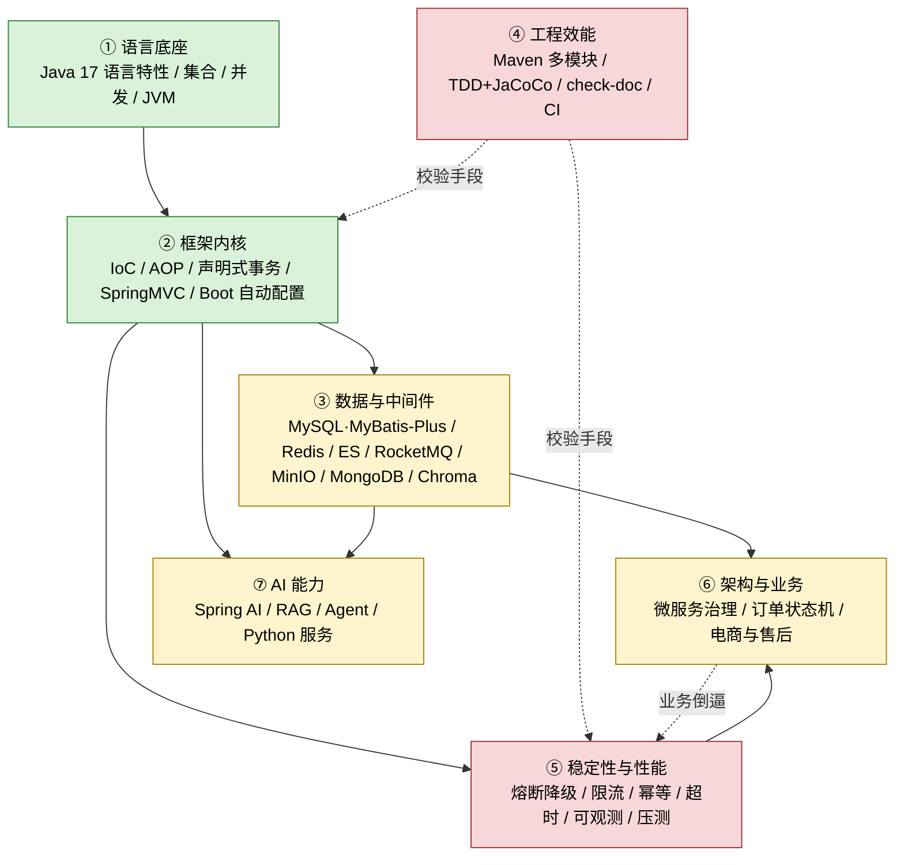
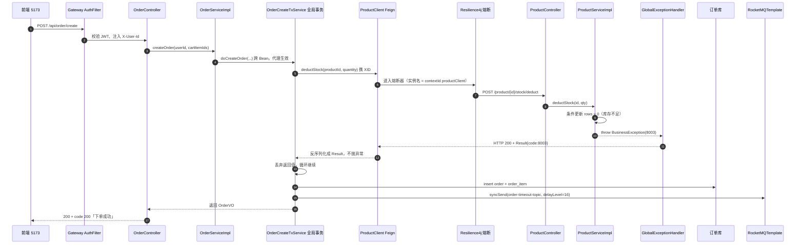

# 00.5 技术缺口总账：把全库的"证据缺口"和"技术债"列成一张可核对的表

> **一句话结论**：本仓 521 个 main 源文件、147 个测试文件、1331 篇文档（41 万行），但真正被"当次命令证过"的结论只覆盖 `01-Java基础` 与 `02-Spring微服务` 两个模块；剩下的缺口不是"没写文档"，而是**七层能力里每一层都有几处"代码在跑、却没有人验证过它跑对没跑对"的位置**——这份文件是全库缺口的上位索引，把每处缺口钉到一个文件、一条命令、一个能观察到的现象上，再交给同目录四份专题计划去补。
> **阅读前置**：读得懂 `@FeignClient` 接口、`application.yml` 的 `spring.config.import`、Maven 多模块与 `mvn -pl` 的作用范围；手边有本仓、能跑 `pwsh` 与 `python`。不需要读过 Spring 源码，但需要接受一条纪律：**没有证据的结论一律标"依据官方文档 / 未验证"**。
> **依据与篇幅**：Spring Boot 4.2.0 / Spring Cloud 2026.0.0 / Spring Cloud Alibaba 2025.1.0.0 基线下，本仓 `ai-cs-*` 当次 `read` 核对的路径与行号、`learning-docs/24-源码分析/assets/source`（905 份摘录）里的 A 级锚点、以及 §1.3 四组可复现命令的真实输出；全篇约 700 行，预计阅读 35 分钟，按 P0→P2 动手约 20 小时。

## 0. 这份计划解决什么问题

### 现象一：库存没扣成功，订单却照样建出来了

`ai-cs-order/src/main/java/com/aics/order/service/impl/OrderCreateTxService.java#L93-L94` 只有一个语句式调用：

```java
for (CartItem item : cartItems) {
    productClient.deductStock(item.getProductId(), item.getQuantity());
}
```

返回值被丢掉了。而下游 `ai-cs-product/src/main/java/com/aics/product/service/impl/ProductServiceImpl.java#L200-L207` 在扣减失败时抛的是 `BusinessException(ResultCode.PRODUCT_STOCK_INSUFFICIENT, ...)`，这个异常由 `ai-cs-common/src/main/java/com/aics/common/exception/GlobalExceptionHandler.java#L35-L39` 处理——**那 5 行没有 `@ResponseStatus`**，于是 HTTP 状态码是 `200`，响应体里才是 `{"code":8003,"message":"商品库存不足…"}`。Feign 的默认错误判定只看状态码（依据 Feign 官方文档的 `ErrorDecoder.Default` 实现，见 §2.2 锚点三），200 就是成功，于是它把失败体当正常返回值交回去，调用方又不查 `code`。

结果：库存一件没扣，订单照样落库，30 分钟后还有一条延迟关单消息在 MQ 里等着。排障现场最典型的一句话是"日志里全是成功"。面试被追问"跨服务调用怎么判断业务失败"时，若只答"抛异常"，这条路就是反例。

### 现象二：order 服务的 Nacos 配置整段被静默丢掉

`ai-cs-order/src/main/resources/application.yml` 里 `spring.cloud` 出现了两次：`#L10` 是 nacos 的 discovery + config 地址，`#L25` 是 openfeign 的 circuitbreaker 开关。YAML 规范禁止重复键，但主流解析器不报错——后出现的覆盖前出现的。用 PyYAML 实测（命令与输出见 §1.3 第三组）：

```text
spring 下的键 : ['lifecycle', 'application', 'cloud', 'config']
spring.cloud  : {'openfeign': {'circuitbreaker': {'enabled': True}}}
nacos 是否还在: False
```

也就是说：**声明了 nacos 地址的那一段，在内存里根本不存在**。它今天还能启动，是因为 `spring.config.import`（`#L21-L24`）里的 `optional:` 前缀把缺失当成了"可选"，服务退回本机默认值继续跑。这类缺口的可怕之处是"没有任何报错"，只有换环境（改 `NACOS_ADDR`）时才炸。

### 现象三：notify 从来没有自己的 Nacos 配置，部署形态也少三块

11 个服务里，只有 `ai-cs-notify/src/main/resources/application.yml#L21-L23` 的 `spring.config.import` 只有一条：

```yaml
  config:
    import:
      - optional:nacos:aics-shared.yml
```

其余 10 个都同时 import 了 `aics-shared.yml` 和 `ai-cs-<服务名>.yml`（§1.3 第三组给了逐服务计数）。也就是说 notify 的专属配置只能写死在本地文件里，Nacos 上改任何 notify 专属项都不会生效；同时 `deploy/k8s/services/` 只有 8 份 manifest（`deploy/k8s/services/product-service.yaml` 等），缺 order、pay、mq 三个有独立端口的服务——**"代码里有的服务"和"部署文件里有的服务"对不上**，而且项目里没有任何自动比对，全靠人眼看。

这些现象指向同一件事：**本仓的技术债绝大多数不是"写错了"，而是"错了没人知道"**——错误被 HTTP 200 吃掉、被可选配置吃掉、被没人跑的比对漏掉。补全计划的第一步不是学更多知识，而是给每一层能力造一个"能看见"的观测点。

## 1. 能力地图

### 1.1 七层能力分层与依赖



> **读图说明**：先看两条实线 `L2 --> L3` 与 `L2 --> L5`——数据访问与稳定性都长在框架内核上，所以"事务/代理没吃透"会同时污染中间件层与稳定性层，这也是本仓一处 `@ResponseStatus` 缺失能一路污染到订单业务的原因。再看两条虚线：`L4 -.-> L5` 表示"工程效能是稳定性的校验手段"，而不是它的上游能力，把它理解成依赖关系就会得出"先补 CI 再补熔断"的错误顺序；本仓 `deploy/k8s/services/` 少三份 manifest 却没人发现，恰恰是这条虚线不存在才发生的事。颜色是成熟度：绿=文档与证据都已按新范式重写，黄=文档仍是旧稿但代码有真实落地，红=不仅是旧稿、连"怎么验"的资产都缺（CI 门禁、压测/演练基线）。

### 1.2 七层成熟度表

| 层 | 主题 | 本项目有没有真实落地（可点开核对） | 对应文档 | 掌握判定标准 |
| --- | --- | --- | --- | --- |
| ① 语言底座 | 集合、并发、JVM、Java 17 语法 | 有：`ai-cs-order/src/main/java/com/aics/order/lock/OrderCreateLockService.java`（分布式锁的加锁/超时语义）、`ai-cs-order/src/main/java/com/aics/order/statemachine/OrderStateTransitionService.java`（状态机迁移的并发安全） | [01-Java基础](../01-Java基础/README.md)（**已新范式**，8 篇正文）、[04-Java基础补全开发计划](04-Java基础补全开发计划.md) | 给定一段 `synchronized` 与 Redis 锁混用的代码，能指出临界区被谁保护、锁泄漏点在哪 |
| ② 框架内核 | IoC、AOP、事务、MVC、Boot 自动配置 | 有：`ai-cs-order/src/main/java/com/aics/order/service/impl/OrderCreateTxService.java#L78`（`@GlobalTransactional` + `@Transactional` 同方法）、`ai-cs-common/src/main/java/com/aics/common/exception/GlobalExceptionHandler.java`（11 个 `@ExceptionHandler`） | [02-Spring微服务](../02-Spring微服务/README.md)（**已新范式**，18 篇正文）、[01-Spring技术补全开发计划](01-Spring技术补全开发计划.md)、[24-源码分析](../24-源码分析/README.md) | 能说出"注解在哪个代理、哪一刻、对谁生效"，并对着 `TransactionAspectSupport` 摘录指出失效发生在拿代理之前 |
| ③ 数据与中间件 | MySQL/MyBatis-Plus、Redis、ES、RocketMQ、MinIO、MongoDB、Chroma | 有：`ai-cs-product/src/main/java/com/aics/product/service/impl/ProductServiceImpl.java#L192-L213`（条件更新扣库存 + Redis 镜像双写）、`OrderCreateTxService.java#L130-L132`（`syncSend` 延迟消息） | [03-数据库与ORM](../03-数据库与ORM/README.md)（旧稿待升级）、[04-中间件](../04-中间件/README.md)（旧稿待升级）、[02-中间件补全开发计划](02-中间件补全开发计划.md) | 能解释"为什么扣库存用条件更新而不是先查后改"，以及 Redis 镜像与 DB 不一致时谁权威 |
| ④ 工程效能 | 多模块构建、TDD、覆盖率门禁、文档校验、CI | 部分有：`learning-docs/tools/check-doc.mjs`（本轮实际在用）、`ai-cs-order/src/test/java/com/aics/order/service/impl/OrderCreateTxWiringTest.java`（装配反例回归）；**缺失**：`.github/workflows/` 只有 `python-learning-validate.yml` 一个流水线，Java 构建与文档校验都没有 CI 触发 | [17-研发效能与工程实践](../17-研发效能与工程实践/README.md)（旧稿待升级）、[08-测试](../08-测试/README.md)（旧稿待升级） | 能说出"这条规则我破坏了，哪条命令会让它变红"，而不是"我们规范里写了" |
| ⑤ 稳定性与性能 | 熔断降级、限流、幂等、超时、可观测、压测 | 部分有：`ai-cs-order/src/main/java/com/aics/order/client/fallback/ProductClientFallbackFactory.java#L17`（关键写快速失败）、`ai-cs-common/src/main/java/com/aics/common/idempotent/IdempotentAspect.java`、`ai-cs-order/src/main/resources/application.yml#L61-L67`（OTLP 追踪配置）；**缺失**：没有压测基线、没有故障演练脚本，`management.tracing` 只有配置没有验收 | [13-稳定性工程](../13-稳定性工程/README.md)、[12-性能工程](../12-性能工程/README.md)、[20-生产实践](../20-生产实践/README.md)（均旧稿待升级）、[08-Feign熔断与降级语义](../02-Spring微服务/08-Feign熔断与降级语义.md) | 能说清"降级在什么异常上触发"——本仓 fallback 只兜网络异常/熔断，兜不住 200+失败体（§2.2 是证据） |
| ⑥ 架构与业务 | 微服务治理、网关、状态机、电商与售后 | 有：`ai-cs-gateway/src/main/java/com/aics/gateway/filter/AuthFilter.java`、`ai-cs-gateway/src/main/java/com/aics/gateway/config/RouteConfig.java`、`ai-cs-pay/src/main/java/com/aics/pay/service/PayNotifyService.java#L64-L73`（tx-message 与 feign 双模式切换） | [21-架构与分布式](../21-架构与分布式/README.md)、[23-电商业务开发](../23-电商业务开发/README.md)（旧稿待升级）、[03-微服务治理补全开发计划](03-微服务治理补全开发计划.md) | 能画出"一次下单"跨了哪几个服务、每段的失败语义是什么（抛异常 / 返回码 / 消息重试） |
| ⑦ AI 能力 | Spring AI、RAG、Agent、MCP、Python 服务 | 有：`ai-cs-chat/src/main/java/com/aics/chat/config/SpringAiConfig.java`、`ai-cs-chat/src/main/java/com/aics/chat/agent/tool/HandoffTool.java#L103`；Python 侧 `ai-cs-py-chat/requirements.txt` 与 `ai-cs-py-recommend/requirements.txt` | [05-AI集成](../05-AI集成/README.md)（52 篇但旧稿）、[10-Python服务](../10-Python服务/README.md)（仅 1 篇正文，证据最弱）、[22-Python速成](../22-Python速成/README.md) | 能说出"工具调用的失败怎么回到模型"，并指出本仓哪一处把失败吞成了成功 |

这张表要读出的结论只有一句：**七层里没有一层是空的，但只有 ①②两层同时具备"新范式文档 + 可复现证据"，③④⑤⑥⑦ 全部处于"代码有、验证无"或"验证有、文档旧"的状态——这正是本文件存在的理由。**

### 1.3 四组实测基线（都可以在仓库根 30 秒内复现）

**第一组：文档规模与模块成熟度分布**

```powershell
cd D:\Projects\Persion\ai-customer-service\learning-docs
$all = Get-ChildItem -Recurse -Filter *.md
$ex24 = $all | Where-Object { $_.FullName -notmatch '24-源码分析' }
"全库篇数 = " + $all.Count
"全库行数 = " + (($all | ForEach-Object { (Get-Content $_.FullName | Measure-Object -Line).Lines } | Measure-Object -Sum).Sum)
"除24外篇数 = " + $ex24.Count
"除24外行数 = " + (($ex24 | ForEach-Object { (Get-Content $_.FullName | Measure-Object -Line).Lines } | Measure-Object -Sum).Sum)
"编号目录数 = " + (Get-ChildItem -Directory | Where-Object { $_.Name -match '^\d\d-' }).Count
```

```text
全库篇数 = 1331
全库行数 = 414530
除24外篇数 = 310
除24外行数 = 115734
编号目录数 = 25
```

怎么读：`1331` 里有 `1021` 篇是 `24-源码分析` 的源码摘录与分册，真正属于"教程正文"的是 `310` 篇 / `115734` 行；编号目录 `25` 个是 `00`~`23` 加 `24-源码分析`。同一轮还量到：`01-Java基础` 9 个文件 / 6872 行（8 篇正文 + README，**已新范式**）、`02-Spring微服务` 19 个文件 / 15126 行（18 篇正文 + README，**已新范式**）、`00-学习路线总览` 6 个文件 / 2204 行（其中五份计划 376 / 424 / 304 / 347 / 本文），**其余 21 个模块仍是旧稿**。所以"文档成熟度"的正确说法是：2 个模块合格、21 个模块待升级，而不是"文档很全"。

**第二组：Feign 返回值被丢弃的调用点**

```powershell
cd D:\Projects\Persion\ai-customer-service
$main = Get-ChildItem .\ai-cs-*\src\main\java -Recurse -Filter *.java
"main java = " + $main.Count
"test java = " + (Get-ChildItem .\ai-cs-*\src\test\java -Recurse -Filter *.java).Count
"含 @FeignClient 的接口 = " + ($main | Select-String -Pattern '@FeignClient').Count
```

```text
main java = 521
test java = 147
含 @FeignClient 的接口 = 13
```

再用脚本（`python` + 正则）把 13 个接口里"返回 `Result<...>`"的方法与全部调用点交叉比对，得到三个数字：**Feign 方法 26 个、其中返回 `Result` 的 25 个、把返回值语句式丢弃的调用点 13 处**。其中四处最要命：

| 调用点 | 丢掉的是什么 | 出错时会发生什么 |
| --- | --- | --- |
| `ai-cs-order/src/main/java/com/aics/order/service/impl/OrderCreateTxService.java#L94` | `deductStock` 的 `Result` | 库存不足照样建单（本文 §4 全流程） |
| `ai-cs-order/src/main/java/com/aics/order/service/impl/OrderServiceImpl.java#L195` | `restoreStock` 的 `Result` | 退款回补库存失败，订单却继续迁到 `REFUND_SUCCESS` |
| `ai-cs-order/src/main/java/com/aics/order/service/impl/OrderServiceImpl.java#L231` | `restoreStock` 的 `Result` | 取消/超时归还库存失败但状态已关单 |
| `ai-cs-order/src/main/java/com/aics/order/service/impl/OrderServiceImpl.java#L261` | `payClient.closeOrder` 的 `Result` | `#L262` 照样打印"已通知支付服务关单"，因为 catch 只接异常不接失败体 |

怎么读：`13` 不是"13 个 bug"，而是"13 处没有校验点"；其中 `chat` 侧 9 处多为可观测类写操作（trace、usage、audit），丢了只影响统计；`order` 侧 4 处全在钱和库存上，属于必须补的 P0。判据是**这次写失败之后，业务状态会不会撒谎**。

**第三组：配置一致性——重复键与缺失的 dataId**

```powershell
cd D:\Projects\Persion\ai-customer-service
Get-Content .\ai-cs-order\src\main\resources\application.yml | Select-String -Pattern '^\s{0,2}(spring|cloud|seata):'
Get-ChildItem .\ai-cs-*\src\main\resources\application.yml | ForEach-Object {
  $n = (Select-String -Path $_.FullName -Pattern 'optional:nacos').Count
  $svc = $_.FullName -replace '\\src\\main\\resources\\application.yml$','' -replace '.*\\',''
  "{0,-16} import={1}" -f $svc, $n
}
```

```text
L5: spring:
L10:   cloud:
L25:   cloud:
L34: seata:

ai-cs-chat       import=2
ai-cs-gateway    import=2
ai-cs-knowledge  import=2
ai-cs-message    import=2
ai-cs-mq         import=2
ai-cs-notify     import=1
ai-cs-order      import=2
ai-cs-pay        import=2
ai-cs-product    import=2
ai-cs-search     import=2
ai-cs-user       import=2
```

再用 PyYAML 证明重复键的后果（脚本三行，输出即结论）：

```python
import yaml, pathlib
d = yaml.safe_load(pathlib.Path("ai-cs-order/src/main/resources/application.yml").read_text(encoding="utf-8"))
print(list(d["spring"].keys()), d["spring"]["cloud"], "nacos" in d["spring"]["cloud"])
```

```text
['lifecycle', 'application', 'cloud', 'config'] {'openfeign': {'circuitbreaker': {'enabled': True}}} False
```

怎么读：`cloud:` 出现两次（`#L10`、`#L25`），所以 `spring.cloud` 里只剩 openfeign 那段，nacos 整段消失（第三个 `False` 是判据）；`notify` 的 `import=1` 说明它没有资格从 Nacos 读自己的 dataId。注意 PyYAML 的 `safe_load` 是"宽容模式"，严格的解析器（如 SnakeYAML 的重复键检测）会直接报 `found duplicate key`——两种行为都不该由运行时才发现。

**第四组：技术债盘点（迁移债、部署、CI、多语言）**

```powershell
cd D:\Projects\Persion\ai-customer-service
"starter-web 出现模块数 = " + (Select-String -Path .\ai-cs-*\pom.xml -Pattern '<artifactId>spring-boot-starter-web</artifactId>').Count
"actuator 出现模块数 = " + (Select-String -Path .\ai-cs-*\pom.xml -Pattern 'spring-boot-starter-actuator').Count
"k8s manifest 数 = " + (Get-ChildItem .\deploy\k8s\services -File).Count
"CI 流水线 = " + (Get-ChildItem .\.github\workflows -File).Count
```

```text
starter-web 出现模块数 = 11
actuator 出现模块数 = 11
k8s manifest 数 = 8
CI 流水线 = 1
```

怎么读：`11` 个模块还在用 Boot 4 已 deprecated 的 `spring-boot-starter-web`（`ai-cs-order/pom.xml#L24`；唯一改对的是 `ai-cs-gateway/pom.xml#L50` 的 `spring-boot-starter-webmvc`），这是"能编译、但有弃用债"的典型；`8` 份 manifest 对 11 个有端口的服务，缺 order / pay / mq；`1` 条 CI 只管 Python 学习材料，Java 构建与 `check-doc.mjs` 都靠人记得跑。另外 Python 两侧密度悬殊：`ai-cs-py-chat` 13 个 `.py` / 11 个测试文件，`ai-cs-py-recommend` 19 个 `.py` / 2 个测试文件——**同一专题里一半有回归、一半没有**。

### 1.4 从哪一节读起

| 你是谁 | 建议入口 | 可以跳过 |
| --- | --- | --- |
| 要判断"这仓到底还差什么"（评审 / 交接 / 答辩） | §2 总表 + §5 取舍 + §7 时效 | §3 的分阶段细节 |
| 认领了一个具体缺口（例如 order 的配置） | §2 对应行 → §3 的该阶段 → §6 自证方法 | §4 的时序图 |
| 只想补业务正确性，不想碰文档 | §4 时序 + §9 练习 1、2、3 | §1 的分层图 |
| 维护 learning-docs 本身 | §1.3 四组命令 + §9 练习 7 | §3 P2 的 CI 部分 |

## 2. 缺口诊断

### 2.1 全库缺口总表

判定证据一栏里的 `#L` 全部为当次核对的真实行号；命令类证据的原始输出在 §1.3。

| # | 缺口 | 影响范围 | 判定证据 | 补齐后能验证什么 |
| --- | --- | --- | --- | --- |
| 1 | 业务异常返回 HTTP `200`（`@ResponseStatus` 缺失） | ai-cs-common + 全部 11 个服务 | `ai-cs-common/src/main/java/com/aics/common/exception/GlobalExceptionHandler.java#L35-L39` 无 `@ResponseStatus`；同文件 `#L45`、`#L58`、`#L71`、`#L85`、`#L98`、`#L110`、`#L120`、`#L130`、`#L150` 十个分支都有 | `curl -i` 一次库存不足请求，能看到 `4xx` 与失败体一致；Feign 调用方 try/catch 真的会进 catch |
| 2 | Feign 返回值不校验（13 处丢弃） | ai-cs-order（4 处关键写）、ai-cs-chat（9 处观测写） | §1.3 第二组实测：25 个返回 `Result` 的方法 / 13 处语句式调用；代表点 `OrderCreateTxService.java#L94` | 库存不足时下单接口返回 `8003`，DB 里没有新订单 |
| 3 | order 的 yml 有重复 `cloud:` 键 | ai-cs-order | `ai-cs-order/src/main/resources/application.yml#L10` 与 `#L25`；PyYAML 实测 nacos 段消失 | 启动后 `spring.cloud.nacos.*` 能取到值（临时开启 `management.endpoints.web.exposure.include=env` 查，或看注册日志） |
| 4 | notify 缺自己的 Nacos dataId | ai-cs-notify | `ai-cs-notify/src/main/resources/application.yml#L21-L23` 只有 `aics-shared.yml`；其余 10 个服务 `import=2` | 在 Nacos 改 notify 专属项（如 consumer group）后重启即生效，无需改本地文件 |
| 5 | `spring-boot-starter-web` 迁移债 11 个模块 | 除 gateway 外全部 | `ai-cs-order/pom.xml#L24` 等 11 处；对照 `ai-cs-gateway/pom.xml#L50` 已用 `webmvc` | `mvn -pl ai-cs-order dependency:tree` 里不再出现 deprecated starter；Boot 4 弃用告警消失 |
| 6 | Seata 无 A 级源码可引 | ai-cs-order 与全部 Seata 文档 | `24-源码分析/assets/source` 下 `*Seata*` 文件数为 0；且根 `pom.xml#L52` 声明 `seata.version=1.7.1`，与文档基线 2.7.0 不一致 | 要么补 XID 传播 / undo_log 的摘录，要么在文档里明确写"依据官方文档 + 本项目配置"，不再假装有源码证据 |
| 7 | K8s manifest 缺 order / pay / mq | deploy | `deploy/k8s/services/` 仅 8 份（含 `deploy/k8s/services/product-service.yaml`），端口表有 11 个服务 | 一次 `kubectl apply --dry-run=client -f deploy/k8s/services` 覆盖 11 个服务名 |
| 8 | CI 只校验 Python 学习材料 | 工程效能 | `.github/workflows/` 只有 `python-learning-validate.yml`；`learning-docs/tools/check-doc.mjs` 全靠手动跑 | PR 上自动出现 Java 编译 + `node tools/check-doc.mjs` 结果 |
| 9 | 文档成熟度断层：21 个模块仍旧稿 | learning-docs | §1.3 第一组：310 篇正文中仅 `01`（9 篇 / 6872 行）与 `02`（19 篇 / 15126 行）为新范式 | 任意模块的结论都能按"命令 + 真实输出 + 怎么读"复核，而不是引用旧数字 |
| 10 | 测试密度与主链路不匹配 | ai-cs-order / product / pay | main 521 / test 147；`ai-cs-order/src/test/java/com/aics/order/service/OrderServiceTest.java#L144` 用 `thenReturn(Result.success())`，失败码分支无覆盖 | 把 §4 的修复回滚，测试变红；现在回滚它是绿的 |
| 11 | 支付回调两套范式并存，丢失语义不同 | ai-cs-pay / ai-cs-order | `ai-cs-pay/src/main/java/com/aics/pay/service/PayNotifyService.java#L64-L73`（`txNotifyEnabled` 切换 tx-message 与 feign）；`ai-cs-pay/src/main/java/com/aics/pay/client/OrderPayClient.java#L96-L101` 手写 `isOk` 解析 `code` | 能说清"哪种模式下 Feign 失败会丢事件"，并给出对账兜底路径 |
| 12 | 跨服务调用存在两套失败语义 | ai-cs-pay 与 ai-cs-order | 同一仓里：Feign 不解析业务码（`ai-cs-order/src/main/java/com/aics/order/client/ProductClient.java#L35-L36` 返回 `Result`），手写 RestTemplate 却显式解析（`OrderPayClient.java#L96-L101`） | 在 common 落一个"Result 校验工具"，两种客户端共用一条判据 |
| 13 | 网关与业务错误语义不统一 | ai-cs-gateway + ai-cs-common | `ai-cs-gateway/src/main/java/com/aics/gateway/controller/GatewayFallbackController.java#L21` 用 `@ResponseStatus(SERVICE_UNAVAILABLE)`（503），业务异常却是 200 | 前端只需一套判定：状态码 + 业务码二选一，不用两套并存 |
| 14 | 可观测性只有配置、没有验收 | 11 个服务 | `ai-cs-order/src/main/resources/application.yml#L61-L67` 的 `management.tracing` / `otlp`；`deploy/observability/grafana/provisioning` 有数据源配置 | 一次下单请求能在 Grafana 里看到跨 order→product 的 span，而不是"配置文件里有 tracing" |
| 15 | 前端与 React 侧证据弱 | ai-cs-frontend / ai-cs-frontend-react | 实测 `ai-cs-frontend` 45 个 ts/vue/js、8 个测试；`ai-cs-frontend-react` 6 个、1 个测试 | 两条前端链路都能给出"跑什么命令、看到什么"的验收动作 |
| 16 | Python 服务证据弱且测试密度不均 | ai-cs-py-chat / ai-cs-py-recommend | 13 个 `.py`/11 个测试 vs 19 个 `.py`/2 个测试；`learning-docs/10-Python服务` 正文仅 1 篇 | 两个服务都有可跑的验收命令与失败样例 |
| 17 | 缺口台账本身没有复核机制 | 全部文档 | 旧稿只有 78 行、数字全靠记忆；本文所有数字来自 §1.3 的四条命令 | 任何人重跑 §1.3 能复现本文每个数字，偏差即过期 |

统计一下：17 行里有 15 行能落到"具体文件 + 行号或具体命令"，剩下 2 行（#15、#16）只能给目录级规模——这本身就是缺口的一部分，说明前端与 Python 侧还缺少可引用的代码级锚点。

### 2.2 四处源码锚点：把"为什么错"钉在源码上

**锚点一：没有 `@ResponseStatus` 时，状态码根本不会被改** —— [[源码:ServletInvocableHandlerMethod.java.md#L149-L168]]

`setResponseStatus` 的第一段只有四行：取 `HttpStatusCode status = getResponseStatus()`，`if (status == null) return;`。也就是说——**没标 `@ResponseStatus`，这段代码直接返回，`HttpServletResponse` 保持默认的 200**。

这条锚点解释了本仓最贵的那个缺口：`GlobalExceptionHandler.handleBusinessException` 没有注解，所以它 `return Result.fail(...)` 时，异常确实被接住了、日志确实打了、响应体确实是失败码，但**HTTP 状态码是 200**。对浏览器前端来说无所谓（前端看 body），对 Feign 来说就是"成功"。

**锚点二：异常处理方法自己也走这条路径** —— [[源码:ServletInvocableHandlerMethod.java.md#L115-L122]]

`doInvoke` 里先 `invokeForRequest(...)` 拿到返回值，紧接着 `setResponseStatus(webRequest)`，最后才处理返回值。`@ExceptionHandler` 方法本质上也是一个 `HandlerMethod`，因此它同样经过 `ServletInvocableHandlerMethod`，同样受"有没有 `@ResponseStatus`"控制。

所以"给异常处理方法加注解"不是一个风格选择，而是**唯一能改变状态码的位置**。看错这条会得出"在 `@ExceptionHandler` 里手动 `response.setStatus(...)` 也行"——那当然也行，但它绕过了框架的统一入口，后续换 `ResponseEntity` 或换消息转换器时会失配。

**锚点三：Feign 判定成功与否只看状态码** —— [[源码:FeignClientFactoryBean.java.md#L214-L222]]

`configureUsingConfiguration` 从容器里取 `ErrorDecoder`（`getInheritedAwareOptional(context, ErrorDecoder.class)`），取到就 `builder.errorDecoder(...)`，取不到则由 Feign 自己的默认实现兜底。而默认实现（依据 Feign 官方文档 `feign.codec.ErrorDecoder.Default`）只做一件事：**`status` 不在 2xx 区间时构造并抛出 `FeignException`**。

推论：只要下游返回 200，无论响应体里的 `code` 是 `8003` 还是 `500`，Feign 都不会抛；本仓也没自定义 `ErrorDecoder` 去解析 `Result`。所以"业务失败"这条信息在跨服务边界上**完全依赖调用方自己看 `Result.getCode()`**。

**锚点四：200 的响应体照样会被反序列化成 `Result`** —— [[源码:FeignClientsConfiguration.java.md#L112-L116]]

默认解码器是三层装饰：`new OptionalDecoder(new ResponseEntityDecoder(new SpringDecoder(messageConverters)))`。`SpringDecoder` 用同一个 `HttpMessageConverters` 体系把 JSON 解成 `Result<Void>`——所以失败体会被**成功解析**成一个对象，字段齐全、`code=8003`，然后被 `OrderCreateTxService.java#L94` 丢掉。

这四段连起来就是一句可背诵的话：**异常被接住了（锚点二）、状态码没被改（锚点一）、Feign 因此认为成功（锚点三）、失败体还被优雅解析成对象（锚点四），最后调用方把对象丢了。**

另外补一处对照锚点：如果异常类上标了 `@ResponseStatus` 或抛的是 `ResponseStatusException`，则由 `ResponseStatusExceptionResolver` 在更外层把状态码写进响应——[[源码:ResponseStatusExceptionResolver.java.md#L78-L99]]：先判 `ex instanceof ResponseStatusException`，再用 `AnnotatedElementUtils.findMergedAnnotation(ex.getClass(), ResponseStatus.class)` 找注解。这给了 P0 修复的第二条路（改造 `BusinessException` 携带状态码），§3 会把两条路的代价摆出来。

## 3. 补全路线

四个阶段：P0 拆成两段（错误语义、配置一致性），都是"正确性问题"；P1 是可观测与性能；P2 是能力外延。**阶段之间不是线性的**：P0-1 的验收动作会反复用到 P1 的观测点。

| 阶段 | 目标能力 | 学哪些文档 | 项目落地动作 | 验收标准 | 预计投入 |
| --- | --- | --- | --- | --- | --- |
| **P0-1 错误语义统一** | 让"失败"在 HTTP 层就是失败 | [17-SpringMVC请求全链路与参数校验](../02-Spring微服务/17-SpringMVC请求全链路与参数校验.md)、[拦截器与异常处理](../24-源码分析/01-Spring框架/04-SpringMVC/04-拦截器与异常处理-interceptor与controlleradvice.md)、[08-Feign熔断与降级语义](../02-Spring微服务/08-Feign熔断与降级语义.md)、[openfeign 动态代理与请求拼接](../24-源码分析/04-SpringCloud/03-负载均衡与调用/02-openfeign-动态代理与请求拼接.md) | ① 给 `GlobalExceptionHandler` 的 `handleBusinessException` 补状态码策略；② 补 order 侧 4 处 Feign 返回值校验；③ 加一条 `thenReturn(Result.fail(8003,...))` 的用例 | `curl -i` 业务失败拿到 4xx；新增用例在修复前红、修复后绿 | 8 小时 |
| **P0-2 配置一致性** | 让"配置生效"可被证明 | [03-Nacos注册与配置中心](../02-Spring微服务/03-Nacos注册与配置中心.md)、[environment 环境抽象与配置加载](../24-源码分析/02-SpringBoot/04-配置与属性绑定/02-环境抽象与配置加载-configdata与profile.md)、[01-configurationproperties 属性绑定原理](../24-源码分析/02-SpringBoot/04-配置与属性绑定/01-configurationproperties-属性绑定原理.md) | ① 合并 order yml 的两个 `cloud:`；② 给 notify 补 `optional:nacos:ai-cs-notify.yml`；③ 把 §1.3 第三组的两条命令写进部署检查清单 | PyYAML 复跑输出里 `nacos` 为 `True`；各服务 `import` 计数全为 2 | 4 小时 |
| **P1 可观测与性能** | 让"跑得对"能被看见 | [13-稳定性工程](../13-稳定性工程/README.md)、[12-性能工程](../12-性能工程/README.md)、[14-分布式幂等设计](../02-Spring微服务/14-分布式幂等设计.md)、[断点清单-按框架速查](../24-源码分析/07-源码方法论与附录/02-源码阅读方法论/02-断点清单-按框架速查.md) | ① 临时开 `management.endpoints.web.exposure.include=env,configprops` 做一次性核对；② 打通一次 OTLP 链路；③ 给 Feign 超时/熔断实例名与 `contextId` 对齐做核对表 | 一次下单请求在 Grafana 有完整 span；`/actuator/health` 之外能查到 `spring.cloud.nacos.*` | 6 小时 |
| **P2 能力外延** | 让"约束"自动生效 | [17-研发效能与工程实践](../17-研发效能与工程实践/README.md)、[16-云原生与GitOps](../16-云原生与GitOps/README.md)、[03-微服务治理补全开发计划](03-微服务治理补全开发计划.md) | ① 补 order / pay / mq 三份 K8s manifest；② 加一条 CI：Java 编译 + `node tools/check-doc.mjs`；③ 21 个旧稿模块按 01/02 范式逐步升级 | CI 在 PR 上自动出结果；`kubectl apply --dry-run=client` 覆盖 11 个服务 | 12 小时 |

P0-1 的第一个动作要给两张路可选，代价不同，必须显式选一次：

| 做法 | 改动面 | 好处 | 代价 |
| --- | --- | --- | --- |
| A. 给 `handleBusinessException` 加 `@ResponseStatus`（如 `BAD_REQUEST`） | 1 个文件 1 行 | 立刻让 Feign 走异常分支，改动最小 | 所有业务码都变成 `400`，语义粗糙；前端若依赖 200+body 会一起改 |
| B. 让 `BusinessException` 携带 `HttpStatus`，方法返回 `ResponseEntity<Result<Void>>` | `BusinessException` + `GlobalExceptionHandler` 两个文件 | 状态码语义准确（库存不足 409/400、找不到 404） | 需改构造函数与既有抛出点；`ai-cs-common/src/main/java/com/aics/common/exception/BusinessException.java#L10` 的所有子类都要过一遍 |

本计划推荐 **B**，理由是"状态码要能表达语义"这件事一旦让步，后面每一次排障都要重新靠 body 反推；但如果时间窗只有半天，先做 A 止血、把 B 排进同一阶段的第二个提交。

各阶段的验收命令（都在仓库根跑，单条不超过 30 秒）：

```powershell
# P0-2 的验收：nacos 段必须还在
python -c "import yaml,pathlib;d=yaml.safe_load(pathlib.Path('ai-cs-order/src/main/resources/application.yml').read_text(encoding='utf-8'));print('nacos' in d['spring']['cloud'])"
# 期望输出：True

# P0-2 的验收：每个服务都 import 自己的 dataId
Get-ChildItem .\ai-cs-*\src\main\resources\application.yml | ForEach-Object { (Select-String -Path $_.FullName -Pattern 'optional:nacos').Count } | Group-Object | Select-Object Name,Count

# P2 的验收：部署文件与端口表对得上
(Get-ChildItem .\deploy\k8s\services -File).Count   # 期望 11
```

风险要说在前面：改 `GlobalExceptionHandler` 会影响 11 个服务的全部错误响应，**必须先跑一遍各服务的 Controller 单测**（`mvn -pl ai-cs-order test` 这类单模块命令，不要全量构建）；合并 yml 时如果 Nacos 上已有同名 dataId，本地改动可能被远端覆盖，改完要用 `/actuator/env` 或启动日志确认最终值来自哪里——`spring.config.import` 里 `optional:` 的语义（见 [环境抽象与配置加载](../24-源码分析/02-SpringBoot/04-配置与属性绑定/02-环境抽象与配置加载-configdata与profile.md)）决定了"缺了不报错"，也决定了"覆盖了不报错"。


> **读图说明**：主路径是 `P0-1 → P0-2`，不能颠倒——先让失败变成 4xx，配置类问题才会在启动/调用时"喊出来"；若先改配置后改语义，你会在一堆 200 里猜配置有没有生效。虚线 `P2 -.-> P01` 是这份文件的关键设计：补全不是一次性工程，P2 每补一块（尤其 CI），都会重新定义"什么算已知缺口"，所以总表要能回流更新。最容易看错的是把 P1 当成可选项——没有观测点，P0 的修复只能靠 `curl` 手测，回归一次就得重测一遍。

## 4. 一次真实落地的执行时序

选本仓最贵、最容易复现的那条：**一次跨服务下单，因为 `@ResponseStatus` 缺失被 Feign 当成成功**。参与者按真实类名标注，第 10 步是缺陷点。



> **读图说明**：盯住第 10 与第 11 步之间。第 10 步下游确实抛了异常、也确实被 `GlobalExceptionHandler` 接住并回了失败体，但第 11 步的状态码是 **200**——于是第 12 步 Feign 不抛、第 13 步 `#L94` 把 `Result` 丢掉、第 14~15 步照常落库发消息，第 16~17 步照样回「下单成功」。第二处要盯的是第 6 步的熔断器：它包在 Feign 调用外层，只对**异常**生效，第 11 步的 200 根本进不了熔断统计，所以"熔断器 + fallback 快速失败"这条防线在这条链上等于不存在。最容易看错的是第 10 步——以为"抛了 `BusinessException` 就是事务回滚"，实际全局事务的回滚要等异常穿过代理边界冒出来，这里它被 HTTP 层吃掉了。

哪一步没做会出现什么（这五条都能直接复现）：

- 第 10 步的 `BusinessException` 若不抛、改成"返回 null"，则下游连失败体都没有，问题从"静默成功"降级为"空指针"，更难查。
- 第 11 步若不回 200（修成 4xx），Feign 会在第 12 步抛 `FeignException`，回调走 fallback，`ProductClientFallbackFactory.java#L17` 的"关键写快速失败"才真正生效，第 14~15 步不会执行。
- 第 13 步若校验 `Result.getCode()`（本计划推荐的第二个修复点），即使状态码仍是 200，也能在抛业务异常后阻止建单——**两处修一处即可止血，都修才叫统一**。
- 第 15 步的 `syncSend` 在本地事务提交前发出（`OrderCreateTxService.java#L130-L132`），所以即使第 14 步回滚，消息可能已经发出；消费侧必须靠"查不到订单就返回"兜底。
- 若第 6 步熔断器实例名与 `contextId` 不一致（`ai-cs-order/src/main/java/com/aics/order/client/ProductClient.java#L27-L29` 声明的是 `productClient`），你会看到熔断状态挂在两个不同名字上，排障时数不到一起。

修复点的三处落位（按推荐顺序）：

| 修复点 | 文件 | 判据 | 副作用 |
| --- | --- | --- | --- |
| ① 状态码 | `ai-cs-common/src/main/java/com/aics/common/exception/GlobalExceptionHandler.java#L35-L39` | `curl -i` 看到 4xx | 影响全部服务的错误响应契约，需回归 |
| ② 返回值校验 | `ai-cs-order/src/main/java/com/aics/order/service/impl/OrderCreateTxService.java#L94` 与 `OrderServiceImpl.java#L195`、`#L231`、`#L261` | 失败时抛 `BusinessException` | 需区分"关键写"与"尽力而为"，后者只记日志 |
| ③ 守护测试 | `ai-cs-order/src/test/java/com/aics/order/service/OrderServiceTest.java#L144` | 改成 `thenReturn(Result.fail(...))` 后用例必须红 | mock 语义变化，需同步断言 |

## 5. 优先级与取舍

| 决定 | 具体内容 | 理由 | 代价 / 风险 |
| --- | --- | --- | --- |
| **做** | P0-1 错误语义统一（状态码 + order 侧 4 处校验） | 4 处全在钱与库存上，且已有一次"库存没扣、订单已建"的完整链路证据 | 8 小时；影响全部服务的错误契约，需回归 |
| **做** | P0-2 配置一致性（重复键 + notify dataId） | 静默失效、无报错、换环境才炸，属于典型的"越晚发现越贵" | 4 小时；合并 yml 时要确认 Nacos 远端是否也定义同名键 |
| **做** | P1 可观测验收（env 核对 + 一次 OTLP 链路） | 没有观测点，P0 的修复无法回归，只能反复 `curl` | 6 小时；需要本地起 Collector，属于环境成本 |
| **不做**（本阶段） | 一次性修完 13 处 Feign 返回值 | chat 侧 9 处是观测写（trace/usage/audit），同步失败会让日志链路阻塞主流程 | 若强改，需为观测写设计异步+丢弃策略，收益低 |
| **不做** | 推倒重来统一异常体系（换掉 `Result` + `BusinessException`） | 11 个服务、25 个 Feign 方法都在用，重构面远超收益 | 一旦动契约，前端、网关、SDK 全部要跟 |
| **不做** | 引入 Seata TC 集群 / Nacos 集群部署 | 本地 `file` registry 已够验证；集群化属于运维专题 | 与 §3 的验收标准无关，属新能力建设 |
| **延后** | `spring-boot-starter-web` → `webmvc` 迁移（11 个模块） | 目前只产生弃用提示，不影响行为；改法与 Boot 4 升级节奏绑定 | 越晚改，与 Jackson 3 默认化的耦合越难拆 |
| **延后** | 前端 / React / Python 侧的代码修复 | 证据密度不足（§2 表 #15、#16），先补"可验收命令"再谈修 | 现状继续靠人工点测 |
| **延后** | 全库 21 个旧稿模块升级 | 与本文同构的工作量，需按模块分派，不属本文件范围 | 旧稿数字继续漂移，靠 §1.3 命令兜底 |

**本计划刻意不做的 5 件事**（避免与其他四份计划、其他模块负责人打架）：

1. **不做"框架源码通读"**：905 份摘录里与本仓缺口相关的不足五分之一，其余读完没有落地场景。需要哪一段就引哪一段 A 级锚点（§2.2 就是范例）。
2. **不做中间件内部原理**（Redis 持久化、RocketMQ 存储、ES 段合并、Chroma 索引结构）——归 [02-中间件补全开发计划](02-中间件补全开发计划.md)。
3. **不做服务治理的配置面**（Nacos 集群、Sentinel 规则持久化、Seata TC 部署）——归 [03-微服务治理补全开发计划](03-微服务治理补全开发计划.md)。本文只登记"order 的 yml 写错了"这类**配置正确性**问题，不展开治理架构。
4. **不做语言层教学**（集合、并发、JVM 调优的具体原理）——归 [04-Java基础补全开发计划](04-Java基础补全开发计划.md) 与 [01-Java基础](../01-Java基础/README.md)。
5. **不写"第 N 批补全"式的流水账**：旧稿里"第三批/第四批/第十七批补全…"这类排期叙述已全部作废——判据不是"读了几篇/补了几批"，而是**能不能拿出一次可观察的行为改变**。

## 6. 常见误区与自己怎么验

### 6.1 误区：Feign 调用在业务失败时会抛异常

为什么错：Feign 的默认 `ErrorDecoder.Default` 只看 HTTP 状态码（§2.2 锚点三），而本仓业务异常走的是 200 + 失败体（`GlobalExceptionHandler.java#L35-L39`）。异常根本没发生，`try/catch` 自然不会进。

怎么自证：用一个库存不足的商品调 `/api/order/create`，`curl -i` 看状态码；同时开启 Feign 日志（`logging.level.com.aics.order.client=debug`）观察响应体。判据是**状态码 200 而 body 里 `code=8003`**——这一对矛盾值就是缺口的指纹。

### 6.2 误区：写了 fallback 就等于失败可控

为什么错：`ai-cs-order/src/main/java/com/aics/order/client/fallback/ProductClientFallbackFactory.java#L17` 的注释写得很硬气（"库存没扣成功下单必须失败"），但 fallback 只在 Feign 抛异常或熔断打开时触发；200+失败体既不是异常也不计入熔断失败率，`#L36` 那段代码永远不会被执行。

怎么自证：在下游 `ProductServiceImpl.deductStock` 里临时制造库存不足，观察 order 侧日志——你不会看到 fallback 的告警，只会看到下单成功。要验 fallback，得先把下游服务停掉（网络异常）才触发。

### 6.3 误区：yml 里同一个键写两次，两个都生效

为什么错：YAML 解析结果是 `Map`，重复键后者覆盖前者（严格解析器直接报 `found duplicate key`）。`ai-cs-order/src/main/resources/application.yml#L10` 与 `#L25` 就是实例，PyYAML 实测 nacos 段整段消失。

怎么自证：跑 §1.3 第三组的 Python 三行命令，看 `nacos` 是否为 `False`；改完再跑一次确认变 `True`。**别用"服务能启动"当判据**——`optional:` 前缀让缺失也不报错。

### 6.4 误区：notify 能正常推送，说明它的配置没问题

为什么错：notify 缺的是"自己的 dataId"（`ai-cs-notify/src/main/resources/application.yml#L21-L23` 只有 `aics-shared.yml`）。共享配置里通常已含注册中心地址与通用项，所以服务照常启动、WebSocket 照常推；只有当你去 Nacos 改一个 notify 专属值（比如 consumer group）时，才会发现"改了没用"。

怎么自证：在 Nacos 的 `aics` 命名空间新建 `ai-cs-notify.yml`，写入一个明显生效的项（如 `logging.level.com.aics.notify=debug`），重启后看日志级别是否变化；变化与否直接证明 import 是否接通。

### 6.5 误区：单测绿了就说明链路对

为什么错：`ai-cs-order/src/test/java/com/aics/order/service/OrderServiceTest.java#L144` 用 `thenReturn(Result.success())` 模拟下游，永远不会返回失败体；单测也不跨 HTTP 边界，所以"200 + 失败体"这种真实形态在测试里构造不出来。

怎么自证：把 mock 改成 `thenReturn(Result.fail(8003, "库存不足"))`——当前代码会**继续建单并断言成功**（因为返回值被丢），用例仍是绿的；只有加上校验后才会红。能观察到这个"绿→红→绿"的过程，才算真的懂了这个缺口。

### 6.6 误区：文档里的数字可以沿用

为什么错：旧稿（78 行）里的模块清单、端口、规模数字全部过期；本文所有数字都来自 §1.3 的四条命令，且其中"docs 篇数 1331 / 41 万行"与旧稿口径完全不同（旧稿按"内容模块"数，实测把 `24-源码分析` 也算进去了）。

怎么自证：跑一遍 §1.3 第一组，对比你手上任何一份文档里的数字；不一致就以命令输出为准，并顺手把该文档标成待更新。

### 6.7 误区：Seata 的说法都能在源码里找到依据

为什么错：`24-源码分析/assets/source` 下没有任何 Seata 相关摘录（实测 0 个文件），而根 `pom.xml#L52` 声明的 `seata.version` 是 `1.7.1`，与本文档基线 2.7.0 不一致。所以凡是涉及 XID 传播、undo_log 写法的结论，本仓只能给"配置 + 官方文档"两级证据。

怎么自证：`Get-ChildItem learning-docs\24-源码分析\assets\source -Filter '*Seata*'` 应为空；再 `mvn -pl ai-cs-order dependency:tree -Dincludes=io.seata` 看实际解析版本。任何一个说自己"读过 Seata 源码"的人，先让他指出摘录文件路径。

## 7. ⚠️ 版本与时效

| 结论 | 依赖的版本或前提 | 什么情况下会失效 | 怎么复核 |
| --- | --- | --- | --- |
| 未标 `@ResponseStatus` 的 `@ExceptionHandler` 返回 200 | Spring Framework 7.1.0 的 `ServletInvocableHandlerMethod#setResponseStatus` 行为 | 框架改动"默认状态码"策略，或项目改用 `ResponseEntity` 显式返回 | 重跑 §2.2 锚点一：`Test-Path learning-docs\24-源码分析\assets\source\ServletInvocableHandlerMethod.java.md`，再看 `#L149-L153` |
| Feign 仅在非 2xx 时抛异常 | Feign 官方 `ErrorDecoder.Default`；本仓未自定义 `ErrorDecoder` | 项目自定义 `ErrorDecoder` 解析 `Result`，或换用 `RestClient`/`WebClient` | `grep` 全仓 `ErrorDecoder`：当前无自定义；一旦出现，§4 时序要重画 |
| Boot 4 起 `spring-boot-starter-web` 已 deprecated，应用 `spring-boot-starter-webmvc` | Spring Boot ≥ 4.0，本仓 4.2.0 | 版本回退，或 starter 命名再次调整 | §1.3 第四组命令：当前 11 个模块命中，`ai-cs-gateway/pom.xml#L50` 已改对 |
| Boot 4 默认 Jackson 3（`tools.jackson`），Jackson 2 需自建 | Boot 4.2.0 | 回退 Boot 3 | 与 [01-Spring技术补全开发计划](01-Spring技术补全开发计划.md) §7 同一判据 |
| `spring.config.import` 带 `optional:` 时缺失不报错 | Boot 的 ConfigData 语义 | 去掉 `optional:` 后会变成启动失败（这是好事，但要一次性全改） | 读 `ai-cs-notify/src/main/resources/application.yml#L21-L23`，把它改成非 optional 试一次启动（单服务） |
| Seata 文档基线 2.7.0 与 pom 的 1.7.1 不一致 | 根 `pom.xml#L52` | 有人只改文档不改 pom，或只改 pom 不改文档 | `mvn -pl ai-cs-order dependency:tree -Dincludes=io.seata` 看实际解析版本 |
| 端口表（8080~8090）与各服务 `application.yml#L3` 一一对应 | 当前 11 个服务的配置文件 | 新增服务或改端口 | `Select-String -Path .\ai-cs-*\src\main\resources\application.yml -Pattern '^  port:'` |
| 本文所有规模数字（1331 篇 / 414530 行 / 521 main / 147 test / 13 处丢弃…） | §1.3 的四条命令 + 当次仓库状态 | 任何人新增文档、增删测试、修完 §2 的缺口 | 重跑 §1.3；**任何偏差都以命令输出为准** |

## 8. 面试与答辩问与答

1. 业务异常返回 HTTP 200 会给跨服务调用带来什么后果？在哪一层可以拦？为什么 `@ExceptionHandler` 里的 `response.setStatus()` 和 `@ResponseStatus` 不等价？
2. Feign 判断"成功/失败"的依据是什么？如果要让它把 `Result.code != 200` 当失败，有几种做法，各自的坑是什么？
3. 你们为什么会有 13 处 Feign 返回值没校验？哪些可以不改、哪些必须改？判断标准是什么？
4. 一个 yml 里出现两个同名键，Spring 会报错吗？`spring.config.import` 里的 `optional:` 前缀掩盖了哪些问题？
5. 服务没 import 自己的 dataId 时，应用还能启动吗？改 Nacos 上的专属配置为什么"不生效"？
6. 你们的配置生效顺序是本地文件、共享 dataId、专属 dataId 还是环境变量？能给出一次真实覆盖关系的证据吗？
7. 分布式事务里，一阶段分支"业务失败但不抛异常"，二阶段会发生什么？TC 能看到这次失败吗？
8. 熔断器统计失败率时，200 + 失败体会被算作失败吗？这对你们的可用性指标意味着什么？
9. 你们怎么证明"RAG/Agent 的写操作没把失败吞成成功"？（提示：`ai-cs-chat/src/main/java/com/aics/chat/agent/tool/HandoffTool.java#L103`）
10. 支付回调为什么有两套模式（tx-message 与 feign），各自的丢事件风险在哪？对账怎么兜？
11. 你们 `main/test` 是 521/147，哪些模块的测试是"看起来有、其实测不到边界"的？举一个具体文件。
12. 一台机器上 `deploy/k8s/services` 少三份 manifest，你们是怎么发现的？如果没发现，第一次上集群会以什么形式炸？
13. 为什么文档里的数字不可信？你们用什么机制保证文档不撒谎？
14. 如果只能修三处让系统"少撒一次谎"，你选哪三处，判据是什么？

## 9. 动手练习

1. **复现"200 掩盖失败"**：先不改代码，用库存不足的商品走一次下单（或直接调 product 的扣减接口）。
   验收标准＝能拿出 `curl -i` 的两行证据：`HTTP/1.1 200` 与 body 里 `"code":8003`；并说明这两行矛盾值分别由哪个类产生。
2. **只修状态码，观察连锁反应**：给 `handleBusinessException` 加 `@ResponseStatus(HttpStatus.BAD_REQUEST)`，再走一次同样的下单。
   验收标准＝下单接口返回 4xx，order 侧日志出现 Feign 异常与 fallback 告警，DB 里没有新订单——三步都能观察到。
3. **只修返回值校验，观察止血**：撤回练习 2 的改动，改成在 `OrderCreateTxService.java#L94` 校验 `Result.getCode()`。
   验收标准＝状态码仍是 200，但下单接口返回失败、没有新订单落库；能解释"两处修一处都能止血"的原因。
4. **让一个测试先红再绿**：把 `OrderServiceTest.java#L144` 的 mock 改成返回失败码。
   验收标准＝当前代码下用例**仍然通过**（证明缺口存在）；加上校验后同一用例变红，改对后变绿。
5. **证明 yml 重复键**：跑 §1.3 第三组的 Python 三行命令，然后合并两个 `cloud:` 段再跑一次。
   验收标准＝输出从 `False` 变 `True`，并把两次输出都贴进提交说明。
6. **给 notify 补一条专属配置**：本地 Nacos 新建 `ai-cs-notify.yml`，写一个可观察项（日志级别），并在 `application.yml` 补上 import。
   验收标准＝重启后日志级别真的变了；撤掉 import 后同样的改动不再生效。
7. **核对一条 B 级引用**：任选本文 §2 表里一行，用 `Get-Content` 定位到行号。
   验收标准＝你记录的行号与本文标注完全一致；不一致就说明文档过期，应提 issue 而不是照抄。

## 小结

- 本仓的技术债主体不是"写错代码"，而是**"错了没人知道"**：失败被 200 吃掉、配置被重复键吃掉、比对被"没人跑"吃掉。
- 七层能力图里只有 ①②（语言底座、框架内核）同时具备"新范式文档 + 可复现证据"；③④⑤⑥⑦ 全部处于"代码有、验证无"或"验证有、文档旧"的状态。
- 最贵的一条链路已完整取证：`ProductServiceImpl#L200-L207` 抛异常 → `GlobalExceptionHandler#L35-L39` 返 200 → Feign 认为成功 → `OrderCreateTxService#L94` 丢弃返回值 → 订单照建。
- 配置一致性有两条可当场复现的硬证据：order 的 yml 重复 `cloud:` 键（PyYAML 实测 nacos 段消失）、notify 缺自己的 dataId（`import=1`，其余 10 个服务为 2）。
- 量化基线的口径要统一：全库 1331 篇 / 414530 行，除 `24-源码分析` 外 310 篇 / 115734 行，其中只有 `01`（9 篇）与 `02`（19 篇）是新范式，其余 21 个模块待升级。
- 修法有顺序：**先让失败在 HTTP 层就是失败，再让配置生效可被证明，最后才谈可观测、部署与文档**；反过来做，会在满屏 200 里猜。
- 可操作归纳：**今天只做一件事——把 `OrderServiceTest` 里那一条 mock 改成失败码，看它是不是还绿**。它绿着，本文 §4 的整条链就仍然在线上等着；它红了，你才真正站在这份计划的起点上。

## 自测题

**1. 为什么业务异常返回 HTTP 200 会让 Feign 调用方"以为成功"？**

<details><summary>参考答案</summary>Feign 的默认 `ErrorDecoder.Default` 只依据 HTTP 状态码判断，非 2xx 才构造并抛出 `FeignException`。200 的响应体会被 `SpringDecoder` 正常反序列化成 `Result<Void>`，失败信息只存在于 `code` 字段里。如果调用方丢弃返回值（本仓 13 处），失败信息就彻底消失。</details>

**2. `GlobalExceptionHandler` 里哪个方法的 `@ResponseStatus` 缺失，后果有多大？**

<details><summary>参考答案</summary>是 `handleBusinessException`（`ai-cs-common/src/main/java/com/aics/common/exception/GlobalExceptionHandler.java#L35-L39`）。它是全仓业务异常的统一出口，覆盖 11 个服务的所有 `BusinessException`；缺它意味着所有业务失败在 HTTP 层都是 200，前端、网关、Feign 三方都只能靠 body 反推。</details>

**3. `ServletInvocableHandlerMethod#setResponseStatus` 在没有注解时做了什么？**

<details><summary>参考答案</summary>它先 `getResponseStatus()`，结果为 `null` 就直接 `return`，不给 `HttpServletResponse` 设置任何状态码，响应保持默认 200。这段逻辑是"没有 `@ResponseStatus` ⇒ 200"的源码级解释（锚点见 §2.2）。</details>

**4. `@ExceptionHandler` 方法上的 `@ResponseStatus` 是谁应用的？**

<details><summary>参考答案</summary>仍然是 `ServletInvocableHandlerMethod`——异常处理方法本质也是一个 `HandlerMethod`，`doInvoke` 里执行完方法后统一调用 `setResponseStatus(webRequest)`，因此才读得到方法级注解。这也解释了为什么在 `@ExceptionHandler` 里手动 `response.setStatus` 虽然可行却绕过了统一入口。</details>

**5. 项目里 `ProductClientFallbackFactory` 写着"关键写快速失败"，为什么它救不了库存不足？**

<details><summary>参考答案</summary>fallback 只在 Feign 抛异常或熔断打开时被调用。库存不足走的是"200 + `code=8003`"的正常响应路径，既没有异常也不计入熔断失败率，所以 fallback 里那段"抛业务异常"永远不会执行。要让它生效，必须先把状态码改成非 2xx。</details>

**6. order 的 `application.yml` 里两个 `cloud:` 键分别写了什么？为什么服务还能启动？**

<details><summary>参考答案</summary>`#L10` 写 nacos 的 discovery/config 地址，`#L25` 写 openfeign 的 circuitbreaker 开关。后者覆盖前者，导致 `spring.cloud.nacos.*` 整段消失。服务仍能启动是因为 `spring.config.import` 里的 `optional:nacos:...` 把缺失当可选，应用退回默认地址继续跑，没有任何报错。</details>

**7. 怎么用一条命令证明"nacos 配置被覆盖丢掉了"？**

<details><summary>参考答案</summary>用 PyYAML 解析后检查键是否存在：`yaml.safe_load(...)` 后打印 `list(d["spring"].keys())`、`d["spring"]["cloud"]` 以及 `"nacos" in d["spring"]["cloud"]`。本仓实测输出最后一值为 `False`，且 `spring.cloud` 里只剩 openfeign。修复后同一命令应输出 `True`。</details>

**8. notify 和其余服务的 `spring.config.import` 有什么差异，后果是什么？**

<details><summary>参考答案</summary>其余 10 个服务都是两条（`aics-shared.yml` + `ai-cs-<服务>.yml`），notify 只有一条 `aics-shared.yml`（`ai-cs-notify/src/main/resources/application.yml#L21-L23`）。后果是 Nacos 上任何 notify 专属配置都不会被拉到，只能靠本地文件；表现为"改了 Nacos 不生效"，且不会有任何报错。</details>

**9. 为什么"把 mock 改成返回失败码"是一个合格的验收动作？**

<details><summary>参考答案</summary>它把真实缺陷（返回值被丢弃）搬到单测里：当前代码在被 mock 返回失败体后仍然建单并通过断言，说明缺陷确实存在；加上校验后同一用例变红，改对后变绿。整个"绿→红→绿"过程既证明缺陷、又证明修复，比"读代码觉得没问题"强得多。</details>

**10. 本仓为什么不能声称"读过 Seata 源码"？**

<details><summary>参考答案</summary>`learning-docs/24-源码分析/assets/source` 下没有任何 Seata 摘录（实测 0 个文件），A 级证据池里没有对应原文；同时根 `pom.xml#L52` 声明 `seata.version=1.7.1`，与文档基线 2.7.0 不一致。因此涉及 XID 传播、undo_log 的结论只能给"本项目配置 + 官方文档"两级证据，并注明版本差异。</details>

**11. 文档规模"1331 篇 / 41 万行"里最容易误读的是什么？**

<details><summary>参考答案</summary>误把 1331 当成"教程正文篇数"。其中 1021 篇属于 `24-源码分析`（源码摘录与分册），教程正文实际是 310 篇 / 115734 行。更进一步：这 310 篇里只有 `01-Java基础`（9 篇）与 `02-Spring微服务`（19 篇）按新范式重写过，其余 21 个模块仍是旧稿。</details>

**12. 如果只能修三处让系统"少撒一次谎"，你选哪三处？**

<details><summary>参考答案</summary>① `GlobalExceptionHandler` 的 `handleBusinessException` 补状态码（让失败在 HTTP 层可见）；② `OrderCreateTxService.java#L94` 等处校验 Feign 返回值（让业务层不再相信失败的"成功"）；③ `OrderServiceTest.java#L144` 的 mock 改成失败码（让缺陷在 CI 里持续可见）。三者分别对应"协议层、调用层、回归层"，缺任何一层都会让同类问题重新长回来。</details>
