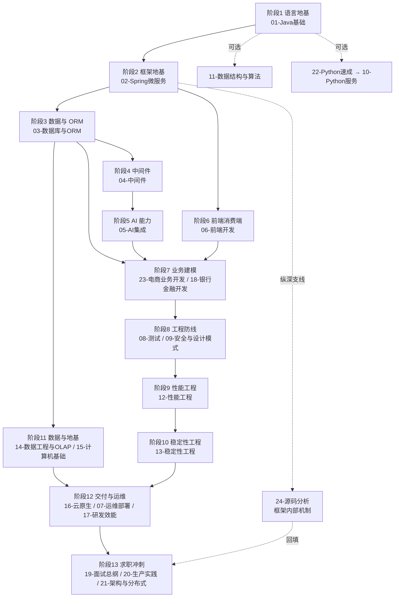

# AI 智能客服平台 · 学习路线总览

> **一句话结论**：这不是一份"读完就会"的知识清单，而是一套能对着本项目代码和框架源码逐行核对的实战教程库——每一篇都要能回答"这个现象是哪一行造成的、证据在哪、怎么亲手复现"。
> **阅读前置**：能读懂 Java 语法、Maven 多模块结构、HTTP 请求响应；本地有 JDK 17（本机实测 `17.0.19`）。
> **证据基线**：JDK 17 / Spring Framework 7.1.0 / Spring Boot 4.2.0 / Spring Cloud 2026.0.0 / Spring Cloud Alibaba 2025.1.0.0 / Spring AI 2.1.0；项目侧锁定的版本见 [2.2 技术栈基线表](#22-技术栈基线表)，全部由 `pom.xml` 实测而来。

## 1. 这个仓库是什么

`learning-docs` 是 `ai-customer-service` 这个真实项目长出来的教程库：22 个内容模块（`00`~`23`）加一个源码纵深模块（`24-源码分析`），每一篇都要求把"框架怎么实现的"和"本项目怎么用的"接在同一根证据链上。所以它的正确用法不是通读，而是**带着一个具体问题进来，拿走一条可核对的结论**：`application.yml` 里的端口为什么是这个值、`@Transactional` 为什么在你的场景里没回滚、RAG 检索为什么召回为空——这些问题的答案都能在这里查到出自哪个文件第几行。

判断一篇文档是否合格，只看三件事：结论能不能落到具体文件与行号、Mermaid 图能不能说清一次请求的流向、踩坑段落里的现象能不能被本机命令复现。三者缺一，这篇就还只是"二手笔记"。

### 1.1 与 `24-源码分析` 的分工

| 维度 | `00`~`23`（本项目教程库） | [`24-源码分析`](../24-源码分析/README.md)（框架源码解剖） |
| --- | --- | --- |
| 回答的问题 | 本项目里这个能力怎么用、坑在哪、为什么这么设计 | 框架内部这个机制到底怎么实现的、入口类在哪一行 |
| 证据主形态 | 本项目源码（`ai-cs-*`）+ 可复现命令 | 源码摘录锚点（`assets/source/` 下 905 份摘录） |
| 单篇粒度 | 一个知识点一篇，可独立阅读 | 一个类/一个机制一篇，通常需要前置概念 |
| 读完的产物 | 能改本项目的代码、能答面试题 | 能画出框架调用链、能解释框架行为边界 |
| 二者关系 | 先在这里建立"我要解决什么问题" | 再进 `24` 看"框架凭什么这么解决" |

一句话记住分工：**`00`~`23` 教你在这个仓库里干活，`24` 教你读懂给你干活的框架**。不要先啃 `24` 再回来——没有具体问题驱动的源码阅读，读完只剩一堆类名。

## 2. 项目现状速览

### 2.1 模块与端口（实测）

12 个 Maven 模块（`pom.xml#L15-L26` 的 `<module>` 列表）加 2 个前端工程、2 个 Python 服务。

| 模块目录 | 端口 | 职责 | 学习入口 |
| --- | --- | --- | --- |
| `ai-cs-common` | 无（纯库） | 统一响应、异常处理、JWT 工具 | [02-Spring微服务](../02-Spring微服务/README.md) |
| `ai-cs-gateway` | 8080 | 路由、鉴权过滤器、限流入口 | [02-Spring微服务](../02-Spring微服务/README.md) |
| `ai-cs-user` | 8081 | 注册登录、用户管理 | [02-Spring微服务](../02-Spring微服务/README.md) |
| `ai-cs-knowledge` | 8082 | 知识库、文档解析与向量化 | [05-AI集成](../05-AI集成/README.md) |
| `ai-cs-chat` | 8083 | AI 对话、RAG、Function Calling | [05-AI集成](../05-AI集成/README.md) |
| `ai-cs-search` | 8084 | Elasticsearch 全文检索 | [04-中间件](../04-中间件/README.md) |
| `ai-cs-message` | 8085 | RocketMQ 生产/消费 | [04-中间件](../04-中间件/README.md) |
| `ai-cs-notify` | 8086 | WebSocket 实时推送 | [04-中间件](../04-中间件/README.md) |
| `ai-cs-order` | 8087 | 购物车、订单、优惠计算 | [23-电商业务开发](../23-电商业务开发/README.md) |
| `ai-cs-product` | 8088 | 商品与库存、分类 | [23-电商业务开发](../23-电商业务开发/README.md) |
| `ai-cs-pay` | 8089 | 支付与对账 | [23-电商业务开发](../23-电商业务开发/README.md) |
| `ai-cs-mq` | 8090 | 消息中台/事件聚合 | [04-中间件](../04-中间件/README.md) |
| `ai-cs-frontend` | 5173 | Vue 3 + Element Plus 管理端 | [06-前端开发](../06-前端开发/README.md) |
| `ai-cs-frontend-react` | 5174 | React 管理端（备选实现） | [06-前端开发](../06-前端开发/README.md) |
| `ai-cs-py-chat` | 8000 | FastAPI 对话侧服务 | [10-Python服务](../10-Python服务/README.md) |
| `ai-cs-py-recommend` | 8082 | FastAPI 推荐服务 | [10-Python服务](../10-Python服务/README.md) |

端口不是抄来的，是扫出来的：

```powershell
Get-ChildItem ai-cs-*\src\main\resources\application.yml -File | ForEach-Object {
  $m = $_.FullName -replace '.*\\(ai-cs-[^\\]+)\\src.*','$1'
  Select-String -Path $_.FullName -Pattern '^\s*port:\s*(\d+)' |
    ForEach-Object { "$m = $($_.Matches[0].Groups[1].Value) (application.yml#L$($_.LineNumber))" }
}
```

```text
ai-cs-chat = 8083 (application.yml#L3)
ai-cs-gateway = 8080 (application.yml#L3)
ai-cs-knowledge = 8082 (application.yml#L3)
ai-cs-message = 8085 (application.yml#L3)
ai-cs-mq = 8090 (application.yml#L3)
ai-cs-notify = 8086 (application.yml#L3)
ai-cs-order = 8087 (application.yml#L3)
ai-cs-order = 9999 (application.yml#L58)
ai-cs-pay = 8089 (application.yml#L3)
ai-cs-product = 8088 (application.yml#L3)
ai-cs-search = 8084 (application.yml#L3)
ai-cs-user = 8081 (application.yml#L3)
```

**怎么读**：12 行输出里只有 11 行是服务端口——多出来的 `ai-cs-order = 9999` 是 XXL-Job 执行器的内嵌端口（`aics.xxl-job.executor.port`），不是 HTTP 服务端口。这条"噪声"正好说明**扫描结果要人看一眼**：凡一个文件出现第二个 `port:`，就得判断它挂在哪个配置前缀下。`ai-cs-common` 完全不在结果里，因为它没有 `application.yml`——这个"缺省"本身就是结论：common 是被依赖的库，不是服务，所以它不能有端口、也不该有自己的 `main`。11 个服务端口全部落在同一个文件同一行（`#L3`），说明配置是统一模板生成的，改动时要一起看，别只改一个。

前端与 Python 侧端口出处不同，得单独查：`ai-cs-frontend/vite.config.js#L25`（5173）、`ai-cs-frontend-react/vite.config.js#L9`（5174）、`ai-cs-py-chat/app/config.py#L25`（`app_port: int = 8000`）、`ai-cs-py-recommend/app/config.py#L31`（`app_port: int = 8082`）。注意 Python 推荐服务默认 8082 与 `ai-cs-knowledge` 撞车，本地同时起两个会抢端口——这是真实配置，不是笔误，遇到 `Address already in use` 先查这里。

### 2.2 技术栈基线表

| 组件 | 版本 | 依据 |
| --- | --- | --- |
| JDK | 17（本机 `17.0.19` Temurin） | `java -version` 实测；`pom.xml#L30` 锁 `17` |
| Spring Framework | 7.1.0 | Boot 4.2.0 自带（官方 Boot 4.2 依赖清单） |
| Spring Boot | 4.2.0 | `pom.xml#L39` |
| Spring Cloud | 2026.0.0 | `pom.xml#L40` |
| Spring Cloud Alibaba | 2025.1.0.0 | `pom.xml#L41` |
| Spring AI | 2.1.0 | `pom.xml#L42` |
| Spring Security | 7.2.0 | Boot 4.2 默认传递版本 |
| Nacos | 3.3.0 | 官方文档（服务注册/配置中心） |
| Sentinel | 1.8.10 | 官方文档（限流熔断） |
| Seata | 基线 2.7.0 / 本项目 `1.7.1` | 基线取官方最新；`pom.xml#L52` 锁 1.7.1 |
| MyBatis-Plus | 基线 3.0.5 / 本项目 `3.5.13` | `pom.xml#L47`（Boot 4 starter 自 3.5.13 起提供） |
| RocketMQ | 5.1 | 官方文档；`pom.xml#L56` 客户端 `rocketmq-spring 2.3.0` |
| Elasticsearch | 8.12 | `pom.xml#L55` 锁 `8.12.2` |
| MySQL | 8.0 | `pom.xml#L49` 驱动 `8.0.33` |
| Redis | 7 | 官方文档 |
| MinIO | 8.5.12 客户端 | `pom.xml#L57` |
| MongoDB / Chroma | 无版本锁定 | 本地容器/外部服务，按部署环境 |
| 前端 | Vue 3 + Element Plus + Vite | `ai-cs-frontend` 目录下的 `package.json` |

> **两处口径不一致，是本仓库最容易被误读的地方**：`Seata` 与 `MyBatis-Plus` 各有两个版本号。基线列（2.7.0 / 3.0.5）是 `24-源码分析` 拿来做源码解剖的版本，本项目 `pom.xml` 锁的是 1.7.1 / 3.5.13。读本仓库时：**讨论框架内部实现，用基线版本**；**讨论本仓库能不能跑、配置怎么写，用 pom 版本**。混用会得出"这个方法 Boot 4 里没有"之类的错误结论。

Boot 4 还有两个必须知道的落地差异：`spring-boot-starter-web` 已被废弃，本项目网关用的是新名字 `spring-boot-starter-webmvc`（`ai-cs-gateway/pom.xml#L50`）；默认 JSON 实现换成 Jackson 3（包名 `tools.jackson`），所以老文章里 `com.fasterxml.jackson.*` 的 import 在本仓库编译不过。

## 3. 全库规模盘点（真跑出来的数字）

### 3.1 三条统计命令

盘点文档规模最容易被旧数字坑：本页所有数字都是当场跑出来的，命令原样给出，你可以自己复算。

```powershell
cd D:\Projects\Persion\ai-customer-service\learning-docs
$md = Get-ChildItem -Recurse -Filter *.md -File
"files=$($md.Count)"
"lines=$(($md | Get-Content | Measure-Object -Line).Lines)"
```

```text
files=1331
lines=358571
```

接着把 `24-源码分析` 的源码摘录剔掉，看"人写的正文"到底有多少：

```powershell
$doc = Get-ChildItem -Recurse -Filter *.md -File |
       Where-Object { $_.FullName -notmatch '\\24-源码分析\\assets\\source\\' }
"files=$($doc.Count)"
"lines=$(($doc | Get-Content | Measure-Object -Line).Lines)"
```

```text
files=426
lines=135150
```

**怎么读**：第一个数是"仓库里所有 `.md`"，第二个是"去掉 905 份机械抓取的源码摘录之后"。两者差 905 个文件、22.3 万行，正好说明 `24-源码分析` 的体积几乎全部来自摘录（它在 `assets/source/` 下有 889 份 `*.java.md`），不是来自写作。评估"这套文档写了多少"要看第二个数：**426 个文件、135,150 行**——这才是人去写、去维护的部分。

### 3.2 各模块规模

```powershell
Get-ChildItem -Directory | Where-Object { $_.Name -match '^\d\d-' } | ForEach-Object {
  $all  = Get-ChildItem $_.FullName -Recurse -Filter *.md -File
  $body = $all | Where-Object { $_.Name -ne 'README.md' -and $_.FullName -notmatch '\\assets\\source\\' }
  "{0,-22} total={1,4} body={2,3} lines={3,6}" -f $_.Name, $all.Count, $body.Count,
    (($all | Get-Content | Measure-Object -Line).Lines)
}
```

实测结果（`total` 含 README 与摘录，`body` 已排除 `README.md` 与源码摘录，`lines` 为该模块全部 md 的行数和）：

| 模块 | md 文件 | 正文篇数 | 行数 |
| --- | --- | --- | --- |
| 00-学习路线总览 | 6 | 5 | 1383 |
| 01-Java基础 | 9 | 8 | 4497 |
| 02-Spring微服务 | 19 | 18 | 10469 |
| 03-数据库与ORM | 11 | 10 | 1216 |
| 04-中间件 | 24 | 23 | 4822 |
| 05-AI集成 | 52 | 49 | 11815 |
| 06-前端开发 | 20 | 19 | 4886 |
| 07-运维部署 | 8 | 7 | 1849 |
| 08-测试 | 6 | 5 | 880 |
| 09-安全与设计模式 | 5 | 4 | 868 |
| 10-Python服务 | 2 | 1 | 431 |
| 11-数据结构与算法 | 12 | 11 | 4025 |
| 12-性能工程 | 9 | 8 | 1640 |
| 13-稳定性工程 | 9 | 8 | 1603 |
| 14-数据工程与OLAP | 9 | 8 | 1785 |
| 15-计算机基础 | 9 | 8 | 1617 |
| 16-云原生与GitOps | 9 | 8 | 1857 |
| 17-研发效能与工程实践 | 9 | 8 | 1654 |
| 18-银行金融开发 | 17 | 16 | 5486 |
| 19-求职与面试总纲 | 9 | 8 | 1900 |
| 20-生产实践 | 5 | 4 | 792 |
| 21-架构与分布式 | 7 | 6 | 1133 |
| 22-Python速成 | 31 | 29 | 14016 |
| 23-电商业务开发 | 11 | 10 | 2868 |
| 24-源码分析 | 1021 | 74 | 274930 |

**怎么读**：`24-源码分析` 那行要单独理解——1021 个 md 里 905 份是源码摘录、42 份是各级 README 导航页，真正可读的教学正文只有 74 篇，却占掉全库 27 万行中的绝大部分，因为摘录本身是整份源码原文。`01`、`02`、`05`、`22` 是体量最大的四个内容模块，但原因不同：`01`/`02` 是按新规范重写的深水区（单篇常在 500 行以上、带源码锚点），`05`/`22` 篇数多但单篇偏轻。要进入 `24`，从它的[导读](../24-源码分析/00-导读与学习路线/README.md)进，别把它近千个文件当成近千篇文章去排期。

### 3.3 文档成熟度表

判定"是否按新规范重写"的机械口径：正文含 `> 一句话结论` 段。这条命令一跑，谁还是旧稿一目了然。

```powershell
Get-ChildItem -Directory | Where-Object { $_.Name -match '^\d\d-' } | ForEach-Object {
  $md  = Get-ChildItem $_.FullName -Recurse -Filter *.md -File |
        Where-Object { $_.FullName -notmatch '\\assets\\source\\' }
  $new = $md | Select-String -Pattern '一句话结论' -List
  "{0,-22} md={1,3} newStyle={2,3}" -f $_.Name, $md.Count, $new.Count
}
```

输出节选（省略中间 20 行全为 `newStyle=  0` 的模块）：

```text
00-学习路线总览              md=  6 newStyle=  1
01-Java基础              md=  9 newStyle=  9
02-Spring微服务           md= 19 newStyle= 19
03-数据库与ORM             md= 11 newStyle=  0
...
24-源码分析                md=116 newStyle= 90
```

| 模块 | 篇数 | 已按新规范重写 | 证据 / 说明 |
| --- | --- | --- | --- |
| [01-Java基础](../01-Java基础/README.md) | 8 篇正文 + README | **是（全部）** | 9/9 命中新范式；入口 [01-Java基础/README.md](../01-Java基础/README.md) 已含路线表与依赖图 |
| [02-Spring微服务](../02-Spring微服务/README.md) | 18 篇正文 + README | **是（全部）** | 19/19 命中；可抽查 [SpringAOP与声明式事务原理](../02-Spring微服务/15-SpringAOP与声明式事务原理.md) |
| [24-源码分析](../24-源码分析/README.md) | 74 篇正文 + 42 个导航页 | 是（按它自己的更严规范） | 90/116 命中新范式，其余是摘录与索引页 |
| 00-学习路线总览 | 5 篇 | **部分**：本页已重写，同目录 5 篇《…补全计划》仍是旧稿 | 本文件；旧计划稿没有 `一句话结论`、含失效路径 |
| 03 / 04 / 05 / 06 / 07 / 08 / 09 | 117 篇 | **否，旧稿** | 全部 `newStyle=0` |
| 10 / 11 / 12 / 13 / 14 / 15 | 44 篇 | **否，旧稿** | 全部 `newStyle=0` |
| 16 / 17 / 18 / 19 / 20 / 21 | 50 篇 | **否，旧稿** | 全部 `newStyle=0` |
| 22 / 23 | 39 篇 | **否，旧稿** | 全部 `newStyle=0` |

**怎么读**：这张表是本页最重要的诚实声明——**只有 `01`、`02` 两个模块完成了新范式重写**，`24` 用的是它自己更严格的源码规范，其余 20 个模块（`03`~`23`）仍是旧稿。旧稿并非没有价值（素材、清单、代码位置常常是对的），但它缺 12 节结构、缺证据分级、路径可能已失效——所以下面所有路线都优先把你引向已完成模块，旧稿模块只当"选题地图"用。

## 4. 学习路线图（13 个阶段 + 一条纵深支线）



> **读图说明**：实线是主链，虚线是可选/纵深支线；看懂 `02 → 24 → 13` 这条虚线走向就够用了（另外两条从阶段 1 分叉的可选支线，跳过不影响主线）。**最关键的是 `02 → 24` 那条虚线**：`24-源码分析` 不是终章，它在你有具体问题时从任意主阶段切进去，读完回填到阶段 13 的面试表达——如果把它当成"先读完 24 再学 02"，就会陷入没有问题的源码漫游，两周后只剩类名。**第二条容易看错的是 `S3 → S7` 与 `S5 → S7` 的汇合点**：业务建模必须同时吃到数据库与 AI 两条线，只走一条的话，`23-电商业务开发` 里的库存扣减和 RAG 客服话术会有一半读不懂。另外 `S2 → S6` 是跳跃箭头（前端不依赖 ORM），别照着箭头的视觉顺序把 `06` 排到 `04` 后面。

| 阶段 | 核心问题 | 对应模块 | 验收标准 |
| --- | --- | --- | --- |
| 1 语言地基 | Java 17 特性、反射、集合与并发的代价 | [01-Java基础](../01-Java基础/README.md) | 能说清 `record`/`sealed`/`var` 各自解决了什么；能写一个动态代理并解释 `InvocationHandler` 的调用时机 |
| 2 框架地基 | IoC、Bean 生命周期、AOP、事务、自动配置 | [02-Spring微服务](../02-Spring微服务/README.md) | 能画出 `@Transactional` 从代理到提交的时序；能说清自动配置类的加载条件 |
| 3 数据与 ORM | SQL 优化、索引、MVCC、事务隔离 | [03-数据库与ORM](../03-数据库与ORM/README.md) | 能读懂执行计划；能解释可重复读下的快照读边界 |
| 4 中间件 | Redis 缓存三兄弟、MQ 幂等、ES 倒排、MinIO 存储 | [04-中间件](../04-中间件/README.md) | 能给出击穿/穿透/雪崩各自的第一处置手段；能写出消费者幂等键 |
| 5 AI 能力 | Spring AI 抽象、RAG 链路、向量库、Function Calling | [05-AI集成](../05-AI集成/README.md) | 能画出 `Embedding → 存储 → 检索 → 拼 Prompt` 全链路并指出每步的失败现象 |
| 6 前端消费端 | Vue 3 组合式 API、请求封装、状态管理 | [06-前端开发](../06-前端开发/README.md) | 能改造一个页面并解释跨域为何在 Vite 层解决 |
| 7 业务建模 | 订单状态机、库存一致性、支付对账、金融合规 | [23-电商业务开发](../23-电商业务开发/README.md) / [18-银行金融开发](../18-银行金融开发/README.md) | 能写出订单状态流转表并说明每步的幂等与补偿 |
| 8 工程防线 | 单测/集成测试分层、鉴权与越权、设计模式落地 | [08-测试](../08-测试/README.md) / [09-安全与设计模式](../09-安全与设计模式/README.md) | 能给出覆盖率门禁与一条真实的越权拦截用例 |
| 9 性能工程 | 压测指标、火焰图、慢查询与 GC | [12-性能工程](../12-性能工程/README.md) | 能按[定位方法论](../12-性能工程/08-性能问题定位方法论.md)给出四步排查路径 |
| 10 稳定性工程 | 限流熔断降级、链路追踪、故障演练 | [13-稳定性工程](../13-稳定性工程/README.md) | 能配置 Sentinel 规则并解释熔断器半开状态的含义 |
| 11 数据与地基 | OLAP 建模、网络与操作系统常识 | [14-数据工程与OLAP](../14-数据工程与OLAP/README.md) / [15-计算机基础](../15-计算机基础/README.md) | 能解释列式存储为何适合聚合；能算清一次 TCP 重建的成本 |
| 12 交付与运维 | Docker/K8s、GitOps、发布与回滚、效能工具 | [16-云原生与GitOps](../16-云原生与GitOps/README.md) / [07-运维部署](../07-运维部署/README.md) / [17-研发效能与工程实践](../17-研发效能与工程实践/README.md) | 能写出一份含探针与回滚策略的部署清单 |
| 13 求职冲刺 | 面试高频题、生产案例表达、架构取舍 | [19-求职与面试总纲](../19-求职与面试总纲/README.md) / [20-生产实践](../20-生产实践/README.md) / [21-架构与分布式](../21-架构与分布式/README.md) | 能对 10 个高频题给出"现象—原因—处置—验证"四段式回答 |
| 支线 | 数据结构、Python 侧服务 | [11-数据结构与算法](../11-数据结构与算法/README.md) / [22-Python速成](../22-Python速成/README.md) / [10-Python服务](../10-Python服务/README.md) | 能实现 LRU 与一致性哈希；能跑通一个 FastAPI 接口 |
| 纵深 | 框架内部机制 | [24-源码分析](../24-源码分析/README.md) | 能对一个机制画出调用栈并标出源码摘录行号 |

## 5. 三类读者的三条路线

| 路线 | 适用者 | 走法 | 预计耗时 | 产出物 |
| --- | --- | --- | --- | --- |
| 面试冲刺 | 2~4 周后面试，项目经历已有 | 阶段 2 → 3 → 4 → 13；按 [19-求职与面试总纲](../19-求职与面试总纲/README.md) 的题目反查，每答一题回填一条证据 | 25~35 小时 | 一份 30 题自述稿，每题带"现象—原因—处置—验证"与 1 个文件行号 |
| 项目落地 | 要在本项目上加功能 | 阶段 2 → 3 → 7，再按需求切 `05`（AI）或 `06`（前端），每步对照本仓库真实代码改 | 40~60 小时 | 一个可合并的 PR（含单测）+ 一份改动点清单 |
| 线上排障 | 已经在救火 | 直接跳[生产问题排查手册](../20-生产实践/02-生产问题排查手册.md)与 [12-性能工程](../12-性能工程/README.md)，再顺现象回查对应模块 | 2~4 小时/次 | 一张"现象 → 假设 → 验证命令 → 结论"的排查记录 |

三条路线的共同纪律：**都不以"读完某模块"为终点，以"能交付那栏产出物"为终点**。面试冲刺最忌按目录从 `01` 读起——你缺的不是知识面，是把已有经历焊到具体代码上的能力，所以从阶段 2 切入最快。项目落地要反过来，老实补 `03`，否则会写出绕过事务与索引的代码。线上排障完全由现象驱动，`20` 与 `12` 两篇是入口，别从目录找起点。

## 6. 怎么用这个库

### 6.1 十二节结构怎么读

已完成重写的每篇正文都是固定 12 节（见[写作规范](../_templates/写作规范.md)）。不要顺序读，按目的跳：

| 节 | 回答什么 | 什么时候读 |
| --- | --- | --- |
| 0 先看现象 | 3 分钟上手：一个能亲手触发的最小现象 | **先读这节**，没有现象感的原理记不住 |
| 1 整体地图 | 先图后码，标出主角类与调用边界 | 读完现象立刻读，建立坐标系 |
| 2 关键概念/关键类 | 逐个拆名词与类职责 | 卡在术语时回查 |
| 3 原理与证据逐段精读 | 源码锚点 + 代码块 + 行号 | **核心节**，决定这篇值不值 |
| 4 一次完整执行时序 | 端到端一条链路 | 面试前必读，用来讲流程 |
| 5 设计取舍 | 为什么这样而不那样 | 被追问"为什么不用 X"时的弹药 |
| 6 踩坑与调试手法 | 真实故障现象与复现命令 | 排障时直接搜这节 |
| 7 版本差异 | Boot 4 / Spring 7 与旧文章的差异 | 抄旧代码编译不过时先看这节 |
| 8 面试高频问与答 | ≥10 问 | 阶段 13 集中刷 |
| 9 动手练习 | 带验收标准的小任务 | 想确认"真的会了"时做 |
| 小结 | 结论清单 | 复习时只看这节 |
| 自测题 | ≥10 题折叠答案 | 隔一周自测，答不全就回到对应节 |

读法的关键在**现象 → 地图 → 原理 → 时序**这条主干：先有现象才有问题，先有地图才知道去哪找原理，时序把原理串成能讲的流程。跳过第 0 节直接读第 3 节，是这套文档最容易被误用的方式——你会觉得"看懂了"，但换个场景就调不出来。

### 6.2 A / B / C 三级证据是什么意思

| 级别 | 含义 | 长什么样 | 强度 |
| --- | --- | --- | --- |
| A | 框架源码摘录（`24-源码分析/assets/source/` 下已有的机械抓取原文） | `[[源码:SpringApplication.java.md#L292-L320]]` 或代码块头标注 `(src: SpringApplication.java.md#L292-L320)` | 最强：可逐行核对，摘录禁止手改 |
| B | 本项目真实代码 | `ai-cs-chat/src/main/resources/application.yml#L3` | 很强：最贴业务，但行号会随重构漂移，引用前必须当次核对 |
| C | 可复现实测 | 一段命令 + 真实输出 + "怎么读" | 够用：不可复现的命令不算证据 |

摘录文件的命名是 `原文件名.md`（如 `SpringApplication.java.md`），锚点里要带上 `.md` 后缀——这是校验器认的写法，写成 `SpringApplication.java` 会被判"锚点文件不存在"。

这条规则的实际意义是**防吹牛**：说"Spring 会先解析占位符再绑定"是观点，给出 A 级锚点才是证据；说"我们的网关做了限流"是观点，给出 `ai-cs-gateway` 的具体文件行号才是证据。一篇文档通篇只有结论没有锚点，就按二手笔记对待。

C 级证据还有额外要求：必须写清"怎么读"。本文 3.1 节的三条命令就是范例——输出 `files=1331` 本身没有意义，配上"其中 905 份是摘录，所以要看剔重后的 426"才是结论。

### 6.3 看到锚点怎么回查

1. **A 级锚点**：看文件名，去 `learning-docs/24-源码分析/assets/source/` 找同名 `.java.md`（共 889 份 `*.java.md`），跳到锚点行号。摘录正文左侧带源码真实行号前缀（形如 `292 |`），锚点行号与它一致。
2. **B 级锚点**：直接打开仓库里的相对路径文件，`Ctrl+G` 跳行号；行号对不上说明代码已改，以实际代码为准并把文档改过来。
3. **C 级证据**：先照抄命令跑一遍。跑不出同样输出就别信这篇的结论——要么环境不同（JDK/端口/版本），要么证据已过期。

### 6.4 同一主题在哪个模块讲

同一件事在多个模块出现是设计使然，不是重复。按这张表找"最该看的那一篇"：

| 主题 | 讲用法 | 讲原理纵深 | 讲排障 |
| --- | --- | --- | --- |
| 事务与回滚 | [02-Spring微服务](../02-Spring微服务/15-SpringAOP与声明式事务原理.md) | [03-数据库与ORM](../03-数据库与ORM/06-事务进阶-MVCC实现与三大日志.md) | [20-生产实践](../20-生产实践/02-生产问题排查手册.md) |
| 索引与慢查询 | [03-数据库与ORM](../03-数据库与ORM/README.md) | [03-数据库与ORM](../03-数据库与ORM/README.md) | [12-性能工程](../12-性能工程/README.md) |
| 缓存与热点 | [04-中间件](../04-中间件/README.md) | [24-源码分析](../24-源码分析/README.md) | [13-稳定性工程](../13-稳定性工程/README.md) |
| RAG 与向量检索 | [05-AI集成](../05-AI集成/README.md) | [05-AI集成/向量数据库](../05-AI集成/05-向量数据库/README.md) | [05-AI集成](../05-AI集成/README.md) |
| 配置与启动 | [02-Spring微服务](../02-Spring微服务/README.md) | [配置属性绑定原理](../24-源码分析/02-SpringBoot/04-配置与属性绑定/01-configurationproperties-属性绑定原理.md) | [07-运维部署](../07-运维部署/README.md) |
| 反射与代理 | [01-Java基础](../01-Java基础/06-反射动态代理与SPI.md) | [24-源码分析](../24-源码分析/README.md) | — |

### 6.5 症状直达

手里只有一个现象时别翻目录，按这张表跳：

| 现象 | 先看 |
| --- | --- |
| 启动报 `Address already in use` | 本文 [2.1](#21-模块与端口实测) 的端口表（注意 py-recommend 与 knowledge 同为 8082） |
| 配置注入为 `null`、`@ConfigurationProperties` 不生效 | [配置属性绑定原理](../24-源码分析/02-SpringBoot/04-配置与属性绑定/01-configurationproperties-属性绑定原理.md) |
| `@Transactional` 没回滚 | [SpringAOP 与声明式事务原理](../02-Spring微服务/15-SpringAOP与声明式事务原理.md) |
| RAG 召回为空 / 答非所问 | [05-AI集成](../05-AI集成/README.md) |
| 接口偶发超时、CPU 高 | [性能问题定位方法论](../12-性能工程/08-性能问题定位方法论.md) |
| 线上故障要写复盘 | [生产问题排查手册](../20-生产实践/02-生产问题排查手册.md) |

## 7. 维护约定

### 7.1 规范与模板入口

- 硬性规范：[`_templates/写作规范.md`](../_templates/写作规范.md)——12 节骨架、证据分级、图表与代码块规则、旧稿迁移规则、质量红线。
- 模块入口写法参照：[24-源码分析/README.md](../24-源码分析/README.md)（目录地图 + 依赖图 + 路线 + 校验状态 + 已知边界）。
- 源码阅读方法：[四步读码法](../24-源码分析/07-源码方法论与附录/02-源码阅读方法论/01-四步读码法-从断点到调用栈.md)。

### 7.2 校验命令与当前状态

全部校验在 `learning-docs` 目录下跑，单模块：

```powershell
cd D:\Projects\Persion\ai-customer-service\learning-docs
node tools\check-doc.mjs 00-学习路线总览
```

这条命令按目录汇总，它当前打印的是：

```text
files=6 errors=35 warnings=10
```

这 35 个 error 全部落在同目录 5 篇旧计划稿（缺节、失效路径）上；把输出按文件名过滤到本页，`00-学习路线总览/README.md` 是 **errors=0、warnings=1**——唯一那条 warning 是文件名 `README.md` 含大写，规范允许 README 保留。`errors=0` 意味着：正文里每条项目路径都真实存在、每个相对链接都能打开、每个代码块都有语言标注。

全库（含旧稿）同一时刻的快照：`files=309 errors=3274 warnings=866`——错误几乎全部集中在尚未重写的旧稿模块（缺节、指向已改名的文件、代码块缺语言标注）。这不是"文档坏了"，而是**重写进度条**：`01`、`02` 已归零，其余模块重写时会一起消掉，这个总数每天在降——引用前重跑一次，别抄。

`check-doc.mjs` 对 README 与正文的判罚标准不同，踩坑前先知道：README 豁免 12 节结构、篇幅、自测题、Mermaid 读图说明四项检查；但**路径存在性与链接存在性对所有行生效，包括代码块内部**。

### 7.3 如何新增一篇

1. 在目标模块下建文件，命名 `NN-主题.md`（编号连续、主题用中文、不带空格）。
2. 从[写作规范](../_templates/写作规范.md)复制 12 节骨架，先写第 0 节"现象"——写不出可复现的现象，说明这题还没想清，先别动笔。
3. 找 A 级证据：去 `24-源码分析/assets/source/` 确认摘录文件存在，记下行号区间；没有摘录就写"依据官方文档"并给出链接，不要编文件名。
4. 找 B 级证据：打开本项目真实文件，当次核对行号；路径里不许用 `...` 省略目录。
5. 画 Mermaid，紧跟 `> **读图说明**：`，点明最关键 1~2 条箭头以及"看错会得出什么错误结论"。
6. 跑 `node tools\check-doc.mjs <模块目录>`，把本文件的 error 修到 0。
7. 回到模块 `README.md` 的目录表与路线表补一行，否则这篇等于没发布。

## 8. 已知边界与诚实清单

这份清单存在的意义是：**别把"没覆盖"读成"不重要"**。以下每条都是当前真实状态。

| 边界 | 具体情况 | 对你的影响 |
| --- | --- | --- |
| Seata 没有 sources jar | 事务协调器源码无法机械抓取，`24-源码分析` 里没有 Seata 源码摘录 | 涉及 Seata 的机制只有官方文档级证据，别指望逐行锚点 |
| 本机 JDK 17，虚拟线程不可实测 | 虚拟线程是 JDK 21 特性，本仓库基线锁 17（`pom.xml#L30`），本机也跑不出 21 的行为 | 相关章节只能给"官方文档 + 设计意图"，没有实测输出；写"已验证"就是造假 |
| 20 个模块仍是旧稿 | `03`~`23` 全部 `newStyle=0`（3.3 节实测） | 旧稿里的模块清单、端口、版本可能已过期，结论要回代码核对 |
| 00 模块同目录 5 篇计划仍是旧稿 | 《01-Spring技术补全开发计划》等 5 篇是旧的补全流水账，本页已取代它们的"索引"职能 | 读它们的**选题**可以，读它们的**结论**不行 |
| Python / 前端证据强度弱 | FastAPI 与 React 侧只有配置与入口级证据（如 `app_port` 默认值），没有框架内部解剖 | `10-Python服务`、`22-Python速成` 的结论多为用法级，不是原理级 |
| Python 推荐服务端口冲突 | `ai-cs-py-recommend/app/config.py#L31` 默认 8082，与 `ai-cs-knowledge` 相同 | 本地联调需显式改端口，否则误判"服务没起来" |
| 两套版本口径并存 | Seata 2.7.0（基线）vs 1.7.1（pom）；MyBatis-Plus 3.0.5（基线）vs 3.5.13（pom） | 讨论框架内部用基线，讨论能否编译运行用 pom（见 2.2） |
| 前端 React 工程非主线 | `ai-cs-frontend-react` 存在且能启动（5174），但文档主线是 Vue 端 | React 侧覆盖明显薄于 Vue |
| 统计数字会漂移 | 第 3 节数字是本次实测快照，多人并行改写时会变 | 引用前重跑 3.1 节命令，不要拿本页数字当现状 |

## 小结

- 这套文档的价值在证据链，不在篇幅：一个结论要么挂 A 级源码锚点、B 级本项目行号，要么挂可复现的 C 级命令输出，三者都没有就是笔记。
- 全库 426 个非摘录文件、135,150 行；真正完成新范式重写的只有 `01`、`02` 两个模块，`24` 走的是更严的源码规范——这是当前真实进度。
- 路线只有三条，终点都是产出物：面试冲刺交自述稿，项目落地交 PR，线上排障交排查记录。读目录不算进度。

## 自测题

<details><summary>1. 这个仓库与 24-源码分析 的分工，用一句话说清</summary>

`00`~`23` 解决"本项目这个能力怎么用、坑在哪"，`24-源码分析` 解决"框架内部凭什么这么实现"；后者是需要具体问题时切入的纵深支线，不是入门必读。
</details>

<details><summary>2. 不看本文，你怎么当场确认 ai-cs-chat 监听哪个端口？</summary>

跑 2.1 节的扫描命令，或 `Select-String -Path ai-cs-chat\src\main\resources\application.yml -Pattern '^\s*port:'`，得到 8083（`application.yml#L3`）。抄文档里的数字不算答案，跑出来才算。
</details>

<details><summary>3. 为什么全库 .md 有 1331 个文件，但"文档规模"要按 426 个算？</summary>

差额 905 个是 `24-源码分析/assets/source/` 下的机械抓取源码摘录（其中 889 份 `*.java.md`），它们是证据原料不是写作成果；剔重后才反映实际撰写量（135,150 行）。
</details>

<details><summary>4. 有人引用"Seata 2.7.0 的某个方法"，你要提醒他什么？</summary>

提醒区分口径：2.7.0 是 `24-源码分析` 做源码解剖的基线版本，本项目 `pom.xml#L52` 锁的是 1.7.1，两者方法签名可能不同，先确认讨论的是"框架内部"还是"本仓库能跑"。
</details>

<details><summary>5. 一篇文档只有结论、没有锚点，先怀疑什么？</summary>

怀疑它是二手笔记：A 级锚点应能在 `assets/source/` 找到同名 `.java.md`，B 级应能当场打开对应行号。两者都无，结论只能当线索。
</details>

<details><summary>6. @Transactional 不生效，最短路径看哪两篇？</summary>

先看 [SpringAOP 与声明式事务原理](../02-Spring微服务/15-SpringAOP与声明式事务原理.md) 弄清代理边界（自调用失效、异常类型），再看 [MVCC 与三大日志](../03-数据库与ORM/06-事务进阶-MVCC实现与三大日志.md) 判断是不是数据库层根本没回滚。
</details>

<details><summary>7. README 与正文的校验标准差在哪？</summary>

README 豁免 12 节结构、篇幅、自测题、Mermaid 读图说明；但路径存在性、链接存在性对所有行生效（含代码块内部）。所以 README 也不能写失效路径。
</details>

<details><summary>8. 想在新模块加一篇，最容易漏的一步是什么？</summary>

漏掉"回模块 README 的目录表与路线表补一行"——文件存在但没人导航得到，等于没发布；另外引用 B 级路径时用 `...` 省略目录会被校验器直接判 error。
</details>
