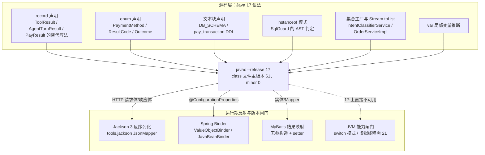
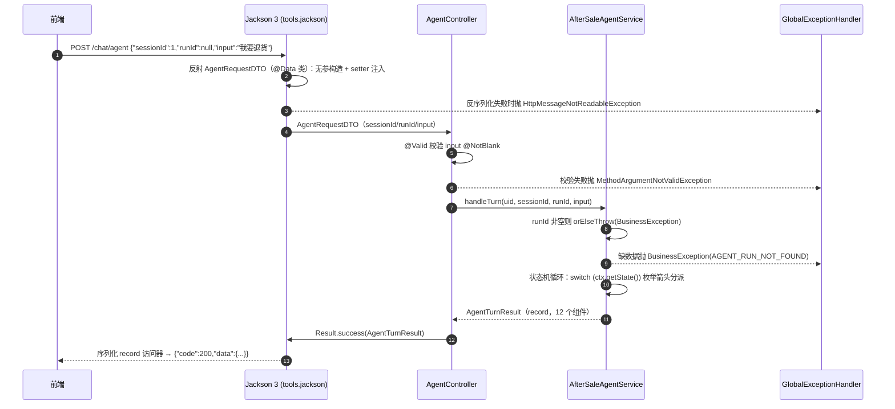

# Java 17 在本项目里的真实用法边界

> **一句话结论**：本项目的编译目标是 17（本机实测 `javac 17.0.19`，class 文件主版本 61），所以 record、sealed、instanceof 模式匹配、文本块、`List.of`、`Stream.toList()` 都是真能用的生产力，而 **switch 模式匹配和虚拟线程在 17 上根本编译不过**；更关键的是，凡跨过 Jackson / Spring Binder / MyBatis 这些反射边界的语法糖，都必须重新核对「构造器、setter、不可变性」这三份契约，否则代码写得再漂亮也会在运行期塌。

> **阅读前置**：能读写普通类、接口、枚举与 Lambda；知道 Maven 的 `<java.version>` 决定编译目标、Spring MVC 用 `@RequestBody` 把 JSON 变成对象、`@ConfigurationProperties` 把 yml 变成 Bean。本项目 `ai-cs-common` 的 `Result` / `BusinessException` 瞄过一眼即可，不要求读过 Agent 编排代码。

> **证据基线**：JDK 编译目标 17（`java -version` 实测 OpenJDK 17.0.19）；Spring Boot 4.2.0 / Spring Framework 7.1.0（Boot 4 默认 Jackson 3，包名 `tools.jackson`，与 Jackson 2 的 `com.fasterxml.jackson` 不是同一类型）；项目侧引用全部取自当前工作区源码。预计阅读 45 分钟。

## 0. 先看现象

**现象一：给请求 DTO 加字段后，前端字段名写成 `order_no`，接口不报错，Service 里拿到的是 `null`。**

前端照旧发 `{"order_no":"SO1","quantity":3}`，后端 DTO 字段叫 `orderNo`。接口返回 200，日志里什么都没有，只是后续业务判断 `orderNo == null` 走了空分支。把 Jackson 配成严格模式才会突然炸出来：

```text
[4] snake_case json    = CreateOrderRequest[orderNo=null, quantity=3]
[7] extra field strict -> tools.jackson.databind.exc.UnrecognizedPropertyException | Unrecognized property "remark" (class JacksonProbe$CreateOrderRequest), not marked as ignorable
```

第一行是「字段名不匹配 → 静默 null」，第二行是「未知字段 → 仅在严格模式下才报错」。两行都来自本篇第 3 节的实测脚本，Jackson 3 的默认值是**忽略未知字段**，所以「写了错的字段名」这种最蠢的 bug，默认是静默的。

**现象二：把 `@Data` 配置类或实体类改成 record，启动直接失败。**

`@ConfigurationProperties` 类改成 record 后，如果属性名对不上或缺少构造参数绑定，报的是这句（Spring Boot 的 JavaBean 绑定器原文）：

```text
java.lang.IllegalStateException: No setter found for property: xxx
```

MyBatis 侧则是另一种死法：record 只有「规范构造器」（canonical constructor），没有任何无参构造器——`javap` 出来只有一行 `public Xxx(java.lang.String,java.lang.Long,byte[])`，于是结果映射拿不到可实例化的入口。

**现象三：`Optional.get()` 在线上抛 `NoSuchElementException`。**

```text
empty().get() -> java.util.NoSuchElementException: No value present
```

这类栈几乎总出现在「上一行刚 `findFirst()`、下一行直接 `.get()`」的地方。本项目里正确的写法在售后编排里能直接看到：`runStore.load(runId.trim()).orElseThrow(() -> new BusinessException(ResultCode.AGENT_RUN_NOT_FOUND))`，缺数据时抛的是带错误码的业务异常，而不是一个裸的 `NoSuchElementException`。

这些现象指向同一件事：**Java 17 的语法糖只改变「你怎么写」，不改变运行期的反射契约与字节码版本闸门**；record 去掉的是 setter，sealed 关掉的是扩展性，文本块保留的是缩进，`List.of` 换掉的是可变性——每一处都要追到「谁在反射读它」才算写对。

## 1. 整体地图



| 组件 | 责任 | 谁在调用它 |
| --- | --- | --- |
| `record` 声明 | 承载不可变数据、免写 getter/equals/hashCode | `AgentController`（返回 `Result<AgentTurnResult>`）、`ToolResult` 被各 Tool 返回 |
| `enum` + 箭头 `switch` | 封闭枚举常量上的分支分派 | `AfterSaleAgentService` 状态机分派、`HybridRetriever` 检索模式分派、`PaySuccessTransactionListener` 回查状态 |
| 文本块 `"""` | 内嵌多行常量（SQL、表结构参考、Prompt 骨架） | `SpringAiConfig`（注入 Prompt 的 `{{dbSchema}}` 占位）、`PaySchemaInitializer`（启动建表） |
| `instanceof` 模式匹配 | 类型判定 + 强转合成一步 | `SqlGuard` 用 jsqlparser 的 AST 类做白名单判定 |
| `List.of` / `Stream.toList()` | 不可变集合、终结操作直接给 `List` | `IntentClassifierService` 关键词表、`IntentResult` 空列表兜底 |
| `Optional` | 显式表达「可能没有值」 | `AfterSaleAgentService.handleTurn` 的 `orElseThrow` |
| Jackson 3 | 请求体 → 对象、对象 → 响应体 | Spring MVC 的 `HttpMessageConverter` |
| Spring Binder | yml → `@ConfigurationProperties` Bean | `MqProperties` 等配置类 |
| MyBatis / MyBatis-Plus | 表行 → 实体 | `ai-cs-message` 的 `AgentRun` 等实体 |

> **读图说明**：最关键的两条箭头是 `record/enum/文本块 → javac --release 17` 与 `JAVAC → Jackson 3 反序列化`。前者说明语法糖在**编译期**就被转成「构造器 + 字段 + 方法」，源码里没有的信息（比如 setter）运行期也不会有；后者说明编译通过的 record 一旦跨进 HTTP 边界，反序列化能力由 Jackson 决定而不是由 record 决定。虚线那条 `JAVAC -.-> VM` 是本篇的「边界」所在：switch 模式匹配与虚拟线程不是写得好不好的问题，是 17 这个版本闸门根本没开门。

## 2. 关键概念与关键类

| 名称 | 所在位置 | 角色 | 关键方法/语法 |
| --- | --- | --- | --- |
| record（记录类） | Java 语言特性（JDK 16 起正式） | 不可变数据载体，编译器生成规范构造器、访问器、`equals/hashCode/toString` | 规范构造器（可写紧凑构造器做校验）、`x()` 访问器 |
| sealed interface（密封接口） | Java 语言特性（JDK 17 起正式） | 「封闭数据类型」：限定只允许 `permits` 列表里的类型实现，便于穷尽分派 | `sealed interface A permits B, C`、子类型 `final`/`sealed`/`non-sealed` |
| instanceof 模式匹配 | JDK 16 起正式 | 判定 + 绑定变量一步完成 | `if (statement instanceof Select select)` |
| switch 模式匹配 | **JDK 17 仍是 preview，JDK 21 正式** | `case Wechat w ->` 这类带类型的 case 标签 | 需 `--enable-preview`，本篇实测 17 上不可用于生产 |
| 文本块 | JDK 15 起正式 | 多行字符串字面量，自动剥离公共缩进 | `"""` 开闭定界符、`\s`、`.formatted(...)` |
| var | JDK 10 起正式 | 局部变量类型推断（仅局部变量） | `var x = ...`，不能为 `null`、不能当字段/参数 |
| `List.of` / `Set.of` / `Map.of` | JDK 9 起 | 不可变集合工厂，拒绝 null | `List.of("a","b")`，`add/set` 抛 `UnsupportedOperationException` |
| `Stream.toList()` | JDK 16 起 | 终结操作直接返回**不可变** `List` | `stream().filter(...).toList()` |
| 虚拟线程 | JDK 21 正式（19/20 preview） | 轻量级线程，`Thread.ofVirtual()` | 本项目 0 处使用 |
| `Result<T>` | `ai-cs-common/src/main/java/com/aics/common/result/Result.java` | 统一响应体（Lombok `@Data` + 私有构造器 + 静态工厂） | `success()` / `fail(...)` / `isSuccess()` |
| `ResultCode` | `ai-cs-common/src/main/java/com/aics/common/result/ResultCode.java` | 错误码枚举，常量自带 code+message | `SUCCESS.getCode()` |
| `BusinessException` | `ai-cs-common/src/main/java/com/aics/common/exception/BusinessException.java` | 带错误码的业务异常 | `getCode()`、5 个构造器重载 |
| `GlobalExceptionHandler` | `ai-cs-common/src/main/java/com/aics/common/exception/GlobalExceptionHandler.java` | 全局异常 → `Result` 翻译层 | `handleHttpMessageNotReadableException` 等 |
| `PaymentMethod` | `ai-cs-common/src/main/java/com/aics/common/enums/PaymentMethod.java` | 支付方式枚举（订单/支付共用） | `getCode()` / `getDescription()` |
| `ToolResult` | `ai-cs-chat/src/main/java/com/aics/chat/agent/tool/ToolResult.java` | record + 嵌套 enum：工具执行结果三态 | `success/candidates/fail`、`isSuccess()` |
| `AgentTurnResult` | `ai-cs-chat/src/main/java/com/aics/chat/agent/model/AgentTurnResult.java` | record：Agent 单轮结果，直接作为 HTTP 响应体 | 12 个组件的访问器 |
| `IntentResult` | `ai-cs-chat/src/main/java/com/aics/chat/agent/model/IntentResult.java` | record：意图识别结果，含 `List.of()` 兜底 | `has(type)` / `get(type)` |
| `MqProperties` | `ai-cs-common/src/main/java/com/aics/common/mq/MqProperties.java` | `@ConfigurationProperties` 普通类（**没用 record**） | 手写 getter/setter |
| `SqlGuard` | `ai-cs-chat/src/main/java/com/aics/chat/security/SqlGuard.java` | NL2SQL 安全闸门，`instanceof` 模式匹配的主战场 | `check(...)`、`reject(...)` |
| `PayChannel` / `PayChannelFactory` | `ai-cs-pay/src/main/java/com/aics/pay/channel/` | 渠道策略接口 + 按 `getMethod()` 建索引的工厂 | `createPayment` / `refund` / `getChannel` |

## 3. 原理与证据逐段精读

### 3.1 record：编译器到底替你写下了什么

**这段在做什么**：`public record ToolResult(Outcome outcome, String message, Object data)` 一行声明，编译器生成 final 类、`private final` 字段、全参规范构造器、三个同名访问器、`equals/hashCode/toString`。它继承 `java.lang.Record`，没有 setter，字段不可重新赋值。

`javap` 实测（`record OrderPaidEvent(String orderNo, Long userId, byte[] payload)`）：

```text
final? true
extends java.lang.Record
--- constructors ---
public RecordProbe$OrderPaidEvent(java.lang.String,java.lang.Long,byte[])
--- fields ---
private final java.lang.String RecordProbe$OrderPaidEvent.orderNo | final=true
private final java.lang.Long RecordProbe$OrderPaidEvent.userId | final=true
private final byte[] RecordProbe$OrderPaidEvent.payload | final=true
--- methods ---
payload
equals
toString
hashCode
userId
orderNo
```

读法：`--- constructors ---` 下**只有一行**，这就是「没有任何无参构造器」的铁证；`--- methods ---` 里只有访问器与三个 Object 方法，**没有 `getOrderNo()`，也没有任何 setter**。所以凡是要「无参构造 + setter」的技术栈，record 都必须额外适配。

本项目就是这么用的：`ToolResult` 是 record 却带着工厂方法与判定方法——

`ai-cs-chat/src/main/java/com/aics/chat/agent/tool/ToolResult.java#L10-L19`

```java
public record ToolResult(Outcome outcome, String message, Object data) {

    public enum Outcome {
        /** 成功 */
        SUCCESS,
        /** 需要用户选择（多候选） */
        CANDIDATES,
        /** 失败 */
        FAIL
    }
```

**为什么这么设计**：工具调用是多分支结果（成功 / 需用户选候选 / 失败），把 `Outcome` 嵌成 record 的嵌套枚举，结果是「一个类型自带一个封闭的取值域」，调用方 `switch (result.outcome())` 时天然穷尽；而 record 保证副作用不可能发生——谁拿到 `ToolResult` 都无法悄悄改掉 `message`。

**换成另一种写法会怎样**：写成 `@Data class ToolResult`，任何人都能 `result.setOutcome(FAIL)`，一个「已成功」的对象在传递三层后变成失败，排查时只能靠断点看谁改的；写成「返回 `Object` + `instanceof` 判定」，则编译器不再帮你检查分支遗漏。

**常见坑**：① record 的组件若是数组或集合，只保证**引用不可变**——实测 `byte[]` 组件被外部改写后 record 内部值跟着变成 `[99, 2, 3]`，需要深拷贝就在紧凑构造器里 `this.payload = payload.clone()`；② record 不能继承类、不能再加实例字段，别指望往里塞缓存；③ 组件名 `intents` 生成的访问器就叫 `intents()`，不是 `getIntents()`，Jackson 早期版本的 `getXxx` 命名假设在这里不成立（Boot 4 的 Jackson 3 已按 record 组件正确处理，见 3.6 实测）。

### 3.2 record 与 Lombok `@Data` 的取舍：反射一侧说了算

**这段在做什么**：同一个「数据载体」需求，record 走「构造器绑定」，`@Data` 走「setter 绑定」。Spring Boot 的 `@ConfigurationProperties` 对两条路各有一个绑定器实现，这就把「用哪个」从口味问题变成了机制问题。

A 级证据之一——构造器绑定（record 走这条）。本仓库的源码摘录在 `learning-docs/24-源码分析/assets/source/` 下按「类名.java.md」归档，摘录头部注明 `origin: org.springframework.boot:spring-boot:4.2.0`，所以下面 src 标注里保留 `.md` 后缀，指向的就是 Boot 4.2.0 的这份归档原文。

```java (src: ValueObjectBinder.java.md#L66-L87)
	public <T> @Nullable T bind(ConfigurationPropertyName name, Bindable<T> target, Binder.Context context,
			DataObjectPropertyBinder propertyBinder, boolean fallbackToDefaultValue) {
		ValueObject<T> valueObject = ValueObject.get(target, context, this.constructorProvider, Discoverer.LENIENT);
		if (valueObject != null) {
			Class<?> targetType = target.getType().resolve();
			Assert.state(targetType != null, "'targetType' must not be null");
			context.pushConstructorBoundTypes(targetType);
			List<ConstructorParameter> parameters = valueObject.getConstructorParameters();
			List<@Nullable Object> args = new ArrayList<>(parameters.size());
			boolean bound = false;
			for (ConstructorParameter parameter : parameters) {
				Object arg = parameter.bind(propertyBinder);
				bound = bound || arg != null;
				arg = (arg != null) ? arg : getDefaultValue(context, parameter);
				args.add(arg);
			}
			context.clearConfigurationProperty();
			context.popConstructorBoundTypes();
			if (bound) {
				return valueObject.instantiate(args);
			}
		}
```

A 级证据——setter 绑定（`@Data` 类走这条，缺 setter 直接抛）：

```java (src: JavaBeanBinder.java.md#L120-L125)
		if (property.isSettable()) {
			property.setValue(beanSupplier, bound);
		}
		else if (value == null || !bound.equals(value.get())) {
			throw new IllegalStateException("No setter found for property: " + property.getName());
		}
		return true;
```

读法：`getConstructorParameters()` → 逐个 `parameter.bind(...)` → `instantiate(args)`，整条链上没有一次 `setValue`；而 JavaBean 那条 `if (property.isSettable())` 失败后立刻 `throw new IllegalStateException("No setter found for property: ...")`。这就是「record 改配置类」失败时那句报错的出生地。

本项目在配置类上的选择是**继续用普通类 + 手写 getter/setter**：

`ai-cs-common/src/main/java/com/aics/common/mq/MqProperties.java#L15-L27`

```java
@ConfigurationProperties(prefix = "aics.mq")
public class MqProperties {

    /** 生效的消息中间件实现，默认 RocketMQ，保证存量行为不变 */
    private MessageBrokerType type = MessageBrokerType.ROCKETMQ;

    private long sendTimeoutMillis = 5_000L;
```

**为什么这么设计**：① 字段带默认值 + 后续允许内部调整（如按 profile 覆写后再局部修正），普通类语义直接；② `@ConfigurationProperties` 类常被 `@EnableConfigurationProperties` 注册成 Bean 并被别处 `@Autowired`，普通类的 `getXxx()` 命名与项目其他代码一致；③ 真正要「不可变」的地方（Agent 结果、工具结果）才用 record——两条路按用途分工，而不是一刀切。

**换成另一种写法会怎样**：把 `MqProperties` 改成 record，Spring 会走 `ValueObjectBinder`：yml 里的 `aics.mq.type` 必须能按构造参数名（本项目开了 `maven.compiler.parameters=true`，参数名得以保留）绑定成功；一旦你写 `aics.mq.types` 这种错名，`bound` 会变成 false，`fallbackToDefaultValue` 分支给出「默认值实例」，**配置静默失效**而不是报错。这比 `@Data` 的报错更难查。

**常见坑**：① record 做 `@ConfigurationProperties` 时必须「全参构造参数名 = 属性名」，否则绑定失败且（在 fallback 场景下）不报错；② `@Data` 类若只写 `@Getter` 忘 `@Setter`，就会实打实撞上 `No setter found for property`；③ 同一个类上同时用 record 和 `@Builder` 没问题（`@Builder` 走构造器），但同时用 record 和 `@NoArgsConstructor` 会直接编译失败——record 没有无参构造器可生成。

### 3.3 sealed interface + record 组成「封闭数据类型」，以及本项目为什么不这么干

**这段在做什么**：sealed 是 JDK 17 正式（JEP 409）的「白名单式继承」：`sealed interface Shape permits Circle, Square` 声明只有 `Circle`、`Square` 能实现它，编译器因此可以做**穷尽性检查**。配上 record 就是经典的「代数数据类型」：接口封闭、每个变体不可变、`switch` 表达式不用写 `default`。

全仓检索结果是硬事实：`sealed` 与 `permits` 在本项目 **0 处命中**。原因不是不知道，而是项目里真正的「多态扩展点」语义与 sealed 相反——支付渠道是可插拔的：

`ai-cs-pay/src/main/java/com/aics/pay/channel/PayChannel.java#L28-L47`

```java
public interface PayChannel {

    String getMethod();

    PayResult createPayment(PayContext context);

    String queryPayment(String orderNo);

    NotifyResult parseNotify(NotifyContext context);
```

`ai-cs-pay/src/main/java/com/aics/pay/channel/PayChannelFactory.java#L32-L38`

```java
    private final Map<String, PayChannel> channelMap;

    public PayChannelFactory(List<PayChannel> channels) {
        this.channelMap = channels.stream()
                .collect(Collectors.toMap(PayChannel::getMethod, Function.identity()));
        log.info("已注册支付渠道: {}", channelMap.keySet());
    }
```

`PayChannel` 是普通 `interface`，工厂构造器收 `List<PayChannel>` 由 Spring 注入全部实现，用 `getMethod()` 建索引。新增一个渠道 = 新增一个 Bean，**不改核心代码**。

**为什么这么设计**：sealed 的价值在「变体固定、必须穷尽」（例如「支付结果 = 成功 | 失败 | 待确认」这种永远只有三态的东西）。支付渠道是「外部世界决定的开放集合」，今天加银联、明天加数字人民币，把渠道 sealed 住等于把扩展点焊死，还要求新增渠道时回头改 `ai-cs-common` 里的接口文件——跨模块改动，正是项目依赖方向规则（业务模块只能依赖 common）最不愿意看到的。

**换成另一种写法会怎样**：如果真把渠道写成封闭数据类型，代码会长这样（**示例代码，未在本项目落地**）：

```java
// 设计示意：把“渠道 + 渠道参数”做成封闭数据类型
public sealed interface PayMethod permits MockPay, WechatPay, AlipayPay, BankCardPay, Unionpay {}

public record WechatPay(String appId, String mchId) implements PayMethod {}
public record AlipayPay(String sellerId) implements PayMethod {}
public record MockPay() implements PayMethod {}

// 穷尽分派，不写 default 也能编译（JDK 21 起可用；17 需 --enable-preview，见 3.5）
static String route(PayMethod m) {
    return switch (m) {
        case WechatPay w -> "wechat:" + w.appId();
        case AlipayPay a -> "alipay:" + a.sellerId();
        case MockPay mock -> "mock";
        case BankCardPay b -> "bankcard";
        case Unionpay u -> "unionpay";
    };
}
```

好处是「新增变体会编译失败」，逼你处理所有分支；代价是渠道参数与渠道实现耦合进同一个封闭类型，且必须跨模块改公共接口。本项目选的替代方案是「开放接口 + 枚举做零散标识 + 记录类型做结果载体」：`PaymentMethod` 枚举只承载 code/description（`ai-cs-common/src/main/java/com/aics/common/enums/PaymentMethod.java#L11-L20`），渠道参数留在各实现类内部。

**常见坑**：① sealed 的子类型必须显式写 `final` / `sealed` / `non-sealed`，record 天然 `final` 所以直接满足；② sealed 类型的所有子类型必须在同一模块（同一包或同一模块），跨模块拆 sealed 是不可能的——这也是本项目不能把 `PayChannel` 直接 sealed 的硬约束；③ 在 17 上写 sealed + record 是合法的，但 `switch` 的**模式**分派不是（见 3.5），只能退回 `instanceof` 链或枚举分派。

### 3.4 instanceof 模式匹配：SqlGuard 里的真实用法

**这段在做什么**：`statement instanceof Select select` 一次性完成「判定 + 强转 + 绑定变量」，比 `(Select) statement` 少了重复类型名和一次可能漏掉的判定。

`ai-cs-chat/src/main/java/com/aics/chat/security/SqlGuard.java#L119-L128`

```java
        Statement statement;
        try {
            statement = CCJSqlParserUtil.parse(noTrailing);
        } catch (Exception e) {
            log.warn("NL2SQL AST 解析失败: db={}, sql={}, err={}", database, sql, e.getMessage());
            return reject(database, sql, "SQL 语法无法解析，已拒绝执行");
        }
        if (!(statement instanceof Select select)) {
            return reject(database, sql, "仅允许 SELECT 查询语句");
        }
```

**为什么这么设计**：NL2SQL 是「让大模型自己写 SQL」，安全边界必须靠 AST 而不是字符串正则。jsqlparser 解析结果是 `Statement` 接口，实现有几十种（`Select`、`Update`、`Insert`、`Delete`…），先用 `!(x instanceof Select)` 一刀切掉非查询，后续方法就能安心接收 `Select` 参数（`checkTables(database, sql, select)`）。这里还藏着一个真实教训：`SqlGuard` 的同文件注释写明 jsqlparser 4.9 的类布局与老教程差异大（`Column` 在 schema 包、`Select` 是抽象类、无 `SelectBody/SubSelect`），所以同文件里还有 `expr instanceof AllTableColumns atc`、`fromItem instanceof ParenthesedSelect ps` 这类逐层判定。

**换成另一种写法会怎样**：写成 `if (statement.getClass() == Select.class)` 会把 `Select` 的子类全部漏判；写成先 `if (statement instanceof Select)` 再 `Select select = (Select) statement;`，多一次强转，且中间插入其他代码后「判定与使用不是同一个变量」，重构时容易出错。

**常见坑**：① 模式变量在 `!` 分支里不可见——`if (!(x instanceof Select s))` 的 `s` 在 `else` 之外不可用，别写成「先取变量再判空」；② `instanceof` 对 `null` 恒为 false，所以它天然吞掉 null 情形，但 `switch` 的模式分派对 null 会抛 `NullPointerException`（实测 `route(null)` 直接 NPE）；③ 泛型擦除下 `instanceof List<String>` 编译不过，只能用 `instanceof List<?>`。

### 3.5 switch 模式匹配在 17 是 preview：本篇最重要的一条边界

**这段在做什么**：项目里到处都是「箭头 switch」，但那是 **switch 表达式/语句的箭头标签**（JDK 14 起正式），与「带类型模式的 switch」（JDK 17 仍是 preview）是两件事。前者 17 完全可用，后者 17 上编译不过。

先看项目里合法的箭头 switch：

`ai-cs-chat/src/main/java/com/aics/chat/agent/workflow/AfterSaleAgentService.java#L334-L344`

```java
            switch (ctx.getState()) {
                case LOCATE_ORDER -> locateOrder(ctx);
                case CHECK_POLICY -> checkPolicy(ctx);
                case COLLECT_EVIDENCE -> collectEvidence(ctx);
                case CONFIRM_ACTION -> issueConfirmation(ctx);
                case EXECUTE_AFTER_SALE -> executeAfterSale(ctx);
                default -> {
                    // 其他状态（START/CLASSIFY_INTENT/终态）不应进入循环体
                    return buildResult(ctx);
                }
            }
```

同样的箭头风格在 `ai-cs-chat/src/main/java/com/aics/chat/rag/retrieve/HybridRetriever.java#L119-L145`（检索模式分派）与 `ai-cs-pay/src/main/java/com/aics/pay/mq/PaySuccessTransactionListener.java#L64-L65`（字符串 case 返回事务状态）都能看到。它们能编译，是因为 `case` 标签是**常量**（枚举常量、字符串常量），不是类型模式。

现在把它换成「类型模式」的 switch（sealed `Channel` + 两个 record 实现），在 `--release 17` 下的真实结果：

命令：`javac --release 17 -d out17 SwitchProbe.java`

```text
SwitchProbe.java:8: error: patterns in switch statements are a preview feature and are disabled by default.
            case Wechat w -> "wechat:" + w.appId();
                 ^
  (use --enable-preview to enable patterns in switch statements)
1 error
```

不听劝、加上 `--enable-preview` 编译成功后，直接运行会撞第二堵墙：

```text
Error: LinkageError occurred while loading main class SwitchProbe
	java.lang.UnsupportedClassVersionError: Preview features are not enabled for SwitchProbe (class file version 61.65535)
. Try running with '--enable-preview'
```

`javap -v outprev/SwitchProbe.class` 给出根因：

```text
  minor version: 65535
  major version: 61
```

读法：`major 61` = Java 17；`minor 65535` 是 preview 的标记位。JVM 看到这个标记就要求运行期也带 `--enable-preview`，且**必须是同一个 JDK 版本**。加上之后才跑通：`java --enable-preview -cp outprev SwitchProbe` → `wechat:wx123`。

**为什么这么设计**：preview 特性的字节码格式允许在下一个版本再改，所以工具链用 minor 版本号把它和正式特性区分开，避免「编译在 17、运行在 18」这种跨版本的半成品组合。

**换成另一种写法会怎样**：17 上想按类型分派，只能①`if (x instanceof Wechat w) {...} else if (x instanceof Alipay a) {...}`；②枚举 + 箭头 switch（像 `AfterSaleAgentService` 那样，把「状态」当枚举而不是把「类型」当模式）；③多态：让每种类型自己实现方法（项目里 `PayChannel` 就是这条路）。三种都比「preview + 双开开关」稳。

**常见坑**：① 在 pom 里给 `maven-compiler-plugin` 加 `--enable-preview` 后，测试/部署也必须同 JDK 且带同一参数，否则 `UnsupportedClassVersionError`；② IDE 里能跑不代表打包后能跑，class 文件已被打上 preview 标记；③ 把「箭头写法」误当 preview——`case SOME_ENUM ->` 是正式特性，`case Wechat w ->` 才是 preview；④ 穷尽的枚举 switch 表达式**可以不写 default**（实测编译通过），但传 `null` 会 NPE：`route(null) -> java.lang.NullPointerException: Cannot invoke "EnumSwitchProbe$PaymentMethod.ordinal()" because "<parameter1>" is null`。

### 3.6 文本块写 SQL / Prompt：缩进、尾随换行、`\s`

**这段在做什么**：文本块 `"""` 让多行常量不用 `\n` 拼接，编译期会①统一去掉「共同缩进」②按需保留相对缩进③内容与结束定界符不同行时补一个尾随换行。

项目里的两处真实用例——AI 的表结构参考与启动建表：

`ai-cs-chat/src/main/java/com/aics/chat/config/SpringAiConfig.java#L115-L120`

```java
    private static final String DB_SCHEMA = """
            数据库表结构参考（编写 SQL 时必须使用真实表名/列名）：
            【user 用户库】
            sys_user(id, username, password, nickname, phone, email, avatar, status, role, create_time, update_time, deleted) 系统用户
            【product 商品库】
            product(id, name, description, price, stock, category_id, image, status, sales, create_time, update_time, deleted) 商品
```

（节选 L115–L120，文本块在 L137 以 `""";` 结束。）这份 `DB_SCHEMA` 随后作为占位符注入外置 Prompt：

`ai-cs-chat/src/main/java/com/aics/chat/config/SpringAiConfig.java#L281-L284`

```java
        // 默认系统提示词外置到 application-prompt.yml（scenario=default-system），DB_SCHEMA 作为 {{dbSchema}} 注入
        String defaultSystem = promptRegistry
                .render("default-system", java.util.Map.of("dbSchema", DB_SCHEMA))
                .getSystem();
```

`ai-cs-pay/src/main/java/com/aics/pay/config/PaySchemaInitializer.java#L22-L45` 则是同一种手法用在 DDL 上：`String ddl = """ CREATE TABLE IF NOT EXISTS ... """;` 之后 `jdbcTemplate.execute(ddl)`，失败只 `warn`（不影响启动）。

实测文本块的三条关键行为（`TextBlockProbe`，`·` 表示空格）：

```text
SELECT id, order_no
FROM orders
WHERE user_id = ?
```

- 每一行**行尾都没有空格**（输出用 `·` 标位后可验证），代码里的「对齐用空格」被编译器吃掉了；
- 结束定界符若与内容同一行（`"""abc"""`），结果 `len=3`，**不补尾随换行**；分行写则末尾带一个 `\n`；
- 想保留行尾空格要显式写 `\s`（实测 `a\s` 保留 1 个）；
- `.formatted("SO20260101")` 可以正常替换占位符，等价于 `String.format`。

**为什么这么设计**：SQL 与 Prompt 的可读性直接决定维护成本。用 `"SELECT ...\n" + "FROM ..."` 拼接时，改一行要动两处引号；文本块让 SQL 保持原样，且公共缩进被剥离，所以源码里缩进 12 个空格、字符串里从第 1 列开始。

**换成另一种写法会怎样**：把 DDL 放进 `schema.sql` 交给 Spring 初始化，或把 Prompt 完全外置到 `application-prompt.yml`（本项目 Prompt 正文确实外置了，`DB_SCHEMA` 留在代码里是因为它和表结构同步演进、需要跟实体一起 review）。两种都能去掉文本块，但会引入「资源文件路径 + 加载失败」这类新故障点。

**常见坑**：① 文本块里写 SQL 千万别手工对齐 `SELECT` 和 `FROM` 的前导空格——公共缩进会被剥离，想要额外缩进得靠相对缩进；② 结束定界符位置决定有没有尾随换行，拼 SQL 时把 `"""` 和 `;` 分行写会多一个 `\n`；③ 文本块里的 `\` 仍是转义符，Windows 路径与正则要写 `\\`；④ 拼接用户输入时文本块没有防注入能力——`PaySchemaInitializer` 那种 `jdbcTemplate.execute(ddl)` 只适用于常量 DDL，绝不能换成 `"..." + 参数`。

### 3.7 var 的边界：只能局部、必须有初始值、不是动态类型

**这段在做什么**：`var` 是编译期类型推断，只在局部变量（含 for/foreach、try-with-resources）里合法，推断结果**就是**声明的静态类型，之后不能变。

实测一条硬限制：

```text
VarProbe.java:8: error: cannot infer type for local variable bad
  (variable initializer is 'null')
```

**为什么这么设计**：`null` 没有类型信息，推断不出来；语言设计上宁可编译失败也不猜成 `Object`。同理 `var` 不能用于字段、方法参数、返回类型，也不能配 `var x[] = ...` 这种混写。

**换成另一种写法会怎样**：项目里大量 `List<String> x = List.of(...)`、`Map<String, PayChannel> channelMap = ...`，显式类型能让人在阅读时就知道「这是不可变列表 / 这是按 method 索引的渠道表」。`var` 用在 `var channelMap = new HashMap<String, PayChannel>()` 上会丢掉「`Map` 接口」这层意图。

**常见坑**：① `var` 遇到菱形推断会退化成具体实现类（`var list = new ArrayList<>()` 变成 `ArrayList<Object>`，后续 `add("x")` 才报错），务必 `new ArrayList<String>()`；② 在 Lambda 参数里不能用 `var` 与注解混写的旧习惯直接套（17 支持 `(@NonNull var x)` 这种注解+var，但参数类型仍需全部一致）；③ 别把 `var` 当「重构省事」工具，它把类型信息从调用点移走，跨模块阅读时成本上升。

### 3.8 `List.of` / `Set.of` 与 `Arrays.asList`：不是同一个东西

**这段在做什么**：`List.of(...)`（JDK 9）给的是**结构不可变、且拒绝 null** 的集合；`Arrays.asList(...)` 给的是「固定长度的数组视图」——可以 `set()` 改元素，但不能 `add()`。两者与 `new ArrayList<>()` 完全不同。

实测输出（`CollectionsProbe`）：

```text
Arrays.asList class = java.util.Arrays$ArrayList
List.of class       = java.util.ImmutableCollections$List12
Arrays.asList after set(0,A) = [A, b]
List.of.set -> java.lang.UnsupportedOperationException
List.of(null) -> java.lang.NullPointerException: null
new ArrayList 允许 null = [a, null]
```

读法：实现类名就说明了本质——`Arrays$ArrayList` 是数组包装，`ImmutableCollections$List12` 是 JDK 内部的不可变实现（0/1/2 个元素有专门优化）。`set` 在第一个上成功、在第二个上抛 `UnsupportedOperationException`；`List.of(null)` 直接 NPE，而 `ArrayList` 允许 null。这三点差异决定了它们各自该用在哪。

项目里的用法（关键词表，编译期常量、绝不修改）：

`ai-cs-chat/src/main/java/com/aics/chat/agent/intent/IntentClassifierService.java#L44-L61` 里声明了 6 个 `private static final List<String> ... = List.of(...)` 常量；`ai-cs-chat/src/main/java/com/aics/chat/agent/model/IntentResult.java#L16-L20` 用 `List.of()` 做空列表兜底：

```java
    public static IntentResult of(List<AgentIntent> intents, SentimentType sentiment, boolean needsHandoff) {
        // 兜底：空列表归一为空、情绪缺省为中性
        return new IntentResult(intents == null ? List.of() : intents,
                sentiment == null ? SentimentType.NEUTRAL : sentiment, needsHandoff, null);
    }
```

**为什么这么设计**：关键词表是「配置型常量」，任何运行期修改都是 bug，用 `List.of` 把「不许改」编码进类型；而 `List.of()` 做兜底比 `Collections.emptyList()` 更短，且返回的是同一个不可变单例视图。

**换成另一种写法会怎样**：关键词表写成 `Arrays.asList("换货","退货")`，某次热修里有人 `keywords.set(0, ...)` 竟然改成功了，且跨请求污染；反过来，如果某处真的需要「先占位后填充」，用 `List.of` 会在 `add` 时抛异常——这类错误在启动/首次调用就暴露，比数据错乱好，但要知道它是「预期失败」。

**常见坑**：① `List.of` 拒绝 null，把「可能为 null 的元素」塞进去会 NPE，务必先过滤；② `Arrays.asList(array)` 与原数组**共享**存储，改数组等于改列表；③ `List.of` 不可变但不保证元素不可变（放进去的对象照样能改）；④ Jackson 反序列化目标若是 `List.of()` 创建的字段，反序列化时无法写入（结构不可变），DTO 里要用可变集合或让 Jackson 重建。

### 3.9 `Stream.toList()` 与 `Collectors.toList()`：一个不可变、一个可变

**这段在做什么**：`stream().toList()`（JDK 16）直接返回 `List`，实现同样是 `ImmutableCollections$ListN`，不可增删改；`collect(Collectors.toList())` 返回常见可变 `ArrayList`。

实测：

```text
Stream.toList class = java.util.ImmutableCollections$ListN
Stream.toList().add -> java.lang.UnsupportedOperationException
```

项目现状是两种并存：`.toList()` 出现约 50 处（如 `ai-cs-chat/src/main/java/com/aics/chat/agent/model/IntentResult.java` 的流式过滤、`ai-cs-product/src/main/java/com/aics/product/service/impl/ProductRecommendServiceImpl.java#L71`），`Collectors.toList()` 仍有留存（如 `ai-cs-order/src/main/java/com/aics/order/service/impl/OrderServiceImpl.java#L75`、`ai-cs-search/src/main/java/com/aics/search/hybrid/RrfMerger.java#L46`）。

**为什么这么设计**：新代码一律 `toList()`——少一个 import、少一层泛型噪音、结果天然不可变，返回给上层后上层改不动；存量 `Collectors.toList()` 不必为了统一而改，因为它语义没变（`Collectors.toList()` 官方文档明确不保证返回类型可变的边界，`toList()` 明确不可变）。

**换成另一种写法会怎样**：把 `toList()` 的返回结果交给需要 `sort()`/`add()` 的下游 → 运行时 `UnsupportedOperationException`，且栈顶在 `ImmutableCollections`，看不出是哪行代码的锅；反过来，用 `collect(Collectors.toCollection(ArrayList::new))` 明确要可变集合，是最稳的写法。

**常见坑**：① `toList()` 允许 null 元素（与 `List.of` 不同），别把两者规则记混；② `toList()` 的结果别缓存进需要修改的字段；③ MyBatis-Plus 的 `in` 条件如果拿到不可变列表没问题（只读），但若下游 `removeIf` 就会炸。

### 3.10 Optional 的正确姿势

**这段在做什么**：`Optional` 是「返回值可能缺失」的容器，正确用法是链式消费（`map/filter/orElseGet/orElseThrow`），错误用法是把它当可空引用（`isPresent()` + `get()`）。

实测三条最关键的行为：

```text
empty().get() -> java.util.NoSuchElementException: No value present
Optional.of(null) -> java.lang.NullPointerException
orElseGet 触发 = computed
```

读法：`get()` 在空值上是**故意抛** `NoSuchElementException`；`Optional.of(null)` 直接 NPE（要用 `ofNullable`）；`orElseGet` 的 supplier 在空值时才执行（`orElse` 的表达式则无论有没有值都会先算出来）。

项目的正确写法：

`ai-cs-chat/src/main/java/com/aics/chat/agent/workflow/AfterSaleAgentService.java#L148-L153`

```java
        if (StringUtils.hasText(runId)) {
            AfterSaleContext ctx = runStore.load(runId.trim())
                    .orElseThrow(() -> new BusinessException(ResultCode.AGENT_RUN_NOT_FOUND));
            ctx.setStreamListener(listener);
            return resumeTurn(ctx, input);
        }
```

`IntentResult` 里也有一个值得区分的反例：

`ai-cs-chat/src/main/java/com/aics/chat/agent/model/IntentResult.java#L33-L36`

```java
    public AgentIntent get(AgentIntentType type) {
        // 取首个指定类型意图（无则返回 null）
        return intents.stream().filter(i -> i.type() == type).findFirst().orElse(null);
    }
```

**为什么这么设计**：`orElseThrow(供应商)` 把「缺失」翻译成**领域异常**，`GlobalExceptionHandler` 能把它变成本项目的 `Result`（`BusinessException` → `Result.fail(e.getCode(), e.getMessage())`），前端拿到的是「AGENT_RUN_NOT_FOUND」这样的可解释错误码；而 `orElse(null)` 用在「缓存查询/可选字段」这类内部取值上，调用方立刻 `== null` 判定，避免 Optional 在方法签名间来回包装。

**换成另一种写法会怎样**：`runStore.load(...).get()` 会抛 `NoSuchElementException`，落进兜底 `Exception` 分支，前端只会看到「系统繁忙」（`ResultCode.INTERNAL_ERROR`），运维拿到的是一句 `No value present`，完全不知道是 runId 过期还是数据被清理。

**常见坑**：① `Optional` 不能当字段/方法参数（语言规范与官方文档均建议只作返回类型），否则序列化、`equals` 全是坑；② `orElse(expensive())` 无论有没有值都会算，热路径用 `orElseGet`；③ `Optional.ofNullable(x).isPresent()` 等价于 `x != null`，绕一圈只增加栈深；④ `Optional<List<T>>` 与「空列表」语义重复，本项目选的是「返回空列表」（`List.of()`）而非空 Optional。

### 3.11 虚拟线程为什么本项目用不了

**这段在做什么**：虚拟线程（`Thread.ofVirtual()`、`Executors.newVirtualThreadPerTaskExecutor()`）是 JDK 21 正式（JEP 444，19/20 为 preview）的轻量级线程，能把「一请求一线程」的阻塞模型扩展到十万级并发。

本项目 **0 处命中** `ofVirtual` / `newVirtualThreadPerTaskExecutor`，原因是版本闸门而不是设计偏好：编译目标 17，`Thread.ofVirtual()` 这些 API 在 17 的 `java.base` 里根本不存在，写了直接编译失败。

另一条硬事实：任务基线里流传的「本地 JDK 21」在本机并不成立——`java -version` 与 `javac -version` 实测都是 `17.0.19`，`D:\DevTools\jdk` 下只有 `jdk1.8`、`jdk17.0.19`、`jdk8u492`。也就是说即使有人把 pom 改成 21，本机也编不了，这条要写进升级清单。

**为什么这么设计**：反应式编程（WebFlux）与虚拟线程是两条不同的「解决阻塞」路线。本项目业务大量依赖同步阻塞式客户端（MyBatis/JDBC、Feign、RestTemplate、Spring AI 的模型调用），平台线程池 + 合理超时在「AI 对话 + 客服」这个量级完全够用；引入虚拟线程还需要排查 `synchronized` 块内的阻塞（会钉住载体线程）与 ThreadLocal 的滥用（本项目用 `ChatUserContext` 透传用户 ID，`AgentController` 里 `finally { ChatUserContext.clear(); }` 正是为此），收益不确定、风险确定。

**换成另一种写法会怎样**：若升到 JDK 21，最省事的落地方式是「只开开关不改代码」——Spring Boot 3.2 起提供 `spring.threads.virtual.enabled=true`（依据 Spring Boot 参考文档 *Virtual threads* 章节），把 Tomcat 请求处理与 `@Async` 换成虚拟线程；但一旦有 `synchronized` 包裹远程调用，载体线程会被钉住，并发能力反而下降。

**常见坑**：① 虚拟线程不能靠池化复用（`newVirtualThreadPerTaskExecutor` 才是正统用法），别把它塞进固定大小线程池；② `ThreadLocal` 在虚拟线程上是「每虚拟线程一份」，把百万元素塞进去会直接吃内存；③ 不要在 17 上尝试通过 `--enable-preview` 用虚拟线程——preview 的 API 在 19/20 才存在，17 连类都没有。

## 4. 一次完整执行时序

以本项目最能体现「record / @Data / 异常翻译」三条线的接口为例：`POST /chat/agent`（`AgentController#agent`）。



> **读图说明**：看两条「反射箭头」——第 2 步（`AgentRequestDTO` 走无参构造 + setter）与第 12 步（`AgentTurnResult` 走访问器/组件序列化）。同一个接口里，**请求 DTO 是 `@Data` 类、响应 DTO 是 record**，这不是风格摇摆，而是「请求需要被框架填充、响应只需要被读取」的直接结果。第 11 步那个 record 是 `Result<AgentTurnResult>` 的泛型参数，泛型在字节码里被擦除，Jackson 靠方法签名上的 `ResolvableType` 才知道要按 `AgentTurnResult` 序列化。

`AgentRequestDTO` 的形态（注意是类不是 record）：

`ai-cs-chat/src/main/java/com/aics/chat/dto/AgentRequestDTO.java#L10-L23`

```java
@Data
@Schema(description = "Agent 对话请求")
public class AgentRequestDTO {

    @Schema(description = "会话 ID")
    private Long sessionId;

    @Schema(description = "续跑的 runId（首次为空）")
    // runId 为空开启新 run；非空时按 runId 续跑多轮状态机
    private String runId;

    @Schema(description = "用户输入")
    @NotBlank(message = "用户输入不能为空")
    private String input;
}
```

**哪一步失败会报什么错**（每条都能在 `GlobalExceptionHandler` 里找到对应处理）：

| 失败位置 | 抛出的异常 | 落到哪个 handler | 客户端看到 |
| --- | --- | --- | --- |
| 第 2 步：JSON 语法错、类型不匹配、record 紧凑构造器校验失败 | `HttpMessageNotReadableException`（底层常是 `ValueInstantiationException` / `MismatchedInputException`） | `GlobalExceptionHandler#L97-L103` | HTTP 400 + `{"code":400,"message":"请求体格式错误或字段类型无效"}` |
| 第 4 步：`input` 为空 | `MethodArgumentNotValidException` | `#L44-L52` | HTTP 400 + 校验消息（`用户输入不能为空`） |
| 第 6 步：runId 不存在/已过期 | `BusinessException(ResultCode.AGENT_RUN_NOT_FOUND)` | `#L35-L39` | HTTP 200 + `Result.fail(错误码, 消息)`，日志 `业务异常 [POST] /chat/agent: code=..., msg=...` |
| 第 8 步：状态机内部未捕获异常 | 原始异常 | `#L149-L154` 兜底 | HTTP 500 + `Result.fail(ResultCode.INTERNAL_ERROR)`，日志 `系统异常 [POST] /chat/agent` |
| 第 12 步：响应含无法序列化的对象（如循环引用） | `HttpMessageNotWritableException` | 无专门 handler，落兜底 | HTTP 500，日志里出现 Jackson 的 `Infinite recursion` 或 `No serializer found` |

## 5. 设计取舍

| 方案 | 优点 | 代价 | 本项目怎么选 |
| --- | --- | --- | --- |
| record 作结果载体 | 不可变、零样板、`equals/hashCode` 免费、天然线程安全 | 无 setter → 不能走「无参构造 + setter」框架（MyBatis 实体、部分表单绑定）；不能继承 | 用在 Agent 结果、工具结果、意图结果（14 处主代码 record） |
| Lombok `@Data` 作可变 Bean | 框架友好（无参构造 + setter）、可按需局部修改、与 `@Builder`/`@TableName` 生态一致 | 可变 → 传递链上谁都能改；`equals` 含全部字段易误用 | 用在 `Result`、请求 DTO、MyBatis 实体、`@ConfigurationProperties` 类 |
| sealed interface + record（封闭数据类型） | 穷尽分派、新增变体编译期报错、模式匹配安全 | 变体固定 → 扩展点被焊死；子类型须同模块 | 全仓 0 处；渠道这类开放扩展点用「普通 interface + Spring 多态」 |
| enum + 箭头 switch | 17 完全支持、穷尽可省 `default`、IDE 支持好 | 只能按常量分派，不能按类型分派 | 状态机分派、检索模式分派、MQ 回查状态 |
| 文本块写 DDL/SQL/Prompt 骨架 | 缩进自动剥离、可读性接近原生 SQL | 尾随换行/`\s` 语义要记；不能参数化 | `DB_SCHEMA`、`pay_transaction` 建表用文本块；Prompt 正文外置到 `application-prompt.yml` |
| `List.of` / `Stream.toList()` | 不可变、拒绝 null、少一层样板 | 下游想改就炸 | 配置型常量与流式结果一律用；需要可变时显式 `new ArrayList<>()` |
| Optional 链式消费 | 缺失语义显式、可翻译成领域异常 | 不能当字段/参数、包装成本 | 仓储查询用 `orElseThrow`；内部可选字段用 `orElse(null)` |
| 虚拟线程 | 阻塞模型下并发更高 | 需 JDK 21 + 排查 `synchronized` 钉住 + ThreadLocal 风险 | 不用（0 处），继续平台线程池 |

**可扩展点清单**（改这些地方时回头读对应小节）：

1. 新增 `@ConfigurationProperties` 类 → 选普通类 + setter（3.2），record 只在「属性名与构造参数名严格一致」时可用。
2. 新增 Agent 返回结构 → 加 record + 静态工厂（3.1），别加 setter。
3. 新增支付渠道 → 加 `PayChannel` 实现 + `getMethod()`（3.3），不要试图 sealed 住接口。
4. 新增枚举分支 → 用箭头 switch 并补齐 case（3.5），17 上禁用 `case 类型 变量`。
5. 新增内嵌 SQL/DDL → 文本块 + 常量校验（3.6），禁止把参数拼进文本块。
6. 新增集合常量 → `List.of`（3.8）；新增流式结果 → `toList()`（3.9）。
7. 计划升级 JDK → 先看第 7 节的迁移动作清单，虚拟线程与 switch 模式匹配是升级的**主要收益**。

## 6. 踩坑与调试手法

| 现象 | 根因 | 验证手段 | 解法 |
| --- | --- | --- | --- |
| 前端传了字段，Service 里是 `null`，无任何报错 | 字段名不匹配（`order_no` vs `orderNo`），Jackson 3 默认忽略未知字段 | ① 用本篇 probe 打开严格模式复现：`UnrecognizedPropertyException: Unrecognized property "remark"`；② 在 `GlobalExceptionHandler` 打断点看异常链里有没有 `UnrecognizedPropertyException` | 统一 camelCase；必要时 `@JsonProperty("order_no")` 显式映射；测试里配 `FAIL_ON_UNKNOWN_PROPERTIES` 让 CI 拦住 |
| 启动报 `No setter found for property: xxx` | `@ConfigurationProperties` 类缺 setter（或被改成 record 但绑定走了 JavaBean 路径） | 断点打在 `ValueObjectBinder#bind`（`src: ValueObjectBinder.java.md#L66`）与 `JavaBeanBinder` 里抛错的 `#L120-L125`（`src: JavaBeanBinder.java.md#L120-L125`）看走哪条；日志里搜属性前缀 `aics.mq` | 补 setter，或改 record 并确保构造参数名 = 属性名（本项目已开 `maven.compiler.parameters=true`） |
| MyBatis 把表行映射到 record 实体时报无法实例化（依据 MyBatis 官方文档：结果映射默认需要无参构造器，或用 `@AutomapConstructor` / `@ConstructorArgs` 显式声明构造器映射） | record 只有规范构造器，无 no-arg 构造器可实例化 | `javap -p Xxx.class` 看 `--- constructors ---` 是否只有全参一行；确认全仓 `@AutomapConstructor` 命中数为 0 | 实体继续用 `@Data` 类（如 `ai-cs-message/src/main/java/com/aics/message/entity/AgentRun.java#L24-L26`）；record 只用于非持久化载体 |
| `List.of(...)` 上调用 `set/add/sort` 抛 `UnsupportedOperationException` | `List.of` 返回 `ImmutableCollections$List12/ListN` | 捕获栈顶类名；或先 `System.out.println(list.getClass())` 看是不是 `ImmutableCollections` | 需要修改就 `new ArrayList<>(List.of(...))` 复制一份；配置型常量则保持不可变 |
| 线上 `java.util.NoSuchElementException: No value present` | `Optional.get()` 用于空 Optional | 搜代码里 `.get()` 紧跟 `findFirst()`/`load()` 的调用；栈里看有无本项目类 | 改 `orElseThrow(() -> new BusinessException(ResultCode.XXX))`（参考 `AfterSaleAgentService#L148-L153`），让错误进 `BusinessException` 分支 |
| 文本块写的 SQL 在生产多出/少了空格、`Where` 变 `WHERE` 对不上 | 公共缩进被剥离、结束定界符同行/分行造成尾随换行差异 | 打印 `sql.length()` 与 `sql.replace(" ", "·")` 对比；单元测试里断言首尾字符 | SQL 不要靠手工对齐空格的缩进；必要时 `strip()` / `stripIndent()` 显式处理 |
| 引入了 `case 类型 变量 ->` 的写法，本地 IDEA 能跑、CI 编译失败 | switch 模式匹配是 preview，CI 用 `--release 17` 编译 | `javac --release 17` 复现：`patterns in switch statements are a preview feature and are disabled by default`；`javap -v` 看 `minor version: 65535` | 改成 `instanceof` 链或枚举 + 箭头 switch；真要 preview 则编译期/运行期同 JDK 同参数 |
| 日志里只有「系统异常」，不知道真实原因 | 异常被 `GlobalExceptionHandler` 兜底吞成 `INTERNAL_ERROR` | 按关键字搜日志：`系统异常`、`请求体解析失败`、`业务异常 [POST]`、`参数校验异常`；在 `#L149-L154` 兜底方法上打断点看 `e` 的真实类型 | 把可预期的失败翻译成 `BusinessException`（带错误码）；兜底分支补 `log.error` 打全栈 |

两条最实用的调试动作：

- **断点位置**：绑定类问题断 `ValueObjectBinder#bind` 或 `JavaBeanBinder` 里抛 `No setter found` 的那一行（`src: JavaBeanBinder.java.md#L124`），一步就能看出框架选了哪条绑定路径；请求体问题断 `GlobalExceptionHandler#handleHttpMessageNotReadableException`（`ai-cs-common/src/main/java/com/aics/common/exception/GlobalExceptionHandler.java#L97-L103`），`e.getMessage()` 里常带 Jackson 的原始 `UnrecognizedPropertyException` 文本。
- **命令行复核**：不想启动服务就能验证语法行为时，用单文件源启动器 `java XxxProbe.java`（JDK 11+ 支持直接运行 `.java`），或在 `target/j17-probe` 下 `javac --release 17 -d out17 XxxProbe.java` 复现编译错误；`javap -v` 验证 class 版本与 preview 标记。

## 7. ⚠️ 版本差异

| 旧写法（旧稿/旧教程常见） | 当前基线（本项目） | 变化点 | 迁移动作 |
| --- | --- | --- | --- |
| 「Java 17 已全面支持模式匹配，switch 可以直接写 `case Circle c ->`」 | 17 中 switch 模式匹配是 **preview**（JEP 406），21 才正式（JEP 441） | 写类型 case 在 `--release 17` 下编译失败：`patterns in switch statements are a preview feature` | 17 上改用 `instanceof` 链 / 枚举箭头 switch；要正式用就升 21 并改 `<java.version>` |
| 「虚拟线程可以直接用 `Thread.ofVirtual()`」 | 虚拟线程 21 正式（JEP 444）；本项目编译目标 17、全仓 0 处使用 | 17 的 `java.base` 没有这些 API，写了编译不过 | 升级到 21 后再启用；Spring Boot 侧开关是 `spring.threads.virtual.enabled`（Boot 3.2+，依据官方文档） |
| 「本地 JDK 21，编译目标 17」 | 本机实测 `javac 17.0.19`，`D:\DevTools\jdk` 下无 JDK 21 | 文档口径与实测环境不一致，任何「21 才能跑」的方案在本机不可验证 | 先在环境清单里补 JDK 21，再谈虚拟线程/switch 模式匹配的迁移 |
| record 当作「带 getter 的普通类」使用 | record 访问器是 `x()` 不是 `getX()`；无 setter、无无参构造器 | JDK 16 正式（JEP 395）后语义固定，17 起未变（判断依据：`javap` 输出只有规范构造器 + 访问器） | MyBatis 实体/表单 Bean 继续用 `@Data`；record 只放不可变结果 |
| sealed 需要 `--enable-preview` | sealed 在 **17 已正式**（JEP 409），不需要任何开关 | 15/16 是 preview，17 转正 | 可以直接写在 17 代码里（本项目 0 处，是设计选择而非版本限制） |
| 文本块是「15 的 preview」 | 文本块 15 正式（JEP 378），17 起未变 | 无变化 | 无需迁移；注意缩进/尾随换行语义（3.6） |
| `instanceof` 模式匹配要开 preview | 16 正式（JEP 394），17 起稳定 | 无变化 | 直接使用（`SqlGuard` 已用） |
| `List.of` 拼装后还要包一层 `Collections.unmodifiableList` | `List.of`/`Set.of`/`Map.of` 自 9 起就不可变且拒绝 null | 无变化 | 去掉多余的包装；注意拒绝 null 的差异 |
| `stream().collect(Collectors.toList())` 是唯一写法 | `Stream.toList()` 自 16 起可用，返回不可变列表 | 新增 API，老写法仍有效 | 新代码用 `toList()`；要可变集合用 `Collectors.toCollection(ArrayList::new)` |
| 响应体统一用 `@Data` VO / `Map` | record 直接作为 `Result<T>` 的泛型参数返回（如 `AgentTurnResult`） | Jackson 3（Boot 4 默认）已按 record 组件正确序列化 | 新响应结构用 record + 静态工厂 |
| `spring-boot-starter-web` 是默认 Web 依赖 | Boot 4 起该坐标 deprecated，新代码用 `spring-boot-starter-webmvc`（本任务基线） | 依赖坐标变化，与语法无关但会影响「照抄旧教程新建模块」 | 新建模块时用 `spring-boot-starter-webmvc` |

## 8. 面试高频问与答

> 只列问题，答案自己先讲一遍，再对照本篇对应小节。

1. record 是「语法糖」还是「新类型」？它在字节码层面和普通类有什么不同？
2. record 能不能有 setter、能不能继承、能不能自定义 `equals`？各自的原因是什么？
3. 为什么 `@ConfigurationProperties` 用 record 有时会「静默不生效」，而用 `@Data` 类会报 `No setter found`？
4. sealed interface 的 `permits` 与「同模块」约束有什么关系？为什么跨模块拆 sealed 做不到？
5. 什么场景适合 sealed + record，什么场景反而是灾难？举一个你项目里的例子。
6. `instanceof` 模式匹配与 `switch` 模式匹配在 JDK 版本上分别是什么状态？preview 特性在字节码里怎么标记？
7. 文本块的公共缩进是怎么计算的？结束定界符位置如何影响尾随换行？`\s` 解决什么问题？
8. `var` 为什么不能用于 `null` 初始化、不能用于字段？它对可读性的真实影响是什么？
9. `List.of`、`Arrays.asList`、`new ArrayList<>()` 三者在「可变性、null 容忍度、底层结构」上的差异？
10. `Stream.toList()` 与 `Collectors.toList()` 返回值有什么本质区别？什么时候必须用后者？
11. `Optional.get()` 为什么被批评？`orElse` 与 `orElseGet` 在什么情况下有性能差异？
12. 为什么虚拟线程需要 JDK 21？`synchronized` 与 `ThreadLocal` 在虚拟线程下分别有什么风险？
13. 如果让你把本项目从 17 升到 21，你会按什么顺序验证？哪些改动是「开关级」、哪些是「重写级」？

## 9. 动手练习

1. **【3.1 record 反射】** 在 `target/j17-probe` 下写一个 `record OrderPaidEvent(String orderNo, Long userId, byte[] payload)`，用 `javap -p` 导出构造器/字段/方法清单。
   验收标准：能看到构造器只有一行全参、字段全是 `private final`、方法里没有 `getOrderNo`/`setOrderNo`；并解释为什么 `byte[]` 组件不是真正不可变。
2. **【3.2 绑定路径】** 把 `ai-cs-common/src/main/java/com/aics/common/mq/MqProperties.java` 临时复制成一份 `record MqPropertiesRecord(MessageBrokerType type, long sendTimeoutMillis)`，用 `@ConfigurationProperties` 注册后启动上下文（单元测试即可，不要起微服务）。
   验收标准：能观察到绑定成功的用例；再把 yml 的 `aics.mq.type` 改成 `aics.mq.types` 后，观察是「报错」还是「静默用默认值」，并解释 `ValueObjectBinder` 的 `fallbackToDefaultValue` 分支为什么导致后者。
3. **【3.5 版本闸门】** 写一个 sealed interface + 两个 record 实现 + `switch` 类型模式的 `SwitchProbe.java`，先 `javac --release 17 -d out17 SwitchProbe.java`，再 `javac --enable-preview --release 17 -d outprev SwitchProbe.java` 并用普通 `java` 运行。
   验收标准：第一条命令输出 `patterns in switch statements are a preview feature`；第二条编译通过但运行报 `UnsupportedClassVersionError ... class file version 61.65535`；`javap -v` 里能指出 `minor version: 65535`。
4. **【3.6 文本块】** 用文本块写一段 `SELECT ... WHERE user_id = ?`，分别用「结束定界符同行」和「分行」两种写法打印 `length()`。
   验收标准：两种写法长度差 1（尾随换行），并且能说明 `stripIndent()` 后行尾空格为什么消失、`\s` 为什么能保留。
5. **【3.8 不可变集合】** 复跑 `CollectionsProbe` 的四个断言：`Arrays.asList` 的 `set`、`List.of` 的 `set`、`List.of(null)`、`ArrayList` 装 null。
   验收标准：输出里出现 `java.util.Arrays$ArrayList`、`java.util.ImmutableCollections$List12`、`UnsupportedOperationException`、`NullPointerException`，并说出各自实现类的来源。
6. **【3.10 Optional】** 在本项目里 `grep` 出所有 `.get()` 紧跟 `findFirst()` 的位置（`ai-cs-chat` 与 `ai-cs-order` 里都有候选），挑一处改成 `orElseThrow`。
   验收标准：改后异常类型从 `NoSuchElementException` 变为 `BusinessException`，并能指出它会落到 `GlobalExceptionHandler#L35-L39` 而不是兜底分支。
7. **【3.3 封闭数据类型决策】** 读 `ai-cs-pay/src/main/java/com/aics/pay/channel/PayChannel.java` 与 `PayChannelFactory.java`，写 200 字说明：若把 `PayChannel` 改成 sealed interface，新增一个「数字人民币」渠道需要动哪些文件。
   验收标准：能明确列出「必须改公共接口文件 + 需要跨模块改动 + 破坏新增渠道零侵入」三点。

## 小结

- 本项目的语法糖边界由 `<java.version>17</java.version>` 决定：record、sealed、instanceof 模式匹配、文本块、`List.of`、`Stream.toList()` 可用；**switch 模式匹配（preview）与虚拟线程（21）不可用**。
- record 的价值是「不可变 + 零样板」，代价是「没有 setter、没有无参构造器」，因此它天然适合结果载体（`ToolResult`、`AgentTurnResult`），不适合 MyBatis 实体与需要框架填充的请求 Bean。
- 同一个接口里 `@Data` 请求 DTO + record 响应 DTO 并不矛盾：一个要被框架写入，一个只被读出来序列化。
- Spring 的两条绑定路径解释了大多数「配置类玄学」：`ValueObjectBinder` 走构造参数（record），`JavaBeanBinder` 走 setter（`@Data`），缺 setter 抛 `No setter found for property`，而 record 绑定失败可能**静默走默认值**。
- sealed + record 是强大的「封闭数据类型」，但它把扩展点焊死；本项目里渠道这种开放扩展点用普通接口 + Spring 多态，全仓 `sealed` 命中为 0。
- Jackson 3 默认忽略未知字段，所以「字段名写错」是静默 `null` 而不是报错——跨 HTTP 边界的 DTO 字段名要当成契约来测。
- 升级 JDK 21 的收益主要是虚拟线程与 switch 模式匹配，但本机实测只有 JDK 17；**动手前第一步是把 `javac 17.0.19` 换成 21 并同步 CI 的 `--release`，再谈 API 迁移**。

## 自测题

**1. `record` 生成的类默认是什么修饰符组合？它能被继承吗？**

<details>
<summary>参考答案</summary>

record 编译结果是 `final` 类且隐式继承 `java.lang.Record`，所以既不能被继承也不能继承别的类。实测 `javap` 输出首行为 `final? true` 与 `extends java.lang.Record`。它只能实现接口（如 `implements Serializable`），不能加实例字段。
</details>

**2. 为什么 `@ConfigurationProperties` 类改成 record 后可能「静默不生效」？**

<details>
<summary>参考答案</summary>

record 走 `ValueObjectBinder.bind`：它取 `valueObject.getConstructorParameters()` 逐个 `parameter.bind(propertyBinder)`，只有 `bound` 为 true 才 `instantiate(args)`；否则走 `fallbackToDefaultValue` 分支给出新默认值实例。属性名对不上时没有任何异常，你拿到的是「全是默认值的对象」。判断依据是 `src: ValueObjectBinder.java.md#L66-L87`。
</details>

**3. `java.lang.IllegalStateException: No setter found for property: x` 是哪段代码抛的？**

<details>
<summary>参考答案</summary>

Spring Boot 的 JavaBean 绑定器 `JavaBeanBinder`：当 `property.isSettable()` 为 false 且新绑定值与旧值不同时抛出。原文见 `src: JavaBeanBinder.java.md#L120-L125`。典型触发场景是配置类只写了 `@Getter` 忘写 `@Setter`。
</details>

**4. 17 上写 `case Wechat w -> ...` 会发生什么？加 `--enable-preview` 就万事大吉了吗？**

<details>
<summary>参考答案</summary>

编译报 `patterns in switch statements are a preview feature and are disabled by default`。加 `--enable-preview` 能编过，但 class 文件被标记 `minor version: 65535`（`javap -v` 可验证），运行时不带 `--enable-preview` 会报 `UnsupportedClassVersionError ... (class file version 61.65535)`，而且运行期必须是同一 JDK 版本。
</details>

**5. 项目里 `AfterSaleAgentService` 那个 `switch (ctx.getState())` 为什么在 17 上是合法的？**

<details>
<summary>参考答案</summary>

它的 case 标签是枚举常量（`LOCATE_ORDER` 等），属于 JDK 14 起正式支持的「箭头标签」，不是类型模式。同理 `HybridRetriever#L119-L145` 按检索模式分派、`PaySuccessTransactionListener#L64-L65` 按字符串常量分派，都在 17 上合法。
</details>

**6. `List.of(...)` 与 `Arrays.asList(...)` 返回的实现类分别是什么？各自的「不可变」含义有何不同？**

<details>
<summary>参考答案</summary>

实测分别是 `java.util.ImmutableCollections$List12` 与 `java.util.Arrays$ArrayList`。`List.of` 结构性不可变（`set/add` 均抛 `UnsupportedOperationException`）且拒绝 null（`List.of(null)` 直接 NPE）；`Arrays.asList` 是数组视图，可 `set` 改元素、不可 `add`，并与原数组共享存储。
</details>

**7. `Stream.toList()` 与 `Collectors.toList()` 的返回值有什么区别？**

<details>
<summary>参考答案</summary>

`toList()`（JDK 16+）返回不可变列表，实测实现类是 `java.util.ImmutableCollections$ListN`，`add` 抛 `UnsupportedOperationException`；`Collectors.toList()` 返回常见可变 `ArrayList`。需要下游修改时用 `Collectors.toCollection(ArrayList::new)`。
</details>

**8. `orElse` 和 `orElseGet` 的关键差异是什么？**

<details>
<summary>参考答案</summary>

`orElse(v)` 的实参**总会被求值**（无论 Optional 是否有值），`orElseGet(supplier)` 只在空值时调用 supplier。实测输出 `orElseGet 触发 = computed` 证明 supplier 在空值时才执行。若默认值是数据库/远程调用结果，必须用 `orElseGet`。
</details>

**9. 项目里 `runStore.load(runId).orElseThrow(() -> new BusinessException(...))` 比 `.get()` 好在哪？**

<details>
<summary>参考答案</summary>

`get()` 抛的是 `java.util.NoSuchElementException`（实测输出 `No value present`），会落进 `GlobalExceptionHandler` 的兜底分支 `Exception`（`#L149-L154`），客户端只看到 `INTERNAL_ERROR`；`orElseThrow(BusinessException)` 带错误码，被 `#L35-L39` 捕获后返回 `Result.fail(e.getCode(), e.getMessage())`，前端和日志都能定位。
</details>

**10. 文本块的公共缩进是怎么处理的？为什么行尾空格会消失？**

<details>
<summary>参考答案</summary>

编译器先剥离所有行（含结束定界符行）的公共最小缩进，再保留相对缩进。所以「为了让 SQL 对齐而写的前导空格」在公共缩进里被吃掉；行尾空格同样被去掉，需要保留就写 `\s`（实测 `a\s` 保留 1 个行尾空格）。
</details>

**11. `var bad = null;` 编译报什么？为什么语言不允许？**

<details>
<summary>参考答案</summary>

报 `cannot infer type for local variable bad` 并提示 `(variable initializer is 'null')`。`null` 不携带类型信息，若猜成 `Object` 会掩盖错误，语言规范要求 `var` 必须有能推断出明确类型的初始化表达式。
</details>

**12. 为什么本项目用不了虚拟线程？是「写得不好」还是「版本没开」？**

<details>
<summary>参考答案</summary>

版本没开。虚拟线程 JDK 21 才正式（JEP 444），本项目编译目标是 17，`Thread.ofVirtual()` 在 17 的 API 里不存在；全仓 `ofVirtual` 命中 0 处。此外本机实测 `javac 17.0.19`，`D:\DevTools\jdk` 下没有 JDK 21，升级前连验证环境都不具备。
</details>

**13. Jackson 3 默认对「未知字段」怎么处理？这对 DTO 设计意味着什么？**

<details>
<summary>参考答案</summary>

默认忽略（不报错）：实测未配置时多传 `remark` 字段反序列化正常返回 `CreateOrderRequest[orderNo=SO1, quantity=1]`，只有显式开启严格模式才抛 `UnrecognizedPropertyException`。因此字段名拼错会静默变 `null`，DTO 字段名必须靠接口契约/测试保证，必要时用 `@JsonProperty` 显式映射。
</details>

**14. 项目里 `ToolResult` 为什么用 record + 嵌套 enum，而不是 `@Data` 类？**

<details>
<summary>参考答案</summary>

`ToolResult` 是工具执行的结果载体，天然不可变，且只有三种结局（`SUCCESS`/`CANDIDATES`/`FAIL`）。record 提供规范构造器与访问器（`outcome()`、`message()`、`data()`），嵌套 enum 把取值域封闭起来，配合 `isSuccess()` 等方法让调用方无需 setter 也不会误改结果。
</details>
