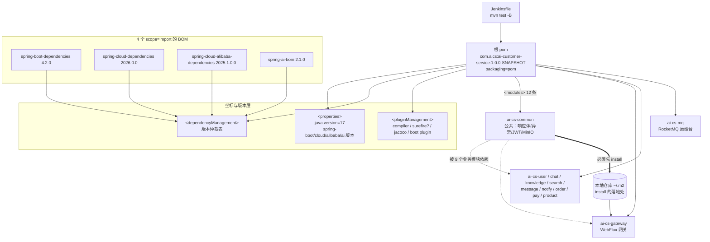
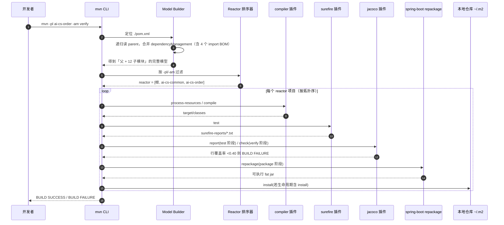

# Maven 多模块工程：12 个模块怎么被组织，依赖冲突怎么定位

> **一句话结论**：这个工程的"模块清单"写在根 `pom.xml` 的 `<modules>` 里（它就是 Maven reactor 的成员表），"版本"集中在根 pom 的 `<properties>` + `<dependencyManagement>`（其中 4 条是 `scope=import` 的 BOM），子模块的依赖一律不写 `<version>`；所以升版本只改根 pom 的 `<properties>`，定位冲突只跑 `dependency:tree -Dverbose` 和 `help:effective-pom`。
> **阅读前置**：读过 [01-Java17核心特性](./01-Java17核心特性.md)（知道 `release=17`、record/sealed 大致是什么），跑过 `mvn clean install`，知道 pom 是一份 XML 而不是脚本。
> **证据基线**：Maven 3.9.16 + JDK 17（本地 JAVA_HOME 指向 JDK 21）+ Spring Boot 4.2.0 / Spring Cloud 2026.0.0 / Spring Cloud Alibaba 2025.1.0.0 / Spring AI 2.1.0。本篇 **A 级证据 0 条**：`learning-docs/24-源码分析/assets/source/` 的 905 份摘录全是框架运行时类（`*Builder.java.md` 之类），没有 Maven 构建相关代码，所以本篇结论由 B 级（本项目 pom 实读行号）与 C 级（本机离线实测的完整命令 + 原始输出）支撑。预计阅读 35 分钟。

## 0. 先看现象

**现象一：新加的模块"本地能跑"，CI 就是不构建它。**

在工程根目录执行离线校验，正常应当列出根 pom 加 12 个子模块共 13 个 reactor 项目（C 级实测，命令在本机 root 目录跑）：

```bash
mvn -o -B validate
```

```text
[INFO] Reactor Build Order:
[INFO] ai-customer-service        [pom]
[INFO] ai-cs-common               [jar]
[INFO] ai-cs-gateway              [jar]
...（中间模块行省略，实测共 13 个 reactor 项目）
[INFO] BUILD SUCCESS
[INFO] Total time:  4.923 s
```

实测的完整顺序是：`ai-customer-service` → `ai-cs-common` → `ai-cs-gateway` → `ai-cs-user` → `ai-cs-knowledge` → `ai-cs-chat` → `ai-cs-search` → `ai-cs-message` → `ai-cs-notify` → `ai-cs-order` → `ai-cs-pay` → `ai-cs-mq` → `ai-cs-product`。

但一旦你以为 `ai-cs-frontend` 也被 Maven 管着，就会撞上这句（C 级实测原文）：

```bash
mvn -o -B validate -pl ai-cs-frontend
```
```text
[ERROR] Could not find the selected project in the reactor: ai-cs-frontend @
```

`ai-cs-frontend` 和 `ai-cs-py-chat` 目录里根本没有 `pom.xml`（`Test-Path ai-cs-frontend\pom.xml` 返回 `False`），它们不是 reactor 成员。同样地，**子目录里有 pom 但父 pom 没写 `<module>`** 时，Maven 连一句警告都不会给——C 级实测（临时工程，父 pom 无 `<modules>`、子目录 `new-svc` 有 pom）：只构建了 `demo:demo-root` 一个项目，`BUILD SUCCESS`，耗时 0.159 s，`new-svc` 被静默忽略。

**现象二：单模块构建时，兄弟模块的依赖"查无此物"。**

```bash
mvn -o -B dependency:tree -pl ai-cs-gateway
```
```text
[WARNING] The POM for com.aics:ai-cs-common:jar:1.0.0-SNAPSHOT is missing, no dependency information available
```

`-pl` 只把网关一个模块拉进构建，它依赖的 `com.aics:ai-cs-common:1.0.0-SNAPSHOT` 既不在 Reactor 里、本地仓库里也没有解析成功过——`C:\Users\16680\.m2\repository\com\aics\ai-cs-common\1.0.0-SNAPSHOT\` 目录下只有 `ai-cs-common-1.0.0-SNAPSHOT.jar.lastUpdated`、`.pom.lastUpdated`、`resolver-status.properties` 三个"失败标记"文件，没有 jar 也没有 pom（C 级实测目录列表）。于是网关的依赖树里**看不到 common 那一大棵子树**，你想核对的传递依赖全部失踪。

**现象三：子模块忘写依赖时会连编译都进不去。**

C 级实测（临时工程，父 pom 只在 `dependencyManagement` 里管了 `hutool-all`，子模块声明 `lombok` 但不写 `<version>`）：

```bash
mvn -o -B validate
```
```text
[ERROR] [ERROR] Some problems were encountered while processing the POMs:
[ERROR] 'dependencies.dependency.version' for org.projectlombok:lombok:jar is missing. @ line 11, column 17
[ERROR] The build could not read 1 project -> [Help 1]
```

注意它连"编译"这一步都没走到：报错发生在 **模型构建（model building）** 阶段，属于"pom 读不进来"，不是"代码写错了"。

这三个现象指向同一件事：**Maven 多模块工程的正确性由"pom 之间的结构关系"决定，而不是由某一份 pom 自己的内容决定**——`<modules>` 决定谁参与构建、`<parent>`+`dependencyManagement` 决定版本从哪来、`install` 决定单模块构建时能不能看见兄弟模块。搞清这三条链路，上面所有报错都能顺着查下去。

## 1. 整体地图



**组件 / 责任 / 调用方**：

| 组件 | 责任 | 谁在用 |
| --- | --- | --- |
| 根 `pom.xml` | 声明 reactor 成员（`<modules>`）、统一属性、版本仲裁、插件管理 | Maven 自己（在根目录跑任何生命周期命令时）、Jenkinsfile |
| 4 个 `scope=import` 的 BOM | 提供框架全家桶的"标准版本集合" | 根 pom 的 `<dependencyManagement>` |
| `<dependencyManagement>` | 子模块"不写版本也能解析"的唯一依据 | 12 个子模块的 `<dependencies>` |
| `<pluginManagement>` | compiler / jacoco / spring-boot-maven-plugin 的版本与参数只写一遍 | 各子模块 `<build><plugins>` 声明插件时 |
| 子模块 pom | 只声明"我要什么"，不声明"是哪个版本" | reactor 构建、IDE 导入 |
| 本地仓库 `~/.m2/repository` | `install` 的落地处，跨 reactor 复用的缓存 | `-pl` 单模块构建、其它工程 |
| `Jenkinsfile` | 在 CI 容器里跑 `mvn test -B` | 流水线触发 |

> **读图说明**：最关键的两根箭头是 **BOM → `<dependencyManagement>`** 和 **根 pom → `<modules>`**。前者解释"为什么子模块的 `<dependency>` 里一个 `<version>` 都找不到还能编译"——版本是 `dependencyManagement` 在仲裁，而 4 个 BOM 又给这张仲裁表灌进了几百条框架版本；后者解释"为什么漏写一个 `<module>` 就相当于这个模块不存在"——`<modules>` 不是目录扫描结果，是手写清单，写漏了 Maven 不会替你发现。图上从 `ai-cs-common` 指向本地仓库的那根粗箭头，是"`-pl` 单模块构建必失败"的根因。

## 2. 关键概念与关键类

| 名称 | 所在位置 | 角色 | 关键点 |
| --- | --- | --- | --- |
| `<modules>` | 根 `pom.xml#L14-L27`（12 条） | reactor 成员表 | 写的是"谁参加"，顺序由依赖拓扑决定（本工程恰好把 `ai-cs-common` 写在最前，所以实测顺序与字面顺序一致） |
| `<parent>` | 如 `ai-cs-order/pom.xml#L7-L11` | 继承根 pom 的 `dependencyManagement`/`pluginManagement` | 子模块靠它拿到"版本表" |
| `<packaging>pom</packaging>` | 根 `pom.xml#L12` | 聚合/父工程不产出 jar | 少了它根工程会尝试打 jar 而失败 |
| `dependencyManagement` | 根 `pom.xml#L85-L309` | 版本仲裁表：只有子模块声明了依赖才生效 | 写在这里**不会**引入依赖 |
| `scope=import` + `type=pom` | `pom.xml#L88-L121` | 把 BOM 的内容"倒进"本工程的仲裁表 | 必须写在 `dependencyManagement` 内 |
| `<properties>` | 根 `pom.xml#L29-L83` | 单一版本源 | 属性值被 `${}` 引用，改一处全工程生效 |
| `pluginManagement` | 根 `pom.xml#L311-L392` | 插件版本与参数模板 | 子模块只写 `<artifactId>` 即可 |
| `maven-compiler-plugin` | 根 `pom.xml#L327-L348`（3.11.0） | 编译，`<source>/<target>=17` + 注解处理器路径 | 不写 `annotationProcessorPaths` 时 mapstruct/lombok 会静默失效 |
| `jacoco-maven-plugin` | 根 `pom.xml#L350-L389`（0.8.11） | `prepare-agent`/`report`/`check` 三段 | `check` 绑在 `verify`，行 0.40、分支 0.30 |
| `maven-surefire-plugin` | 根 pom **没有**；`ai-cs-gateway/pom.xml#L125-L137`、`ai-cs-chat/pom.xml#L250-L262` | 跑单测 | 两处都没写 `<version>`，Maven 会告警（见 §6） |
| `spring-boot-maven-plugin` | 根 `pom.xml#L314-L326`，子模块如 `ai-cs-order/pom.xml#L188-L191` | `repackage` 打成可执行 fat jar | 声明即生效：`repackage` 的默认 phase 就是 `package` |
| reactor（反应堆） | 运行时概念 | 一次构建里所有参与者及其构建顺序 | 由 `<modules>` 递归展开 + 依赖拓扑排序得到 |
| `-pl` / `-am` | 命令行 | `-pl` 选模块、`-am` 连带把它的上游模块也拉进 reactor | `-pl` 不带 `-am` 就只剩一个模块 |
| `SNAPSHOT` | `pom.xml#L10`（`1.0.0-SNAPSHOT`） | 可被反复覆盖的"临时版本" | 别人拿到的是你 `install` 那一刻的快照 |
| `dependency:tree` | 插件目标 | 打印解析后的依赖树 | 加 `-Dverbose` 才显示"被谁挤掉"的版本 |
| `help:effective-pom` | 插件目标 | 打印"合并父 pom 与 BOM 之后"的最终 pom | 排查"版本到底是哪来的"最直接 |
| BOM（Bill of Materials） | 概念 | 只含 `dependencyManagement` 的 pom，用来成组发布版本 | 本工程 import 了 4 个 |

## 3. 原理与证据逐段精读

### 3.1 根 pom 的坐标声明与 `<modules>`：reactor 的唯一来源

**这段在做什么**：先把工程自己的坐标和"谁是我儿子"写清楚。

```xml (B: pom.xml#L7-L27)
    <groupId>com.aics</groupId>
    <artifactId>ai-customer-service</artifactId>
    <version>1.0.0-SNAPSHOT</version>
    <packaging>pom</packaging>
    <name>ai-customer-service</name>
    <description>AI 智能客服平台 - 父工程（聚合 + 版本统一管理）</description>

    <modules>
        <module>ai-cs-common</module>
        <module>ai-cs-gateway</module>
        <module>ai-cs-user</module>
        <module>ai-cs-knowledge</module>
        <module>ai-cs-chat</module>
        <module>ai-cs-search</module>
        <module>ai-cs-message</module>
        <module>ai-cs-notify</module>
        <module>ai-cs-order</module>
        <module>ai-cs-pay</module>
        <module>ai-cs-mq</module>
        <module>ai-cs-product</module>
    </modules>
```

12 条 `<module>`，加上根自己 = 13 个 reactor 项目，与 C 级实测的 Reactor Build Order 完全对得上。注意 `ai-cs-frontend`、`ai-cs-frontend-react`、`ai-cs-py-chat`、`ai-cs-py-recommend` 都**不在这张表里**：前两个是 npm 工程，后两个是 Python，它们由各自的工具链构建。

**为什么这么设计**：Maven 没有"扫目录自动发现模块"的能力（这是 Gradle 的 `include` + 目录约定的一个小差别）。`<modules>` 是显式清单，好处是构建范围可控、顺序无关（Maven 自己按依赖重排），坏处是**漏写等于不存在**。

**换成另一种写法会怎样**：如果不用聚合（根 pom 只做父工程、不写 `<modules>`），那 12 个模块就要各自 `mvn install`，顺序还得人工保证 `ai-cs-common` 最先——这正是"多仓库"方案的代价。反过来，如果把前端目录也硬塞进 `<modules>`，会因为目录里没有 `pom.xml` 直接构建失败。

**常见坑**：新增模块后**只在 IDE 里 add module**，忘了回根 pom 加 `<module>`。表现是本地 IDE 一切正常、`mvn -pl 新模块` 报 `Could not find the selected project in the reactor`，CI（跑根目录 `mvn test -B`）根本不构建它。C 级实测的 `mvn-mod-demo` 已经证明：父 pom 没有 `<modules>` 时，子目录里的 pom 被完全静默忽略，构建照样 `BUILD SUCCESS`。

### 3.2 `dependencyManagement`：子模块"不写版本"的法律依据

**这段在做什么**：建立一张"版本仲裁表"。子模块写 `<dependency>` 时只要 groupId+artifactId 能在表里命中，就可以省略 `<version>`。

```xml (B: pom.xml#L85-L121)
    <dependencyManagement>
        <dependencies>
            <!-- Spring Boot 依赖管理 -->
            <dependency>
                <groupId>org.springframework.boot</groupId>
                <artifactId>spring-boot-dependencies</artifactId>
                <version>${spring-boot.version}</version>
                <type>pom</type>
                <scope>import</scope>
            </dependency>
            <!-- Spring Cloud 依赖管理 -->
            <dependency>
                <groupId>org.springframework.cloud</groupId>
                <artifactId>spring-cloud-dependencies</artifactId>
                <version>${spring-cloud.version}</version>
                <type>pom</type>
                <scope>import</scope>
            </dependency>
            <!-- Spring Cloud Alibaba 依赖管理 -->
            <dependency>
                <groupId>com.alibaba.cloud</groupId>
                <artifactId>spring-cloud-alibaba-dependencies</artifactId>
                <version>${spring-cloud-alibaba.version}</version>
                <type>pom</type>
                <scope>import</scope>
            </dependency>
            <!-- Spring AI 依赖管理 -->
            <dependency>
                <groupId>org.springframework.ai</groupId>
                <artifactId>spring-ai-bom</artifactId>
                <version>${spring-ai.version}</version>
                <type>pom</type>
                <scope>import</scope>
            </dependency>
        </dependencies>
    </dependencyManagement>
```

对照子模块，能看到"位置"和"效果"：

```xml (B: ai-cs-common/pom.xml#L18-L29)
        <dependency>
            <groupId>org.springframework.boot</groupId>
            <artifactId>spring-boot-starter-web</artifactId>
        </dependency>
        <dependency>
            <groupId>org.springframework.boot</groupId>
            <artifactId>spring-boot-starter-validation</artifactId>
        </dependency>
```

```xml (B: ai-cs-order/pom.xml#L86-L91)
        <dependency>
            <groupId>com.aics</groupId>
            <artifactId>ai-cs-common</artifactId>
        </dependency>
```

`ai-cs-order` 依赖自家 `ai-cs-common` 也不写版本，依据是根 pom 里唯一一条内部模块仲裁（B 级：`pom.xml#L280-L284`，版本写的是 `${project.version}`）。

**为什么这么设计**：`import` 型 BOM 把"某个框架全家桶官方认证的版本组合"整包倒进仲裁表，避免出现"Spring Boot 4.2.0 配 Spring Framework 6.x"这种自选组合事故。本项目**没有**用 `spring-boot-starter-parent` 作为 parent，而是自己当 parent + import BOM —— 两种都能统一版本，区别见 §5。

**换成另一种写法会怎样**：如果每个子模块自己写 `<version>`，版本源就从 1 处变成 N 处，`spring-boot-starter-web` 在 12 个模块里可以合法地写成 12 个不同版本，而 Maven 不会报错，只会在运行时给你 `NoSuchMethodError`。反过来，如果不 import BOM 而逐条手写每个框架依赖的版本，仲裁表会膨胀到几百行且必然漏项。

**常见坑**：把 BOM 写进 `<dependencies>` 而不是 `<dependencyManagement>`。写错位置后 Maven 会把 BOM 当普通依赖解析（它没有 jar），构建直接失败。另外别指望 import 的 BOM 会出现在子模块的 `effective-pom` 里——C 级实测 `ai-cs-order` 的 effective-pom 中，`spring-boot-dependencies` 这类 BOM 条目**不存在**，它们已经被"展开"成一条条具体版本（例如 `mybatis-plus-spring-boot4-starter` 解析成 `3.5.13`）。

### 3.3 `<properties>`：全工程唯一的版本源，以及一个刻意不放进来的例外

**这段在做什么**：把每个第三方库的版本收敛成一个属性。

```xml (B: pom.xml#L29-L42)
        <java.version>17</java.version>
        <maven.compiler.source>17</maven.compiler.source>
        <maven.compiler.target>17</maven.compiler.target>
        <!-- 保留方法参数名：SpEL #paramName、@ConfigurationProperties 构造绑定、Feign 接口签名都依赖它 -->
        <maven.compiler.parameters>true</maven.compiler.parameters>
        <project.build.sourceEncoding>UTF-8</project.build.sourceEncoding>
        <project.reporting.outputEncoding>UTF-8</project.reporting.outputEncoding>
        <spring-boot.version>4.2.0</spring-boot.version>
        <spring-cloud.version>2026.0.0</spring-cloud.version>
        <spring-cloud-alibaba.version>2025.1.0.0</spring-cloud-alibaba.version>
        <spring-ai.version>2.1.0</spring-ai.version>
```

`<properties>` 一共 30 余条（`pom.xml#L29-L83`），覆盖 MyBatis-Plus 3.5.13、ShardingSphere 5.5.0、Seata 1.7.1、Elasticsearch 8.12.2、RocketMQ 2.3.0、MinIO 8.5.12、Hutool 5.8.26、Lombok 1.18.30、MapStruct 1.5.5.Final、JJWT 0.12.5、Guava 33.0.0-jre、SpringDoc 2.3.0、JaCoCo 0.8.11、Resilience4j 2.4.0、Redisson 3.27.2、XXL-Job 2.4.1、Spring Statemachine 4.0.0 等。

有一个反例值得单独看：

```xml (B: pom.xml#L196-L201)
            <dependency>
                <groupId>org.apache.commons</groupId>
                <artifactId>commons-compress</artifactId>
                <!-- Spring AI 2.1 的 Tika 4 / POI 5.5.1 要求 1.28.0，压掉 MinIO 传递来的 1.26.0 -->
                <version>1.28.0</version>
            </dependency>
```

它**没有**用属性，而是把 `1.28.0` 硬编码在 `dependencyManagement` 里。这是一个真实的"反模式但正确"的取舍：这条版本是为了压掉 MinIO 传递进来的旧版（C 级实测证据在 §3.8），属于一次性的、带注释的定点压制；一旦有多个模块需要同一个属性，才值得提升为 `<properties>`。

**为什么这么设计**：属性 + `${}` 让"升级 Spring Boot"变成改一行。同时 `maven.compiler.parameters=true` 这条注释点出了一个容易忽略的联动：没有它，`@ConfigurationProperties` 构造器绑定、SpEL 的 `#paramName`、Feign 接口参数名都会失效——这类问题在编译期完全看不出。

**换成另一种写法会怎样**：把版本直接写在每个 `<dependency>` 里（旧教程的写法），升级等于全工程 grep 替换；用 `versions-maven-plugin` 自动扫描升级虽然方便，但在这个工程里会把 4 个 BOM 与 SCA/Spring AI 的兼容矩阵一起升乱。

**常见坑**：只改 `spring-boot.version` 不改 `spring-cloud.version`。Boot 4.2.0 需要 Cloud 2026.0.0 这条线，错配的典型表现是启动期 `NoSuchMethodError` 或 `NoClassDefFoundError`，而不是编译错误——编译期一切正常，因为两边的类名都在。

### 3.4 编译插件：`source/target=17` 而不是 `release=17`

**这段在做什么**：固定编译级别，并把两个注解处理器按顺序注册。

```xml (B: pom.xml#L327-L348)
                <plugin>
                    <groupId>org.apache.maven.plugins</groupId>
                    <artifactId>maven-compiler-plugin</artifactId>
                    <version>3.11.0</version>
                    <configuration>
                        <source>${java.version}</source>
                        <target>${java.version}</target>
                        <encoding>UTF-8</encoding>
                        <annotationProcessorPaths>
                            <path>
                                <groupId>org.projectlombok</groupId>
                                <artifactId>lombok</artifactId>
                                <version>${lombok.version}</version>
                            </path>
                            <path>
                                <groupId>org.mapstruct</groupId>
                                <artifactId>mapstruct-processor</artifactId>
                                <version>${mapstruct.version}</version>
                            </path>
                        </annotationProcessorPaths>
                    </configuration>
                </plugin>
```

C 级实测（`help:effective-pom -pl ai-cs-order` 产出的 484026 字节文件）里，这段合并结果是 `<version>3.11.0</version>`、`<source>17</source>`、`<target>17</target>`、`<encoding>UTF-8</encoding>`。

**为什么这么设计**：`annotationProcessorPaths` 的好处是"编译用的处理器版本与运行时依赖解耦"——`lombok` 在 `<dependencies>` 里可能是 `provided`，但只要处理器路径里写了，编译期一定能生成 `getter/setter`/`MapperImpl`。把 `lombok` 排在 `mapstruct-processor` 之前，是为了让 MapStruct 生成的实现类能看到 Lombok 生成的访问器。

**换成另一种写法会怎样**：现代写法是 `<release>17</release>`，它比 `source/target` 更严格——`release` 会同时校验**JDK API 的使用范围**，避免"用 JDK 21 编译、却调用了 JDK 21 才有的方法、在 JDK 17 运行时炸 `NoSuchMethodError`"。本工程仍是 `source/target` 组合，本地 JAVA_HOME 指向 JDK 21 时，这个风险窗口是真实存在的（依据：`javac` 官方文档对 `--release` 与 `-source/-target` 差异的说明）。§7 把它列成一条待迁移项。

**常见坑**：两个注解处理器只写一个。少了 `mapstruct-processor` 的表现是"Mapper 实现类不存在 / `cannot find symbol MapperImpl`"；少了 `lombok` 的表现是"找不到 `getXxx()`"——两种报错都长着"代码写错"的脸，实际是构建配置问题。

### 3.5 覆盖率门禁：规则只写一遍，但只有 5 个模块真的开了门

**这段在做什么**：用 JaCoCo 在 `verify` 阶段卡覆盖率。

```xml (B: pom.xml#L350-L389)
                <plugin>
                    <groupId>org.jacoco</groupId>
                    <artifactId>jacoco-maven-plugin</artifactId>
                    <version>${jacoco.version}</version>
                    <executions>
                        <execution>
                            <id>prepare-agent</id>
                            <goals><goal>prepare-agent</goal></goals>
                        </execution>
                        <execution>
                            <id>report</id>
                            <phase>test</phase>
                            <goals><goal>report</goal></goals>
                        </execution>
                        <execution>
                            <id>check</id>
                            <phase>verify</phase>
                            <goals><goal>check</goal></goals>
                            <configuration>
                                <rules>
                                    <rule>
                                        <element>BUNDLE</element>
                                        <limits>
                                            <limit>
                                                <counter>LINE</counter>
                                                <value>COVEREDRATIO</value>
                                                <minimum>0.40</minimum>
                                            </limit>
                                            <limit>
                                                <counter>BRANCH</counter>
                                                <value>COVEREDRATIO</value>
                                                <minimum>0.30</minimum>
                                            </limit>
                                        </limits>
                                    </rule>
                                </rules>
                            </configuration>
                        </execution>
                    </executions>
                </plugin>
```

但这段写在 `<pluginManagement>` 里，**它只是模板**。真正开门要子模块自己声明插件：

```xml (B: ai-cs-order/pom.xml#L186-L198)
        <plugins>
            <plugin>
                <groupId>org.springframework.boot</groupId>
                <artifactId>spring-boot-maven-plugin</artifactId>
            </plugin>
            <plugin>
                <groupId>org.jacoco</groupId>
                <artifactId>jacoco-maven-plugin</artifactId>
            </plugin>
        </plugins>
```

`ai-cs-message/pom.xml#L125-L129` 甚至留了注释说明这个机制："JaCoCo 覆盖率门禁（行 ≥40%，分支 ≥30%，规则定义在父 POM pluginManagement）"。逐模块查下来，**只有 `ai-cs-message`、`ai-cs-notify`、`ai-cs-order`、`ai-cs-pay`、`ai-cs-product` 这 5 个模块声明了 jacoco**；`common`、`gateway`、`user`、`knowledge`、`chat`、`search`、`mq` 都没有。也就是说 `mvn -pl ai-cs-chat verify` 永远不会因为覆盖率不达标失败。

**为什么这么设计**：`pluginManagement` 统一参数 + 子模块按需启用，是 Maven 里"可选门禁"的标准做法——`common` 这种纯 POJO/工具模块没有可测的业务分支，硬卡 40% 只会逼人造垃圾测试。

**换成另一种写法会怎样**：把 jacoco 直接写进根 pom 的 `<build><plugins>`，效果是**所有模块强制生效**（`<plugins>` 会继承），`ai-cs-common` 立刻会因为覆盖率不足挂掉。另一种写法是每个模块复制一遍规则，结果是规则漂移（有的 40%、有的 60%）。

**常见坑**：以为"根 pom 写了 jacoco 就有门禁"。判断方法很直接：看模块 pom 的 `<build><plugins>` 里有没有 `jacoco-maven-plugin`；或者 `mvn -pl 模块 help:effective-pom` 搜 `jacoco`，看 `check` 的 `execution` 是否真的存在（C 级实测的 `eff-order.xml` 里能搜到 `LINE/0.40` 与 `BRANCH/0.30`，而 common 的 effective-pom 里搜不到）。

### 3.6 surefire：根 pom 一条都没有，两个模块各自带着告警

**这段在做什么**：控制"哪些测试类会被执行"。

根 pom 的 `pluginManagement` 里**没有** `maven-surefire-plugin`（B 级核对：`pom.xml#L311-L392` 只有 spring-boot-maven-plugin、maven-compiler-plugin、jacoco-maven-plugin 三个）。而网关和 chat 各自配了 includes，且都没写 `<version>`：

```xml (B: ai-cs-gateway/pom.xml#L122-L137)
        <plugins>
            <plugin>
                <groupId>org.apache.maven.plugins</groupId>
                <artifactId>maven-surefire-plugin</artifactId>
                <configuration>
                    <includes>
                        <include>**/*Test.java</include>
                        <include>**/*Tests.java</include>
                        <include>**/*TestCase.java</include>
                        <include>**/Test*.java</include>
                        <include>**/*Suite.java</include>
                    </includes>
                </configuration>
            </plugin>
```

C 级实测证据：在根目录跑 `mvn -o -B validate`，Maven 会同时打两条告警——

```text
[WARNING] 'build.plugins.plugin.version' for org.apache.maven.plugins:maven-surefire-plugin is missing. @ line 125, column 21
[WARNING] 'build.plugins.plugin.version' for org.apache.maven.plugins:maven-surefire-plugin is missing. @ line 250, column 21
```

两条分别对应 `ai-cs-gateway/pom.xml` 第 125 行与 `ai-cs-chat/pom.xml` 第 250 行。同时 Maven 还提示 "future Maven versions might no longer support building such malformed projects"。

**为什么这么设计**：不写版本的动机大概是"让 Maven 用默认值"。确实能跑——`ai-cs-order` 的 effective-pom 里 surefire 被解析成 `3.5.4`（C 级实测），来自 Maven 的默认生命周期绑定。但这属于"靠默认值兜底"，不是"明确声明"。

**换成另一种写法会怎样**：在根 pom 的 `pluginManagement` 里加一条 `maven-surefire-plugin` + `${maven-surefire-plugin.version}`，告警消失、升级可控、全工程行为一致——这是 §9 练习里的第一条。反例是把 surefire 配置写进根 `<build><plugins>`，那 12 个模块都会被强制套用同一份 includes（对 chat 的 `-Peval` 专门 profile 是冲突的）。

**常见坑**：`ai-cs-chat` 有一个 `<profiles>` 片段专门只跑 RAG 评估测试（`ai-cs-chat/pom.xml#L226-L245`，`-Peval` 时 includes 改成 `**/RagEvaluationTest.java`）。如果哪天有人把 surefire 配置提升到根 `<build><plugins>`，这个 profile 的覆盖关系就会变得难以预测。

### 3.7 reactor 构建顺序与 `-pl` / `-am`

**这段在做什么**：决定"这次构建谁参加、按什么顺序"。

C 级实测三种跑法，输出差异非常直观：

| 命令 | reactor 成员 | 隐含含义 |
| --- | --- | --- |
| `mvn -o -B validate` | 13 个（根 + 12 模块），`ai-cs-common` 排第一 | 全量；顺序由模块间依赖的拓扑排序决定——本工程 `<modules>` 里 `ai-cs-common` 恰好写在最前，所以两者一致 |
| `mvn -o -B validate -pl ai-cs-order -am` | 3 个：`ai-customer-service`、`ai-cs-common`、`ai-cs-order`（输出 `[1/3]`…`[3/3]`） | `-am`（also-make）把上游依赖一起拉进来 |
| `mvn -o -B validate -pl ai-cs-frontend` | 无 | `[ERROR] Could not find the selected project in the reactor` |

**为什么这么设计**：`-pl` 是"我只要这个模块"，`-am` 是"以及它依赖的模块"，`-amd`（also-make-dependents）是"以及依赖它的模块"。日常开发 `mvn -pl ai-cs-order -am test` 比全量快一个数量级，因为 `chat`/`knowledge` 这类重模块根本不进 reactor。

**换成另一种写法会怎样**：不用 `-pl` 就每次全量构建，13 个模块的 `verify` 加 JaCoCo 会让你等到怀疑人生；只 `-pl` 不加 `-am`，则依赖的兄弟模块只能从本地仓库拿——这正是 §0 现象二的来源（`ai-cs-common` 没 install 过，于是 `[WARNING] The POM for com.aics:ai-cs-common:jar:1.0.0-SNAPSHOT is missing`）。

**常见坑**：`-pl` 写的是**目录名或 artifactId**，不是路径通配符。写成 `-pl ai-cs-order/` 或用 `-pl ./ai-cs-order` 在不同 Maven 版本上行为不一致，稳妥写法是 `-pl :ai-cs-order`（冒号开头表示按 artifactId 精确匹配）。

### 3.8 SNAPSHOT 与 install：单模块构建的前提

**这段在做什么**：让"本地改的 common"能被"只构建的 order"看见。

`1.0.0-SNAPSHOT`（`pom.xml#L10`）意味着这个版本号可以被反复覆盖发布。**但 reactor 内部构建并不会自动写本地仓库**——`mvn test`、`mvn package` 都不会 `install`。C 级实测的目录证据：

```text
C:\Users\16680\.m2\repository\com\aics\ai-cs-common\1.0.0-SNAPSHOT\
    ai-cs-common-1.0.0-SNAPSHOT.jar.lastUpdated
    ai-cs-common-1.0.0-SNAPSHOT.pom.lastUpdated
    resolver-status.properties
```

`.lastUpdated` 文件是 Maven 记录"这次解析失败了"的标记，它们的**存在本身就是"从未 install 成功"的证据**（依据：Maven 官方文档对 `resolver-status.properties` / `*.lastUpdated` 的说明）。

**为什么这么设计**：SNAPSHOT 是"未定稿"的语义，配合 `-U` 强制更新可以覆盖已缓存的 SNAPSHOT。风险也在这里：你 `install` 之后别人拉到的就是你那一刻的代码，**没有版本号变化可追踪**。

**换成另一种写法会怎样**：如果内部模块用 release 版本（如 `1.0.0`），每次改 common 都要发一次版本号，`dependencyManagement` 里的 `${project.version}` 也得跟着改——本地开发循环会变得非常痛苦。所以内部 SNAPSHOT + 对外 release 是常规取舍。

**常见坑**：改了 common 的代码，`mvn -pl ai-cs-order test` 却跑的是旧行为。原因是 order 从本地仓库拿的是**上次 install 的 common**。正确姿势：`mvn -pl ai-cs-common -am install -DskipTests` 先刷新，或者干脆 `mvn -pl ai-cs-order -am test` 让 common 进 reactor。

### 3.9 依赖冲突怎么定位：三条命令 + 两个真实案例

**这段在做什么**：从"依赖版本不对"定位到"是谁把版本带来的"。

**第一步：看全貌 + 看被挤掉的版本。** `-Dverbose` 会把"解析到这条路径上的另一个版本被忽略"打印出来（C 级实测，`mvn -o -B dependency:tree -pl ai-cs-common -Dverbose` 原文）：

```text
(com.alibaba.fastjson2:fastjson2:jar:2.0.58:compile - omitted for conflict with 2.0.43)
(com.github.luben:zstd-jni:jar:1.5.2-2:compile - omitted for conflict with 1.5.7-17)
(com.squareup.okio:okio-jvm:jar:3.18.1:runtime - omitted for conflict with 3.6.0)
(com.google.errorprone:error_prone_annotations:jar:2.50.0:compile - omitted for conflict with 2.23.0)
(org.xerial.snappy:snappy-java:jar:1.1.10.7:runtime - omitted for conflict with 1.1.10.5)
```

**怎么读这个输出**：括号里的坐标是"被放弃的候选版本"，`omitted for conflict with X` 里的 X 是**最终生效的版本**。注意方向：`fastjson2 2.0.58` 被 `2.0.43` 挤掉，说明**最终生效的是更旧的那个**。这正是 `NoSuchMethodError` 的典型来源——代码按 2.0.58 的 API 写，运行时加载的是 2.0.43，方法不存在。

**第二步：只看某一个坐标，确认"最终是谁提供了它"。**（C 级实测）

```bash
mvn -o -B dependency:tree -pl ai-cs-common "-Dincludes=org.apache.commons:commons-compress"
```
```text
com.aics:ai-cs-common:jar:1.0.0-SNAPSHOT
\- io.minio:minio:jar:8.5.12:compile
   \- org.apache.commons:commons-compress:jar:1.28.0:compile (version managed from 1.26.0)
```

**怎么读**：`(version managed from 1.26.0)` 是这句话的全部价值——MinIO 8.5.12 带来的是 `1.26.0`，但根 pom 的 `dependencyManagement`（`pom.xml#L196-L201`）把它压成了 `1.28.0`。也就是说：**没有那 5 行硬编码版本，这里就会是 1.26.0**，而 Spring AI 2.1 的 Tika 4 / POI 5.5.1 需要 1.28.0，会在运行时炸 `NoSuchMethodError`（`ZipArchiveOutputStream` 之类）。这就是"定点压制"为什么必须带注释。

**第三步：看"合并后的最终 pom"，回答"这个版本到底从哪来"。**

```bash
mvn -o -B help:effective-pom -pl ai-cs-order "-Doutput=eff-order.xml"
```

C 级实测：`BUILD SUCCESS`，产出 `ai-cs-order\eff-order.xml`（484026 字节）。在里面能直接读到三件事：jacoco `check` 的 `LINE/0.40`、`BRANCH/0.30`（证明 §3.5 的模板确实对 order 生效）、`maven-compiler-plugin 3.11.0 / source 17 / target 17`（§3.4）、`maven-surefire-plugin 3.5.4`（§3.6 说的默认值）、以及 `com.aics:ai-cs-common` 的版本被解析成 `1.0.0-SNAPSHOT`。

> PowerShell 注意：`-D` 参数必须整体加引号（`"-Doutput=eff-order.xml"`、`"-Dincludes=org.apache.commons:commons-compress"`），否则会被拆开，Maven 报 `Unknown lifecycle phase ".txt"`（C 级实测踩过）。

**案例：一条"看起来对、实际不生效"的 exclusion。** 网关为了保持 WebFlux 纯净，在依赖 common 时排除了 MVC：

```xml (B: ai-cs-gateway/pom.xml#L43-L53)
        <dependency>
            <groupId>com.aics</groupId>
            <artifactId>ai-cs-common</artifactId>
            <exclusions>
                <!-- 排除 Spring MVC，网关基于 WebFlux，两者不兼容 -->
                <exclusion>
                    <groupId>org.springframework.boot</groupId>
                    <artifactId>spring-boot-starter-webmvc</artifactId>
                </exclusion>
            </exclusions>
        </dependency>
```

C 级实测两件事：① `mvn -o -B dependency:tree -pl ai-cs-common "-Dincludes=org.springframework.boot:spring-boot-starter-webmvc"` 输出为空树（零匹配）；② common 依赖的是 `spring-boot-starter-web`（`ai-cs-common/pom.xml#L18-L23`），而 `spring-boot-starter-web:4.2.0` 的 pom 里，它的子依赖是 `spring-boot-starter-jackson`、`spring-boot-starter-tomcat`、`spring-boot-http-converter`、**`spring-boot-webmvc`**——不是 `spring-boot-starter-webmvc`（依据：`~/.m2` 中该 pom 的实际内容）。所以这条 exclusion 的目标坐标在 common 的传递树上**根本不存在**，排除不掉任何东西。

顺带一个 4.2.0 的事实：`spring-boot-starter-web:4.2.0` 的 pom description 明确写着 "…Uses Tomcat as the default embedded container **(deprecated in favor of spring-boot-starter-webmvc)**"，而 `spring-boot-starter-webmvc:4.2.0` 的 description 是 "Starter for using Spring MVC and Tomcat"，两者依赖集合完全相同——前者已是后者的别名。

**为什么这么设计（指 exclusion 机制）**：exclusion 是按 groupId+artifactId 精确匹配"传递依赖节点"的，不认"同类替代"。写错一个 artifactId，后果是静默失效，没有任何警告。

**换成另一种写法会怎样**：正确写法是排除 `spring-boot-webmvc`（或干脆让 common 不引入 `spring-boot-starter-web`，改成 `spring-boot-starter-webmvc` 并让网关排除它 + 排除 tomcat），或者最干净的方案：common 不依赖任何 web starter，把 web 相关能力下沉到各业务模块。

**常见坑**：以为"pom 里写了 exclusion 就一定生效"。验证方法只有一条——`dependency:tree` 里看目标坐标还在不在。本工程当前因为 `ai-cs-common` 未 install，网关的完整依赖树在本机无法离线验证（C 级实测：树里没有 common 子树），所以这条 exclusion 的实际危害要等 `mvn install -DskipTests` 之后再跑一次 `mvn -o -B dependency:tree -pl ai-cs-gateway "-Dincludes=org.springframework.boot:spring-boot-webmvc"` 才能下定论。

## 4. 一次完整执行时序

以最常用的一条命令为例：`mvn -pl ai-cs-order -am verify`（在工程根目录执行）。



> **读图说明**：最关键的是第 3~4 步（Model Builder 递归合并父 pom 与 BOM）与第 6 步（Reactor 排序）。前者决定"子模块能不能不写版本"，后者决定"为什么 `-pl ai-cs-order -am` 只跑 3 个模块而不是 13 个"。第 9~12 步是每个模块内部固定的生命周期顺序：`compile → test → jacoco report → package/repackage → verify/jacoco check → install`，`check` 排在 `verify` 而不是 `test`，是为了让"测试挂了"和"覆盖率不达标"两个失败原因不在同一阶段混在一起。

**哪一步失败会报什么错**：

| 失败步骤 | 报错形态（原文或官方格式） | 判据 |
| --- | --- | --- |
| 定位/读取 pom（模型构建） | `[ERROR] 'dependencies.dependency.version' for org.projectlombok:lombok:jar is missing. @ line 11, column 17` + `The build could not read 1 project`（C 级实测原文） | 报错带 `@ line X, column Y`，说明是 pom XML 的问题，不是代码 |
| `-pl` 选模块 | `[ERROR] Could not find the selected project in the reactor: ai-cs-frontend`（C 级实测原文） | 模块不在 `<modules>` 里，或目录里没 pom |
| 依赖解析（resolve） | `[WARNING] The POM for com.aics:ai-cs-common:jar:1.0.0-SNAPSHOT is missing, no dependency information available`（C 级实测原文） | 兄弟模块没 install，或 `-pl` 没带 `-am` |
| compile | `cannot find symbol` / `package xxx does not exist` | 常见于漏加依赖，或 `annotationProcessorPaths` 少配处理器 |
| test | `Tests run: x, Failures: y, Errors: z` + `BUILD FAILURE` | 业务/断言问题，与构建结构无关 |
| jacoco `check` | JaCoCo 的 `Rule violated for bundle ai-cs-order: lines covered ratio is 0.xx, but expected minimum is 0.40`（依据 JaCoCo 官方文档 `check` 目标的标准输出格式；本工程规则见 `pom.xml#L374-L382`，本次未触发） | 前提是该模块 pom 里真的声明了 jacoco（见 §3.5 的 5 个模块名单） |
| repackage | `Unable to find main class`（依据 spring-boot-maven-plugin 官方文档） | 模块没有 `@SpringBootApplication` 入口类，却想打成可执行 jar |
| install | `Could not install artifact …` / 无写权限 | 本地仓库目录权限或磁盘问题 |

## 5. 设计取舍

| 方案 | 优点 | 代价 | 本项目怎么选 |
| --- | --- | --- | --- |
| 用 `spring-boot-starter-parent` 当 parent | 一行拿到官方推荐配置（surefire/failsafe/repackage 都配好） | 只能有一个 parent，想再继承自己的父工程就得靠 `dependencyManagement` 绕 | **不用**。本项目根 pom 自定义全部（`pom.xml#L1-L411`），换取对 12 个模块的完全控制 |
| 自定义父 pom + `scope=import` BOM | 可同时 import 多个生态的 BOM（Boot/Cloud/SCA/AI 四个并存） | surefire 之类的默认值不再被自动提供（于是有了 §3.6 的告警） | **选用**：4 个 BOM 全部 import（`pom.xml#L88-L121`） |
| 版本集中到 `dependencyManagement` | 版本源唯一，升级改一行 | 子模块的 pom 单看"不完整"，新人会困惑 | **选用**：12 个子模块全都不写第三方版本 |
| 每个模块自己写版本 | 单个模块自解释 | N 处版本漂移，冲突只能靠运行时暴露 | 拒绝 |
| 所有内部模块都在 `dependencyManagement` 里登记 | 统一 `${project.version}` | 12 条重复条目，新增模块要改两处 | **只登记 `ai-cs-common`**（`pom.xml#L280-L284`），其它模块靠 reactor 内部解析 |
| 单一聚合构建（`<modules>`） | 一条命令构建全部、顺序自动 | 全量构建慢；漏写 `<module>` 就静默漏构建 | **选用**：12 条 `<module>` |
| 多仓库 + 版本号发布 | 真正的模块边界与独立发版 | 本地跨仓库开发要反复 install，痛苦 | 拒绝（单体仓库 + SNAPSHOT） |
| 覆盖率门禁全模块强制 | 质量底线统一 | 纯 POJO 模块会被迫写垃圾测试 | **只在 5 个模块启用**（见 §3.5） |
| `source/target` 固定编译级别 | 兼容老 Maven | 不校验 JDK API 范围，JDK 21 编译 17 目标有隐患 | 当前用 `source/target=17`（`pom.xml#L331-L332`），**建议迁到 `<release>17</release>`** |
| 依赖冲突靠"发生问题再查" | 不增加构建时间 | 冲突只能上线后暴露 | 现阶段靠 `-Dverbose` 手工排查（§3.9），未引入 `maven-enforcer-plugin` |

**可扩展点清单**（按性价比排序）：

1. 根 `pluginManagement` 补 `maven-surefire-plugin` + 版本属性——顺手消掉两条 WARNING。
2. 根 pom 加 `maven-enforcer-plugin` 的 `dependencyConvergence` 或 `requireUpperBoundDeps`，把 §3.9 那 5 条 `omitted for conflict` 变成构建期失败。
3. 把 `source/target` 换成 `<release>${java.version}</release>`。
4. 把 jacoco 门禁逐步推到 `chat`/`knowledge`（有真实业务分支的两个模块）。
5. 给 `commons-compress` 这类定点压制补 `<!-- 为什么 -->` 注释的同时，考虑抽成 `<properties>` 里的 `commons-compress.version`。
6. 修掉网关那条不生效的 exclusion（§3.9 案例）。
7. Jenkinsfile 里 `SKIP_TESTS` 默认 `true`（`Jenkinsfile#L17`），「Maven 测试」stage 才跑 `mvn test -B`（`Jenkinsfile#L50-L67`）——门禁在 CI 上默认是关的，这是流程层的可扩展点。

## 6. 踩坑与调试手法

| 现象 | 根因 | 验证手段 | 解法 |
| --- | --- | --- | --- |
| CI 不构建新模块，本地 IDE 正常 | 新模块目录里的 pom 没被写进根 `<modules>` | 根目录 `mvn -o -B validate`，看 `Reactor Build Order` 里有没有它（C 级实测：漏写时只有 1 个项目、`BUILD SUCCESS`） | 在 `pom.xml#L14-L27` 补一行 `<module>` |
| `Could not find the selected project in the reactor: xxx` | 同上；或该目录根本不是 Maven 工程 | `Test-Path xxx\pom.xml`；`mvn -o -B validate -pl xxx` | 补 `<module>`；前端/Python 目录别用 Maven 命令 |
| `'dependencies.dependency.version' for X:jar is missing` | 该坐标不在任何 `dependencyManagement`/BOM 里（父 pom 只写了 groupId+artifactId） | 直接看报错行号；再 `mvn help:effective-pom` 搜该坐标 | 要么补 `<version>`，要么把它加进根 `dependencyManagement` |
| `The POM for com.aics:ai-cs-common:jar:1.0.0-SNAPSHOT is missing` | 兄弟模块从未 install，且 `-pl` 没带 `-am` | `ls ~/.m2/repository/com/aics/ai-cs-common/1.0.0-SNAPSHOT/`，只有 `*.lastUpdated` 就说明从没成功过 | `mvn -pl ai-cs-common -am install -DskipTests`，或改用 `mvn -pl 目标模块 -am …` |
| 运行时 `NoSuchMethodError` / `NoClassDefFoundError`（编译期全绿） | 同一坐标存在两个版本，最终生效的是旧版 | `mvn -o -B dependency:tree -pl <模块> -Dverbose \| Select-String "omitted for conflict"` | 在根 `dependencyManagement` 里定点压制版本（范例：`commons-compress`），或用 exclusion 剪掉旧路径 |
| `'build.plugins.plugin.version' … maven-surefire-plugin is missing` | 模块 pom 声明了插件却不写版本，根 `pluginManagement` 里也没有 | `mvn -o -B validate` 直接给出 `@ line 125, column 21` 与 `@ line 250, column 21` | 根 `pluginManagement` 加 surefire + 版本属性 |
| 改了 common 但 order 单测没变化 | order 用的是本地仓库里上次 install 的 common | 看 order 的 `dependency:tree` 顶部版本；或临时在 common 里加个会编译失败的语句试构建 | 先 `install` common，或 `-pl ai-cs-order -am` |
| `mvn verify` 覆盖率不达标构建失败，但只想跳过 | jacoco `check` 绑在 `verify` | `mvn -pl X help:effective-pom` 搜 `jacoco` 看 `check` execution 是否存在 | `-Djacoco.skip=true`，或临时 `mvn package`（不触发 `verify`） |
| `package` 后 jar 不能 `java -jar` | 该模块没声明 `spring-boot-maven-plugin`，或没有主类 | `jar tf target/xxx.jar \| Select-String BOOT-INF`；`mvn -pl X help:effective-pom` 搜 `repackage` | 在模块 `<build><plugins>` 声明插件（`repackage` 默认 phase 是 `package`，依据 4.2.0 版 plugin.xml：`<phase>package</phase>`） |

**两条真正能定位问题的调试手法**：

1. **`-Dverbose` + `Select-String` 找"被挤掉的版本"**。这是唯一能看见"没生效的那个版本"的手段——不加 `-Dverbose`，`dependency:tree` 只显示最终结果，看起来人畜无害。

   ```bash
   mvn -o -B dependency:tree -pl ai-cs-common -Dverbose | Select-String "omitted for conflict"
   ```

   关键日志关键字：`omitted for conflict with`（谁赢了）、`version managed from`（被 `dependencyManagement` 改写过）、`(scope managed from …)`（scope 被改写）。

2. **`help:effective-pom -Doutput=` 落地一个完整文件，再用文本搜索定位"这个值从哪来"**。

   ```bash
   mvn -o -B help:effective-pom -pl ai-cs-order "-Doutput=eff-order.xml"
   Select-String -Path ai-cs-order\eff-order.xml -Pattern "0.40","maven-surefire-plugin","<release>"
   ```

   它回答的是 `dependency:tree` 回答不了的问题：插件版本、`<configuration>` 合并结果、`<source>/<target>` 最终值、某个依赖的版本被解析成了什么。C 级实测该文件 484026 字节，`BUILD SUCCESS` 耗时 3.981 s。

> 备注：Maven 构建没有"断点"可言，但 `mvn -X`（debug 级别日志）等效。想定位"这个依赖为什么被解析成这个版本"，`-X` 输出里搜 `Dependency collection statistics` 与 `Resolving` 关键字，能看到每次解析的候选与决策过程。注意 `-X` 输出极大，必须配合 `Select-String` 过滤，否则看不到有用信息。

## 7. ⚠️ 版本差异

| 旧写法（很多教程/旧稿） | 当前基线（本仓库实况） | 变化点 | 迁移动作 |
| --- | --- | --- | --- |
| `spring-boot-starter-web` | `spring-boot-starter-web` 仍可用，但 4.2.0 的 pom description 已标注 "deprecated in favor of spring-boot-starter-webmvc" | Boot 4 起 MVC 启动器改名，旧的变别名（两者依赖集合相同） | 新代码用 `spring-boot-starter-webmvc`；存量模块可逐步替换（common 仍是 `starter-web`，`ai-cs-common/pom.xml#L18-L23`） |
| `mybatis-plus-spring-boot3-starter` | `mybatis-plus-spring-boot4-starter`（`pom.xml#L131-L135`，版本 3.5.13） | Boot 4 适配版 starter 改名 | 旧稿/旧教程里的 boot3 starter 在本工程**不存在**；新增模块照抄仲裁表里的坐标 |
| 分页插件直接在 `mybatis-plus` 里 | 3.5.13 起 jsqlparser 拆成独立模块，需单独引入 `mybatis-plus-jsqlparser`（`pom.xml#L137-L141` + `ai-cs-order/pom.xml#L69-L72`） | 版本升级导致的模块拆分 | 用分页/多租户等需要 jsqlparser 的功能时，必须显式加这条依赖 |
| `MockMvc`/`@WebMvcTest` 来自 `spring-boot-starter-test` | Boot 4 拆分：`spring-boot-starter-webmvc-test`（`ai-cs-user/pom.xml#L104-L109`，注释写明"Boot 4 将 MockMvc/WebMvcTest 拆分到独立 starter"）、`spring-boot-starter-security-test`（同文件 `#L110-L114`） | 测试启动器按技术栈拆分 | 写 MockMvc 测试的模块要在 `<scope>test</scope>` 下补这两个 starter |
| `spring-cloud-starter-gateway` | 实测坐标为 `org.springframework.cloud:spring-cloud-starter-gateway-server-webflux:5.1.0`（`mvn -o -B dependency:tree -pl ai-cs-gateway` 原文） | Spring Cloud Gateway 在 2025.x 线把 WebFlux/WebMVC 两套实现拆成不同 artifact（依据：Spring Cloud Gateway 官方文档的更名说明） | 网关类模块用 `…-server-webflux`；写 Servlet 版网关用对应的 mvc artifact |
| `<maven.compiler.source>17</maven.compiler.source>` + `target` | 同一写法仍在用（`pom.xml#L31-L32`、`#L331-L332`），但 `--release` 是更严格的做法 | `--release` 会同时校验 JDK API 范围（依据 `javac` 官方文档） | 建议改成 `<release>${java.version}</release>`（§9 练习 3） |
| 根 pom 里 `pluginManagement` 配 surefire | 根 pom **没有** surefire 配置；gateway/chat 各自配 includes 且不写版本 | 靠 Maven 默认值兜底（实测解析为 3.5.4），未来 Maven 版本可能不再容忍 | 补 `pluginManagement`（§9 练习 1） |
| `<modules>` 里含 10 个模块（旧稿说法） | 12 个（`pom.xml#L14-L27`），另有 `ai-cs-pay`、`ai-cs-mq` | 新增支付与 MQ 运维台两个模块 | 以根 pom 为准，别信文档里的旧清单 |
| 覆盖率门禁"全工程生效" | 只有 5 个模块声明 jacoco（message/notify/order/pay/product） | 门禁是按模块可选的 | 判断某模块有没有门禁，看它 pom 的 `<build><plugins>` |

**没有变化的**：`<modules>` + `dependencyManagement` + `scope=import` 这套组织方式从 Maven 2.x 起就没变过（依据：Maven 官方 POM 参考文档对 `dependencyManagement` 与 `import` scope 的描述）。也就是说，本篇 §2、§3.1、§3.2、§3.7 讲的结构，十年内都不会过时；会变的只有**具体坐标名和版本号**——这也是为什么要把版本集中到 `<properties>`。

## 8. 面试高频问与答

> 以下只列问题，答案自己先在脑子里过一遍，再对照 §2、§3 的表格与代码块。

1. `<dependencyManagement>` 和 `<dependencies>` 的区别是什么？为什么写在 `dependencyManagement` 里的依赖不会被打进 jar？
2. `scope=import` 的作用是什么？它为什么必须配合 `<type>pom</type>`？为什么 import 的 BOM 条目在子模块 `effective-pom` 里搜不到？
3. 一个工程能不能有两个 parent？本工程为什么选择"自定义父 pom + import BOM"而不是 `spring-boot-starter-parent`？
4. `<modules>` 的顺序等于构建顺序吗？Maven 是怎么算出 reactor 构建顺序的？出现循环依赖会怎样？
5. `-pl`、`-am`、`-amd` 三个参数分别解决什么问题？`-pl ai-cs-order` 不带 `-am` 时，`ai-cs-common` 从哪里来？
6. 依赖调解（dependency mediation）的默认规则是什么？"最近者优先"具体怎么比？`-Dverbose` 输出里 `omitted for conflict with` 的方向怎么读？
7. 一个依赖在运行时出现 `NoSuchMethodError`，但编译期完全正常，可能有哪些原因？怎么用 `dependency:tree` 定位？
8. `exclusion` 是按什么匹配的？如果 artifactId 写错会发生什么（结合本章 §3.9 的网关案例说明）？
9. `SNAPSHOT` 版本的解析机制是什么？为什么 `mvn -pl 子模块 test` 可能拿到旧的兄弟模块代码？`-U` 参数起什么作用？
10. `pluginManagement` 与 `build/plugins` 的区别？为什么根 pom 里配了 jacoco 的 `check` 规则，某些模块的 `verify` 却不会失败？
11. `maven-compiler-plugin` 的 `source/target` 与 `release` 有什么本质区别？为什么在 JDK 21 上编译、目标 17 时更推荐 `--release`？
12. `annotationProcessorPaths` 解决了什么问题？如果只写 `lombok` 不写 `mapstruct-processor`，会出现什么报错？
13. JaCoCo 的 `prepare-agent` / `report` / `check` 三个 execution 分别绑在哪个 phase？为什么 `check` 通常绑 `verify` 而不是 `test`？
14. `spring-boot-maven-plugin` 的 `repackage` 目标默认绑定哪个 phase？只写 `<plugin>` 不写 `<executions>` 能生成可执行 jar 吗？依据是什么？

## 9. 动手练习

> 每条都绑定本篇的一个具体分支，验收标准写的是"你能观察到什么"。除第 6 条外，全部可离线完成（`-o`）。

1. **消掉两条 surefire 告警**（绑定 §3.6）
   在根 pom 的 `<pluginManagement>` 里加 `maven-surefire-plugin` 并把版本写成属性 `${maven-surefire-plugin.version}`，然后根目录 `mvn -o -B validate`。
   *验收*：输出里不再出现 `'build.plugins.plugin.version' for org.apache.maven.plugins:maven-surefire-plugin is missing`（当前有两条，分别指向 gateway L125 与 chat L250）。

2. **验证 `-am` 的差别**（绑定 §3.7）
   分别跑 `mvn -o -B validate -pl ai-cs-order` 与 `mvn -o -B validate -pl ai-cs-order -am`。
   *验收*：前者 `Reactor Build Order` 只有 1 个项目（不含根），后者是 3 个（根 + common + order），且输出带 `[1/3]`…`[3/3]` 进度编号。

3. **把编译级别迁到 `release`**（绑定 §3.4 / §7）
   在根 pom 的 `maven-compiler-plugin` 里用 `<release>${java.version}</release>` 替换 `<source>/<target>`，然后 `mvn -o -B -pl ai-cs-common compile`。
   *验收*：`mvn -o -B help:effective-pom -pl ai-cs-common "-Doutput=eff-common.xml"` 里出现 `<release>17</release>`；若某处用到了 21 才有的 API，编译会立刻报 `cannot find symbol` 而不是等到运行时。

4. **复现"漏写 `<module>` 的静默漏构建"**（绑定 §3.1 / §0 现象一）
   临时注释掉根 pom 里的 `<module>ai-cs-mq</module>`，跑 `mvn -o -B validate`，再恢复。
   *验收*：`Reactor Build Order` 从 13 个项目变成 12 个、`ai-cs-mq` 消失，而 **`BUILD SUCCESS` 依旧**——这就是 CI 漏构建的形态。

5. **用 `-Dincludes` 定位"版本被谁改写"**（绑定 §3.9）
   ```bash
   mvn -o -B dependency:tree -pl ai-cs-common "-Dincludes=org.apache.commons:commons-compress"
   ```
   *验收*：输出中出现 `(version managed from 1.26.0)`，并且最终版本是 `1.28.0`；然后注释掉根 pom 那段硬编码版本重跑，观察它变回 `1.26.0`。

6. **给网关那条不生效的 exclusion 下定论**（绑定 §3.9 案例）
   ```bash
   mvn -o -B -pl ai-cs-common -am install -DskipTests
   mvn -o -B dependency:tree -pl ai-cs-gateway "-Dincludes=org.springframework.boot:spring-boot-webmvc"
   ```
   *验收*：第一条跑完后 `~/.m2/repository/com/aics/ai-cs-common/1.0.0-SNAPSHOT/` 里出现真实 `.jar` 与 `.pom`（不再是 `*.lastUpdated`）；第二条若输出非空，说明网关最终仍带上了 `spring-boot-webmvc`，即现有 exclusion（目标是 `spring-boot-starter-webmvc`）确实没生效。

7. **补一条 `-Dverbose` 冲突清单**（绑定 §3.9）
   ```bash
   mvn -o -B dependency:tree -pl ai-cs-chat -Dverbose | Select-String "omitted for conflict"
   ```
   *验收*：能列出 chat 模块里被挤掉的版本；挑一条在根 `dependencyManagement` 里定点压制，重跑后该行消失或方向反转。

8. **确认某模块有没有覆盖率门禁**（绑定 §3.5）
   ```bash
   mvn -o -B help:effective-pom -pl ai-cs-chat "-Doutput=eff-chat.xml"
   Select-String -Path ai-cs-chat\eff-chat.xml -Pattern "jacoco"
   ```
   *验收*：`ai-cs-chat` 的结果里**没有** jacoco 的 `check` execution（对照 `eff-order.xml` 里能搜到 `0.40`/`0.30`），由此证明门禁是按模块可选的。

## 小结

- `<modules>` 是 reactor 的唯一来源，不是目录扫描：12 条 `<module>` + 根 = 13 个构建单元；漏写一个，Maven 静默不构建（实测 `BUILD SUCCESS`）。
- 版本只有一个源：根 `<properties>`（30 余条）+ `<dependencyManagement>`；子模块只写 groupId/artifactId，被管理的内部模块只有 `ai-cs-common`（`${project.version}`）。
- 4 个 BOM 用 `scope=import` 倒进仲裁表：Boot 4.2.0 / Cloud 2026.0.0 / SCA 2025.1.0.0 / Spring AI 2.1.0；BOM 本身不会出现在模块 effective-pom 里，只会留下展开后的具体版本。
- `pluginManagement` 是模板、`build/plugins` 才是开关：jacoco 的 `check`（行 40%/分支 30%）只对声明了 jacoco 的 5 个模块生效；根 pom 里根本没有 surefire 配置，于是 gateway/chat 各带一条版本缺失告警。
- 构建范围靠 `-pl`/`-am` 收窄；一旦只 `-pl` 不带 `-am`，兄弟模块必须来自本地仓库——而 `ai-cs-common` 从未 install 成功（`*.lastUpdated` 为证），这就是"单模块构建依赖缺失"的根因。
- 冲突定位三件套：`dependency:tree -Dverbose`（看 `omitted for conflict with`）、`dependency:tree -Dincludes=group:artifact`（看 `version managed from`）、`help:effective-pom -Doutput=`（看合并后的最终值）。
- 依赖压制要带注释：`commons-compress 1.28.0` 那 5 行硬编码，压掉了 MinIO 传递来的 `1.26.0`，避免与 Spring AI 2.1 的 Tika/POI 冲突。
- **可操作归纳**：以后遇到"模块没构建 / 版本不对 / 类找不到"，按固定顺序查——① `mvn -o -B validate` 看 reactor 成员对不对；② `dependency:tree -Dverbose | Select-String "omitted for conflict"` 看有没有两个版本；③ `help:effective-pom -Doutput=xxx.xml` 看最终值从哪来。三条命令都在 10 秒内出结果，比猜快得多。

## 自测题

**1. 根 pom 的 `<modules>` 里一共几条 `<module>`？为什么 `ai-cs-frontend` 不在里面？**

<details><summary>参考答案</summary>

12 条（`pom.xml#L14-L27`），加上根自身共 13 个 reactor 项目，与 `mvn -o -B validate` 打印的 Reactor Build Order 一致。`ai-cs-frontend`、`ai-cs-frontend-react` 是 npm 工程，`ai-cs-py-chat`、`ai-cs-py-recommend` 是 Python 工程，目录里没有 `pom.xml`，所以 `mvn -pl ai-cs-frontend` 会报 `Could not find the selected project in the reactor`。
</details>

**2. 子模块的 `<dependency>` 里不写 `<version>` 为什么能编译通过？**

<details><summary>参考答案</summary>

因为根 pom 的 `<dependencyManagement>`（`pom.xml#L85-L309`）通过 4 个 `scope=import` 的 BOM 灌入了框架版本，并且手动登记了 MyBatis-Plus、MinIO、SpringDoc 等坐标；Maven 在模型构建阶段就用这张仲裁表补齐版本。若某坐标不在表里，报错是 `'dependencies.dependency.version' for X:jar is missing`，且发生在编译之前。
</details>

**3. `scope=import` 的 BOM 在子模块的 `effective-pom` 里能看到吗？为什么？**

<details><summary>参考答案</summary>

看不到。C 级实测 `help:effective-pom -pl ai-cs-order` 产出的文件里没有 `spring-boot-dependencies` 这类 BOM 条目，只有展开后的具体版本（如 `mybatis-plus-spring-boot4-starter` 解析为 `3.5.13`）。原因：import 是在模型构建时被"解析并合并"，最终 pom 只保留合并结果。
</details>

**4. `mvn -pl ai-cs-order` 与 `mvn -pl ai-cs-order -am` 的 reactor 有什么不同？实测输出长什么样？**

<details><summary>参考答案</summary>

`-pl` 只把 order 一个模块放进 reactor；`-am`（also-make）会把 order 依赖的上游一起拉进来，实测是 3 个项目：`ai-customer-service`、`ai-cs-common`、`ai-cs-order`，并打印 `[1/3]`…`[3/3]`。不带 `-am` 时 common 只能从本地仓库获取，而本机 `~/.m2` 里只有 `*.lastUpdated`，于是出现 `The POM for com.aics:ai-cs-common:jar:1.0.0-SNAPSHOT is missing`。
</details>

**5. `-Dverbose` 输出里的 `(com.alibaba.fastjson2:fastjson2:jar:2.0.58:compile - omitted for conflict with 2.0.43)` 该怎样读？**

<details><summary>参考答案</summary>

括号里是被放弃的候选坐标，`omitted for conflict with 2.0.43` 里的版本是最终生效的版本。所以这里最终生效的是更旧的 `2.0.43`，`2.0.58` 被丢弃——这正是 `NoSuchMethodError` 的常见来源：代码按 2.0.58 的 API 编写，运行时加载 2.0.43。
</details>

**6. `dependency:tree` 里的 `(version managed from 1.26.0)` 是什么意思？对应根 pom 的哪一段？**

<details><summary>参考答案</summary>

表示这条依赖原本（由 MinIO 8.5.12 传递）解析出 `1.26.0`，但被本工程的 `dependencyManagement` 改写成了 `1.28.0`。对应 `pom.xml#L196-L201` 里那段硬编码 `<version>1.28.0</version>`，注释说明是为了满足 Spring AI 2.1 的 Tika 4 / POI 5.5.1。
</details>

**7. 根 pom 里配了 jacoco 的 `check`（行 40%、分支 30%），为什么 `ai-cs-chat` 的 `verify` 不会因为这些规则失败？**

<details><summary>参考答案</summary>

那段配置写在 `<pluginManagement>`（`pom.xml#L350-L389`）里，只是模板，不会自动绑定到任何模块。只有模块自己的 `<build><plugins>` 里声明了 `jacoco-maven-plugin` 才生效——实际只有 message、notify、order、pay、product 这 5 个模块声明了，chat 没有。验证方法是 `help:effective-pom -pl ai-cs-chat` 后搜 `jacoco`。
</details>

**8. 为什么 `mvn -o -B validate` 会打印两条 surefire 版本缺失告警？**

<details><summary>参考答案</summary>

因为 `ai-cs-gateway/pom.xml#L122-L137` 与 `ai-cs-chat/pom.xml#L250-L262` 分别在 `<build><plugins>` 里声明了 `maven-surefire-plugin` 却都没写 `<version>`，根 pom 的 `<pluginManagement>` 里也没有对应条目，于是 Maven 告警 `'build.plugins.plugin.version' for org.apache.maven.plugins:maven-surefire-plugin is missing. @ line 125, column 21`（另加 `@ line 250, column 21`）。
</details>

**9. `ai-cs-common` 依赖的是 `spring-boot-starter-web`，而网关的 exclusion 写的是 `spring-boot-starter-webmvc`，为什么这条 exclusion 排除不掉 MVC？**

<details><summary>参考答案</summary>

exclusion 按 groupId+artifactId 精确匹配传递依赖节点。`spring-boot-starter-web:4.2.0` 的子依赖是 `spring-boot-starter-jackson`、`spring-boot-starter-tomcat`、`spring-boot-http-converter`、`spring-boot-webmvc`，其中没有名为 `spring-boot-starter-webmvc` 的节点（`-Dincludes=org.springframework.boot:spring-boot-starter-webmvc` 在 common 上返回空树），所以这条 exclusion 匹配不到任何东西，属于静默失效。
</details>

**10. 想让 `mvn -pl ai-cs-order test` 用上刚改过的 common 代码，最稳的做法是什么？**

<details><summary>参考答案</summary>

优先用 `mvn -pl ai-cs-order -am test`，让 common 进同一个 reactor 一起构建；或者先 `mvn -pl ai-cs-common -am install -DskipTests` 把新 jar 写进本地仓库。否则 order 会从 `~/.m2` 里取上次 install 的 common SNAPSHOT，表现是"改了没生效"。
</details>

**11. 想知道某个模块最终用的是哪个版本的 surefire 插件，该跑什么命令、看什么关键字？**

<details><summary>参考答案</summary>

`mvn -o -B help:effective-pom -pl ai-cs-order "-Doutput=eff-order.xml"`，然后在文件里搜 `maven-surefire-plugin`。实测 order 解析出的版本是 `3.5.4`（未声明也由 Maven 默认生命周期提供），同时该文件里还能看到 `maven-compiler-plugin` 3.11.0 与 `<source>17</source><target>17</target>`。
</details>

**12. `spring-boot-maven-plugin` 只写 `<plugin>` 不写 `<executions>`，能打出可执行 jar 吗？依据是什么？**

<details><summary>参考答案</summary>

能。`spring-boot-maven-plugin:4.2.0` 的 `META-INF/maven/plugin.xml` 中，`repackage` mojo 声明了 `<phase>package</phase>`（实现类 `org.springframework.boot.maven.RepackageMojo`，`requiresDependencyResolution` 为 `compile+runtime`），所以只要模块在 `<build><plugins>` 里声明了该插件，`package` 阶段就会执行 `repackage`。`ai-cs-order/pom.xml#L188-L191` 正是这种写法，而 `ai-cs-chat/pom.xml#L263-L273` 额外显式写了一遍 execution，两种写法结果一致。
</details>

**13. `maven-compiler-plugin` 用 `source/target` 与用 `release` 有什么实际差别？本工程现在是哪种？**

<details><summary>参考答案</summary>

`source/target` 只控制语法与字节码版本，不校验 JDK API 的使用范围；`--release` 会同时把可用的 API 限制在目标版本（依据 `javac` 官方文档）。本工程当前是 `source/target=17`（`pom.xml#L31-L32`、`#L331-L332`），在本地 JDK 21 上编译时存在"误用 21 的 API、跑到 17 才炸"的风险窗口，所以 §7 把它列为待迁移项。
</details>

**14. 新加一个模块 `ai-cs-report`，需要改哪几处 pom？漏改哪一处会静默出问题？**

<details><summary>参考答案</summary>

需要：① 根 pom 的 `<modules>` 加 `<module>ai-cs-report</module>`（`pom.xml#L14-L27`）；② 新模块 pom 的 `<parent>` 指向 `com.aics:ai-customer-service:1.0.0-SNAPSHOT`；③ 若它被别的模块依赖，还要在根 `dependencyManagement` 里登记（当前只有 `ai-cs-common` 被登记，`pom.xml#L280-L284`）。漏 ① 时 Maven 不报错，只是这个模块不进 reactor——`mvn -o -B validate` 的 Reactor Build Order 里看不到它，CI 也就永远不构建它。
</details>
