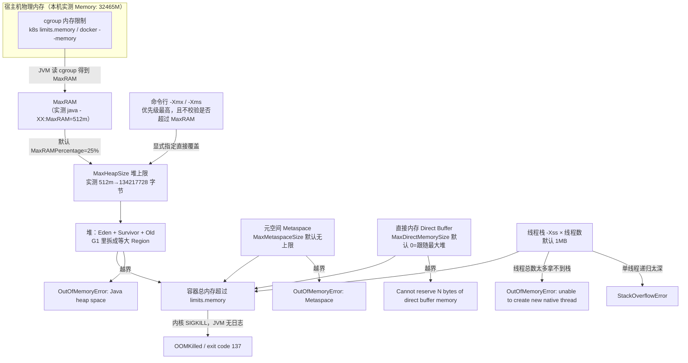
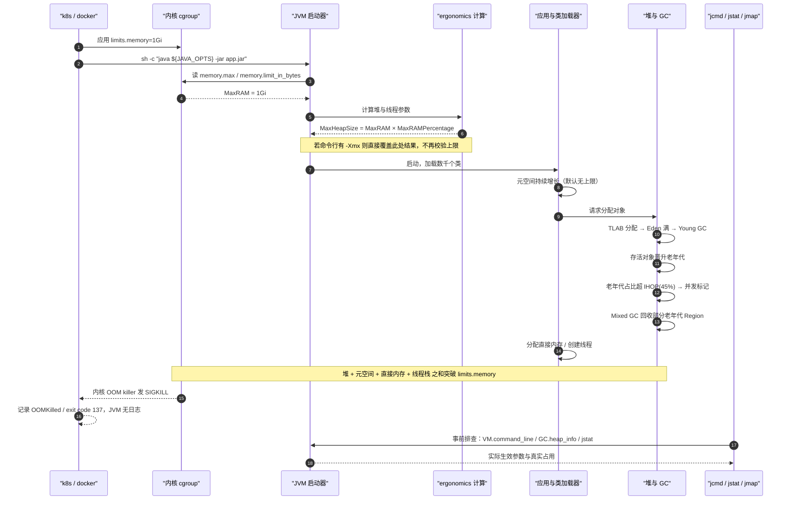

# JVM 内存模型与 GC 实战：从"卡顿 / OOM / 被 kill"倒推真实配置

> **一句话结论**：线上被叫"内存问题"的现场，绝大多数不是 GC 参数没调好，而是两件更朴素的事——JVM 的 `MaxHeapSize` 究竟从哪个数算出来的没查清（容器里 25% 的默认值 + 一个不会被限制的 `-Xmx`），以及有对象被长期引用着（Full GC 回收量为 0）。先量出事实，再谈 G1。
> **阅读前置**：会写普通 Java、会用 `java -jar` 或 Docker 起服务、知道堆和栈这两个词存在；不需要任何 GC 调优经验。涉及的本项目代码只看得到"调用点"，不需要读过那些模块的实现。
> **证据基线**：JDK 编译目标 17（`pom.xml#L30`），本地实测 **JDK 17.0.19 (Temurin)**；Spring Boot 4.2.0 / Spring Cloud 2026.0.0 / Spring AI 2.1.0。A 级源码摘录 3 份（4 处代码块）、B 级本项目证据 13 处、C 级实测输出 19 处（全部为本机真实输出）。预计阅读 40 分钟。

---

## 0. 先看现象

### 现象一：本地 `-Xmx512m` 跑得好好的，进容器就 `OOMKilled`，退出码 137

部署清单里给 ai-chat 服务配的是"堆 512MB、容器上限 1Gi"，看着很富裕；换成网关（堆 256MB / 上限 512Mi）就开始不定时重启。`kubectl describe pod` 里看到的是：

```text
Last State:     Terminated
  Reason:       OOMKilled
  Exit Code:    137
```

**关键在于：这份输出里没有任何 Java 异常。** 137 = 128 + 9，9 是 Linux 的 `SIGKILL`，是内核的 cgroup 内存控制器在"这个容器超过 `limits.memory`"时直接杀进程，JVM 来不及打印 `OutOfMemoryError`，也来不及 dump 堆。JVM 认为自己还有堆可用，内核认为你已经超支——两套账本各算各的。

这不是"感觉上会爆"，是可以量出来的：本机跑一个**只 sleep、什么业务都不做**的最小 JVM，`-Xms256m -Xmx256m`，实测进程私有内存（`PrivateMemorySize64`）**372.4MB**，比堆上限 256MB 多出 116MB（32 个线程的栈 + Metaspace + 代码缓存 + JVM 自身）。也就是说 `-Xmx` 从来就不等于进程内存。

### 现象二：Full GC 打了好几轮，内存一点没降

线上抓一段 GC 日志，会看到这种"白干"的 Full GC——每次回收量都是 0：

```text
[11.203s][info][gc] GC(28) Pause Full (G1 Compaction Pause) 193M->193M(256M) 8.911ms
[11.419s][info][gc] GC(29) Pause Full (G1 Compaction Pause) 193M->193M(256M) 9.402ms
[11.664s][info][gc] GC(30) Pause Full (G1 Compaction Pause) 193M->193M(256M) 9.874ms
```

`193M->193M` 是"回收前 193M、回收后 193M"。GC 一次都没白做——它把**所有能回收的都回收了**，剩下的 193M 全都是活对象。这时候继续在 GC 参数上做文章（换收集器、调 `MaxGCPauseMillis`、加 `-XX:+ExplicitGCInvokesConcurrent`）全是在治标；真正要看的是"谁还引用着这 193M"。

顺带一个反直觉点：这三行 `Pause Full` 出现时，`jstat` 的 `FGC` 列可能还是 0，而 `CGC`（并发周期次数）在涨。G1 时代"Full GC 次数"这个指标的语义已经变了，第 7 节会把这条差异摊开讲。

### 现象三：堆 dump 打开一看，`byte[]` 占了绝大头

用 `jmap -histo:live` 看一个持有 80 个 1MB 数组的进程（`-Xms192m -Xmx192m`），前几行是：

```text
 num     #instances         #bytes  class name (module)
-------------------------------------------------------
   1:         10839       84683040  [B (java.base@17.0.19)
   2:          2669         318240  java.lang.Class (java.base@17.0.19)
   3:         10669         256056  java.lang.String (java.base@17.0.19)
   4:           267         251240  [C (java.base@17.0.19)
   5:          2201         176336  [J (java.base@17.0.19)
   6:          4871         155872  com.sun.tools.javac.util.SharedNameTable$NameImpl (jdk.compiler@17.0.19)
```

`[B` 就是 `byte[]`，`[C` 是 `char[]`。80 个 1MB 数组 = 84,683,040 字节，而前六行加起来才 85,770,784 字节——**一个类型吃掉 98%**。

这里的坑在于：`byte[]` 本身不带任何业务语义。它可能是序列化的 JSON、可能是 Token 编码结果、可能是 `MessageDigest.digest()` 的返回值、可能是 Netty 的缓冲区。所以你看到 `[B` 排第一**还不能下结论**，得看它的 GC Root 引用链（第 6 节给出具体手法）。

### 这三个现象指向同一件事

**JVM 的内存不是一个池子，而是五个各自会爆、各自报不同错的池子；而容器 limit 是第六个、也是最容易被漏算的池子。** 排查顺序必须反过来：先确认"进程允许用多少内存"（cgroup limit），再确认"JVM 以为能用多少"（`MaxHeapSize` 的真实来源），最后才问"这些对象为什么不死"（引用链 + GC 日志）。顺序反了，就会在 GC 参数上耗掉一整晚。

---

## 1. 整体地图



> **读图说明**：
> 1. 最关键的一条箭头是 `cgroup → MaxRAM → MaxHeapSize`。这条路上藏着整篇文章最容易搞错的一件事：容器 limit 并不会"夹住"你写的 `-Xmx`，只有你**没写** `-Xmx` 时，25% 的默认值才会生效。本机实测：`java -XX:MaxRAM=512m -XX:+PrintFlagsFinal -version` 给 `MaxHeapSize = 134217728`（128M），加 `-Xmx400m` 后变成 `419430400`（400M）且**没有任何警告**——也就是说限制 512M 的容器里配 400M 堆是被 JVM 放行的，剩下的 112M 要装下元空间、直接内存、线程栈和 JVM 自身。
> 2. 第二关键的是右下角那条汇合箭头：`HEAP / META / DIR / STK` 四条线**最后都汇到同一个 `limits.memory`**。看错成一个箭头会得出错误结论——只盯着 `Java heap space` 的堆溢出，就会漏掉"堆只用了 60%，但进程被 kill"这一类（此时凶手是直接内存或线程栈，堆 dump 里根本看不见）。

| 组件 | 责任 | 上限由谁决定 | 越界时的报错原文 |
| --- | --- | --- | --- |
| 堆（Heap） | 存放所有 `new` 出来的对象与数组，GC 的主战场 | `-Xmx`；未写时 = `MaxRAMPercentage`(25%) × MaxRAM | `java.lang.OutOfMemoryError: Java heap space` |
| 元空间（Metaspace） | 存放类的元数据、方法字节码、常量池、`Class` 对象背后的结构 | `-XX:MaxMetaspaceSize`，**默认无上限**（实测 `18446744073709551615`） | `java.lang.OutOfMemoryError: Metaspace` |
| 直接内存（Direct Memory） | `ByteBuffer.allocateDirect` 申请的堆外内存，NIO/Netty/文件映射使用 | `-XX:MaxDirectMemorySize`，默认 `0` 表示"跟随最大堆" | `java.lang.OutOfMemoryError: Cannot reserve N bytes of direct buffer memory (allocated: X, limit: Y)` |
| 线程栈（Thread Stack） | 每个线程一块，存栈帧、局部变量、返回地址 | `-Xss` 单线程大小；总量 = `-Xss` × 线程数 | `java.lang.StackOverflowError` / `java.lang.OutOfMemoryError: unable to create new native thread` |
| 代码缓存（Code Cache） | JIT 编译后的机器码 | `-XX:ReservedCodeCacheSize` | 不报 OOM，表现为"编译线程停了、性能下降" |
| 容器 limit（cgroup） | 整个进程（含堆外、含 page cache）的硬上限 | k8s `resources.limits.memory` / `docker run --memory` | 无 Java 异常；`OOMKilled`、`exit code 137` |

调用方一览：堆和元空间的"调用方"是应用代码与类加载器；直接内存的调用方是 NIO/Netty/Spring AI 的 HTTP 客户端；线程栈的调用方是 Tomcat 线程池（本项目 `application.yml` 里的 `server.tomcat.threads.max`）和业务自建线程池；容器 limit 的调用方是 `deploy/k8s/services/*.yaml` 和 `deploy/docker-compose/docker-compose-all.yml`——**只有这一层是人写的，上面几层都是算出来的**。

---

## 2. 关键概念与关键类

先把词解释清楚，后面所有结论都建立在这几个词上。

| 名称 | 所在位置 | 角色 | 关键方法 / 参数 |
| --- | --- | --- | --- |
| `java.lang.OutOfMemoryError` | JDK 运行时 | 唯一的"内存不够"异常类型，靠**消息文本**区分子系统 | 消息为 `Java heap space` / `Metaspace` / `unable to create new native thread` / `Cannot reserve ... direct buffer memory` |
| `java.lang.StackOverflowError` | JDK 运行时 | 栈帧超过 `-Xss` 时抛出，**不是** `OutOfMemoryError` 的子类 | 只有 `Error` 家族关系，`catch (OutOfMemoryError e)` 抓不到它 |
| G1 Region | HotSpot G1 收集器 | 把堆切成等大的 Region（实测 4M，`-XX:G1HeapRegionSize`），Region 动态扮演 Eden/Survivor/Old | `jcmd GC.heap_info` 输出的 `region size` 与 `N young` |
| Humongous 对象 | HotSpot G1 | 超过 **Region 一半** 的对象，独占连续 Region | 实测 50 个 1MB 数组占 100 个 Region（见 3.2） |
| IHOP | HotSpot G1 | `InitiatingHeapOccupancyPercent`，老年代占比超过它就启动并发标记周期 | 默认 45（实测 `InitiatingHeapOccupancyPercent = 45`） |
| Mixed GC | HotSpot G1 | 年轻代 + 部分老年代 Region 一起回收的停顿 | GC 日志里 `Pause Young (Mixed)` |
| `MaxRAMPercentage` | HotSpot ergonomics | 未写 `-Xmx` 时，用"可用内存 × 百分比"算堆上限 | 实测 `MaxRAMPercentage = 25.000000 {product} {default}` |
| `java.nio.Bits` | `java.base` | 直接内存的记账员，超支就在这里抛错 | `reserveMemory`（实测异常栈顶） |
| `jcmd` | JDK 工具 | 向运行中 JVM 发诊断命令，生产首选（多数命令安全） | `GC.heap_info`、`VM.flags`、`VM.command_line`、`GC.heap_dump` |
| `jstat` | JDK 工具 | 按固定间隔采样各区使用率与 GC 计数 | `jstat -gcutil <pid> 1000 30` |
| `jmap` | JDK 工具 | 直方图与堆 dump（`-histo:live` 会触发一次 Full GC，**生产慎用**） | `jmap -histo:live <pid>`、`jmap -dump:live,format=b,file=x.hprof <pid>` |
| `TokenTextSplitter` | Spring AI 2.1.0（A 级摘录） | 本项目知识库切块的实现，会把整篇文本编码成装箱的 token 列表 | `doSplit`、`getEncodedTokens` |
| `LruCache` | MyBatis 3.6.0（A 级摘录） | 「有界 LRU」的标准写法：`LinkedHashMap` + `removeEldestEntry` | `setSize`、`cycleKeyList` |
| `MessageWindowChatMemory` | Spring AI 2.1.0（A 级摘录） | 会话记忆的窗口上界，默认只留 20 条消息 | `DEFAULT_MAX_MESSAGES`、`maxMessages` |
| `VectorCacheStore` | `ai-cs-chat/src/main/java/com/aics/chat/cache/VectorCacheStore.java#L48-L54`（B 级） | 本项目自己的 L1 进程内缓存，**带容量上限** | `get`、`removeEldestEntry` |
| `ChatUserContext` | `ai-cs-chat/src/main/java/com/aics/chat/util/ChatUserContext.java#L26-L41`（B 级） | `ThreadLocal<Long>` 存当前用户，必须在 `finally` 里 `clear()` | `setUserId`、`clear` |

---

## 3. 原理与证据逐段精读

### 3.1 五个池子：先算总账，再谈优化

**这段在做什么。** 把"JVM 进程占用"拆成可以分别配上限的几块，再和容器 limit 对齐。下面是本机实测的账本（`-Xms256m -Xmx256m -XX:+UseG1GC`，一个只 sleep 的空程序）：

```text
WorkingSet64(MB) = 78.9
PrivateMemorySize64(MB) = 372.4
Threads = 32
29444:
 garbage-first heap   total 262144K, used 15831K [0x00000000f0000000, 0x0000000100000000)
  region size 1024K, 16 young (16384K), 0 survivors (0K)
 Metaspace       used 8955K, committed 9152K, reserved 1114112K
  class space    used 1057K, committed 1152K, reserved 1048576K
```

**怎么读这个输出。** 三行数字要配对看：（1）`total 262144K` 是 G1 **已提交**的堆，等于 256MiB，也就是 `-Xmx` 说好的量，可它只是"答应了"不是"用了"——`used 15831K` 才是真用了，这就是 `WorkingSet64` 只有 78.9MB 的原因（页还没被 touch）。（2）`Metaspace committed 9152K` 约 9MB，空程序都占 9MB，一个 Spring Boot 应用加载几千个类后通常到 80~150MB。（3）`PrivateMemorySize64 = 372.4MB` 是进程**已提交的私有内存总量**，它 = 堆已提交 + 元空间已提交 + 代码缓存 + 32 个线程栈 + JVM 自身结构。**这个数比 `-Xmx` 多出 116MB**，而这还没算业务真正用起来的直接内存。

**为什么这么设计。** 因为这几块内存的生命周期完全不同：堆里的对象一批批死掉（GC 能回收），元空间的类元数据活到类加载器卸载，直接内存由 `ByteBuffer` 的 `Cleaner` 在 GC 之后才归还，线程栈随线程生灭。**用一个数字管四种不同生命周期的内存，必然要么浪费要么爆。** 所以才需要分别配上限、分别报错。

**换成另一种写法会怎样。** 如果把"所有内存都塞进堆"（比如用 `byte[]` 代替 `ByteBuffer.allocateDirect` 做网络缓冲）：优点是只有一种内存要管、GC 一把全回收、dump 里能看见；代价是每次 I/O 多一次从堆到内核的拷贝，且大数组会造成 Humongous 分配与晋升压力。反过来全部用直接内存：I/O 零拷贝很爽，但**这部分内存 GC 看不见也 dump 不出来**，泄漏只能靠 `ByteBuffer` 的引用计数和 `jcmd VM.native_memory` 找。

**常见坑。** （1）把容器 `limits.memory` 当成"堆上限"直接写 `-Xmx1Gi`，实测 372MB 的固定开销 + 1Gi 堆 = 必然 OOMKilled，而且 JVM 不会警告你（见 3.8）。（2）`-XX:MaxDirectMemorySize` 默认 `0` 的含义是"等于最大堆"，不是"零"，所以 `-Xmx512m` 的进程理论上能再吃 512MB 直接内存。（3）`catch (OutOfMemoryError e)` 抓不到 `StackOverflowError`，因为后者继承 `VirtualMachineError` 直系；也别指望 catch 完还能继续服务，此时堆状态已经不可信。

### 3.2 对象分配与晋升：为什么"临时对象"最后进了老年代

**这段在做什么。** 一个 `new` 出来的对象，正常情况下活不过一次 Young GC：它先落在 Eden 的 TLAB（Thread Local Allocation Buffer，线程私有的分配缓冲区，避免多线程抢同一个分配指针），Eden 满了触发 Young GC，活下来的被复制到 Survivor，`-XX:MaxTenuringThreshold` 默认 15 次之后晋升老年代。**但还有三条"抄近道"的路径**：对象太大直接进老年代、Survivor 装不下直接进老年代、以及 G1 特有的 Humongous 直接占老年代 Region。

本机实测 Humongous 的代价（50 个 `new byte[1024*1024]`，`-Xms256m -Xmx256m`，region size 1M）：

```text
[0.593s][info][gc,heap] GC(0) Humongous regions: 100->100
```

**怎么读这个输出。** 50 个 1MB 数组，占了 **100 个** 1MB 的 Region——因为每个数组除了 1048576 字节数据，还有 16 字节对象头，`1048576 + 16 > 1048576`，于是每个数组要跨 2 个 Region，尾部那点空隙不能再分配别的对象。**内存放大接近 100%**。这条日志就是"为什么我明明只放了 50MB 数据，堆就告急"的直接答案。

**为什么这么设计。** Region 是 G1 的回收单位，回收时要整块搬走，所以大对象必须落在"整块连续、不与他人共享"的 Region 里才能高效复制；碎片化的代价由大对象自己承担，换来的是普通对象的回收可以做得很干净。`-XX:PretenureSizeThreshold`（实测默认 `0`）只是 Serial/ParNew 的阈值参数，**G1 不看它**，G1 用"Region 的一半"这条线判断 Humongous。

**换成另一种写法会怎样。** 把大数组切成小块（比如 1MB 的图片/文档按 256KB 流式处理），Humongous 就消失，堆利用率立刻回升；代价是代码复杂度上升、需要正确的流式读写。反过来把阈值调大（`-XX:G1HeapRegionSize=32m`）：Humongous 少了，但每个 Region 更大、Region 总数更少、回收时能选的"最脏 Region"变少，暂停时间反而可能更差。

**常见坑。** （1）认为"对象在 Eden 分配、和老年代无关"——一次 Full GC 里 `193M->193M` 的那些对象，全都是早就晋升到老年代的大活口。（2）`-Xmn` 把年轻代写死（本项目 `tools/nacos/bin/startup.sh#L92` 就用了 `-Xmn256m`）：G1 下 `-Xmn` 等价于关掉自适应年轻代大小，Mixed GC 无法通过缩小年轻代来腾出时间预算。（3）把"临时对象多"当成 OOM 原因——临时对象只影响 Young GC 频率，不影响老年代能不能回收；`Pause Young` 频繁但 `O->` 不涨是健康的。

### 3.3 元空间：从 PermGen 到 Metaspace，以及"默认无上限"的坑

**这段在做什么。** 类元数据（`Class` 结构、方法字节码、常量池）存在元空间，它在**本地内存**里，不在堆里。本机实测 `-XX:MaxMetaspaceSize` 的默认值：

```text
size_t MaxMetaspaceSize = 18446744073709551615 {product} {default}
```

`18446744073709551615` 是 `2^64-1`，即"实际上不设上限"。于是元空间泄漏的最终表现不是 JVM 报错，而是**进程慢慢吃掉宿主机内存，然后被 cgroup 杀掉**——又是现象一那个 137。

**怎么读这个输出。** `{product} {default}` 表示这是产品默认值、没有人改过；`{ergonomic}` 表示"JVM 自己算出来的"；`{command line}` 表示"你在命令行里写的"。看 `PrintFlagsFinal` 时这三列比数值本身更重要——它能告诉你这个数到底是默认、自动推导还是你亲手写的。

**为什么这么设计。** JDK 8 之前用 PermGen（永久代），它在堆里、有固定上限 `-XX:MaxPermSize`，类加载多了就 `OutOfMemoryError: PermGen space`，而且必须预估一个很难估的数。JDK 8 起改成元空间（JEP 122），放到本地内存、只在真正耗尽时向操作系统申请，好处是"大多数应用不用配"。代价就是上面这条：**默认没有上限，意味着失控时没有护栏**。

本机实测元空间被撑爆的样子（循环用自定义 `ClassLoader` 反复 `defineClass`，`-Xmx64m -XX:MaxMetaspaceSize=32m`）：

```text
Exception in thread "main" java.lang.OutOfMemoryError: Metaspace
	at java.base/java.lang.ClassLoader.defineClass0(Native Method)
	...
```

**换成另一种写法会怎样。** 给元空间设上限（`-XX:MaxMetaspaceSize=256m`）：优点是失控时立刻在**应用进程内**抛出 `Metaspace` OOM、日志和 dump 都还在，比起被内核杀掉好排查一百倍；代价是要真的估准，估小了启动就挂。生产建议写这个值，它本质上是"把 OOM 从沉默的 SIGKILL 变成响亮的异常"。

**常见坑。** （1）`jstat` 的 `M` 列常年 90%+ 就以为元空间泄漏——实测那一列是 `used/committed`（9442K/9728K = 97.07%），元空间 committed 是"按需一小块一小块涨"的，两者本来就贴得很近，**只要 committed 不持续单调上涨就没问题**。这是旧稿里最容易误导人的一条结论，本篇按实测纠正。（2）以为调大 `-Xmx` 能解决 `Metaspace` OOM——完全无关，它不在堆里。（3）热部署/频繁重新定义类（Spring DevTools、字节码增强框架、脚本引擎、`MethodHandle`/Lambda 元数据工厂）会持续产生新类，元空间只涨不降。

### 3.4 直接内存：唯一"GC 看不见"的内存

**这段在做什么。** `ByteBuffer.allocateDirect(n)` 申请的是一块堆外内存，JVM 用 `java.nio.Bits` 记账，上限由 `-XX:MaxDirectMemorySize` 决定（实测默认 `0`，语义是跟随最大堆）。它被 NIO SocketChannel、Netty 的 `PooledByteBufAllocator`、`FileChannel.map` 内存映射、以及 Spring AI 的 HTTP 客户端大量使用。

本机实测直接内存爆掉的原文（`-Xmx256m -XX:MaxDirectMemorySize=16m`，循环 1MB）：

```text
direct buffers MB = 15
Exception in thread "main" java.lang.OutOfMemoryError: Cannot reserve 1048576 bytes of direct buffer memory (allocated: 15736832, limit: 16777216)
	at java.base/java.nio.Bits.reserveMemory(Bits.java:178)
	at java.base/java.nio.DirectByteBuffer.<init>(DirectByteBuffer.java:121)
	at java.base/java.nio.ByteBuffer.allocateDirect(ByteBuffer.java:332)
```

**怎么读这个输出。** 三个数字构成完整的证据链：`allocated: 15736832`（已占 15.7MB）+ 本次请求的 `1048576`（1MB）> `limit: 16777216`（16MB），所以被拒。**注意 `allocated` 只统计通过 `Bits` 记账的那些**——`Unsafe.allocateMemory` 或 Netty 自己调 `malloc` 的部分不计入，所以 `-XX:MaxDirectMemorySize` 不是"堆外内存的硬墙"，只是"通过 NIO 记账那部分的上限"。这也解释了为什么把 limit 调大有时能"治好"却只是把爆点往后推。

**为什么这么设计。** 直接内存的价值是**零拷贝**：数据从网卡/磁盘直接进堆外缓冲，不用先拷进堆再拷出去，也不受 GC 移动对象影响（地址稳定）。代价是它的回收挂在 `DirectByteBuffer` 的 `Cleaner` 上——**只有当这个 `ByteBuffer` 对象本身被 GC 判定不可达，堆外那块才会被释放**。于是出现一种诡异现象：堆很空、`jmap -histo` 看不出问题，但直接内存一直在涨。此时凶手是"已经没人用的 `ByteBuffer` 还没被 GC 扫到"，`System.gc()` 有时能立刻缓解（这也解释了为什么很多 NIO 框架在 OOM 前会主动 `System.gc()`）。

**换成另一种写法会怎样。** 用堆内 `byte[]`：dump 里看得见、GC 一把回收、逻辑简单；代价是多一次拷贝 + 大数组触发 Humongous。用池化的直接内存（Netty `PooledByteBufAllocator`）：分配/释放都可控、可复用；代价是要显式 `release()`，忘了就是真泄漏；而且池的容量本身就是一块固定占用，`-XX:MaxDirectMemorySize` 要按池大小来配。

**常见坑。** （1）看到 `Direct buffer memory` OOM 就加 `-Xmx`——两者毫无关系。（2）在容器里只算堆：`-Xmx512m` + Netty 默认池 + 512Mi limit = 稳定复现 137。（3）以为堆 dump 能看见直接内存——**看不见**，`.hprof` 里只有 `DirectByteBuffer` 这个壳，不包含它指向的堆外数据。要查就得靠 `-XX:NativeMemoryTracking=summary` + `jcmd VM.native_memory`（需重启开启，本项目未开）。

### 3.5 线程栈：两种完全不同的"栈爆"

**这段在做什么。** 每个线程一块私有的栈，默认 1MB（64 位 Linux 的 `-Xss` 默认值），存栈帧、局部变量、返回地址。**它有两条独立的爆炸路线**，报错完全不同：

路线一，单个线程递归太深 → `StackOverflowError`。本机实测（一个死递归）：

```text
max depth = 37531
Exception in thread "main" java.lang.StackOverflowError
	at SoDemo.recurse(SoDemo.java:3)
```

**怎么读这个输出。** `max depth = 37531` 说明在这台机器、这个 `-Xss` 下，大约 3.7 万个栈帧就把 1MB 栈用完了。这个数字对你的业务很有用：**如果线上看到 `StackOverflowError`，第一反应不该是"加大 -Xss"，而是"哪个递归/嵌套解析没有出口"**——常见的凶手是 `toString()` 里自引用、JSON 序列化的循环引用、正则回溯。

路线二，创建线程时拿不到栈内存 → `OutOfMemoryError: unable to create new native thread`。这条**本篇没有实测**（在 Windows 上很难稳定复现），按 OpenJDK 官方文档与 `java.lang.Thread` 的 Javadoc 说明：要么进程线程数撞到了 OS/容器的 `nproc`/`pid` 限制，要么地址空间不够再划一块栈。原文形如：

```text
java.lang.OutOfMemoryError: unable to create new native thread
```

（这条消息的确切文本以你所在 JDK 的实现为准，本篇不伪造完整栈。）

**为什么这么设计。** 栈必须有上限，否则一个死递归就能把整机吃掉。把上限做成每线程的 `-Xss`，是"用总量换隔离"：一个线程写崩只影响自己（抛 `Error`），但总内存 = `-Xss × 线程数`，线程一多就成了隐性成本。本项目 `ObservabilityExecutorConfig` 里那两个线程池（`usageExecutor` 上限 4 线程、`evalExecutor` 上限 2 线程，见 `ai-cs-chat/src/main/java/com/aics/chat/config/ObservabilityExecutorConfig.java#L31-L56`）就是这条原则的实践：**给观测/上报这类旁路任务单独的、有界的小线程池，而不是去占 Tomcat 那 200 个工作线程**。注释里写的原因是"故障隔离 + 削峰"，从内存角度看还有第三个好处：线程数有界 = 栈内存有界。

**换成另一种写法会怎样。** 用虚拟线程（JDK 21 起正式，JDK 17 上需要 `--enable-preview`，本项目编译目标 17 用不了）：栈是"按需增长的堆内对象"，百万级线程也不占 1MB×N；代价是 `ThreadLocal` 语义、`synchronized` 造成的 pinning、以及 profiling 工具链的适配。用 `-Xss256k` 减小每线程栈：能塞更多线程；代价是容易 `StackOverflowError`，尤其是有深层框架调用栈（Spring 的代理链 + MyBatis 拦截器链）。

**常见坑。** （1）把 `StackOverflowError` 当成"内存不够"，去加 `-Xmx`，完全无效。（2）容器里线程数超限的报错常被误判成"内存不足"，实际是 `limits`/安全组/`ulimit -u`；验证手法见第 6 节 `jcmd Thread.print` 数线程。（3）线程池用了无界队列（`LinkedBlockingQueue` 不传容量）——线程数不涨，但任务堆在**堆**里，最后是 `Java heap space` 而不是 `unable to create new native thread`，两者根因完全不同。

### 3.6 谁在长期活着：本项目里四个真实的驻留点

**这段在做什么。** 现象二说"Full GC 回收量为 0"，那就要问"谁在引用"。与其凭印象猜，不如看本项目里四类**天生会长期持有对象**的代码，它们各自的边界在哪。

**第一类：切块时把整篇文本编码成装箱列表。** 这是本篇最值得记住的一处 A 级证据。本项目 `KnowledgeBaseService` 调 `TokenTextSplitter` 切块（`ai-cs-chat/src/main/java/com/aics/chat/service/KnowledgeBaseService.java#L159-L169`），而切块内部是这么干的：

```java (src: TokenTextSplitter.java.md#L292-L295)
	private List<Integer> getEncodedTokens(String text) {
		Assert.notNull(text, "Text must not be null");
		return this.encoding.encode(text).boxed();
	}
```

以及调用点：

```java (src: TokenTextSplitter.java.md#L188-L199)
		List<Integer> tokens = getEncodedTokens(text);

		// If text is smaller than chunk size, return as a single chunk
		if (tokens.size() <= chunkSize) {
			String processedText = this.keepSeparator ? text.trim() : text.replace(System.lineSeparator(), " ").trim();

			if (processedText.length() > this.minChunkLengthToEmbed) {
				return List.of(processedText);
			}
			return new ArrayList<>();
		}
```

**这段在做什么。** `Encoding.encode(text)` 返回原始 `int[]`，`.boxed()` 把它转成 `List<Integer>`——**每个 token 变成一个独立的 `Integer` 对象**。一篇 8 万字的文档大约 5~8 万 token，于是堆上出现 5~8 万个 `Integer`（每个 16 字节对象头+值，外加 `List` 里 4~8 字节引用），而原始字符串才 16 万字节左右。**放大倍数轻松到 3~5 倍，且全部是短命对象，直接冲击 Eden 与晋升。**

**为什么这么设计。** 因为切块算法要对 token 做 `subList`、前后移动 `position`、还要反复 `decodeTokens` 回文本做标点边界优化（`TokenTextSplitter.java#L297-L302` 里再把 `List<Integer>` 塞回 `IntArrayList`）。用 `List<Integer>` 换取算法表达上的简洁是可理解的，代价是装箱开销。

**换成另一种写法会怎样。** 直接把 `int[]` 从头到尾用下标推进（`position`/`chunkEnd` 都是 `int`），不装箱、不建中间 List，内存降一个数量级、GC 压力随之下降；代价是要重写一遍边界逻辑。或者用流式切块（按字符窗口切完再 token 计数），代价是无法保证边界正好落在 token 上。

**常见坑。** 上传一篇大 PDF 时打爆堆，`jmap -histo` 里却看不到你的业务类，只有 `[B`、`[C`、`java.lang.Integer` 排前面——就是这一类"框架内部中间结构"。判断方法：`jmap -histo:live` 里 `java.lang.Integer` 实例数量与文档长度成正比，就是它。

**第二类：进程内缓存必须带容量上限。** 本项目 `VectorCacheStore` 的 L1 缓存是这样写的（B 级）：

```java
// ai-cs-chat/src/main/java/com/aics/chat/cache/VectorCacheStore.java#L48-L54
this.l1Cache = Collections.synchronizedMap(new LinkedHashMap<>(128, 0.75f, true) {
    @Override
    protected boolean removeEldestEntry(Map.Entry<String, List<Float>> eldest) {
        return size() > Math.max(1, properties.getVector().getL1MaxEntries());
    }
});
```

**这段在做什么。** `LinkedHashMap` 构造第三个参数 `true` = 按访问顺序排序，重写 `removeEldestEntry` 就能在超出上限时自动淘汰最久未用的条目。这就是「有界 LRU」。同一套写法在 MyBatis 的 `LruCache` 里是标准实现：

```java (src: LruCache.java.md#L49-L62)
  public void setSize(final int size) {
    keyMap = new LinkedHashMap<Object, Object>(size, .75F, true) {
      private static final long serialVersionUID = 4267176411845948333L;

      @Override
      protected boolean removeEldestEntry(Map.Entry<Object, Object> eldest) {
        boolean tooBig = size() > size;
        if (tooBig) {
          eldestKey = eldest.getKey();
        }
        return tooBig;
      }
    };
  }
```

**为什么这么设计。** 因为"缓存"和"泄漏"的唯一区别就是**有没有上界**。`LinkedHashMap` 一个重写方法就能把无界 `Map` 变成有界 LRU，没有引入任何依赖，这也是为什么 MyBatis（`LruCache.java#L34-L37` 构造时 `setSize(1024)`）和本项目都选了它，而不是引入 Caffeine。

**换成另一种写法会怎样。** 用 `ConcurrentHashMap` 存缓存：并发性能好、代码更短；代价是**默认无界**，`put` 的键永远不删，这就是最经典的堆泄漏，`Pause Full 193M->193M` 的主角。用 Caffeine：有 W-TinyLFU 命中率、有 `expireAfterWrite`、有异步刷新；代价是引入依赖 + 需要理解淘汰策略。用 Redis 做 L2（本项目 `VectorCacheStore` 就是这么两级：L1 进程内 LRU → L2 Redis → 回填，见 `ai-cs-chat/src/main/java/com/aics/chat/cache/VectorCacheStore.java#L59-L78`）：堆压力转移到 Redis，代价是网络延迟与序列化开销。

**常见坑。** （1）`Collections.synchronizedMap` 只是"每个方法加锁"，迭代时仍要手动同步；（2）以"对象/字节数"为上限比"条目数"更准，本项目按条目数算是简化；（3）缓存 key 里带时间戳/UUID/用户输入原文，等于换个姿势的无界增长。

**第三类：会话记忆的窗口有没有上界。** Spring AI 的 `MessageWindowChatMemory` 给了明确默认值：

```java (src: MessageWindowChatMemory.java.md#L50-L54)
	private static final int DEFAULT_MAX_MESSAGES = 20;

	private final int maxMessages;
```

**这段在做什么。** 每轮对话都 `add` 消息，但 `maxMessages` 到了就淘汰旧消息（`MessageWindowChatMemory.java#L100` 判 `processedMessages.size() <= this.maxMessages`，`#L116` 算 `cutIndex`）。所以单会话的堆占用有界。**但注意"有界"的是条数，不是字节数**：20 条包含长文档/长回答的消息，依然可能很大；而"会话数 × 每会话字节"才是老年代的总压力。

**换成另一种写法会怎样。** 不做窗口、全量记忆：上下文更完整；代价是单会话内存单调增长，长会话必然把老年代填满。用 `EventFilter.lastN` / 压缩（compaction）替代淘汰（`MessageWindowChatMemory.java#L44` 的 Javadoc 提到这一点）：保留信息更多；代价是压缩本身要调 LLM，成本与延迟都上去了。

**常见坑。** 把 `ChatMemory` 实现成 `static Map<String, List<Message>>`——`maxMessages` 只约束列表长度，不约束 Map 里的会话数；用户一多就是现象二。

**第四类：`ThreadLocal` 不 `clear` 就是泄漏。** 本项目 `ChatUserContext` 的写法是对的：

```java
// ai-cs-chat/src/main/java/com/aics/chat/util/ChatUserContext.java#L26-L41
private static final ThreadLocal<Long> USER_ID = new ThreadLocal<>();
// ... setUserId / getUserId ...
public static void clear() {
    USER_ID.remove();
}
```

**这段在做什么。** Tomcat 的线程是复用的，`ThreadLocal` 的值挂在 `Thread` 对象上，线程不销毁就不释放。不 `clear()` 有两个后果：一是**越权**（下一个请求读到了上一个用户的 id），二是**泄漏**（尤其当 value 是个大对象时，它跟着线程池里的线程一直活着，直到线程被回收）。

**为什么这么设计。** `ThreadLocal` 是"线程私有"的最轻实现，比传参优雅。代价是它把生命周期交给了线程，而线程生命周期由线程池决定——**这是两个不同模块的所有权，天然容易错位**。

**常见坑。** 只在 `try` 里 `set`、忘了 `finally { clear(); }`；在异步任务里 `set` 了 `ThreadLocal` 然后 `submit` 到线程池，子线程读不到（`ThreadLocal` 不跨线程，要用 `InheritableThreadLocal` 或显式传参）；`TraceContextHolder` 那类追踪上下文同理。

### 3.7 G1 的区域化与 Mixed GC：把日志逐行读一遍

**这段在做什么。** G1（Garbage-First）把堆切成等大 Region，年轻代和老年代不再是两块连续内存，而是"一批 Region 扮演的角色"。回收时优先挑"垃圾最多"的 Region（Garbage First 的名字由此而来），所以停顿时间可控。本机实测一次完整的老年代回收过程（`-Xms256m -Xmx256m -Xlog:gc*`，持续分配常驻对象）：

```text
[8.627s][info][gc,start    ] GC(5) Pause Young (Concurrent Start) (G1 Evacuation Pause)
[8.633s][info][gc,heap     ] GC(5) Old regions: 138->170
[8.633s][info][gc          ] GC(5) Pause Young (Concurrent Start) (G1 Evacuation Pause) 174M->174M(256M) 6.189ms
[8.633s][info][gc          ] GC(6) Concurrent Mark Cycle
[8.645s][info][gc          ] GC(6) Concurrent Mark Cycle 11.965ms
[9.878s][info][gc,start    ] GC(8) Pause Young (Mixed) (G1 Evacuation Pause)
[9.883s][info][gc,heap     ] GC(8) Old regions: 191->201
[9.883s][info][gc          ] GC(8) Pause Young (Mixed) (G1 Evacuation Pause) 202M->202M(256M) 4.778ms
```

**怎么读这个输出。** 按顺序看四件事：
1. `Pause Young (Concurrent Start)`：这不是普通 Young GC，它的额外含义是"**同时在后台启动了并发标记周期**"，触发条件就是 IHOP（老年代占比超 45%）。
2. `Old regions: 138->170`：标记完成后老年代 Region 从 138 涨到 170——这次 Young GC 回收时把存活对象晋升上来了，所以老年代 Region 变多。
3. `Concurrent Mark Cycle 11.965ms`：**并发**标记，不暂停应用线程，所以它出现在两个暂停之间，不计入 STW 时间。
4. `Pause Young (Mixed)`：这才是"混合回收"——同时清理年轻代和**一部分**被标记为"垃圾多"的老年代 Region（`Old regions: 191->201`）。注意 G1 的 Mixed GC 一次只回收一部分老年代，所谓 "Garbage First" 就是这个意思。

**为什么这么设计。** 停顿时间可预测（`-XX:MaxGCPauseMillis=200` 是**目标**不是承诺）：因为回收粒度是 Region，G1 可以选择"这次只回收 8 个 Region，保证 200ms 内结束"，而不是像 Parallel 那样必须整代回收。代价是：额外维护 RSet（Remembered Set，记录跨 Region 引用）和 SATB（Snapshot-At-The-Beginning，并发标记的写屏障），这些结构本身占内存、也让每次引用写入多一点开销。

**换成另一种写法会怎样。** Serial GC（`-XX:+UseSerialGC`）：单线程、无额外结构、内存开销最小，小堆（<512MB）纯计算型服务反而更快；代价是停顿不可控。Parallel GC：吞吐更高；代价是停顿与堆大小成正比。ZGC/Shenandoah：停顿亚毫秒级；代价是更多内存与 CPU 换来的，小容器里不划算。

**常见坑。** （1）把 `MaxGCPauseMillis` 当硬指标，压到 20ms——G1 会缩小年轻代来达标，结果是 Young GC 极其频繁，吞吐掉一半，而且仍然达不到。（2）看到 `Pause Young (Mixed)` 就以为"老年代泄漏被治好了"，实际 `Old regions` 还在涨说明对象真活着。（3）日志里出现 `to-space exhausted` 或 `Evacuation Failure`——这是"逃逸失败"，说明回收速度跟不上分配速度，紧接着就会退化成 Full GC，这是真正的危险信号，比 `Pause Full` 本身更早出现。

### 3.8 容器感知：`MaxRAMPercentage` 与 cgroup 的三个实测

**这段在做什么。** JVM 从 JDK 10 起默认开启容器感知（`-XX:+UseContainerSupport`，8u191 之后回移到 8u），会读 cgroup 的内存上限作为 `MaxRAM`，再乘 `MaxRAMPercentage`（默认 25%）得到 `MaxHeapSize`。下面三条是本机实测，用 `-XX:MaxRAM=` 模拟 cgroup 上限（本题不让起容器，这个参数就是官方的模拟入口）：

```text
# 1) 只给 MaxRAM=512m，什么都没写
$ java -XX:MaxRAM=512m -XX:+PrintFlagsFinal -version | Select-String MaxHeapSize
   size_t MaxHeapSize = 134217728 {product} {ergonomic}

# 2) 同时给 MaxRAMPercentage=75
$ java -XX:MaxRAM=512m -XX:MaxRAMPercentage=75.0 -XX:+PrintFlagsFinal -version | Select-String MaxHeapSize
   size_t MaxHeapSize = 402653184 {product} {ergonomic}

# 3) 显式写 -Xmx400m（超过 limit 的 78%）
$ java -XX:MaxRAM=512m -Xmx400m -XX:+PrintFlagsFinal -version | Select-String MaxHeapSize
   size_t MaxHeapSize = 419430400 {product} {command line}
```

**怎么读这个输出。** `134217728` = 128MiB = 512 × 25%，`402653184` = 384MiB = 512 × 75%。第 3 条是重点：`419430400` = 400MiB，**`{command line}` 一列告诉你它是命令行写的，JVM 没有把它夹到 limit 内，也没有打印任何警告**。也就是说：

> **容器 limit 与 `-Xmx` 之间没有任何守卫。** 写了 `-Xmx` 就完全由你负责剩下的堆外预算；不写才走 25%。

本机默认（无 `-Xmx`、宿主机 32GB）的对照数据：

```text
$ java -XshowSettings:vm -version
Max. Heap Size (Estimated): 7.93G
Using VM: OpenJDK 64-Bit Server VM

$ java -XX:+PrintFlagsFinal -version | Select-String -Pattern 'MaxHeapSize|MaxRAMPercentage|UseG1GC|G1HeapRegionSize'
   size_t G1HeapRegionSize = 4194304 {product} {ergonomic}
   size_t MaxHeapSize = 8514437120 {product} {ergonomic}
   double MaxRAMPercentage = 25.000000 {product} {default}
    bool UseG1GC = true {product} {ergonomic}
```

8514437120 字节 = 8120MiB ≈ 7.93G，正是 `XshowSettings` 里那个估算值的来源；`{ergonomic}` 说明是 JVM 自己按 `MaxRAMPercentage` 算的。

**为什么这么设计。** 25% 这个默认值是"安全但保守"的选择：JDK 无法知道你的应用会用多少直接内存和线程，留 75% 给堆外是防"堆配满把容器挤爆"。但它显然不适合 Spring Boot：一个 1Gi limit 的服务，25% 只有 256MB 堆，远不够；而配 `-Xmx1Gi` 又必然 OOMKilled。**所以生产上的正解是"用百分比让 JVM 自己算，并给堆外留固定余量"**，例如 `-XX:MaxRAMPercentage=70 -XX:InitialRAMPercentage=70`（初始值也设成 70，避免运行中扩堆引发的抖动）。

**换成另一种写法会怎样。** 固定 `-Xms = -Xmx`：启动即提交全部堆，避免运行期扩堆的停顿，堆内存可预测；代价是启动慢一点、且容器里"承诺了但没用"的内存也算进 limit。用 `-XX:MaxRAMPercentage`：自适应不同规格的 Pod 模板；代价是同一份镜像在不同 limit 下表现不同，排查时必须先 `jcmd VM.flags` 确认实际堆大小。

**常见坑。** （1）`-Xms` 大于 `-Xmx` 时 JVM 启动直接失败；`-Xms` 只写一半时常看到启动慢+前期频繁 GC。（2）JVM 在**没有** cgroup 限制的容器里（本项目 `deploy/docker-compose/docker-compose-all.yml` 全文没有 `mem_limit` / `deploy.resources`）看到的是**宿主机**内存，`-Xmx` 就成了唯一护栏——这也解释了为什么 compose 里每个服务都显式写 `JAVA_OPTS`。（3）`-Xmx` 与 `limits.memory` 之间建议留出"堆 + 30% + 固定 300MB 左右"的余量，判据用第 6 节的 `jcmd GC.heap_info` + 进程 RSS 实测校准，而不是背一个魔数。

---

## 4. 一次完整执行时序

以"容器里一个 Spring Boot 服务从启动到被 kill（或 OOM dump）"为主线，串起前面所有概念。



> **读图说明**：
> 1. 最关键的箭头是第 6~8 步那条 `Kernel → JVM → ergonomics → MaxHeapSize`。它解释了 90% 的"为什么容器里堆跟我配的不一样"：**只有第 7 步的结果会受第 8 步的 Note 影响**——命令行一旦给了 `-Xmx`，整个 ergonomics 计算就被短路，后面对不对全靠人。看懂这条，才知道排查第一步永远是 `jcmd VM.flags` 而不是猜。
> 2. 第二条要看的是末尾 `App → 直接内存/线程` 汇入 `Kernel → SIGKILL` 的那一段。如果误以为"内存溢出＝堆溢出"，就会在第 15 步之后一直盯着 `Java heap space` 找日志，而真实路径是绕开 JVM 直接到内核的——**这条路径上没有任何 Java 日志**。

### 哪一步失败会报什么错

| 失败环节 | 触发条件 | 用户看到的原文 | 有没有 dump |
| --- | --- | --- | --- |
| 第 4~5 步 cgroup 读不到 | 老版本 JDK 或容器内核不支持 | 堆按宿主机算，超大 | 无 |
| 第 7 步 `-Xms > -Xmx` | 参数写错 | `Error: Could not create the Java Virtual Machine.` + `Initial heap size set to a larger value than the maximum heap size` | 无 |
| 第 11 步类加载 | 元空间被撑满 | `java.lang.OutOfMemoryError: Metaspace` | 有（若开了参数） |
| 第 13 步 Eden 分配 | 堆满且回收不动 | `java.lang.OutOfMemoryError: Java heap space` | 有（若开了参数） |
| 第 17 步直接内存 | `Bits.reserveMemory` 超 limit | `Cannot reserve N bytes of direct buffer memory (allocated: X, limit: Y)` | **无堆信息可用** |
| 第 18 步创建线程 | 线程数/地址空间不够 | `OutOfMemoryError: unable to create new native thread` | 无 |
| 第 19 步总内存超限 | 堆外 + 堆 > `limits.memory` | 无 Java 异常；`OOMKilled` / `exit code 137` | 无（SIGKILL 不给机会） |

---

## 5. 设计取舍

| 方案 | 优点 | 代价 | 本项目怎么选 |
| --- | --- | --- | --- |
| 显式 `-Xms = -Xmx` 固定堆 | 运行期无扩堆停顿，堆大小可预测，排查看一眼就知道 | 启动即提交全部堆；容器里"承诺未用"也算 limit | **已选**：compose 里每个服务 `JAVA_OPTS: "-Xms256m -Xmx512m"`（`deploy/docker-compose/docker-compose-all.yml#L236` 等 7 处） |
| 只给 `-XX:MaxRAMPercentage` | 一份镜像适配不同规格 Pod；不会把 limit 吃满 | 参数不直观，排查必须先 `jcmd VM.flags` | 未选，但推荐改造方向（3.8 的判据） |
| 显式 `-Xmx` 且贴近 `limits.memory` | 堆尽量大，JIT 与缓存都受益 | 堆外没余量 → 随机 137 | **部分存在风险**：`ai-chat` 是 512m 堆 / 1Gi limit（余量够），而单一 512Mi limit 的服务配 `-Xmx256m` 只剩 256Mi 给堆外，压测容易踩线 |
| 完全依赖默认（不写任何堆参数） | 零配置 | 25% 太小；且一旦有人加了 `-Xmx` 就变成另一个故事 | `deploy/k8s/services/product-service.yaml#L61-L67` 只有 `resources`、没有 `JAVA_OPTS`——512Mi × 25% ≈ 128MB 堆，属于"能跑但很紧" |
| 有界 LRU 做进程内缓存 | 内存可控、无依赖、命中快 | 单机不共享、重启失效 | **已选**：`VectorCacheStore` L1（`ai-cs-chat/src/main/java/com/aics/chat/cache/VectorCacheStore.java#L48-L54`） |
| 直接上 Caffeine / Redis 做缓存 | 命中率更高 / 天然共享 | 多一个组件或依赖，运维与延迟成本 | Redis 做 L2 已选（`VectorCacheStore#L59-L78`），L1 仍用 LRU |
| 开 `-XX:+HeapDumpOnOutOfMemoryError` | OOM 现场可复原，一次定位顶十次猜 | 写盘 IO 抖动 + 磁盘占用（实测一个 64MB 堆的小程序 dump 出来 38,999,050 字节） | **未开**：全仓 grep 本项目服务与部署文件均无此参数（仅 `tools/` 下 nacos/seata/rocketmq 的第三方脚本自带） |
| 开 `-Xlog:gc*:file=` | 唯一能看到"回收量为 0"的证据 | 日志量（需配 `filecount`/`filesize` 滚动） | 同上，**未开**；`tools/nacos/bin/startup.sh#L114` 是仓库内可直接抄的写法 |

### 可扩展点清单（按实用度排序）

1. **给每个服务的 `JAVA_OPTS` 补三件套**：`-XX:+HeapDumpOnOutOfMemoryError -XX:HeapDumpPath=/data/dump -Xlog:gc*:file=/data/logs/gc.log:time,tags:filecount=5,filesize=50M`。改动点集中在 `deploy/k8s/services/*.yaml` 与 `deploy/docker-compose/docker-compose-all.yml` 的 `JAVA_OPTS` 行。
2. **把 `-Xmx` 改成百分比**：`-XX:InitialRAMPercentage=70 -XX:MaxRAMPercentage=70`，让同一份 Pod 模板在 512Mi / 1Gi 下都合理。
3. **给 `product-service` 补 `JAVA_OPTS`**：它目前没有（`deploy/k8s/services/product-service.yaml#L61-L67` 只有 resources），512Mi 下堆只有约 128MB。
4. **元空间设护栏**：`-XX:MaxMetaspaceSize=256m`，把"被内核杀"变成"应用内报错"。
5. **`ai-cs-chat` 的切块路径改成流式/免装箱**：绕开 3.6 里 `List<Integer>` 的放大效应。
6. **Tomcat 线程数与 `-Xss` 一起规划**：`server.tomcat.threads.max` × 1MB 是固定的栈内存预算。

---

## 6. 踩坑与调试手法

| 现象 | 根因 | 验证手段 | 解法 |
| --- | --- | --- | --- |
| `OOMKilled` / `exit code 137`，无 Java 日志 | 堆 + 堆外 > `limits.memory`，内核 SIGKILL | `kubectl describe pod` 看 `Last State`；`docker inspect <id>` 看 `OOMKilled: true`；容器内 `jcmd <pid> GC.heap_info` 对比 limit | 降 `-Xmx` 或改百分比；给直接内存设上限；把 limit 提上去 |
| `Java heap space`，`jmap -histo` 里某个业务类暴涨 | 集合无界增长 / 缓存无淘汰 | `jmap -histo:live <pid>`（注意会触发 Full GC）；再 `jcmd GC.heap_dump` 用 MAT 看 dominator tree | 加容量上限（参照 3.6 的 `removeEldestEntry` 写法） |
| Full GC 回收量为 0（`193M->193M`） | 活对象占满，不是 GC 参数问题 | GC 日志里 `Pause Full` 前后两数相等且反复出现；`jstat` 的 `O` 列不降 | 找引用链，别调参数 |
| `Metaspace` OOM | 类加载器泄漏（热部署/字节码增强/动态代理） | `jcmd GC.heap_info` 看 `Metaspace committed` 是否单调涨；`jcmd VM.classloader_stats` 看 loader 数量 | 设 `-XX:MaxMetaspaceSize`；排查谁在 `defineClass` |
| `Direct buffer memory` OOM | 直接内存没释放（`ByteBuffer` 未被 GC） | `-XX:MaxDirectMemorySize` 调小复现；`jcmd VM.native_memory summary`（需 NMT 开启） | 显式池化并 `release()`；限制并发上传；必要时 `System.gc()` 兜底 |
| `unable to create new native thread` | 线程数撞 OS/容器上限，或栈地址空间不足 | `jcmd <pid> Thread.print \| Select-String '"' \| Measure-Object` 数线程；`ulimit -u`；容器 `pids` 限制 | 换有界线程池（参考 `ObservabilityExecutorConfig` 的独立小池）；减 `-Xss` |
| 启动没多久就 OOM，但堆几乎没满 | `-Xms` 太大 + limit 太小，或元空间爆炸 | `jcmd VM.flags` 看 `InitialHeapSize`；`GC.heap_info` 看 Metaspace | 降 `-Xms`；设元空间上限 |

### 六个"真调试手法"（按排查顺序）

**手法 1：先问"参数到底是多少"，别问"我配的是多少"。**

```text
jcmd <pid> VM.command_line
jcmd <pid> VM.flags
```

实测输出（`-Xms128m -Xmx256m -XX:+UseG1GC` 的实验进程）：

```text
jvm_args: -Xms128m -Xmx256m -XX:+UseG1GC -Xlog:gc*:file=gc-lab.log -Duser.language=en
-XX:CICompilerCount=12 -XX:ConcGCThreads=3 -XX:G1ConcRefinementThreads=13 -XX:G1HeapRegionSize=1048576 -XX:GCDrainStackTargetSize=64 -XX:InitialHeapSize=134217728 -XX:MarkStackSize=4194304 -XX:MaxHeapSize=268435456 -XX:MaxNewSize=160432128 -XX:MinHeapDeltaBytes=1048576 -XX:MinHeapSize=134217728 -XX:+SegmentedCodeCache -XX:SoftMaxHeapSize=268435456 -XX:+UseCompressedClassPointers -XX:+UseCompressedOops -XX:+UseG1GC
```

**怎么读。** `VM.command_line` 给你"人写了什么"，`VM.flags` 给你"JVM 最终认了什么"（含 ergonomics 推导出来的 `MaxHeapSize`、`G1HeapRegionSize`、`MaxNewSize`）。两者对照，一眼看出"我写的 `-Xmx512m` 是不是被 `JAVA_OPTS` 里的另一个 `-Xmx` 覆盖了"——这是容器里最常见的事故：镜像 ENTRYPOINT 拼 `${JAVA_OPTS}`，而清单里又塞了一份，后者胜出。

**手法 2：打开 GC 日志，只记三个关键字。**

```text
-Xlog:gc*:file=/data/logs/gc.log:time,tags:filecount=5,filesize=50M
```

- `Pause Young` 频率高但 `Old regions` 不涨 → 健康，只是分配速率大；
- `Pause Young (Mixed)` 出现 → 老年代在回收，正常；
- `to-space exhausted` / `Evacuation Failure` / `Pause Full` → **危险**，回收追不上分配或已经退化成 Full GC。

**手法 3：`jstat` 看趋势，单点值没有意义。**

```text
jstat -gcutil <pid> 1000 30
```

实测表头（**JDK 17 有 13 列，比旧资料多 CGC/CGCT**）：

```text
  S0     S1     E      O      M     CCS    YGC     YGCT     FGC    FGCT     CGC    CGCT       GCT
  0.00  13.22  10.39  33.00  97.07  88.62      3     0.017     0     0.000     0     0.000     0.017
  0.00  13.22  18.18  33.00  97.07  88.62      3     0.017     0     0.000     0     0.000     0.017
  0.00  13.22  27.27  33.00  97.07  88.62      3     0.017     0     0.000     0     0.000     0.017
  0.00  13.22  35.06  33.00  97.07  88.62      3     0.017     0     0.000     0     0.000     0.017
```

**怎么读。** 只有 `E`（Eden）在 10→18→27→35 地涨，`O`（老年代）稳定在 33.00，`YGC` 不涨 → 这是"只分配、没存活"，完全健康。`M = 97.07` 是 `used 9442K / committed 9728K`，**不是"元空间快满了"**。真正要看的是 `O` 是否单调上涨、`FGC + CGC` 是否在涨、以及 `GCT` 的增速。

**手法 4：直方图找"谁占内存"，但要接受它的局限。**

```text
jmap -histo:live <pid>
```

`-histo:live` 会先做一次 Full GC 再统计，**生产大堆上可能停顿数秒**；先用 `jmap -histo <pid>`（不带 live，含垃圾）粗看，确认后再上 live。看到 `[B` 领先时，不要停在这一步——`byte[]` 没有业务语义，必须去 MAT 里看它的 incoming references。

**手法 5：断点打在哪（本地复现时最省时间）。**

- `ai-cs-chat/src/main/java/com/aics/chat/cache/VectorCacheStore.java#L59`（`get` 方法入口）打条件断点 `l1Cache.size() > 200`——直接抓到"缓存超界"的瞬间，并 Evaluate 看 key 的分布。
- `ai-cs-chat/src/main/java/com/aics/chat/service/KnowledgeBaseService.java#L159-L169` 的 `split` 调用前后各打一个断点，Evaluate `text.length()` 与 `chunks.size()`——确认是"原文太大"还是"切块太多"。
- 抓不到现场就用 `-XX:+HeapDumpOnOutOfMemoryError` 让 JVM 在那一刻自己 dump，比断点更可靠（实测输出见手法 6）。

**手法 6：让 OOM 自己留下证据。**

```text
java -Xmx64m -XX:+HeapDumpOnOutOfMemoryError -XX:HeapDumpPath=/data/dump HeapOom.java
```

实测输出：

```text
java.lang.OutOfMemoryError: Java heap space
Dumping heap to C:\Users\16680\AppData\Local\Temp\jvm-lab\java_pid23640.hprof ...
Heap dump file created [38999050 bytes in 0.047 secs]
	at HeapOom.main(HeapOom.java:9)
```

**怎么读。** 三行的分工：第一行告诉你爆的是哪个池子（这里 `Java heap space`）、第二三行确认 dump 真的落盘了（**没看到 `Heap dump file created` 就等于没 dump**，常见原因是路径没权限或 `HeapDumpPath` 指到了只读挂载），第四行才是业务代码位置。容器里务必把 `HeapDumpPath` 指到**持久卷**，否则 Pod 一重启 dump 就没了。

---

## 7. ⚠️ 版本差异

下表所有"当前基线"列的结论都在本机 JDK 17.0.19 上跑过，输出原样贴出。

| 旧写法（JDK 8 时代资料 / 旧稿） | 当前基线（实测 JDK 17.0.19） | 变化点 | 迁移动作 |
| --- | --- | --- | --- |
| `-XX:+UseConcMarkSweepGC` | `java -XX:+UseConcMarkSweepGC -version` → `Unrecognized VM option 'UseConcMarkSweepGC'` / `Error: Could not create the Java Virtual Machine.` | CMS 在 JDK 9 被 deprecated（JEP 363）、JDK 14 被移除；**不是忽略，是直接启动失败** | 删掉 CMS 相关参数（含 `CMSInitiatingOccupancyFraction`、`CMSParallelRemarkEnabled`），用默认 G1 |
| `-XX:+PrintGCDetails` / `-XX:+PrintGCTimeStamps` | `-XX:+PrintGCDetails is deprecated. Will use -Xlog:gc* instead.`（并打印完整 `[gc,init]` 信息） | JDK 9 起统一日志框架（JEP 158），旧参数被映射而不是报错，**所以它"看起来还能用"** | 换 `-Xlog:gc*:file=...:time,tags:filecount=5,filesize=50M` |
| `-Xloggc:/path/gc.log` | `-Xloggc is deprecated. Will use -Xlog:gc:gc-old.log instead.` | 同上，被自动映射 | 换 `-Xlog:gc:file=/path/gc.log` |
| `-XX:MaxRAMFraction=2` | `Option MaxRAMFraction was deprecated in version 10.0 and will likely be removed in a future release.` | JDK 10 引入 `MaxRAMPercentage`，Fraction 语义反直觉（分母）被 deprecated | 换 `-XX:MaxRAMPercentage=50`（`Fraction=2` 等价于 50%） |
| 容器内不配堆，JVM 按宿主机内存算 | 默认 `UseContainerSupport` 生效，`MaxRAMPercentage=25`（实测 `{product} {default}`） | JDK 10 起默认容器感知，8u191 后回移到 8u | 老 8u191 之前的镜像必须显式配 `-Xmx` |
| 元空间必须配 `-XX:MaxMetaspaceSize`（否则像 PermGen 一样爆） | 实测默认 `18446744073709551615`（无上限），不配也不会在应用内报错——**而是撑爆容器** | JDK 8 用 Metaspace 取代 PermGen（JEP 122） | 生产建议显式设上限，把 SIGKILL 变成可诊断的 `Metaspace` OOM |
| `jstat` 表头 `S0 S1 E O P YGC YGCT FGC FGCT GCT`（P = PermGen） | 实测 13 列：`S0 S1 E O M CCS YGC YGCT FGC FGCT CGC CGCT GCT` | `P` 换成 `M` + `CCS`（压缩类空间）；JDK 9 起新增 `CGC`/`CGCT` 表示 G1 并发周期 | 旧脚本按列号取值会全部错位，改按列名取 |
| `FGC` 涨了才是发生了老年代回收 | 实测出现过 `FGC=0` 而 `CGC` 从 2 涨到 4，同时 GC 日志里有连续的 `Pause Full (G1 Compaction Pause)` | G1 的并发标记周期计入 `CGC`；是否退化 Full GC 要看日志 `Pause Full`，不能只看 `FGC` | 监控告警改成"`Pause Full` 出现次数"或 `CGC` 增速，而不是 `FGC` |
| `java.lang.OutOfMemoryError: Direct buffer memory` | 实测 `Cannot reserve 1048576 bytes of direct buffer memory (allocated: 15736832, limit: 16777216)` | 新版把 allocated/limit 带进消息，排错信息量大增 | 日志告警的关键字从精确串改成 `direct buffer memory` |

**没有差异的部分（同样要写明判断依据）**：`-Xmx`/`-Xms`/`-Xss`/`-XX:MaxDirectMemorySize`/`-XX:HeapDumpOnOutOfMemoryError`/`-XX:HeapDumpPath` 这些参数从 JDK 5 起语义未变（本机 `-XX:+PrintFlagsFinal` 中它们仍标注为 `{product}`，`MaxDirectMemorySize` 为 `{default}` 值 0）；`jcmd` 自 JDK 7 提供、`GC.heap_info` 与 `VM.flags` 在 17 上可用（本篇所有 C 级证据即出自这两个命令）。**Spring Boot 本身不改变 JVM 的 GC 与堆默认值**——依据官方文档，Spring Boot 只负责把 JVM 参数原样拼到启动命令行（本项目的做法见 `ai-cs-chat/Dockerfile#L21` 的 `java ${JAVA_OPTS:-} -jar app.jar`），所以第 6 节所有命令在本项目里可直接用。

---

## 8. 面试高频问与答

1. JVM 运行时内存分成哪几块？每块被撑爆时抛出的异常原文分别是什么？
2. `-Xmx` 和容器 `limits.memory` 是什么关系？写了 `-Xmx` 之后 cgroup 限制还会生效吗？
3. `MaxRAMPercentage` 默认是多少？为什么 Spring Boot 生产环境几乎不该用这个默认值？
4. 元空间和永久代（PermGen）的区别是什么？为什么元空间"可以不配上限"反而是个坑？
5. 一个对象从 `new` 到进入老年代，会经过哪些阶段？有哪几条"抄近道"的路径？
6. 什么是 Humongous 对象？为什么 50 个 1MB 的数组会占掉 100 个 1MB 的 Region？
7. G1 的 Region 化带来了什么好处、又付出了什么代价（RSet、SATB 各是什么）？
8. Young GC、Mixed GC、Full GC 在日志里怎么区分？看到什么关键字说明马上要退化成 Full GC？
9. `jstat -gcutil` 里 `M` 列 97% 说明元空间要泄漏了吗？怎么正确判断？
10. Full GC 之后内存不降，可能的原因有哪些？下一步该看什么，而不是调什么？
11. 直接内存（Direct Buffer）为什么堆 dump 里看不到？它泄漏了怎么排查？
12. 什么情况下会抛 `unable to create new native thread`？它和 `Java heap space` 是同一个根因吗？
13. 为什么 `catch (OutOfMemoryError e)` 不建议用来兜底？`StackOverflowError` 能被同一个 catch 抓住吗？
14. `-XX:+HeapDumpOnOutOfMemoryError` 在生产上有什么代价？容器里 `HeapDumpPath` 要注意什么？
15. 拿到一个 `OOMKilled` 的告警，你的排查顺序是什么（说出前五步命令）？

---

## 9. 动手练习

> 所有练习都在临时目录做，不碰本项目源码；每条都给了"能观察到什么"作为验收标准。

**练习 1（对应 3.8 容器感知分支）：亲手算一次 `MaxHeapSize` 的来源。**
跑 `java -XX:+PrintFlagsFinal -version | Select-String -Pattern 'MaxHeapSize|MaxRAMPercentage|InitialRAMPercentage'`，再用 `java -XX:MaxRAM=512m -XX:+PrintFlagsFinal -version` 重复，最后加 `-XX:MaxRAMPercentage=75.0` 第三次。
验收标准：能说出三次的 `MaxHeapSize` 分别等于多少字节、`{ergonomic}` 与 `{command line}` 的区别；第三次应看到 `402653184`。

**练习 2（对应 3.8 的"没有守卫"分支）：证明 `-Xmx` 不会被 limit 夹住。**
跑 `java -XX:MaxRAM=512m -Xmx400m -XX:+PrintFlagsFinal -version | Select-String MaxHeapSize`。
验收标准：输出 `419430400 {product} {command line}`，且**没有任何 warning**；能据此解释为什么"容器 512Mi + `-Xmx512m`"必然 OOMKilled。

**练习 3（对应 3.1 的堆外预算分支）：量出一个空 JVM 的固定开销。**
写一个只 `Thread.sleep(12000)` 的类，用 `-Xms256m -Xmx256m` 启动，五秒后 `Get-Process -Id <pid>` 看 `WorkingSet64` 与 `PrivateMemorySize64`，同时 `jcmd <pid> GC.heap_info`。
验收标准：`PrivateMemorySize64` 明显大于 256MB（本机实测 372.4MB），`GC.heap_info` 里 `total 262144K`；能算出"`-Xmx256m` 的进程至少要留多少 MB 给堆外"。

**练习 4（对应 3.2 Humongous 分支）：制造并观察 Humongous Region。**
写程序 `new byte[1024*1024]` 循环 50 次并持有引用，用 `-Xms256m -Xmx256m -Xlog:gc+heap=info` 启动。
验收标准：日志出现 `Humongous regions: 100->100`，能解释为什么是 100 而不是 50（对象头 16 字节导致跨 2 个 1MB Region）。

**练习 5（对应 3.7 Mixed GC 分支）：抓一次 Mixed GC 的完整过程。**
持续分配并持有约 200MB 常驻对象（每轮 10 个 256KB），用 `-Xms256m -Xmx256m -Xlog:gc*:file=mixed.log` 跑，然后 `Select-String -Path mixed.log -Pattern 'Mixed|Concurrent Start|Concurrent Mark'`。
验收标准：能指出 `Pause Young (Concurrent Start)`、`Concurrent Mark Cycle`、`Pause Young (Mixed)` 三行谁先谁后，并说明 `Old regions: x->y` 的两个数各代表什么。

**练习 6（对应 3.3 / 3.5 两条爆炸路线）：复现两种不同的 OOM 文本。**
（a）用自定义 `ClassLoader` 循环 `defineClass` 同一份 `.class`，配 `-Xmx64m -XX:MaxMetaspaceSize=32m`；（b）写一个死递归，配默认 `-Xss`。
验收标准：分别拿到 `java.lang.OutOfMemoryError: Metaspace`（栈里出现 `ClassLoader.defineClass0`）与 `java.lang.StackOverflowError` + 一个"最大递归深度"数字（本机 37531）；能说出两者为什么不能用同一个 `catch` 兜住。

**练习 7（对应 3.6 缓存分支）：把无界 Map 改成有界 LRU。**
先写 `static Map<String, byte[]> cache = new HashMap<>()`，循环放 200 个 1MB 数组，`jmap -histo:live` 观察 `[B`；再照 `LruCache.java#L49-L62` 的写法换成 `LinkedHashMap(…, true)` + `removeEldestEntry` 限 20 条，重跑。
验收标准：改前 `[B` 的 `#bytes` 随循环线性增长直到 OOM；改后 `[B` 稳定在 20MB 附近，进程不 OOM。

**练习 8（对应手法 6）：确认 dump 真的落盘了。**
用 `-Xmx64m -XX:+HeapDumpOnOutOfMemoryError -XX:HeapDumpPath=<一个可写目录>` 跑一个必 OOM 的程序。
验收标准：输出里同时出现 `Dumping heap to ...` 与 `Heap dump file created [N bytes in X secs]`，且目录里真有 `.hprof` 文件；能解释"只有第一行没有第二行"意味着什么。

---

## 小结

- **JVM 内存是五个独立的池子**：堆（`Java heap space`）、元空间（`Metaspace`）、直接内存（`Cannot reserve ... direct buffer memory`）、线程栈（`StackOverflowError` / `unable to create new native thread`）、加上容器 cgroup limit（`OOMKilled` / `exit 137`，**没有 Java 日志**）。报错文本就是定位入口，别混用。
- **`-Xmx` 不等于进程内存，容器 limit 也不守护 `-Xmx`**。实测：`-Xmx256m` 的空 JVM 私有内存 372.4MB；`-XX:MaxRAM=512m -Xmx400m` 被 `{command line}` 直接放行且无警告。
- **未写 `-Xmx` 时堆上限 = MaxRAM × 25%**（实测 `MaxRAMPercentage = 25.000000 {product} {default}`），生产上偏小，应显式给 `MaxRAMPercentage` 或 `-Xmx` 并留出堆外余量。
- **Full GC 回收量为 0 说明对象真的活着**（实测反复 `Pause Full (G1 Compaction Pause) 193M->193M`），下一步找引用链，不是换收集器。
- **G1 时代看日志比看 `FGC` 靠谱**：`Pause Young (Concurrent Start)` 是 IHOP（默认 45%）触发并发标记，`Pause Young (Mixed)` 才是老年代回收；`to-space exhausted` / `Evacuation Failure` / `Pause Full` 才是危险信号。
- **大对象在 G1 里按 Region 整数倍吃内存**：50 个 1MB 数组 = 100 个 Region（`Humongous regions: 100->100`），所以"小改大"的批处理要拆块。
- **本项目当前的现实**：`deploy/docker-compose/docker-compose-all.yml` 里 7 个服务都写了 `JAVA_OPTS: "-Xms256m -Xmx512m"` 但全文无 `mem_limit`；k8s 侧 `ai-chat` 是 512m 堆 / 1Gi limit、其余多为 256m 堆 / 512Mi limit，而 `product-service` 根本没写 `JAVA_OPTS`（512Mi 下堆约 128MB）；**所有服务的部署文件都没有 GC 日志和 HeapDump 参数**。
- **可操作归纳**：下次遇到内存告警，按这四步走——①`kubectl describe pod` 看是不是 137（是就查 limit，不查 GC）；②`jcmd <pid> VM.command_line` + `VM.flags` 确认真实参数；③`jcmd GC.heap_info` + `jstat -gcutil 1000 30` 看哪个池子在涨；④只有确认是堆、且回收不动，才去 `jmap -histo:live` / dump 找引用链。同时把 `-XX:+HeapDumpOnOutOfMemoryError`、`-Xlog:gc*:file=`、`-XX:MaxMetaspaceSize` 三件套补进上面那些 `JAVA_OPTS` 行。

---

## 自测题

**1. 现象一里 `exit code 137` 是怎么算出来的？为什么 JVM 没打印 `OutOfMemoryError`？**

<details><summary>参考答案</summary>
137 = 128 + 9，9 是 Linux 的 `SIGKILL`，由内核 cgroup 内存控制器在进程超过 `limits.memory` 时发出。`SIGKILL` 不可捕获、不给进程任何清理机会，所以 JVM 既来不及抛 `OutOfMemoryError`，也来不及做 heap dump。判断依据是 `kubectl describe pod` 输出里的 `Reason: OOMKilled`。
</details>

**2. 不写 `-Xmx` 时，JDK 17 的堆上限是怎么算出来的？请给出实测数值。**

<details><summary>参考答案</summary>
`MaxHeapSize = MaxRAM × MaxRAMPercentage`，`MaxRAMPercentage` 默认 25（`java -XX:+PrintFlagsFinal -version` 里是 `25.000000 {product} {default}`）。本机 `-XX:MaxRAM=512m` 实测得到 `MaxHeapSize = 134217728`，即 128MiB = 512 × 25%。
</details>

**3. 写了 `-Xmx400m` 而容器 limit 是 512Mi，JVM 会报错或自动缩小吗？**

<details><summary>参考答案</summary>
不会。实测 `java -XX:MaxRAM=512m -Xmx400m -XX:+PrintFlagsFinal -version` 输出 `MaxHeapSize = 419430400 {product} {command line}`，`{command line}` 表示以命令行为准，且没有任何警告。所以剩下的 112MiB 必须自己留够给元空间、直接内存、线程栈和 JVM 自身。
</details>

**4. `java.lang.OutOfMemoryError: Metaspace` 和 `Java heap space` 的本质区别是什么？**

<details><summary>参考答案</summary>
元空间在**本地内存**里存类元数据，堆里存对象实例。`Metaspace` OOM 通常是类加载器泄漏或动态生成类过多（实测可用自定义 `ClassLoader` 循环 `defineClass` 复现，栈顶是 `java.base/java.lang.ClassLoader.defineClass0`）；`Java heap space` 是对象分配不动。调大 `-Xmx` 对前者完全无效。
</details>

**5. 为什么 50 个 `new byte[1024*1024]` 会占用 100 个 1MB 的 Region？**

<details><summary>参考答案</summary>
G1 把超过 Region 一半的对象判定为 Humongous，必须占用**连续的整块** Region。数组本身 1048576 字节，加上 16 字节对象头就超过了 1MB，因此每个数组要跨 2 个 Region，尾部空隙无法再分配。实测日志正是 `Humongous regions: 100->100`。
</details>

**6. `jstat -gcutil` 输出里 `M = 97.07`，是不是说明元空间马上就要溢出？**

<details><summary>参考答案</summary>
不是。`M` 是 `Metaspace used / committed` 的百分比，实测对应 `used 9442K / committed 9728K`。元空间 committed 是按需小块增长的，两者天生贴近。判断泄漏要看 `jcmd <pid> GC.heap_info` 里 `Metaspace committed` 是否**持续单调上涨**。
</details>

**7. Full GC 日志显示 `193M->193M`，说明什么？下一步该做什么？**

<details><summary>参考答案</summary>
说明这一轮 GC 把所有能回收的都回收了，剩下 193M 全是活对象，属于"泄漏或合理驻留"，不是 GC 参数问题。下一步用 `jmap -histo:live <pid>` 找占大头的类型，再用 `jcmd <pid> GC.heap_dump` + MAT 看 dominator tree / 引用链，而不是去换收集器或调 `MaxGCPauseMillis`。
</details>

**8. GC 日志里 `Pause Young (Concurrent Start)` 和 `Pause Young (Mixed)` 有什么区别？**

<details><summary>参考答案</summary>
前者是普通 Young GC 但**同时启动了并发标记周期**（由 IHOP 触发，实测默认 45），后者是真正的混合回收——同时清理年轻代和被标记为垃圾多的**部分**老年代 Region。实测序列是先 `Pause Young (Concurrent Start)`、再 `Concurrent Mark Cycle`、再 `Pause Young (Mixed)`，且后者带 `Old regions: 191->201` 这样的明细。
</details>

**9. G1 下连续出现 `to-space exhausted` 或 `Evacuation Failure` 意味着什么？**

<details><summary>参考答案</summary>
意味着存活对象没地方复制（Survivor/空闲 Region 不够），回收速度追不上分配速度。这是比 `Pause Full` 本身更早的危险信号，紧接着通常退化成 Full GC。此时应该看分配速率与老年代占用，而不是调大 `MaxGCPauseMillis`。
</details>

**10. 直接内存溢出为什么堆 dump 里查不到？该怎么查？**

<details><summary>参考答案</summary>
直接内存是 `ByteBuffer.allocateDirect` 从操作系统申请的堆外内存，`.hprof` 里只有 `DirectByteBuffer` 这个 Java 对象壳，不含堆外数据本身。排查靠 `-XX:MaxDirectMemorySize` 调小复现（实测报错带 `allocated` 与 `limit` 两个数字）、以及 `-XX:NativeMemoryTracking=summary` 后 `jcmd VM.native_memory summary`（需重启开启）。
</details>

**11. `unable to create new native thread` 和 `Java heap space` 是同一个根因吗？**

<details><summary>参考答案</summary>
不是。前者是创建线程时拿不到栈内存或撞到线程数上限（OS `ulimit -u`、容器 `pids` 限制），与堆无关；后者是堆里分配不下对象。验证手法是 `jcmd <pid> Thread.print` 数线程数、看 `ulimit -u`，而不是看堆使用率。注意本篇未实测该异常文本，仅依据 OpenJDK 文档与 `Thread` Javadoc 说明。
</details>

**12. `catch (OutOfMemoryError e)` 能兜住 `StackOverflowError` 吗？为什么不该这么兜？**

<details><summary>参考答案</summary>
`StackOverflowError` 与 `OutOfMemoryError` 是 `VirtualMachineError` 下的两个兄弟，互不继承，所以单纯 `catch (OutOfMemoryError)` 抓不到它。即便抓到，此时 JVM 内部状态已不可信（堆可能半满、栈帧未恢复），继续服务容易产生更隐蔽的错误，正确做法是让它失败并由编排层重启。
</details>

**13. `-XX:+HeapDumpOnOutOfMemoryError` 在生产上的代价是什么？容器里配 `HeapDumpPath` 要注意什么？**

<details><summary>参考答案</summary>
代价是 OOM 瞬间要把整个堆写到磁盘，会造成明显 IO 抖动并占用大量磁盘（实测一个 64MB 堆的小程序 dump 出 38,999,050 字节）。容器里必须把 `HeapDumpPath` 指到持久卷/挂载目录，否则 Pod 重启后 dump 随容器一起消失；同时确认目录可写，否则只会看到 `Dumping heap to ...` 而没有 `Heap dump file created`。
</details>

**14. 为什么 `jmap -histo:live` 在生产上要慎用？有没有替代？**

<details><summary>参考答案</summary>
`-histo:live` 会先触发一次 Full GC 再统计，大堆上可能造成数秒停顿，等于自己制造一次故障。替代做法：先用不带 `live` 的 `jmap -histo <pid>` 粗看；或用 `jcmd <pid> GC.class_histogram`；需要精确引用链时用 `-XX:+HeapDumpOnOutOfMemoryError` 事后分析，或 `jcmd <pid> GC.heap_dump` 在低峰期导。
</details>

**15. 本项目 `deploy/k8s/services/product-service.yaml` 没写 `JAVA_OPTS`，它的堆大约多大？怎么验证？**

<details><summary>参考答案</summary>
该文件只有 `resources.limits.memory: "512Mi"`（`deploy/k8s/services/product-service.yaml#L61-L67`），没有 `JAVA_OPTS`，于是走 `MaxRAMPercentage` 默认 25% ≈ 128MB 堆。进容器后 `jcmd <pid> VM.command_line` 与 `jcmd <pid> VM.flags` 可以确认实际 `MaxHeapSize`，`jcmd <pid> GC.heap_info` 看真实用量。
</details>

**16. 给一个 Java 服务配 JVM 参数时，怎么从"容器 limit"推出"堆上限"？**

<details><summary>参考答案</summary>
先算出堆外固定开销：元空间 committed（空 JVM 实测约 9MB，Spring Boot 常见 80~150MB）+ 代码缓存 + `-Xss × 线程数`（默认 1MB/线程）+ 直接内存（默认上限跟随最大堆）。实测一个 `-Xmx256m` 的空 JVM 私有内存 372.4MB。因此要么用 `-XX:MaxRAMPercentage=70` 让 JVM 自己留 30%，要么显式 `-Xmx` 后按"limit ≥ 堆 + 30% + 固定余量"配置并用 `GC.heap_info` + 进程 RSS 校准。
</details>
