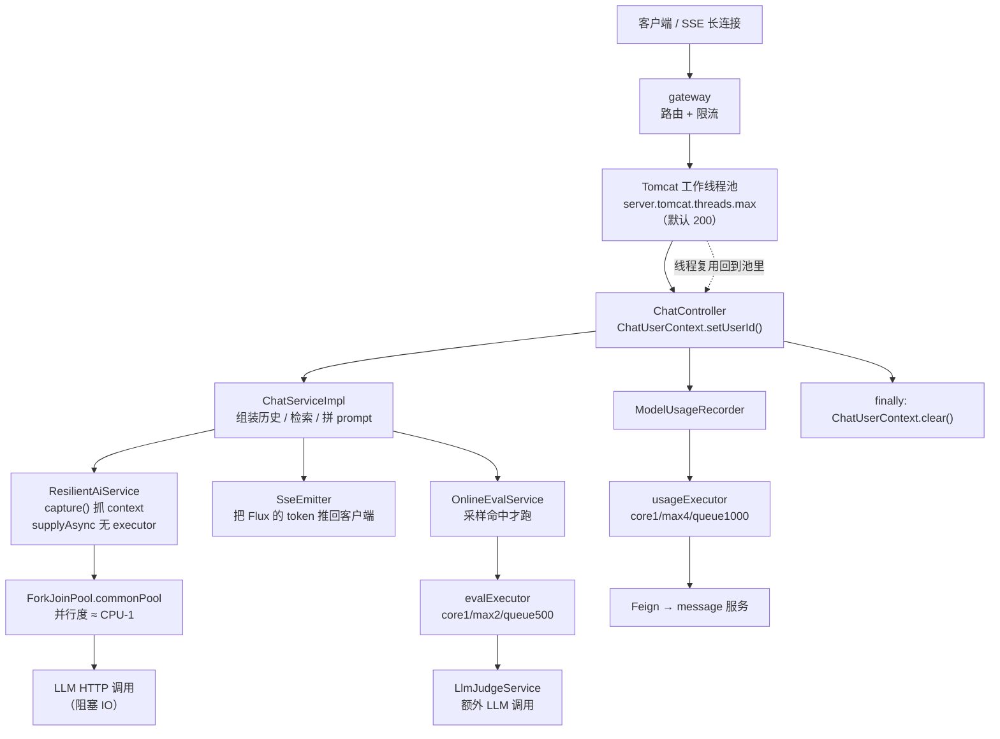
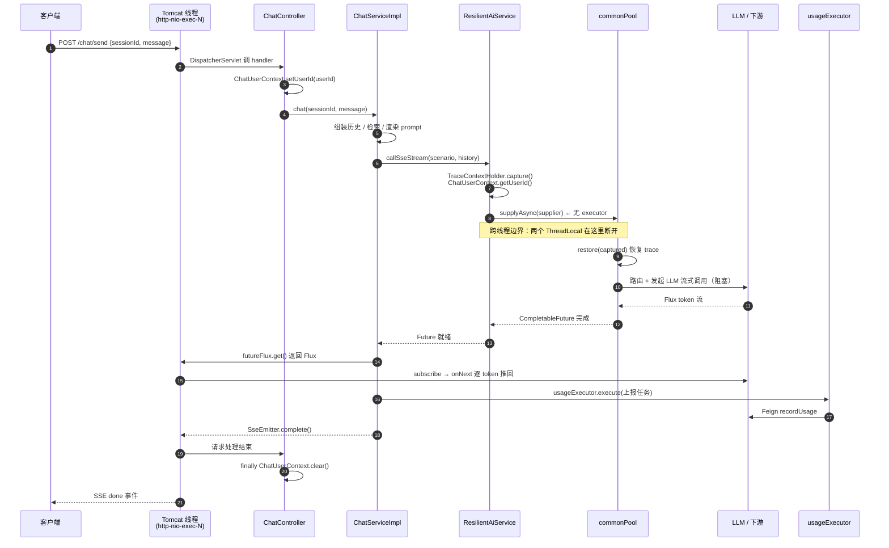

# 并发编程进阶：一个请求要等外部慢调用的系统，线程模型怎么设计

> 一句话结论：在这个"一次对话要等 LLM、等向量库、等 Feign 下游"的系统里，线程模型不是"配个线程池大小"这么一件事，而是三件互相咬合的事——**请求线程（Tomcat）绝不阻塞在慢调用上**、**异步边界两侧的上下文（用户身份 / traceId）必须显式搬过去**、**跨线程之后必须显式清理**。三者缺一，就分别对应 P99 暴涨、会话串号、上下文泄漏。

- 阅读前置：读完本篇同目录 `05-集合框架与源码.md`（知道 `HashMap` 为什么不安全）；用过 `CompletableFuture` 和 `@Async`；了解 Spring 的 Bean 代理（`06-反射动态代理与SPI.md`）；知道 HTTP 请求最终跑在 Tomcat 的工作线程上。
- 证据基线：JDK 17 编译目标（本地 JDK 21，但本篇所有可复现实验都跑在 `java 17.0.19` 上，原因见 §7）；Spring Boot **4.2.0**、Spring Framework **7.1.0**、Spring Security **7.2.0**；被测代码为 `ai-customer-service` 主干。
- 预计阅读：70 分钟。

关于证据等级，先交代一句：`learning-docs/24-源码分析/assets/source/` 收录的 889 份摘录全部是 Spring / Boot / Cloud / Security / AI 的**框架类**，JDK 的 `java.util.concurrent` 包不在库内——也就是说本篇**没有 `ThreadPoolExecutor` 的源码摘录可引**。所以 JDK 并发类的行为依据只有两种：本篇 §3 的**可复现实验（真实命令 + 真实输出）**，以及**JDK 官方 Javadoc / JLS**（正文会点明是哪一条）。唯一能引 A 级的是 Spring Security 的 `SecurityContextHolder` 家族，而它恰好是"框架自己怎么写 ThreadLocal 上下文、怎么清"的教科书样本。

---

## 0. 先看现象

### 现象 1：QPS 没变，P99 从 800ms 涨到 3s，CPU 只跑了 20%

外部模型侧 RT 正常波动（300ms → 1s），上游 QPS 也没涨，但接口 P99 从 800ms 直接抬到 3s；机器 CPU 20%、GC 日志干净、下游没有错误率。唯一的异常是**线程数没涨、队列在涨**。

这不是"慢"，这是"排"。一次请求的耗时从"我调用的这几个下游"变成了"我调用的这几个下游 + 前面还有多少个请求在等同一个线程"。

### 现象 2：两个用户的对话串了

A 用户问"我的订单到哪了"，AI 把 B 用户的订单号念了出来。复现条件很刁钻：同一台机器、偶发、重启后消失。日志里 `requestId` 和 `userId` 对不上号——不是查询逻辑错了，而是**线程复用了，但线程身上挂的"当前用户"没有被换掉**。

同一个类里还有一个更隐蔽的版本：`TraceContext`（traceId/spanId 的载体）没清，于是新请求的日志全部带上了上一个请求的 traceId，链路追踪直接串成一条假链路。

### 现象 3：日志里搜不到"上报失败"，接口却抛 `RejectedExecutionException`

代码里明明写了"上报失败只记 warn"，运维 `grep 模型用量上报失败` 一条没有；倒是接口偶发 500，异常栈顶是 `java.util.concurrent.RejectedExecutionException`。

原因在 §3.2 会拆开：那个 `try { ... } catch (Exception e) { log.warn(...) }` 包住的是**任务体**，而 `RejectedExecutionException` 是 `execute()` 这一句**提交动作本身**抛的——任务根本没进线程池，自然走不到任务体里的 catch。于是"只告警"变成了"打到用户脸上"。

这三个现象指向同一件事：**线程是一份需要显式设计、显式划界、显式清理的资源**——队列会排、上下文会残留、异常会跨边界抛出。下面把它拆成可验证的几块。

---

## 1. 整体地图：一次对话会在哪几条线程上跑



> **读图说明**：最关键的是两个箭头。第一个是 `ResilientAiService → ForkJoinPool.commonPool`——这是本系统唯一一次"请求线程把活交给别的线程"，一切上下文丢失、超时失控、池被占满都发生在这个跨线程动作上；它是 `CompletableFuture.supplyAsync(...)` 不带 executor 参数的默认结果（§3.5 有实测）。第二个是 `ChatController → finally: clear()` 这条回到 Tomcat 线程池的虚线：`clear()` 一旦缺失，下一个拿到该线程的请求就会继承上一个请求的身份（§3.7 有实测）。其余三条支线（`usageExecutor` / `evalExecutor` / 直接同步调用）都是"可选旁路"，画出来是为了让你看到**它们各自有独立的队列，互不背锅**。

| 组件 | 责任 | 运行在谁的线程上 | 调用方 / 被谁调用 |
| --- | --- | --- | --- |
| Tomcat 工作线程池 | 承载所有 HTTP 请求与 SSE 长连接 | `http-nio-*-exec-*` | 容器（Spring Boot 内置 Tomcat） |
| `ChatController` | 解析参数、设/清 `ChatUserContext`、返回 `SseEmitter` | Tomcat 线程 | Spring MVC |
| `ChatServiceImpl` | 业务编排：历史、检索、prompt、订阅 Flux | Tomcat 线程 | `ChatController` |
| `ResilientAiService` | 路由 / 熔断 / fallback / 观测，**把调用丢进异步** | 提交在 Tomcat 线程，执行在 commonPool | `ChatServiceImpl` |
| `ForkJoinPool.commonPool` | 默认异步执行器（JVM 全局共享） | `ForkJoinPool.commonPool-worker-*` | `CompletableFuture.supplyAsync/runAsync` 无 executor 时 |
| `usageExecutor` | 用量上报（Feign 落库），失败只告警 | `usage-report-*` | `ModelUsageRecorder` |
| `evalExecutor` | 线上采样评估（LLM-as-Judge），控成本 | `online-eval-*` | `OnlineEvalService` |
| `ChatUserContext` | 当前用户 ID（ThreadLocal） | 绑定到"当前线程" | 控制器写、`@Tool` 方法读 |
| `TraceContextHolder` | traceId/spanId + MDC（ThreadLocal） | 绑定到"当前线程" | 拦截器/服务写，异步前 `capture()` |
| `SseEmitter` | 服务端推送通道，长连接 | 回调在订阅线程 | `ChatServiceImpl` |

---

## 2. 关键概念与关键类

先把术语钉死，后面不再解释第二次：

- **线程池（Thread Pool）**：预先创建一批线程反复使用的容器，好处是省掉创建/销毁线程的开销并把并发数**卡住**；代价是任务超过承载能力时必须排队或拒绝。
- **拒绝策略（RejectedExecutionHandler）**：队列满且线程到上限时，`execute()` 决定"怎么办"的那段代码，默认是 `AbortPolicy`（直接抛 `RejectedExecutionException`）。
- **`CompletableFuture`**：JDK 8 起的异步编排工具，把"一个异步结果"变成一个可 `thenApply/thenCombine` 的容器。
- **`ThreadLocal`**：以"当前线程"为 key 的隐式变量；本质是每个 `Thread` 对象身上挂一个 `ThreadLocalMap`。它不会自动继承到别的线程（`InheritableThreadLocal` 只在**创建**线程时拷贝一次，线程池里线程是复用的，所以几乎没用）。
- **CAS（Compare-And-Swap）**：一条 CPU 原语，"如果当前值还是旧值，就改成新值"，失败就重试；`AtomicInteger` 等方法靠它做无锁自增。
- **虚拟线程（Virtual Thread）**：JDK 21 正式（JEP 444）的 JVM 调度线程，阻塞时**卸载**载体线程（carrier），适合"等 IO"；运行在 `synchronized` 块里等 native/monitor 时会"钉住"（pin）载体线程，这个限制在 JDK 24（JEP 491）才被拿掉。
- **代理（Proxy）**：Spring 给 bean 套一层 AOP 子类/接口实现；`@Async`、`@Transactional` 全靠"调用必须穿过代理"才生效。
- **`commonPool`**：`ForkJoinPool` 的全局默认实例，JVM 里所有 `parallelStream()` 和不带 executor 的 `CompletableFuture` 都共用它。

| 名称 | 所在位置 | 角色 | 关键方法 / 字段 |
| --- | --- | --- | --- |
| `ThreadPoolExecutor` | JDK `java.util.concurrent` | 线程池的"发动机"，七参数全在这里生效 | `execute(Runnable)`、`getPoolSize()`、`getQueue()`、`shutdown()` |
| `ThreadPoolTaskExecutor` | Spring `org.springframework.scheduling.concurrent` | Spring 对上面那个的包装，作为 bean 暴露（`queueCapacity` 等以"容量"形式配置） | `initialize()`、`setCorePoolSize`、`setQueueCapacity`、`submit` |
| `CompletableFuture` | JDK | 异步编排 | `supplyAsync`、`thenCombine`、`allOf`、`whenComplete`、`join`/`get` |
| `ThreadLocal` | JDK | 线程私有变量 | `set`、`get`、**`remove()`** |
| `ForkJoinPool.commonPool()` | JDK | 默认异步执行器（守护线程，不阻塞 JVM 退出） | `getParallelism()` |
| `CopyOnWriteArrayList` | JDK | 写时复制列表，读多写少（跨线程追加 span） | `add`、迭代 |
| `AtomicInteger` / `AtomicLong` | JDK | 无锁计数（CAS） | `incrementAndGet`、`updateAndGet` |
| `ChatUserContext` | `ai-cs-chat/src/main/java/com/aics/chat/util/ChatUserContext.java` | 当前用户 ID 的 ThreadLocal 门面 | `setUserId` / `getUserId` / `clear`（L31-L41） |
| `TraceContextHolder` | `ai-cs-chat/src/main/java/com/aics/chat/observability/TraceContextHolder.java` | traceId/spanId + MDC 的 ThreadLocal 门面 | `begin` / `capture` / `restore` / `clear`（L40-L107） |
| `ObservabilityExecutorConfig` | `ai-cs-chat/src/main/java/com/aics/chat/config/ObservabilityExecutorConfig.java` | 两个可观测性线程池的 bean 定义 | `usageExecutor()` L27-L40、`evalExecutor()` L47-L59 |
| `ModelUsageRecorder` | `ai-cs-chat/src/main/java/com/aics/chat/observability/ModelUsageRecorder.java` | 用量上报的提交方 | `usageExecutor.execute(...)` L106-L114 |
| `ResilientAiService` | `ai-cs-chat/src/main/java/com/aics/chat/service/impl/ResilientAiService.java` | 弹性调用模板：捕获上下文 → 异步 → 超时/熔断 | `capture()` L173、`supplyAsync` L176/L255/L382、`timedCall` L378-L406 |
| `ChatServiceImpl` | `ai-cs-chat/src/main/java/com/aics/chat/service/impl/ChatServiceImpl.java` | SSE 桥接 | `futureFlux.get()` L601 |
| `InstanceInFlightRegistry` | `ai-cs-gateway/src/main/java/com/aics/gateway/loadbalancer/InstanceInFlightRegistry.java` | 网关侧"在途请求数"计数器（并发集合 + CAS 的真实用法） | `increment` L39-L41、`decrement` L44-L49 |

---

## 3. 原理与证据逐段精读

### 3.1 线程池七参数：任务提交之后的四步决策

**这段在做什么**

`ThreadPoolExecutor.execute(task)` 不是"有空线程就跑、没空就开新线程"这么朴素，它是一条固定顺序的四步决策：

1. 当前线程数 < `corePoolSize` → **开一个新核心线程**跑这个任务；
2. 否则尝试把任务**放进队列**；
3. 放不进去（队列满）且当前线程数 < `maximumPoolSize` → **开一个非核心线程**；
4. 还不行 → 交给 `RejectedExecutionHandler`。

七参数里真正影响行为的就三个：`corePoolSize`、`maximumPoolSize`、`workQueue`（外加 `keepAliveTime` 管非核心线程活多久、`threadFactory` 管线程名、`handler` 管拒绝）。

项目的两个池是这样配的：

```java
// ai-cs-chat/src/main/java/com/aics/chat/config/ObservabilityExecutorConfig.java#L27-L40
@Bean(name = "usageExecutor")
public ThreadPoolTaskExecutor usageExecutor() {
    ThreadPoolTaskExecutor executor = new ThreadPoolTaskExecutor();
    executor.setCorePoolSize(1);
    executor.setMaxPoolSize(4);
    executor.setQueueCapacity(1000);
    executor.setThreadNamePrefix("usage-report-");
    executor.setWaitForTasksToCompleteOnShutdown(true);
    executor.initialize();
    return executor;
}
```

`evalExecutor` 是同一形状的缩小版：`corePoolSize=1`、`maxPoolSize=2`、`queueCapacity=500`、线程名前缀 `online-eval-`（`ai-cs-chat/src/main/java/com/aics/chat/config/ObservabilityExecutorConfig.java` L47-L59）。原文件注释把理由写得很直白：评估是"额外的 LLM 调用"，并发上限 2 是为了"控制 token 成本"，而不是性能。

**为什么这么设计**

因为这两个任务是**旁路任务**：用量上报和采样评估都不能反过来拖慢用户请求。所以配置取向不是"尽量快"，而是"**上限小、队列长、出问题自己吞**"：core=1 意味着平时只有一个线程在打 Feign，队列 1000 用来扛瞬时爆发（削峰），`setWaitForTasksToCompleteOnShutdown(true)` 保证停机前把队列里没落库的用量数据冲完。

**换成另一种写法会怎样**

如果按"性能优先"直觉配成 core=32 / queue=0，那么：平时就常驻 32 个线程空转（内存 + 上下文切换）；下游 message 服务抖一下，32 个线程全部卡在 Feign 上，队列 0 让第 33 个任务立刻被拒绝——旁路任务的抖动会以异常形式漏回主链路。反过来配成 core=1 / queue=无界（也就是 `queueCapacity` 不设），则「积压变内存」，见 §3.3。

**常见坑**

- 以为 `maxPoolSize` 是"并发上限"。它不是——`maxPoolSize` 只在**队列满**时才起作用。下面这段真实实验会把这个反直觉点钉死。
- `ThreadPoolTaskExecutor` 必须调 `initialize()`（或让它作为 bean 被 Spring 生命周期回调）才会真正创建底层 `ThreadPoolExecutor`；手工 `new` 之后不 `initialize()` 就 `submit`，会抛 `IllegalStateException`（依据 Spring 官方 Javadoc）。

**实测（C 级）**：`core=1 / max=8 / queue=100`，一次提交 6 个会阻塞的任务，然后立刻采样池状态。

```text
== exp2: core=1 max=8 queue=100, submit 6 tasks, sample poolSize ==
after submit: poolSize=1 activeCount=1 queueSize=5 maxPoolSize=8
```

怎么读这个输出：`maxPoolSize=8` 形同虚设——6 个任务一共只开了 **1** 个线程，剩下 **5** 个老实躺在队列里。因为第 2 步"入队"永远成功（队列容量 100），所以第 3 步"扩容到 max"永远不会被触发。**结论：想让 maxPoolSize 有意义，队列必须是有界的，且队列容量要和 max- core 一起算。**

复现命令（30 行内，JDK 17）：

```bash
# Windows PowerShell；ConcurrencyLab.java 是本篇实测用的 30 行 demo，形状同 §9 练习 1／练习 8
javac -encoding UTF-8 ConcurrencyLab.java
java "-Dfile.encoding=UTF-8" ConcurrencyLab
```

> 注意 `-Dfile.encoding=UTF-8` 在 PowerShell 里必须用引号包起来，否则会被拆成参数，报 `ClassNotFoundException: /encoding=UTF-8`。

### 3.2 拒绝策略：默认的 `AbortPolicy` 把异常抛给了谁

**这段在做什么**

队列满 + 线程到上限时，`execute()` 把任务交给 `RejectedExecutionHandler`。JDK 提供四个（依据 JDK 官方 Javadoc `ThreadPoolExecutor`）：

| 策略 | 行为 | 什么时候用 |
| --- | --- | --- |
| `AbortPolicy`（默认） | 抛 `RejectedExecutionException` | 调用方**必须知道**任务丢了 |
| `CallerRunsPolicy` | 谁提交谁执行（在调用方线程跑） | 想要天然背压，且任务短 |
| `DiscardPolicy` | 静默丢弃 | 丢了也无所谓（心跳、埋点） |
| `DiscardOldestPolicy` | 丢掉队列里最老的一个，再重试 | 只关心新数据（行情推送） |

项目里 `usageExecutor` 用的是**默认值**，源码注释明说："拒绝策略默认 AbortPolicy，队列满时报错由调用方捕获告警"（`ai-cs-chat/src/main/java/com/aics/chat/config/ObservabilityExecutorConfig.java` L33）。于是问题变成：调用方真的捕获了吗？

```java
// ai-cs-chat/src/main/java/com/aics/chat/observability/ModelUsageRecorder.java#L106-L114
usageExecutor.execute(() -> {
    try {
        modelUsageFeignClient.recordUsage(dto);
    } catch (Exception e) {
        log.warn("模型用量上报失败: requestId={}, model={}, err={}",
                dto.getRequestId(), model, e.getMessage());
    }
});
```

**为什么这么设计（以及这里为什么是坑）**

`try/catch` 包在 **lambda 内部**，它保护的是"任务被某个 `usage-report-*` 线程执行时"的异常。而 `execute(...)` 这一行本身是**在 Tomcat 线程上执行的提交动作**：队列满时它直接抛 `RejectedExecutionException`，异常栈的起点是 `ModelUsageRecorder` 的调用点，**lambda 根本没开始跑**。这就是现象 3 的完整解释：`grep 模型用量上报失败` 一条都没有，因为那条 warn 属于任务体，而任务体没被执行。

**换成另一种写法会怎样**

- 把 `usageExecutor.execute(...)` 整句再包一层 `try/catch (RejectedExecutionException e)` 并记 warn → 现象 3 变成一条可观测的告警，主链路不受影响。这是最小修复。
- 换 `CallerRunsPolicy` → 任务不会丢，但代价是**退化到 Tomcat 线程上同步打 Feign**；对"旁路任务"来说，这等于把故障隔离拆掉了。要么接受排队（加队列），要么接受丢（记 warn），别选"退回主链路"。
- 换 `DiscardPolicy` → 干净，但"用量数据丢了"必须事前被接受（计费场景不能这么干）。

**常见坑**

- 拒绝策略是**每个池**的属性，不是全局的；`ThreadPoolTaskExecutor` 要换策略得注入自己的 `RejectedExecutionHandler`。
- `submit()` 与 `execute()` 的异常语义不同：`submit()` 返回 `Future`，任务体内的异常被**吞进 Future**，不调 `get()` 就永远看不到（这也是为什么 §3.4 里必须显式解包 `ExecutionException`）。

**实测（C 级）**：`core=1 / max=1 / queue=1`，连提交 4 个任务。

```text
== exp1: core=1 max=1 queue=1 AbortPolicy, submit 4 tasks ==
task-1 accepted   poolSize=1
task-2 accepted   poolSize=1
task-3 REJECTED   RejectedExecutionException
task-4 REJECTED   RejectedExecutionException
executed=2 lost=2
```

怎么读：容量 = 1 个运行中 + 1 个排队 = 2，第 3、4 个必然被拒；`executed=2 lost=2` 是**任务丢失的实锤**（`ok.incrementAndGet()` 只跑了两次）。在线上，这行输出等价于"两个用户的用量没上报，而且没人知道"。

### 3.3 为什么不用 `Executors.newFixedThreadPool(...)`

**这段在做什么**

`Executors` 的几个工厂方法把七参数隐藏了，代价是**你失去了对边界的控制**。依据 JDK 官方 Javadoc（`Executors#newFixedThreadPool`、`#newSingleThreadExecutor`、`#newCachedThreadPool`）：

| 工厂方法 | core / max | 队列 | 隐患 |
| --- | --- | --- | --- |
| `newFixedThreadPool(n)` | n / n | **无界 `LinkedBlockingQueue`** | 队列永不拒绝 → 积压变内存 → OOM；`max` 与 `core` 相等，等于放弃弹性 |
| `newSingleThreadExecutor()` | 1 / 1 | **无界** | 同上，且单点串行 |
| `newCachedThreadPool()` | 0 / `Integer.MAX_VALUE` | `SynchronousQueue`（不排队） | 线程数无上限 → 线程爆炸 |
| `newScheduledThreadPool(n)` | n / `Integer.MAX_VALUE` | `DelayedWorkQueue` | 队列无界 |

另外两个副作用：线程名是 `pool-1-thread-1` 这种默认格式（线上排障时 `top -H` 里分不清是谁），而且返回类型是 `ExecutorService` 接口——**必须自己 `shutdown()`**，否则非守护线程会让 JVM 永不退出。

**为什么这么设计**

`Executors` 的定位是"给玩具程序和单测用的便捷入口"，它的 Javadoc 自己就写着建议：生产环境应显式构造 `ThreadPoolExecutor` 并说明容量（依据 JDK 官方 Javadoc 原文："It is recommended that programmers use the more convenient `Executors` factory methods instead" 只是旧文档口径，现行文档在 `ThreadPoolExecutor` 类注释里给出了与之相反的容量约束建议）。所以这不是"API 选哪个"的问题，而是"**边界必须写在调用点显眼处**"的工程原则——项目里 `ObservabilityExecutorConfig` 用 `ThreadPoolTaskExecutor` 逐项 `setXxx`，正是这个原则的体现。

**换成另一种写法会怎样**

把 `usageExecutor` 换成 `Executors.newFixedThreadPool(4)`：代码短 10 行，代价是（a）`queueCapacity` 从"1000"变成"无界"，用量上报积压时先吃内存再 OOM，而不是先拒绝再告警；（b）线程名变成 `pool-2-thread-1`，`/actuator/threaddump` 里认不出；（c）`@Bean` 销毁时要手写 `shutdown`，否则优雅停机失效（`setWaitForTasksToCompleteOnShutdown(true)` 也就白配了）。

**实测（C 级）**：`HangDemo` 用 `core=1 / max=4 + new LinkedBlockingQueue<>()`（等价于 `newFixedThreadPool` 的形状，但保留线程名以便排障），提交 50 个 `sleep(500)` 任务，不 `shutdown`，然后用 3 秒看门狗检查进程：

```text
aliveAfter3s=True
poolSize=1 maxPoolSize=4 queueSize=49 queueClass=LinkedBlockingQueue
main() finished, but pool was never shutdown()
killed
```

怎么读：`queueSize=49` + `poolSize=1` 说明**无界队列让 `maxPoolSize=4` 彻底失效**——50 个任务永远只有 1 个线程在跑，剩下的接受"排队等"，一个都不拒绝。`main() finished` 之后进程还活着（`aliveAfter3s=True`），是因为池线程默认是非守护线程；把这段代码放进 `@PostConstruct` 就变成了"应用停不下来"。另外 `queueClass=LinkedBlockingQueue` 是从运行时反射打印的，比读代码更可信。

### 3.4 `CompletableFuture` 编排：`thenCombine` 并行、`allOf` 的异常形状、`join` 阻塞了谁

**这段在做什么**

多路检索（向量库 + 关键词 + 数据库）天然可并行。串行写法是 `a(); b(); c()`，总耗时 = 三者之和；并行写法是把每个调用包成 `CompletableFuture`，再用 `thenCombine`（两两合并结果）或 `allOf`（等全部完成）编排。

**实测（C 级）**：三个 200ms 的假下游，串行 vs 并行，以及 `allOf` 遇到一个失败分支时的异常形状。

```text
== exp4: serial vs thenCombine; allOf exception shape ==
serial  total=622ms result=vec+kw+db
combine total=229ms result=vec+kw+db
whenComplete got ex=CompletionException
allOf.join() threw java.util.concurrent.CompletionException cause=IllegalStateException msg=bad boom
good branch still usable: ok-1
bad branch join(): 
  -> java.util.concurrent.CompletionException cause=IllegalStateException
```

怎么读这个输出，四点：

1. `622ms → 229ms`：并行把"和"变成"最大值"，3 路时收益接近 3 倍。
2. `whenComplete` 拿到的异常类型是 `CompletionException`，**不是**业务异常——`CompletableFuture` 把所有异常都套一层。
3. `allOf(...).join()` 抛出的是 `CompletionException`，而 `getCause()` 才是真正的 `IllegalStateException: bad boom`。**不解包就只能打印一个没有信息量的 `CompletionException`**。
4. `good branch still usable: ok-1`：一个分支失败**不会**拖累其他分支的结果，`allOf` 只是"等全部结束"，不做短路。

**为什么这么设计**

`CompletionException` 是"跨线程传递异常"的必然产物：异步任务在别的线程抛异常，没法直接 `throw` 到调用方栈上，只能塞进结果容器里，调用方取值时再抛出来。这就是为什么项目里显式做了双层解包：

```java
// ai-cs-chat/src/main/java/com/aics/chat/service/impl/ResilientAiService.java#L378-L406（节选）
CompletableFuture<ChatResponse> future = CompletableFuture.supplyAsync(() -> {
    try { return call.call(holder); }
    catch (Exception e) { throw new CompletionException(e); } // 第一层：任务体里包一次
});
try {
    return future.get(holder.getDefinition().getTimeoutMs(), TimeUnit.MILLISECONDS);
} catch (TimeoutException e) {
    future.cancel(true);
    throw e;
} catch (ExecutionException | CompletionException e) { /* 第二层：get() 又包一层 ExecutionException，需要拆 */ }
```

注意这里的三个动作值得学：**带超时的 `get(timeout)`**、**超时后 `cancel(true)` 尝试打断**、**双层解包**（`future.get()` 抛 `ExecutionException`，里面再套 `CompletionException`）。

**换成另一种写法会怎样**

- 用 `join()` 代替 `get(timeout)`：`join()` 没有超时参数，等于"无限期等"。放在 Tomcat 线程上，下游一卡，线程就永久占用——这正是 §0 现象 1 的成因（§4 时序图里那个红点）。
- 用 `allOf(...).join()` 然后 `catch (Exception e) { log.error(e); }`：日志里只有 `CompletionException`，没有根因，排障时要靠猜。
- 用 `thenCombine` 串成链：可读但**错误传播是"快失败"**——任一路失败，合并结果直接失败。对"三路检索取并集"这种场景，更合理的是每路各自 `exceptionally(fallback)` 兜成空结果，让 `allOf` 永远成功。

**常见坑**

- `allOf` 的返回类型是 `CompletableFuture<Void>`，**它不携带结果**；要结果得拿着原来的 `List<CompletableFuture<T>>` 再逐个 `join()`（此时已全部完成，`join` 不会阻塞）。
- 在 Tomcat 线程上 `join()`/`get()` 而**不设超时**，等于把异步白做了——异步只解决"谁在执行"，不解决"调用方等多久"。
- 项目的 SSE 链路就踩在这个边界上：`ChatServiceImpl` 在请求线程上无超时取结果，注释称"受 TimeLimiter 保护"（`ai-cs-chat/src/main/java/com/aics/chat/service/impl/ChatServiceImpl.java` L601）。这句话是否成立，取决于 `callSseStream` 返回的那个 `Future` 内部是否真的套了超时——读代码时要顺着 `invokeStream` → `resilience4j` 装饰器一层层确认，不能默认安全。

```java
// ai-cs-chat/src/main/java/com/aics/chat/service/impl/ChatServiceImpl.java#L584-L601（节选）
CompletableFuture<Flux<String>> futureFlux;
if (hasKb) {
    futureFlux = resilientAiService.callSseRagStream(ModelScenario.RAG, ragPrompt);
} else {
    futureFlux = resilientAiService.callSseStream(ModelScenario.CHAT, streamHistory);
}
// 等待 Flux 就绪（受 TimeLimiter 保护，不会无限等待）
Flux<String> flux = futureFlux.get();
```

**改造方向**：把 `futureFlux.get()` 换成 `futureFlux.get(路由超时, TimeUnit.MILLISECONDS)`，超时抛 `TimeoutException` 并 `cancel(true)`，让"等多久"变成一个显式数字而不是一句注释。

### 3.5 `supplyAsync` 不带 executor 会落到 `ForkJoinPool.commonPool`

**这段在做什么**

`CompletableFuture.supplyAsync(supplier)` 有一个重载接受 `Executor`。**不传就用 `ForkJoinPool.commonPool()`**（依据 JDK 官方 Javadoc：`asyncRunStage` 使用 `ASYNC_POOL`，即 common pool）。而项目里三处 `supplyAsync` 都没传 executor：

```text
ai-cs-chat/src/main/java/com/aics/chat/service/impl/ResilientAiService.java
  L176  return CompletableFuture.supplyAsync(() -> {     // invokeNonStream
  L255  return CompletableFuture.supplyAsync(() -> {     // invokeStream
  L382  CompletableFuture<ChatResponse> future = CompletableFuture.supplyAsync(() -> {  // timedCall
```

代码注释其实已经点破了这一点——L177 写着"在 **ForkJoinPool 线程**里恢复 trace 上下文"。作者知道自己在 commonPool 上。

**为什么这是问题**

`commonPool` 是**全 JVM 共享**的：`parallelStream()`、其他同事的 `CompletableFuture`、某些库的内部实现都在用它。它的线程数默认是 `CPU 核数 - 1`，并且**没有队列上限的概念**（任务塞进各 worker 的本地队列）。把"等 LLM 返回"这种几百毫秒到几十秒的**阻塞 IO** 放进去，等于用 CPU 密集型工具的配额去跑 IO 密集型负载——只要并发数超过并行度，任务就互相等。

**实测（C 级）**：

```text
== exp5: default pool of supplyAsync ==
commonPool.parallelism=15 cpu=16
supplyAsync ran on ForkJoinPool.commonPool-worker-1 daemon=true
supplyAsync(executor) ran on biz-pool
```

怎么读：`parallelism=15` 对应 16 核机器（`CPU-1`），也就是说这台机器上**所有**走默认池的异步任务，最多也只有 15 个能真正并行；`daemon=true` 说明它是守护线程（不会阻止 JVM 退出，这是它唯一的温柔之处）；传了 executor 之后线程名变成 `biz-pool`——**线程名是排查"这活到底在谁的线程上跑"的第一手证据**。

**换成另一种写法会怎样**

- 给 `ResilientAiService` 注入一个专用 `ThreadPoolExecutor`（core=200 之类，或 §3.10 的虚拟线程执行器），`supplyAsync(supplier, executor)`：阻塞任务与 commonPool 隔离，`parallelStream` 不受影响，且线程名可辨识。
- 什么都不改，但把并发压住：靠 `Resilience4j` 的 `Bulkhead` 限流。这只能缓解，不能隔离——一旦别处的 `parallelStream` 打满 commonPool，你的请求照样排队。

**常见坑**

- 以为 `daemon=true` 是好事：它意味着 **commonPool 里的任务可能随 JVM 退出被直接丢弃**，不会等你的 `finally`。
- 以为"异步 = 不占 Tomcat 线程"就万事大吉：异步只是把阻塞挪了个地方，挪到 commonPool 后仍然会因为并行度不足而排队（§6 的线程 dump 手法可以验证这点）。

### 3.6 `@Async` 的代理边界，以及本项目为什么不用它

**这段在做什么**

`@Async` 的语义是"这个方法被调用时，交给 `TaskExecutor` 在别的线程执行"，实现方式是 **Spring 给 bean 生成代理**，代理拦到方法调用后把 `Runnable` 丢进 executor。因此它有三个硬约束（依据 Spring Framework 官方文档 *Task Execution and Scheduling*）：方法必须是 `public`、必须**从外部**调用（同类内部 `this.foo()` 不经过代理）、返回 `void` 或 `Future`。

**本项目怎么做的**

全仓 `grep` 的结果很干脆：**没有一个 `@Async`、没有 `@EnableAsync`**（`ai-cs-chat` / `ai-cs-gateway` / `ai-cs-order` 等模块均无命中）。异步的地方只有两种写法：

1. 直接注入具体的 executor bean，显式 `execute(...)`：

```java
// ai-cs-chat/src/main/java/com/aics/chat/observability/ModelUsageRecorder.java#L34-L38（字段与注入）
private final ThreadPoolTaskExecutor usageExecutor;

public ModelUsageRecorder(..., @Qualifier("usageExecutor") ThreadPoolTaskExecutor usageExecutor) {
```

2. 直接 `CompletableFuture.runAsync(...)` / `supplyAsync(...)`（§3.4、§3.5）。

`OnlineEvalService` 同理：构造器上 `@Qualifier("evalExecutor")`，然后 `evalExecutor.execute(...)`（`ai-cs-chat/src/main/java/com/aics/chat/observability/OnlineEvalService.java` L31-L42、L67）。

**为什么这么设计**

因为 `@Async` 把"哪段代码跑在哪个池上"变成了**注解的副作用**：读 `evaluateAsync` 的方法体看不出它是异步的，改动一处 `@Async` 就可能让整条链路换池。显式 `execute` 的代价是几行样板，换来的是三个确定性：异步点可见（就在方法体里）、池可见（`@Qualifier` 写死）、异常可见（可以就地 `try/catch`，见 §3.2 的教训）。

**换成另一种写法会怎样**

把 `evaluateAsync` 改成 `@Async("evalExecutor") public void evaluateAsync(...)`：调用方更短，但（a）同一个类内部若有人 `this.evaluateAsync(...)`，注解**静默失效**，任务跑回调用者线程（这是 `@Async` 最经典的"没生效"来源）；（b）`@Async` 方法返回值只能是 `void`/`Future`，异常默认交给 `AsyncUncaughtExceptionHandler`，不配置就只打一条日志——比显式 catch 更不可控。

**常见坑**

- 在 `@Configuration` 类里给 `@Bean` 方法标 `@Async` 想让 bean 异步初始化——不生效，且极易误解。
- 以为 `@Async` 会传递 `ThreadLocal`：不会，和 `CompletableFuture` 一模一样（§3.7、§3.8）。
- 以为写了 `@EnableAsync` 就有池：不指定 executor 时用容器里的 `TaskExecutor`；Spring Boot 会自动配置一个 `applicationTaskExecutor`（依据 Spring Boot 官方文档 *Task Execution and Scheduling*，默认 core=8、`queueCapacity` 为无界，即 `maxPoolSize` 实际不生效——和 §3.3 的实验结论同构）。**旧版本文档曾把这里写成"Boot 默认小池 + 有界队列"，实际默认是无界队列、有效并发等于 core。**

### 3.7 `ThreadLocal` 泄漏：Tomcat 线程复用 + 忘了 `clear()`

**这段在做什么**

`ThreadLocal` 的值挂在 `Thread` 对象上（`ThreadLocalMap`，key 是 `ThreadLocal` 的弱引用）。Tomcat 的工作线程**是复用的**：一个线程处理完请求 1，回到池里，再去处理请求 2。如果请求 1 结束时没有 `remove()`，请求 2 一进来 `get()` 就能读到请求 1 的值——**这不叫泄漏，这叫越权**；值本身还会随线程一直活着，才叫泄漏（直到线程被销毁）。

项目把这件事做对了，而且是"教科书式做对"：

```java
// ai-cs-chat/src/main/java/com/aics/chat/controller/ChatController.java#L83-L91
try {
    ChatUserContext.setUserId(userId);   // 供 @Tool 方法（订单查询）读取当前用户
    return chatService.chat(sessionId, message);
} finally {
    ChatUserContext.clear();             // Tomcat 线程被复用，否则下个请求会读到上个用户的 ID
}
```

异步 SSE 那条路径也一样：`AgentController#runAgentTurn` 在新线程里第一件事是 `ChatUserContext.setUserId(uid)`，最后 `finally { ChatUserContext.clear(); }`（`ai-cs-chat/src/main/java/com/aics/chat/agent/AgentController.java` L148、L177-L180），注释写着"防止线程池复用导致用户串号"。

**为什么这么设计**

因为"当前用户"这个概念没法一路当参数传下去：它要穿过 Controller → Service → Spring AI 的 `@Tool` 回调（工具方法签名由框架决定，你加不了参数）。`ThreadLocal` 是唯一能穿透这层的隐式通道，代价是需要**成对的 `set`/`clear`**。因此项目里的规矩很硬：`ChatUserContext` 只有三个方法，`clear()` 和 `setUserId()` 在代码里永远成对出现（`ai-cs-chat/src/main/java/com/aics/chat/util/ChatUserContext.java` L31-L41）。

**框架也是这么做的**——Spring Security 的 `SecurityContextHolder` 是同一个模式的官方实现：三个策略常量 `MODE_THREADLOCAL` / `MODE_INHERITABLETHREADLOCAL` / `MODE_GLOBAL`，默认 `MODE_THREADLOCAL`。

```java
(src: SecurityContextHolder.java#L53-L65)
```

它的清理点被钉在过滤器里，`finally` 中无条件执行：

```java
(src: SecurityContextHolderFilter.java#L79-L87)
```

**这是本篇最有价值的一处类比**：连 Spring Security 都不敢指望"上下文会自己消失"，而是在 `finally` 里 `clearContext()`。而 `clearContext()` 本身极简——它不自己干活，只把调用委托给当前策略：

```java
(src: SecurityContextHolder.java#L113-L118)
```

你的 `ChatUserContext` 没有任何理由比它更乐观：它的 `clear()` 同样只是 `USER_ID.remove()`，谁来调、在哪个 `finally` 里调，全靠调用方守规矩。

**换成另一种写法会怎样**

- 只在 `setUserId` 处覆盖、不 `clear()`：低频请求看不出问题（§0 现象 2 的"偶发、重启后消失"就是这么来的），高频下必然串号。
- 用 `ThreadLocal.withInitial(...)` 求安心：`withInitial` 只解决"值为 null"，**不解决"值是上一个人的"**——它反而让"忘记清理"更难被发现。
- 依赖 `InheritableThreadLocal` 传给下一个线程：线程池里线程是复用的，`InheritableThreadLocal` 只在**创建线程**那一刻拷贝，等于几乎永远拿到脏值（§3.8 详述）。

**实测（C 级）**：单线程池模拟 Tomcat 复用，3 个请求，第 2 个"忘了 clear"。

```text
== exp3: single-thread pool, 3 requests, request#2 forgets to clear ==
[req1] sees userId=1001
[req1] finally cleared
[req2] sees userId=2002
[req3] sees userId=2002   <-- leaked from req2
```

怎么读：`req3` 自己从来没 `set` 过，却读到了 `2002`——因为它跑在同一个线程上，看到的是 `req2` 留下的值。生产上这就是"A 用户看到 B 用户的订单"。`req1` 里那句 `finally cleared` 则演示了正确做法：清理必须和赋值**在同一个 try/finally 里成对出现**。

项目里还有一处**已知的、可接受的**残留，值得当反面教材读：`LlmJudgeService` 用 `ThreadLocal<Integer> LAST_TOTAL_TOKENS` 把"上一次调用消耗多少 token"带出来（`ai-cs-chat/src/main/java/com/aics/chat/rag/eval/LlmJudgeService.java` L54），它的读取方法 `lastTotalTokens()` 会**读后即 `remove()`**（L100-L106）。但全仓只有离线评估 `RagEvalServiceImpl#L147` 会去读它；线上采样评估走 `evalExecutor` 时**从不读**，于是那个值在 `online-eval-*` 线程上一直挂着。危害级别低（下一轮 `recordTokenUsage` 会覆盖），但它说明一件事：**"谁写谁清"的责任一旦跨了调用方，就必然有人忘**。

### 3.8 跨线程传上下文：显式搬 vs 自动继承

**这段在做什么**

`ThreadLocal` 不跨线程，而系统需要把两类上下文带进异步：`userId`（配额/越权）和 `traceId`（日志关联）。三种做法，项目里全都有痕迹：

| 方案 | 机制 | 代价 | 项目现状 |
| --- | --- | --- | --- |
| 显式捕获 + 恢复（`capture`/`restore`） | 异步前把值取出来，异步任务第一行塞回去 | 每个异步点都要手写两行 | **采用** |
| `InheritableThreadLocal` | 创建子线程时拷贝 | 线程池复用 → 值不刷新（脏读） | 未采用 |
| `TransmittableThreadLocal`（阿里 TTL，第三方） | 字节码增强+包装 executor，提交/执行时自动快照恢复 | 引入依赖 + 必须装饰线程池 | 未采用 |

项目的实现就在 `TraceContextHolder` 上：`capture()` 取当前快照，`restore(ctx)` 在异步线程里塞回去，`clear()` 同时清 `ThreadLocal` 与 MDC（`ai-cs-chat/src/main/java/com/aics/chat/observability/TraceContextHolder.java` L73-L75、L87-L95、L104-L107）。`ResilientAiService` 的用法是标准范式：

```java
// ai-cs-chat/src/main/java/com/aics/chat/service/impl/ResilientAiService.java#L172-L177（节选）
private CompletableFuture<String> invokeNonStream(ModelScenario scenario, NonStreamCall call) {
    TraceContext captured = TraceContextHolder.capture();   // 快照
    Long userId = ChatUserContext.getUserId();             // 另一个 ThreadLocal，也要一起搬
    return CompletableFuture.supplyAsync(() -> {
        TraceContextHolder.restore(captured);              // 异步线程里恢复
        ...
```

**为什么这么设计**

因为 `capture/restore` 是唯一**不依赖"线程创建时机"**的方案。TTL 更强但需要额外依赖和显式装饰每一个池；`InheritableThreadLocal` 在线程池场景下等于失效（JDK 官方 Javadoc 对 `InheritableThreadLocal` 的说明只承诺"创建线程时"继承）。项目选择"手写两行"，是把复杂度放在**能看见**的地方。

框架侧也是同一个问题的另一种解法：`SecurityContextHolder` 的 `initialize()` 里，如果策略名是 `MODE_INHERITABLETHREADLOCAL`，就换成 `InheritableThreadLocalSecurityContextHolderStrategy`——**它把这把刀递给用户，但默认不用**，正是因为线程池场景下它会给出脏值。

```java
(src: SecurityContextHolder.java#L90-L100)
```

**换成另一种写法会怎样**

- 忘了 `capture` 就 `supplyAsync`：`TraceContext` 为 null → 异步段落的日志没有 `requestId`（MDC 只在原线程上），`ModelUsageRecorder` 里 `TraceContextHolder.current()`（`ai-cs-chat/src/main/java/com/aics/chat/observability/ModelUsageRecorder.java` L83）拿到 null → 用量数据挂在匿名用户上。项目注释已经写明后果："否则配额会按匿名用户计算"。
- 只搬 `userId` 不搬 `trace`：能查到数据，但查不到"这条数据属于哪个请求"。
- 只 `restore` 不 `clear`：异步池线程（`usage-report-*`、commonPool）自己也开始积累脏上下文——§3.7 的坑换了个池再踩一次。

**常见坑**

- `restore` 之后必须配 `finally { clear() }`，否则这个池线程的下一个任务会继承上下文。项目的 `runAgentTurn` 做对了，但三个 `supplyAsync` 的 lambda 里**没有**对应的 `clear`——它们跑在 commonPool 上，靠"下一个任务执行前一定先 `restore`"来兜底，属于"能跑但脆"的写法，值得作为练习改进（§9 练习 4）。
- MDC 是**日志框架**的 ThreadLocal（logback/slf4j），和你的 `ThreadLocal` 是两套东西，必须一起搬一起清。

### 3.9 并发集合与 CAS：共享可变状态的最小化

**这段在做什么**

线程安全问题的根源是"**共享 + 可变**"。第一步永远是消灭共享（用 ThreadLocal、用不可变对象、用消息传递），第二步才轮到"用并发容器保护共享"。项目里的并发原语分三类，各有一个真实用处：

**① `ConcurrentHashMap` + `AtomicInteger`：分片计数**

```java
// ai-cs-gateway/src/main/java/com/aics/gateway/loadbalancer/InstanceInFlightRegistry.java#L30-L49（节选）
private final Map<String, AtomicInteger> counters = new ConcurrentHashMap<>();

public void increment(String key) {
    counters.computeIfAbsent(key, k -> new AtomicInteger()).incrementAndGet();
}

public void decrement(String key) {
    AtomicInteger counter = counters.get(key);
    if (counter != null) {
        counter.updateAndGet(current -> Math.max(0, current - 1)); // 不低于 0，防御 doFinally 重复触发
    }
}
```

这里是两层并发控制叠加：`ConcurrentHashMap` 保证"多个网关线程同时增删 key"安全，`computeIfAbsent` 保证"原子地初始化计数器"（不会因为先 `get` 后 `put` 而互相覆盖）；内层 `AtomicInteger` 用自己的 CAS 保证"同一实例的计数自增"不需要锁 map。

**② `AtomicReference` / `AtomicLong`：在响应式管道里携带可变状态**

```text
ai-cs-chat/src/main/java/com/aics/chat/service/impl/ResilientAiService.java
  L277  AtomicReference<Usage> usageRef = new AtomicReference<>();   // 流式场景 Usage 只在最后一个 chunk 里
  L278  AtomicReference<Throwable> errorRef = new AtomicReference<>();
  L279  AtomicLong firstTokenMs = new AtomicLong(-1);                // CAS 只记录第一次
```

Lambda 捕获的局部变量必须 effectively final，而"首 token 时间"需要被写一次、读一次——`AtomicLong` 既解决了"不可变捕获"，又顺手保证了"只写一次"的原子性（`compareAndSet(-1, now)`）。

**③ `CopyOnWriteArrayList`：读多写少的跨线程集合**

```text
ai-cs-chat/src/main/java/com/aics/chat/observability/TraceContext.java
  L42  学习点：CopyOnWriteArrayList —— 写时复制，读操作无锁
  L44  读多写少的场景下 CopyOnWriteArrayList 比 synchronizedList 并发度更高
  L45  private final List<TraceSpan> spans = new CopyOnWriteArrayList<>();
```

span 通常只在开始时追加一两次，却被日志/导出反复遍历，所以"写时复制 + 无锁读"的代价（每次写复制整个数组）在这里完全合理。

**为什么这么设计**

因为这三处共享的状态都满足"**元素少、操作单一、粒度细**"：计数的 key 数量有限，span 数量是个位数。如果换成"给整个方法加 `synchronized`"，正确性没问题但吞吐会掉在锁上；`ConcurrentHashMap` + CAS 把这把锁拆成了"桶/单变量"级别。

**换成另一种写法会怎样**

- 用 `HashMap` 存 counters：并发 `put` 在扩容时可能丢数据甚至形成环（JDK 8 改成尾插不再成环，但丢更新照样发生）——网关的在途数会越算越偏，负载均衡退化成瞎选。
- 用 `Collections.synchronizedMap`：正确但所有 key 抢同一把锁，网关每转发一次请求都要抢锁。
- 用 `counter.incrementAndGet()` 去掉 `Math.max(0, ...)`：`doFinally` 若重复触发（Reactor 里确实会），在途数会变成负数，负载均衡器永远认为该实例"最闲"——这是"计数语义要防御重复调用"的经典教训。

**常见坑**

- `ConcurrentHashMap` 只是**单个操作**原子；`if (!map.containsKey(k)) map.put(k, v)` 这种复合操作必须用 `computeIfAbsent`/`putIfAbsent`。
- `ConcurrentHashMap` 不允许 null key/value（`HashMap` 允许），从 `HashMap` 迁移时容易 NPE。
- `CopyOnWriteArrayList` 的迭代器是快照，遍历时看不到新加入的元素——对"要给客户端推送完整 span 列表"的语义刚好合适，对"要实时统计"就不合适。

### 3.10 虚拟线程（JDK 21+）的适用边界

**这段在做什么**

虚拟线程（JEP 444，JDK 21 正式；JDK 19/20 是预览）由 JVM 调度，阻塞时把载体线程（carrier，默认数量 = CPU 核数）让出来。用法上就两种：`Thread.ofVirtual().start(...)`，或 `Executors.newVirtualThreadPerTaskExecutor()`（这个 executor **每个任务开一个虚拟线程**，不池化）。

**它对这个系统意味着什么**

这个系统的负载画像非常契合虚拟线程：请求的绝大部分时间在**等**（等 LLM token、等向量库、等 Feign）。平台线程模型下"等"就等于"占着一个 1MB 栈的线程"，于是必须靠小池 + 队列来省资源（§3.1 的 core=1 就是这个逻辑的极端版）；虚拟线程模型下"等"几乎不花钱，于是"一请求一线程"重新变得可行，`ThreadLocal` 依赖的"线程独占"语义也天然成立。

**适用边界（依据 JDK 官方文档 JEP 444 与 `Thread` 类 Javadoc）**

| 场景 | 用虚拟线程？ | 原因 |
| --- | --- | --- |
| 阻塞 IO（HTTP/Feign/DB 驱动，`java.net` 重写过） | ✅ 主力场景 | 阻塞即卸载载体线程，吞吐随并发线性上升 |
| 大量短生命周期任务 | ✅ | 创建成本远低于平台线程 |
| CPU 密集计算 | ❌ | 没有"等"，虚拟线程只会增加调度开销 |
| `synchronized` 块里做阻塞操作（JDK 21~23） | ⚠️ 会 pin | 钉住载体线程，退化成平台线程；JEP 491 在 **JDK 24** 才解决 |
| 依赖 `ThreadLocal` 存大对象 | ⚠️ 谨慎 | 一请求一线程 → 每个请求一份副本，注意清理 |
| 需要限制并发数（保护下游） | ⚠️ 要额外信号量 | 虚拟线程"不限并发"，必须自己用 `Semaphore`/`Bulkhead` 兜住 |

**为什么本项目现在没启用**

`grep` 全仓 `application*.yml` 没有任何 `spring.threads.virtual` / `spring.task.execution` 配置，也没有虚拟线程执行器——异步全部跑在 `commonPool` 和两个 `ThreadPoolTaskExecutor` 上。这不是疏忽：Spring Boot 的 `spring.threads.virtual.enabled=true` 会改变**整个应用的执行模型**（包括 `applicationTaskExecutor`），在依赖 `ThreadLocal`（`ChatUserContext`、`TraceContextHolder`）和 `synchronized` 的代码库里贸然开启，风险大于收益。

**换成另一种写法会怎样**

把 `supplyAsync` 的 executor 换成 `Executors.newVirtualThreadPerTaskExecutor()`：阻塞的 LLM 调用不再抢 15 个 commonPool worker，`parallelism` 不再是天花板。代价是：并发数**彻底失去上限**，LLM 供应商的限流会以 429 的形式回来打你——所以必须配 `Semaphore` 或保留 Resilience4j 的 `Bulkhead`。

**常见坑**

- 以为虚拟线程能替代线程池：它替代的是"为了省线程而池化"的理由，不是"为了限流而池化"的理由。
- 以为 `newVirtualThreadPerTaskExecutor()` 会复用线程：它每次都新建，`ThreadLocal` 在任务结束后随线程消失——**这反而让 §3.7 的串号问题消失**，但"没清理"的内存问题变成"每个任务一份"。
- 在虚拟线程里用 `ThreadLocal` 存大 buffer：一请求一份，GC 压力会明显上升（JEP 444 建议用 `ScopedValue` 的动机之一，`ScopedValue` 仍是预览 API）。
- 本机只有 `java 17.0.19`（`javac 17.0.19`、`JAVA_HOME=D:\DevTools\jdk\jdk17.0.19`），**本篇无法给出虚拟线程的实测输出**——所以这一节全部标注为"依据官方文档"，不做实验断言。

---

## 4. 一次完整执行时序：`POST /chat/send` 的四条线程



> **读图说明**：最关键的一步是第 8 步 `supplyAsync`（`R→P`）——从这一刻起，"当前用户"和"traceId"只存在于 `captured` 这个局部变量里，`P` 上的线程对它一无所知；所有 `restore` 都必须在这里之后、任何日志/观测之前完成。第二关键的是**第 21 步 `finally clear()`**：它跑在 `T`（Tomcat 线程）上，是这个线程被复用前唯一一次清洗机会。

**哪一步失败会报什么错**

| 步骤 | 失败情形 | 你会看到什么 |
| --- | --- | --- |
| 4 | `userId` 为 null（网关没传/解析失败） | 后续 `@Tool` 查询走"匿名"分支 → 查不到订单，或按 uid=0 记账 |
| 5~6 | 检索/渲染抛异常 | `chatService.chat` 直接抛 → 全局异常处理器返回 500（`@SentinelResource` 的 `blockHandler` 只管限流，不管业务异常） |
| 8 | `usageExecutor`/commonPool 队列满 | `RejectedExecutionException`（§3.2），栈顶在提交处而非 lambda 内 |
| 9 | 忘了 `restore` | 不报错，只是异步段日志没有 `requestId`、用量按匿名用户记 |
| 11 | 下游超时/LLM 429 | `Resilience4j` 熔断/重试生效（`ResilientAiService` L360-L366 只对 `ResourceAccessException`/`SocketTimeoutException`/`TimeoutException` 重试一次），最终返回兜底文案而不是异常 |
| 15 | `futureFlux.get()` 无超时且内部没兜住 | Tomcat 线程**永久阻塞**，表现为 P99 抬升 + 线程数打满（§0 现象 1） |
| 19 | 客户端已断开 | `emitter.send` 抛 `IOException`，`sendEvent` 里静默忽略（`AgentController` L184-L190） |
| 21 | 缺 `finally clear()` | 下一个复用该线程的请求继承上一个用户身份（§3.7 实测） |

---

## 5. 设计取舍

| 方案 | 优点 | 代价 | 本项目怎么选 |
| --- | --- | --- | --- |
| 同步阻塞调用（不异步） | 代码最简单，栈上错误一目了然 | Tomcat 200 线程被 LLM 的 RT 直接乘掉，吞吐 = 200/RT | ❌ 不用。§3.1 的 `ObservabilityExecutorConfig` 类注释第一句就是"不占用 Tomcat 工作线程" |
| `CompletableFuture` + 自建池 | 完全可控，无额外依赖，线程名可辨识 | 每个异步点手写 `capture/restore`，容易漏 | ✅ RAG/LLM 调用用它（`ResilientAiService`），但 executor 目前用的是默认 commonPool（可改造点） |
| Reactor（`Mono`/`Flux`） | 超时/降级/背压语义最完整，`Mono.empty()` 比 null 清楚 | 学习曲线陡，调试栈不直观 | ✅ 流式链路上游用 Reactor；`SiliconFlowRerankService` 注释里明确写了"为什么用 Reactor 而不是 CompletableFuture" |
| `@Async` | 一行注解，样板最少 | 代理失效静默、异步点不可见、异常默认只打日志 | ❌ 全仓不用（`grep` 无命中），改用 `@Qualifier` 注入具体 executor |
| `Executors.newFixedThreadPool` | 一行搞定 | 无界队列 → 内存爆；线程名不可辨识；需手工 shutdown | ❌ 不用，全部显式 `ThreadPoolTaskExecutor` 逐项 `setXxx` |
| 有界队列 + `AbortPolicy` | 背压明确，问题暴露快 | 必须有人处理 `RejectedExecutionException` | ✅ `usageExecutor`/`evalExecutor` 的现状；但 `ModelUsageRecorder` 的提交处**尚未**捕获（§3.2 待修） |
| 有界队列 + `CallerRunsPolicy` | 不丢任务，天然背压 | 退化到 Tomcat 线程同步执行，等于拆掉隔离 | ⚠️ 仅适合"任务极短且不能丢"的场景，本项目旁路任务不适用 |
| 虚拟线程（JDK 21+） | 阻塞几乎免费，"一请求一线程" | 并发无上限需另配信号量；`synchronized` pin（JDK 24 前） | ⏸ 未启用（无 `spring.threads.virtual` 配置），列为评估项而非现状 |
| 上下文用 `ThreadLocal` | 穿透 `@Tool` 等框架回调的唯一手段 | 必须成对 `set/clear`，池线程上极易出错 | ✅ `ChatUserContext` + `TraceContextHolder`，且都提供 `clear()` |
| 上下文用 TTL（`TransmittableThreadLocal`） | 自动跨池传播，无需逐个改 | 第三方依赖 + 必须装饰线程池，隐式魔改 | ❌ 未采用，选择显式 `capture/restore`（见 `TraceContextHolder` L80-L85 的注释权衡） |

**可扩展点清单**

1. **知识库并行检索**：`ai-cs-knowledge` 全模块 `grep CompletableFuture|ExecutorService|@Async|parallel|ThreadLocal` 零命中——检索目前是同步的。多路召回（向量 + 关键词 + 图谱）可用 `thenCombine` 并行，预期收益参考 §3.4 的 622ms→229ms。
2. **给 `supplyAsync` 指定专用 executor**：`ResilientAiService` 的 L176/L255/L382 三处都落在 commonPool，替换成按业务隔离的池（或 §3.10 的虚拟线程执行器 + `Semaphore`）是最直接的吞吐改进。
3. **`RejectedExecutionException` 兜底**：给 `ModelUsageRecorder` 的 `execute` 包一层 `catch (RejectedExecutionException)` + 计数指标，把"静默丢数据"变成"可告警的丢数据"。
4. **`futureFlux.get()` 加超时**：把注释里的"受 TimeLimiter 保护"变成一个真实的 `get(timeout, unit)`。
5. **`ChatUserContext` 的"自动清理"**：用 `HandlerInterceptor#afterCompletion` 或 `TaskDecorator` 统一清理，减少"每个控制器都要写 finally"的重复劳动（代价是清理点变隐式，需权衡）。
6. **`ThreadPoolTaskExecutor` 换成 `TaskDecorator` 传播上下文**：Spring 提供 `TaskDecorator` 钩子，可在提交/执行两侧统一 `capture/restore/clear`，比每个 lambda 手写更彻底。

---

## 6. 踩坑与调试手法

| 现象 | 根因 | 验证手段 | 解法 |
| --- | --- | --- | --- |
| 接口 P99 抬高，CPU/GC 都正常，QPS 没涨 | Tomcat 线程被慢调用占住，或 commonPool 并行度被打满 | `jcmd <pid> Thread.print` 数 `http-nio-*-exec` 的线程状态；看是否大量卡在 `CompletableFuture.get`/`SocketInputStream.read` | 把阻塞调用移出请求线程 + 加超时（§3.4、§3.5） |
| 日志偶发 `RejectedExecutionException`，且伴随"用量数据缺失" | 有界队列 + `AbortPolicy`，提交处没有 catch | 抓异常栈顶：栈顶是 `ThreadPoolExecutor.execute` → 说明任务没进池；`grep` 任务体里的 warn 关键字**查不到** | 提交处 `catch (RejectedExecutionException)` + 指标；或调大队列并接受延迟 |
| 两个用户数据串了 / 日志 traceId 对不上 | `ThreadLocal` 未清理 + Tomcat 线程复用 | 在 `set` 和 `get` 处各打一行 `Thread.currentThread().getName()`，看是否同一个 `http-nio-*-exec-N` | `finally` 里 `clear()`；`TraceContextHolder.clear()` 同时清 MDC |
| 线程池 `maxPoolSize` 调了没效果 | 队列无界（或容量远大于并发），第 3 步扩容永不触发 | `executor.getQueue().size()` + `getPoolSize()` 同时打点（§3.3 实测） | 队列设成有界，容量与 max-core 一起算 |
| 应用关不掉 / `kill` 后进程仍存活 | 自建线程池线程是非守护线程且未 `shutdown` | `jcmd <pid> Thread.print` 里出现 `DestroyJavaVM` 但进程不退（§3.3 实测 dump） | `setWaitForTasksToCompleteOnShutdown(true)` + `shutdown()`；或虚拟线程/守护线程工厂 |
| `@Async` 方法"没生效"，同步执行了 | 同类内部调用绕过代理；或方法非 `public` | 方法里打一行 `Thread.currentThread().getName()`，看到 `http-nio-*` 就说明没走代理 | 把异步方法拆到另一个 bean，或改显式 `executor.execute(...)`（本项目做法） |
| 异步段日志没有 requestId | 跨线程没恢复上下文 | 日志格式里带 `%X{requestId}`，对比同步段与异步段 | 异步前 `capture()`，异步内第一行 `restore()`（`ResilientAiService` L173-L177） |
| 评估/上报线程池明明是 core=1 却像"卡死" | 队列积压，任务串行排队 | `jstack` 看 `online-eval-*` 线程是否在 `Thread.sleep`/`HttpClient` 上；对比入队速率 | 这是设计意图（控成本），排障时先看队列长度而不是线程数 |

**三条真调试手法（可直接抄）**

**手法 1：用 `jcmd Thread.print` 按线程名前缀定位"谁的线程在干什么"。** 这是判断"到底是排还是慢"的唯一硬证据。真实 dump 片段（对 §3.3 的 `HangDemo` 进程执行 `jcmd <pid> Thread.print`）：

```text
"fixed-like-pool" #23 prio=5 os_prio=0 cpu=0.00ms elapsed=2.15s tid=0x... nid=0x84a8 waiting on condition  [0x...]
   java.lang.Thread.State: TIMED_WAITING (sleeping)
	at java.lang.Thread.sleep(java.base@17.0.19/Native Method)
	at HangDemo.sleep(HangDemo.java:7)
	at HangDemo.lambda$main$1(HangDemo.java:15)
	at java.util.concurrent.ThreadPoolExecutor.runWorker(java.base@17.0.19/ThreadPoolExecutor.java:1136)
	at java.util.concurrent.ThreadPoolExecutor$Worker.run(java.base@17.0.19/ThreadPoolExecutor.java:635)
	at java.lang.Thread.run(java.base@17.0.19/Thread.java:840)

"DestroyJavaVM" #24 prio=5 os_prio=0 cpu=78.12ms elapsed=2.01s tid=0x... nid=0x7b20 waiting on condition  [0x...]
```

怎么读：`"fixed-like-pool" #23` 是线程名（**这就是给线程池设 `setThreadNamePrefix` 的全部理由**）；`TIMED_WAITING (sleeping)` 表示它在跑业务代码而不是在等任务；`runWorker` 帧证明它是池的工作线程而不是临时线程；下面的 `DestroyJavaVM` 线程则直接告诉你"main 已经结束，但 JVM 退不出去"。在生产上把 `fixed-like-pool` 换成 `http-nio-`、`usage-report-`、`online-eval-`、`ForkJoinPool.commonPool-worker-`，就是四张不同的诊断图。

命令（Windows）：

```powershell
jcmd <pid> Thread.print > dump.txt
Select-String -Path dump.txt -Pattern 'usage-report-|online-eval-|http-nio-' -Context 0,6
jcmd <pid> VM.native_memory summary    # 需要 -XX:NativeMemoryTracking 才可用
```

**手法 2：用线程名 + 日志关键字反向确认"异常发生在提交处还是任务体内"。** 这是 §3.2 的破案手法：`grep "模型用量上报失败"` **查不到**，同时接口日志里有 `RejectedExecutionException`——两个事实一凑，就能断定"任务体根本没执行，异常来自 `execute()`"。如果反过来（能查到 warn 而没有 `RejectedExecutionException`），则是"任务执行了但失败"，该去查 Feather/网络，而不是线程池。

**手法 3：断点位置——`ThreadPoolExecutor.execute` 的第一行 + `ThreadLocal.set` 的调用处。** 排查"任务到底进了哪个池"，在 `execute`（或 Spring 的 `ThreadPoolTaskExecutor#execute`）第一行下断点，看调用栈里 `pool-` 还是 `usage-report-`；排查"上下文什么时候丢的"，在 `ChatUserContext.setUserId` 与 `TraceContextHolder.begin` 上下断点，跨过 `supplyAsync` 后看 `getUserId()` 是否变 null——IDE 里"跨线程断点"要勾选挂起策略 `Thread`，否则断点会跟着跑丢。

---

## 7. ⚠️ 版本差异

| 旧写法（网上/旧文档常见） | 当前基线 | 变化点 | 迁移动作 |
| --- | --- | --- | --- |
| `Executors.newFixedThreadPool(n)` 是"标准线程池写法" | 现行 Javadoc 在 `ThreadPoolExecutor` 类注释里要求**显式给出容量与队列约束**；`newFixedThreadPool` 的无界 `LinkedBlockingQueue` 是典型反例 | JDK 官方文档口径变化（不是 API 变化——方法仍在、未 `@Deprecated`） | 改 `new ThreadPoolExecutor(core, max, keepAlive, unit, new ArrayBlockingQueue<>(n), namedFactory, new AbortPolicy())`，或 Spring 的 `ThreadPoolTaskExecutor` |
| 偏向锁是锁升级第一级（"偏向→轻量→重量"三级） | JDK 15（JEP 374）默认关闭并标记废弃；JDK 18 **移除**相关实现，对象头不再有 biased 状态；本地 JDK 21 已无此机制 | 机制被删除，不是"默认关闭" | 面试/文档统一说"无锁 → 轻量级（自旋）→ 重量级（monitor）"；不要再写"JDK 17 默认关闭所以……"（旧稿 §2.1/L62 就是这么写的，此处更正） |
| 虚拟线程"JDK 21 才有" | JDK 21 正式（JEP 444），但 JDK 19/20 已有**预览**；`synchronized` 内阻塞会 pin 的缺陷由 JEP 491 在 **JDK 24** 修掉 | `synchronized` pin 是版本相关的**限制**，不是永久属性 | 在 JDK 21~23 上评估虚拟线程必须在压测里专门验证 `synchronized` 段；升级到 24+ 后可放宽 |
| `ThreadLocal` 跨线程"用 `InheritableThreadLocal` 就行" | Javadoc 只承诺**创建线程时**继承；线程池复用线程 → 值不刷新，等于脏读 | 线程池成为默认执行模型后，该方案基本失效 | 改用显式 `capture/restore`（本项目）或 TTL 并装饰线程池 |
| `spring-boot-starter-web` 引入 Spring MVC | Boot 4 起 `spring-boot-starter-web` **已 deprecated**，新代码用 `spring-boot-starter-webmvc` | starter 名称变化（依赖树/自动配置入口随名称调整） | 新模块依赖改成 `spring-boot-starter-webmvc`；老模块升级时同步替换，避免混用两套 starter |
| `@Async` 不指定 executor 时"用 Boot 自动配置的小池 + 有界队列"（旧稿 §5.3/L205 的说法） | Boot 自动配置的 `applicationTaskExecutor` 默认 **core=8、`queueCapacity` 无界（`Integer.MAX_VALUE`）**，因此 `maxPoolSize` 实际不生效 | 默认值口径（依据 Spring Boot 官方文档 *Task Execution and Scheduling* 的 `TaskExecutionProperties` 默认值），不是行为变化 | 需要真实上限时必须显式 `spring.task.execution.pool.queue-capacity` + `max-size`，或自己定义 executor bean（本项目走的是后者） |
| `@Async`/`@Transactional` 代理语义 | Spring 6/7 自 Spring 4.3 起基本未变：必须外部调用、必须 `public`、同类自调用失效 | 从 Spring 4.3 起未变 | 无需迁移；但 Boot 4 + `spring-boot-starter-webmvc` 下若用 CGLIB 代理，`final` 方法同样失效，需检查 |
| `ThreadPoolTaskExecutor` 用法 | 自 Spring 2.0 起稳定；`queueCapacity` 默认 `Integer.MAX_VALUE`（无界）、`rejectedExecutionHandler` 默认 `AbortPolicy` | 从 Spring 2.0 起未变（依据 Spring 官方 Javadoc） | 只要没显式 `setQueueCapacity`，就等于"无界队列 + 永不拒绝"，请务必显式设置 |
| Tomcat 默认工作线程数 | Boot 4 仍是 `server.tomcat.threads.max=200`（官方文档 *Common Application Properties*） | 从 Boot 1.x 起未变 | 无需迁移；但配了虚拟线程后这个数字的含义变了 |

> 判断依据说明：本表"未变"条目依据对应版本的官方 Javadoc / 参考文档；涉及 JDK 的条目依据 JEP 374、JEP 444、JEP 491 的公开说明。**本篇无法直接阅读 JDK 并发包源码**（`assets/source` 不含），所以凡涉及 JDK 内部实现细节（如 `ThreadPoolExecutor` 的具体字段）都以 Javadoc 描述与 §3 实验为准，不编造行号。

---

## 8. 面试高频问与答

只列问题，答案自己讲一遍才算过（自测题里有对照）：

1. 线程池七个参数分别是什么？`execute()` 的四步决策顺序是怎样的，为什么"先入队再扩容"这个顺序会让 `maxPoolSize` 失效？
2. `AbortPolicy` 的 `RejectedExecutionException` 是在哪一行抛出的？为什么包在任务体里的 `try/catch` 抓不到它？
3. `CallerRunsPolicy` 为什么既被称作"背压"又被称作"陷阱"？什么场景下它会把故障放大？
4. 为什么 `Executors.newFixedThreadPool` 在面试里成了"不要用"的典型？它和 `newCachedThreadPool` 的风险有什么本质不同？
5. `ThreadPoolTaskExecutor` 的 `queueCapacity` 默认值是多少？不设它会带来什么后果？
6. `CompletableFuture.allOf` 返回什么类型？它为什么不携带结果？某个分支失败后其它分支的结果还能不能拿到？
7. `join()` 和 `get()` 的区别是什么（异常类型、是否可中断、是否支持超时）？为什么在 Tomcat 线程上无超时 `join()` 是架构级错误？
8. `CompletableFuture` 抛出的 `CompletionException` 为什么要"双层解包"？`future.get()` 抛的 `ExecutionException` 和它是什么关系？
9. 不带 executor 的 `CompletableFuture.supplyAsync` 在哪个线程池执行？它的并行度是多少、线程是守护线程吗、为什么把阻塞 IO 放进去会出事？
10. `ThreadLocal` 的实现原理是什么（key 在哪、存在哪、弱引用指向谁）？为什么 ThreadLocal 的 key 用弱引用之后仍然可能内存泄漏？
11. Tomcat 线程池复用导致"用户串号"的完整链路是什么？为什么 `ThreadLocal.withInitial` 不能解决、`InheritableThreadLocal` 几乎也不能解决？
12. `@Async` 在什么情况下会静默失效？它的失效和 `@Transactional` 自调用失效是不是同一个原因？
13. 跨线程传上下文有哪几种方案？`TransmittableThreadLocal` 相比手写 `capture/restore` 的优势和风险分别是什么？
14. `ConcurrentHashMap` 为什么在 JDK 8 之后放弃分段锁？`computeIfAbsent` 相比 `get`+`put` 解决了什么？
15. `AtomicInteger` 的 CAS 是什么？ABA 问题在这套系统里出现在哪、怎么规避？
16. 虚拟线程解决的是什么问题、不解决什么？`synchronized` 里的 pin 是哪个版本修掉的？"不限并发"为什么在下游限流场景下是缺点？
17. 如果要你给这个"等 LLM"的系统重排线程模型，你会怎么划分线程池（按业务？按阻塞类型？），每个池的队列和拒绝策略怎么定？
18. 线上 P99 从 800ms 涨到 3s 而 CPU 只有 20%，你的排查顺序是什么？会先看哪个指标、抓什么 dump？

---

## 9. 动手练习

每条都绑定本篇一个具体分支，验收标准是"你能观察到什么"，不是"你写完了"。

1. **（对应 §3.1／§3.3）把 `usageExecutor` 复制一份，`queueCapacity` 设成 2，然后并发提交 20 个任务。**
   验收：日志里出现 `RejectedExecutionException`（对应 exp1 的 `executed=2 lost=2`），并且 `getPoolSize()` 始终等于 core；再把 `queueCapacity` 改成 `Integer.MAX_VALUE`，拒绝消失但任务开始堆积——你能说出"为什么 max 变成了装饰"。

2. **（对应 §3.2）给 `ModelUsageRecorder` 的 `execute` 外层加 `catch (RejectedExecutionException)` 并打一条带 `requestId` 的 warn。**
   验收：用练习 1 的配置压出拒绝，日志里出现你新加的 warn，且**接口不再 500**；`grep 模型用量上报失败` 依然为零——你能解释这两条日志分别属于"提交失败"和"执行失败"。

3. **（对应 §3.4）在 `ChatServiceImpl` 里把 RAG 的两路（向量检索、关键词检索）改成 `thenCombine` 并行，并保留串行开关。**
   验收：在检索各加 100ms 的 `Thread.sleep`，串行与并行两次 `/chat/rag` 的耗时差接近 100ms（对照 exp4 的 622ms→229ms）；开关切回串行能复现旧耗时。

4. **（对应 §3.5／§3.8）给 `ResilientAiService` 注入一个自定义 `ThreadPoolExecutor`（线程名前缀 `llm-call-`），替换三处 `supplyAsync` 的默认池，并在 lambda 里补 `finally { TraceContextHolder.clear(); ChatUserContext... }`。**
   验收：`jcmd <pid> Thread.print` 里出现 `llm-call-*` 而不是 `ForkJoinPool.commonPool-worker-*`；异步段落日志的 `requestId` 与入口一致；连续 100 次请求后 dump 里 `llm-call-*` 线程的栈上没有残留的 trace 对象（可用 `restore` 前后的 `current()` 打印验证）。

5. **（对应 §3.7）在 `ChatController#chat` 里临时删掉 `finally { ChatUserContext.clear(); }`，用两个不同 `userId` 交替请求同一接口。**
   验收：第二个请求在 `@Tool` 里读到的是第一个用户的 id（对照 exp3 的 `[req3] sees userId=2002 <-- leaked`）；恢复 `finally` 后现象消失。**做完务必恢复代码**。

6. **（对应 §3.9）把 `InstanceInFlightRegistry` 的 `decrement` 改成 `counters.get(key).decrementAndGet()`（去掉 `Math.max(0, ...)`），然后模拟 `doFinally` 被触发两次。**
   验收：`current(key)` 返回负数，且负载均衡器把最多流量打到该实例；你能解释"计数语义必须对重复调用幂等"。

7. **（对应 §3.10）在一台装了 JDK 21+ 的机器上，把练习 4 的 executor 换成 `Executors.newVirtualThreadPerTaskExecutor()`，压 500 并发。**
   验收：线程名变成空字符串（虚拟线程默认无名）或你在 `Thread.ofVirtual().name("llm-", 0)` 里起的名字；吞吐显著上升**同时**下游 429 出现——你能说出为什么必须再加 `Semaphore` 才能上线。

8. **（对应 §6 手法 1）写一个"线程池不 shutdown"的 20 行 demo，用 `jcmd <pid> Thread.print` 抓一次 dump。**
   验收：dump 里同时看到你命名的工作线程和 `DestroyJavaVM` 线程，进程在 `main` 结束后仍存活——对照 §3.3 的 `aliveAfter3s=True`。

---

## 小结

- 线程池的"并发上限"由**三个参数联合决定**，只看 `maxPoolSize` 必然误判：队列无界时它永不生效，这是 `newFixedThreadPool` 和"忘了设 queueCapacity"共同的病根。
- `AbortPolicy` 抛的 `RejectedExecutionException` 属于**提交动作**，不属于任务体；包在 lambda 里的 `try/catch` 保护不到它，所以"只告警"经常变成"打到用户脸上"。
- `CompletableFuture` 的三个必备常识：`allOf` 不携带结果、异常一定是 `CompletionException`（且常常两层）、无超时的 `join/get` 在请求线程上是架构级错误。
- 不带 executor 的 `supplyAsync` 落在 `ForkJoinPool.commonPool`（并行度 ≈ CPU-1、守护线程）；把阻塞 IO 放进去，等于用 CPU 的配额跑 IO 的负载。
- `ThreadLocal` 的价值在于穿透框架回调（`@Tool`），代价是"必须成对 set/clear"；Tomcat 线程复用会让"忘记 clear"直接变成**越权**，Spring Security 用 `finally { clearContext(); }` 给出了标准答案。
- 跨线程传递上下文只有两条路：显式 `capture/restore`（本项目）或 TTL 装饰线程池；`InheritableThreadLocal` 在线程池场景下基本是陷阱。
- 并发容器不是"先上的保险"，而是"消灭共享失败后的第二选择"；`InstanceInFlightRegistry` 展示了 `ConcurrentHashMap` + `computeIfAbsent` + `AtomicInteger` 的三层组合用法。
- **可操作归纳**：下次你在项目里看到 `CompletableFuture` / 线程池 / `ThreadLocal`，按这个顺序问三句——"这活跑在谁的线程上（看线程名）"、"跨线程那一刻上下文带过去了没有（capture/restore）"、"这条线程还回池之前清干净了没有（finally clear）"。三句都能答上来，线程模型就是设计过的；有一句答不上来，就是下一次 P99 飙升或串号事故的候选点。

---

## 自测题

**1. 线程池的核心线程已满、队列未满时，新任务会怎么处理？**

<details><summary>参考答案</summary>进队列等待，不会创建新线程——这正是 `maxPoolSize` 常常"不生效"的原因。可对照本篇 §3.1 的实测：`core=1 max=8 queue=100` 提交 6 个任务，`poolSize=1 queueSize=5`。要让 max 生效，必须把队列设成有界（如 `ArrayBlockingQueue(2)`）。</details>

**2. `Executors.newFixedThreadPool(4)` 的两个隐患是什么？**

<details><summary>参考答案</summary>一是队列是无界 `LinkedBlockingQueue`，任务只会堆积不拒绝，积压最终变成 OOM；二是 max 与 core 相等，弹性为零，且线程名为 `pool-N-thread-M`、需要手工 `shutdown()`。本篇 `HangDemo` 用等价配置实测到 `queueSize=49 poolSize=1 maxPoolSize=4`。</details>

**3. 为什么包在 `usageExecutor.execute(() -> { try {...} catch ... })` 里的 catch 抓不到拒绝异常？**

<details><summary>参考答案</summary>`RejectedExecutionException` 由 `ThreadPoolExecutor.execute(...)` 在**提交阶段**抛出，此时任务还没进池、lambda 尚未执行，因此任务体内的 catch 不会被触发。修法是在 `execute` 外层再包一层 `catch (RejectedExecutionException)`，见 `ModelUsageRecorder` L106-L114 的现状。</details>

**4. `CompletableFuture.allOf(a, b, c)` 的返回类型是什么？怎么拿三个分支的结果？**

<details><summary>参考答案</summary>返回 `CompletableFuture<Void>`，不携带任何结果。需要保留原始的 `List<CompletableFuture<T>>`，在 `allOf(...).join()` 之后逐个 `future.join()` 取值（此时都已结束，不会阻塞）。</details>

**5. `future.join()` 抛出的异常为什么要"解包"？解几层？**

<details><summary>参考答案</summary>`CompletableFuture` 把异步任务里的异常包成 `CompletionException`；若用 `future.get()` 取值，`get` 又把它包成 `ExecutionException`，所以最坏情况要拆两层才能看到业务异常。§3.4 实测输出里 `allOf.join() threw ... CompletionException cause=IllegalStateException msg=bad boom` 就是一层解包后的样子。</details>

**6. 不带 executor 的 `supplyAsync` 在哪个池跑？并行度多少、线程是守护线程吗？**

<details><summary>参考答案</summary>跑在 `ForkJoinPool.commonPool()`；默认并行度是 `CPU 核数 - 1`（实测 16 核机器为 `parallelism=15`）；线程是 `ForkJoinPool.commonPool-worker-N`、`daemon=true`。因此阻塞 IO 放进去会与全 JVM 的 `parallelStream()` 抢同一批 worker。</details>

**7. `ThreadLocal` 的值存在哪？为什么 key 用弱引用还可能泄漏？**

<details><summary>参考答案</summary>值存在 `Thread` 对象持有的 `ThreadLocalMap` 里，key 是 `ThreadLocal` 实例的弱引用、value 是强引用。当外部对 `ThreadLocal` 的强引用消失后 key 被回收，但 value 仍被 `Thread` → `ThreadLocalMap` → `Entry.value` 强引用链拉住；在线程池里线程长期存活，value 就一直不释放，直到调用 `remove()`。</details>

**8. "两个用户会话串了"的完整链路是什么？**

<details><summary>参考答案</summary>请求 1 在 `http-nio-*-exec-N` 上 `ChatUserContext.setUserId(A)`，处理完没有 `clear()`；线程回到池里；请求 2（用户 B）拿到同一个线程，`@Tool` 方法里 `ChatUserContext.getUserId()` 读到 A 的 id，于是查出 A 的订单。本篇 exp3 用单线程池复现出 `[req3] sees userId=2002 <-- leaked`。</details>

**9. Spring Security 在哪里清 `SecurityContextHolder`？这给了你什么启示？**

<details><summary>参考答案</summary>在 `SecurityContextHolderFilter#doFilter` 的 `finally` 块里调 `securityContextHolderStrategy.clearContext()`（`src: SecurityContextHolderFilter.java#L79-L87`）。启示是：框架级 ThreadLocal 上下文也必须无条件清理，业务代码里的 `ChatUserContext.clear()` 应放在同样的位置（`finally` 或拦截器 `afterCompletion`）。</details>

**10. `@Async` 为什么会在自调用时失效？本项目用什么替代？**

<details><summary>参考答案</summary>`@Async` 依赖 Spring 生成的代理，同类内部 `this.method()` 不经过代理，注解不生效，方法在调用者线程上同步执行。本项目全仓不用 `@Async`，而是构造器注入具体 executor bean（`@Qualifier("usageExecutor")` / `@Qualifier("evalExecutor")`）后显式 `execute(...)`，异步点与异常处理都在方法体里可见。</details>

**11. 跨线程传 `traceId` 有三种方案，各自的代价是什么？**

<details><summary>参考答案</summary>显式 `capture/restore`：每个异步点手写两行，但完全可控（本项目采用）；`InheritableThreadLocal`：只在创建线程时拷贝，线程池复用线程时拿到脏值；TTL（`TransmittableThreadLocal`）：自动传播，但需引入依赖并装饰线程池，属隐式魔改。`SecurityContextHolder` 里 `MODE_INHERITABLETHREADLOCAL` 只是把刀递给你，默认仍是 `MODE_THREADLOCAL`。</details>

**12. `ConcurrentHashMap.computeIfAbsent` 相比 `if (map.get(k) == null) map.put(...)` 解决了什么？**

<details><summary>参考答案</summary>后者是复合操作，两个线程可能同时判定为 null 然后各自 `put`，导致其中一个计数器被覆盖、后续计数丢失。`computeIfAbsent` 对该桶做原子操作，只初始化一次。`InstanceInFlightRegistry#increment`（L40）就是 `counters.computeIfAbsent(key, k -> new AtomicInteger()).incrementAndGet()`。</details>

**13. 虚拟线程适用于本系统的哪一段？为什么不直接全站开启 `spring.threads.virtual.enabled=true`？**

<details><summary>参考答案</summary>适用于"等 LLM / 等向量库 / 等 Feign"的阻塞段——阻塞时卸载载体线程。但全站开启会改变整个执行模型（含 `applicationTaskExecutor`），而本仓库依赖 `ChatUserContext`/`TraceContextHolder` 两个 `ThreadLocal` 且有 `synchronized` 代码（JDK 21~23 会 pin 载体线程，JEP 491 在 JDK 24 才修），风险大于收益；另外虚拟线程不限并发，必须自配 `Semaphore`/`Bulkhead` 才不会把下游打爆。</details>

**14. 线上 P99 从 800ms 涨到 3s、CPU 20%，你的第一步是什么？**

<details><summary>参考答案</summary>先确认是"慢"还是"排"：抓 `jcmd <pid> Thread.print`，按线程名前缀（`http-nio-`、`usage-report-`、`online-eval-`、`ForkJoinPool.commonPool-worker-`）分组统计线程状态与栈帧。若大量 `http-nio-*` 停在 `CompletableFuture.get` 或 socket read 上，说明请求线程被慢调用占住，下一步查超时配置与池容量（对应 §6 表格第 1 行）。</details>

**15. 怎样用日志关键字区分"提交失败"和"执行失败"？**

<details><summary>参考答案</summary>"提交失败"表现为接口侧出现 `RejectedExecutionException`、而任务体里的 warn 关键字（如 `模型用量上报失败`）一条都没有——因为任务体没执行；"执行失败"则相反，warn 关键字有、异常被吞在任务体内、接口正常。本篇 §3.2 与 §6 手法 2 就是用这个组合反推根因的。</details>

**16. `ThreadPoolTaskExecutor` 不设 `queueCapacity` 时默认是多少？边界在哪？**

<details><summary>参考答案</summary>默认 `Integer.MAX_VALUE`（无界 `LinkedBlockingQueue`），同时默认拒绝策略是 `AbortPolicy`——但因为队列无界，拒绝永远不会触发，`maxPoolSize` 也不会生效，有效并发等于 `corePoolSize`。所以"两个池都设了 max"不等于"真有限流"，必须显式 `setQueueCapacity`。</details>
