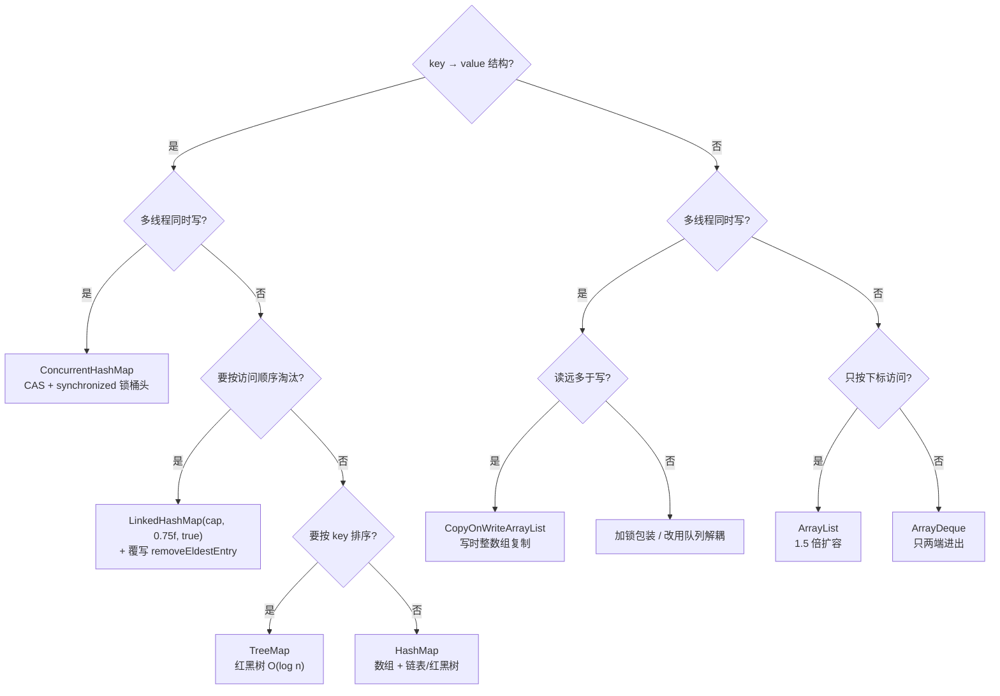
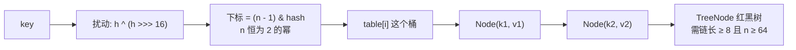
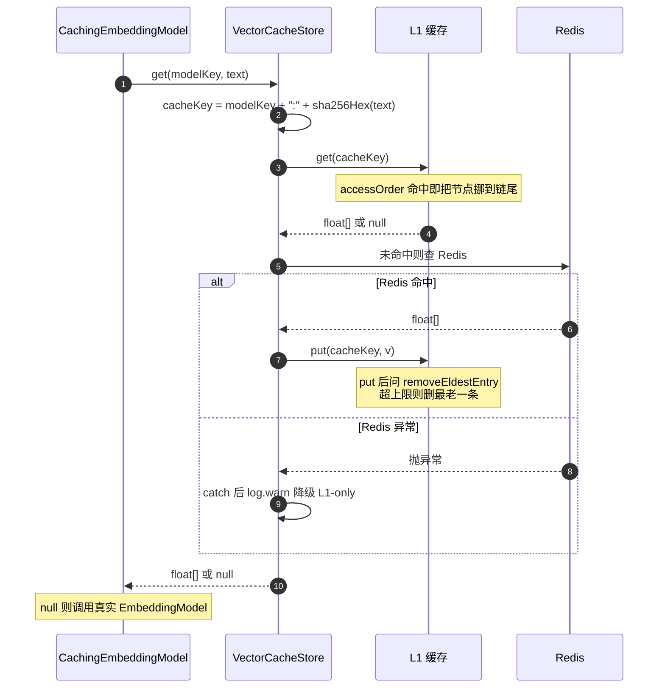

# 集合框架与源码：容器选型与"为什么慢 / 为什么报错"的根因

> **一句话结论**：集合的"慢"和"炸"几乎总是四条内部不变式被违反的结果——**扩容的节奏（1.5 倍 / 2 的幂）、哈希怎么落到桶（扰动函数）、结构修改谁记账（modCount）、元素身份怎么比较（hashCode/equals）**；把这四条记住，选型就从"凭感觉"变成"查表"。
> **阅读前置**：能写 `for-each`、用过 `ArrayList` / `HashMap`、看得懂泛型与 lambda；不需要背过 JDK 源码。
> **证据基线**：JDK 编译目标 17（`pom.xml` 的 `<java.version>17</java.version>`），本篇所有实测运行在 `java.version = 17.0.19`；工程背景 Spring Boot 4.2.0。证据分三级——**A 级**=本项目 `learning-docs/24-源码分析/assets/source/` 已入库的真实源码摘录（该目录下的文件实际命名为 `Xxx.java.md`，故锚点写作 `Xxx.java.md#L起-L止`），**B 级**=本项目真实业务代码（已逐行核对），**C 级**=本篇实跑命令 + 原样输出。预计阅读 35 分钟。

## 0. 先看现象

### 现象一：日志里突然冒出 `ConcurrentModificationException`，但它不指向你的 `remove`

线上最常见的形态：一段"遍历集合、满足条件就删"的代码，平时跑得好好的，某个用户的订单有 4 条明细时炸了。报错原文（本篇实测栈，`ArrayList.java:1013` 这一行号来自**真实运行输出**，不是背出来的）：

```text
java.util.ConcurrentModificationException
	at java.base/java.util.ArrayList$Itr.checkForComodification(ArrayList.java:1013)
	at java.base/java.util.ArrayList$Itr.next(ArrayList.java:967)
	at CollectProbe.cme(CollectProbe.java:93)
```

注意两个反直觉点：

- 它抛在 `Itr.next()`，不抛在你 `remove()` 的那一行——所以栈顶看着"和你无关"，人容易去查错地方。
- 它**不是每次都会抛**。本篇实测：3 个元素的列表删中间那个，**不抛异常**，结果还是对的；4 个元素删第二个，**立刻抛**。代码一字未改。

### 现象二：订单明细去重之后，顺序变了

一个"去重 + 保序"的需求，用 `new HashSet<>(list)` 或 `Collectors.groupingBy` 之后，SKU 的回显顺序和入库顺序对不上，前端截图对比才发现。本篇实测（同一份输入，六种写法）：

```text
input                      -> [SKU-3, SKU-1, SKU-3, SKU-2, SKU-1, SKU-4]
stream().distinct()        -> [SKU-3, SKU-1, SKU-2, SKU-4]
new HashSet<>(ids)         -> [SKU-4, SKU-1, SKU-2, SKU-3]
new LinkedHashSet<>(ids)   -> [SKU-3, SKU-1, SKU-2, SKU-4]
groupingBy default(HashMap)-> [SKU-4, SKU-1, SKU-2, SKU-3]
groupingBy TreeMap         -> [SKU-1, SKU-2, SKU-3, SKU-4]
```

同样是"去重"，`HashSet` 和 `LinkedHashSet` 给出的顺序不一样，而且 `HashSet` 的顺序在 JDK 版本、元素个数变化时都可能变——**它从来不是"随机"，而是"你不该依赖"**。

### 现象三：`map.get(key)` 返回 null，但 `map` 里明明有这条数据

用可变对象当 key（比如一个 `List<String>` 或带 setter 的实体），`put` 完之后又改了这个对象的字段，再 `get` 就取不到了。本篇实测：

```text
hashCode at put = 2550047
get(k1) before mutate = order-1
hashCode after mutate = -1023622310
get(k1) after mutate = null
get(equalList) = null
containsKey(k1) = false
size = 1 keySet=[[SO-1, line-2]]
entrySet=[[SO-1, line-2]=order-1]
```

数据**没丢**（`size=1`，`entrySet` 里还能打印出来），但你**再也走不到它**：`get` 用新的 `hashCode` 算出新位置，那里是空的。

这些现象指向同一件事：**集合的行为不是"随便长长"的，而是由几条写死的内部不变式决定的——数组按什么节奏扩容、哈希怎么折算成下标、结构改了谁记账、两个元素凭什么算"相等"；不按不变式用它，"慢"和"炸"就是迟早的事。**

## 1. 整体地图



> **读图说明**：最关键的是两条箭头。**① `Q2 -->|否| Q3` 之后落到 `LHM`**：只要需求里出现"上限"和"淘汰最久未用"，唯一正解就是 `LinkedHashMap` 的 `accessOrder=true` + `removeEldestEntry`，不要自己拿 `ArrayList` 维护顺序（O(n) 查找变 O(n²) 扫描）。**② `Q2 -->|是| CHM`**：一旦有并发写，`HashMap` 换 `ConcurrentHashMap` 是必须的，但换成 `Collections.synchronizedMap` 只是"不炸但更慢"——它把整张表锁成单线程。其余分支都是"性能取舍"，只有这两条是"对错"。

各类容器的责任边界与在本项目中的真实调用方：

| 组件 | 一句话责任 | 关键不变式 | 本项目真实调用方（B 级） |
|---|---|---|---|
| `ArrayList` | 连续数组 + 按需扩容，随机访问 O(1) | 容量按 `old + (old >> 1)` 增长；`modCount` 记账，`modCount != expectedModCount` 即 fail-fast | `ModelRouter` 组装候选模型列表；`HashEmbeddingModel` 收集向量 |
| `HashMap` | 数组 + 链表/红黑树，O(1) 平均查找 | 容量恒为 2 的幂；hash 经 `h ^ (h >>> 16)` 扰动；阈值 = 容量 × 0.75 | `AgentToolRegistry` 的工具注册表；`AuthFilter` 的 apiKey 表 |
| `LinkedHashMap` | `HashMap` + 双向链表维护顺序 | 第三参 `accessOrder` 决定"插入序"还是"访问序" | `VectorCacheStore` 的进程内 L1 向量缓存 |
| `ConcurrentHashMap` | 并发安全哈希表 | 1.8 起 CAS 占位 + `synchronized` 锁单个桶头；`key`/`value` 均不允许 null | 网关限流器、在途请求计数器、表达式缓存 |
| `CopyOnWriteArrayList` | 读不加锁、写复制整个数组 | 迭代器看到的是**快照**，不是实时视图 | 本项目未使用（见 §3.8 说明原因） |
| `Collections.unmodifiableList` | 只读**视图**（原集合变了它也变） | 不拷贝，只包一层禁止写的皮 | `ServiceCache` 返回实例列表时的防御性包装（A 级） |

## 2. 关键概念与关键类

| 名称 | 所在位置 | 角色 | 关键方法 / 字段 |
|---|---|---|---|
| `ArrayList` | `java.base/java.util`（JDK 17） | 最常用的有序列表实现 | `add` / `grow` / `elementData` / `modCount` |
| `ArrayList.Itr` | `java.base/java.util`（`ArrayList` 内部类） | 迭代器，fail-fast 的执行者 | `hasNext` / `next` / `checkForComodification` |
| `HashMap` | `java.base/java.util` | 哈希表实现 | `putVal` / `resize` / `tableSizeFor` / `treeifyBin` |
| `HashMap.Node` | `java.base/java.util` | 链表节点（桶内冲突用） | `hash` / `key` / `value` / `next` |
| `HashMap.TreeNode` | `java.base/java.util` | 红黑树节点（桶内冲突过长时） | `treeify` / `untreeify` |
| 桶（bucket） | 概念 | `table[i]` 这一格，同一个桶里放 hash 下标相同的元素 | 下标 = `(n - 1) & hash` |
| 扰动函数 | 概念 | 把 32 位 hash 的高位异或进低位，避免"只有低位参与下标计算"导致的撞桶 | `h ^ (h >>> 16)` |
| 负载因子（load factor） | 概念 | 已用容量占比的阈值，超过就扩容；`HashMap` 默认 0.75 | `threshold = capacity * loadFactor` |
| `LinkedHashMap` | `java.base/java.util` | 在 `HashMap` 之上加双向链表，可维护插入序或访问序 | `accessOrder` / `afterNodeAccess` / `afterNodeInsertion` |
| `removeEldestEntry` | `java.base/java.util.LinkedHashMap` | 钩子方法，返回 `true` 时由 `LinkedHashMap` 自己删掉最老条目 | `protected boolean removeEldestEntry(Map.Entry eldest)` |
| `ConcurrentHashMap` | `java.base/java.util.concurrent` | 并发哈希表 | `putVal` / `casTabAt` / `sizeCtl` / `baseCount` |
| `CopyOnWriteArrayList` | `java.base/java.util.concurrent` | 写时复制的并发列表 | `add` / `setArray` / `array` |
| `List.of` / `List.copyOf` | `java.base/java.util`（JDK 9 / JDK 10 起） | 不可变集合的工厂方法 | `List.copyOf`（快照）、`List.of`（字面量） |

## 3. 原理与证据逐段精读

每一小节固定四层：**这段在做什么 → 为什么这么设计 → 换成另一种写法会怎样 → 常见坑**。

### 3.1 `ArrayList` 扩容：为什么是 1.5 倍，以及"无参构造并没有分配 10"

**这段在做什么。** `ArrayList` 内部就是一个 `Object[] elementData`。元素装满了就新建一个更长的数组、把老元素复制过去。本篇用反射读出真实数组长度（C 级，完整命令如下）：

```pwsh
java --add-opens java.base/java.util=ALL-UNNAMED CollectProbe.java arraylist
```

```text
new ArrayList<>() -> elementData.length = 0
size=1 capacity=10
size=10 capacity=10
size=11 capacity=15
size=15 capacity=15
size=20 capacity=22
size=25 capacity=33
size=30 capacity=33
size=35 capacity=49
size=40 capacity=49
new ArrayList<>(0) -> elementData.length = 0
  after 1st add -> capacity = 1
new ArrayList<>(1000) -> elementData.length = 1000
```

怎么读这张表：

- `new ArrayList<>()` 之后容量是 **0**，不是 10。第 1 次 `add` 才一次性扩到 10（懒初始化）。所以"无参构造就分配 10 个格子"是旧文档里最常见的错误说法。
- 10 → 15 → 22 → 33 → 49，每次约等于 **`old + (old >> 1)`**（1.5 倍，向下取整）。10 装到第 10 个就满，第 11 个触发扩容。
- `new ArrayList<>(0)` 和 `new ArrayList<>()` 是两条不同的路：前者第一次 `add` 只涨到 **1**，后者涨到 **10**。原因是空数组被分成了两个不同的哨兵常量，只有"默认哨兵"才会被补到 10。

**为什么这么设计。** 1.5 倍是"复制次数"与"浪费空间"的折中：2 倍扩容的摊销复制次数更少，但老数组被释放后更容易留下无法复用的大空洞；1.5 倍的内存放大倍数在多次扩容后仍然"可以和老数组首尾接上"（`a + a/2 < 2a`），对底层分配器更友好。懒初始化则是为了 `new` 出来但没用上的空列表不背 10 个引用（Spring 容器里到处是这种空列表）。

**换成另一种写法会怎样。** 如果一开始就知道要装多少，直接 `new ArrayList<>(n)`：上表实测 `new ArrayList<>(1000)` 构造完就是 1000，**一次复制都不用做**。反过来，如果 `n` 设得离谱大（比如按"最大可能条数"传 100 万），数组一创建就占 8MB 以上的引用空间，而实际可能只放 10 条——扩容是可摊销的 O(1)，浪费是不可回收的。

**常见坑。**

- `new ArrayList<>(0)` 只用来表达"我确定一条都不会加"；当普通列表用会让前几次 `add` 每次都复制一次（1、2、3、4…），小列表反而更慢。
- `ArrayList` 扩容时 `modCount` 也会变（见 3.2），所以"扩容 + 遍历"的组合可能在多线程下先炸 CME。
- `Arrays.asList(...).add(...)` 抛 `UnsupportedOperationException`（本篇实测）——它是固定长度的视图，不是 `ArrayList`；同理 `List.of(...)`、`Collections.unmodifiableList(...)` 都不能写。

### 3.2 `modCount` 与 fail-fast：为什么删倒数第二个元素"侥幸不报错"

**这段在做什么。** `ArrayList` 里有个 `protected transient int modCount`，**每一次结构修改**（增、删、内部数组替换）都 `modCount++`。迭代器 `ArrayList.Itr` 创建时把当时的 `modCount` 抄进 `expectedModCount`，此后每次 `next()` 开头先比对：不等就抛 `ConcurrentModificationException`。

本篇实测两种情形（C 级）：

```text
remove middle of [a,b,c] -> NO exception, list=[a, c]
java.util.ConcurrentModificationException
	at java.base/java.util.ArrayList$Itr.checkForComodification(ArrayList.java:1013)
	at java.base/java.util.ArrayList$Itr.next(ArrayList.java:967)
removeIf -> [a, c]
```

**为什么这么设计。** 这是"廉价探测"而不是"真同步"：`modCount` 只是一个 `int` 自增，成本几乎为零，却能把"边遍历边改"这类最危险的错误尽早暴露。JDK 的注释明确说过 fail-fast 是 **best-effort（尽力而为）**，不保证一定检测到——上面的实测就是活例子。

**换成另一种写法会怎样。** 三种写法的实测对照：

| 写法 | 结果 | 原因 |
|---|---|---|
| `for (String s : list) if (cond) list.remove(s);` 删中间（3 元素） | 不抛，结果正确 | 删完 `size` 变小，`cursor == size` 使 `hasNext()` 直接返回 `false`，**`next()` 没被调用，检查没被执行** |
| 同上，删第二个（4 元素） | 抛 CME | 删完还剩 3 个，`hasNext()` 为真 → 调 `next()` → `checkForComodification` 发现 `modCount != expectedModCount` |
| `list.removeIf(cond)` | 正常，`[a, c]` | `removeIf` 内部用迭代器自己的 `remove`，同步更新了 `expectedModCount` |

所以正确的改法不是"删最后一个就没事"，而是：**要么用 `removeIf`，要么用 `Iterator.remove()`，要么遍历副本 `new ArrayList<>(list)` 后删原件**。

**常见坑。**

- 多线程下"炸"的通常是 CME，但 `modCount != expectedModCount` 报的异常名有 `Concurrent` 字样，其实**单线程也会抛**——名字误导了无数人。
- `subList(...)` 拿到的是**视图**，不是拷贝：本篇实测改原集合会让子列表跟着变（`subList view after src.set(0,A) -> [A, b]`）；而对原集合做结构修改后再用子列表，会抛 CME（`subList after structural change -> ConcurrentModificationException`）。
- `Collectors.toList()` 返回的列表是否可变是实现细节，JDK 16+ 的 `Stream.toList()` 返回**不可变**列表（依据 JDK 官方 API 文档），接 `add` 会抛 `UnsupportedOperationException`。

### 3.3 `HashMap` 的四条不变式（全部有实测）

先看结构。`HashMap` 的本质是 **数组（`table`）+ 桶内链表 + 过长时转红黑树**：



> **读图说明**：箭头 `SP --> IDX` 是理解"为什么扩容是 2 的幂"的关键——只有当 `n` 是 2 的幂时，`(n-1) & hash` 才等价于 `hash % n`，且扩容时每个元素要么留在原位、要么平移到 `原位 + 旧容量`（不用重新算 hash）。箭头 `N2 --> TN` 是最后一个门槛：光有"链长 8"还不够，表本身也得够大。

**不变式一：容量恒为 2 的幂。** 构造时传什么，都会被"向上取整到最近的 2 的幂"（C 级实测，`new HashMap<>(x)` 后第一次 `put` 观察 `table.length`）：

```text
new HashMap<>(16) after 1 put -> table.length=16
new HashMap<>(17) after 1 put -> table.length=32
new HashMap<>(100) after 1 put -> table.length=128
```

**这段在做什么**：把用户给的任意容量向上取整成 2 的幂，保证用按位与取下标。**为什么这么设计**：`&` 比 `%` 快一个数量级，而且扩容拆分只需要判断 hash 中"新增的那一位"是 0 还是 1。**换成另一种写法**：若允许任意容量，就得用 `hash % n`，且扩容要重算全部 hash，成本和实现复杂度都上升。**常见坑**：`new HashMap<>(100)` 实际拿到 128 个格子的表（还要再乘 4 字节或 8 字节的引用），想精确控制内存就得自己算到 2 的幂。

**不变式二：hash 必须先扰动。** `HashMap` 不直接用 `key.hashCode()` 当下标，而是先 `h ^ (h >>> 16)` 把高 16 位混进低位。实测（C 级，两个只差高位的 key）：

```text
key=1     hashCode=1     spreadHash=1     raw&15=1  spread&15=1
key=65537 hashCode=65537 spreadHash=65536 raw&15=1  spread&15=0
```

`65537` 和 `1` 的低 4 位完全相同——如果直接 `hash & 15`，它们的下标都是 1，必然撞桶；扰动之后一个落在 1、一个落在 0，分开了。**为什么这么设计**：小表只看低几位，而真实业务 key（尤其是自增 ID、连续字符串）的高位信息更"散"，扰动等于免费买了一份随机性。**换成另一种写法**：不扰动、直接用 `hashCode()`——一旦业务 key 的 `hashCode` 实现得很差（例如只用 `id % 100`），所有元素挤进少数几个桶，`get` 退化到 O(n)。**常见坑**：`Aa` 与 `BB` 的 `String.hashCode()` 实测都是 `2112`（本篇实测），`String` 的 hash 是纯算术、可被构造出大量碰撞——所以"大量不可信 key"（例如用户可控的字符串）不要直接丢进 `HashMap`。

**不变式三：负载因子 0.75，阈值 = 容量 × 0.75。** 实测（C 级）：容量 16 时，元素到 12 个都不扩容，第 13 个触发扩容到 32：

```text
size=9..12 table.length=16
size=13   table.length=32
```

**为什么这么设计**：0.75 是时间与空间的经验折中（依据 JDK `HashMap` 类注释对 load factor 的说明：过高会增加查找成本，过低浪费空间）。**换成另一种写法**：设 1.0，表会接近全满，冲突链变长、查找退化；设 0.5，冲突少但内存翻倍、扩容更频繁。**常见坑**：扩容是**整体重建**（每个元素重新落桶），一次 `put` 可能从 O(1) 变成 O(n) 的卡顿；批量插入前用 `new HashMap<>((int)(n / 0.75f) + 1)` 预设容量，可以把多次扩容压成 0 次。

**不变式四：树化需要 8 和 64 两个条件同时满足。** 本篇用自定义 `K`（`hashCode()` 恒返回 1，全部撞一个桶）观察桶内节点类型（C 级）：

```text
collide size=1..8  table.length=16 bin1=Node
collide size=9     table.length=32 bin1=Node
collide size=10    table.length=64 bin1=Node
collide size=11    table.length=64 bin1=TreeNode
collide size=12    table.length=64 bin1=TreeNode
```

读法：链长到 8 时**并没有立刻变红黑树**，而是先扩容（16 → 32 → 64）；直到表容量达到 64、链长又超过 8，才真的 `TreeNode`。也就是说 `MIN_TREEIFY_CAPACITY = 64` 优先于 `TREEIFY_THRESHOLD = 8`——**先用扩容解决碰撞，扩容不解决问题了才上红黑树**。反向退化阈值是 6（`UNTREEIFY_THRESHOLD`），留 1 的缓冲避免在 7~8 之间反复转换。这些常量名可在 JDK 源码中直接读到，本篇在 `ConcurrentHashMap` 的字段列表里也实测打印出了同名的 `TREEIFY_THRESHOLD / UNTREEIFY_THRESHOLD / MIN_TREEIFY_CAPACITY`（见 3.7）。

**常见坑**：把"阈值 8"当成"冲突超过 8 就树化"，于是算错了最坏复杂度——在表还没扩到 64 之前，退化是 O(n) 而不是 O(log n)；这也解释了为什么"故意构造大量同 hash key"时性能曲线会先变差再突然变好。

### 3.4 key 必须不可变：`hashCode`/`equals` 是"路径"，不是"标签"

**这段在做什么。** `HashMap` 定位一个 key 分两步：先算 `hash` 找桶，再在桶里用 `equals` 找节点。两步都依赖 key 的**当前状态**。所以 key 一旦被改，等于"地址变了"。

本篇实测（C 级，用 `new ArrayList<>(List.of("SO-1"))` 当 key，`put` 之后 `k1.add("line-2")`）：

```text
hashCode at put = 2550047
get(k1) before mutate = order-1
hashCode after mutate = -1023622310
get(k1) after mutate = null
get(equalList) = null
containsKey(k1) = false
size = 1 keySet=[[SO-1, line-2]]
entrySet=[[SO-1, line-2]=order-1]
```

**为什么这么设计。** 哈希表要 O(1)，就必须能"由 key 直接算出位置"，而不是"扫描找"。这个设计前提是 key 的 hash 稳定；`String`、`Integer`、枚举、`record` 之所以被推荐当 key，就是因为它们不可变或字段不可变。

**换成另一种写法会怎样。** 三种身份约定对比：

| key 类型 | hash 稳定性 | 后果 |
|---|---|---|
| `String` / `Integer` / 枚举 | 不可变，稳定 | 安全，本项目所有 Map key 都是这类（如 `InstanceInFlightRegistry` 用 `serviceId + ":" + instanceId`） |
| 可变 `List` / 可变实体 | 会随字段变化 | 改了字段后 `get` 返回 `null`，`entrySet` 里还能看到——"看得见、摸不着" |
| `equals` 覆写但 `hashCode` 没覆写的实体 | 两个"相等"的对象 hash 不同 | 存进去一个、用另一个同样的值取不出来；`HashSet` 里会出现两条"相等"元素 |

**常见坑。**

- 用 Lombok `@Data` 当 key：它同时生成 `equals`/`hashCode`，看似正确；但只要 key 是被 `save` 之后才拿到自增 ID 的实体，ID 变了 hash 就变了——正确做法是 key 只放不可变字段，或者干脆用 `Long id`。
- `equals` 写了、`hashCode` 忘了：`HashMap` 会分到不同桶，`equals` 根本没机会被执行。
- 用数组或 `Object[]` 当 key：数组的 `equals` 是**引用比较**，两个内容相同的数组永远不相等。

### 3.5 `LinkedHashMap` 做 LRU 的三个要素

**这段在做什么。** `LinkedHashMap` 在 `HashMap` 的 `Node` 上加了 `before`/`after` 两根指针，把所有条目串成双向链表。做 LRU（Least Recently Used，最近最少使用淘汰）只需要三件事：**① 第三参 `accessOrder = true`（读也算访问，命中后把节点挪到链尾）；② 覆写 `removeEldestEntry`，在超出上限时返回 `true`；③ 上限能从外部读到**。

本项目外部依赖里的标准写法（A 级，MyBatis 的 `LruCache`）：

```java (src: LruCache.java.md#L49-L61)
  public void setSize(final int size) {
    keyMap =
        new LinkedHashMap<Object, Object>(size, .75F, true) {
          private static final long serialVersionUID = 4267176411845948333L;

          @Override
          protected boolean removeEldestEntry(Map.Entry<Object, Object> eldest) {
            boolean tooBig = size() > size;
            if (tooBig) {
              eldestKey = eldest.getKey();
            }
            return tooBig;
          }
        };
  }
```

注意第二参 `.75F` 是负载因子（只影响桶密度，**不影响淘汰**），第三参 `true` 才是开关。同一个文件里 `getObject` 的实现还特意"摸一下"：`keyMap.get(key); // touch` [[源码:LruCache.java.md#L71-L73]]——因为只有走到 `get`，`accessOrder` 才会把节点移到链尾，否则读过的条目会被当"最老"淘汰掉。

**验证 `accessOrder` 到底在做什么**（C 级实测，容量 3）：

```text
accessOrder after put A,B,C -> [A, B, C]
accessOrder after get(A)    -> [B, C, A]
accessOrder after put(D)    -> [C, A, D]
insertionOrder after get(A) -> [A, B, C]
HashMap iteration order     -> [A, B, C]
```

`get(A)` 之后 A 从队头跑到队尾；再 `put(D)` 触发淘汰，走掉的是 **B**（最久未使用），不是 A。而插入序版本 `get(A)` 后顺序不变——这就是"漏了 `accessOrder=true` 时，LRU 退化成 FIFO"的确切现象。

本项目自己的实现（B 级）：

```java
// ai-cs-chat/src/main/java/com/aics/chat/cache/VectorCacheStore.java#L44-L54
this.l1 = Collections.synchronizedMap(new LinkedHashMap<>(128, 0.75f, true) {
    @Override
    protected boolean removeEldestEntry(Map.Entry<String, float[]> eldest) {
        return size() > Math.max(1, properties.getVector().getL1MaxEntries());
    }
});
```

上限来自配置（B 级 `ai-cs-chat/src/main/java/com/aics/chat/cache/CacheProperties.java#L48-L56`：`l1MaxEntries = 4096`、`ttlHours = 168`），可以经 Nacos 动态调整——**于是踩到了下面这个坑**。

**常见坑：把上限调小，缓存不会跟着缩小。** 因为 `removeEldestEntry` 在每次 `put` 之后只被问一次，返回 `true` 也只删**一个**最老条目。"加一个删一个"之后 size 停在旧上限，永远降不下来。C 级实测（把上限从 5 改成 2）：

```text
limit=5 -> size=5 keys=[k0, k1, k2, k3, k4]
after limit=2 (no put yet) -> size=5 keys=[k0, k1, k2, k3, k4]
after 1 put -> size=5 keys=[k1, k2, k3, k4, k5]
after 4 puts -> size=5 keys=[k4, k5, k6, k7, k8]
```

四次 `put` 之后 size 仍然是 5，永不收敛到 2。所以"降级/缩容"场景必须显式 `clear()` 或自己写淘汰循环，光改配置没用。

### 3.6 `ConcurrentHashMap`：从"分段锁"到"CAS + synchronized 锁桶头"

**这段在做什么。** 要理解 1.8 之后的设计，最直接的办法是看它**现在有什么字段**。C 级实测（反射打印 `ConcurrentHashMap` 的声明字段与内部类）：

```text
Segment class EXISTS
Segment superclass = java.util.concurrent.locks.ReentrantLock
declared fields = [serialVersionUID, MAXIMUM_CAPACITY, DEFAULT_CAPACITY, MAX_ARRAY_SIZE,
 DEFAULT_CONCURRENCY_LEVEL, LOAD_FACTOR, TREEIFY_THRESHOLD, UNTREEIFY_THRESHOLD,
 MIN_TREEIFY_CAPACITY, MIN_TRANSFER_STRIDE, RESIZE_STAMP_BITS, MAX_RESIZERS,
 RESIZE_STAMP_SHIFT, MOVED, TREEBIN, RESERVED, HASH_BITS, NCPU, serialPersistentFields,
 table, nextTable, baseCount, sizeCtl, transferIndex, cellsBusy, counterCells,
 keySet, values, entrySet, U, SIZECTL, TRANSFERINDEX, BASECOUNT, CELLSBUSY, CELLVALUE, ABASE, ASHIFT]
CounterCell present = true
```

怎么读这个输出：

- `Segment` **类还在**，继承 `ReentrantLock`——但它是为**序列化兼容**留下的空壳；真正干活的字段里**没有任何 `segments` 数组**。所以"`ConcurrentHashMap` 用 16 个 Segment 分段锁"这个说法，在 JDK 17 上已经不成立了。
- 取而代之的是 `table`（桶数组）+ `nextTable` / `transferIndex`（扩容时的新表与迁移进度）+ `sizeCtl`（控制初始化和扩容的 CAS 竞争标记）+ `baseCount` / `counterCells`（分散计数）。
- `counterCells` 是 `LongAdder` 那套"热点打散"思路：并发 `put` 时不再抢同一个 `size` 变量，而是各自累加到不同的 `CounterCell`，读 `size()` 时再求和。所以并发场景下 `size()` 是**近似值**（依据 JDK 官方 API 文档对 `size()` 的说明："a value that is only an estimate"）。

**为什么这么设计。** 分段锁的粒度是"段"，16 段就是并发度上限 16；而"桶头节点 + `synchronized`"把锁粒度降到单个桶，冲突概率低时并发度接近元素数；只在初始化、扩容这些全局动作上才用 CAS 抢 `sizeCtl`。1.8 起 `synchronized` 也做过偏向锁/轻量级锁优化，短临界区性能足够。

**换成另一种写法会怎样。**

| 方案 | 优点 | 代价 |
|---|---|---|
| `HashMap` + `synchronized`（或 `Collections.synchronizedMap`） | 实现简单、绝对互斥 | 整表一把锁，读写全串行 |
| 1.7 分段锁 `Segment[]` | 并发度 = 段数 | 并发度固定上限；内存多一层间接 |
| 1.8+ CAS + `synchronized` 锁桶头 | 粒度细、无固定并发度上限 | 实现极复杂；`size()` 只能是近似值 |
| `StampedLock` / `ReadWriteLock` 自研 | 可针对性优化读多写少 | 需要自己保证正确性，收益常不抵成本 |

**常见坑。**

- `ConcurrentHashMap` **不接受 null**：实测 `chm.put(k, null)` 抛 `NullPointerException`，`chm.get(null)` 抛 `NullPointerException: Cannot invoke "Object.hashCode()" because "key" is null`（这是 JDK 14+ 的 helpful NPE 文案）。而 `HashMap.put(k, null)` 完全正常，`get(k)` 返回 `null`、`containsKey(k)` 为 `true`——所以"`get` 返回 `null` 到底是没这个 key 还是有 key 值为 null"这个问题，`HashMap` 无法区分，`ConcurrentHashMap` 用"禁 null"从设计上消灭了它。
- `computeIfAbsent` 里的映射函数**不要**再做这张表的写操作，容易死锁或抛 `IllegalStateException`（依据 JDK 官方 API 文档对 `computeIfAbsent` 的说明）。本项目多处用它做"原子初始化"（见 3.7），值都是新建对象，所以安全。
- 复合操作仍非原子：`if (!map.containsKey(k)) map.put(k, v)` 在 `ConcurrentHashMap` 上依然有竞态，必须用 `putIfAbsent` / `computeIfAbsent`。

### 3.7 本项目里的 Map 用法：三种真实模式

**模式一：只读配置表，用 `HashMap`，启动时填一次。** B 级 `ai-cs-gateway/src/main/java/com/aics/gateway/filter/AuthFilter.java#L59-L60`：

```java
/** keyId -> secret（启动时解析一次，请求期只读） */
private final Map<String, String> apiKeySecrets = new HashMap<>();
```

字段是 `HashMap` 而不是 `ConcurrentHashMap`，安全性来自 `final` + `@PostConstruct` 里一次性填充（B 级同文件 `#L62-L80`）+ 之后只读。这是**用"发布安全"代替"并发容器"** 的典型手法：`final` 字段在构造完成后对其他线程可见（依据 Java 语言规范 JLS §17.5 的 final 字段语义），前提是填充发生在构造/初始化阶段、之后不再修改。

**模式二：注册表用 `HashMap` 装，出口用 `Map.copyOf` 拷。** B 级 `ai-cs-chat/src/main/java/com/aics/chat/agent/tool/AgentToolRegistry.java#L23` 是 `private final Map<String, AgentTool> tools = new HashMap<>();`（启动时 `toolList.forEach(t -> tools.put(t.name(), t))` 填满），而对外出口 `#L74-L76` 是：

```java
public Map<String, AgentTool> all() {
    return Map.copyOf(tools);
}
```

`Map.copyOf` 返回**不可变快照**，外部拿到后无法反向修改注册表，也不需要担心遍历时被改。代价是每次调用都复制一遍（`all()` 属于低频调用，可接受）。**顺带一个真实副作用**：`tools` 是 `HashMap`，`Map.copyOf` 保留的也是 `HashMap` 的遍历顺序，所以 `all()` 返回的 key 顺序**不稳定**（插入顺序无关）——若某个接口把它直接序列化给前端做工具列表，顺序会随元素增减变化。

**模式三：并发计数用 `ConcurrentHashMap` + `computeIfAbsent` 做原子初始化。** B 级 `ai-cs-gateway/src/main/java/com/aics/gateway/loadbalancer/InstanceInFlightRegistry.java#L31` 与 `#L39-L48`：

```java
private final Map<String, AtomicInteger> counters = new ConcurrentHashMap<>();

public void increment(String key) {
    counters.computeIfAbsent(key, k -> new AtomicInteger()).incrementAndGet();
}

public void decrement(String key) {
    AtomicInteger counter = counters.get(key);
    if (counter != null) {
        counter.updateAndGet(current -> Math.max(0, current - 1));
    }
}
```

这里防的是"两个线程同时 `computeIfAbsent` 会创建出两个 `AtomicInteger`"——`ConcurrentHashMap` 保证映射函数对同一个 key 只执行一次，计数器才是全局唯一的那一个。同理见 B 级 `ai-cs-gateway/src/main/java/com/aics/gateway/filter/SlidingWindowRateLimiter.java#L35`。

**模式三的坑：Map 会只增不减。** B 级 `ai-cs-gateway/src/main/java/com/aics/gateway/filter/SlidingWindowRateLimiter.java#L17` 的 `windows` 以客户端标识为 key，`#L36-L46` 里在 `synchronized (timestamps)` 内**惰性清掉过期时间戳**，但**队列清空后从不把 key 从 map 移除**。于是 key 数量随"出现过的不同客户端数"单调增长，永不回收。本篇用 `jcmd` 量化这个效应（C 级，完整过程见 §6 第 5 条）：

```text
   3:         23664         757248  java.util.HashMap$Node (java.base@17.0.19)
   5:         20220         485280  java.util.ArrayList (java.base@17.0.19)
   9:           341         178960  [Ljava.util.HashMap$Node; (java.base@17.0.19)
```

`HashMap$Node` 的实例数（23664）与 Map 的条目数（20000）同量级——**只要这个数随流量单调上涨且在 Full GC 后不回落，就是"Map 只增不减"**。

**模式四：缓存失效靠 `Map.remove`，一把锁管写、`ConcurrentHashMap` 管读。** 外部依赖里还有一个更省事的用法（A 级，Spring Cloud Gateway 的 `CachingRouteLocator`）：整份路由缓存只占**一个固定的 key**，要刷新就把这个 key 删掉，让下次读重建：

```java (src: CachingRouteLocator.java.md#L81-L84)
  public Flux<Route> refresh() {
    this.cache.remove(CACHE_KEY);
    return this.routes;
  }
```

写入口 `updateCache` 方法带 `synchronized`（同文件 `#L108-L118`），存储本身是 `ConcurrentHashMap`（同文件 `#L55`）。**锁管"写不并发"，`ConcurrentHashMap` 管"读不阻塞"**——这个组合比"整表加锁"读得动，比"全程无锁"写得稳，是"单 key 缓存 + 显式失效"的最小可用形态。它的已知边界：删 key 之后到重建完成之间的窗口里，读线程会看到"缓存为空"，也就是**缓存击穿**；要挡住就得再叠一层 `computeIfAbsent` 或者一次性发布（先构建好新值，再原子替换）。

### 3.8 `CopyOnWriteArrayList` 的边界：写时复制到底买到了什么

**这段在做什么。** `CopyOnWriteArrayList`（COW）的每次**写**（`add`/`remove`/`set`）都 `new` 一个新数组、把旧元素抄过去、再原子替换内部引用；**读不加锁**。本篇实测（C 级）：

```text
removed during for-each, size now = 2
array identity unchanged? false
list after loop = [a, c]
iterator snapshot = [x] live list = [x, y]
```

关键两行：`array identity unchanged? false` 证明写操作换掉了底层数组（不是原地改）；`iterator snapshot = [x] live list = [x, y]` 证明**迭代器拿到的是创建那一刻的数组**，后续 `add` 完全不影响它。所以 COW 上"边遍历边删"不抛 CME——它删的是新数组，你遍历的是旧数组。

**为什么这么设计。** 它只适合一种形态：**读极多、写极少、列表很小**。典型场景是"监听器列表""配置快照"。读完全无锁，写虽然贵（O(n) 复制）但次数少。

**换成另一种写法会怎样。**

| 场景 | COW | `ArrayList` + `synchronized` | `ConcurrentLinkedQueue` |
|---|---|---|---|
| 每读 1 万次才写 1 次、元素几十个 | 最优（读零锁） | 读也要抢锁 | 语义是队列，无随机访问 |
| 每秒写几百次 | 灾难（每次复制整表） | 尚可 | 合适 |
| 需要"遍历时看到最新" | ❌ 看到的是旧快照 | ✅ | 部分 |

**常见坑。**

- **数据可见性被误读**：`iterator snapshot` 那一行还意味着"你以为在遍历时删掉的元素，本轮循环里仍然会被看到"——业务里表现为"已经过滤掉的黑名单用户还是发了一条消息"。
- 元素本身若可变，COW 只保证**数组引用**安全，不保证元素内部状态安全（它只拷贝数组，不深拷贝元素）。
- 内存放大：写一次就多一份完整数组，列表 1 万条时每次 `add` 都要复制 1 万个引用。**本项目因此没有使用 COW**（全仓库无 `CopyOnWriteArrayList` 引用），需要并发列表处改用 `ConcurrentHashMap` 分桶，或直接避免共享可变列表。

### 3.9 不可变集合三兄弟：视图、快照、字面量

**这段在做什么。** 三种"只读"其实语义不同。C 级实测（同一份底层集合，先建视图/快照，再改底层）：

```pwsh
java ImmProbe.java
```

```text
# runtime = 17.0.19
base         = [a, b]
unmodifiable = [a, b]
List.copyOf  = [a]
view.add -> java.lang.UnsupportedOperationException
copy.add -> java.lang.UnsupportedOperationException
unmodifiableList with null = [x, null]
List.copyOf with null -> NullPointerException: null
List.of.set -> java.lang.UnsupportedOperationException
List.of with null -> NullPointerException: null
```

`unmodifiable` 跟着 `base` 变成了 `[a, b]`（**视图**，不拷贝），而 `List.copyOf` 停在 `[a]`（**快照**，创建时拷贝）。`List.of` 连 `set` 都不允许，且和 `List.copyOf` 一样**拒绝 null**；`unmodifiableList` 因为只是包皮，底层允许 null 它就允许。

**为什么这么设计。** 视图零成本但可能"背刺"（原集合被别人改了）；快照有成本但语义确定。返回值场景应该给快照，内部只读引用可以用视图。

**换成另一种写法会怎样。** 外部依赖里也有同样的取舍：`ServiceCache` 往 `ConcurrentHashMap` 里存实例列表时选择了视图（[[源码:ServiceCache.java.md#L55-L57]]：`instancesMap.put(serviceId, Collections.unmodifiableList(instances));`），读的时候再用 `Optional.ofNullable(...).orElse(Collections.emptyList())` 兜底（[[源码:ServiceCache.java.md#L64-L67]]）——它赌的是"传进来的 `instances` 之后不再被改"，省掉一次拷贝。业务代码里若这么写，必须确认入参的所有权已经转移。

**常见坑。** 用 `unmodifiableList` 当"防御性拷贝"是错的：调用方只要还握着原集合的引用，就能绕过只读视图改数据；要真隔离必须 `List.copyOf`（或 `new ArrayList<>(...)`）。

## 4. 一次完整执行时序：一次向量缓存读，走遍四种容器

以本项目 RAG 的向量缓存读路径为例（`CachingEmbeddingModel` → `VectorCacheStore` → L1 → Redis），它一次串起 `LinkedHashMap`（LRU）、`synchronizedMap`（锁）、`ConcurrentHashMap`（外部依赖同类用法）和 `String` 作为 key 的稳定性要求：



> **读图说明**：最关键的是第 6 步和第 10 步这一对。**`L1->>VCS: get(cacheKey)`** 在 `accessOrder=true` 的 `LinkedHashMap` 里是**写操作**（要改链表指针），所以外层 `Collections.synchronizedMap` 的锁对 `get` 也生效——这就是"热缓存也抢锁"的根源，也是"读多写少场景下 LRU 反而拖吞吐"的原因。**`put 后问 removeEldestEntry`** 则是"上限形同虚设"的来源：一次 `put` 最多淘汰一条，上限调小不会立刻收缩（§3.5 实测）。

哪一步失败会报什么错：

| 失败点 | 表现 | 依据 |
|---|---|---|
| `cacheKey` 用可变对象拼 | 先 hit 后全 miss，`get` 恒为 `null` | §3.4 实测（hash 变了） |
| L1 `get` 与 `put` 并发 | 若没包 `synchronizedMap`，`LinkedHashMap` 会 CME 或链表指针错乱 | §3.2 / `VectorCacheStore.java#L44-L54` 的包装就是为此 |
| Redis 超时/连接失败 | **不抛异常**：catch 里 `log.warn("向量缓存 L2 读取失败，降级 L1-only: err={}", e.getMessage())`，返回 null 继续走真实模型 | B 级 `ai-cs-chat/src/main/java/com/aics/chat/cache/VectorCacheStore.java#L59-L78` |
| Redis 里存了 `null` | 序列化/反序列化拿到 null，等价于 miss，不会进 L1 | 同上 |
| 真实模型返回数量与请求数量不一致 | 回填按下标做，多余/缺失会被 `j < missEmbeddings.size() && j < missIndexes.size()` 截断，不报错但会少回填 | B 级 `ai-cs-chat/src/main/java/com/aics/chat/cache/CachingEmbeddingModel.java#L67-L72` |

## 5. 设计取舍

| 方案 | 优点 | 代价 | 本项目怎么选 |
|---|---|---|---|
| `ArrayList` | 内存紧凑、遍历最快、下标 O(1) | 中间插入/删除 O(n)；扩容要复制 | **默认选择**。`ModelRouter` 用 `new ArrayList<>()` 装候选模型，用 `removeIf` 过滤（B 级 `ai-cs-chat/src/main/java/com/aics/chat/modelrouter/ModelRouter.java#L30-L40`），避免 for-each 删 |
| `LinkedList` | 头尾增删 O(1) | 每个元素多一个 Node 对象；按下标访问 O(n)；实际几乎总比 `ArrayList` 慢 | **不用**。需要两端进出就 `ArrayDeque` |
| `ArrayList` 预设容量 | 0 次扩容、无复制、无内存碎片 | 容量猜大就浪费（`new ArrayList<>(1000)` 立刻占 1000 格） | 已知大小时预设：`HashEmbeddingModel.embed` 用 `new ArrayList<>(texts.size())`（B 级 `ai-cs-common/src/main/java/com/aics/common/ai/embedding/HashEmbeddingModel.java#L54`）；未知大小不预设（`CachingEmbeddingModel` 的 miss 列表 `#L48-L49`） |
| `HashMap` | 平均 O(1)、内存最省 | 无序、非线程安全、允许 null（无法区分"没有"与"值为 null"） | 只读配置表（`AuthFilter#L59-L60`）与启动期注册表（`AgentToolRegistry#L23`） |
| `LinkedHashMap(accessOrder=true)` | 一行代码拿到 LRU，无需额外结构 | 每次 `get` 都是写操作 → 必须加锁；`get` 也变慢 | L1 缓存（`VectorCacheStore#L44-L54`），代价被 G1/G2 风格的"少量条目 + 相对 Redis 的巨大收益"覆盖 |
| 自研 LRU（双向链表 + HashMap） | 可控制淘汰策略（LFU/加权）、可异步 | 几十行易错代码 + 需要自己写并发 | **不选**。真要精细淘汰就用 Caffeine，而不是自研 |
| `ConcurrentHashMap` | 细粒度锁、读多写少吞吐高 | 禁 null；`size()` 近似；`computeIfAbsent` 里不能写同一张表 | 并发计数/限流/表达式缓存（`InstanceInFlightRegistry#L39-L48`、`SlidingWindowRateLimiter#L35`） |
| `Collections.synchronizedMap(HashMap)` | 一行变线程安全 | 全表一把锁，读也串行；迭代仍需手动 `synchronized` | 仅在"就是为了串行化"时用（L1 缓存愿意付这个代价） |
| `CopyOnWriteArrayList` | 读零锁、迭代天然安全 | 每次写复制整表；快照语义（看见旧数据） | **不用**，全仓库无引用 |
| `Map.copyOf` / `List.copyOf` 作为返回值 | 不可变快照，外部改不动 | 每次调用都拷贝 | 对外出口用（`AgentToolRegistry#L74-L76`）；内部字段不用（`AfterSaleContext` 的字段仍是 `new ArrayList<>()`） |

**可扩展点清单**（想继续深入时按这个顺序做）：

1. **容量预设审计**：把 `new HashMap<>()` / `new ArrayList<>()` 逐个评估是否已知大小，已知的补上容量（注意 `HashMap` 要 `size/0.75 + 1`）。
2. **缓存淘汰策略外置**：`VectorCacheStore` 的 L1 若成为瓶颈，把 `synchronizedMap(LinkedHashMap)` 换成 Caffeine（`maximumSize` + `expireAfterAccess`），接口不变。
3. **无界 Map 治理**：`SlidingWindowRateLimiter.windows` 与 `InstanceInFlightRegistry.counters` 都是"key 只增不减"，需要加"空闲 key 定期清理"或改用带 TTL 的存储。
4. **key 稳定性检查**：给所有 `Map<自定义对象, ...>` 加一条单元测试，断言 key 修改字段后 `get` 仍能命中（应当失败，用来固化"必须不可变"这条纪律）。
5. **顺序契约显式化**：凡是"顺序重要"的接口（工具列表、SKU 去重），返回值用 `LinkedHashMap` / `distinct()` / `LinkedHashSet`，并在 javadoc 写明保序。

## 6. 踩坑与调试手法

| 现象 | 根因 | 验证手段（真调试手法） | 解法 |
|---|---|---|---|
| `ConcurrentModificationException`，栈顶是 `ArrayList$Itr.next`，但代码里没写 `next` | for-each 语法糖 = 迭代器；`remove` 改了 `modCount` 没改 `expectedModCount` | **断点位置**：在 `java.util.ArrayList$Itr.checkForComodification` 上打断点（IDEA 允许给 JDK 内部类下断点），条件写 `modCount != expectedModCount`，命中即看调用栈与 `cursor`/`size` | 改 `removeIf(cond)` / `Iterator.remove()` / 遍历副本 |
| 同一段代码"有时报 CME 有时不报" | 删到"最后一个"时 `hasNext()` 直接 false，`next()` 未被调用，检查没执行（§3.2 实测） | 把列表元素个数从 3 改到 4 各跑一次；或用 `CollectProbe cme` 复现 | 不要赌位置，统一改 `removeIf` |
| `map.get(key)` 返回 null，但 `entrySet` 里能看到该 key | key 是可变对象，修改字段后 `hashCode` 变了，落桶路径失效（§3.4 实测） | **日志关键字**：`NullPointerException: Cannot invoke "Object.hashCode()"`（JDK 14+ helpful NPE）会直接点出"key is null"；对非 null 场景，在 `put` 与 `get` 处各打一行 `key.hashCode()`，两次不同即坐实 | key 换成不可变类型；或 `put` 时用 `List.copyOf` 固化 |
| 订单/SKU 去重后顺序变了，前端截图对不上 | `HashSet` / `HashMap` 无顺序契约；JDK 版本、元素个数变化都可能改顺序（§0 实测六种写法顺序各异） | 打印 `keySet()` 对比三次不同输入；或直接跑本篇 `dedup` 探针 | `LinkedHashSet` / `stream().distinct()` / `groupingBy(TreeMap::new, ...)` |
| 网关 RSS 随流量持续上涨，Full GC 也不回落 | 限流器 `windows` Map 的 key 只增不减（§3.7） | **命令**：`jcmd <pid> GC.class_histogram`（pid 可用 `ProcessHandle.current().pid()` 打印）。本篇实跑前 3 行：<br>`num #instances #bytes class`<br>`3: 23664 757248 java.util.HashMap$Node`<br>`5: 20220 485280 java.util.ArrayList`<br>`9: 341 178960 [Ljava.util.HashMap$Node;`。**怎么读**：`HashMap$Node` 实例数 ≈ Map 条目总数（实测 Map 20000 条、Node 23664 个，差值来自 JDK 自身的其他 Map）；若它随流量单调上涨且 Full GC 后不降，即为泄漏 | 定期清理空闲 key，或改用带 TTL 的缓存 |
| `UnsupportedOperationException` 出现在 `add` | 拿到的是 `Arrays.asList`、`List.of`、`subList`、`Collections.unmodifiableList` 等**非 ArrayList** | 断点打在抛异常处，看对象实际类型（`Arrays$ArrayList` / `ListN` / `ArrayList$SubList` / `UnmodifiableRandomAccessList`） | 需要可写就用 `new ArrayList<>(...)` 包一层 |
| `ConcurrentHashMap` 上 `put(k, null)` 抛 NPE，而 `HashMap` 正常 | CHM 从设计上禁 null（§3.6 实测） | 单测覆盖 `put(null)`，断言 `NullPointerException` | 用哨兵值代替 null，或保留 `HashMap` 但加锁 |
| 热更新把缓存上限调小，内存没降 | `removeEldestEntry` 每次 `put` 只删一条，"加一删一"停在旧上限（§3.5 实测） | 打印 `cache.size()` 在上限调整前后各一次 | 缩容时显式 `clear()`，或写循环淘汰 |

## 7. ⚠️ 版本差异

本篇主题是 JDK 集合，所以"版本"指 JDK 版本。本项目的编译目标是 **17**（`pom.xml` 的 `<java.version>17</java.version>`），本篇实测运行在 **17.0.19**；本地开发机若用 JDK 21 也必须遵守 17 的 API 面。

| 旧写法 / 旧结论 | 当前基线（JDK 17 实测） | 变化点 | 迁移动作 |
|---|---|---|---|
| "`ConcurrentHashMap` 用 16 个 Segment 分段锁，并发度 16" | `Segment` 类**仍存在**（继承 `ReentrantLock`，仅供反序列化兼容），但类中**没有 `segments` 字段**，改为 `table` + `sizeCtl` + `baseCount`/`counterCells`（§3.6 实测字段列表） | JDK 8 起改为 CAS 占位 + `synchronized` 锁桶头；并发度不再固定 | 讲并发度时不要说"16 段"；说"按桶加锁 + `CounterCell` 分散计数" |
| "`HashMap` 扩容用头插法，1.7 多线程扩容会成环死循环" | JDK 8 起改为**尾插**（`resize` 拆成 lo/hi 两条链并保持相对顺序），成环死循环现象消失 | JDK 8 的 `resize` 重写 | 不要再把"头插死循环"当作 `HashMap` 的现症；但仍**不能**说 `HashMap` 线程安全——1.8 起多线程 `put` 会丢数据/覆盖，只是不死循环 |
| "`ArrayList()` 一创建就分配 10 个格子" | 无参构造 `elementData.length = 0`，首次 `add` 才到 10（§3.1 实测） | JDK 7 起引入 `DEFAULTCAPACITY_EMPTY_ELEMENTDATA` 懒初始化（依据 JDK 源码中的两个空数组哨兵常量；本篇未在 JDK 6/7 上实测） | 谈内存时以"懒初始化"为准；`new ArrayList<>(0)` 与 `new ArrayList<>()` 行为不同（首次 `add` 分别涨到 1 和 10） |
| "`List.of` / `Map.copyOf` 可以直接用" | 本项目 `release = 17`，可用（`List.of` 自 JDK 9、`List.copyOf`/`Map.copyOf` 自 JDK 10） | JDK 9 / 10 新增工厂方法 | 无迁移问题；注意 `List.of`/`copyOf` **拒绝 null**，而 `unmodifiableList` 允许（§3.9 实测） |
| "用 `list.getFirst()` / `reversed()` 拿首元素和反转视图" | **不可用**：`SequencedCollection` 系列方法（`getFirst`/`getLast`/`addFirst`/`reversed`）自 **JDK 21** 才加入，编译目标 17 会直接编译失败 | JDK 21 新增 Sequenced Collections | 继续用 `list.get(0)` / `list.get(size-1)` / `Collections.reverse`；等编译目标升到 21 再迁移 |
| "`Collections.synchronizedMap` 包一层就完全线程安全" | 包住的**单个方法**原子，但"遍历"仍需外部 `synchronized (map)`（依据 JDK 官方 API 文档对 `synchronizedMap` 的说明：遍历时必须手动同步） | 该语义自 1.2 起未变 | 遍历只读配置表时要么不并发写，要么复制出来再遍历 |
| "树化阈值 8 表示链长到 8 就变红黑树" | 还要 `table.length >= 64`（`MIN_TREEIFY_CAPACITY`），否则优先扩容（§3.3 实测 9→扩容、11→TreeNode） | 该规则自 JDK 8 引入树化起未变 | 性能估算时把"扩容优先"算进去 |

## 8. 面试高频问与答

（只列问题，答案在"自测题"与正文里找。）

1. `new ArrayList<>(16)` 和 `new ArrayList<>()` 在内存上有什么差别？首次 `add` 各发生了什么？
2. `ArrayList` 为什么是 1.5 倍扩容而不是 2 倍？
3. `modCount` 是干什么的？为什么单线程也会抛 `ConcurrentModificationException`？
4. 用 for-each 删 `ArrayList` 的元素，什么情况下不抛异常？为什么？
5. `removeIf` 和 for-each + `remove` 的本质区别在哪？
6. `HashMap` 的容量为什么必须是 2 的幂？`new HashMap<>(17)` 实际拿到多大的表？
7. `HashMap` 的 hash 扰动函数解决什么问题？举一个"不扰动就撞桶"的例子。
8. 负载因子为什么是 0.75？调大调小各有什么后果？
9. `TREEIFY_THRESHOLD = 8` 和 `MIN_TREEIFY_CAPACITY = 64` 谁优先？为什么？
10. 为什么 `HashMap` 的 key 推荐用 `String` / `Integer` / 枚举？用可变对象当 key 会怎样？
11. `LinkedHashMap` 做 LRU 需要哪几个条件？漏掉 `accessOrder=true` 会变成什么？
12. `removeEldestEntry` 只返回 `true` 为什么就够？为什么把上限调小缓存不会立刻缩小？
13. `ConcurrentHashMap` 1.7 和 1.8 的实现差别是什么？为什么 1.8 还要保留 `Segment` 类？
14. `ConcurrentHashMap` 为什么不允许 null key/value？`size()` 为什么是近似值？
15. `CopyOnWriteArrayList` 适合什么场景？"遍历时删元素不报错"是优点还是陷阱？
16. `Collections.unmodifiableList` 和 `List.copyOf` 的区别？做防御性拷贝该用哪个？

## 9. 动手练习

每条都绑定本篇一个具体分支，验收标准写的是"你能观察到什么"。

1. **量出扩容节奏（对应 §3.1）**：写一个 `main`，用反射读 `ArrayList` 的 `elementData.length`，从 0 加到 40，每加一个打印容量。以 `java --add-opens java.base/java.util=ALL-UNNAMED Xxx.java` 运行。**验收**：输出序列为 `0`（构造后）→ `10`（第 1 次 add 后）→ 15 → 22 → 33 → 49，且每个容量值都出现在 `size == 容量` 的那一步之后。
2. **复现 CME 的"侥幸"与"必炸"（对应 §3.2）**：同一段 for-each + `remove` 代码，分别用 3 元素和 4 元素列表跑。**验收**：3 元素不抛且结果正确，4 元素抛 `ConcurrentModificationException`，栈顶是 `ArrayList$Itr.checkForComodification`；把 `remove` 换成 `removeIf` 后两者都正常且无异常。
3. **证伪"容量就是构造参数"（对应 §3.3）**：分别 `new HashMap<>(16)`、`(17)`、`(100)`，各 `put` 一个元素后用反射读 `table.length`。**验收**：得到 16 / 32 / 128，并能在纸上算出 `new HashMap<>(100)` 的扩容阈值是 96。
4. **让 `HashMap` 真的树化（对应 §3.3）**：自定义一个 `hashCode()` 恒为 1 的 key，连续 `put` 11 个不同实例，用反射读 `table[1]` 的运行时类。**验收**：size=8 时是 `HashMap$Node`、size=9 与 10 时表被扩到 `table.length=32/64` 且仍是 `Node`、size=11 时变成 `HashMap$TreeNode`。
5. **亲手做一个会"失联"的 key（对应 §3.4）**：用 `List<String>` 当 key 存一个订单号，`put` 后往这个 List 追加一个元素，再 `get`。**验收**：`get` 返回 `null`、`containsKey` 为 `false`，但 `entrySet` 里仍能打印出这条记录（"看得见摸不着"）。
6. **把 LRU 的上限改小（对应 §3.5）**：`LinkedHashMap(cap, 0.75f, true)` + 可变的 `limit` 数组，填满到上限 5，然后把 `limit[0]` 改成 2，再 `put` 四次。**验收**：`size()` 一直是 5，永远不会降到 2；只有在停止 `put` 后手动 `clear()` 或循环淘汰才能缩小。
7. **核实 `ConcurrentHashMap` 现在还有什么（对应 §3.6）**：反射打印 `ConcurrentHashMap` 的 `getDeclaredFields()` 类名与 `Class.forName("java.util.concurrent.ConcurrentHashMap$Segment")` 是否成功。**验收**：`Segment` 类存在但字段列表中**没有 `segments`**，却能看到 `table`、`sizeCtl`、`baseCount`、`counterCells`；同时 `put(k, null)` 抛 `NullPointerException`。
8. **用 `jcmd` 定位"哪个 Map 在涨"（对应 §6 第 5 条）**：起一个持续往 `Map` 里塞 key 的进程并打印自己的 pid，另开一个终端跑 `jcmd <pid> GC.class_histogram`。**验收**：输出里 `java.util.HashMap$Node` 的 `#instances` 与 Map 条目数同量级（本篇实测 20000 条 → 23664 个 Node），停止写入并触发一次 `System.gc()` 后该数字回落。

## 小结

- 集合的"慢"绝大多数来自两个量：**扩容次数**（`ArrayList` 复制、`HashMap` rehash）与**桶内冲突长度**（扰动不够、key 的 `hashCode` 太差、容量不是 2 的幂）。
- 集合的"炸"绝大多数来自两个账：**`modCount` 与 `expectedModCount` 对不上**（fail-fast）、**`hashCode` 与 `equals` 不再自洽**（可变 key、只覆写一个）。
- `ArrayList` 无参构造**不分配数组**（实测长度 0），首次 `add` 才到 10，之后按 1.5 倍增长（10→15→22→33→49）；已知大小时用 `new ArrayList<>(n)` 一次性到位。
- `HashMap` 的四条不变式：容量恒为 2 的幂（`(n-1) & hash`）、hash 先扰动（`h ^ (h>>>16)`）、阈值 = 容量 × 0.75、树化需链长 ≥ 8 **且**表容量 ≥ 64（本篇实测：不到 64 时树化退化成扩容）。
- LRU 只需三要素：`accessOrder=true`、覆写 `removeEldestEntry`、上限可读；漏掉第三参就退化成 FIFO，而 `Collections.synchronizedMap` 包一层会让 `get` 也抢锁。
- `ConcurrentHashMap` 的 `Segment` 类只是序列化残留（实测无 `segments` 字段），现役实现是 CAS + `synchronized` 锁桶头 + `CounterCell` 分散计数，代价是禁 null、`size()` 近似。
- `CopyOnWriteArrayList` 只适合"读极多、写极少、列表小"；它的迭代器是快照，"遍历时删元素不报错"是陷阱而不是优点。
- **可操作归纳**：下次写集合前先答三句——① 大概放多少条（决定容量预设）；② 有没有"上限/淘汰"（决定 `LinkedHashMap` 还是 Caffeine）；③ 会不会多线程同时写（决定 `ConcurrentHashMap`，以及"这个 Map 的 key 会不会只增不减"）。

## 自测题

**1. `new ArrayList<>(16)` 与无参构造在内存上有什么差别？**
<details><summary>参考答案</summary>
无参构造使用空数组哨兵，`elementData.length` 为 0，第一次 `add` 才扩到 `DEFAULT_CAPACITY = 10`；`new ArrayList<>(16)` 直接分配长度 16 的数组。本篇实测还显示 `new ArrayList<>(0)` 是另一个哨兵，第一次 `add` 只涨到 1，而不是 10。
</details>

**2. `ArrayList` 的扩容公式是什么？本篇实测的容量序列是什么？**
<details><summary>参考答案</summary>
`newCapacity = oldCapacity + (oldCapacity >> 1)`，即 1.5 倍向下取整。本篇实测从默认容量开始是 10 → 15 → 22 → 33 → 49；用 `--add-opens java.base/java.util=ALL-UNNAMED` 反射读 `elementData` 可直接观察。
</details>

**3. 为什么单线程也会抛 `ConcurrentModificationException`？**
<details><summary>参考答案</summary>
因为 `modCount` 记录的是结构修改次数，`ArrayList.Itr` 创建时把它抄进 `expectedModCount`，每次 `next()` 调 `checkForComodification()` 比对；任何绕过迭代器接口的 `list.remove/add` 都只加 `modCount` 不改 `expectedModCount`，于是抛异常。异常名带 `Concurrent` 只是历史命名。
</details>

**4. 3 个元素的 `ArrayList` 删除中间元素，为什么 for-each 不抛异常？**
<details><summary>参考答案</summary>
删完后 `size` 变 2，而迭代器 `cursor` 已经是 2，`hasNext()` 返回 `false`，循环直接退出，`next()` 没有被调用，`checkForComodification()` 因此没机会执行。本篇实测这属于 fail-fast 的"尽力而为"，JDK 文档明确不保证 100% 检测。
</details>

**5. `removeIf` 为什么安全？**
<details><summary>参考答案</summary>
`removeIf` 内部走迭代器自己的 `remove()`，删完会同步更新 `expectedModCount`，所以 `modCount` 与它始终一致。本篇实测把它和 for-each + `remove` 对比，前者在 3 元素与 4 元素两种输入下都正常返回 `[a, c]`。
</details>

**6. `HashMap` 容量为什么必须是 2 的幂？`new HashMap<>(17)` 实际多大？**
<details><summary>参考答案</summary>
因为下标用 `(n - 1) & hash` 计算，只有 `n` 是 2 的幂时它才等价于取模，且扩容时元素只需判断"新增那一位"是 0 还是 1 就能决定留在原位还是平移。本篇实测 `new HashMap<>(17)` 第一次 `put` 后 `table.length = 32`、`new HashMap<>(100)` 是 128。
</details>

**7. 扰动函数解决什么问题？给一个实例。**
<details><summary>参考答案</summary>
`h ^ (h >>> 16)` 把高 16 位混进低位，让小表也能用上 hash 的高位信息。本篇实测 key=1 与 key=65537 的低 4 位相同（直接 `& 15` 都等于 1，必撞桶），扰动后 `spread&15` 分别是 1 和 0，落到不同桶。
</details>

**8. 负载因子 0.75 意味着什么？容量 16 时第几个元素触发扩容？**
<details><summary>参考答案</summary>
阈值 `threshold = capacity * loadFactor`，容量 16 时为 12，所以第 13 个元素触发扩容到 32。本篇实测 `size=9..12` 时 `table.length` 都是 16，`size=13` 时变成 32。
</details>

**9. 树化的两个条件是什么？本篇实测说明了什么？**
<details><summary>参考答案</summary>
需要桶内链长达到 `TREEIFY_THRESHOLD = 8` **且** 表容量达到 `MIN_TREEIFY_CAPACITY = 64`；否则优先 `resize()`。实测用恒返回 1 的 hash 制造全冲突：size=9 时表扩到 32、size=10 时扩到 64、直到 size=11 才出现 `HashMap$TreeNode`。反向退化阈值是 `UNTREEIFY_THRESHOLD = 6`。
</details>

**10. 用可变对象当 `HashMap` 的 key，`put` 后改字段会怎样？为什么数据还在却取不到？**
<details><summary>参考答案</summary>
`hashCode` 变化后 `get` 会去新桶找，那里是空的，所以返回 `null`、`containsKey` 为 `false`；但 `entrySet` 仍能遍历到该条目，因为数组里的节点没被删。本篇实测 `put` 时 hash 为 2550047，改字段后为 -1023622310，`size` 始终是 1。正确做法是用不可变 key，如 `String`、`Long`、枚举或 `record`。
</details>

**11. `LinkedHashMap` 做 LRU 需要哪三个要素？漏掉 `accessOrder` 会怎样？**
<details><summary>参考答案</summary>
① 构造第三参 `accessOrder = true`；② 覆写 `removeEldestEntry` 在超限时返回 `true`；③ 上限能被读到。漏掉第一参就变成插入序（FIFO）：本篇实测插入序版本 `get(A)` 后顺序仍为 `[A, B, C]`，而访问序版本变成 `[B, C, A]`，再 `put(D)` 淘汰的是 B。
</details>

**12. 为什么把 `removeEldestEntry` 的上限调小，缓存不会立刻缩小？**
<details><summary>参考答案</summary>
因为 `removeEldestEntry` 只在每次 `put` 之后被问一次，返回 `true` 也只删一条最老条目。本篇实测把上限从 5 改成 2 后，连续 `put` 四次 `size()` 仍是 5（加一删一），永远不会收敛到 2。缩容必须显式 `clear()` 或自己循环淘汰。
</details>

**13. `ConcurrentHashMap` 1.8 之后还能找到 `Segment` 吗？怎么证明它不干锁的活了？**
<details><summary>参考答案</summary>
能，`ConcurrentHashMap$Segment` 类仍存在且继承 `ReentrantLock`，但只是为序列化兼容保留。证明方式是反射打印 `ConcurrentHashMap` 的声明字段：本篇实测字段列表里有 `table`、`nextTable`、`sizeCtl`、`transferIndex`、`baseCount`、`counterCells`，**没有任何 `segments` 字段**。
</details>

**14. `ConcurrentHashMap` 为什么不允许 null？`size()` 为什么不精确？**
<details><summary>参考答案</summary>
禁 null 是为了消除"`get` 返回 null 到底是没这个 key，还是 key 对应的值是 null"的歧义，在并发下无法用二次检查区分。`size()` 由 `baseCount` 加若干 `CounterCell` 求和得到，读取时其他线程还在更新，所以官方文档说明它只是一个估计值。本篇实测 `chm.put(k, null)` 与 `chm.get(null)` 都抛 `NullPointerException`。
</details>

**15. `CopyOnWriteArrayList` 边遍历边删为什么不报错？这算优点吗？**
<details><summary>参考答案</summary>
因为写操作是"新建数组 + 原子替换引用"，迭代器持有的是创建那一刻的数组快照。本篇实测 `array identity unchanged? false`、`iterator snapshot = [x] live list = [x, y]`。这既是优点也是陷阱：循环里会"看到"已删除的元素，业务上表现为过滤不生效。它只适合读极多、写极少、列表小的场景。
</details>

**16. `Collections.unmodifiableList` 和 `List.copyOf` 该怎么选？**
<details><summary>参考答案</summary>
前者是零拷贝的只读**视图**（原集合变了它也变，且允许 null），后者是**快照**（创建时拷贝，拒绝 null）。本篇实测底层 `base` 加元素后 `unmodifiable` 变成 `[a, b]` 而 `copyOf` 保持 `[a]`。做防御性拷贝、对外返回必须用 `List.copyOf` / `Map.copyOf`，例如 `AgentToolRegistry.all()` 返回 `Map.copyOf(tools)`。
</details>

**17. 怎么用一条命令确认"内存是被哪张 Map 吃掉的"？**
<details><summary>参考答案</summary>
`jcmd <pid> GC.class_histogram`，pid 可用 `ProcessHandle.current().pid()` 打印。看 `java.util.HashMap$Node` 的 `#instances`：它约等于所有 `HashMap` 的条目总数（本篇实测 Map 20000 条对应 23664 个 Node）。若该数字随流量单调上涨且 Full GC 后不回落，就是某张 Map 只增不减，例如 `SlidingWindowRateLimiter.windows` 从不清 key。
</details>
