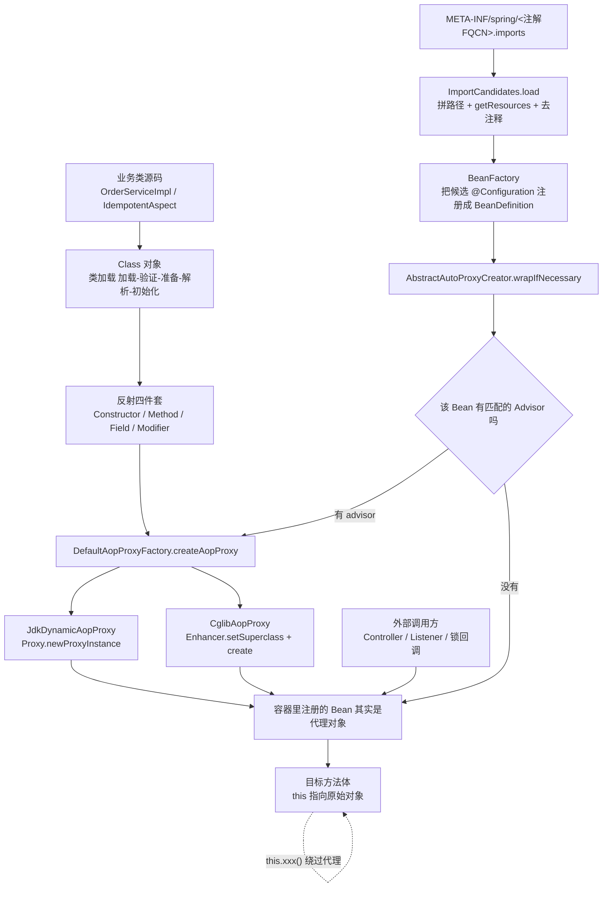
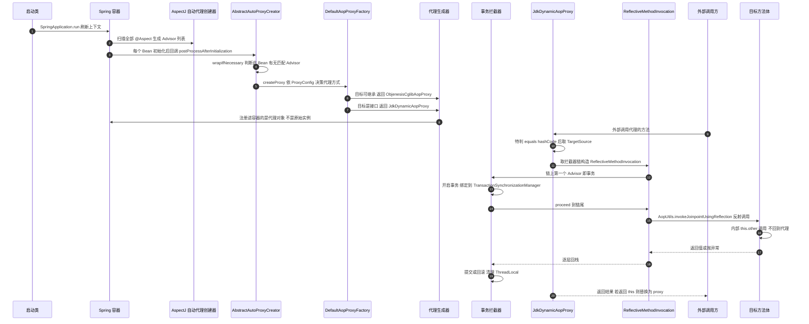

# 反射、动态代理与 SPI：注解"不生效"时，先问这次调用经过代理了吗

> **一句话结论**：`@Transactional`、`@Aspect`、`@Idempotent` 这些注解本身不执行任何逻辑，它们只是**给反射读的标签**；真正干活的是容器启动时由 `DefaultAopProxyFactory` 生成的那个代理对象——JDK 动态代理（只能基于接口）或 CGLIB 子类。所以注解"失效"几乎从来不是注解写错了，而是**这次调用没经过代理**（同类自调用、final 类、final 方法、private 方法），或者**自动配置类压根没被 `.imports` 文件登记**（那是另一套 SPI 机制，同样静默失败）。
> **阅读前置**：会写 Spring Boot 业务代码，知道 `@Service`、`@Transactional` 想达到什么效果；看得懂 `interface` 与继承。不需要读过 Spring 源码，本篇逐段带读。反射只需见过 `Class.forName`。
> **证据基线**：JDK 编译目标 17（`pom.xml#L30-L34`，本地实测 **Temurin 17.0.19**）；Spring Framework 7.1.0 / Spring Boot 4.2.0 / Spring Cloud 2026.0.0 / Spring Cloud Alibaba 2025.1.0.0（`pom.xml#L39-L41`）。A 级源码摘录 8 份（13 处代码块）、B 级本项目证据 18 处、C 级本机实测输出 8 组（全部为本机真实输出，命令与输出一起给出）。预计阅读 45 分钟。

---

## 0. 先看现象

### 现象一：方法上明明有 `@Transactional`，抛了异常数据却还在

本项目的订单创建曾经就是这样：`OrderServiceImpl.createOrder` 拿到分布式锁后，在锁回调里调 `this.doCreateOrder(...)`，而 `doCreateOrder` 上写着两个事务注解。

`ai-cs-order/src/main/java/com/aics/order/service/impl/OrderCreateTxService.java#L37-L44` 的类注释把结论写在了代码里：

```text
@Transactional 与 @GlobalTransactional 都依赖 Spring 代理，只有「外部调用方 → 代理 → 目标方法」
这条路径才会开启事务。若放在 OrderServiceImpl 里由 createOrder 直接 this.doCreateOrder(...) 调用，
会绕过代理导致事务注解失效（该问题由 OrderCreateTxWiringTest 复现并回归，详见 docs/28 故障案例 C1）
```

修复前，这个缺陷在 143 个单元测试全绿的情况下活了下来——因为 `@InjectMocks` 造的裸实例根本没有代理。补上的集成测试 `ai-cs-order/src/test/java/com/aics/order/service/impl/OrderCreateTxWiringTest.java#L91-L99` 在 `orderMapper.insert` 被调用的那一瞬间断言事务是否真的开着，断言失败信息是：

```text
doCreateOrder 必须在事务中执行；若为 false，说明 @Transactional 被同类自调用绕过（docs/28 C1）
```

`docs/28-故障案例库.md#L80-L86` 记录了当时的红绿对照：修复前 `Expecting value to be true but was false`，修复后 `Tests run: 1, Failures: 0, Errors: 0`。

**关键在于：整个过程没有任何异常、没有任何 WARN。** 注解被安静地忽略了。这正是代理类问题最难受的地方——它不报错，它只是"少做了一件事"。

### 现象二：给 final 类加切面，要么启动就炸，要么静默失效

给一个 `final class` 加 `@Aspect` 切面，启动日志里会出现（原文来自 `CglibAopProxy` 的异常文案）：

```text
Could not generate CGLIB subclass of class com.example.LoginService: Common causes of this
problem include using a final class or a non-visible class
```

它的本质是 Java 语言规则，可以单独复现——让 javac 去编译一个"继承 final 类"的子类（模拟 CGLIB 生成的子类）：

```text
LoginServiceSpringCGLIB.java:1: error: cannot inherit from final LoginService
class LoginService$$SpringCGLIB extends LoginService {
                                        ^
1 error
```

而如果是**类不是 final、只有某个 public 方法是 final**，程序不会报错，只有一条 DEBUG 日志躺在日志文件深处。于是现象变成"这个方法的切面偶尔不生效"——比启动失败难查十倍。

### 现象三：自己写的 starter 里 `@Bean` 死活不进容器

`ai-cs-common` 是纯 jar，没有入口类，它的 `@Configuration` 全靠一个文本文件点名。本项目这个文件现在登记了 6 个自动配置类：

```text
ai-cs-common/src/main/resources/META-INF/spring/org.springframework.boot.autoconfigure.AutoConfiguration.imports

com.aics.common.autoconfigure.CommonWebAutoConfiguration
com.aics.common.autoconfigure.MinioAutoConfiguration
com.aics.common.ai.embedding.EmbeddingAutoConfig
com.aics.common.idempotent.IdempotentAutoConfiguration
com.aics.common.mq.MessagePublisherAutoConfiguration
com.aics.common.autoconfigure.Jackson2AutoConfiguration
```

这个文件只要有一处不对，整份清单会被**当成不存在**，而不是报错：目录写成 `META-INF/`、文件名写成 `EnableAutoConfiguration.imports`、或者干脆还留在 `spring.factories` 里。三种都能编译通过、都能打包成功，也都能启动成功——只是你的 `@Bean` 不存在。

### 这三个现象指向同一件事

**注解是标签，代理是执行者，SPI 文件是点名册。** 三者的共同点是"约定优于配置 + 静默失败"：`this` 调用绕过了执行者，`final` 让执行者无法生成，`.imports` 放错位置让点名册不被读到——三处任何一处接头错位，代码都不会报错，只会少做一件事。所以排查这类问题的顺序是固定的：**先确认"代理对象存在吗"，再确认"这次调用碰到代理了吗"，最后才怀疑注解本身。**

---

## 1. 整体地图



> **读图说明**：全图最关键的是右下角那两个箭头——`CALL --> PROXY --> TGTOBJ`（外部调用一定要先落到代理对象上，才会触发拦截）和 `TGTOBJ` 指向自己的虚线（同类内部 `this.xxx()` 调用**完全不经过代理**）。误读方式是把左下角 `REF --> DPF` 当成"反射生成代理"：反射只负责**读注解、读方法签名、调用目标方法**，代理类是由 Spring 交给 JDK `Proxy` 或 CGLIB `Enhancer` 生成的。上图还有一条独立支线（`IMP → IC → BF`），那是 SPI 侧：它和代理没有任何关系，只是同样"靠文本文件 + 反射"完成装配，所以放在同一张图里对照。

| 组件 | 责任 | 谁在调用它 |
|---|---|---|
| 类加载器 + `Class` 对象 | 把 `.class` 字节流变成堆上的 `Class` 实例，反射的入口 | JVM 启动时、`Class.forName`、`ServiceLoader`（用线程上下文类加载器） |
| 反射四件套 `Constructor`/`Method`/`Field`/`Modifier` | 在运行时读类的结构并调用 | Spring 容器、MyBatis 映射、Jackson、本文所有代理实现 |
| `AnnotationAwareAspectJAutoProxyCreator` | 启动时扫描 `@Aspect`，算出 Advisor 列表 | `AbstractAutoProxyCreator` 的 `postProcessAfterInitialization` 回调 |
| `AbstractAutoProxyCreator` | 决定"这个 Bean 要不要包成代理" | `AbstractAutowireCapableBeanFactory` 初始化后回调 |
| `DefaultAopProxyFactory` | 决定"包成 JDK 代理还是 CGLIB" | `ProxyFactory.getProxy()`（即 `createProxy` 内部） |
| `JdkDynamicAopProxy` | 生成 `$Proxy0`，把调用转给拦截器链 | `Proxy.newProxyInstance` 在运行期回调它的 `invoke` |
| `CglibAopProxy` | 用 `Enhancer` 生成目标类子类，覆写方法插回调 | CGLIB 生成的子类方法在运行期回调 `MethodInterceptor` |
| `ReflectiveMethodInvocation` | 持有拦截器链，逐个 `invoke`，最后一个真正反射调目标 | 两个代理实现的 `invoke`/`intercept` |
| `ImportCandidates` | 从 classpath 读 `META-INF/spring/<注解FQCN>.imports` | `AutoConfigurationImportSelector.getCandidateConfigurations` |
| `EnableAutoConfiguration` / `AutoConfigurationImportSelector` | 把候选配置类名单交给容器 | `@SpringBootApplication` 上的 `@Import` |
| `ServiceLoader` | JDK 原生 SPI 迭代器，按约定实例化实现类 | 应用代码 / 框架（如 JDBC 驱动发现） |
| `IdempotentAspect` + `IdempotentAutoConfiguration` | 本项目里"注解 + 切面 + 自动装配"的完整样本 | 各业务服务的 Spring 容器 |

---

## 2. 关键概念与关键类

| 名称 | 所在位置 | 角色 | 关键方法 |
|---|---|---|---|
| `Class<T>` | `java.base / java.lang` | 类元数据在堆上的句柄，一切反射的起点 | `forName` / `getDeclaredMethods` / `cast` |
| `Constructor<T>`、`Method`、`Field` | `java.base / java.lang.reflect` | 反射四件套里"能动的"三件 | `newInstance` / `invoke` / `set`、`setAccessible` |
| `Modifier` | `java.base / java.lang.reflect` | 解析 `int` 型修饰符位 | `isFinal` / `isPrivate` / `isStatic` |
| `InvocationHandler` | `java.base / java.lang.reflect` | JDK 代理的回调契约：所有方法调用都汇到 `invoke` | `invoke(proxy, method, args)` |
| `Proxy` | `java.base / java.lang.reflect` | 生成 `$Proxy0` 的工厂 + 所有 JDK 代理的父类 | `newProxyInstance` / `isProxyClass` |
| `Enhancer` | `org.springframework.cglib.proxy`（重打包在 spring-core） | CGLIB 的"子类生成器" | `setSuperclass` / `setCallbacks` / `create` |
| `JdkDynamicAopProxy` | `spring-aop:7.1.0 / org.springframework.aop.framework` | JDK 代理形态的 AOP 实现，自己就是 `InvocationHandler` | `getProxy` / `invoke` |
| `CglibAopProxy` | 同上 | CGLIB 形态的 AOP 实现，内含 11 个回调类 | `getProxy` / `doValidateClass` / `DynamicAdvisedInterceptor.intercept` |
| `DefaultAopProxyFactory` | 同上 | 代理方式的**唯一**决策点 | `createAopProxy` |
| `ProxyConfig` | 同上 | 代理策略配置（`proxyTargetClass` / `optimize` / `exposeProxy` / `frozen`） | `setProxyTargetClass` / `setExposeProxy` / `copyDefault` |
| `AopContext` | 同上 | 用 ThreadLocal 暴露当前代理，给"自调用也要生效"兜底 | `setCurrentProxy` / `currentProxy` |
| `ReflectiveMethodInvocation` | `spring-aop:7.1.0 / org.springframework.aop.framework` | 拦截器链的执行器 | `proceed` / `invokeJoinpoint` |
| `AbstractAutoProxyCreator` | `spring-aop:7.1.0 / ...framework.autoproxy` | "要不要包代理"的判定 + 创建入口 | `wrapIfNecessary` / `createProxy` |
| `ImportCandidates` | `spring-boot:4.2.0 / org.springframework.boot.context.annotation` | `.imports` 文件的读取器 | `load(Class, ClassLoader)` |
| `EnableAutoConfiguration` | `spring-boot-autoconfigure:4.2.0` | 触发自动配置的注解（`@Import` 选择器） | 元注解 `@Import(AutoConfigurationImportSelector.class)` |
| `AutoConfigurationImportSelector` | 同上 | 把候选名单交给容器，并做排除 | `selectImports` / `getCandidateConfigurations` |
| `ServiceLoader<S>` | `java.base / java.util` | JDK 原生 SPI 加载器 | `load` / `iterator` / `stream` |
| `IdempotentAspect` | `com.aics.common.idempotent` | 本项目的幂等切面（`@Around` + Redis 占位） | `around` / `resolveKey` |

---

## 3. 原理与证据逐段精读

### 3.1 `Class` 从哪来：类加载五阶段与双亲委派

**这段在做什么。** 反射的每一个 API 都需要一个 `Class` 实例，而 `Class` 实例只在"类加载"过程中产生。JVM 把这件事拆成五步：加载（把 `.class` 字节流读进来，方法区里生成类型元数据、堆里生成 `Class` 对象）、验证、准备（静态字段赋零值）、解析（符号引用转直接引用）、初始化（执行 `<clinit>`，即静态赋值语句与 `static` 块）。依据是《Java 虚拟机规范》第 5 章（Loading, Linking, and Initializing）——这一章从 Java 8 到 Java 21 未变，属"依据语言/虚拟机规范"的结论，不是我实测的。

| 阶段 | 谁触发 | 反射能观察到什么 |
|---|---|---|
| 加载 | `ClassLoader.defineClass` | `Class` 对象已存在，但静态字段还是零值 |
| 准备 | JVM | `static int LIMIT = 100` 此时仍是 `0` |
| 解析 | 首次用到某符号引用 | `getDeclaredMethods()` 拿到的 `Method` 里，参数类型可能尚未解析 |
| 初始化 | `new`、`getstatic`、`invokestatic`、反射、`Class.forName`、初始化子类、`main` 所在类 | 静态字段变成真正值 |

一个高频细节：`Class.forName("x.Y")` **会**触发初始化（它默认 `initialize=true`），而 `ClassLoader.loadClass("x.Y")` **不会**。两者取到的 `Class` 是同一个（同一个类加载器只加载一次），但如果你在静态块里做了注册动作，用 `loadClass` 就会看到"类拿到了、静态块没跑"。

**为什么这么设计。** 分阶段是为了"延迟"：验证与解析可以推迟到真正用到时才做，启动更快；初始化一定要等到第一次主动使用，这样静态依赖（比如数据库 URL）才有机会被准备好。加载阶段用双亲委派（先问父加载器，父加载器找不到才自己加载）是为了两件事：核心类安全（你自己写个 `java.lang.String` 也没用，`java.base` 里那份永远由 Bootstrap 加载）与类的唯一性（同一个类名只对应一个 `Class`，`instanceof` 才可靠）。

**换成另一种写法会怎样。** 如果没有双亲委派（每个加载器自己先加载），Tomcat 里两个 webapp 各带一份同名工具类就会变成两个不同的 `Class`，互相 `instanceof` 失败——这正是某些"ClassCastException: X cannot be cast to X"的成因。反过来，如果严格坚持双亲委派，**SPI 就无法实现**：`ServiceLoader` 的调用方常常是 Bootstrap 加载的核心类（例如 JDBC 的 `java.sql.DriverManager`），它看不见 classpath 上的厂商驱动。所以 JDK 给了一个后门：线程上下文类加载器 `Thread.currentThread().getContextClassLoader()`，让"父加载器里的代码"能反向加载"子加载器里的实现类"。这条后门贯穿全文——本文第 3.7 节讲的三种 SPI，最终都要靠它或者等价的 `getResources` 才能跨 jar 找到文件。

**常见坑。** ①`NoClassDefFoundError` 与 `ClassNotFoundException` 的区别：前者是"链接阶段找不到了"（编译期有、运行期缺依赖），后者是"加载阶段没找到"。②同一个类被两个类加载器各加载一次，静态字段会各有一份——`spring-boot-devtools` 重启后静态计数器不清零就是这个原因。③`Class.forName` 用在 JDBC 上已经是历史写法（JDBC 4.0 起靠 SPI 自动发现驱动），保留它只有"显式指定驱动"的意义。

### 3.2 反射四件套与 `setAccessible`：JDK 17 之后不再是万能钥匙

**这段在做什么。** 拿到 `Class` 之后，反射四件套分别是：`Class`（入口）、`Constructor`（造对象）、`Method`（调方法）、`Field`（读写字段）。它们有两个维度要记牢：`getDeclaredXxx` 只看**本类**（含 private，不含继承），`getXxx` 只看 **public**（含继承）。写框架代码时几乎只用 `getDeclaredXxx`，然后逐级向父类爬。

```java
// 反射四件套的最小闭环：私有构造器 + 私有方法 + 私有字段
Class<?> c = Secret.class;                        // 不触发初始化
Constructor<?> ctor = Secret.class.getDeclaredConstructor();
Method m = Secret.class.getDeclaredMethod("peek"); // 只找本类声明的方法
Field f = Secret.class.getDeclaredField("value");
m.setAccessible(true);                             // 关掉访问检查（可能失败，见下）
Object o = ctor.newInstance();                     // 走构造器实例化
Object v = m.invoke(o);                            // 参数要包成 Object[]
```

`setAccessible(true)` 在 JDK 17 上和在 JDK 8 上已经不是一回事：模块化之后，"关掉访问检查"要先问模块系统同不同意。下面这段本机实测（Temurin 17.0.19，`Secret` 与调用类是两个独立的顶层类）：

```text
invoke without setAccessible -> java.lang.IllegalAccessException: class AccessDemo2 cannot access a member of class Secret with modifiers "private"
invoke after setAccessible    -> aics-token
```

再进一步，去碰 `java.base` 内部的私有字段（`String` 的 `value`）：

```text
String#value setAccessible -> java.lang.reflect.InaccessibleObjectException
  msg: Unable to make field private final byte[] java.lang.String.value accessible: module java.base does not "opens java.lang" to unnamed module @5ca881b5
```

**怎么读这两段输出。** 第一段说明"`setAccessible` 依然是私有成员的通行证"，只是必须先调它——不调就是 `IllegalAccessException`，错误信息里明确写了 `class AccessDemo2 cannot access a member of class Secret`。第二段是模块系统在拦人：`java.base does not "opens java.lang" to unnamed module`。翻译成人话——JDK 把 `java.lang` 这个包对 classpath（unnamed module）关闭了深度反射，`setAccessible` 直接抛 `InaccessibleObjectException`。要放行只能显式开洞：`--add-opens java.base/java.lang=ALL-UNNAMED`。

**为什么这么设计。** `setAccessible` 的原始动机是让"框架能操作业务私有成员"（Spring 注入字段、Jackson 序列化私有字段、Hibernate 填实体），这是生产力。但同一把钥匙能捅穿 JDK 自己的封装（改 `String` 内部数组、改 `Integer` 缓存），于是 JDK 9 用 JPMS 划了一条线：**你的模块对你开放，JDK 模块默认不开放**。这也解释了为什么 Spring Boot 3/4 时代升级常见的一条报错就是 `InaccessibleObjectException`——老框架还在按 JDK 8 的习惯去捅 `java.base`。

**换成另一种写法会怎样。** 如果你不 `setAccessible` 而改用 `MethodHandle`，行为有一处重要差别：`MethodHandles.privateLookupIn` 同样受模块规则约束（要 `opens`），但 `MethodHandle` 的类型检查发生在**创建时**而不是调用时，热路径上少一次参数数组封装——这就是 Spring 6+ 内部把大量反射调用换成 `MethodHandle`/`VarHandle` 的原因。反过来，如果你图省事用 `Class.newInstance()`（JDK 9 起 deprecated），它只能调无参 public 构造器，且会把构造器抛出的受检异常原样"漏"出来，是把 `InvocationTargetException` 包装丢掉的经典坑。

**常见坑。** ①`Method.invoke` 抛 `InvocationTargetException`，真实异常在 `getCause()` 里——日志里只打外层会丢掉业务异常。②`getDeclaredMethod("x", int.class)` 与 `getDeclaredMethod("x", Integer.class)` 是两个方法，自动装箱在反射里不会帮你匹配。③嵌套类/内部类的私有成员在同"嵌套家族"（nestmates，Java 11+）内互相访问**不需要** `setAccessible`——本机实测中 `AccessDemo` 调用自己内部类 `Holder` 的私有方法 `peek()` 直接成功了，这容易让人误判"setAccessible 没用"。④高频路径必须缓存 `Method`：`getDeclaredMethods()` 每次都会新建对象并做一次安全检查，本项目 `IdempotentAspect` 就把 SpEL 表达式缓存了起来（`ai-cs-common/src/main/java/com/aics/common/idempotent/IdempotentAspect.java#L96`）。

### 3.3 第一形态：JDK 动态代理——它只能基于接口

**这段在做什么。** JDK 动态代理在运行期生成一个类（`$Proxy0`），它**继承 `java.lang.reflect.Proxy`**、**实现你指定的所有接口**，把每个方法调用都转发给一个 `InvocationHandler`。Spring AOP 把这件事包成了 `JdkDynamicAopProxy`——注意它自己就 `implements InvocationHandler`：

[[源码:JdkDynamicAopProxy.java.md#L116-L122]]

```java (src: JdkDynamicAopProxy.java.md#L116-L122)
	@Override
	public Object getProxy(@Nullable ClassLoader classLoader) {
		if (logger.isTraceEnabled()) {
			logger.trace("Creating JDK dynamic proxy: " + this.advised.getTargetSource());
		}
		return Proxy.newProxyInstance(determineClassLoader(classLoader), this.cache.proxiedInterfaces, this);
	}
```

生成出来的类长什么样，本机实测最直观（`Greeter` 是接口，`Target` 是它的实现）：

```text
proxy.class  = $Proxy0
superclass   = java.lang.reflect.Proxy
interfaces   = [interface ProxyDemo$Greeter]
isProxyClass = true
call         = hi aics
class-as-interface -> java.lang.IllegalArgumentException: ProxyDemo$Target is not an interface
```

**怎么读这个输出。** 前四行确认了三件事：类名是 `$Proxy0`、父类是 `Proxy`、接口就是你传进去的那个。最后一行是最有价值的一行——把**类**当接口传进去，JDK 直接 `IllegalArgumentException: ... is not an interface`。也就是说"JDK 代理必须基于接口"不是 Spring 的规矩，是 `Proxy.newProxyInstance` 的硬约束。这个约束在 `JdkDynamicAopProxy` 的类注释里也写着：

[[源码:JdkDynamicAopProxy.java.md#L45-L47]]

```java (src: JdkDynamicAopProxy.java.md#L45-L47)
 * <p>Creates a dynamic proxy, implementing the interfaces exposed by
 * the AopProxy. Dynamic proxies <i>cannot</i> be used to proxy methods
 * defined in classes, rather than interfaces.
```

**为什么这么设计。** Java 单继承：`$Proxy0` 已经 `extends Proxy`，没有第二个 `extends` 名额留给目标类，所以它只能"实现接口"。代价是明确的：代理对象**只**拥有接口上声明的方法，实现类里多出来的 public 方法（哪怕加了注解）在代理上根本不存在，调用方拿到的是接口类型所以通常感觉不到——但如果你 `(OrderServiceImpl) proxy` 强转，会得到 `ClassCastException`。

**换成另一种写法会怎样。** 如果目标类没有接口却又必须用 JDK 代理，只有两条路：给它抽一个接口（改造业务代码），或者换 CGLIB（下一节）。反过来，如果目标类**是接口**（`targetClass.isInterface()`）、或者目标本身就是个代理类、或者目标是 lambda 类，Spring 会主动选 JDK 代理——这条判断逻辑集中在 `DefaultAopProxyFactory` 里，只有一处，非常值得背下来：

[[源码:DefaultAopProxyFactory.java.md#L59-L76]]

```java (src: DefaultAopProxyFactory.java.md#L59-L76)
	@Override
	public AopProxy createAopProxy(AdvisedSupport config) throws AopConfigException {
		if (config.isOptimize() || config.isProxyTargetClass() || !config.hasUserSuppliedInterfaces()) {
			Class<?> targetClass = config.getTargetClass();
			if (targetClass == null && config.getProxiedInterfaces().length == 0) {
				throw new AopConfigException("TargetSource cannot determine target class: " +
						"Either an interface or a target is required for proxy creation.");
			}
			if (targetClass == null || targetClass.isInterface() ||
					Proxy.isProxyClass(targetClass) || ClassUtils.isLambdaClass(targetClass)) {
				return new JdkDynamicAopProxy(config);
			}
			return new ObjenesisCglibAopProxy(config);
		}
		else {
			return new JdkDynamicAopProxy(config);
		}
	}
```

读这段代码只需要抓一条主线：**先看要不要走"按类代理"（`isOptimize()` 或 `isProxyTargetClass()` 或用户没给接口），要走的话再看目标能不能被 CGLIB 继承**（是接口/已是代理/lambda 就不行），能就走 CGLIB、不能就退回 JDK。`hasUserSuppliedInterfaces()` 是"用户显式指定了接口"的意思，一旦指定，即使 `proxyTargetClass=false` 也不会选错。

**常见坑。** ①`$Proxy0` 只在第一次生成，之后同类接口复用（`JdkDynamicAopProxy` 里那个 `ProxiedInterfacesCache`，`@since 6.1.3`，缓存了 `proxiedInterfaces`/`equalsDefined`/`hashCodeDefined` 三个字段）。②代理对象的 `equals`/`hashCode` 有特殊处理：目标类没重写 `equals` 时，代理用自己的（`JdkDynamicAopProxy` 的 `invoke` 开头就 `return equals(args[0])`），所以拿代理当 `Map` key 与拿裸对象当 key 是两套语义。③`toString()` 打到的是代理类的 `toString`，日志里出现 `Transforming`/`$Proxy` 一类字样不要以为出错。

### 3.4 第二形态：CGLIB——子类代理，final 是它的天敌

**这段在做什么。** CGLIB 用 ASM 在运行期生成目标类的**子类**，覆写所有非 final、非 private、可见的方法，插入回调。Spring 6/7 已经把 CGLIB 重打包进 `spring-core`（`org.springframework.cglib.proxy.Enhancer`，`CglibAopProxy` 第 40-52 行的 import 全是 `org.springframework.cglib.*`），所以**不需要再单独引 cglib 依赖**。核心三步：先校验类、再 `setSuperclass`、最后 `create`：

[[源码:CglibAopProxy.java.md#L189-L204]]

```java (src: CglibAopProxy.java.md#L189-L204)
			// Validate the class, writing log messages as necessary.
			validateClassIfNecessary(proxySuperClass, classLoader);

			// Configure CGLIB Enhancer...
			Enhancer enhancer = createEnhancer();
			if (classLoader != null) {
				enhancer.setClassLoader(classLoader);
				if (classLoader instanceof SmartClassLoader smartClassLoader &&
						smartClassLoader.isClassReloadable(proxySuperClass)) {
					enhancer.setUseCache(false);
				}
			}
			enhancer.setSuperclass(proxySuperClass);
			enhancer.setInterfaces(AopProxyUtils.completeProxiedInterfaces(this.advised));
			enhancer.setNamingPolicy(SpringNamingPolicy.INSTANCE);
			enhancer.setAttemptLoad(enhancer.getUseCache() && AotDetector.useGeneratedArtifacts());
```

生成失败时，Spring 抛出的异常文案几乎等于一份排查指南（`Could not generate CGLIB subclass of ...: Common causes of this problem include using a final class or a non-visible class`）。请注意 `catch` 抓的是 `CodeGenerationException | IllegalArgumentException`：

[[源码:CglibAopProxy.java.md#L232-L240]]

```java (src: CglibAopProxy.java.md#L232-L240)
		catch (CodeGenerationException | IllegalArgumentException ex) {
			throw new AopConfigException("Could not generate CGLIB subclass of " + this.advised.getTargetClass() +
					": Common causes of this problem include using a final class or a non-visible class",
					ex);
		}
		catch (Throwable ex) {
			// TargetSource.getTarget() failed
			throw new AopConfigException("Unexpected AOP exception", ex);
		}
```

**为什么这么设计。** 因为"不要求接口"这件事太值钱了：绝大多数业务 Bean（`OrderServiceImpl`、`ProductServiceImpl`）虽然是"接口 + 实现"结构，但注解往往写在实现类上，用 JDK 代理会丢掉"实现类特有的方法"。子类代理的代价是它必须遵守 Java 的继承规则：final 类不能被继承、final 方法不能被覆写、private 方法不可见、包可见方法跨类加载器不可见。Spring 没有选择"遇到 final 就报错"，而是把**类级别的失败**变成异常、把**方法级别的失败**变成日志——于是有了下面这段最有信息量的校验代码：

[[源码:CglibAopProxy.java.md#L283-L310]]

```java (src: CglibAopProxy.java.md#L283-L310)
	private void doValidateClass(Class<?> proxySuperClass, @Nullable ClassLoader proxyClassLoader, Set<Class<?>> ifcs) {
		if (proxySuperClass != Object.class) {
			Method[] methods = proxySuperClass.getDeclaredMethods();
			for (Method method : methods) {
				int mod = method.getModifiers();
				if (!Modifier.isStatic(mod) && !Modifier.isPrivate(mod)) {
					if (Modifier.isFinal(mod)) {
						if (logger.isWarnEnabled() && Modifier.isPublic(mod)) {
							if (implementsInterface(method, ifcs)) {
								// Final methods inherited from configuration callback interfaces are
								// typically driven by the container itself rather than by user code, so
								// logging a warning about CGLIB being unable to advise them is misleading noise.
								if (!implementsOnlyConfigurationCallbackInterfaces(method, ifcs)) {
									logger.warn("Unable to proxy interface-implementing method [" + method + "] because " +
											"it is marked as final, consider using interface-based JDK proxies instead.");
								}
							}
							else {
								logger.warn("Public final method [" + method + "] cannot get proxied via CGLIB, " +
										"consider removing the final marker or using interface-based JDK proxies.");
							}
						}
						if (logger.isDebugEnabled()) {
							logger.debug("Final method [" + method + "] cannot get proxied via CGLIB: " +
									"Calls to this method will NOT be routed to the target instance and " +
									"might lead to NPEs against uninitialized fields in the proxy instance.");
						}
					}
```

这段代码同时回答了三个问题：**哪些方法会被跳过**（`static` 与 `private` 直接不参与，`final` 参与但无法代理）、**public final 方法会响一声**（WARN 级，public 才有）、**非 public final 方法一声不响**（只有 DEBUG）。最后那句 DEBUG 文案值得完整记住：`Calls to this method will NOT be routed to the target instance`——它精确描述了后果：调用会落在代理子类的继承实现上，`this` 是代理对象，切面不生效，而且如果目标方法依赖"只有真对象才初始化过的字段"，还会 NPE。

**换成另一种写法会怎样。** 如果给所有 Bean 都强制 CGLIB（`proxyTargetClass=true`，Boot 的默认值，见第 7 节），你会遇到两类项目：一类是"接口 + 实现"结构、注解写在接口上——此时 CGLIB 生成的子类照样能覆写实现，切面生效，看不出区别；另一类是 `final` DTO/工具类被误加切面——启动即失败。反之，如果把 `proxyTargetClass=false`，那些"注解写在实现类上、注入用接口"的 Bean 会因为接口上没有注解而拿不到 Advisor，静默失效。这就是 Boot 选择"默认按类代理"的权衡：**宁可启动报错，也不要静默失效**。

**常见坑。** ①CGLIB 生成的子类会先调父类构造器（`enhancer.setInterceptDuringConstruction(false)`，即构造期间不拦截），所以**构造函数里调用被代理方法**不会触发切面，且此时依赖字段可能还没注入。②`abstract` 类可以被 CGLIB 代理（它只覆写非 abstract 方法），但接口方法必须由实现类提供。③Kotlin 的 `final` 是整个 `class` 默认 final，所以在 Kotlin 项目里 CGLIB 代理问题特别多（Spring 用 `KotlinDetector` 专门处理，见 `CglibAopProxy` 第 205 行）。④自己写测试时若用 `new OrderServiceImpl()` 手动构造，永远证明不了切面生效——必须经过代理（第 3.8 节给了一个不启动 Spring 的做法）。

### 3.5 代理对象与 `this`：自调用失效的唯一根因

**这段在做什么。** 容器里注册的 Bean 不是你的实例，而是代理。代理持有原始实例（`TargetSource`），只有**从代理进入**的调用才会触发拦截。而在目标方法内部写 `this.otherMethod()`，`this` 是**原始实例**，它根本不知道代理存在——这个调用链就直接落在目标方法体上。

Spring 把这条语义写进了 `ProxyConfig#setExposeProxy` 的 javadoc，原文非常直白：

[[源码:ProxyConfig.java.md#L111-L122]]

```java (src: ProxyConfig.java.md#L111-L122)
	/**
	 * Set whether the proxy should be exposed by the AOP framework as a
	 * ThreadLocal for retrieval via the AopContext class. This is useful
	 * if an advised object needs to call another advised method on itself.
	 * (If it uses {@code this}, the invocation will not be advised).
	 * <p>Default is "false", in order to avoid unnecessary extra interception.
	 * This means that no guarantees are provided that AopContext access will
	 * work consistently within any method of the advised object.
	 */
	public void setExposeProxy(boolean exposeProxy) {
		this.exposeProxy = exposeProxy;
	}
```

注意其中两句：`(If it uses {@code this}, the invocation will not be advised)` 是官方盖章的结论；`Default is "false", in order to avoid unnecessary extra interception` 解释了为什么 Spring 不默认帮你兜底——每次调用都要往 ThreadLocal 塞代理，是有成本的。

本机实测把这件事变成了可观察的数字（一个接口、一个实现、一个计数用的 `InvocationHandler`）：

```text
case A: proxy.createOrder()  (self-invocation inside outer method)
  [advice] createOrder hits=1 proxy!=this? true
  [target] createOrder, this.class=demo.self.SelfInvocationDemo$OrderServiceImpl, adviceHits=1
  [target] doCreateOrder, adviceHits=1  (expect +1 if advised)
  total advice hits = 1
case B: proxy.doCreateOrder() (called from outside)
  [advice] doCreateOrder hits=1 proxy!=this? true
  [target] doCreateOrder, adviceHits=1  (expect +1 if advised)
  total advice hits = 1
```

**怎么读这个输出。** 两个 case 的 `total advice hits` 都是 1，但含义完全不同。case A 里外部只调了一次 `createOrder`，拦截器命中 1 次是正常的；内部的 `doCreateOrder` **一次都没有重新进入拦截器**（如果进了，总数会是 2）。case B 是"从外部直接调方法"，于是它也命中 1 次。换成事务语境：case A 里 `createOrder` 上的事务注解会生效（如果它有），而 `doCreateOrder` 上的注解**完全不生效**——这就是订单创建事故的机制。注意 `proxy!=this? true` 这一行：目标对象眼里的 `this` 与调用方手里的代理**确实是两个对象**。

**为什么这么设计。** 因为"代理"是一个外层对象，而 Java 没有"自动把 `this` 换成代理"的语言机制（这需要编译期改写字节码，即 AspectJ 的编译期/加载期织入）。Spring 选择了"运行期代理 + 明确告知"：不偷偷改你的对象，而是把选择权交给写代码的人。代价就是你必须了解这条规则。

**换成另一种写法会怎样。** 三种解法，代价递增：

| 写法 | 具体做法 | 代价 |
|---|---|---|
| 拆 Bean（本项目选它） | 把事务方法搬到另一个类 `OrderCreateTxService`，由注入的代理调用 | 多一个类，但依赖关系一眼可见；纯结构改动，零框架知识 |
| 自注入代理 | `@Autowired @Lazy private OrderService self;` 然后 `self.doCreateOrder(...)` | 循环依赖，`@Lazy` 不可少 |
| 暴露代理 + `AopContext` | 配 `@EnableAspectJAutoProxy(exposeProxy = true)`，再用 `AopContext.currentProxy()` 强转调用 | ThreadLocal 开销；忘了开 `exposeProxy` 就抛 `IllegalStateException`；对 Seata/XID 传播更不友好 |

本项目的选择有代码可查：`OrderServiceImpl` 注入 `OrderCreateTxService` 后在锁回调里调它（`ai-cs-order/src/main/java/com/aics/order/service/impl/OrderServiceImpl.java#L45`、`#L57-L59`），而带 `@GlobalTransactional` + `@Transactional` 的方法在另一个 Bean 上（`ai-cs-order/src/main/java/com/aics/order/service/impl/OrderCreateTxService.java#L78-L80`）。

**常见坑。** ①"自调用"不限于 `this.x()`：`this::x` 方法引用、`stream().forEach(this::x)`、内部类里的 `Outer.this.x()` 全都是绕代理。②`@Transactional` 写在 `private` 方法上，CGLIB 覆写不到，静默失效。③"类内调用也算自调用"的反面同样成立：**Controller 调用 Service 是跨对象调用，一定经过代理**，所以事务正常。④`@TransactionalEventListener(phase = AFTER_COMMIT)` 这类监听器只有在事务真的开着时才有"提交后"时刻——事务没开，监听器会在方法返回时就触发，这条链路也常见于自调用导致的"时序错乱"。

### 3.6 代理内部：从 `invoke` 到目标方法的那 20 行

**这段在做什么。** 代理拿到调用后干的活是固定的五步：特判、暴露代理、取目标、取拦截器链、走链或直调。

[[源码:JdkDynamicAopProxy.java.md#L191-L220]]

```java (src: JdkDynamicAopProxy.java.md#L191-L220)
			if (this.advised.isExposeProxy()) {
				// Make invocation available if necessary.
				oldProxy = AopContext.setCurrentProxy(proxy);
				setProxyContext = true;
			}

			// Get as late as possible to minimize the time we "own" the target,
			// in case it comes from a pool.
			target = targetSource.getTarget();
			Class<?> targetClass = (target != null ? target.getClass() : null);

			// Get the interception chain for this method.
			List<Object> chain = this.advised.getInterceptorsAndDynamicInterceptionAdvice(method, targetClass);

			// Check whether we have any advice. If we don't, we can fall back on direct
			// reflective invocation of the target, and avoid creating a MethodInvocation.
			if (chain.isEmpty()) {
				// We can skip creating a MethodInvocation: just invoke the target directly
				// Note that the final invoker must be an InvokerInterceptor so we know it does
				// nothing but a reflective operation on the target, and no hot swapping or fancy proxying.
				@Nullable Object[] argsToUse = AopProxyUtils.adaptArgumentsIfNecessary(method, args);
				retVal = AopUtils.invokeJoinpointUsingReflection(target, method, argsToUse);
			}
			else {
				// We need to create a method invocation...
				MethodInvocation invocation =
						new ReflectiveMethodInvocation(proxy, target, method, args, targetClass, chain);
				// Proceed to the joinpoint through the interceptor chain.
				retVal = invocation.proceed();
			}
```

CGLIB 侧的 `DynamicAdvisedInterceptor#intercept` 是同一套逻辑的孪生兄弟（`CglibAopProxy.java#L716-L740`），连注释都几乎一样——这不是巧合，而是"两条代理路径必须保持语义一致"的工程约束。

链是怎么被"走"完的？`ReflectiveMethodInvocation` 用一个游标 `currentInterceptorIndex` 从 -1 开始，每次 `proceed()` 加一取下一个拦截器，取完最后一个才真正反射调目标：

[[源码:ReflectiveMethodInvocation.java.md#L154-L181]]

```java (src: ReflectiveMethodInvocation.java.md#L154-L181)
	@Override
	public @Nullable Object proceed() throws Throwable {
		// We start with an index of -1 and increment early.
		if (this.currentInterceptorIndex == this.interceptorsAndDynamicMethodMatchers.size() - 1) {
			return invokeJoinpoint();
		}

		Object interceptorOrInterceptionAdvice =
				this.interceptorsAndDynamicMethodMatchers.get(++this.currentInterceptorIndex);
		if (interceptorOrInterceptionAdvice instanceof InterceptorAndDynamicMethodMatcher dm) {
			// Evaluate dynamic method matcher here: static part will already have
			// been evaluated and found to match.
			Class<?> targetClass = (this.targetClass != null ? this.targetClass : this.method.getDeclaringClass());
			if (dm.matcher().matches(this.method, targetClass, this.arguments)) {
				return dm.interceptor().invoke(this);
			}
			else {
				// Dynamic matching failed.
				// Skip this interceptor and invoke the next in the chain.
				return proceed();
			}
		}
		else {
			// It's an interceptor, so we just invoke it: The pointcut will have
			// been evaluated statically before this object was constructed.
			return ((MethodInterceptor) interceptorOrInterceptionAdvice).invoke(this);
		}
	}
```

**为什么这么设计。** 递归 + 游标是"责任链"的最省实现：每个拦截器收到的是 `MethodInvocation`，它能决定"继续 `proceed()`"（环绕通知的前置部分）、"不 `proceed()`"（直接返回，比如幂等拒绝）、或者"`try { proceed() } catch { 补偿 }`"（事务回滚、幂等释放 key）。这条链上没有 Spring 特有的魔法——它就是一本"往前往后"的账本。

**换成另一种写法会怎样。** 如果拦截器链为空（`chain.isEmpty()`），Spring 会跳过 `ReflectiveMethodInvocation` 直接反射调用——这是给"代理了但没有一个切点匹配这个方法"的场景省一次对象分配。这也解释了为什么"代理对象存在但切面不生效"是可能发生的：**包装了 Bean ≠ 匹配了切点**。切点表达式写错（比如 `@annotation` 与 `@within` 混用、包名写错）同样静默。

**常见坑。** ①通知返回 `null` 但目标方法返回基本类型时，抛 `AopInvocationException: Null return value from advice does not match primitive return type for: ...`（`JdkDynamicAopProxy.java#L232-L235`）——这是"切面里写了 `return null` 兜底"的常见后果。②`exposeProxy=true` 时 ThreadLocal 的清理在 `finally` 里，若你的切面在拦截器里再嵌套调用会读到"内层代理"，排查时要看清栈深度。③多个切面的顺序由 `@Order`/`Ordered` 决定，链的顺序等于环绕通知的嵌套顺序，**不是**声明顺序。

### 3.7 SPI 三代同堂：`ServiceLoader` → `spring.factories` → `.imports`

**这段在做什么。** 三代机制解决的是同一个问题：**"我是 jar，我不知道谁会用我，怎么让使用者发现我提供的实现？"** 答案是"在固定路径放一个文本文件，写上类的全限定名（FQCN），由加载方反射实例化"。

JDK 原生约定是 `META-INF/services/<接口 FQCN>`，加载方用 `ServiceLoader`：

```java
// 约定：META-INF/services/demo.spi.RuleProvider 里每行一个实现类 FQCN
ServiceLoader<RuleProvider> loader = ServiceLoader.load(RuleProvider.class);
for (RuleProvider p : loader) {        // 迭代时才实例化（反射 + 无参构造）
    System.out.println(p.name());      // 实现类必须 public + public 无参构造
}
```

本机实测（文件里故意混进一个只有有参构造的实现类 `BrokenProvider`）：

```text
ServiceLoader.load(RuleProvider.class):
  [ctor] RemoteRuleProvider
  got: remote
  [ctor] StaticRuleProvider
  got: static
  -> java.util.ServiceConfigurationError: demo.spi.RuleProvider: demo.spi.BrokenProvider Unable to get public no-arg constructor
```

**怎么读这个输出。** 三件事：①实例化是**惰性**的（`[ctor]` 打在每次 `hasNext`/`next` 时才出现），不是 `load` 的时候；②文件里的顺序就是迭代顺序，前两个正常实现都跑完了；③坏掉的那个抛 `ServiceConfigurationError`——**它是 `Error` 而不是 `Exception`**，`catch (Exception e)` 抓不到，会把整个循环打断。这条坑在第三方驱动上很常见：一个 jar 的 `services` 文件里有一个类没无参构造，整个 SPI 迭代就崩。

Spring 的第二代是 `META-INF/spring.factories`（键值对形式，一个键可以列多个值），Boot ≤2.6 的自动配置就是这样登记的。它在实践中的两个问题是：一个文件塞下所有 SPI 类型（几百行、合并冲突）和"一个键的多个值无法按时序表达优先级"。于是 Boot 2.7 引入了新格式，3.0 起自动配置**只**读新格式（依据 Spring Boot 2.7 Release Notes 与 3.0 Migration Guide 中 "Auto-configuration registration" 一节；本项目全仓 grep 也已经没有任何 `spring.factories` 文件，属于"已迁移完成"的状态）。

第三代就是 `ImportCandidates`：路径和文件名的拼法只有一行，但它是所有"文件放错位置"事故的根源：

[[源码:ImportCandidates.java.md#L33-L37]]

```java (src: ImportCandidates.java.md#L33-L37)
public final class ImportCandidates implements Iterable<String> {

	private static final String LOCATION = "META-INF/spring/%s.imports";

	private static final String COMMENT_START = "#";
```

`%s` 被替换成**传给 `load` 的那个注解类的 FQCN**。读取逻辑是"列出 classpath 上所有同名文件的 URL，逐个按 UTF-8 读、切掉 `#` 注释、trim、跳过空行"：

[[源码:ImportCandidates.java.md#L69-L80]]

```java (src: ImportCandidates.java.md#L69-L80)
	public static ImportCandidates load(Class<?> annotation, @Nullable ClassLoader classLoader) {
		Assert.notNull(annotation, "'annotation' must not be null");
		ClassLoader classLoaderToUse = decideClassloader(classLoader);
		String location = String.format(LOCATION, annotation.getName());
		Enumeration<URL> urls = findUrlsInClasspath(classLoaderToUse, location);
		List<String> importCandidates = new ArrayList<>();
		while (urls.hasMoreElements()) {
			URL url = urls.nextElement();
			importCandidates.addAll(readCandidateConfigurations(url));
		}
		return new ImportCandidates(importCandidates);
	}
```

而 `findUrlsInClasspath` 就是 `classLoader.getResources(location)`——**多 jar 聚合**靠的是这个方法，而不是 `getResource`（后者只返回第一个）。这解释了为什么"多个 starter 各带一份同名 `.imports` 文件"能共存。

至于"到底传哪个注解"，答案是 `AutoConfiguration`（不是 `EnableAutoConfiguration`）：

[[源码:AutoConfigurationImportSelector.java.md#L188-L198]]

```java (src: AutoConfigurationImportSelector.java.md#L188-L198)
	protected List<String> getCandidateConfigurations(AnnotationMetadata metadata,
			@Nullable AnnotationAttributes attributes) {
		ImportCandidates importCandidates = ImportCandidates.load(this.autoConfigurationAnnotation,
				getBeanClassLoader());
		List<String> configurations = importCandidates.getCandidates();
		Assert.state(!CollectionUtils.isEmpty(configurations),
				() -> "No auto configuration classes found in " + "META-INF/spring/"
						+ this.autoConfigurationAnnotation.getName() + ".imports. If you "
						+ "are using a custom packaging, make sure that file is correct.");
		return configurations;
	}
```

`this.autoConfigurationAnnotation` 指向 `org.springframework.boot.autoconfigure.AutoConfiguration`，所以文件名是 `org.springframework.boot.autoconfigure.AutoConfiguration.imports`（与本项目实际文件名完全一致）。而这一切的入口是 `@EnableAutoConfiguration` 上的 `@Import`：

[[源码:EnableAutoConfiguration.java.md#L60-L66]]

```java (src: EnableAutoConfiguration.java.md#L60-L66)
@Target(ElementType.TYPE)
@Retention(RetentionPolicy.RUNTIME)
@Documented
@Inherited
@AutoConfigurationPackage
@Import(AutoConfigurationImportSelector.class)
public @interface EnableAutoConfiguration {
```

**怎么读这段链路。** `@SpringBootApplication` 组合了 `@EnableAutoConfiguration` → 它 `@Import` 了 `AutoConfigurationImportSelector` → 选择器的 `selectImports` 调 `getCandidateConfigurations` → `ImportCandidates.load(AutoConfiguration.class, ...)` → 拼出 `META-INF/spring/org.springframework.boot.autoconfigure.AutoConfiguration.imports` → `getResources` 把**所有 jar** 里的同名文件都找出来 → 逐行读成类名列表 → 交给容器做条件装配。任何一个环节的"名字"对不上，结果都是空列表。

**换成另一种写法会怎样——本机实测。** 我准备了三份故意写错的文件（`META-INF/spring/` 下用 `EnableAutoConfiguration` 命名的、`META-INF/` 下少一层目录的、以及一份 `spring.factories`），再加一份正确的，用真 jar（spring-boot 4.2.0）跑 `ImportCandidates.load`：

```text
[AutoConfiguration] candidate[1] = org.springframework.boot.autoconfigure.admin.SpringApplicationAdminJmxAutoConfiguration
[AutoConfiguration] candidate[2] = org.springframework.boot.autoconfigure.aop.AopAutoConfiguration
...
[AutoConfiguration] candidate[12] = org.springframework.boot.autoconfigure.task.TaskSchedulingAutoConfiguration
[AutoConfiguration] candidate[13] = demo.FakeAutoConfiguration
[AutoConfiguration] candidate[14] = demo.AnotherAutoConfiguration
[AutoConfiguration] candidate[15] = demo.ThirdAutoConfiguration
[AutoConfiguration] total = 15
[EnableAutoConfiguration] candidate[1] = demo.WrongFileNameAutoConfiguration
[EnableAutoConfiguration] total = 1
```

**怎么读这个输出。** ①`[AutoConfiguration]` 那组的前 12 条来自 `spring-boot-autoconfigure-4.2.0.jar` 自带的同名文件（说明 Boot 4 把自动配置拆到了多个 jar，核心 jar 里只剩 12 个），后 3 条来自我那份"正确文件"——注意我故意写了 `#` 注释行、空行和带前导空格的 `   demo.AnotherAutoConfiguration`，全都被正确清洗（说明 `stripComment` + `trim` 生效）。②`[EnableAutoConfiguration]` 那组只有 1 条，来自我那份"文件名写成 EnableAutoConfiguration"的文件——这证明**文件名必须等于传进去的注解 FQCN**，两者不会互相兜底。③`spring.factories` 里的 `demo.SpringFactoriesAutoConfiguration` **一条都没出现**，少一层目录的 `META-INF/AutoConfiguration.imports` 同样一条都没出现——这三份错文件在真实启动里就是"安静地不存在"。

**常见坑。** ①文件名用 `EnableAutoConfiguration`（最常见的错），或目录少一层 `spring/`。②文件里写了 `@Configuration` 类的**相对名**而不是 FQCN。③把 `.imports` 放进 `src/main/resources` 却忘了模块没有 `spring-boot-maven-plugin` 打包时被打进去——可用 `jar tf` 验证。④`ServiceLoader` 的实现类必须 `public` 且有无参构造；而 `.imports` 里的配置类**不需要**无参构造（Spring 会处理），但必须是 `@Configuration`/`@AutoConfiguration`。⑤`spring.factories` 时代的老教程还在流传，照抄会得到"文件存在但不生效"。

### 3.8 落到本项目：幂等切面是怎么被代理上的

**这段在做什么。** 项目里唯一一个 `@Aspect` 是 `IdempotentAspect`，它展示了"注解 + 切面 + 自动装配"的完整闭环。三个文件各司其职：

```java
// 1) 切面本体：没有 @Component，靠自动配置类里的 @Bean 注册
ai-cs-common/src/main/java/com/aics/common/idempotent/IdempotentAspect.java#L29-L30
@Aspect
public class IdempotentAspect {

// 2) 切点 + 通知：注解式切点，参数直接注入被拦截方法上的注解实例
ai-cs-common/src/main/java/com/aics/common/idempotent/IdempotentAspect.java#L49-L50
    @Around("@annotation(idempotent)")
    public Object around(ProceedingJoinPoint joinPoint, Idempotent idempotent) throws Throwable {

// 3) 自动配置：三重条件 + 让位机制
ai-cs-common/src/main/java/com/aics/common/idempotent/IdempotentAutoConfiguration.java#L20-L31
@AutoConfiguration
@ConditionalOnClass(StringRedisTemplate.class)
@ConditionalOnProperty(prefix = "aics.idempotent", name = "enabled", havingValue = "true", matchIfMissing = true)
@EnableConfigurationProperties(IdempotentProperties.class)
public class IdempotentAutoConfiguration {

    @Bean
    @ConditionalOnMissingBean
    public IdempotentAspect idempotentAspect(StringRedisTemplate redisTemplate, IdempotentProperties properties) {
```

**为什么这么设计。** 三处细节都是"库代码"才需要的心眼：①切面不加 `@Component`——`ai-cs-common` 被所有服务依赖，若加 `@Component` 而某服务没引 Redis，启动就会报"找不到 `StringRedisTemplate`"；改成 `@Bean` + `@ConditionalOnClass` 就能"有 Redis 才装配"。②`matchIfMissing = true` 让默认开启、出事可一键关闭。③`@ConditionalOnMissingBean` 让业务方可以覆盖。这三条合起来就是"starter 三件套"。

**换成另一种写法会怎样。** 如果直接把 `@Aspect` 类标上 `@Component` 放在 common 里，那么所有依赖 common 的服务（包括没有 Redis 的网关）都会尝试装配它，启动失败；如果连 `@Aspect` 都不加、只写 `@Around`，那它就是个普通 Bean，永远不会被 `AnnotationAwareAspectJAutoProxyCreator` 收集成 Advisor，注解彻底失效——两种错误都不会给出清晰报错。

**常见坑。** ①`@Around` 参数里的 `Idempotent idempotent` 是"绑定注解实例"，写法必须是 `@Around("@annotation(参数名)")`，注解类型与参数类型一致。②`@annotation` 切点只匹配**方法上**的注解，类上的注解要用 `@within`。③切面里用了 `joinPoint.getSignature()` 转 `MethodSignature` 才能拿 `Method`（`IdempotentAspect.java#L87`）。④SpEL 用参数名（本项目 `@Idempotent(key = "'pay:callback:' + #orderNo")`）依赖编译期 `-parameters`，本项目在 `pom.xml#L34` 显式开了 `<maven.compiler.parameters>true</maven.compiler.parameters>`；不开的话 `#orderNo` 解析不到，`resolveKey` 会走到"key 为空"的分支直接抛异常（`IdempotentAspect.java#L96-L101`）。

---

## 4. 一次完整执行时序



> **读图说明**：最关键的箭头是第 9、10 步（`CALL --> JDK`）：**只有从容器里取出的代理对象发起的调用**才会进入 `invoke`。第 17 步 `TGT->>TGT` 是本图唯一一条不回头的箭头——它表示 `this` 内部调用，发生在代理"里面"，永远不会重新进入第 10 步。误读方式是把第 5-8 步理解成"每个 Bean 都一定会被代理"：`wrapIfNecessary` 完全没有匹配 Advisor 时会原样返回，容器里放的就是裸对象，此时连"代理存在"这个前提都不成立。另一处容易漏看的是第 8 步：容器注册的是**代理**，所以 `applicationContext.getBean(OrderService.class)` 拿到的 `getClass()` 是 `$Proxy...` 或 `Xxx$$SpringCGLIB$$0`，不是 `OrderServiceImpl`。

**哪一步失败会报什么错。** 这张表是排查时的第一落点：

| 失败点 | 现象 | 报错原文 / 证据 |
|---|---|---|
| 步骤 4：没有匹配的 Advisor | 注解静默失效，无异常 | 无日志（`wrapIfNecessary` 直接 `return bean`），`AbstractAutoProxyCreator.java#L328-L344` |
| 步骤 5：既无接口又无目标类 | 启动失败 | `AopConfigException: TargetSource cannot determine target class: Either an interface or a target is required for proxy creation.`（`DefaultAopProxyFactory.java#L63-L66`） |
| 步骤 6/7：目标是 final 类 | 启动失败 | `AopConfigException: Could not generate CGLIB subclass of ...: Common causes of this problem include using a final class or a non-visible class`（`CglibAopProxy.java#L232-L236`） |
| 步骤 6/7：目标是 public final 方法 | **不报错**，只有 WARN/DEBUG | `Public final method [...] cannot get proxied via CGLIB...`（`CglibAopProxy.java#L301-L302`）、`Final method [...] will NOT be routed to the target instance...`（`#L306-L308`） |
| 步骤 10：调用方用 `this` 调用 | **不报错**，切面不执行 | 本机实测 `total advice hits = 1`（内部调用未命中） |
| 步骤 15：通知返回 `null` 而方法返回 `int` | 运行期异常 | `AopInvocationException: Null return value from advice does not match primitive return type for: ...`（`JdkDynamicAopProxy.java#L232-L235`） |
| 自动装配候选为空 | 启动失败 | `No auto configuration classes found in META-INF/spring/<注解FQCN>.imports. If you are using a custom packaging, make sure that file is correct.`（`AutoConfigurationImportSelector.java#L193-L196`） |
| SPI 实现类缺无参构造 | 迭代中断（`Error` 不走 `catch (Exception)`） | `java.util.ServiceConfigurationError: ... Unable to get public no-arg constructor`（本机实测） |

---

## 5. 设计取舍

| 方案 | 优点 | 代价 | 本项目怎么选 |
|---|---|---|---|
| JDK 动态代理 | 无字节码生成依赖、生成快、`$Proxy0` 可缓存复用；不会碰目标类的构造器 | 目标必须有接口；接口外的方法在代理上不存在；强转会 `ClassCastException` | 用作"目标是接口 / 已是代理 / lambda"时的兜底（`DefaultAopProxyFactory` 第 67-69 行） |
| CGLIB 子类代理 | 不要求接口，注解写在实现类上也能生效 | final 类启动失败、final/public final 方法静默失效、private 不可代理；构造期调方法不拦截；多一次类生成开销 | **默认选择**（Boot 的 `spring.aop.proxy-target-class=true`），本项目未覆盖该配置 |
| 编译期/加载期织入（AspectJ LTW） | `this` 自调用**也**生效；无运行期代理对象 | 需要 `-javaagent` 或编译插件；团队必须统一构建方式；调试栈更绕 | 未使用（全仓无 `aop.xml`、无 `spring-instrument`） |
| 编程式事务（`TransactionTemplate`） | 零魔法，自调用天然生效；边界一眼可见 | 代码侵入，事务边界散落 | 未使用；但"拆 Bean"在效果上等价于把结构显式化 |
| 拆 Bean（`OrderCreateTxService`） | 零框架知识，靠结构保证"必经代理"；可被集成测试直接验证 | 多一个类、多一层调用 | **本项目采用**（`docs/28` C1 的采纳修复） |
| Spring 注入 `List<RuleProvider>` | 类型安全、可排序、可条件装配、能注入依赖 | 实现必须在本容器内（跨 jar 需组件扫描或额外配置） | **本项目采用**：`RuleProvider` 有 `StaticRuleProvider`、`KnowledgeRuleProvider` 两个实现，都标了 `@Component`（`ai-cs-chat/src/main/java/com/aics/chat/agent/tool/StaticRuleProvider.java#L13-L14`、`ai-cs-chat/src/main/java/com/aics/chat/agent/tool/KnowledgeRuleProvider.java#L24-L26`） |
| JDK `ServiceLoader` | 完全解耦：jar 自带注册文件即可被发现；无需容器 | 只能无参构造 + public；不能注入依赖；`ServiceConfigurationError` 会打断整轮迭代；无优先级 | 未用于业务扩展点（本项目策略实现都在同一服务内，Spring 注入足够） |
| `.imports` + `@AutoConfiguration` | 条件装配、自动排序、可排除、本服务不引入就没影响 | 文件名/目录名是硬约定；错了静默失败 | **本项目采用**：`ai-cs-common` 的 6 个自动配置类全靠它 |

**可扩展点清单**（想深挖可以按这张单子做实验）：

1. 自定义 `Advisor` + `Pointcut`（不写 `@Aspect`，用编程式切点），观察 `getInterceptorsAndDynamicInterceptionAdvice` 返回什么。
2. `@EnableAspectJAutoProxy(exposeProxy = true)` + `AopContext.currentProxy()`，把自调用改成经代理（注意 ThreadLocal 开销）。
3. `spring.aop.proxy-target-class=false`，观察 `$Proxy0` 与 `$$SpringCGLIB$$0` 的类名差异，以及"注解写在实现类上"时切面是否还生效。
4. `optimize=true`：注意 `ProxyConfig` 注释里写着它"enforces CGLIB proxies ... without any class validation checks (for final methods etc)"——即**跳过**第 3.4 节那段校验。
5. 给 starter 加 `@AutoConfiguration(after = ...)`/`before`，验证自动配置之间的排序。
6. 用 `ApplicationContextRunner` 断言"有依赖才装配 / 无依赖不装配 / 用户自定义则让位"（本项目 `IdempotentAutoConfigurationTest` 就是这三条）。

---

## 6. 踩坑与调试手法

| 现象 | 根因 | 验证手段 | 解法 |
|---|---|---|---|
| 同类自调用 `@Transactional` 不回滚，无任何日志 | `this` 调用不经代理（第 3.5 节） | 断点打在 `JdkDynamicAopProxy#invoke`（第 163 行）或 `CglibAopProxy$DynamicAdvisedInterceptor#intercept`（第 711 行），条件 `method.getName().equals("doCreateOrder")`：命中 0 次即自调用 | 拆 Bean（本项目做法）/ 自注入 `@Lazy` / `exposeProxy` + `AopContext` |
| 某方法切面时灵时不灵 | 该方法 `public final` 或 `private`，CGLIB 无法覆写 | `logging.level.org.springframework.aop.framework=DEBUG`，搜关键字 `cannot get proxied via CGLIB`（`CglibAopProxy.java#L301-L302`、`#L306-L308`） | 去掉 `final`，或改 `private` 为 `public`，或改用接口 + JDK 代理 |
| 启动报 `Could not generate CGLIB subclass of ...` | 目标类是 `final`，或类不可见（包私有且跨包/跨类加载器） | 看异常 `cause` 的类型；可直接用 javac 复现：写一个 `class X extends 目标类` 编译一次 | 去掉 `final`；把类改成 public；或为它抽接口 |
| 自定义 starter 的 `@Bean` 不进容器 | `.imports` 目录/文件名不对，或类名不是 FQCN | ①`jar tf target/xxx.jar \| Select-String "META-INF/spring"` ②跑 `ImportCandidates.load(AutoConfiguration.class, 本类.getClassLoader())` 打印含 `com.aics` 的条目 | 文件必须放在 `src/main/resources/META-INF/spring/`，名字必须是 `org.springframework.boot.autoconfigure.AutoConfiguration.imports` |
| `ServiceLoader` 迭代中途抛 `ServiceConfigurationError` | 某实现类没有 public 无参构造，或类不可见 | 逐个实现类 `javap -p` 看构造器；或把 `services` 文件里的实现类注释掉二分定位 | 补无参构造；或用工厂方法（Dubbo Spring 式自适应扩展）替代纯 SPI |
| JDK 17 上 `setAccessible` 抛 `InaccessibleObjectException` | JPMS 未对反射方 `opens` 该包 | 报错信息里直接写了 `module java.base does not "opens java.lang"` | `--add-opens java.base/java.lang=ALL-UNNAMED`；或别反射 JDK 内部类 |
| `@Idempotent(key="#orderNo")` 解析出的 key 为空/抛 `IllegalArgumentException` | 编译时没开 `-parameters`，拿不到参数名 | `javap -v 类名.class \| Select-String MethodParameters`；没有该段就是没开 | 加 `<maven.compiler.parameters>true</maven.compiler.parameters>`（本项目 `pom.xml#L34`），或用 `#p0` 兜底 |
| 单测全绿但线上注解不生效 | 单测用 `@InjectMocks`/`new` 造的是裸实例，没有代理 | 看测试是否经过容器：有没有 `@SpringBootTest`/`@SpringJUnitConfig` | 写最小上下文集成测试（参照 `OrderCreateTxWiringTest`），或在单测里用 `AspectJProxyFactory` 手工织入 |

其中三条是**真调试手法**，值得单独记住：

- **断点位置**：不要打在业务方法体里（那里永远会命中，信息量低）。打在 `JdkDynamicAopProxy#invoke`（`JdkDynamicAopProxy.java#L163`）或 CGLIB 的 `DynamicAdvisedInterceptor#intercept`，用条件断点过滤方法名。命中次数直接给出答案：**外部调用命中、内部调用不命中**。
- **日志关键字**：`Creating JDK dynamic proxy: ...`（`JdkDynamicAopProxy.java#L119`，TRACE）与 `Creating CGLIB proxy: ...`（`CglibAopProxy.java#L173`，TRACE）回答"到底用了哪种代理"；`cannot get proxied via CGLIB`（DEBUG/WARN）回答"哪几个方法漏了"。这两个开关用 `logging.level.org.springframework.aop.framework=TRACE` 打开。
- **命令行探针**：验证 `.imports` 是否真的被读到，最直接的办法是脱离容器跑一次 `ImportCandidates.load`。本机实测（classpath 挂上 `ai-cs-common/target/classes`）：

```text
aics -> com.aics.common.autoconfigure.CommonWebAutoConfiguration
aics -> com.aics.common.autoconfigure.MinioAutoConfiguration
aics -> com.aics.common.ai.embedding.EmbeddingAutoConfig
aics -> com.aics.common.idempotent.IdempotentAutoConfiguration
aics -> com.aics.common.mq.MessagePublisherAutoConfiguration
aics -> com.aics.common.autoconfigure.Jackson2AutoConfiguration
```

**怎么读这个输出。** 六条全部出现，说明"文件被找到 + 每行都是合法 FQCN + 清洗规则没吃掉内容"。如果一条都没有，问题一定在路径或文件名（不在代码里）；如果只少了某一条，问题在那一行的拼写。这个方法比"启动一次服务看日志"快一个数量级，也不用启动任何微服务。

---

## 7. ⚠️ 版本差异

| 旧写法 | 当前基线 | 变化点 | 迁移动作 |
|---|---|---|---|
| `spring-boot-starter-aop` | `spring-boot-starter-aspectj` | Boot 4 更换了 starter 坐标。本机 m2 实测：`spring-boot-starter-aop` 目录里只有 `3.2.5`，`spring-boot-starter-aspectj` 有 `4.2.0` | 依赖改成 `spring-boot-starter-aspectj`；本项目已经是新坐标（`ai-cs-common/pom.xml#L71-L75`） |
| `spring-boot-starter-web` | `spring-boot-starter-webmvc` | Boot 4 起 `-web` 标记 deprecated（本机 m2 两者都有 4.2.0，但官方推荐 `webmvc`） | 新代码用 `spring-boot-starter-webmvc`，老代码编译不报错但会有 deprecation 提示 |
| `META-INF/spring.factories` 里写 `org.springframework.boot.autoconfigure.EnableAutoConfiguration=...` | `META-INF/spring/org.springframework.boot.autoconfigure.AutoConfiguration.imports` | Boot 2.7 引入 `.imports` 并在 `spring.factories` 上标 deprecated；3.0 起自动配置不再从 `spring.factories` 读（依据 Spring Boot 2.7 Release Notes / 3.0 Migration Guide） | 把每个 FQCN 拆成一行，删掉 `spring.factories` 里的自动配置键；本机实测证明留在 `spring.factories` 的那行**一条都不会被读到** |
| 单独引入 `cglib` / `cglib-nodep` 依赖 | CGLIB 重打包进 `spring-core`：`org.springframework.cglib.proxy.Enhancer` 就在 `spring-core-7.1.0.jar` 内（本机实测该 jar 里 `org/springframework/cglib/*` 共 238 个条目，`CglibAopProxy` 的 import 全是 `org.springframework.cglib.*`） | 从 Spring 4 起就不再需要外部 cglib；Spring 6/7 还内联了 objenesis（`org.springframework.objenesis.ObjenesisStd`） | 删掉 cglib 依赖（本项目全仓 pom 里没有任何 cglib 声明） |
| `ProxyFactory` 里手工抄一堆配置项 | `ProxyConfig#copyDefault`（`@since 7.0`）只填 `null` 字段 | 7.0 新增"默认值合并"语义，改变了过去"直接覆写"的边界 | 自研 `ProxyFactory` 子类时改用它，避免覆盖已显式设置的项 |
| （无对外差异）`JdkDynamicAopProxy` 内部缓存 | 6.1.3 起抽出 `ProxiedInterfacesCache`，缓存 `proxiedInterfaces`/`equalsDefined`/`hashCodeDefined` | 纯内部优化，`invoke` 语义未变 | 无 |
| CGLIB 对 final 方法的告警口径 | 7.x 起，若 final 方法来自"配置回调接口"（如 `InitializingBean`），不再打印 WARN（`CglibAopProxy.java#L291-L299`） | 减少框架自身噪音；但**你自己写的 final 方法照样告警** | 排查时先看方法属主：框架回调接口的方法可以忽略，业务方法必须处理 |
| `spring.aop.proxy-target-class` 默认值 | `true`（本机从 `spring-boot-autoconfigure-4.2.0.jar` 的 `spring-configuration-metadata.json` 读到 `"defaultValue": true`） | 自 Boot 2.0 起就是 `true`，一直到 4.2.0 未变 | 想要 JDK 代理必须显式设 `false`，否则"有接口也走 CGLIB" |
| `Class.forName` / `Proxy.newProxyInstance` / `ServiceLoader` 的用法 | 与 JDK 8 完全一致 | 签名与约定从 Java 8 到 Java 21 未变（依据 JDK API 文档与 JVMS 第 5 章）；唯一新增的是 `Class#trySetAccessible`（JDK 9+）这类便利方法 | 无需迁移；新代码可用 `trySetAccessible()` 代替 `setAccessible` + try/catch |

一条判断依据要说明白：上表中"从哪版起未变"的结论，我核对的是本机 `~/.m2` 里实际存在的构件版本（`spring-boot-starter-aop` 只到 3.2.5、`spring-aop` 同时有 6.1.6 与 7.1.0），**不是**凭印象写的版本号；涉及 Boot 生命周期策略的两条（`spring.factories` 弃用、`-web` → `-webmvc`）明确标注为"依据官方迁移文档"，因为这类结论本地没有可执行的证据。

---

## 8. 面试高频问与答

> 只列问题，答案请自己按本篇证据组织。每题后面标了可以回到哪一节找弹药。

1. 一个类从 `.class` 文件到能被反射使用，中间经历了哪几个阶段？（3.1）
2. `Class.forName` 和 `ClassLoader.loadClass` 有什么区别？为什么老代码里 JDBC 要写 `Class.forName`？（3.1）
3. 双亲委派是什么？它保护了什么？哪三种场景会打破它？（3.1）
4. 为什么 SPI 必须打破双亲委派？靠什么机制打破的？（3.1 / 3.7）
5. JDK 17 上 `setAccessible(true)` 什么时候会失败？失败后除了 `--add-opens` 还有别的办法吗？（3.2）
6. `Method.invoke` 抛出的 `InvocationTargetException` 里怎么拿到真实业务异常？为什么 `Class.newInstance()` 被废弃？（3.2）
7. JDK 动态代理为什么必须基于接口？如果强转成实现类会发生什么？（3.3）
8. `DefaultAopProxyFactory` 是怎么决定用 JDK 代理还是 CGLIB 的？`proxyTargetClass` 与 `hasUserSuppliedInterfaces` 各影响哪一支？（3.3）
9. CGLIB 为什么能代理"没有接口的类"？它对 `final` 类、`public final` 方法、`private` 方法分别是什么行为？（3.4）
10. `@Transactional` 同类自调用为什么失效？给出三种解法并说明各自代价。（3.5）
11. 为什么 `@Transactional` 写在 `private` 方法上会失效，而写在 `public` 方法上可能也失效？（3.4 / 3.5）
12. 一个 Bean 被包成了代理，但切面仍然没生效，可能是什么原因？（3.6）
13. 代理对象的 `equals`/`hashCode` 与原始对象一致吗？把它当 `Map` 的 key 有什么风险？（3.3 / 3.6）
14. Spring Boot 自动配置是怎么找到你的配置类的？文件名里的 `%s` 到底是什么？（3.7）
15. `spring.factories` 为什么被 `.imports` 取代？两者在"多个 jar 聚合"上的机制一样吗？（3.7）
16. `ServiceLoader` 有什么硬约束？为什么它抛的是 `Error` 而不是 `Exception`？（3.7）
17. 你如何在不启动 Spring 的情况下证明一个切面真的织入了？（3.8 / 6）
18. 为什么单元测试全绿也可能藏着"事务根本没开"的缺陷？该补什么测试？（0 / 3.5）

---

## 9. 动手练习

> 每条都绑定本篇的一个具体分支，验收标准写成"你能观察到什么"。全部在本机 `Temurin 17` 上可完成，不需要启动任何微服务。

1. **复现 JDK 代理的接口硬约束**（分支 3.3）。写一个接口 + 实现 + `InvocationHandler`，先用接口调 `Proxy.newProxyInstance`，再把实现类塞进 `Class<?>[]`。
   验收：能看到 `$Proxy0` / 父类 `java.lang.reflect.Proxy` / `IllegalArgumentException: ... is not an interface` 三行，且能解释最后一行是谁抛的。

2. **复现"自调用绕过代理"**（分支 3.5）。定义一个 `createOrder()` 内部 `this.doCreateOrder()` 的目标类，用计数器 `InvocationHandler` 数命中次数，分别从外部调 `proxy.createOrder()` 与 `proxy.doCreateOrder()`。
   验收：case A 的 `total advice hits` 是 1 而不是 2，且 `proxy != this` 打印为 `true`；不看代码也能画出"哪次调用进了拦截器"。

3. **让 CGLIB 的 final 限制暴露出来**（分支 3.4）。在不启动 Spring 的前提下，用 `javac` 分别编译 `final class A` 与一个 `class B extends A`。
   验收：得到 `error: cannot inherit from final A`；再对照 `CglibAopProxy` 里那句 `Could not generate CGLIB subclass of ... using a final class or a non-visible class`，说明两者是同一个原因的两层包装。

4. **手工织入一个切面并验证 SpEL 参数名**（分支 3.8）。用 `AspectJProxyFactory`（参考 `ai-cs-common/src/test/java/com/aics/common/idempotent/IdempotentAspectTest.java#L55-L59`）给一个 demo service 织入 `IdempotentAspect`，断言 Redis key 等于 `aics:idem:pay:callback:O1`。
   验收：跑通是绿的；再把 `<maven.compiler.parameters>` 从 `pom.xml#L34` 临时去掉重编译，测试变红且抛出"幂等 key 解析结果为空"——你就亲手复现了 `-parameters` 这个坑。

5. **用探针验证 `.imports` 的硬约定**（分支 3.7）。写 10 行的 `ImportCandidates.load(AutoConfiguration.class, 本类.getClassLoader())`，classpath 里同时放：正确文件名、`EnableAutoConfiguration` 命名的文件、少一层目录的文件、`spring.factories`。
   验收：只有正确文件里的类名出现在输出里（本机实测为 `total = 15` 而那三份错文件贡献 0 条）；把正确文件改成带 `#` 注释与缩进，输出仍然正确。

6. **给 SPI 制造一次 `ServiceConfigurationError`**（分支 3.7）。准备接口 + 两个正常实现 + 一个只有有参构造的实现，写 `META-INF/services/` 文件，用 `ServiceLoader` 迭代。
   验收：前两个正常打印，第三个抛 `java.util.ServiceConfigurationError: ... Unable to get public no-arg constructor`；再用 `catch (Exception e)` 包住循环，确认**抓不到**它。

7. **读一遍本项目的自动装配链**（分支 3.8）。把 `ai-cs-common` 的 6 行 `.imports` 与 `IdempotentAutoConfiguration` 的三个条件注解对上，说明"为什么网关服务不引 Redis 也不会启动失败"。
   验收：能指着 `@ConditionalOnClass(StringRedisTemplate.class)` 说出"类不在 classpath 时整个配置类被跳过"，并说出 `@ConditionalOnMissingBean` 在什么时候让位。

---

## 小结

- 反射的一切都从 `Class` 对象开始，而 `Class` 只在"类加载"时产生；`Class.forName` 会触发初始化，`ClassLoader.loadClass` 不会。
- `setAccessible` 在 JDK 9+ 受模块系统约束：动自己人（同模块/同 nest）常常不需要它，动 `java.base` 内部会直接抛 `InaccessibleObjectException`。
- JDK 动态代理**只能基于接口**（`$Proxy0` 已经 `extends Proxy`，Java 单继承没有第二个名额），把类当接口传进去立刻 `IllegalArgumentException`。
- CGLIB 生成**子类**，所以 `final` 类是启动失败、`public final` 方法是静默失效、`private` 方法根本不参与——三者的区别只体现在日志级别上。
- **容器里注册的是代理对象，不是你的实例**；`this.x()` 永远不会经过代理，这就是 `@Transactional`/`@Aspect`/`@Idempotent` 自调用失效的唯一根因。可靠解法是拆 Bean，成本最低的证据是"集成测试断言事务真的开着"。
- `DefaultAopProxyFactory` 是全仓唯一的代理方式决策点：`isOptimize() || isProxyTargetClass() || !hasUserSuppliedInterfaces()` 决定是否走"按类代理"，再排除接口/代理类/lambda 后交给 CGLIB。Boot 默认 `spring.aop.proxy-target-class=true`，所以本项目几乎所有切面都跑在 CGLIB 上。
- SPI 三代是同一个思路的演化：`META-INF/services/<接口FQCN>`（`ServiceLoader`，实现类必须 public 无参构造）→ `META-INF/spring.factories`（Boot ≤2.6）→ `META-INF/spring/<注解FQCN>.imports`（Boot 2.7+，3.0 起自动配置只认它）。文件名里的 `<注解FQCN>` 是 **`org.springframework.boot.autoconfigure.AutoConfiguration`**，不是 `EnableAutoConfiguration`。
- **可操作归纳**：下次遇到"注解不生效"，按这个顺序自问三句——①`getBean(...).getClass()` 是代理类吗（不是 → 检查切点/Advisor）？②这次调用是从代理进来的吗（不是 → 自调用，拆 Bean）？③方法是 final/private 吗（是 → 改签名或换 JDK 代理）？三句都不是，才去怀疑自动配置有没有被 `.imports` 登记。

---

## 自测题

**1. 反射里"四件套"指哪四个类型？`getDeclaredMethods()` 和 `getMethods()` 的区别是什么？**

<details><summary>参考答案</summary>

`Class`、`Constructor`、`Method`、`Field`（`Modifier` 是解析修饰符的辅助类）。`getDeclaredMethods()` 只返回**本类声明**的方法，包含 private，不含继承；`getMethods()` 返回所有 **public** 方法，包含从父类与接口继承来的。写框架代码时用 `getDeclaredXxx` 并逐级 `getSuperclass()` 向上爬，`CglibAopProxy#doValidateClass` 就是这么遍历整条继承链的。</details>

**2. `setAccessible(true)` 在 JDK 17 上什么情况下会抛异常？抛的异常叫什么？**

<details><summary>参考答案</summary>

当被反射的成员所在包没有对调用方 `opens` 时抛出 `java.lang.reflect.InaccessibleObjectException`，消息形如 `module java.base does not "opens java.lang" to unnamed module`。本机实测对 `String#value` 调用就复现了这个异常。解法是加 JVM 参数 `--add-opens java.base/java.lang=ALL-UNNAMED`，或用 `Class#trySetAccessible()` 判断而不抛异常。</details>

**3. 为什么 JDK 动态代理不能代理一个普通类？生成的类长什么样？**

<details><summary>参考答案</summary>

`Proxy.newProxyInstance` 生成的 `$Proxy0` 必须 `extends java.lang.reflect.Proxy`，Java 是单继承，没有第二个位置再继承目标类，所以只能用"实现接口"的方式获得方法集合。把类当接口传进去会立刻抛 `IllegalArgumentException: X is not an interface`（本机实测）。生成类在运行期的三个特征是：类名 `$Proxy0`、父类 `java.lang.reflect.Proxy`、`Proxy.isProxyClass` 返回 true。</details>

**4. `DefaultAopProxyFactory#createAopProxy` 的判断顺序是怎样的？**

<details><summary>参考答案</summary>

先判断 `config.isOptimize() || config.isProxyTargetClass() || !config.hasUserSuppliedInterfaces()`——三者任一为真才进入"按类代理"分支；进入后先处理"既无目标类也无接口"的异常（`AopConfigException: TargetSource cannot determine target class...`），再看目标是不是接口、是不是代理类、是不是 lambda 类；这三种情况仍用 `new JdkDynamicAopProxy(config)`，其余才是 `new ObjenesisCglibAopProxy(config)`。整段只在 `DefaultAopProxyFactory.java#L60-L76` 这一处。</details>

**5. CGLIB 代理下，`final class`、`public final 方法`、`private 方法` 分别是什么后果？**

<details><summary>参考答案</summary>

`final class`：无法生成子类，`Enhancer.create()` 失败，`CglibAopProxy` 包成 `AopConfigException: Could not generate CGLIB subclass of ... Common causes of this problem include using a final class or a non-visible class`，**启动失败**。`public final 方法`：类能生成，但该方法无法覆写，切面不生效，只有 WARN（`Public final method [...] cannot get proxied via CGLIB...`）与 DEBUG（`Final method [...] will NOT be routed to the target instance...`）日志。`private 方法`：`doValidateClass` 里 `!Modifier.isPrivate(mod)` 直接跳过校验，CGLIB 也覆写不到，**完全静默**。</details>

**6. 用一句话说清"同类自调用导致 `@Transactional` 失效"的机制，并给出三条解法。**

<details><summary>参考答案</summary>

`this` 指向原始实例，`this.doCreateOrder()` 不经过容器里的代理对象，因此拦截器链根本不会执行，事务通知不生效。解法：①拆到独立 Bean，由注入的代理去调（本项目 `OrderCreateTxService` 的做法）；②自注入 `@Lazy` 代理后通过 `self.doCreateOrder()` 调；③`@EnableAspectJAutoProxy(exposeProxy = true)` 后用 `AopContext.currentProxy()` 强转再调。`ProxyConfig#setExposeProxy` 的 javadoc 原文写着 `(If it uses {@code this}, the invocation will not be advised)`。</details>

**7. 怎么用调试手段判断"这次调用到底有没有经过代理"？给出两个可操作手法。**

<details><summary>参考答案</summary>

①断点：打在 `JdkDynamicAopProxy#invoke`（第 163 行）或 `CglibAopProxy$DynamicAdvisedInterceptor#intercept`（第 711 行），加条件 `method.getName().equals("目标方法名")`；命中 0 次就是自调用绕过。②日志：设 `logging.level.org.springframework.aop.framework=TRACE`，看是否出现 `Creating JDK dynamic proxy: ...`（`JdkDynamicAopProxy.java#L119`）或 `Creating CGLIB proxy: ...`（`CglibAopProxy.java#L173`），同时 DEBUG 级别能看到 `cannot get proxied via CGLIB` 这类"漏网方法"清单。</details>

**8. `ReflectiveMethodInvocation#proceed` 是怎么把拦截器链走完的？**

<details><summary>参考答案</summary>

它持有 `currentInterceptorIndex`（初始 -1）与拦截器列表；`proceed()` 先判断是否已到最后一个（`size() - 1`），到了就 `invokeJoinpoint()` 真正反射调目标；否则 `++currentInterceptorIndex` 取下一个，是动态匹配器就先 `matches(...)` 再决定调用还是递归 `proceed()`，是普通拦截器就直接 `((MethodInterceptor) x).invoke(this)`。所以 `proceed()` 的递归深度等于切面嵌套层数，每个拦截器都能在 `proceed()` 前后插入逻辑。</details>

**9. `META-INF/spring/` 下那个 `.imports` 文件的名字到底怎么来的？写成 `EnableAutoConfiguration.imports` 会怎样？**

<details><summary>参考答案</summary>

名字来自 `String.format("META-INF/spring/%s.imports", annotation.getName())`，而 `AutoConfigurationImportSelector#getCandidateConfigurations` 传进去的是 `this.autoConfigurationAnnotation`，即 `org.springframework.boot.autoconfigure.AutoConfiguration`。所以正确的文件名是 `org.springframework.boot.autoconfigure.AutoConfiguration.imports`。写成 `EnableAutoConfiguration.imports` 不会被读到——本机实测用两个不同注解分别 `ImportCandidates.load`，各自只认自己名字对应的文件，互不兜底。</details>

**10. `spring.factories` 里的自动配置条目在 Boot 4 还会被执行吗？**

<details><summary>参考答案</summary>

不会。Boot 2.7 引入 `.imports` 并弃用 `spring.factories` 中的自动配置登记，3.0 起自动配置只从 `.imports` 读（依据官方 2.7 Release Notes / 3.0 Migration Guide）。本机实测把 `org.springframework.boot.autoconfigure.EnableAutoConfiguration=demo.SpringFactoriesAutoConfiguration` 放进 `spring.factories` 后跑 `ImportCandidates.load(AutoConfiguration.class, ...)`，该条目一条都没出现。迁移动作是把每个 FQCN 拆成 `.imports` 里的一行。</details>

**11. `ServiceLoader` 有哪些硬约束？坏掉的实现类会抛什么？**

<details><summary>参考答案</summary>

约定路径 `META-INF/services/<接口FQCN>`，每行一个实现类 FQCN；实现类必须 `public` 且有无参构造（实例化发生在迭代时，惰性）。若有实现类不满足，迭代到它时抛 `java.util.ServiceConfigurationError: <接口>: <实现类> Unable to get public no-arg constructor`。它是 `Error` 不是 `Exception`，`catch (Exception e)` 抓不到，会中断整轮迭代。</details>

**12. 为什么"143 个单测全绿"仍然可能藏着事务没开的缺陷？该补什么？**

<details><summary>参考答案</summary>

因为单元测试用 `@InjectMocks` 或 `new` 造的是**裸实例**，没有 Spring 代理，"注解有没有生效"这件事根本没被检验。要补的是最小 Spring 上下文的集成测试：`@SpringJUnitConfig` + `@EnableTransactionManagement` + H2 数据源，在 Mapper 被调用的瞬间断言 `TransactionSynchronizationManager.isActualTransactionActive()`。本项目 `OrderCreateTxWiringTest` 就是这么写的，断言失败信息明确指向"被同类自调用绕过"。</details>

**13. 通知返回 `null` 但目标方法返回 `int`，会报什么错？**

<details><summary>参考答案</summary>

抛 `org.springframework.aop.framework.AopInvocationException`，消息为 `Null return value from advice does not match primitive return type for: <方法>`（`JdkDynamicAopProxy.java#L232-L235`）。原因是对基本类型返回值，Spring 无法把 `null` 拆箱，只能显式报错。写切面"兜底返回 null"时必须确认目标方法返回的是引用类型。</details>

**14. 你自己写一个 starter，怎么用最快的办法验证自动配置类有没有被登记？**

<details><summary>参考答案</summary>

脱离容器跑一次探针：`ImportCandidates.load(AutoConfiguration.class, 本类.getClassLoader())`，遍历输出里过滤 `com.aics`；或者用 `jar tf target/xxx.jar | Select-String "META-INF/spring"` 确认文件在包里。本机实测在 classpath 挂上 `ai-cs-common/target/classes` 后，6 个 `com.aics` 自动配置类全部打印出来。这比启动服务看日志快，也不用启动任何微服务。</details>

---

## 下一步

→ [07-IO模型与Netty基础](./07-IO模型与Netty基础.md)
→ 事务语义与自调用治理的完整故事：[02-Spring微服务/15-SpringAOP与声明式事务原理](../02-Spring微服务/15-SpringAOP与声明式事务原理.md)
→ 幂等切面的业务侧设计：[02-Spring微服务/14-分布式幂等设计](../02-Spring微服务/14-分布式幂等设计.md)
→ starter 打包与装配细节：[02-Spring微服务/10-自定义Starter与自动装配](../02-Spring微服务/10-自定义Starter与自动装配.md)
