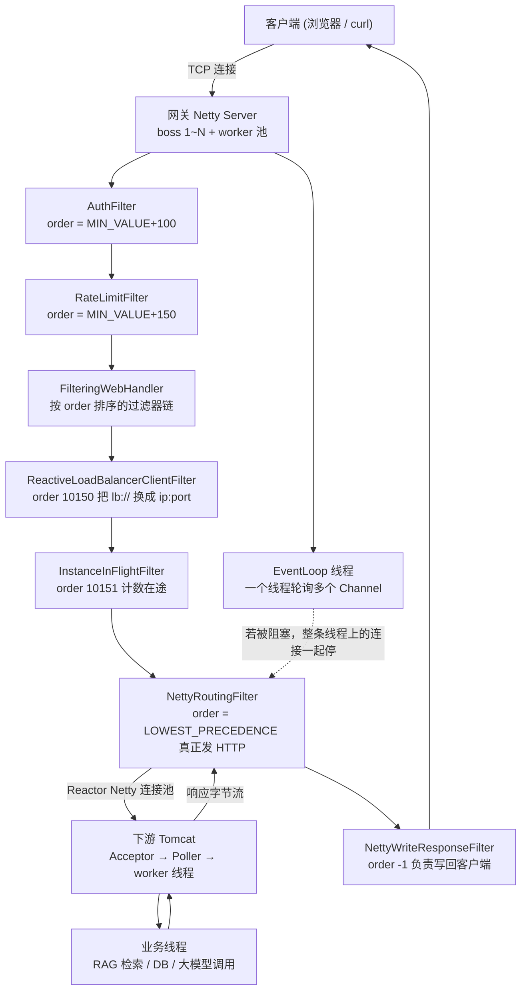
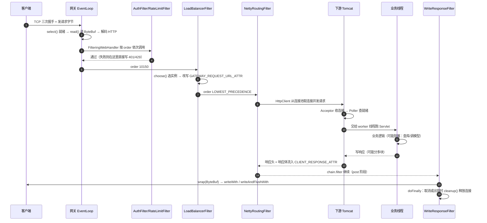

# 一次网关转发背后：谁在读写 socket，阻塞如何传染

> **一句话结论**：一次网关转发里，真正碰 socket 的只有 Netty EventLoop 池里的那几个线程——BIO 把"等待"摊给操作系统线程调度，多路复用把"等待"收进内核的就绪队列，所以 BIO 死在连接数上，NIO 死在"有人敢在 EventLoop 上阻塞一下"上。
> **阅读前置**：读过错综目录的线程池与并发篇（知道 `Future`、线程状态、上下文切换的代价）；用过 `InputStream`/`OutputStream` 读写数据；写过 Spring MVC 的 Controller；知道 Spring Cloud Gateway 站在所有微服务前面做转发。
> **证据基线**：编译目标 JDK 17，实测环境 OpenJDK 17.0.19 Temurin + Windows 11；Spring Boot 4.2.0 / Spring Cloud 2026.0.0（`spring-cloud-gateway-server-webflux` 5.1.0）；A 级证据取自 `learning-docs/24-源码分析/assets/source/` 的机器抓取摘录，B 级证据取本仓库 `ai-cs-gateway`、`ai-cs-chat` 真实代码（行号已核对）。预计阅读 45~60 分钟。

---

## 0. 先看现象

下面三类现象看起来互不相关，但都出在同一层：**谁在替你把字节搬进搬出 socket，以及那条线程在搬运期间还能不能干别的**。

### 现象 1：网关偶发 `Connection reset by peer`

网关日志里出现（异常类名是 Reactor Netty 的真实类，堆栈省略）：

```text
reactor.netty.http.client.PrematureCloseException: Connection prematurely closed BEFORE response
```

客户端侧则可能直接看到 `java.net.SocketException: Connection reset by peer`。**为什么偶发**：连接不是这次请求才建的——网关到下游复用了连接池里的空闲连接，而下游 Tomcat 侧因为 `keepAliveTimeout` 到期、或者一次发布重启，已经把这条连接关掉了。网关拿到一条"已经被对端关掉的连接"，写出去的第一批字节换来一个 RST。

### 现象 2：大响应被截断，日志出现 `already committed`

网关日志（`NettyWriteResponseFilter` 的 debug 输出）里有：

```text
NettyWriteResponseFilter response already committed, discarding inbound: ...
```

客户端侧 `curl` 报 `curl: (18) transfer closed with outstanding read data remaining`。**为什么**：响应头已经 flush 给客户端了（committed），此时再有第二个代码路径想写响应体，Netty/WebFlux 只能丢弃。这类问题多半出在"响应体是流式的、但中间某个过滤器想整体改写它"。

### 现象 3：压测 QPS 上不去，但 CPU 空闲

压测时 QPS 卡在某个数字不涨，`taskmgr` 看 CPU 30% 以下，`jcmd <pid> Thread.print` 抓出来的线程栈里绝大多数是 `WAITING`/`TIMED_WAITING`，剩下的 `RUNNABLE` 也没有吃满 CPU——**它们在 native 的 `read`/`epoll_wait` 里等**。机器没累，是并发的"通道"被占满了。

**这些现象指向同一件事**：网关这一层不产生业务 CPU 负载，它的吞吐由"同时能挂多少条连接"和"每条连接上那条线程是否被阻塞"两个数决定；理解这两件事，必须回到 `accept` / `read` / `select` 这几个系统调用上。

---

## 1. 整体地图



| 组件 | 责任 | 调用方 |
|---|---|---|
| Netty Server（`NettyServerProperties` 驱动） | `accept` 新连接、把字节读进 `ByteBuf` | Reactor Netty，由 `GatewayAutoConfiguration.NettyConfiguration` 装配 |
| `EventLoop` / `EventLoopGroup` | 一个线程轮询多个 `Channel` 的读写就绪事件 | Netty 内部；业务代码永远是被它回调 |
| `FilteringWebHandler` | 把全局过滤器 + 路由过滤器合成一条有序链 | `DispatcherHandler` → `RoutePredicateHandlerMapping` |
| `ReactiveLoadBalancerClientFilter` | 把 `lb://ai-cs-chat` 换成真实 `ip:port` | 过滤器链 |
| `NettyRoutingFilter` | 用 Reactor Netty `HttpClient` 把请求发给下游 | 过滤器链 |
| `NettyWriteResponseFilter` | 把下游响应体写回客户端 | 过滤器链（post 阶段最后执行） |
| Tomcat NIO Connector（`TomcatWebServer` 管理） | Acceptor 收连接、Poller 查就绪、worker 线程跑 Servlet | `ai-cs-chat` 等业务服务的 Servlet 容器 |
| 业务线程（Servlet worker） | 执行 Controller / Service，包括那些**阻塞**调用 | Tomcat worker 线程池 |

> **读图说明**：
> - 最关键的两条箭头是 `NS --> EP -.-> NR` 和 `NR --> WR`。第一条说明**网关几乎没有"每请求一条线程"的概念**：一个 EventLoop 线程同时轮询成百上千个 `Channel`，任何一次阻塞都会连坐；第二条说明**回程不是原路同步返回的**，`NettyRoutingFilter` 只负责把下游响应挂到 `exchange` 属性上，真正写回客户端是 `NettyWriteResponseFilter` 在 post 阶段做的事（`order = -1` 意味着 pre 阶段最早、post 阶段最晚）。
> - `TC --> TW` 那一侧是另一半世界：Servlet 栈是"一请求一线程"，一个 SSE 长连接会实打实占住一个 worker 线程直到连接结束。

---

## 2. 关键概念与关键类

先把本篇会用到的术语钉死（首次出现即解释，后文不再重复）：

- **fd（file descriptor，文件描述符）**：内核给每个打开的文件/socket 分配的整数编号，读写 socket 本质是对一个 fd 做系统调用。
- **阻塞 / 非阻塞**：`read` 时没数据，调用线程是"睡在这里等"（阻塞）还是"立刻返回 `-1`/`EAGAIN`"（非阻塞）。
- **同步 / 异步**：同步＝"数据就绪"要你自己去读；异步＝"数据已读完"由内核通知你。多路复用是**同步非阻塞**，不是异步。
- **就绪（readiness）**：fd 上有数据可读/可写这个"状态"，不是"数据已经拷到你的缓冲区"。
- **零拷贝**：省掉 CPU 参与的 `用户态缓冲区 ⇄ 内核页缓存` 那次拷贝，不是"一次拷贝都没有"。
- **EventLoop**：Netty 里"一个死循环 + 一个 `Selector` + 一个任务队列"的线程抽象，一个 `Channel` 终身只绑一个 EventLoop。
- **ByteBuf**：Netty 的字节容器，读写用两个独立指针，引用计数管理生命周期。
- **堆内 / 直接内存**：`byte[]` 在 Java 堆里（受 GC 管）；`DirectByteBuffer` 在堆外（受 `-XX:MaxDirectMemorySize` 管），写 socket 时不需要再拷一次。
- **背压（backpressure）**：下游消费不过来时，上游要能被"慢下来"，而不是把数据全堆在内存里。

**读下文锚点前的一句说明**：本篇 A 级锚点的形式是"方括号里写"源码"二字 + 冒号 + 归档文件名 + 行号区间"，例如 `源码:` 后面跟 `NettyRoutingFilter.java.md#L202-L212`。文件名取自 `learning-docs/24-源码分析/assets/source/` 的**归档名**（归档规则是"类名 + `.java.md`"），`#L` 后面是**该类原始源码的行号**（不是 md 文件的行号）；正文里写成 `Xxx.java#L120` 的，就是原始源码行号的口语写法。

| 名称 | 所在位置 | 角色 | 关键方法 |
|---|---|---|---|
| `Selector` | `java.nio.channels`（JDK） | 多路复用入口，注册 fd + 兴趣事件 | `open()` / `select()` / `selectedKeys()` |
| `Channel` | `io.netty.channel` | 一条连接（服务端 `NioServerSocketChannel`、客户端 `NioSocketChannel`） | `read()` / `write()` / `pipeline()` |
| `ByteBuf` | `io.netty.buffer` | 字节容器，双指针 + 引用计数 | `readableBytes()` / `retain()` / `release()` |
| `PooledByteBufAllocator` | `io.netty.buffer` | 池化分配器（jemalloc 风格 size class） | `directBuffer()` / `heapBuffer()` |
| `ChannelPipeline` | `io.netty.channel` | Handler 链，入站/出站双向传播 | `addLast()` / `fireChannelRead()` |
| `EventLoopGroup` | `io.netty.channel.nio` | 线程池，`NioEventLoopGroup` 默认线程数 = CPU 核数 × 2 | `next()` / `register()` |
| `FilteringWebHandler` | `spring-cloud-gateway-server-webflux` | 把所有 `GlobalFilter` 编成一条有序链 | `handle()` / `loadFilters()` |
| `ReactiveLoadBalancerClientFilter` | 同上 | 解析 `lb://` scheme，选实例并改写 URL | `filter()` / `choose()` |
| `NettyRoutingFilter` | 同上 | 用 Reactor Netty 发真实 HTTP 请求 | `filter()` / `getHttpClient()` / `getByteBuf()` |
| `NettyWriteResponseFilter` | 同上 | 把下游响应体写回客户端 | `filter()` / `wrap()` / `cleanup()` |
| `HttpClientProperties` | 同上 | `connectTimeout` / `responseTimeout` 的配置载体 | `getConnectTimeout()` / `getResponseTimeout()` |
| `GatewayAutoConfiguration` | 同上 | 条件装配 Netty + 过滤器 Bean | `routingFilter()` / `nettyWriteResponseFilter()` |
| `TomcatWebServer` | `spring-boot` servlet 容器模块 | Tomcat 的启停、Connector 绑定、优雅停机 | `initialize()` / `start()` / `startNonDaemonAwaitThread()` |
| `AuthFilter` / `RateLimitFilter` / `InstanceInFlightFilter` | 本项目 `ai-cs-gateway` | 鉴权、限流、在途请求计数 | `filter()` / `getOrder()` |

---

## 3. 原理与证据逐段精读

### 3.1 BIO：把"等待"摊到每一条线程上

**这段在做什么。** 最朴素的服务器长这样：主线程 `accept()` 一条连接，就把 `Socket` 交给一个线程，那个线程在 `read()` 里睡着，直到有字节到达、或对端关闭（`-1`）、或抛异常。

```java
// 依据 JDK 官方 API 文档（java.net.ServerSocket / java.net.Socket）示意
while (true) {
    Socket socket = serverSocket.accept();       // 没有新连接就阻塞在这
    new Thread(() -> {
        byte[] buf = new byte[8192];
        int n = socket.getInputStream().read(buf); // 没有数据就阻塞在这
        // ... 处理并写回
    }).start();
}
```

**为什么这么设计。** 因为它把"等待"这件事整个外包给了操作系统：线程睡不着的时候不占 CPU，内核在数据到达时把它唤醒。模型简单到你不需要知道 `Selector` 是什么，代码就是"顺序逻辑"。

**换成另一种写法会怎样。** 两种升级路线都能缓解 C10K：
1. **每次 accept 后不立刻开线程**，而是注册到 `Selector`，让一条线程监控上千条连接的就绪状态（这就是 3.3 的 NIO）；
2. **保留一连接一线程，但把线程做便宜**，例如 JDK 21 的虚拟线程——注意它只解决"线程太贵"，`read` 的阻塞语义没变。

**常见坑。** BIO 的成本不在 CPU 而在**线程数与栈内存**：每条线程一份栈（HotSpot x64 默认 `ThreadStackSize` 量级 1MB，可用 `-Xss` 调），一万条连接就是十 GB 级的地址空间加巨量上下文切换。另一个更隐蔽的坑是：**阻塞在 `read()` 里的 Java 线程在 `jstack` 里显示 `RUNNABLE`**（它确实在跑 native 代码），于是你看到"一堆 RUNNABLE 但 CPU 空"，第一反应往往是"死循环"——其实是等 IO。

### 3.2 多路复用：select / poll / epoll 的系统调用差异与代价

**这段在做什么。** 一条线程问内核："我手里这 N 个 fd，哪些现在可读/可写？"内核答完，线程只处理那些就绪的。三个方案的差别全在"这 N 个 fd 怎么交给内核、结果怎么拿回来"。

| 维度 | `select` | `poll` | `epoll` |
|---|---|---|---|
| fd 集合怎么传 | 每次调用重传整个 `fd_set` 位图 | 每次调用重传整个 `pollfd` 数组 | `epoll_ctl` 注册一次，内核用红黑树存 |
| 每次调用的开销 | 用户态→内核态**全量拷贝** + O(n) 线性扫描 | 同样全量拷贝 + O(n) 扫描 | `epoll_wait` 只返回就绪链表，O(就绪数) |
| fd 数量上限 | `FD_SETSIZE`，默认 1024 | 无硬上限（受内存/`file-max`） | 无硬上限（受 `file-max`） |
| 触发模式 | 水平触发 | 水平触发 | 水平触发 + 边沿触发（ET） |
| 移植性 | POSIX 通用 | POSIX 通用 | Linux 专属 |
| 典型问题 | fd 号大时位图浪费、超 1024 直接不可用 | 无上限但仍 O(n) | ET 模式必须读到 `EAGAIN`，否则漏事件 |

**为什么这么设计。** `select`/`poll` 是"无状态"的：内核不为你的 fd 集合保存任何东西，所以每次都得把集合再送进去一遍——连接数上万时，"送进去"本身就是主要成本。`epoll` 反过来，把状态留在内核（注册时建树），`epoll_wait` 只做"取结果"，于是**连接数与每次调用的成本解耦**。这才是 epoll 的真正优势，不是"一定更快"：连接数少、几乎全就绪时，多一次 `epoll_ctl` 注册反而更亏。

**换成另一种写法会怎样。** Java 侧你不用直接调这三个系统调用，`Selector.open()` 会挑平台实现。较新的 JDK 在 Windows 上已不是当年的 `select` 封装，而是 WEPoll（下面 C 级实测会在 17.0.19 上看到；更早版本以 `SelectorProvider.provider()` 实测为准）。所以"Windows 上 select 有 1024 上限"这个流传很广的说法，在本篇实测的 JDK 17 上已经不成立。

**常见坑。** ① 把 `epoll` 当银弹，忽视"就绪事件多时批量回调也是成本"；② 用 ET 模式却没在回调里循环读到 `EAGAIN`，事件丢了还找不到原因；③ 以为"多路复用 = 异步 IO"，其实它只是"一个线程管多条连接"，`read` 仍然是同步的。

**C 级证据（可复现）**：在 Windows 11 + Temurin 17.0.19 上打印 `Selector` 的真实实现类。

```java
import java.nio.channels.Selector;
import java.nio.channels.spi.SelectorProvider;

public class SelectorProviderDemo {
    public static void main(String[] args) throws Exception {
        SelectorProvider provider = SelectorProvider.provider();
        System.out.println("os.name        = " + System.getProperty("os.name"));
        System.out.println("java.version   = " + System.getProperty("java.version"));
        System.out.println("provider       = " + provider.getClass().getName());
        System.out.println("selector class = " + Selector.open().getClass().getName());
    }
}
```

```powershell
cd $env:TEMP\io-demo
java SelectorProviderDemo.java
```

实际输出：

```text
os.name        = Windows 11
java.version   = 17.0.19
provider       = sun.nio.ch.WEPollSelectorProvider
selector class = sun.nio.ch.WEPollSelectorImpl
```

**怎么读这个输出**：`provider` 是 `WEPollSelectorProvider`、`selector class` 是 `WEPollSelectorImpl`，说明这条机器上 JDK 的 `Selector` 走的是 WEPoll（Windows 版的 epoll 语义），不是 `select`。判读规则：Linux 上会看到 `EPollSelectorImpl`，macOS 上 `KQueueSelectorImpl`——**换平台只换实现类，业务代码不变**，这正是 JDK 把多路复用抽象成 `Selector` 的价值。

### 3.3 NIO 三件套：Channel / Buffer / Selector

**这段在做什么。** 三个角色分工：

- `Channel`：双向通道（`FileChannel` 除外），可以注册到 `Selector` 上，兴趣事件是 `OP_ACCEPT`、`OP_READ`、`OP_WRITE`、`OP_CONNECT`；
- `Buffer`：字节容器，有 `position`（读写位置）、`limit`（可读/可写边界）、`capacity`（容量）三个指针；
- `Selector`：`select()` 阻塞直到**至少一个**注册的 Channel 就绪，然后 `selectedKeys()` 给你就绪集合。

典型循环：`select()` → 遍历 `selectedKeys()` → 可读就读到 `-1` → 处理 → `key.remove()`。注意 `OP_WRITE` 几乎总是"就绪"的（只要发送缓冲区有空间），**常注册 `OP_WRITE` 会让 `select()` 立刻返回、空转烧 CPU**，正确做法是写不进去时才临时注册。

**为什么这么设计。** `Buffer` 的三指针是为了"一块内存两用"：写满之后不必拷到另一个数组再读，翻转指针方向即可复用同一块内存。

**换成另一种写法会怎样。** 这次反过来看：三指针的代价是**你必须手工维护状态机**——写→读要 `flip()`，读完要 `clear()`/`compact()`，忘记一次就是"读到 0 字节"或"数据错位"。Netty 的 `ByteBuf` 之所以用两个独立指针（`readerIndex` / `writerIndex`），就是为了干掉这个 `flip()`。

**常见坑。** 下面这个坑几乎所有写过 NIO 的人都踩过：写完直接 `get()`。

```java
import java.nio.ByteBuffer;

public class FlipDemo {
    public static void main(String[] args) {
        ByteBuffer buf = ByteBuffer.allocate(64);
        buf.put("hi".getBytes());
        System.out.println("after put : position=" + buf.position() + " limit=" + buf.limit() + " capacity=" + buf.capacity());
        System.out.println("read() without flip -> " + buf.get());   // 坑：没 flip
        buf.flip();
        System.out.println("after flip: position=" + buf.position() + " limit=" + buf.limit());
        System.out.println("read() after flip   -> " + (char) buf.get());
    }
}
```

C 级实测输出（`java FlipDemo.java`）：

```text
after put : position=2 limit=64 capacity=64
read() without flip -> 0
after flip: position=0 limit=3
read() after flip   -> h
```

**怎么读这个输出**：`after put` 时 `position=2`（写了 2 字节）、`limit=64`（还能写满 64），此时 `get()` 读的是 `position` 之后的空洞，所以拿到 `0`——**这就是"读到脏数据/读到 0"的真相**。那次 `get()` 顺手把 `position` 推到 3，所以 `flip()` 之后 `limit=3`、`position=0`，再 `get()` 才拿到 `h`。记住一句话：**`flip()` 不是清空，是把 `limit` 拉到 `position`、把 `position` 归零。**

### 3.4 Reactor 模式：单 Reactor / 多 Reactor / 主从

**这段在做什么。** Reactor 就是把 3.2/3.3 的"select 循环"抽成一个组件：**Reactor 负责发现就绪事件，Handler 负责处理事件**。三种形态：

| 形态 | 结构 | 优点 | 代价 / 适用 |
|---|---|---|---|
| 单 Reactor 单线程 | 一个线程做 accept + read + 业务 | 最简单，无锁 | 业务一慢全卡，只适合连接少、逻辑轻 |
| 单 Reactor 多线程 | 一个 Reactor 收事件，业务丢给线程池 | 业务并行 | Reactor 线程仍是单点；`read` 与"派发"耦合在一人身上 |
| 主从 Reactor | `boss` 只 `accept`，`worker` 组负责读写事件，业务仍在 worker 上 | accept 与读写隔离，可水平扩 worker | 多一层线程切换与连接分配 |

**为什么这么设计。** `accept` 是低频事件（新连接不常有），读写是高频事件；把两者拆到不同 EventLoop 组，可以给读写组更多线程而不浪费在 `accept` 上。Netty 的 `ServerBootstrap.group(bossGroup, workerGroup)` 就是主从形态。

**换成另一种写法会怎样。** 单 Reactor 多线程看起来"业务进池子"就完事了，但只要 `read` 之后还要在 Reactor 线程上做编解码（协议解析、TLS 解密），Reactor 线程就仍然是瓶颈——所以 Netty 的做法是 **worker 线程自己就是 IO 线程**，编解码都在它上面做，业务才由你显式切走。

**常见坑。** 把"主从"理解成"两条线程干同一件事"：其实 `boss` 组通常 1 个线程就够（`accept` 就那点活），`worker` 组默认 `CPU 核数 × 2`（依据 Netty `MultithreadEventLoopGroup` 的默认值，可用 `-Dio.netty.eventLoopThreads` 覆盖）。调大 `boss` 线程数几乎没有收益。

### 3.5 EventLoop：一条线程与它名下所有连接的终身绑定

**这段在做什么。** `NioEventLoop.run()` 是一个死循环，每圈做三件事：`select()` 拿到就绪事件 → `processSelectedKeys()` 回调 handler → `runAllTasks()` 跑队列里的任务。**一个 `Channel` 注册时被分配到一个 EventLoop，此后终身不变**（`EventLoopGroup.next()` 那一刻决定）。

**为什么这么设计。** 因为"终身绑定"换来了**无锁串行化**：同一个 `Channel` 上的所有回调永远在同一条线程上执行，`ChannelPipeline` 里的 handler 状态（解码器的半包缓冲、业务对象）就不需要任何同步。这是 Netty 性能好写的根本原因。

**换成另一种写法会怎样。** 如果改成"每个事件随机分配线程"，你就得给每个 handler 加锁或用并发容器，`LengthFieldBasedFrameDecoder` 那种"半包等待下一批字节"的状态在跨线程时会变得极难正确。

**常见坑。** 终身绑定是一份契约：**在 EventLoop 线程上阻塞 = 这条线程名下的所有连接一起停**。默认 `worker` 线程数 = CPU × 2，所以一次 200ms 的阻塞调用，会让这条线程上平均分摊的几十上百条连接全部卡 200ms；线程数少的时候，整个网关的 QPS 就塌了——这正是现象 3。判断当前是否在 EventLoop 上：Netty 里用 `ctx.executor().inEventLoop()`，Reactor 里用 `Schedulers.isInNonBlockingThread()`；Reactor 官方还提供 `BlockHound` 在测试期直接抛异常抓这种调用。

### 3.6 ChannelPipeline：一条可拆卸的 handler 链

**这段在做什么。** 一个 `Channel` 上挂一条双向链：入站事件（`channelRead`、`channelActive`）从 `head` 往 `tail` 走，出站操作（`write`、`flush`）从 `tail` 往 `head` 走。粘包拆包、编解码、心跳、空闲检测都是往链上插 handler。

**为什么这么设计。** 因为协议栈本质是"一层解码、一层校验、一层业务、再一层编码"，链式结构让它可拆卸、可复用、顺序可组合。Spring Cloud Gateway 的过滤器链是同一个思路——`FilteringWebHandler.loadFilters()` 里对实现了 `Ordered` 的过滤器取 `getOrder()`，否则退化成读 `@Order` 注解，最后用 `AnnotationAwareOrderComparator.sort(combined)` 排一遍——见 [[源码:FilteringWebHandler.java.md#L74-L84]]。

**换成另一种写法会怎样。** 用 `if-else` 硬编码顺序也能跑，但每加一个功能就改一次主干，且无法按需开关（Gateway 的 `@ConditionalOnEnabledGlobalFilter` 就是靠 Bean 的有无来开关单个过滤器）。

**常见坑。** ① 在 handler 里 `new Thread(...)` 或调阻塞 SDK，直接毁掉 3.5 的契约；② 入站拿到 `ByteBuf` 后没有 `release()`（或该 `retain()` 没 `retain`），引用计数归零前泄漏；③ 出站 `write` 不 `flush`，数据躺在缓冲区里直到超时——日志上看是"下游没收到"，抓包才能看出没发出去。

### 3.7 ByteBuf：双指针、池化、堆内 vs 直接内存

**这段在做什么。** `ByteBuf` 用 `readerIndex` / `writerIndex` 两个指针替代 NIO 的三指针状态机：写只动 `writerIndex`，读只动 `readerIndex`，读写之间**不需要 flip**。`discardReadBytes()` 才回收已读部分。生命周期用引用计数（`retain()` / `release()`），`CompositeByteBuf` 可以把多个 `ByteBuf` 逻辑拼成一个视图而不拷贝。

**为什么这么设计。** 双指针解决的问题在 3.3 已经演示过（`flip()` 一忘就废）；引用计数解决的问题是"零拷贝共享"——同一块内存可能被 pipeline 里多个 handler 持有，谁最后放手谁负责释放，避免"提前释放导致读到脏数据"和"永不释放导致泄漏"两难。池化（`PooledByteBufAllocator`，jemalloc 风格的 size class）解决的是**高频分配小块的 GC 压力与 malloc 开销**。

**换成另一种写法会怎样。** 用 `byte[]` + 手写下标：JS 式简单，但跨 handler 传递必须拷，一拷就毁掉零拷贝路径；用 NIO `ByteBuffer`：`flip()` 状态机和 `capacity` 不可变（不能扩容）会逼你在协议解析时做大量切片与拼接。

**直接内存的代价（C 级实测）**：`DirectByteBuffer` 的分配/回收比堆内慢一个量级，因为它要向 OS 要页、回收还要靠 `Cleaner`。下面这段在 20 万次分配下对比（每次 1024 字节，`putLong` 保证不被优化掉）：

```java
import java.nio.ByteBuffer;

public class AllocDemo {
    public static void main(String[] args) {
        int loops = 200_000;
        for (int round = 1; round <= 3; round++) {
            long t0 = System.nanoTime();
            for (int i = 0; i < loops; i++) {
                ByteBuffer b = ByteBuffer.allocate(1024);
                b.putLong(0, i);
            }
            long heapNs = System.nanoTime() - t0;
            long t1 = System.nanoTime();
            for (int i = 0; i < loops; i++) {
                ByteBuffer b = ByteBuffer.allocateDirect(1024);
                b.putLong(0, i);
            }
            long directNs = System.nanoTime() - t1;
            System.out.printf("round=%d heap=%dms direct=%dms ratio=%.1fx%n",
                    round, heapNs / 1_000_000, directNs / 1_000_000, (double) directNs / heapNs);
        }
    }
}
```

实测输出（同一台机器连跑 3 轮，绝对值每次都会浮动，看量级）：

```text
round=1 heap=74ms direct=224ms ratio=3.0x
round=2 heap=65ms direct=202ms ratio=3.1x
round=3 heap=0ms direct=198ms ratio=1995.6x
```

**怎么读这个输出**：前两轮 `ratio` 稳定在 3 倍左右，说明**直接内存分配比堆内慢约 3 倍**；第 3 轮 `heap=0ms` 是**假数字**——JIT 的逃逸分析发现那些 `ByteBuffer` 根本没被用，直接把整个分配循环消掉了，而 `allocateDirect` 有副作用（真的向 OS 要内存）所以消不掉。**这就是为什么"直接内存性能对比"的基准测试极易得出垃圾结论**，也是 Netty 必须自己搞池化的原因：池化之后分配是"从 freelist 摘一个"，两边都不进 `malloc`。

另一个必须知道的数字：`-XX:MaxDirectMemorySize` 默认是 `0`，含义是"不单独限制，等于 `-Xmx`"。

```powershell
java -XX:+PrintFlagsFinal -version | Select-String 'MaxDirectMemorySize|MaxHeapSize'
```

实际输出：

```text
   size_t MaxHeapSize                              = 8514437120 {ergonomic}
 uint64_t MaxDirectMemorySize                      = 0 {product} {default}
```

**怎么读这个输出**：`MaxHeapSize` 约 8.1GB（按机器内存 1/4 的 `ergonomic` 策略算出来的），`MaxDirectMemorySize = 0` 表示"跟随堆上限"。所以直接内存泄漏的典型报错是 `java.lang.OutOfMemoryError: Direct buffer memory`，而你的堆监控一切正常——**排查直接内存问题要看 `-XX:MaxDirectMemorySize` 和 `BufferPoolMXBean`，不是看堆**。

**常见坑。** ① 池化 + 引用计数下"忘了 `release`"是最常见泄漏源，Netty 用 `ResourceLeakDetector`（`-Dio.netty.leakDetection.level=paranoid`）抓；② `ByteBuf.slice()` / `duplicate()` 出来的视图不 `retain` 就跨 handler 传递，上游 `release` 后你手里是野指针；③ 把 `ByteBuf` 交给别的线程异步用，却没 `retain`。

### 3.8 零拷贝：网关里真正省掉的那次拷贝

**这段在做什么。** 网关的角色是"搬运工"，所以它的性能几乎全部取决于"能不能不拷"。A 级证据：`NettyRoutingFilter` 把请求体交给下游时，对不同 `DataBuffer` 分两种处理——见 [[源码:NettyRoutingFilter.java.md#L215-L226]]：

```java (src: NettyRoutingFilter.java.md#L215-L226)
	protected ByteBuf getByteBuf(DataBuffer dataBuffer) {
		if (dataBuffer instanceof NettyDataBuffer) {
			NettyDataBuffer buffer = (NettyDataBuffer) dataBuffer;
			return buffer.getNativeBuffer();
		}
		// MockServerHttpResponse creates these
		else if (dataBuffer instanceof DefaultDataBuffer) {
			DefaultDataBuffer buffer = (DefaultDataBuffer) dataBuffer;
			return Unpooled.wrappedBuffer(buffer.getNativeBuffer());
		}
		throw new IllegalArgumentException("Unable to handle DataBuffer of type " + dataBuffer.getClass());
	}
```

**这段在做什么（逐句）**：如果 `DataBuffer` 本身就是 Netty 的实现，直接 `getNativeBuffer()` 把底层 `ByteBuf` 交出去——**零拷贝**；只有"不是 Netty 生产的" `DefaultDataBuffer` 才用 `Unpooled.wrappedBuffer` 包一层（还是包装，不复制内容）；两个都不是就直接抛 `IllegalArgumentException`。中间那行注释 `// MockServerHttpResponse creates these` 是作者留下的线索：`DefaultDataBuffer` 这条分支主要服务测试替身 `MockServerHttpResponse`，生产链路上基本走第一条。回程同理：`NettyWriteResponseFilter.wrap()` 把下游收到的 `ByteBuf` 直接 `factory.wrap(byteBuf)` 变成 `DataBuffer`；只有 `DefaultDataBufferFactory` 才走 `allocateBuffer` + `write(...)` + `release()` 那条"多一次拷贝"的降级路径——见 [[源码:NettyWriteResponseFilter.java.md#L143-L157]]。

**为什么这么设计。** 因为 WebFlux 生态里 `DataBuffer` 是抽象（不同容器不同实现），而网关要和 Netty 零拷贝对接，就必须有一条"认出原生实现就直接交出去"的旁路。这条旁路决定了：**只要你不插一个会改写响应体的过滤器**（比如 `ModifyResponseBodyGatewayFilterFactory`），网关转发大文件时内存里就只有一份字节。

**换成另一种写法会怎样。** 如果统一 `allocate + write`，一个 100MB 的下载就要在网关堆里再多一份 100MB 副本，而且这份副本要过 GC——这就是"网关一开 `ModifyResponseBody` 就 OOM"的由来。

**更底层的零拷贝**（依据 `sendfile(2)` / `mmap(2)` 手册与 JDK `FileChannel` 文档）：传统 `read + write` 是"磁盘 → 页缓存 → 用户缓冲区 → socket 缓冲区 → 网卡"，4 次拷贝 4 次上下文切换；`sendfile` 让数据"磁盘 → 页缓存 → 网卡"，CPU 不碰数据；`mmap` 把文件页映射进用户地址空间，省掉"页缓存 → 用户缓冲区"这一跳；Java 里对应 `FileChannel.transferTo()`（底层 `sendfile`）和 `MappedByteBuffer`（底层 `mmap`）。RocketMQ 用 `mmap` 读 CommitLog，Kafka 用 `sendfile` 发消息，都是这个原理。

**常见坑。** ① `transferTo` 单次有上限（内核会限制一次搬运量），大文件要循环搬并在每次循环后修正 offset；② `MappedByteBuffer` 的 unmap 不由 GC 保证，删文件/覆盖文件时可能因为映射未释放而失败（Windows 上尤其明显）；③ 零拷贝省的是 CPU 拷贝，不省网络带宽——带宽打满时它救不了你。

### 3.9 为什么网关是 WebFlux，而业务服务是 Tomcat

**这段在做什么。** 先把事实钉住：本项目的网关依赖是 `spring-cloud-starter-gateway-server-webflux`（`ai-cs-gateway/pom.xml#L22`），并且在引入 `ai-cs-common` 时显式排除了 `org.springframework.boot:spring-boot-starter-webmvc`（`ai-cs-gateway/pom.xml#L44-L52`，注释原文是"排除了 Spring MVC，网关基于 WebFlux，两者不兼容"）；而 `ai-cs-chat` 走的是 Servlet 栈，`ai-cs-chat/pom.xml#L22` 仍是旧的 `spring-boot-starter-web` 坐标（Boot 4 已把它标记为 deprecated，见 §7）。

Spring Cloud Gateway 这边靠条件装配决定"用不用 Netty 传输"：整个自动配置类挂在 `@ConditionalOnClass(DispatcherHandler.class)` 上（见 [[源码:GatewayAutoConfiguration.java.md#L220]]），而 Netty 传输那一段又挂在 `@ConditionalOnClass({ HttpClient.class, NettyServerProperties.class })` 上（见 [[源码:GatewayAutoConfiguration.java.md#L850-L851]]）。

**为什么这么设计。** 因为**网关是纯转发**：一条连接的存活时间里没有业务计算，只有"读进来、发出去"，所以"少量线程 + 多路复用"是它的最优解。业务服务相反：一次请求要查库、要调大模型、要读文件，全是阻塞逻辑，Servlet 的"一请求一线程"反而让每段业务代码都能顺序写，线程就是天然的隔离单元。

**换成另一种写法会怎样。** 两边都能换，但代价不同：
- 网关换成 MVC：`spring-boot-starter-gateway` 与 `spring-boot-starter-webmvc` 同时在场会启动失败（WebFlux 与 MVC 的 `DispatcherHandler`/`DispatcherServlet` 抢同一套 `HandlerMapping`），所以 pom 里必须排除；
- 业务服务换成 WebFlux：所有阻塞 SDK（JDBC、`OkHttp`、同步 RAG 检索）都得包进 `Schedulers.boundedElastic()`，否则直接把 EventLoop 卡死（见 3.11）。

顺带澄清一个常见误解：**Tomcat 也能跑 WebFlux**。`TomcatWebServer.imperative()` 里有个判断——如果包装的 Servlet 类是 `org.springframework.http.server.reactive.TomcatHttpHandlerAdapter`，就认为"不是命令式（imperative）栈"——见 [[源码:TomcatWebServer.java.md#L412-L422]]。所以"WebFlux 一定跑在 Netty 上"是错的，WebFlux 是编程模型，Netty 是它的默认运行时。

Tomcat 自己的连接模型分三段（依据 Tomcat 官方文档 `maxThreads` / `acceptCount` / `maxConnections` 的说明，NIO connector 自 Tomcat 8.0 起为默认、BIO connector 在 8.5 被移除）：**Acceptor** 只负责 `accept` 新连接并把它注册给 **Poller**；**Poller** 用 `Selector` 查就绪；就绪的请求被交给 **worker 线程池**跑 Servlet，`maxThreads` 默认 200。这解释了两件事：① 空闲连接不占 worker 线程（这就是 NIO connector 相对 BIO 的进步）；② **一个请求在 Servlet 里待多久，就占住 worker 多久**——SSE 长连接会把 `maxThreads` 直接吃光。

Tomcat 还有一个和"谁在撑住 JVM"有关的细节：`TomcatWebServer.startNonDaemonAwaitThread()` 会额外起一条非 daemon 线程去 `tomcat.getServer().await()`，因为 Tomcat 的线程全是 daemon，不这样主线程一结束进程就退了——见 [[源码:TomcatWebServer.java.md#L199-L211]]：

```java (src: TomcatWebServer.java.md#L199-L211)
	private void startNonDaemonAwaitThread() {
		Thread awaitThread = new Thread("container-" + (containerCounter.get())) {

			@Override
			public void run() {
				TomcatWebServer.this.tomcat.getServer().await();
			}

		};
		awaitThread.setContextClassLoader(getClass().getClassLoader());
		awaitThread.setDaemon(false);
		awaitThread.start();
	}
```

**这段在做什么（逐句）**：起一条名字叫 `container-N` 的线程，`setDaemon(false)` 让它成为非守护线程，然后在 `await()` 里长期阻塞等停机信号。**为什么要非守护**：daemon 线程不阻止 JVM 退出，如果 `main` 跑完就没人撑着，容器会"启动成功但立刻退出"，日志上表现为"Started Application in X seconds"紧跟进程结束。**常见坑**：这个线程的栈里永远有一帧 `await()`，用 `jstack` 排查"谁在阻塞"时要认得它，别误判成业务卡死。

### 3.10 三个过滤器串起来：一次转发到底谁在写 socket

**这段在做什么。** 网关的转发在三个 `GlobalFilter` 里完成，它们的 `order` 决定了"谁先跑、谁后跑"。

第一段，把 `lb://ai-cs-chat` 换成真实地址（`order = 10150`，见 [[源码:ReactiveLoadBalancerClientFilter.java.md#L109-L141]]）：

```java (src: ReactiveLoadBalancerClientFilter.java.md#L109-L141)
		return choose(lbRequest, serviceId, supportedLifecycleProcessors).doOnNext(response -> {

			if (!response.hasServer()) {
				supportedLifecycleProcessors.forEach(lifecycle -> lifecycle
					.onComplete(new CompletionContext<>(CompletionContext.Status.DISCARD, lbRequest, response)));
				throw NotFoundException.create(properties.isUse404(), "Unable to find instance for " + url.getHost());
			}

			ServiceInstance retrievedInstance = response.getServer();

			URI uri = exchange.getRequest().getURI();

			// if the `lb:<scheme>` mechanism was used, use `<scheme>` as the default,
			// if the loadbalancer doesn't provide one.
			Objects.requireNonNull(retrievedInstance, "retrievedInstance can not be null");
			String overrideScheme = retrievedInstance.isSecure() ? "https" : "http";
			if (schemePrefix != null) {
				overrideScheme = url.getScheme();
			}

			DelegatingServiceInstance serviceInstance = new DelegatingServiceInstance(retrievedInstance,
					overrideScheme);

			URI requestUrl = reconstructURI(serviceInstance, uri);

			if (log.isTraceEnabled()) {
				log.trace("LoadBalancerClientFilter url chosen: " + requestUrl);
			}
			exchange.getAttributes().put(GATEWAY_REQUEST_URL_ATTR, requestUrl);
			exchange.getAttributes().put(GATEWAY_LOADBALANCER_RESPONSE_ATTR, response);
			supportedLifecycleProcessors.forEach(lifecycle -> lifecycle.onStartRequest(lbRequest, response));
		})
			.then(chain.filter(exchange))
```

**逐句**：`choose()` 是反应式的（不阻塞地选一个实例）；选不到实例时先通知所有 `LoadBalancerLifecycle` 处理器"这次选择被丢弃"（`CompletionContext.Status.DISCARD`），再抛 `NotFoundException`（配 `use404` 时映射成 404，否则 503）；选到了就用 `exchange` 里原始请求的 `uri` 加上真实实例的 `host:port` 重建 URL——注意 `schemePrefix != null`（即地址写成 `lb:https://…`）时协议取你写的前缀而不是实例的 `isSecure()`；最后把结果塞进 `GATEWAY_REQUEST_URL_ATTR`，把 `Response<ServiceInstance>` 塞进 `GATEWAY_LOADBALANCER_RESPONSE_ATTR`，并回调 `onStartRequest`（本项目 `InstanceInFlightFilter` 读的正是后一个属性来加在途计数）。**为什么要放进属性而不是直接返回**：因为后面还有过滤器要读它，`exchange` 的属性表就是过滤器之间的"黑板"。

第二段，真正发请求（`order = Ordered.LOWEST_PRECEDENCE`，见 [[源码:NettyRoutingFilter.java.md#L202-L212]]）：

```java (src: NettyRoutingFilter.java.md#L202-L212)
		Duration responseTimeout = getResponseTimeout(route);
		if (responseTimeout != null) {
			responseFlux = responseFlux
				.timeout(responseTimeout,
						Mono.defer(() -> Mono
							.error(new TimeoutException("Response took longer than timeout: " + responseTimeout))))
				.onErrorMap(TimeoutException.class,
						th -> new ResponseStatusException(HttpStatus.GATEWAY_TIMEOUT, th.getMessage(), th));
		}

		return responseFlux.then(chain.filter(exchange));
```

**逐句**：`getResponseTimeout(route)` 先看路由 metadata 里的超时键（常量 `RouteMetadataUtils.RESPONSE_TIMEOUT_ATTR`，见该类的静态导入），没有就回落到 `HttpClientProperties`；**两者都没配就是 `null`，于是没有超时**。有超时才挂 `.timeout()`，并把 `TimeoutException` 映射成 504 `GATEWAY_TIMEOUT`。最后 `responseFlux.then(chain.filter(exchange))`——意思是"先把请求发出去、拿到响应（挂在属性上），再继续走后面的过滤器链"。注意这里的 `then` 方向：**发请求是前置动作，写响应不在这里**。

第三段，写回客户端（`order = -1`，见 [[源码:NettyWriteResponseFilter.java.md#L113-L133]]）：

```java (src: NettyWriteResponseFilter.java.md#L113-L133)
					final Flux<DataBuffer> body = connection
							.inbound()
							.receive()
							.retain()
							.map(byteBuf -> wrap(byteBuf, response));

					MediaType contentType = null;
					try {
						contentType = response.getHeaders().getContentType();
					}
					catch (Exception e) {
						if (log.isTraceEnabled()) {
							log.trace("invalid media type", e);
						}
					}

					HttpClientResponse httpClientResponse = exchange.getAttribute(CLIENT_RESPONSE_ATTR);
					Mono<Void> write = (isStreamingMediaType(contentType)
							? response.writeAndFlushWith(body.map(Flux::just))
							: response.writeWith(body));
					return write.then(TrailerHeadersFilter.filter(getHeadersFilters(), exchange, httpClientResponse)).then();
```

**逐句**：`connection.inbound().receive().retain()` 从下游连接上"流式"读响应体（不是全量读进内存）；`wrap` 把 `ByteBuf` 变成 `DataBuffer`（零拷贝路径见 3.8）；关键是 `isStreamingMediaType(contentType)` 这个分支——SSE（`text/event-stream`）、`application/stream+json` 这类流式类型走 `writeAndFlushWith`（**每块立刻 flush**），其他类型走 `writeWith`（允许容器攒批）。**这就是"网关转发 SSE 必须被识别为流式"的原因**：走错分支就会攒批，表现为"AI 回复不是一段段出来，而是最后一次性吐"。

**为什么 `order = -1` 反而"最后"写。** 因为 `chain.filter(exchange)` 是递归嵌套：order 小的先执行 pre 部分，但它的 post 部分（`.then(...)` 之后）最后才执行。`NettyWriteResponseFilter` 的 `order = -1` 是**最小值**，所以它的 pre 阶段在所有过滤器之前跑（此时什么都不做，源码注释明确说前置阶段没有事情可做，因为 `CLIENT_RESPONSE_CONN_ATTR` 要等 `NettyRoutingFilter` 跑完才有），post 阶段则在所有过滤器之后跑——正好可以在别人都写完时负责写响应。

**换成另一种写法会怎样。** 如果让 `NettyRoutingFilter` 自己把响应写完，就会和"响应体改写类过滤器"抢同一份数据流；分成"取响应"与"写响应"两个过滤器，才能让中间那些过滤器在响应体经过时做手脚（`ModifyResponseBody`、加 header、压 gzip）。

**常见坑。** ① 以为 `responseTimeout` 有默认值——`HttpClientProperties` 里 `private Integer connectTimeout;`（[[源码:HttpClientProperties.java.md#L40]]）和 `private Duration responseTimeout;`（[[源码:HttpClientProperties.java.md#L43]]）都**没有初始值**，不配就是 `null`；② 在 pre 阶段去读 `CLIENT_RESPONSE_ATTR`，永远是空；③ 想给单个路由加超时却写到全局配置里——`HttpClientProperties` 绑的是 `GatewayProperties.PREFIX + ".httpclient"` 前缀（见 [[源码:HttpClientProperties.java.md#L35]]），改的是**所有路由共用**的 `responseTimeout`，结果把 SSE 全掐了（本项目正是**一个都没配**，见下）。

### 3.11 阻塞如何传染：从一条线程到整个网关

**这段在做什么。** 先确认网关侧是干净的：`ai-cs-gateway/src/main/java` 下 grep `.block(`、`boundedElastic`、`publishOn`、`subscribeOn`、`Mono.fromCallable` **全部零命中**，也就是说当前网关的自定义过滤器（`AuthFilter`、`RateLimitFilter`、`InstanceInFlightFilter`）里没有任何"把反应式转回阻塞"的写法。这是好事，也是必须守住的基线。

再看业务侧的对照组：`ChatServiceImpl` 的 SSE 方法里，`Flux<String> flux = futureFlux.get();`（`ai-cs-chat/src/main/java/com/aics/chat/service/impl/ChatServiceImpl.java#L601`）——这是在 **Servlet 请求线程**上真阻塞，等异步 AI 调用把 `Flux` 准备好；前面的 `retrieveRagDocs(...)`（同文件 `#L587`）也是同步调用。这些都发生在 Tomcat worker 线程上，不碰 EventLoop，所以**只是占线程，不会卡网关**——但如果 `maxThreads` 被占满，网关看到的就是"下游不响应"。

传染路径是这样的：

| 环节 | 被卡住的东西 | 观测信号 | 处理方式 |
|---|---|---|---|
| 业务线程里同步调 AI/DB | Tomcat worker（默认 200） | `jstack` 里 worker 全停在同一个业务方法；下游 QPS 正常但排队 | 用异步 SDK + `SseEmitter` 已做；进一步靠超时与限流 |
| SSE 长连接 | 一个 worker 占 5 分钟（`SSE_EMITTER_TIMEOUT`） | `netstat` 里 8083 的 ESTABLISHED 数量级等于 worker 数 | 增大 `maxThreads` 要谨慎；正解是流式模型换 WebFlux 或虚拟线程 |
| 网关没有 response-timeout | Reactor Netty 连接 + 挂在 EventLoop 上的订阅 | 客户端先超时、网关日志无 504 | 按路由配 `response-timeout`；SSE 路由单独放宽 |
| 网关在 EventLoop 上阻塞 | 该 EventLoop 名下所有连接 | QPS 塌、CPU 空、`jstack` 里 EventLoop 线程停在业务方法 | 严禁 `.block()`；用 `boundedElastic` 显式切走 |

**为什么这么设计。** 反应式的核心契约是"**不阻塞调用线程**"，代价是你必须把所有阻塞调用显式搬到别的线程池。这条契约没有编译期检查，所以它只能靠纪律（和 `BlockHound`）守。

**换成另一种写法会怎样。** 在网关里写 `mono.block()` 是最省事的写法，压测时也"看起来很对"——单连接测完全没问题，因为阻塞的只有一条线程、一条请求。一上并发就原形毕露：EventLoop 线程全被占，`select()` 没机会跑，新连接连 `accept` 完都没人读。**这类问题在小流量下永远不会暴露**，这也解释了为什么"上线第二天才炸"。

**常见坑。** ① 用 `.subscribe()` 在 pre 阶段"提前发起"，结果响应早于过滤器链被写；② 在 `doOnNext` 里调同步 SDK；③ 用 `subscribeOn(boundedElastic)` 就以为安全——`subscribeOn` 只影响订阅动作发生的线程，数据流后续算子在谁的线程上执行还要看 `publishOn`。

---

## 4. 一次完整执行时序



> **读图说明**：
> - 关键在**第 8 步与第 12 步之间的时间差**：从 `NR->>TC` 发出请求到 `TC-->>NR` 收到响应，这段耗时里网关的 EventLoop 线程**并没有在等**——它在同一时间轮询别的 `Channel`。这就是"少量线程扛大量并发"的来源；一旦 `responseTimeout` 没配，这条订阅可以无限挂着，占的是连接池里的连接而不是线程。
> - 第二个关键是**第 13~14 步的"跨过滤器接力"**：`NettyRoutingFilter` 只把响应挂到 `exchange` 属性上，真正写回客户端的是 `NettyWriteResponseFilter`；它靠 `doFinally` 保证正常完成、异常、客户端断开三条路径都会 `cleanup()` 释放下游连接——这条如果漏了，就是连接泄漏。

**哪一步失败会报什么错**（逐条对应上图的编号）：

| 失败位置 | 现象 / 异常 | 根因与下一步 |
|---|---|---|
| 第 2 步解码 | `io.netty.handler.codec.http.TooLongHttpHeaderException` / `TooLongHttpLineException` | 请求头或首行超过 `maxHeaderSize`，先看客户端是不是塞了大 cookie |
| 第 3~4 步鉴权 | 401 + 本项目统一 JSON | `AuthFilter` 抛/写响应；查 `ai-cs-gateway/src/main/java/com/aics/gateway/filter/AuthFilter.java#L237-L242` 的 `unauthorized()` |
| 第 5 步限流 | 429 + `Retry-After` | 看 `RateLimitFilter` 的 key 解析：伪造 `X-User-Id` 会切桶，所以它必须排在 `AuthFilter`（order +100）之后（order +150） |
| 第 7 步选实例 | 503 `Unable to find instance for ai-cs-chat` | 注册中心没有健康实例；核对 Nacos 里该服务的实例数 |
| 第 8 步建连 | `io.netty.channel.ConnectTimeoutException` | `connect-timeout`（默认来自 `HttpClientProperties`，本项目未配 → 走 Reactor Netty 默认） |
| 第 11~12 步等响应 | 504 `Response took longer than timeout` | 只在配了 `response-timeout` 时出现；**没配就永远不会有这个错**，客户端先超时 |
| 第 12 步中途断开 | `PrematureCloseException: Connection prematurely closed BEFORE response` | 复用了已被对端关闭的空闲连接，或下游重启；考虑重试（仅幂等 GET）与连接池 `maxIdleTime` |
| 第 14 步写回 | `already committed, discarding inbound` | 响应头已提交却又想二次写；来源见 §6 第 2 条 |

---

## 5. 设计取舍

| 方案 | 优点 | 代价 | 本项目怎么选 |
|---|---|---|---|
| BIO + 线程池 | 代码顺序化，无回调，调试最容易 | 线程数 = 并发连接数，栈内存与上下文切换成本高；C10K 不可行 | 不用；Tomcat 8.5 起连 BIO connector 都移除了 |
| Tomcat NIO connector + Servlet | 空闲连接不占 worker；业务代码同步写 | 请求占线程直到结束，SSE 长连接会吃光 `maxThreads`；每请求一次线程切换 | **业务服务选它**（`ai-cs-chat` / `ai-cs-order`），因为业务全是阻塞调用 |
| Netty 主从 Reactor | 少量线程扛大量连接；回调式无阻塞 | 编程范式陡峭；任何阻塞调用都会毁掉整条 EventLoop | **网关选它**（`spring-cloud-starter-gateway-server-webflux`） |
| 堆内 `byte[]` / `ByteBuffer` | 分配快（实测快 3 倍），受 GC 管 | 写 socket 前要一次拷贝；大对象进老年代 | 小报文、业务对象用它 |
| 直接内存 + 池化 | 免拷贝、无 GC 压力、可零拷贝对接 | 分配慢、泄漏难查（`Direct buffer memory`）、受 `MaxDirectMemorySize` 限制 | **Netty 默认用它**（`PooledByteBufAllocator`） |
| 零拷贝（`sendfile` / `wrap`） | 大响应几乎不占网关内存 | 中间不能改写响应体；不是所有链路都支持 | 网关默认路径；一旦加 `ModifyResponseBody` 就退化成拷贝 |
| 给每条路由配超时 | 把"卡住"变成可观测的 504 | 配错会掐断 SSE / 大文件下载 | **本项目当前一个都没配**——这是最值得补的一块 |

**可扩展点清单**（按实用度排序）：

1. **给路由加 `response-timeout`**：在 `RouteConfig.customRouteLocator` 里按业务类型分开配 `.metadata(Map.of("response-timeout", 30000))`，SSE 路由放宽到分钟级（**键名以 `RouteMetadataUtils.RESPONSE_TIMEOUT_ATTR` 常量为准，写错会静默不生效**）。
2. **配 `connect-timeout`**：下游实例网络抖动时能快速失败，而不是让请求挂在连接建立阶段。
3. **开 wiretap**：把 `HttpServerProperties.PREFIX + ".wiretap"` 这个键设为 `true`（键的前缀由该常量拼出，按你所用版本核对实际键名）就会装配 `nettyServerWiretapCustomizer`，它给 `NettyReactiveWebServerFactory` 加一个 `httpServer.wiretap(true)` 定制器（见 [[源码:GatewayAutoConfiguration.java.md#L855-L866]]），把原始字节打进日志，排查协议问题最快的一招（**只在排障时开，日志量极大**）。
4. **连接池显式化**：用 `HttpClient.create(ConnectionProvider.builder(...))` 设 `maxConnections`、`maxIdleTime`、`pendingAcquireTimeout`，避免复用已被对端关闭的连接（针对现象 1）。
5. **`ResourceLeakDetector` 调到 `paranoid`**：排 `ByteBuf` 泄漏，只在测试环境开。
6. **`BlockHound` 接入测试**：CI 里跑一遍，任何在 EventLoop 上阻塞的代码直接测失败。
7. **虚拟线程**：`ai-cs-chat` 这类 IO 密集服务在 JDK 21 上可用虚拟线程把 `maxThreads` 从"硬上限"变成"近乎无限"，但要先确认所有阻塞 SDK 都支持虚拟线程的 pinning 友好性。
8. **在途请求数监控**：本项目已有 `InstanceInFlightFilter` 做计数（`ai-cs-gateway/src/main/java/com/aics/gateway/loadbalancer/InstanceInFlightFilter.java#L34-L47`），把它的计数打到 Prometheus 就能看到"某个实例的在途数堆积"。

---

## 6. 踩坑与调试手法

| 现象 | 根因 | 验证手段 | 解法 |
|---|---|---|---|
| 偶发 `Connection reset by peer` / `PrematureCloseException` | 复用了连接池里已被对端关闭的空闲连接 | 网关日志看 `io.netty.channel.unix.Errors$NativeIoException`；`Get-NetTCPConnection -LocalPort 8080` 看 TIME_WAIT/CLOSE_WAIT 堆积 | 缩短 `maxIdleTime`、开启 TCP keepalive、对幂等 GET 加重试（本项目 `RouteConfig` 只对 GET 重试 2 次） |
| 大响应被截断，日志 `response already committed, discarding inbound` | 响应头已提交，仍有代码想写响应体（常见于同时开了响应改写过滤器与流式类型） | 搜索这条日志（`NettyWriteResponseFilter` 的 debug 级别）；确认该路由是否挂了 `ModifyResponseBody` | 流式接口不挂改写类过滤器；需要改写就把它整体读进内存并显式设 `Content-Length` |
| 压测 QPS 上不去、CPU 空闲 | 线程都在 native `read`/`epoll_wait` 里等，或在等下游 | `jcmd <pid> Thread.print` 数线程状态；`jstack` 里 `RUNNABLE` 但 CPU 空 = 在 native 等待 | 网关侧查是否有阻塞调用；业务侧查 `maxThreads` 与下游 RT |
| SSE 回复"最后一次性吐出" | 网关把 `text/event-stream` 当成普通类型 `writeWith`（攒批）而不是 `writeAndFlushWith` | 看 `isStreamingMediaType` 的判定条件与 `GatewayProperties.streamingMediaTypes` 配置 | 确认响应 `Content-Type` 精确匹配流式类型；必要时自定义 `streaming-media-types` |
| 下游 5 秒就返回，网关却报 504 | 配了 `response-timeout` 且小于下游 RT，或反过来根本没配导致客户端先超时 | 对照 `HttpClientProperties` 的 `connectTimeout`/`responseTimeout` 与路由 metadata 优先级 | 按路由配，不要全局一刀切 |
| `OutOfMemoryError: Direct buffer memory`，堆监控正常 | 直接内存泄漏（`ByteBuf` 没 `release`）或 `-XX:MaxDirectMemorySize` 太小 | `-Dio.netty.leakDetection.level=paranoid` 复现；读 `BufferPoolMXBean` 的 `memoryUsed` | 修 `release`；必要时下调池化阈值 |
| `TooLongHttpHeaderException` | 请求头超过 Netty 的 `maxHeaderSize`（大 cookie / 超大 JWT） | 客户端抓包看 header 长度；网关侧看异常类名 | 精简 cookie；调 `spring.cloud.gateway.httpclient.max-header-size` 之类配置 |
| 改了 `application.yml` 里的路由却不生效 | 本项目路由是**编程式**的（`RouteConfig`），yml 里根本没有 `spring.cloud.gateway.routes` | `grep -r "RouteLocator" ai-cs-gateway/src/main/java`；看启动日志里 `CachingRouteLocator` 刷新的路由数 | 改 `RouteConfig.java`；yml 只放限流/鉴权/追踪这类属性 |

### 6.1 真调试手法一：抓线程栈，先分清"在等"还是"在跑"

```powershell
# 1) 先找进程
jcmd -l
# 2) 抓线程栈（把 12345 换成上一步查到的 pid）
jcmd 12345 Thread.print > $env:TEMP\gateway-threads.txt
# 3) 只数状态分布
Select-String -Path $env:TEMP\gateway-threads.txt -Pattern 'java.lang.Thread.State:' |
    ForEach-Object { $_.Line.Trim() } | Group-Object | Sort-Object Count -Descending
```

**怎么读**：状态分布是第一眼信息。**`RUNNABLE` 多但 CPU 空** → 线程卡在 native 系统调用（`read`、`epoll_wait`、`accept`），去看栈里有没有 `sun.nio.ch.EPoll.wait` / `Netty` 的 `NioEventLoop.run`（这是正常态：EventLoop 在等事件），或者业务方法里的 `SocketInputStream.read`（这是异常态：有人在 BIO 里等）。**`WAITING` 多** → 在等锁、等 `Future.get()`、等连接池。**`TIMED_WAITING` 多** → 在看 `parkNanos` 的调用者，通常是 `responseTimeout` 或连接池 `pendingAcquireTimeout`。判读的关键是**看栈顶那一帧是不是你自己的业务类名**：是，就是业务阻塞；不是（全是 `sun.nio.ch` / `io.netty`），那是框架在正常等事件。

### 6.2 真调试手法二：数连接与端口状态，判断"等人"还是"等网络"

```powershell
# 网关监听端口上有多少已建立连接（本机压测时最直观）
(Get-NetTCPConnection -LocalPort 8080 -State Established).Count
# 业务服务端口上的连接数（默认 8083，见 ai-cs-chat/src/main/resources/application.yml#L1-L3）
(Get-NetTCPConnection -LocalPort 8083 -State Established).Count
# 谁在 CLOSE_WAIT（我方没关）/ TIME_WAIT（我方主动关）
Get-NetTCPConnection -LocalPort 8083 | Group-Object State | Select-Object Name, Count
```

**怎么读**：`8080` 的 ESTABLISHED 涨到几千而 QPS 不涨 → 连接在排队，去看 EventLoop 是否被阻塞；`8083` 的 ESTABLISHED 逼近 `maxThreads`（默认 200）→ worker 线程已被占满，`TIME_WAIT` 大量出现说明连接被频繁重建（考虑连接复用/keepalive）。**注意本机压测时客户端与服务端同机，`TIME_WAIT` 会额外消耗本地端口**，这时看到的是压测工具的上限而不是网关的上限。

---

## 7. ⚠️ 版本差异

| 主题 | 旧写法（网上常见 / 旧文档） | 当前基线 | 变化点 | 迁移动作 |
|---|---|---|---|---|
| Servlet starter 坐标 | `spring-boot-starter-web` | Boot 4 起 `spring-boot-starter-web` 已 **deprecated**，新代码用 `spring-boot-starter-webmvc` | 只是改名，自动配置内容一致 | 把 `ai-cs-chat/pom.xml#L22` 之类的旧坐标换成 `spring-boot-starter-webmvc`；pom 里排除 MVC 的地方也要跟着改（`ai-cs-gateway/pom.xml#L44-L52` 已用新坐标） |
| 网关 starter 坐标 | `spring-cloud-starter-gateway` | `spring-cloud-starter-gateway-server-webflux`（spring-cloud-gateway 5.x，`NettyRoutingFilter` 出自 `spring-cloud-gateway-server-webflux:5.1.0`） | 5.x 把 WebFlux Server / WebFlux 函数式 / MVC 拆成独立 artifact | 检查 pom 是否还用老三合一坐标；MVC 版网关是另一套 artifact，过滤器类名不同 |
| Windows 上的 `Selector` | "Windows 只有 `select`，1024 上限" | 当前基线 JDK 17（本篇实测 17.0.19）在 Windows 上用 WEPoll（C1 实测到 `WEPollSelectorImpl`） | 平台实现从 `select` 封装换成 WEPoll | 不用改代码；**删掉"Windows 上并发不能超过 1024"这类经验结论** |
| Tomcat connector | "Tomcat 有 BIO / NIO / APR 三种 connector" | NIO 自 Tomcat 8.0 起为默认，**BIO connector 在 Tomcat 8.5 被移除**（依据 Tomcat 官方 changelog / 迁移指南） | BIO 相关类（`Http11Protocol`）已删 | 老文章里 `protocol="org.apache.coyote.http11.Http11Protocol"` 的配置会启动失败 |
| `responseTimeout` / `connectTimeout` 默认值 | 常见说法"默认 45 秒" | 当前 5.1.0 源码里两个字段**都没有初始值**（[[源码:HttpClientProperties.java.md#L40]]、[[源码:HttpClientProperties.java.md#L43]]）→ 不配即 `null`，`NettyRoutingFilter` 也就不挂 `.timeout()` | 从"有默认值"变成"必须显式配"（或至少不能假定有） | 在路由 metadata 或全局配置里显式写超时；不要把"默认 45 秒"当兜底 |
| Netty 空轮询（Selector 空转） | "JDK 的 epoll 在极少数情况下 `select()` 立刻返回 0 个就绪，导致 100% CPU" | Netty 仍保留保护：`NioEventLoop` 统计空轮询次数，超过阈值（512）就重建 `Selector`（依据 Netty 官方 issue 与 `NioEventLoop#select` 实现；本篇未取到该类的 A 级摘录） | 属长期防护，不是新版移除的功能 | 一般不用管；看到 `SelectiveCleaningThread`/`rebuildSelector` 日志说明触发过 |
| 虚拟线程 | "并发靠加线程/加机器" | JDK 21 提供虚拟线程，Spring Boot 4 可用 `spring.threads.virtual.enabled=true` 一键开启（依据 Spring Boot 官方文档）；本项目全仓 grep 无任何 `virtual` 配置 | 线程成本结构变了：BIO 式阻塞的代价大幅下降 | 先在 `ai-cs-chat` 这类 IO 密集服务试点，压测对比 pinning 情况再推广 |
| WebFlux 运行时 | "WebFlux 只能跑 Netty" | Tomcat 同样能承载 WebFlux（`TomcatWebServer.imperative()` 里专门识别 `TomcatHttpHandlerAdapter`，见 [[源码:TomcatWebServer.java.md#L412-L422]]） | 编程模型与运行时解耦更明确 | 选型时先定编程模型，再定容器 |
| 网关路由定义位置 | "路由都配在 `application.yml` 的 `spring.cloud.gateway.routes` 里" | 本项目**全部编程式**定义在 `ai-cs-gateway/src/main/java/com/aics/gateway/config/RouteConfig.java`（yml 里没有任何路由键） | 团队选择了类型安全、可复用 `.filters(...)` 的写法 | 改路由去改 Java；yml 里只放 `aics.gateway.*` 这类业务属性 |

---

## 8. 面试高频问与答

只列问题——每题都应该能不看稿讲 60 秒以上；讲不出来的，回到对应的 §3 小节。

1. BIO、NIO、多路复用、异步 IO 这四个词，各自的"等待"发生在哪里？为什么说多路复用**不是**异步 IO？
2. `select` 和 `epoll` 的本质差别是什么？为什么 `select` 的瓶颈不是"慢"而是"每次调用都要重传全量集合"？
3. `epoll` 的 LT 和 ET 两种触发模式，写错 ET 会漏什么事件？为什么 ET 模式必须一次读到 `EAGAIN`？
4. `Selector.select()` 返回 0 可能意味着什么？Netty 为什么要为"空轮询"做重建 `Selector` 的兜底？
5. `ByteBuffer` 的 `position` / `limit` / `capacity` 三指针状态机，为什么容易出错？`ByteBuf` 的双指针具体解决了哪些场景？
6. 为什么一个 `Channel` 要"终身"绑定一个 `EventLoop`？这条设计换来了什么、放弃了什么？
7. 在 Netty 的 handler 里做一次 200ms 的阻塞调用，会导致什么后果？为什么小流量测试发现不了？
8. `ByteBuf` 的引用计数在什么场景下必须 `retain()`？哪些常见写法会导致 `LEAK: ByteBuf.release() was not called`？
9. 堆内缓冲和直接内存在"分配成本、GC、写 socket 时的拷贝次数"三个维度上各有什么取舍？
10. 零拷贝具体省掉了哪几份拷贝？`sendfile` 和 `mmap` 分别在什么场景更合适？
11. Spring Cloud Gateway 为什么不能和 Spring MVC 同时存在？如果两个 starter 都在 classpath 会发生什么？
12. `NettyRoutingFilter` 与 `NettyWriteResponseFilter` 为什么要拆成两个过滤器？`WRITE_RESPONSE_FILTER_ORDER = -1` 的"负一号"到底意味着 pre 阶段还是 post 阶段先跑？
13. `lb://` 的解析发生在哪个过滤器里？它和 `RouteToRequestUrlFilter`、`InstanceInFlightFilter` 的先后顺序为什么不能随便调？
14. 网关没有配 `response-timeout` 时，一个"下游永远不响应"的请求最终会怎样结束？这个过程中谁被占住了？
15. Tomcat 的 Acceptor / Poller / worker 三段模型里，一个 SSE 长连接会占住哪一段？为什么"把 `maxThreads` 调大"不是长久解法？

---

## 9. 动手练习

每条都绑定本篇一个具体分支，**验收标准是"你能观察到什么"**，不是"代码跑通"。

1. **摊开 BIO 的代价**（对应 §3.1）。用 `ServerSocket` + 一连接一线程写 20 行 echo 服务，用 200 个并发连接连上但不发数据，`jcmd <pid> Thread.print | Select-String 'java.lang.Thread.State'` 数一遍线程状态；再用 `-Xss256k` 启动对比进程 RSS。**验收**：能看到线程数≈连接数、这些线程全部停在 `SocketInputStream.read` 或阻塞态，且缩小 `-Xss` 后 RSS 明显下降。
2. **验证多路复用在你这台机器上的实现**（对应 §3.2）。重跑 3.2 的 `SelectorProviderDemo`，然后把 `os.name`/`java.version`/实现类三行记录下来。**验收**：能说出你的平台对应的是 `EPollSelectorImpl` / `KQueueSelectorImpl` / `WEPollSelectorImpl` 中的哪一个，并解释为什么这决定了"Windows 1024 上限"是否成立。
3. **亲手踩一次 `flip()` 的坑**（对应 §3.3）。把 3.3 的 `FlipDemo` 改成"写入 3 字节后忘记 `flip` 就读"，观察读到什么；再改成"读完之后 `compact()` 继续写"，观察 `position`/`limit` 如何变化。**验收**：能画出两次操作后三个指针的位置图，并说明为什么 `compact()` 之后 `position` 不为 0。
4. **量化直接内存的分配成本**（对应 §3.7）。重跑 3.7 的 `AllocDemo`，然后把 `putLong(0, i)` 换成"把 buffer 存进一个 `static` 引用"，观察 ratio 变成多少。**验收**：能解释为什么"存进引用"之后堆内那一轮不再出现 `heap=0ms`——也就是验证"逃逸分析把分配消掉了"这件事。
5. **让 `ByteBuf` 泄漏一次**（对应 §3.7 / §6）。写一个 Netty 或 `EmbeddedChannel` 小例子，在入站 handler 里拿到 `ByteBuf` 后既不 `release` 也不往下传，用 `-Dio.netty.leakDetection.level=paranoid` 跑。**验收**：能看到 `LEAK: ByteBuf.release() was not called before it's garbage-collected` 报告，并能指出报告里 `Recent access records` 的最后一次访问位置。
6. **给一条路由配超时并观察 504**（对应 §3.10 / §5）。在 `RouteConfig` 里挑一条非 SSE 路由（例如 `ai-cs-user`），加 `.metadata(Map.of("response-timeout", 500))`，然后请求一个必然慢于 500ms 的接口。**验收**：网关返回 504，日志里出现 `Response took longer than timeout: PT0.5S`；去掉 metadata 再请求同接口，**验收**：不再 504（因为 `HttpClientProperties` 两个字段都是 `null`）。
7. **复现 SSE 被攒批**（对应 §3.10 的 `isStreamingMediaType` 分支）。请求 `ai-cs-chat` 的 SSE 接口（`ChatController.chatStreamSse`），用 `curl -N` 观察分块节奏；再把响应的 `Content-Type` 改成 `text/plain` 对比。**验收**：能观察到 `text/event-stream` 时逐块到达、改成普通类型后一次性到达，并能对应到 `writeAndFlushWith` 与 `writeWith` 两个分支。

---

## 小结

- 一次网关转发里，真正碰 socket 的是 **Netty EventLoop 线程**；它靠"一个线程轮询多个 `Channel`"把并发做上去，代价是**终身绑定**——任何一次阻塞都会让该线程名下的所有连接一起等。
- `select` / `poll` / `epoll` 的差别不在"快慢"，而在**每次调用要不要重传全量 fd 集合**；Java 侧只需认 `Selector` 的实现类（`EPollSelectorImpl` / `KQueueSelectorImpl` / `WEPollSelectorImpl`），平台差异被 JDK 吸收。
- NIO 三指针状态机的易错性，正是 `ByteBuf` 用 `readerIndex`/`writerIndex` 双指针的理由；再叠上引用计数与池化，才有"零拷贝共享 + 无 GC 压力"的转发路径。
- 直接内存分配实测比堆内慢约 3 倍（`ratio≈3.0x`），但省掉一次写 socket 的拷贝；`MaxDirectMemorySize=0` 的含义是"跟随 `-Xmx`"，所以直接内存泄漏的表现是堆监控正常却报 `Direct buffer memory`。
- 网关选 WebFlux 是因为"纯转发无业务计算"，业务服务选 Tomcat 是因为"全是阻塞调用"；两者不能混在同一个应用里，pom 里必须排除 `spring-boot-starter-webmvc`。
- 转发被拆成三段：`ReactiveLoadBalancerClientFilter`（10150，解析 `lb://`）→ `NettyRoutingFilter`（`LOWEST_PRECEDENCE`，发请求并挂响应）→ `NettyWriteResponseFilter`（-1，post 阶段最后写回，靠 `doFinally` 释放连接）。
- **可操作归纳**：排查"网关慢/卡/截断"时按这个顺序问三句话——① 线程栈里卡的是业务类还是 `sun.nio.ch`（分"业务阻塞"与"正常等事件"）；② 这条路由有没有配 `response-timeout`（本项目当前一个都没配，`HttpClientProperties` 两个超时字段默认都是 `null`）；③ 响应是不是流式类型（决定走 `writeAndFlushWith` 还是 `writeWith`）。

---

## 自测题

**1.** 一个 Java 线程阻塞在 `socket.getInputStream().read()` 上，`jstack` 里它的状态是什么？为什么这个状态容易让人误判？

<details><summary>参考答案</summary>
是 `RUNNABLE`——它在执行 native 的 `read` 系统调用，JVM 认为线程在跑。误判点在于"`RUNNABLE` 多但 CPU 空闲"，容易被当成死循环或计算密集，实际是等 IO。判读时要看栈顶是不是 `java.net.SocketInputStream.read` 之类的 native 帧。
</details>

**2.** `Selector.select()` 在 Linux 上对应哪个内核机制？`Selector.open()` 在你的平台上返回哪个实现类，怎么验证？

<details><summary>参考答案</summary>
Linux 上对应 epoll，实现类是 `sun.nio.ch.EPollSelectorImpl`。验证方式是打印 `SelectorProvider.provider().getClass().getName()` 和 `Selector.open().getClass().getName()`；本篇在 Windows 11 + Temurin 17.0.19 上实测得到 `WEPollSelectorProvider` / `WEPollSelectorImpl`。
</details>

**3.** 为什么说 `epoll` 的优势是"连接数与每次调用成本解耦"，而不是"一定比 `select` 快"？

<details><summary>参考答案</summary>
因为 `epoll_ctl` 只注册一次，`epoll_wait` 返回的是内核维护的就绪链表，复杂度与就绪数相关；而 `select`/`poll` 每次调用都要把全量 fd 集合从用户态拷进内核并线性扫描。连接数少、几乎全就绪时，epoll 多出的注册开销反而更亏。
</details>

**4.** 写完 `ByteBuffer` 忘记 `flip()` 就读，会读到什么？本篇实测输出是什么？

<details><summary>参考答案</summary>
会读到 `position` 之后未被写入的空洞字节，实测 `read() without flip -> 0`。因为 `flip()` 的作用是把 `limit` 拉到 `position`、`position` 归零；不 flip 就相当于继续"写模式"去读。`FlipDemo` 的完整输出是 `position=2 limit=64`（flip 前）与 `position=0 limit=3`（flip 后）。
</details>

**5.** `ByteBuf` 的 `readerIndex` / `writerIndex` 相比 `ByteBuffer` 的三指针，具体省掉了哪些操作？`discardReadBytes()` 是干什么的？

<details><summary>参考答案</summary>
省掉了读写切换时的 `flip()` 与 `clear()`/`compact()` 状态机维护，读写可以交替进行而不用先翻转。`discardReadBytes()` 把 `readerIndex` 之前的已读字节回收，把剩余可读内容搬到头部，用于控制内存占用。
</details>

**6.** 一个 `Channel` 为什么必须终身绑定一个 `EventLoop`？这条设计带来什么、放弃什么？

<details><summary>参考答案</summary>
绑定保证同一 `Channel` 的所有回调都在同一线程执行，从而实现无锁串行化，`ChannelPipeline` 里 handler 的状态（半包缓冲等）不需要同步。放弃的是负载均衡的灵活性：某个连接特别忙时无法"迁移"到别的线程，且在该线程上阻塞会连坐所有绑定连接（默认 worker 线程数 = CPU 核数 × 2）。
</details>

**7.** 在网关自定义过滤器里写 `mono.block()` 会发生什么？为什么单连接压测发现不了？

<details><summary>参考答案</summary>
会占住 EventLoop 线程，使该线程名下的所有连接停止处理（`select()` 无法继续），表现为 QPS 塌陷而 CPU 空闲。单连接压测时被阻塞的只有一条线程、一条请求，延迟看起来正常，所以不会暴露。检测手段是 `Schedulers.isInNonBlockingThread()` / Netty 的 `ctx.executor().inEventLoop()`，或测试期用 `BlockHound`。
</details>

**8.** `-XX:MaxDirectMemorySize` 默认值是多少？它意味着什么？直接内存泄漏报什么错？

<details><summary>参考答案</summary>
默认 `0`，含义是"不单独限制，跟随 `-Xmx`"（本篇用 `java -XX:+PrintFlagsFinal -version` 实测到 `MaxDirectMemorySize = 0 {product} {default}` 与 `MaxHeapSize = 8514437120 {ergonomic}`）。泄漏时抛 `java.lang.OutOfMemoryError: Direct buffer memory`，此时堆监控一切正常，要看 `BufferPoolMXBean` 的 `memoryUsed`。
</details>

**9.** 网关转发一个 100MB 下载，什么时候是零拷贝、什么时候会多一份内存副本？

<details><summary>参考答案</summary>
当 `DataBuffer` 是 Netty 实现时 `NettyRoutingFilter.getByteBuf()` 直接 `getNativeBuffer()`、`NettyWriteResponseFilter.wrap()` 直接 `factory.wrap(byteBuf)`，不复制内容；只有 `DefaultDataBuffer(Factory)` 才走 `allocateBuffer + write + release` 的降级路径。另外一旦插入会改写响应体的过滤器（如 `ModifyResponseBody`），就必须把响应读进内存，退化成全量拷贝。
</details>

**10.** 为什么 Spring Cloud Gateway 项目里要排除 `spring-boot-starter-webmvc`？请给出本项目的证据位置。

<details><summary>参考答案</summary>
因为 MVC 与 WebFlux 的 `DispatcherServlet` / `DispatcherHandler` 及 `HandlerMapping` 会互相冲突，同时存在会导致启动失败。本项目的证据是 `ai-cs-gateway/pom.xml#L44-L52`：引入 `ai-cs-common` 时显式 `<exclusion>` 掉 `org.springframework.boot:spring-boot-starter-webmvc`，注释写明"排除了 Spring MVC，网关基于 WebFlux，两者不兼容"。
</details>

**11.** `NettyWriteResponseFilter` 的 `WRITE_RESPONSE_FILTER_ORDER = -1` 在 pre 阶段和 post 阶段分别是最早还是最晚执行？为什么这样设计？

<details><summary>参考答案</summary>
pre 阶段最早执行（此时它什么都不做，因为 `CLIENT_RESPONSE_CONN_ATTR` 要等 `NettyRoutingFilter` 跑完才存在），post 阶段最晚执行，正好在其他过滤器都处理完之后负责把响应写回客户端。依据 [[源码:NettyWriteResponseFilter.java.md#L85-L95]] 与 [[源码:NettyWriteResponseFilter.java.md#L55]]。
</details>

**12.** 本项目没配 `response-timeout` 会怎样？你怎么从源码确认这一点？

<details><summary>参考答案</summary>
`HttpClientProperties` 的 `connectTimeout`（L40）与 `responseTimeout`（L43）都没有初始值，不配就是 `null`；`NettyRoutingFilter` 只有在 `responseTimeout != null` 时才挂 `.timeout(...)` 并映射 504（见 [[源码:NettyRoutingFilter.java.md#L202-L212]]），所以"下游永不响应"时网关侧不会有 504，最终由客户端先超时。
</details>

**13.** `lb://ai-cs-chat` 是在哪个过滤器里被换成真实地址的？改写后放在哪个属性里？

<details><summary>参考答案</summary>
在 `ReactiveLoadBalancerClientFilter`（`LOAD_BALANCER_CLIENT_FILTER_ORDER = 10150`）里，通过 `reconstructURI(serviceInstance, uri)` 重建 URL，然后放进 `GATEWAY_REQUEST_URL_ATTR`，同时把 `Response<ServiceInstance>` 放进 `GATEWAY_LOADBALANCER_RESPONSE_ATTR`（见 [[源码:ReactiveLoadBalancerClientFilter.java.md#L109-L141]]）。本项目 `InstanceInFlightFilter` 用 order 10151 紧跟其后，读的正是后一个属性。
</details>

**14.** Tomcat 的 Acceptor / Poller / worker 三段里，一个 SSE 长连接占住的是哪一段？默认上限是多少，依据是什么？

<details><summary>参考答案</summary>
占住的是 worker 线程池里的一个线程，整个连接存活期间不释放。`maxThreads` 默认 200（依据 Tomcat 官方文档的 HTTP connector 配置说明；`acceptCount` 默认 100 是等待队列长度）。所以"调大 `maxThreads`"只是把上限往后推，正解是把长连接模型换成异步/WebFlux 或虚拟线程。
</details>

**15.** 网关日志出现 `NettyWriteResponseFilter response already committed, discarding inbound`，通常是什么场景造成的？该怎么处理？

<details><summary>参考答案</summary>
响应头已经提交给客户端，却仍有代码想写响应体，源码在这种情况下主动放弃并清理连接（见 [[源码:NettyWriteResponseFilter.java.md#L97-L105]]）。常见成因是流式响应叠加了会改写响应体的过滤器，或某个过滤器在 pre 阶段提前写了响应。处理办法是流式接口不挂改写类过滤器，需要改写就整体读进内存并显式设置 `Content-Length`。
</details>
