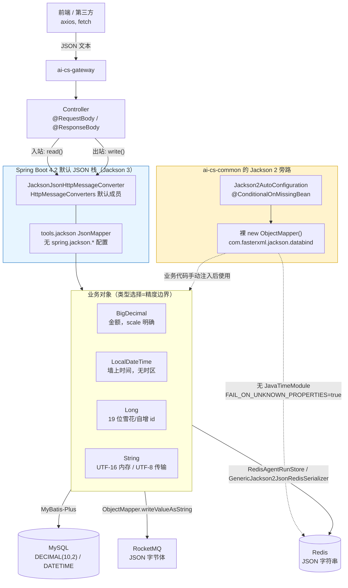
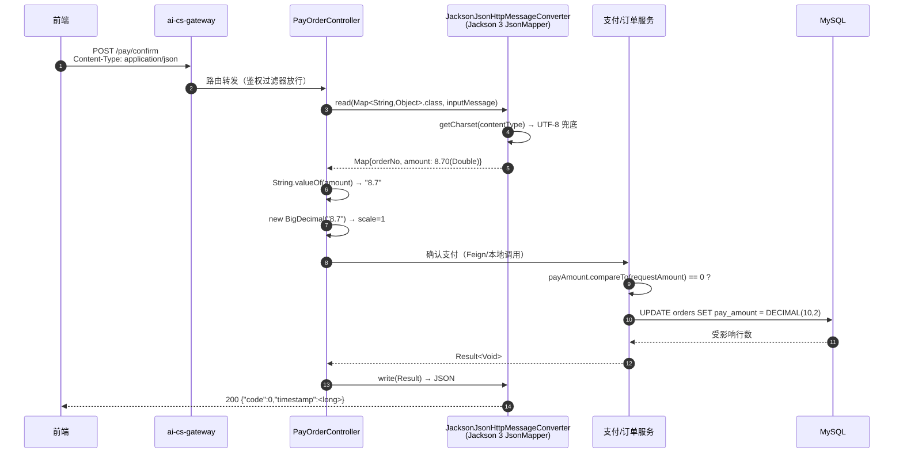

# 语言级细节与序列化：金额、时间、编码、序列化四类"静默错误"的定位与防线

> **一句话结论**：这四类问题的共同点是"元信息（有效位数 / 时区 / 字符集 / 字段集合）在链路的某一跳被丢掉，而代码不报错"；能挡住它们的只有三条硬约定——金额全程 `BigDecimal` + 字符串构造 + `compareTo`，时间全程 `LocalDateTime` 且所有进程时区统一为 `Asia/Shanghai`，JSON 只认 Boot 4 的 Jackson 3 `JsonMapper`（本项目 `Jackson2AutoConfiguration` 里那个裸 `new ObjectMapper()` 是唯一必须盯住的旁路）。
> **阅读前置**：Java 17 基础（集合、`equals`/`hashCode`、自动装箱）、Spring Boot 自动配置（`@ConditionalOnMissingBean`）、HTTP JSON 收发的基本概念；未读过可先看 [01-Java17核心特性.md](./01-Java17核心特性.md) 与 [05-集合框架与源码.md](./05-集合框架与源码.md)。
> **证据基线**：JDK 编译目标 17（本机实测 JDK 17.0.19）/ Spring Framework 7.1.0 / Spring Boot 4.2.0 / 本项目当前模块源码；A 级摘录取自 `learning-docs/24-源码分析/assets/source/`，C 级为本机实际运行的命令与输出。预计阅读 45 分钟。

---

## 0. 先看现象

### 现象一：前端拿到的 19 位订单 id，末尾四位变成 0000

后端日志与数据库里明明是 `1800000000000000001`，前端 `console.log(res.data.id)` 打出来是 `1800000000000000000`，再拿这个值回传查详情就是"订单不存在"。整个链路没有任何异常、没有 4xx、没有日志告警。

把 JSON 原文丢给 Node 复现（C 级，本机执行）：

```text
> node %TEMP%\acp-lang\long.js
JSON 原文 : {"id":1800000000000000001,"orderNo":"20261127023554010000"}
o.id      : 1800000000000000000
String()  : 1800000000000000000
MAX_SAFE  : 9007199254740991
2**53     : 9007199254740992
o.id === 1800000000000000001 : true
```

怎么读这个输出：第 4、5 行给出分界线——JS 的 `Number` 是 IEEE-754 双精度，只有 53 位有效精度，安全整数上限 `9007199254740991`（16 位十进制），而 MySQL `BIGINT` 自增 id 是 19 位；第 2、3 行说明这个 19 位数在 `JSON.parse` 的那一刻就已经变成 `...000`，`String()` 也救不回来。最后一行更能说明问题的隐蔽性：`o.id === 1800000000000000001` 返回 `true`，因为右侧字面量在解析阶段就已经被压成同一个近似值了——**连写死字面量的断言都测不出这个 bug**。

### 现象二：容器里跑出来的时间比本地少 8 小时

本地 IDE 起服务，`LocalDateTime.now()` 打出 `2026-11-27T02:35`；同一个 jar 在镜像里起来（镜像未设时区，默认 UTC），同一时刻打出 `2026-11-26T18:35`。订单的 `expireTime`、`createTime` 全部偏移 8 小时，超时关单任务在错误的时间点触发。

C 级：同一个程序，分别带/不带 `-Duser.timezone=UTC` 运行，关键三行对比：

```text
# 第一次：java -cp %TEMP%\acp-lang Details.java
E1 User timezone prop = null ; ZoneId.systemDefault() = Asia/Shanghai
E2 Instant.now()      = 2026-11-26T18:43:35.435820600Z
E3 LocalDateTime.now()= 2026-11-27T02:43:35.439346500
E4 ZonedDateTime.now(Asia/Shanghai) = 2026-11-27T02:43:35.440346100+08:00[Asia/Shanghai]

# 第二次：java "-Duser.timezone=UTC" -cp %TEMP%\acp-lang Details.java
E1 User timezone prop = UTC ; ZoneId.systemDefault() = UTC
E2 Instant.now()      = 2026-11-26T18:44:39.348832200Z
E3 LocalDateTime.now()= 2026-11-26T18:44:39.352950400
E4 ZonedDateTime.now(Asia/Shanghai) = 2026-11-27T02:44:39.364494900+08:00[Asia/Shanghai]
```

怎么读这个输出：两次运行的 `E2 Instant.now()` 几乎一样（都是同一物理时刻，带 `Z` 后缀），而 `E3 LocalDateTime.now()` 从 `...T02:43` 变成 `...T18:44`——说明 `LocalDateTime` 记录的是"墙上时钟读数"，进程时区一改读数就改；`E4` 那行是程序里显式写死 `Asia/Shanghai` 的，改 JVM 默认时区它也不受影响，永远是 `+08:00`。本项目写库用的正是 `LocalDateTime`（`ai-cs-order/src/main/java/com/aics/order/service/impl/OrderCreateTxService.java#L105`）。

### 现象三：上游加了一个字段，下游老服务立刻 400

A 服务给 `POST /pay/confirm` 的请求体加了一个 `couponId`（业务上完全兼容、老服务根本用不到），B 服务（还没升级）日志里出现 `UnrecognizedPropertyException`，接口返回 400，提示"请求体格式错误或字段类型无效"。两边代码都"没改错"，是**字段集合的兼容策略**没谈过。

C 级：Jackson 2.21.8 真实抛出的异常（本机 `java -cp ...\acp-lang JsonProbe.java` 运行）：

```text
G1 unknown property THROWS = com.fasterxml.jackson.databind.exc.UnrecognizedPropertyException | Unrecognized field "couponId" (class JsonProbe$OrderView), not marked as ignorable (4 known properties: "payAmount", "id", "expireTime", "orderNo")
```

怎么读这个输出：异常类型是 `UnrecognizedPropertyException`（`JsonMappingException` 的子类），括号里那句 `4 known properties` 是排查重点——它直接告诉你"老 DTO 只认这 4 个字段"。Spring MVC 会把它包成 `HttpMessageNotReadableException`，再由本项目 `ai-cs-common/src/main/java/com/aics/common/exception/GlobalExceptionHandler.java#L94-L103` 统一转成 400 + 那句固定文案，**真正的字段名只留在 `log.warn` 里**，所以前端看到的 400 文案是没什么信息量的。

> **这些现象指向同一件事**：数据的元信息（多少位有效数字、哪个时区、哪种字符集、哪些字段）没有跟着数据一起走，而丢掉它们的那一刻不抛异常；能报警的只剩最后那次类型转换，或者干脆永远不报。

---

## 1. 整体地图



**组件与责任**

| 组件 | 所在位置 | 责任 | 谁在调它 |
| --- | --- | --- | --- |
| `JacksonJsonHttpMessageConverter` | Spring Boot 4.2 `JacksonHttpMessageConvertersConfiguration`（A 级 `#L31-L47`、`#L74-L79`） | 出入站 HTTP JSON 的唯一编解码器 | Spring MVC 的 `RequestMappingHandlerAdapter` |
| Jackson 3 `JsonMapper` | Boot 4 自动配置产出，本仓库零 `spring.jackson.*` | 提供全局 ObjectMapper 行为（未知字段、时间、时区） | 上面那个 converter |
| `Jackson2AutoConfiguration` | `ai-cs-common/src/main/java/com/aics/common/autoconfigure/Jackson2AutoConfiguration.java#L13-L21` | 为老代码补一个 Jackson 2 `ObjectMapper` bean | Spring 容器（`@ConditionalOnMissingBean`） |
| `Order` / `OrderVO` | `ai-cs-order/src/main/java/com/aics/order/entity/Order.java#L23-L31` | 承载 5 个 `BigDecimal` 金额与 3 个 `LocalDateTime` 时间 | Service / Controller / Jackson |
| `RedisAgentRunStore` | `ai-cs-chat/src/main/java/com/aics/chat/agent/store/RedisAgentRunStore.java#L30-L43` | 把含 `LocalDateTime` 的上下文 JSON 存 Redis | Agent 编排流程 |
| `PaySuccessMessage` | `ai-cs-common/src/main/java/com/aics/common/mq/PaySuccessMessage.java#L18-L36` | 支付成功事件体（`BigDecimal amount`，已 `implements Serializable`） | 支付服务生产、订单服务消费 |
| `GenericJackson2JsonRedisSerializer` | `ai-cs-product/src/main/java/com/aics/product/config/ProductCacheConfig.java#L23-L45` | Spring Cache 的 value 序列化（带 `@class` 类型信息） | `@Cacheable` 拦截器 |

> **读图说明**：图上最关键的是两条边。第一条是 `Controller ←→ JacksonJsonHttpMessageConverter`：它是**所有 HTTP JSON 行为的唯一总闸**，而本仓库 `ai-cs-order/src/main/resources/application.yml` 里没有任何 `spring.jackson.*`，全仓 `ai-cs-*/deploy` 的 yml 里 grep `jackson` 也是 0 命中——也就是说线上行为就是框架默认值，没有"我配了但没生效"这一层，反而更要看清默认值是什么。第二条是右下角那条虚线 `裸 new ObjectMapper() → 业务对象/Redis`：它是 Jackson 2 的旁路，与蓝框里的 Jackson 3 栈**不共享任何配置**，`FAIL_ON_UNKNOWN_PROPERTIES` 仍是 `true`、也没有 `JavaTimeModule`，是本篇唯一会在运行时抛异常的地方（3.9 与 3.12 展开）。

---

## 2. 关键概念与关键类

| 名称 | 所在位置 | 角色 | 关键方法 / 属性 |
| --- | --- | --- | --- |
| `BigDecimal` | `java.math`（JDK） | 精确十进制定点数；金额的唯一合法载体 | `new BigDecimal(String)`、`valueOf(double)`、`add/subtract/multiply`、`divide(divisor, scale, RoundingMode)`、`setScale`、`compareTo`、`scale()` |
| scale（标度） | `BigDecimal` 的概念 | 小数点后保留几位，**是值的一部分**，参与 `equals`/`hashCode` | `scale()`、`stripTrailingZeros()` |
| `RoundingMode` | `java.math`（JDK，枚举） | 舍入策略，八种；金额场景基本只用 `HALF_UP`（四舍五入） | `RoundingMode.HALF_UP` |
| `double` | Java 基本类型 | IEEE-754 双精度二进制浮点，**不能精确表示 0.1** | — |
| `LocalDateTime` | `java.time`（JDK 8+） | "墙上时钟读数"，无时区无偏移，`2026-11-27T02:35` 就是字面意思 | `now()`、`plusMinutes()`、`isAfter()`、`format()` |
| `Instant` | `java.time`（JDK 8+） | 时间轴上的一个绝对时刻（UTC 基准），跨时区传输应用它 | `now()`、`toEpochMilli()` |
| `ZoneId` / 进程时区 | `java.time.ZoneId`；JVM 参数 `-Duser.timezone` / 环境变量 `TZ` | 决定 `LocalDateTime.now()`、`LocalDate.now()` 读到哪个时钟 | `ZoneId.systemDefault()` |
| 字符集 Charset | `java.nio.charset` | 字节 ↔ 字符的映射规则；`String` 内存是 UTF-16，落盘/过网才编码 | `Charset.defaultCharset()`、`getBytes(StandardCharsets.UTF_8)`、`new String(bytes, charset)` |
| mojibake（乱码） | 现象名 | 用 A 字符集解码 B 字符集的字节，得到"看起来像汉字的怪字" | 例：UTF-8 字节按 GBK 读 = `璁㈠崟` |
| JEP 400 | JDK 18 规范提案 | 把 `file.encoding` 默认值固定为 UTF-8；**JDK 17 及以前仍是平台默认** | C 级实测 JDK 17 + 中文 Windows：`GBK` |
| 字符串常量池 / `intern()` | `String` 的 JVM 机制 | 字面量在常量池唯一化；`intern()` 手动把堆上字符串归入池并返回池中引用 | `"abc" == new String("abc").intern()` |
| 自动装箱缓存 | `Integer.valueOf(int)` | `-128~127` 走缓存，区间内 `==` 为真，区间外 `==` 为假 | `Integer.valueOf(127) == Integer.valueOf(127)` |
| `equals`/`hashCode` 契约 | `java.lang.Object` | 相等则哈希必等；参与哈希容器的 key 必须不可变 | `equals`、`hashCode`、`Objects.hash` |
| Lombok `@Data` | 编译期注解处理器 | 生成 getter/setter/`equals`/`hashCode`/`toString`，**改的是 AST，不生成新源文件** | 根 `pom.xml#L61` `lombok.version=1.18.30` |
| `Jackson2ObjectMapperBuilder` | spring-web 7.1.0（A 级摘录 979 行） | 老一代 Jackson 2 的 builder，Boot 的 `FAIL_ON_UNKNOWN_PROPERTIES=false` 就出在这里 | `customizeDefaultFeatures`、`registerWellKnownModulesIfAvailable` |
| `JacksonAutoConfiguration` | Boot 4.2 `org.springframework.boot.jackson.autoconfigure`（A 级摘录） | Boot 4 的 Jackson 3 自动配置，`@since 4.0.0` | `customize`、`configureDateFormat` |
| `ToStringSerializer` | `com.fasterxml.jackson.databind.ser.std`（Jackson 2）/ Jackson 3 同族 | 把 `Long` 输出成 JSON 字符串，规避 JS 53 位精度问题 | `@JsonSerialize(using = ToStringSerializer.class)` |
| `@JsonIgnore` | `com.fasterxml.jackson.annotation` | 序列化/反序列化时跳过某字段；用于不可序列化的回调对象、循环引用 | `@JsonIgnore` |
| `FAIL_ON_UNKNOWN_PROPERTIES` | Jackson `DeserializationFeature` | 遇到 DTO 没有的字段是否抛异常；Boot 默认 `false` | `mapper.configure(...)` |
| `WRITE_DATES_AS_TIMESTAMPS` | Jackson 时间开关 | 时间输出成数组 `[2026,11,27,2,35,54]` 还是字符串 | `DateTimeFeature` / `SerializationFeature` |
| `serialVersionUID` | `java.io.Serializable` | 原生序列化的类版本指纹，不匹配即 `InvalidClassException` | 只在 Java 原生序列化中生效，JSON 不认它 |

---

## 3. 原理与证据逐段精读

### 3.1 `new BigDecimal(double)`：把二进制浮点的误差原样搬进"精确类型"

**这段在做什么**：`new BigDecimal(0.1)` 不会得到 `0.1`，因为构造前 `0.1` 这个 `double` 字面量已经丢失了精度，`BigDecimal` 只是诚实地把这个近似值的**完整十进制展开**抄了一遍。

C 级（`java -cp %TEMP%\acp-lang Details.java`，JDK 17.0.19）：

```text
A1 new BigDecimal(0.1)      = 0.1000000000000000055511151231257827021181583404541015625
A2 new BigDecimal("0.1")    = 0.1
A3 BigDecimal.valueOf(0.1)  = 0.1
A9 double 0.1 added 10 times = 0.9999999999999999
A10 0.1+0.2 double           = 0.30000000000000004
```

怎么读这个输出：A1 长到离谱的那串就是 `0.1` 的 `double` 二进制值的精确十进制表示——`BigDecimal(double)` 一个字符都没舍。A2/A3 是正确写法，`valueOf` 内部走 `Double.toString` 所以也是 `0.1`。A9/A10 解释了为什么金额绝对不能用 `double`：十次 0.1 相加不等于 1。

**为什么这么设计**：`BigDecimal` 的定位是"任意精度十进制数"，它不能假装 `double` 参数是精确的，否则每次构造都在偷偷做一次舍入，损失不可追溯。所以 JDK 把这个责任推给调用方：想要精确就传字符串。

**换成另一种写法会怎样**：传 `int`/`long` 是精确的（`new BigDecimal(100)` 没问题），`BigDecimal.valueOf(double)` 用 `Double.toString` 的十进制短表示、在金额场景下通常"看起来对"，但它仍然是浮点数的再解释，`0.1+0.2` 之后再 `valueOf` 就救不回来。项目里 `BigDecimal.valueOf(item.getQuantity())`（`ai-cs-order/src/main/java/com/aics/order/service/impl/CartServiceImpl.java#L44-L47`）是安全的，因为 `quantity` 是整数。

**常见坑**：
- 从 `Map<String,Object>` 里取金额直接 `new BigDecimal((Double) v)`，一步就把误差引进来。本项目 `PayOrderController` 用的是 `String.valueOf(body.get("amount"))` 再 `new BigDecimal(String)`（`ai-cs-order/src/main/java/com/aics/order/controller/PayOrderController.java#L31-L33`），方向是对的，但见 3.10 的前置风险。
- 以为 `new BigDecimal(0.1).setScale(2, HALF_UP)` 能救回来——它只会得到 `0.10`，误差被"藏"在第 3 位以后，累加几万笔后再舍入就可能差一分。

### 3.2 `divide` 不给 scale 就敢上线？——`ArithmeticException` 就在等你

**这段在做什么**：`BigDecimal.divide(BigDecimal)` 的单参重载要求"结果必须能被精确表示"，除不尽就抛异常，而不是像 `double` 那样给你一个近似值。

C 级（同一次运行）：

```text
A4 divide no scale THROWS  = java.lang.ArithmeticException: Non-terminating decimal expansion; no exact representable decimal result.
A5 divide(3,2,HALF_UP)      = 3.33
```

怎么读这个输出：A4 的异常消息里 `Non-terminating decimal expansion`（无限小数展开）是关键词，搜这个字符串能直接定位到没给 scale 的 `divide`。A5 三参版本指定"保留 2 位 + 四舍五入"就能算出结果。

**为什么这么设计**：除法是唯一会"位数爆炸"的运算。加、减、乘的 scale 都可以由操作数推导（乘是两者相加），除法不能——`1/3` 没有有限小数表示。JDK 的选择是宁可抛异常也不静默截断，这是"精确类型"的基本立场。

**换成另一种写法会怎样**：`divide(b, 10, RoundingMode.HALF_UP)` 给足位数能在多数场景"跑得通"，但 scale 会污染后续结果（比如 10 位小数的金额存进 `DECIMAL(10,2)` 又被 DB 隐式舍入一次，等于舍入两次）。分摊、按比例分账这类场景要先算清"最后一位差额归谁"。

**常见坑**：
- 本地小数据能跑（`100/2` 除得尽），一上线遇到 `100/3` 直接 500。这是"看起来能跑但会错"的典型。
- 本项目当前全仓 order/pay 没有 `divide` 调用（grep 过），所以这条现在是**潜在**雷而不是已发生的 bug——但一旦加"按比例分摊优惠"，它立刻成为第一号问题。
- 只写 `setScale(2)` 不写 `RoundingMode`，JDK 9 起会抛 `ArithmeticException: Rounding necessary`（老代码里 `setScale(2, BigDecimal.ROUND_HALF_UP)` 的 int 常量已 deprecated）。

### 3.3 `equals` 认 scale，`compareTo` 只认值——哈希容器里会出人命

**这段在做什么**：`BigDecimal` 的 `equals` 同时比较"数值"和"scale"，`compareTo` 只比较数值。

C 级：

```text
A6 new BigDecimal("1.0").equals("1.00") = false
A7 compareTo("1.00")                     = 0
A8 hashCode 1.0 / 1.00      = 311 / 3102
```

怎么读这个输出：`equals=false` 但 `compareTo=0`，说明"值相等"和"对象相等"在 `BigDecimal` 上是两个问题；`hashCode` 不同则意味着它们能同时作为 `HashMap` 的两个 key 存在。

**为什么这么设计**：`BigDecimal` 内部就是"未缩放值 + scale"两段表示，`1.0`(10,1) 和 `1.00`(100,2) 是两种不同表示。`equals` 按表示比（与 `hashCode` 契约一致），`compareTo` 按数值比（符合"比较大小"的语义）。JDK 官方 javadoc 明确写了这一点（依据 JDK 17 `java.math.BigDecimal` 类文档）。

**换成另一种写法会怎样**：金额比较一律用 `compareTo(x) == 0`；如果非要用 `equals`，就得在入口处统一 `setScale(2, HALF_UP)`。本项目走的是前者：`totalAmount.compareTo(rule.getThresholdAmount()) >= 0`（`ai-cs-order/src/main/java/com/aics/order/service/impl/PromotionServiceImpl.java#L88-L106`）、`getCouponAmount().compareTo(BigDecimal.ZERO) > 0`（`OrderCreateTxService.java#L120`）。

**常见坑**：
- 用金额对象当 `HashMap` key 或放进 `HashSet`，`contains` 永远 `false`。C 级里 `HashTrap` 实测：放进 `Money("1.0")` 后 `contains(new Money("1.00"))` 返回 `false`，`map.size()` 变成 2。根因是 Lombok `@Data` 生成的 `equals` 直接调字段的 `equals`，把 `BigDecimal` 的 scale 敏感带了进来。
- 反过来也有坑：`assertEquals(new BigDecimal("1.0"), actual)` 在单测里会莫名其妙失败，换成 `assertThat(actual).isEqualByComparingTo("1.0")`（AssertJ）才稳。

### 3.4 本项目金额链路：DB 定精度、代码定算法

**这段在做什么**：金额精度不只在代码里保证，DB 列类型是第一道闸。项目建表脚本把所有金额列写成 `DECIMAL(10,2)`（`deploy/mysql/all-init.sql#L591-L595`：`total_amount`、`discount_amount`、`pay_amount`、`full_reduction_amount`、`coupon_amount`；订单项与券规则同规格，见 `#L617-L619`、`#L629-L630`、`#L644-L645`）。

**为什么这么设计**：`DECIMAL(10,2)` 表示"共 10 位有效数字、其中 2 位小数"，上限 `99,999,999.99`，对单笔订单足够且不会像 `FLOAT/DOUBLE` 那样存进去就变。ORM 侧 JDBC 驱动把它映射成 `BigDecimal`，MyBatis-Plus 原样带给实体（`ai-cs-order/src/main/java/com/aics/order/entity/Order.java#L23-L31`）。

**换成另一种写法会怎样**：如果列是 `DECIMAL(12,6)`（本项目观测表里 `estimated_cost`/`quota_cost` 就是这种，见 `deploy/mysql/all-init.sql#L460`、`#L478`），金额就会带上 6 位小数，然后在 Java 侧 `compareTo` 与前端展示之间反复舍入。若列是 `DOUBLE`，那 3.1 的教训会原样在 DB 里重演。

**常见坑**：
- 金额链路里混进 `float`：`Item.getProductPrice()` 只要有一处是 `float`，整条 `multiply(...).reduce(...)` 就失去精度保证。
- 实体 `BigDecimal` 字段读到 `null` 后直接 `compareTo`，`NullPointerException` 而不是金额错误——本项目在 `PromotionServiceImpl` 里先做了 `couponAmount` 判空/零值比较，属于正确姿势。
- 计算顺序导致"满减"和"优惠券"双重优惠的基准不同：`ai-cs-order/src/main/java/com/aics/order/service/impl/PromotionServiceImpl.java#L39-L54` 是"先满减、再券、最后减"的固定顺序，顺序一改金额就变但不会报错。

### 3.5 时区：`LocalDateTime` 是墙上时间，`Instant` 是时间轴

**这段在做什么**：`LocalDateTime` 只存"年月日时分秒"，不带任何时区信息；`Instant` 存的是自 1970-01-01T00:00:00Z 起的绝对时刻。二者互相"看"的时候必须经过 `ZoneId`。

C 级证据已在"现象二"给出：同一物理时刻下，`Instant.now()` 两行几乎一致，`LocalDateTime.now()` 差了 8 小时——因为后者由 `ZoneId.systemDefault()` 决定。

**为什么这么设计**：JSR-310（Java 8 引入的 `java.time`）把"时刻"和"本地读数"拆成两个类型，正是为了让编译器帮你区分。`LocalDateTime` 适合"业务约定时间"（营业结束 22:00、活动开始时间），`Instant` 适合"事件发生时刻"（支付成功时间戳、日志时间）。

**换成另一种写法会怎样**：传输层用 `Instant`/`OffsetDateTime`，服务端就不再依赖进程时区；但本项目大量依赖 `LocalDateTime.now()` 与 `expireTime.isAfter()`（`PromotionServiceImpl.java#L111-L133`），这意味着**只要所有进程时区一致**就能自洽。因此项目把时区当成部署纪律：`deploy/docker-compose/docker-compose-all.yml#L17` 起各容器统一 `TZ: Asia/Shanghai`，JDBC 连接串显式带 `serverTimezone=Asia/Shanghai`（`deploy/k8s/services/product-service.yaml#L40-L46`，同处注释写明"-- 时区，避免时间差 8 小时"）。

**常见坑**：
- 只在 docker-compose 设了 `TZ`，K8s 里忘了设，Pod 默认 UTC → 3.5 现象复现。检查方法：进容器 `date`，或 `jcmd <pid> VM.system_properties | Select-String user.timezone`。
- 只设了 `TZ` 却没设 MySQL 的 `serverTimezone`：JDBC 驱动按自己猜的时区做 `java.util.Date` 换算，`LocalDateTime` 不经过换算所以"看起来对"，一旦有人用了 `java.util.Date` 字段就出现 8 小时错位——这种"一半字段对一半字段错"最难查。
- 用 `LocalDate.now()` 算"今天"做每日统计，容器 UTC 下每天 08:00 才切日，报表口径与业务口径差一整天边缘。

### 3.6 字符集：默认到底是谁的默认

**这段在做什么**：`String.getBytes()` / `new String(byte[])` 这类无参重载用**平台默认字符集**；`Charset.defaultCharset()` 的值由 `file.encoding` 决定。

C 级（本机 JDK 17.0.19 + 中文 Windows，`java -cp %TEMP%\acp-lang Cs.java`）：

```text
K1 Charset.defaultCharset() = GBK
K2 file.encoding = GBK ; native.encoding = GBK
K3 utf8 bytes len = 24
K4 new String(bytes) 不加字符集 = 璁㈠崟宸叉敮浠
K6 java.version = 17.0.19
```

怎么读这个输出：K1/K2 说明 JDK 17 在中文 Windows 上默认仍是 GBK；K3 是 6 个汉字 × 3 字节（一个汉字在 UTF-8 里 3 字节）；K4 就是把 UTF-8 的 24 个字节按 GBK 解——于是每 2 个字节凑出一个"看起来像汉字"的怪字，这就是 mojibake（`K4` 行末的显示截断是控制台渲染造成的，源码里的原始字符串是"订单已支付"6 个汉字）。反过来把 GBK 字节按 UTF-8 读，通常得到 `?` 或替换字符 `�`，因为 UTF-8 的字节模式有强校验。

**为什么这么设计**：`file.encoding` 历史上跟着操作系统语言走，是为了兼容老程序；从 JEP 400（JDK 18）起默认值固定为 UTF-8，就是因为"平台默认"这件事本身就是 bug 源。注意基线差异：本项目编译目标是 17，所以**不能假设默认 UTF-8**。

**换成另一种写法会怎样**：所有显式 API 都带字符集——`getBytes(StandardCharsets.UTF_8)`、`new String(bytes, StandardCharsets.UTF_8)`、`Files.readString(path, UTF_8)`。HTTP 层则不用操心：Spring 的 JSON converter 有兜底，`AbstractJackson2HttpMessageConverter#getCharset` 先看 `Content-Type` 里的 `charset`，没有就 `return StandardCharsets.UTF_8`（A 级 `[[源码:AbstractJackson2HttpMessageConverter.java.md#L437-L442]]`，javadoc 明说 "By default this is either the charset from the input MediaType or otherwise falling back on UTF-8"）。所以**请求头里乱写 `charset=GBK` 才是真风险**：它会让 Spring 用 GBK 去解 UTF-8 字节，最后 Jackson 收到一串 mojibake 再报 JSON 语法错。

**常见坑**：
- 文件读写用 `new FileReader(f)` / `new FileWriter(f)`（JDK 11 前无 charset 参数），换个机器就乱码。JDK 11+ 用 `Files.newBufferedReader(p, UTF_8)`。
- `PrintStream` 的 `System.out` 用的是 `stdout.encoding`，控制台乱码不等于数据乱码——先确认是"落库就错了"还是"只是打印难看"，这一步能省掉一半排查时间。
- MySQL 侧只改表字符集不改连接：`characterEncoding=utf-8`（连接串）+ 库表 `utf8mb4` 两头都要对，`deploy/k8s/services/product-service.yaml#L40-L46` 的注释把 `useUnicode/characterEncoding` 标为"中文支持"就是这个意思。

### 3.7 `equals`/`hashCode` 契约与 Lombok 的隐性违约

**这段在做什么**：`equals` 说相等的两个对象，`hashCode` 必须相等（JDK `Object` 契约）。Lombok `@Data` 会生成 `equals`/`hashCode`，逐字段用 `Objects.equals`/`Objects.hash`，于是字段本身的"相等语义"被继承下来。

C 级（`HashTrap`，用的正是 3.3 的 `BigDecimal` 语义）：

```text
J1 contains Money(1.00) = false
J2 map size = 2 -> {Money(1.0)=first, Money(1.00)=second}
J3 0.1+0.2 BigDecimal = 0.3 scale=1
```

怎么读这个输出：J1/J2 是 Lombok + `BigDecimal` 的组合陷阱——`@Data` 生成的 `equals` 调 `BigDecimal.equals`，scale 不同就不等，于是语义上"同一个金额"变成两个 key。J3 顺带说明 `BigDecimal` 加法会取较大的 scale（`0.1` 与 `0.2` 都是 1，结果 1）。

**为什么这么设计**：Lombok 只在编译期改 AST（不生成新源文件），它没法知道你字段的"业务相等"定义，只能机械生成。项目现状是全仓裸 `@Data`（grep `@EqualsAndHashCode` 0 命中），也就是说没有任何一处显式调整 `callSuper`——目前能跑，因为实体都不继承父类。

**换成另一种写法会怎样**：需要"按业务 id 判等"时显式 `@EqualsAndHashCode(onlyExplicitlyIncluded = true)` + `@EqualsAndHashCode.Include` 打在 id 上；有继承时必须 `@EqualsAndHashCode(callSuper = true)`，否则父类字段不参与比较（IDE/Lombok 都会警告）。

**常见坑**：
- 实体放进 `HashSet`/`HashMap` 后又被 setter 改了参与 `hashCode` 的字段 → 再也 `get` 不到（"对象蒸发"）。DTO/VO 慎当 key，尤其是 `@Data` 生成的 setter 全公开。
- 用 `@Data` 覆盖的 `equals` 做"是否同一订单"的判断，字段多一个就可能不等；订单幂等判断应比 `orderNo`/`id`。
- Lombok 1.18.30 与 MapStruct 1.5.5.Final 共用注解处理器时顺序敏感：根 `pom.xml#L335-L346` 把 lombok 放在 mapstruct-processor 之前，顺序反了会出现 MapStruct 生成的实现类拿不到 getter（编译报错）。这是"改了依赖顺序就一堆红"的常见来源，与 [06-反射动态代理与SPI.md](./06-反射动态代理与SPI.md) 里注解处理器部分可对照看。

### 3.8 `String` 常量池与 `Integer` 缓存：`==` 的两个"看起来对"的场合

**这段在做什么**：`==` 比较引用（`String`、包装类型都是引用）。JVM 有两处缓存让 `==` "偶尔为真"，最容易让人误以为 `==` 可以比内容。

C 级：

```text
C1 "abc" 字面量 vs new String("abc")：s1 == s2 -> false, s1 == s3(intern) -> true, equals -> true
B1 (127 == 127) true , (128 == 128) false        # 均为 Integer 自动装箱后比较
B2 (-128 == -128) true , (-129 == -129) false
```

怎么读这个输出：B1/B2 的边界恰好卡在 `-128` 与 `127`——这是 `Integer.valueOf(int)` 的缓存区间（`IntegerCache.low/high`）。`new String("abc")` 强制在堆上新建，所以 `s1 == s2` 为 `false`，而 `intern()` 返回常量池里的那一个，于是 `s1 == s3` 为 `true`。

**为什么这么设计**：常量池是为了省内存和加速字面量比较（编译期已知的字面量天然唯一）；`-128~127` 是"最常用的小整数"，缓存它们能省掉大量装箱对象。两者都不是为了让你用 `==` 比内容。

**换成另一种写法会怎样**：`String` 一律 `equals`/`Objects.equals`（注意 `Objects.equals(a,b)` 能同时处理 `null`）；包装类型比较用 `equals` 或先 `intValue()` 拆箱。`switch` 里的 `String` 是编译器生成的 `hashCode`+`equals`，不受影响。项目里 `PaySuccessMessage` 的 `amount` 是 `BigDecimal` 而 `paymentMethod` 是 `String`，比较必须用 `equals`。

**常见坑**：
- `Integer a = 200; Integer b = 200; a == b` → `false`，但用 127 测就通过，单测"覆盖了却没测到"。
- `Long` 也有 `LongCache`（同样 `-128~127`），`Long.parseLong("1") == 1L` 永远为 `false` 因为一边是对象一边是基本类型（这一句会拆箱，反而是 `true`；但两个 `Long` 对象比较就是引用比较）。
- `String.intern()` 不要滥用：JDK 7+ 常量池在堆里，`intern()` 大量不同字符串会撑大元空间/堆，且 `intern` 后的字符串生命周期极长。

### 3.9 Jackson 在 Boot 4 的双栈：`JsonMapper` 与裸 `ObjectMapper`

**这段在做什么**：Boot 4.2 的 HTTP JSON 走 Jackson 3（`tools.jackson` 包）的 `JsonMapper`，而 `com.fasterxml.jackson.databind.ObjectMapper`（Jackson 2）不再是 HTTP 主 mapper。项目为兼容老代码留了一个 Jackson 2 bean。

A 级证据一：Boot 4.2 的 `JacksonAutoConfiguration` 就是围绕 `JsonMapper` 建的条件：

```java (src: JacksonAutoConfiguration.java.md#L93-L95)
@AutoConfiguration
@ConditionalOnClass(JsonMapper.class)
public final class JacksonAutoConfiguration
```

A 级证据二：HTTP converter 也按 `JsonMapper` 装配：

```java (src: JacksonHttpMessageConvertersConfiguration.java.md#L31-L47)
@ConditionalOnClass(JsonMapper.class)
@ConditionalOnBean(JsonMapper.class)
```

项目侧（B 级）则明确点出了两套类型共存这件事：

```java
// ai-cs-common/src/main/java/com/aics/common/autoconfigure/Jackson2AutoConfiguration.java#L9-L21
/**
 * 为仍使用 Jackson 2 的业务代码保留独立 ObjectMapper。
 * Spring Boot 4 默认提供 Jackson 3 的 tools.jackson JsonMapper，二者不是同一类型。
 */
@AutoConfiguration
@ConditionalOnClass(ObjectMapper.class)
public class Jackson2AutoConfiguration {
    @Bean
    @ConditionalOnMissingBean(ObjectMapper.class)
    public ObjectMapper jackson2ObjectMapper() {
        return new ObjectMapper();
    }
}
```

**为什么这么设计**：Boot 4 换 Jackson 3 是包名整体迁移（`com.fasterxml.jackson.*` → `tools.jackson.*`），没法悄悄替换；把 Jackson 2 作为一个可选 bean 留着，能让还没迁移的业务代码编译通过，代价是**两套 mapper 的配置完全不通**。

**换成另一种写法会怎样**：把业务代码改成注入 `tools.jackson.databind.json.JsonMapper`，就能吃到 Boot 的 `spring.jackson.*` 全部行为（未知字段忽略、时区、日期格式）。留在 Jackson 2 就必须自己管这些配置。

**常见坑（本篇最值得记的一条）**：
- 那个 bean 是**裸 `new ObjectMapper()`**（`#L17-L21`，全仓 grep `public ObjectMapper ` 只有这一处），意味着它既没有 `JavaTimeModule`，也没有关掉 `FAIL_ON_UNKNOWN_PROPERTIES`。C 级已实测裸 mapper 的行为：

```text
F1 plain new ObjectMapper() THROWS = com.fasterxml.jackson.databind.exc.InvalidDefinitionException | Java 8 date/time type `java.time.LocalDateTime` not supported by default: add Module "com.fasterxml.jackson.datatype:jackson-datatype-jsr310" to enable handling (or disable `MapperFeature.REQUIRE_HANDLERS_FOR_JAVA8_TIMES`) (through reference chain: JsonProbe$OrderView["expireTime"])
```

  把它套到本项目：`ai-cs-chat/src/main/java/com/aics/chat/agent/store/RedisAgentRunStore.java#L30-L43` 注入的正是这个 Jackson 2 mapper，而它序列化的 `AfterSaleContext` 有两个 `LocalDateTime` 字段（`AfterSaleContext.java#L78`、`#L99`）——**静态推演 + C 级 F1 复现的结论是：`save()` 会在 `writeValueAsString` 处抛 `InvalidDefinitionException`，然后被 `catch (Exception e)` 吞成一条 `log.warn("Agent run 状态写入 Redis 失败: ...")`**，Agent 上下文静默不落盘。这里必须说清楚证据边界：我没有启动 chat 服务验证线上表现（禁止启服务），这是读代码得出的静态结论 + 同一库版本下的可复现异常。

### 3.10 长度与精度：`Long` 出网关那一跳最危险

**这段在做什么**：JS 的 `Number` 只有 53 位精度（C 级输出见"现象一"的 `node` 复现），而项目主键是 `Long` + MySQL `BIGINT`（`ai-cs-order/src/main/java/com/aics/order/entity/Order.java#L16-L17`、`ai-cs-product/src/main/java/com/aics/product/entity/Product.java#L16-L17`）。19 位 id 一出网关就被截断。

**为什么这么设计**：这是"后端精确 + 前端省事实用主义"的历史选择，JSON 规范本身没有整数上限，是 JS 运行时有限制。所以修复点在前端之前：把 id 变成 JSON 字符串。

C 级：同一份 Jackson 2.21.8，加一行注解就换类型：

```text
F3 ToStringSerializer on Long => {"id":"1800000000000000001","orderNo":"A1"}
```

怎么读这个输出：`"id"` 的值带引号了，前端 `JSON.parse` 得到 `String`，不经过 `Number`，精度完整保留。

**换成另一种写法会怎样**：全局方案是在 `JsonMapper` 上注册一个 `SimpleModule`，把 `Long.class`/`long.class` 的序列化器统一换成 `ToStringSerializer`（Boot 4 下可以自定义 `MapperBuilderCustomizer`）；局部方案就是字段上打 `@JsonSerialize`。代价：字符串 id 会让前端的 `id === 1` 这类比较失效，接口文档必须同步。

**常见坑**：
- 只改了 `OrderVO.id`，忘了 `OrderItemVO.productId`（`ai-cs-order/src/main/java/com/aics/order/vo/OrderVO.java#L39-L46`）——同样 19 位，同一个坑。
- 加了全局 `Long→String` 之后，`Result.timestamp`（`long`，`ai-cs-common/src/main/java/com/aics/common/result/Result.java#L12-L27`）和分页 `total` 也变成字符串，前端算术直接 `NaN`。全局改要显式排除。
- 还有一种"小数精度丢失"的变体：C 级实测 `{"amount":8.70}` 读进 `Map<String,Object>` 得到 `java.lang.Double`，`String.valueOf` 打出 `8.7`——scale 丢了。这解释了为什么 `PayOrderController` 用 `String.valueOf(body.get("amount"))` 再 `new BigDecimal(...)`：它在 `Double` 已经损失之后才补救，`8.70` 只能说勉强可用（`8.7` 的十进制短表示仍是精确的），但如果前端传 `0.1+0.2` 算出来的金额，就真的救不回来了。正确姿势是前端把金额当字符串传，或用 `JsonNode`/`BigDecimal` 直接接收。

### 3.11 时间输出格式与未知字段：两处配置决定跨服务兼容性

**这段在做什么**：Boot 侧控制时间的两个旋钮是"是否输出时间戳数组"和"日期格式串"，控制兼容性的旋钮是 `FAIL_ON_UNKNOWN_PROPERTIES`。

A 级证据：Boot 4.2 的 `customize` 只在**显式开启 Jackson 2 兼容模式**时才关掉时间戳数组：

```java (src: JacksonAutoConfiguration.java.md#L502-L505)
if (this.jacksonProperties.isUseJackson2Defaults()) {
    builder.configureForJackson2()
        .disable(DateTimeFeature.WRITE_DATES_AS_TIMESTAMPS, DateTimeFeature.WRITE_DURATIONS_AS_TIMESTAMPS);
}
```

而 `date-format` 只在 Java 传统日期类型上生效——它最终被塞给 `SimpleDateFormat`：

```java (src: JacksonAutoConfiguration.java.md#L556-L575)
String dateFormat = this.jacksonProperties.getDateFormat();
// 先 try ClassUtils.forName(dateFormat) 当 DateFormat 子类用；
// 否则 new SimpleDateFormat(dateFormat) 并 setTimeZone(timeZone)
```

C 级对照（Jackson 2 裸 mapper，用来展示"加模块但没动开关"会怎样）：

```text
F2 +JavaTimeModule => {"id":1800000000000000001,"orderNo":"20261127023554010000","payAmount":0.10,"expireTime":[2026,11,27,2,35,54]}
```

怎么读这个输出：`payAmount` 是 `0.10`（JSON 数字，scale 保住了），`expireTime` 却是数组 `[2026,11,27,2,35,54]`——`WRITE_DATES_AS_TIMESTAMPS` 默认是开的，只注册模块不改开关，前端拿到的就是数组。这就是"配了 JavaTimeModule 还是不对"的经典困惑。

未知字段这边，A 级证据是 Spring 老 builder 里的默认值（Boot 3 时代行为，Boot 4 的 Jackson 3 侧按官方文档同样默认忽略）：

```java (src: Jackson2ObjectMapperBuilder.java.md#L795-L802)
if (!this.features.containsKey(MapperFeature.DEFAULT_VIEW_INCLUSION)) {
    configureFeature(objectMapper, MapperFeature.DEFAULT_VIEW_INCLUSION, false);
}
if (!this.features.containsKey(DeserializationFeature.FAIL_ON_UNKNOWN_PROPERTIES)) {
    configureFeature(objectMapper, DeserializationFeature.FAIL_ON_UNKNOWN_PROPERTIES, false);
}
```

C 级给出"关掉之后就不炸"的对照（G1 已在现象三给出）：

```text
G2 FAIL_ON_UNKNOWN_PROPERTIES=false => orderNo=A1
```

**为什么这么设计**：`FAIL_ON_UNKNOWN_PROPERTIES=false` 是 Spring Boot 提高前后兼容性的核心决定（A 级 `Jackson2ObjectMapperBuilder` javadoc `#L73-L93` 明确写 "FAIL_ON_UNKNOWN_PROPERTIES is disabled"）：DTO 加字段不破坏老调用方、老调用方多传字段也不炸被调方。注意它是"用户没显式设过才生效"——一旦有人 `spring.jackson.deserialization.fail-on-unknown-properties=true`，默认值就翻转。

**换成另一种写法会怎样**：HTTP 层靠框架默认（忽略未知字段）最省事；但本项目的**旁路 mapper 不吃这套**——裸 `new ObjectMapper()` 的 `FAIL_ON_UNKNOWN_PROPERTIES` 是 `true`，所以任何走 `Jackson2AutoConfiguration` 的代码（如 `ai-cs-pay/src/main/java/com/aics/pay/mq/PaySuccessMessageProducer.java#L68` 的 `MAPPER.readValue(msg.getBody(), PaySuccessMessage.class)`）在消息体加字段后会直接抛 `UnrecognizedPropertyException`，再被包成 `IllegalStateException("支付成功消息体反序列化失败")`（`#L60-L66`）。

**常见坑**：
- 以为 `spring.jackson.date-format: yyyy-MM-dd HH:mm:ss` 能管 `LocalDateTime`——管不了，它只作用在 `java.util.Date`（因为实现是 `SimpleDateFormat`）。`LocalDateTime` 要用 `@JsonFormat(pattern = "yyyy-MM-dd HH:mm:ss")` 或全局自定义序列化器。
- 前后端约定"时间用字符串"，但服务端没关 `WRITE_DATES_AS_TIMESTAMPS`，于是 `createTime` 是数组，前端 `new Date([2026,11,27,2,35,54])` 得到 1970 年。
- 跨服务"字段只增不减"是纪律：忽略未知字段只解决"多了不认识"，解决不了"少了变 null"。

### 3.12 循环引用与"为什么不用 Java 原生序列化"

**这段在做什么**：对象图里两个对象互相持有，JSON 序列化会无限递归（`StackOverflowError` / `JsonMappingException: Infinite recursion`）；不可序列化的回调对象（连接、`Consumer`、`AgentTurnListener`）也会让序列化直接失败。项目在 `AfterSaleContext` 上用注解显式切断：

```java
// ai-cs-chat/src/main/java/com/aics/chat/agent/context/AfterSaleContext.java#L106-L109
/**
 * 必须 @JsonIgnore：ctx 会以 JSON 存入 Redis（AgentRunStore），回调对象不可序列化
 */
@JsonIgnore
private transient AgentTurnListener streamListener;
```

**为什么这么设计**：上下文对象需要一个"可持久化的子集"和一个"仅运行时使用的子集"。用 `@JsonIgnore` 把后者排除，是最小改动；`transient` 则是给 Java 原生序列化上的第二道锁（它不看 `@JsonIgnore`）。

**换成另一种写法会怎样**：`@JsonBackReference`/`@JsonManagedReference` 成对使用可以打破父子双向引用（序列化只走 managed 一侧）；`@JsonIdentityInfo` 用 id 去重能处理任意图。但更彻底的做法是不让领域对象直接当传输对象（DTO 只装要传的字段）——本项目 `OrderVO` 就是这么做的。

**Java 原生序列化（`implements Serializable`）为什么不适合跨服务**：
1. **强耦合类结构**：`serialVersionUID` 与字段签名一变就 `InvalidClassException`，等于把"内部字段顺序、类型"变成对外协议。项目里 `PaySuccessMessage`、`Result` 都实现了 `Serializable` 并写了 `serialVersionUID = 1L`（`ai-cs-common/src/main/java/com/aics/common/mq/PaySuccessMessage.java#L18-L36`、`ai-cs-common/src/main/java/com/aics/common/result/Result.java#L12-L27`），但**真正在 RocketMQ 上跑的是 JSON**：`PaySuccessMessageProducer` 用 `MAPPER.readValue(msg.getBody(), ...)` 解析字节（`ai-cs-pay/src/main/java/com/aics/pay/mq/PaySuccessMessageProducer.java#L60-L68`）。
2. **安全风险**：反序列化可触发任意 `readObject` 逻辑，历史上大量 RCE 出自此（依据 Java 官方 `ObjectInputFilter` 引入动机与 Oracle 安全公告），所以 JDK 9 起加了过滤机制、JDK 17 默认更严。
3. **跨语言不可能**：Python 侧的 `ai-cs-py-chat`/`ai-cs-py-recommend` 无法解析 Java 序列化流；JSON/Protobuf 才是多语言事实标准。
4. **体积大**：原生流带类描述符，比字段名+值的 JSON 更臃肿，也完全不透明（排障时无法用 `curl`/日志肉眼读）。

**常见坑**：
- 两个都实现了 `Serializable` 却不写 `serialVersionUID`，编译器按字段签名生成——加个字段旧数据就反序列化失败。
- 把 `@JsonIgnore` 当"安全"用：它只影响序列化，不影响业务访问控制。
- 只用 `transient` 不加 `@JsonIgnore`：走 JSON 的路径照样会尝试序列化该字段（Jackson 不看 `transient`）。

---

## 4. 一次完整执行时序：`POST /pay/confirm` 从网关到库



> **读图说明**：整条链路里有两个"不可逆"的拐点。第一个是第 4~5 步：`getCharset` 决定按哪种字符集把字节变成字符，一旦请求头写了 `charset=GBK` 而后端发的是 UTF-8，后面所有步骤都在处理乱码（A 级 `AbstractJackson2HttpMessageConverter#L437-L442` 与 `#L411-L413` 决定了它的报错形态）。第二个是第 6~7 步：`amount` 从 JSON 数字变成 `Double` 再被 `String.valueOf` 还原，**scale 在这一步已经丢了**，后面 `BigDecimal` 再精确也只是在错误的输入上精确。

**哪一步失败会报什么错**

| 失败点 | 触发条件 | 抛出的异常 | 项目里最终返回 |
| --- | --- | --- | --- |
| 步骤 3 读流 | 客户端断连、Content-Length 与实际不符 | `HttpMessageNotReadableException("I/O error while reading input message")`（A 级 `AbstractMessageConverterMethodArgumentResolver.java#L221-L222`） | 400「请求体格式错误或字段类型无效」 |
| 步骤 4 解码 | 声明的 charset 与真实字节不符导致 JSON 结构损坏 | `HttpMessageNotReadableException("JSON parse error: ...")`（A 级 `AbstractJackson2HttpMessageConverter.java#L411-L413`） | 同上，真因只在 `log.warn("请求体解析失败 ...")` |
| 步骤 4 反序列化 | 请求体带 DTO 没有的字段且未忽略 | `UnrecognizedPropertyException`（C 级 G1） | 同上 |
| 步骤 7 构造 | `amount` 传 `"abc"` 或 `"1,000"` | `NumberFormatException`（`IllegalArgumentException` 子类） | 400 + 异常原文（`GlobalExceptionHandler#L139-L144`） |
| 步骤 9 金额校验 | 前端金额被 JS 浮点污染 | **不报错**，校验通过或不通过都"看起来合理" | 200，但金额可能差一分 |
| 步骤 10 落库 | scale 超过列定义 | MySQL 静默四舍五入到 `DECIMAL(10,2)` | 200，返回值与入参不一致 |

---

## 5. 设计取舍

| 方案 | 优点 | 代价 | 本项目怎么选 |
| --- | --- | --- | --- |
| 金额用 `double`/`float` | 运算快、代码短、DB 直接 `DOUBLE` | 0.1+0.2≠0.3，累加误差，对账永远差几分 | **不选**；全链路 `BigDecimal` + DB `DECIMAL(10,2)`（`deploy/mysql/all-init.sql#L591-L595`） |
| 金额用 `long`（单位为分） | 整数运算最快、天然精确、跨语言友好 | 展示层要除 100（又回到精度问题）、币种精度不同的场景（如 6 位小数）表达不了 | 未采用；本项目按"元"存储 |
| 金额用 `BigDecimal` | 十进制精确、scale 显式、DB 原生支持 | 必须约定 scale 与 `RoundingMode`，`equals` 有坑，不可变对象创建开销 | **采用**，并用 `compareTo` 比较（`PromotionServiceImpl.java#L88-L106`） |
| 时间用 `java.util.Date` | 老代码兼容、可直接存 `TIMESTAMP` | 可变、`SimpleDateFormat` 非线程安全、语义模糊（是时刻还是墙上时间？） | **不选**；全仓用 `LocalDateTime` |
| 时间用 `LocalDateTime` | 直观、不可变、与 MySQL `DATETIME` 一一对应 | 不带时区，跨时区部署必须靠纪律对齐 | **采用**，配合 `TZ=Asia/Shanghai`（`deploy/docker-compose/docker-compose-all.yml#L17`）与 `serverTimezone`（`deploy/k8s/services/product-service.yaml#L40-L46`） |
| 时间用 `Instant`/`OffsetDateTime` | 绝对时刻，天然跨时区、跨语言 | 展示要转 `ZoneId`；DB 列要 `TIMESTAMP` 或应用层转换 | 传输层可选；本项目 DB 是 `DATETIME`，未采用 |
| JSON 用 Jackson 3（Boot 4 默认） | 与框架一致，全局配置只在 `spring.jackson.*` 一处 | 包名迁移、Jackson 2 生态插件（部分自定义序列化器）需适配 | **默认路径**；本项目零 `spring.jackson.*`，全靠框架默认 |
| 保留 Jackson 2 `ObjectMapper` bean | 老业务代码零改动 | 两套 mapper 配置不通，裸 `new` 丢了 `JavaTimeModule`（C 级 F1） | **采用但有代价**（`Jackson2AutoConfiguration.java#L13-L21`），见 3.9 |
| id 用 JSON 数字 | 前端直接当 key 用、类型自然 | 19 位 `Long` 过 JS 就丢精度（C 级 long.js） | 现状是数字；改进方向 `ToStringSerializer`（C 级 F3） |
| 未知字段忽略（`FAIL_ON_UNKNOWN_PROPERTIES=false`） | 前后兼容、灰度期不炸 | 拼错字段名不会报错，字段名打错会静默为 `null` | **采用**（框架默认，A 级 `Jackson2ObjectMapperBuilder#L795-L802`） |
| 跨服务用 Java 原生序列化 | 不需要 schema、JDK 自带 | 类结构强耦合、安全风险、跨语言不可能 | **不选**；RocketMQ 传 JSON 字节（`PaySuccessMessageProducer.java#L60-L68`） |

**可扩展点清单**

1. **全局 `Long → String` 序列化模块**：在 Boot 4 的 `MapperBuilderCustomizer`（或 Jackson 3 的 `JsonMapper.Builder`）上注册 `SimpleModule`，显式排除 `Result.timestamp`/分页 `total` 这类"真的要做算术"的字段。
2. **统一的金额 `Money` 值对象**：内部持 `BigDecimal`，构造时强制 `setScale(2, HALF_UP)`，`equals` 按 `compareTo` 实现、`hashCode` 用 `stripTrailingZeros()` 后的值——一次解决 3.1/3.3/3.7 三个坑。
3. **`@JsonFormat` 约定时间格式**：所有对外 DTO 的 `LocalDateTime` 字段统一 `@JsonFormat(pattern = "yyyy-MM-dd HH:mm:ss")`，并在网关层加响应体快照测试（断言 `createTime` 是字符串而非数组）。
4. **给 `Jackson2AutoConfiguration` 补配置**：`new ObjectMapper().registerModule(new JavaTimeModule()).disable(FAIL_ON_UNKNOWN_PROPERTIES)`，或直接把 `Jackson2AutoConfiguration` 标记 deprecated 并逐步迁到 `JsonMapper`——这是把 3.9 的静默失败改掉的唯一低成本路径。
5. **字符集强制**：`spring.mvc`/`server.servlet.encoding` 与所有 `Files`/`getBytes` 调用显式 `UTF_8`，并在 CI 里 grep 无参 `getBytes()`/`new String(byte[])`。
6. **时区自检端点**：`/actuator/info` 里暴露 `ZoneId.systemDefault()` 与 `Instant.now()`，配合部署检查脚本，比进容器 `date` 更快发现"某个 Pod 忘记设 TZ"。

---

## 6. 踩坑与调试手法

| 现象 | 根因 | 验证手段 | 解法 |
| --- | --- | --- | --- |
| 前端 id 末尾变 `0000`，接口 404/查不到 | `Long` 以 JSON 数字出网关，JS `Number` 只有 53 位精度（C 级 long.js） | 浏览器 Network 面板看**原始响应文本**是否 19 位；对同一 id 用 `String(o.id)` 与原文对比 | `@JsonSerialize(using = ToStringSerializer.class)` 或全局 `Long→String`（注意排除 `timestamp`） |
| 金额累加后差几分 | `double` 参与计算（C 级 A9/A10） | 单测里 `0.1+0.2` 断言失败，或用 `BigDecimal` 重算对账 | 全链路 `BigDecimal`，构造只用 `String`/`valueOf(int)` |
| 线上偶发 500：`Non-terminating decimal expansion` | `divide` 未给 scale（C 级 A4） | 日志搜 `Non-terminating decimal expansion`；断点在 `BigDecimal.divide(BigDecimal)` 调用处 | `divide(x, 2, RoundingMode.HALF_UP)` |
| 容器里时间少 8 小时（C 级 E2/E3） | 进程默认时区 UTC，代码用 `LocalDateTime.now()` | 容器内 `date`；`jcmd <pid> VM.system_properties \| Select-String "user.timezone\|file.encoding"` | 部署层统一 `TZ=Asia/Shanghai`；跨时区传输改 `Instant` |
| 中文写文件/落库变 `璁㈠崟`（C 级 K4） | 无参 `getBytes()`/`new String(byte[])` 用了平台默认（JDK 17 中文 Windows = GBK） | 打印 `Charset.defaultCharset()`、`System.getProperty("file.encoding")`；对比字节长度（1 汉字 UTF-8 = 3 字节） | 显式 `StandardCharsets.UTF_8`；连接串 `characterEncoding=utf-8` + 库表 `utf8mb4` |
| 加了个字段，下游 400「请求体格式错误」 | 旁路 mapper 的 `FAIL_ON_UNKNOWN_PROPERTIES` 仍为 `true`（C 级 G1） | 看 `GlobalExceptionHandler` 的 `log.warn("请求体解析失败 ...")`，里面含 `Unrecognized field "xxx"` 与 `N known properties` | 业务侧 `disable(FAIL_ON_UNKNOWN_PROPERTIES)` 或字段加 `@JsonIgnoreProperties(ignoreUnknown = true)`；协议上"只增不减" |
| 请求体里 `LocalDateTime` 字段导致序列化失败且**没有报错堆栈** | 裸 `new ObjectMapper()` 无 `JavaTimeModule`（C 级 F1），异常被 `catch (Exception)` 吞成 `log.warn` | 断点 `RedisAgentRunStore#save` 的 `writeValueAsString` 行；日志搜 `Agent run 状态写入 Redis 失败` | 注册 `JavaTimeModule`；或改用注入的 `JsonMapper`；catch 里至少 `log.warn(msg, e)` 带堆栈 |
| `Set`/`Map` 里"放进去就取不出来" | 参与 `hashCode` 的字段被改，或 `BigDecimal` scale 不同（C 级 J1/J2） | 复现：`contains` 为 `false` 但 `equals` 遍历能找到；比对 `scale()` | 不把可变实体当 key；金额统一 `setScale(2)`；自定义 `equals`/`hashCode` |
| `Integer` 用 127 测通过、用 128 上线出错（C 级 B1/B2） | 装箱缓存区间 `-128~127`，`==` 比引用 | 单元测试参数化跑 127 与 128 两个值 | 包装类型一律 `equals`/`Objects.equals`，或先拆箱 |

**三个真调试手法（可直接照做）**

1. **断点位置**：`AbstractJackson2HttpMessageConverter#read`（或 Boot 4 的 `JacksonJsonHttpMessageConverter` 同类入口）——在这里看 `inputMessage.getHeaders().getContentType().getCharset()`，一眼确定字符集；再看 `mapper` 实例的 `getClass()`，是 `tools.jackson.databind.json.JsonMapper` 还是 `com.fasterxml.jackson.databind.ObjectMapper`，直接区分走了哪套栈。业务侧旁路的断点打在 `RedisAgentRunStore#save` 的 `writeValueAsString` 那一行。
2. **日志关键字**：`JSON parse error`（A 级 `AbstractJackson2HttpMessageConverter#L411-L413` 拼的固定前缀）、`I/O error while reading input message`、`请求体解析失败`（本项目 400 的统一 warn）、`Agent run 状态写入 Redis 失败`、`Unrecognized field`。`grep` 这几个词基本能在 5 分钟内把"是编码、是格式、还是字段集合"分清。
3. **命令复现**：
   - 单文件复现（不启服务、秒级）：把可疑片段写成 `Probe.java` 用 `java -cp <dir> Probe.java` 直接跑（本篇所有 C 级输出都是这么来的，JDK 17 支持单文件源码模式）。
   - 进程时区/编码自检：`jcmd <pid> VM.system_properties | Select-String "user.timezone|file.encoding|stdout.encoding"`。
   - 字符集不一致复现：`curl -X POST http://localhost:8087/pay/confirm -H "Content-Type: application/json;charset=GBK" --data-binary @body.json`，对比不带 `charset` 的结果。
   - 精度复现：`node -e "console.log(JSON.parse('{\"id\":1800000000000000001}').id)"`。

---

## 7. ⚠️ 版本差异

| 旧写法 | 当前基线 | 变化点 | 迁移动作 |
| --- | --- | --- | --- |
| 注入 `com.fasterxml.jackson.databind.ObjectMapper` 当主 mapper | Boot 4.2 HTTP JSON 走 Jackson 3 `tools.jackson` 的 `JsonMapper`（A 级 `JacksonAutoConfiguration#L93-L95` `@since 4.0.0`） | Boot 4 起 Jackson 3 成为默认，Jackson 2 不再参与 Web 层 | 新代码注入 `JsonMapper`；老代码靠 `Jackson2AutoConfiguration` 过渡，并补齐 `JavaTimeModule` 等配置 |
| `spring-boot-starter-web` | 仍能用但**已 deprecated**，新代码用 `spring-boot-starter-webmvc` | Boot 4 把 web 栈 starter 拆名，`web` 保留兼容 | 新模块用 `spring-boot-starter-webmvc`；本项目 `ai-cs-order/pom.xml#L24` 仍是旧名，属待迁移项 |
| 以为"平台默认字符集 = 系统语言编码" | JEP 400（JDK 18）起 `file.encoding` 默认为 UTF-8；**JDK 17 及以前仍是平台默认**（C 级 K1/K2：本机 JDK 17.0.19 + 中文 Windows = `GBK`） | 升级到 JDK 18+ 才会改变默认值 | 不要依赖任何默认；代码显式 `StandardCharsets.UTF_8`。判断依据：JDK 17 实测输出 + JEP 400 规范 |
| 用 `spring.jackson.date-format` 统一时间格式 | 到 Boot 4.2 仍只作用于 `java.util.Date`（实现是 `new SimpleDateFormat(dateFormat)`，A 级 `JacksonAutoConfiguration#L556-L575`） | 从 Boot 2.x 到 4.2 **未变**；判断依据是同一段 `configureDateFormat` 逻辑与 `SimpleDateFormat` 分支 | `LocalDateTime` 用 `@JsonFormat(pattern=...)` 或全局自定义序列化器 |
| 依赖框架默认忽略未知字段 | 仍是 `FAIL_ON_UNKNOWN_PROPERTIES=false`（A 级 `Jackson2ObjectMapperBuilder#L795-L802`；`Jackson2ObjectMapperBuilder` 在 spring-web 7.1.0 里仍是这个实现） | 自 Boot 2.x 起未变；判断依据是"只在用户未显式配置时才设置"的写法 | 无需迁移；但要给裸 `new ObjectMapper()` 的旁路单独关掉 |
| 时间序列化默认输出 ISO 字符串的理解 | Boot 4.2 只在 `use-jackson2-defaults=true` 时显式 `disable(WRITE_DATES_AS_TIMESTAMPS)`（A 级 `JacksonAutoConfiguration#L502-L505`） | Jackson 3 与 Jackson 2 的默认值不同，Boot 用"兼容开关"来表达差异 | 升级前用响应快照断言时间字段形态（字符串还是数组），别靠猜 |
| 金额列 `DECIMAL(12,2)` | 本项目实际是 `DECIMAL(10,2)`（`deploy/mysql/all-init.sql#L591-L595`） | 精度上限 9,999,999.99 而不是 99,999,999.99 | 大额场景（如企业账户余额）另开 `DECIMAL(18,2)` 表，不要改订单主表语义 |
| "JSON 里 `BigDecimal` 一定保 scale" | C 级实测：`Map<String,Object>` 接收时变 `Double`（scale 丢），Jackson 直连 `BigDecimal` 字段时才保 scale（`{"v":0.10}`） | 与版本无关，是"接收目标类型"决定的 | 金额字段 DTO 直接用 `BigDecimal`，不要先落 `Map<String,Object>` |
| `BigDecimal.setScale(2, BigDecimal.ROUND_HALF_UP)` | `ROUND_*` int 常量自 JDK 9 起 deprecated | JDK 17 编译会告警，未来会移除 | 改 `RoundingMode.HALF_UP` |

---

## 8. 面试高频问与答

1. `new BigDecimal(0.1)` 和 `new BigDecimal("0.1")` 结果为什么不同？`BigDecimal.valueOf(0.1)` 又凭什么是对的？
2. `BigDecimal.divide(BigDecimal)` 为什么会抛 `ArithmeticException`？三参重载里 `scale` 和 `RoundingMode` 分别解决什么问题？
3. `BigDecimal` 的 `equals` 和 `compareTo` 语义差别在哪？为什么 `HashSet` 里"同一个金额"能存两份？
4. 金额为什么不能用 `double`？如果换成"以分为单位的 `long`"，你会怎么权衡？
5. `scale`（标度）是什么？`DECIMAL(10,2)` 的 10 和 2 分别限制了什么？
6. `equals`/`hashCode` 契约是什么？为什么重写 `equals` 必须重写 `hashCode`？违反了会怎样？
7. Lombok `@Data` 生成的 `equals`/`hashCode` 有哪些坑？有继承时为什么要 `callSuper = true`？
8. `String` 为什么不可变？常量池和 `intern()` 的关系是什么？`"abc" == new String("abc")` 为什么是 `false`？
9. `Integer` 的 `-128~127` 缓存是怎么来的？为什么 `Integer a=128, b=128; a==b` 是 `false`？
10. UTF-8 与 GBK 的字节边界有何不同？"乱码"的本质是什么？为什么 GBK 字节按 UTF-8 读常得到 `?`？
11. JDK 17 在中文 Windows 上 `Charset.defaultCharset()` 是什么？JEP 400 改变了什么？
12. `LocalDateTime`、`Instant`、`ZonedDateTime` 分别存什么？容器里少 8 小时该从哪三层排查？
13. Jackson 为什么要把 `Long` 序列化成字符串？全局改会带来什么副作用？
14. `FAIL_ON_UNKNOWN_PROPERTIES` 默认值在 Spring Boot 里是什么？为什么这么设计？它在哪些场景仍然危险？
15. `WRITE_DATES_AS_TIMESTAMPS` 控制什么？只注册 `JavaTimeModule` 为什么时间还是数组？
16. 循环引用在 Jackson 里有哪几种解法？`@JsonIgnore` 和 `transient` 的区别是什么？
17. Java 原生序列化（`Serializable`）为什么不适合做微服务间的 RPC 协议？`serialVersionUID` 在 JSON 里有作用吗？
18. OpenFeign/HTTP 编解码与业务代码手写 `ObjectMapper` 会共用配置吗？怎么验证？
19. 一次 `/confirm` 请求里，`amount` 的精度在哪些环节可能丢？每一步怎么防？
20. 如果让你给出"这个项目的序列化规范"，你会写哪五条？

---

## 9. 动手练习

> 约定：所有练习都在**不启动微服务、不跑全量 `mvn` 构建**的前提下完成（单文件 `java` 或 `mvn -pl <module> test -Dtest=...` 单测级别）。

1. **（对应 3.1 / 3.2）构造复现 + 修复对照**
   目标分支：`BigDecimal` 的三种构造与 `divide` 三参。
   做法：写 `Money.java`，打印 `new BigDecimal(0.1)`、`new BigDecimal("0.1")`、`BigDecimal.valueOf(0.1)`，再分别跑 `divide(b)` 与 `divide(b, 2, RoundingMode.HALF_UP)`。
   验收标准：能看到 `0.100000000000000005551...` 这串长尾；能看到 `Non-terminating decimal expansion` 异常消息原文；三参调用输出 `3.33`。
2. **（对应 3.3 / 3.7）让 `HashMap` 丢掉一个金额**
   目标分支：`BigDecimal.equals` 的 scale 敏感 + Lombok `@Data`。
   做法：写一个 `@Data` 类包一个 `BigDecimal` 字段，`put(new Money("1.0"), "a")` 后 `get(new Money("1.00"))`。
   验收标准：`get` 返回 `null`、`size()` 为 2；把字段改成 `stripTrailingZeros()` 后再跑，能观察到 `size()` 变成 1 或 `equals` 变 `true`（取决于你选的修复方式）。
3. **（对应 3.5）把进程时区换成 UTC，看哪一列数据变了**
   目标分支：`LocalDateTime` vs `Instant`。
   做法：同一个程序打印 `Instant.now()`、`LocalDateTime.now()`、`ZonedDateTime.now(ZoneId.of("Asia/Shanghai"))`，先正常跑，再加 `-Duser.timezone=UTC` 跑。
   验收标准：`Instant` 两行只差几秒；`LocalDateTime` 两行差 8 小时；`ZonedDateTime` 两行都带 `+08:00`。用 `ai-cs-order` 的 `expireTime`（`OrderCreateTxService.java#L105`）说明同样的偏移会落在哪张表哪一列。
4. **（对应 3.6）制造并定位一次 mojibake**
   目标分支：默认字符集 + 显式字符集。
   做法：`"订单".getBytes(UTF_8)` 后用 `new String(bytes)` 与 `new String(bytes, UTF_8)` 各解一次；再打印 `Charset.defaultCharset()` 与 `System.getProperty("file.encoding")`。
   验收标准：能复现 `璁㈠崟`；能说出"字符数是 2、字节数是 6"这条判据；能指出 JDK 17 中文 Windows 上默认是 `GBK` 而不是 UTF-8。
5. **（对应 3.9 / 3.10）裸 `ObjectMapper` 的两次翻车**
   目标分支：`Jackson2AutoConfiguration` 的裸 mapper。
   做法：`new ObjectMapper()` 先序列化一个含 `LocalDateTime` 的对象（预期抛 `InvalidDefinitionException`），再 `registerModule(new JavaTimeModule())` 重跑（预期得到时间数组）；最后给 `Long` 字段加 `@JsonSerialize(using = ToStringSerializer.class)` 再跑。
   验收标准：看到 `add Module "com.fasterxml.jackson.datatype:jackson-datatype-jsr310"` 这句原始提示；看到 `[2026,11,27,2,35,54]` 数组；看到 id 变成带引号字符串。
6. **（对应 3.11）让老 DTO 挡住新字段，然后修好**
   目标分支：`FAIL_ON_UNKNOWN_PROPERTIES`。
   做法：用不含 `couponId` 的 DTO 去 `readValue` 一个带 `couponId` 的 JSON，再 `disable(DeserializationFeature.FAIL_ON_UNKNOWN_PROPERTIES)` 重跑。
   验收标准：第一次异常消息里能读到 `Unrecognized field "couponId"` 与 `N known properties`；第二次正常得到对象。再对照 `GlobalExceptionHandler#L94-L103` 说明线上只会看到 400 + 固定文案。
7. **（对应 3.12 / 4）给一条 RocketMQ 消息加字段的回归清单**
   目标分支：跨服务 JSON 兼容。
   做法：读 `PaySuccessMessage`（`ai-cs-common/src/main/java/com/aics/common/mq/PaySuccessMessage.java#L18-L36`）与消费端 `PaySuccessMessageProducer.java#L60-L68`，列出"加字段/改字段/删字段"三种操作在"生产方先升级""消费方先升级"两种顺序下的结果。
   验收标准：能写出一张 3×2 的表，并指出唯一致命组合（删字段且消费方先升级；或消费端走的是裸 `new ObjectMapper()` 而加字段）。

---

## 小结

- 这四类问题的共同结构是"**元信息丢失且不报错**"：精度（scale）、时区（ZoneId）、字符集（Charset）、字段集合（DTO schema）——它们都不在类型系统里，只能靠约定和纪律守。
- 金额三件套：构造只用 `String` / `valueOf(int)`、`divide` 必带 `(scale, RoundingMode)`、比较只用 `compareTo`；DB 侧靠 `DECIMAL(10,2)`（`deploy/mysql/all-init.sql#L591-L595`）兜底。
- 时间两类：`LocalDateTime` 是墙上读数、`Instant` 是绝对时刻；本项目选 `LocalDateTime` 就必须保证所有进程 `TZ` 与 JDBC `serverTimezone` 一致（`deploy/k8s/services/product-service.yaml#L40-L46`）。
- 字符集不要依赖默认：JDK 17 中文 Windows 默认 `GBK`（C 级 K1），JEP 400 的 UTF-8 默认要到 JDK 18 才生效；所有编解码显式 `StandardCharsets.UTF_8`。
- Jackson 在 Boot 4 是双栈：HTTP 走 Jackson 3 `JsonMapper`（A 级 `JacksonAutoConfiguration#L93-L95`），而 `Jackson2AutoConfiguration` 那个裸 `new ObjectMapper()`（B 级 `#L17-L21`）没有 `JavaTimeModule`、`FAIL_ON_UNKNOWN_PROPERTIES` 仍为 `true` —— 这是全项目唯一会"运行时炸且可能被吞掉"的 JSON 通道。
- `equals`/`hashCode` 的坑都来自"字段的相等语义被继承"：`BigDecimal` 的 scale、可变字段当 key、Lombok 的机械生成；包装类型与 `String` 永远别用 `==` 比内容。
- 跨服务只传 JSON/Protobuf：`implements Serializable` + `serialVersionUID` 是给 Java 原生序列化用的，JSON 链路里它不起作用（`PaySuccessMessage` 就是这么个"标了但没用上"的例子）。
- **可操作归纳**：在 `ai-cs-common` 里落一个 `Money` 值对象（强制 `setScale(2, HALF_UP)`、`equals` 走 `compareTo`）+ 给 `Jackson2AutoConfiguration` 的 mapper 补 `JavaTimeModule` 与 `disable(FAIL_ON_UNKNOWN_PROPERTIES)` + 对外 DTO 的 `Long` id 与 `LocalDateTime` 统一注解——这三步能一次性消掉本篇 80% 的静默错误。

---

## 自测题

**1. `new BigDecimal(0.1).toPlainString()` 输出什么？为什么？**

<details><summary>参考答案</summary>

输出 `0.1000000000000000055511151231257827021181583404541015625`。因为 `0.1` 这个 `double` 字面量本身无法精确表示，`BigDecimal(double)` 构造会把该近似值的完整十进制展开抄下来（本机 JDK 17 实测）。要得到精确的 `0.1`，用 `new BigDecimal("0.1")` 或 `BigDecimal.valueOf(0.1)`。
</details>

**2. 什么情况下 `BigDecimal.divide` 会抛 `ArithmeticException`？怎么改？**

<details><summary>参考答案</summary>

单参重载 `divide(BigDecimal)` 在结果除不尽（无限小数展开）时抛 `ArithmeticException: Non-terminating decimal expansion; no exact representable decimal result.`。改用三参 `divide(divisor, scale, RoundingMode)`，例如 `divide(new BigDecimal("3"), 2, RoundingMode.HALF_UP)` 得 `3.33`。金额场景的 `scale` 必须与 DB 列一致（本项目是 2）。
</details>

**3. `new BigDecimal("1.0").equals(new BigDecimal("1.00"))` 和 `compareTo` 分别返回什么？实际影响是什么？**

<details><summary>参考答案</summary>

`equals` 返回 `false`（scale 参与比较，`hashCode` 也不同），`compareTo` 返回 `0`。影响：把它们当 `HashMap`/`HashSet` 的 key 时是"两个不同对象"，`contains` 会返回 `false`；单测里 `assertEquals` 会误报失败。解决：比较金额统一用 `compareTo(x) == 0`，或在入口统一 `setScale(2, RoundingMode.HALF_UP)`。
</details>

**4. 为什么前端会看到 19 位订单 id 末尾变 `0000`？后端能做什么？**

<details><summary>参考答案</summary>

JS 的 `Number` 是 IEEE-754 双精度，只有 53 位有效精度，安全整数上限 `9007199254740991`（16 位），而 `Long`/`BIGINT` 可达 19 位，`JSON.parse` 时即被舍入（本机 `node` 实测 `1800000000000000001` → `1800000000000000000`）。后端可给字段加 `@JsonSerialize(using = ToStringSerializer.class)`，或全局注册 `Long → String` 序列化模块（注意排除 `Result.timestamp` 与分页 `total`）。
</details>

**5. `LocalDateTime` 与 `Instant` 的本质区别？为什么容器里 `LocalDateTime.now()` 会少 8 小时而 `Instant.now()` 不会？**

<details><summary>参考答案</summary>

`LocalDateTime` 只记录墙上时钟读数（年月日时分秒，无时区），`Instant` 记录自 epoch 起的绝对时刻（UTC 基准）。`LocalDateTime.now()` 由 `ZoneId.systemDefault()` 决定，容器默认 UTC 时读数就比 `Asia/Shanghai` 少 8 小时；`Instant.now()` 与进程时区无关。修复：部署层统一 `TZ=Asia/Shanghai`，或跨时区传输改 `Instant`。
</details>

**6. 一次"UTF-8 字节按 GBK 解码"会得到什么？怎么用两行代码判断字符串是否被错误解码？**

<details><summary>参考答案</summary>

得到 mojibake，例如 `"订单"` 的 UTF-8 字节按 GBK 解是 `璁㈠崟`（本机实测）。判据：`"订单".getBytes(StandardCharsets.UTF_8).length == 6`（一个汉字 3 字节），而 `"订单".length() == 2`；若字符数与字节数比例对不上 3:1，就说明编码环节有问题。另可打印 `Charset.defaultCharset()` 与 `System.getProperty("file.encoding")` 确认默认值。
</details>

**7. JDK 17 在中文 Windows 上 `Charset.defaultCharset()` 是什么？JEP 400 改变了什么？**

<details><summary>参考答案</summary>

本机 JDK 17.0.19 实测是 `GBK`（`file.encoding=GBK`、`native.encoding=GBK`）。JEP 400 自 JDK 18 起把 `file.encoding` 默认值固定为 UTF-8，因此升级到 18+ 后无参 `getBytes()`/`new String(byte[])` 的行为会变。结论：任何代码都不要依赖默认字符集，显式传 `StandardCharsets.UTF_8`。
</details>

**8. `Integer` 的 `==` 什么时候为 `true`？为什么单测容易漏？**

<details><summary>参考答案</summary>

自动装箱走 `Integer.valueOf(int)`，`-128~127` 命中 `IntegerCache`，区间内两个 `Integer` 的 `==` 为 `true`，区间外为 `false`（本机实测 `127==127` true、`128==128` false，负边界 `-128` true、`-129` false）。单测若只用 1 或 127 之类的小值就永远通过。包装类型比较一律 `equals`/`Objects.equals`。
</details>

**9. Spring Boot 里 `FAIL_ON_UNKNOWN_PROPERTIES` 默认是什么？为什么本项目的某些代码仍然会被未知字段炸掉？**

<details><summary>参考答案</summary>

默认 `false`（A 级 `Jackson2ObjectMapperBuilder#L795-L802`：只在用户未显式配置时才设为 `false`）。但本项目 `Jackson2AutoConfiguration` 提供的是裸 `new ObjectMapper()`（`#L17-L21`），其 `FAIL_ON_UNKNOWN_PROPERTIES` 仍为 `true`，所以走这个 mapper 的代码（如 `PaySuccessMessageProducer.java#L60-L68`）遇到新字段会抛 `UnrecognizedPropertyException`，再被包成 `IllegalStateException("支付成功消息体反序列化失败")`。
</details>

**10. 只注册 `JavaTimeModule` 不关 `WRITE_DATES_AS_TIMESTAMPS`，`LocalDateTime` 会输出成什么？**

<details><summary>参考答案</summary>

输出成时间戳数组，如 `[2026,11,27,2,35,54]`（本机 Jackson 2.21.8 实测），而不是 ISO 字符串。Boot 4.2 里只有在 `use-jackson2-defaults=true` 时才会显式 `disable(DateTimeFeature.WRITE_DATES_AS_TIMESTAMPS)`（A 级 `JacksonAutoConfiguration#L502-L505`）。要字符串格式，用 `@JsonFormat(pattern = "yyyy-MM-dd HH:mm:ss")` 或显式关闭该开关。
</details>

**11. `spring.jackson.date-format` 能改 `LocalDateTime` 的格式吗？**

<details><summary>参考答案</summary>

不能。它在 Boot 4.2 里的实现是先尝试把值当 `DateFormat` 类名加载，否则 `new SimpleDateFormat(dateFormat)` 并 `setTimeZone(...)`（A 级 `JacksonAutoConfiguration#L556-L575`），只作用于 `java.util.Date`。`LocalDateTime` 需要 `@JsonFormat` 或自定义 `JsonSerializer<LocalDateTime>`。
</details>

**12. 为什么 `@JsonIgnore` 和 `transient` 要一起写在 `AfterSaleContext` 的回调字段上？**

<details><summary>参考答案</summary>

`@JsonIgnore` 让 Jackson 跳过该字段（JSON 链路，如 `RedisAgentRunStore#save` 的 `writeValueAsString`），`transient` 让 Java 原生序列化跳过（Jackson 不看 `transient`，原生序列化不看 `@JsonIgnore`）。两者覆盖两条不同的序列化路径，`AfterSaleContext.java#L106-L109` 的注释也明确写了"ctx 会以 JSON 存入 Redis，回调对象不可序列化"。
</details>

**13. 为什么 `implements Serializable` + `serialVersionUID` 在 RocketMQ 的 JSON 消息里没有实际作用？**

<details><summary>参考答案</summary>

因为消息体是 JSON 字节，消费端用 `ObjectMapper.readValue(msg.getBody(), PaySuccessMessage.class)` 解析（`ai-cs-pay/src/main/java/com/aics/pay/mq/PaySuccessMessageProducer.java#L60-L68`），走的是 Jackson 的字段映射，`serialVersionUID` 只在 `ObjectInputStream` 反序列化时校验。它留着无害且对"将来若改原生序列化"有意义，但不能指望它保护 JSON 协议兼容性。
</details>

**14. 请求体解析失败时，前端提示与真正原因分别在哪里？用什么关键字找？**

<details><summary>参考答案</summary>

前端只看到 `GlobalExceptionHandler` 统一返回的 400 + "请求体格式错误或字段类型无效"（`ai-cs-common/src/main/java/com/aics/common/exception/GlobalExceptionHandler.java#L94-L103`）；真因在 `log.warn("请求体解析失败 [{}] {}: {}")` 的第三个参数里，形如 `Unrecognized field "couponId"` 或 `JSON parse error: ...`（后者由 A 级 `AbstractJackson2HttpMessageConverter#L411-L413` 拼接）。检索关键字：`请求体解析失败`、`JSON parse error`、`Unrecognized field`。
</details>

**15. 排查"容器里时间差 8 小时"，按顺序该看哪三层？用什么命令确认进程时区？**

<details><summary>参考答案</summary>

三层：①部署层（`TZ` 环境变量，项目在 `deploy/docker-compose/docker-compose-all.yml#L17` 等处统一 `Asia/Shanghai`）；②进程/JVM 层（`-Duser.timezone`，可用 `jcmd <pid> VM.system_properties | Select-String user.timezone` 确认，或容器内 `date`）；③数据库连接层（JDBC `serverTimezone`，见 `deploy/k8s/services/product-service.yaml#L40-L46`）。三层都对齐后，`LocalDateTime.now()` 与库里的 `DATETIME` 才一致。
</details>
