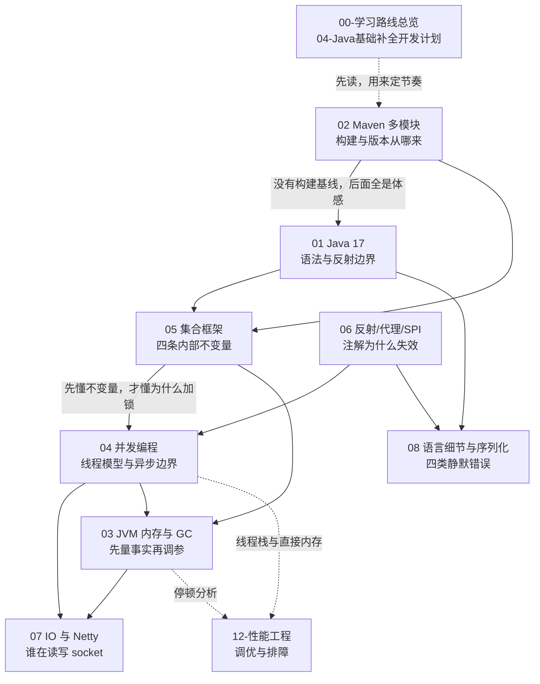

# 01-Java基础：先把"不报错但行为不对"的那一类问题解决掉

> **一句话结论**：这 8 篇不列 API 清单，只回答一个问题——线上那些"编译通过、单测通过、行为却不对"的毛病，是 Java 语言、构建或运行时的哪条机制被违反了，以及用什么动作能当场证明它。
> **阅读前置**：会写普通 Java 方法，能用 Maven 跑单模块命令（`mvn -o -pl <module> test`），知道 `@Service` 大致干什么即可；**不需要**读过任何 JDK 源码。
> **证据基线**：编译目标 JDK 17（`pom.xml#L30` 的 `<java.version>17</java.version>`），本地实测 `openjdk 17.0.19`（Temurin 构建）；Spring Framework 7.1.0 / Spring Boot 4.2.0（`pom.xml#L39`）/ Spring Cloud 2026.0.0 / Spring Cloud Alibaba 2025.1.0.0 / Spring Security 7.2.0 / Spring AI 2.1.0。8 篇合计 5283 行；按"一条线"读 6~8 小时，按"一篇一章"读 2~3 天。

## 1. 定位：补的是三种缺口

框架文档会告诉你"加这个注解就行"，但不会告诉你注解失效时该看哪里。这个模块存在的理由，是三种反复出现的缺口：

| 缺口 | 具体长什么样 | 不补的代价 |
| --- | --- | --- |
| **语言地基缺口** | 本地 `java -version` 是 21，工程编译目标却是 17；`record`、`sealed`、文本块（`"""`）到处用，却分不清哪些是 17 就有的、哪些要 21；用 `switch` 模式匹配或 `Thread.ofVirtual()` 写完后 CI 报 `cannot find symbol` | 语法糖当常识用，代码在 CI 和本地表现不一致，最后靠"删掉重写"收场 |
| **运行时黑盒缺口** | 报错只到 `OutOfMemoryError`、`ConcurrentModificationException`、`reactor.netty.http.client.PrematureCloseException` 这一层；再问下去——堆是谁撑大的、哪个线程把事件循环堵住了、哪个 `for` 循环在改集合——说不出来 | 只能靠重启、加内存、加机器，问题按周复发 |
| **框架契约缺口** | 注解、代理、自动配置、JSON 序列化"看起来是框架的魔法"；其实全是 Java 语言机制（反射、动态代理、SPI、序列化协议）在起作用 | 遇到"注解不生效""字段变 null""金额对不上"只能试，试不出就绕过 |

### 1.1 七个术语先对齐

后面 8 篇会反复用到这几个词，含义先钉死，避免"以为在说同一件事"：

| 术语 | 一句话解释 | 为什么必须先懂 |
| --- | --- | --- |
| 编译目标 | `javac` 产出的 class 文件的主版本号（17 对应 61），与"你本机装的是哪个 JDK"是两件事 | 同一个文件在本地 JDK 21 能编译、在 CI（目标 17）编译不过，是本项目最高频的"玄学" |
| 反射 | 运行时按名字拿构造器、方法、字段并调用，不依赖编译期类型 | 框架读注解、做绑定、做序列化全靠它；"注解失效"多半是反射没扫到 |
| 动态代理 | 运行期生成一个新对象（实现同接口，或继承目标类），在其方法里插入拦截逻辑后再回调真实对象 | 事务、缓存、异步、Feign 客户端都是这么实现的 |
| SPI | 一种"接口在核心包里、实现类写在登记文件里、启动时按文件加载"的服务发现机制 | 自动配置、JDBC 驱动、starter 都靠它；文件丢失＝功能静默消失 |
| Full GC | 一次连老年代（长期存活对象所在区域）一起清理的回收动作 | 判断内存问题时，看的是"次数涨不涨"与"清完老年代用量降不降"，而不是单次耗时 |
| 事件循环 | Netty 中少数固定线程，各自负责一批连接的读写事件 | 在这些线程上做阻塞操作，会连带拖慢它负责的**所有**连接，比线程池打满更难查 |
| 元信息 | 描述数据的数据：有效位数、时区、字符集、字段集合 | 08 篇的四类静默错误，本质都是元信息在某一跳被丢掉且没报错 |

### 1.2 读者画像

- 能写 CRUD、能照文档加注解，但被追问"为什么这么写就生效、换个位置就不生效"答不上来的 1~3 年工程师。
- 正在 ai-customer-service 这类 Spring Cloud 多模块项目里改代码，需要动 `ai-cs-order`（订单/支付）、`ai-cs-chat`（AI 对话）、`ai-cs-gateway`（网关）的人。
- 准备面试，想把"背过的结论"换成"能自证的推理链"的人——面试官追问一层就露馅的那种，本模块按"每个结论都挂证据"的方式补齐。
- **不做 JDK 源码通读**的人。本模块只管"现象 ↔ 机制"对上号；读 Spring 源码是 [24-源码分析](../24-源码分析/README.md) 的活，读 JDK 调优是 [12-性能工程](../12-性能工程/README.md) 的活。

**起点自测**（三个问题，能答出两个以上可跳过对应章节）：

| 问题 | 答不上来 → 从这里开始 |
| --- | --- |
| 本工程的编译目标是哪个 JDK 版本？写在哪一行？答案不一致时以谁为准？ | [01](01-Java17核心特性.md) + [02](02-Maven多模块管理.md) |
| `HashMap` 一次扩容扩到原来的几倍？为什么并发写它可能死循环或丢数据？ | [05](05-集合框架与源码.md) |
| `@Transactional` 标在同类内部调用的方法上为什么不生效？ | [06](06-反射动态代理与SPI.md) |

### 1.3 读完能做什么（每条都可用一个动作验收）

| 能做什么 | 验收动作（做完能观察到什么） | 对应篇 |
| --- | --- | --- |
| 能判断一段新语法在编译目标 17 下能不能活 | 把代码单独存成 `.java` 用 `javac` 编译一次，结果要么是 0 error，要么是 `error: cannot find symbol`（§9.2 有本机真实输出） | [01](01-Java17核心特性.md) |
| 能定位一次依赖版本冲突 | 跑 `mvn -o -pl ai-cs-order dependency:tree -Dverbose`，在输出里指出同一个 `groupId:artifactId` 出现两个版本，并说出哪个被 Maven 的"最近优先"规则选中 | [02](02-Maven多模块管理.md) |
| 能解释一次"内存居高不下、Full GC 不回收" | 用 `jstat -gc <pid> 1000` 连续采样，同时看 `OU`（老年代已用）与 `FGC`（Full GC 次数）两列是否"次数涨、OU 不掉" | [03](03-JVM内存模型与GC实战.md) |
| 能画出一次网关请求的线程归属 | 在图上指出 `reactor-http-nio-*`（Netty 事件循环线程）与 `http-nio-8083-exec-*`（下游 Tomcat 工作线程）各负责哪一段，并说明中间为什么可以"换手" | [07](07-IO模型与Netty基础.md) |
| 能说清一次"注解没生效"的确切原因 | 说出这次调用是否真的走了代理，再用断点或日志证明：`@Transactional` 方法被本类内部直接调用时，代理根本没进场 | [06](06-反射动态代理与SPI.md) |
| 能把三条防线写进 PR 描述 | 金额全链路 `BigDecimal`（用字符串构造、用 `compareTo` 比较）、时间全链路 `LocalDateTime` 且进程时区统一、JSON 只认 Boot 4 的 Jackson 3 `JsonMapper` | [08](08-语言级细节与序列化.md) |

## 2. 模块地图：8 篇的依赖不是一条直线



> **读图说明**：最关键的是两条箭头。第一条是 `02 → 01`：没有"编译目标是 17 还是 21、版本从谁那里来"这条基线，后面每一篇的"我本地试过可以"都是体感而非事实——本项目 8 篇里大量实测结论都以 `pom.xml#L30` 的 `17` 为前提。第二条是 `05 → 04`：先弄明白 `HashMap` 的两条不变量（扩容按 1.5 倍、桶下标由扰动后的哈希决定），才谈得上"为什么要 `ConcurrentHashMap`""为什么线程池里共享一个 `SimpleDateFormat` 会解析错"。**最容易看错的一条**是以为 `01 → 04`（17 篇的语法会直接支撑并发篇）：17 上既没有虚拟线程也没有 `switch` 模式匹配，并发篇讲的是 Tomcat 工作线程 + 线程池 + 异步边界，语法糖帮不上忙。

**推荐阅读顺序与理由**：

1. **第一遍：01 → 02 → 05 → 04**。先用一篇把"语言边界"钉死在 17 上（01），再用一篇确认"构建与版本从哪来"（02），然后拿到全模块复用率最高的一组内部机制（05），最后进入本仓库最容易出线上事故的一层——线程与异步（04）。
2. **第二遍：06 → 08 → 03 → 07**。06 解释框架契约（注解/代理/自动配置），08 解释数据在边界上的静默损坏，03 与 07 分别从"内存"和"socket"两个物理层收口。
3. **不要顺着 01…08 编号读**：03 与 07 依赖 04 的线程模型结论，08 依赖 01 的序列化边界结论；按编号读完 03 再读 04，会得到一堆"知道 G1 参数但不知道谁在分配"的孤立知识。

## 3. 每篇一句话摘要

| # | 文章 | 一句话摘要（解决什么问题） | 证据类型 |
| --- | --- | --- | --- |
| 01 | [01-Java17核心特性](01-Java17核心特性.md) | 哪些语法糖在编译目标 17 上可用、哪些根本编译不过，以及语法糖跨过 Jackson / Binder / MyBatis 的反射边界后要重核哪三件事（构造器、setter、不可变性） | B 级 36 处项目路径 + C 级 `javac` 实测 |
| 02 | [02-Maven多模块管理](02-Maven多模块管理.md) | 根 pom 怎么组织 12 个 Maven 模块、版本为什么集中在 `<properties>` + `<dependencyManagement>`、依赖冲突用哪两条命令定位 | B 级（`pom.xml#L14-L27` 等）+ C 级命令 |
| 03 | [03-JVM内存模型与GC实战](03-JVM内存模型与GC实战.md) | 线上"内存问题"多数不是调参问题，而是 `MaxHeapSize` 从哪算出来没查清、对象被谁长期强引用（Full GC 回收量为 0） | A 级 4 段（Spring/Boot 侧摘录）+ B 级 + C 级 `jstat` / `-Xlog:gc` |
| 04 | [04-并发编程进阶](04-并发编程进阶.md) | 一个请求要等 LLM 或向量库返回时，线程模型怎么摆才不把 Tomcat 工作线程耗尽；异步边界两侧的用户身份与 `traceId` 为什么必须显式搬运 | A 级 4 段（`SecurityContextHolder` 家族）+ C 级 + JDK 官方 Javadoc |
| 05 | [05-集合框架与源码](05-集合框架与源码.md) | 容器"慢"和"错"几乎总是四条内部不变量被违反：扩容节奏、哈希落桶、`modCount` 记账、元素身份比较 | A 级 2 段 + B 级 + C 级真实异常栈 |
| 06 | [06-反射动态代理与SPI](06-反射动态代理与SPI.md) | 注解只是给反射读的标签，真正干活的是启动时生成的代理；"注解失效"几乎总是这次调用没经过代理，或自动配置类没被登记 | A 级 13 段（`DefaultAopProxyFactory` 等）+ B 级 |
| 07 | [07-IO模型与Netty基础](07-IO模型与Netty基础.md) | 一次网关转发里真正碰 socket 的只有 Netty 事件循环池的少数线程；BIO 死在连接数，NIO 死在有人把事件循环堵住 | A 级 5 段 + B 级 + C 级实测（17.0.19 / Win11） |
| 08 | [08-语言级细节与序列化](08-语言级细节与序列化.md) | 金额、时间、编码、序列化四类静默错误＝元信息（有效位数 / 时区 / 字符集 / 字段集合）在某一跳被丢掉且不报错 | A 级 5 段 + B 级 28 处 + C 级 |

> 说明：A 级指 [24-源码分析](../24-源码分析/README.md) 的 `assets/source` 摘录，B 级指本仓库真实文件+行号，C 级指可复现实测命令与输出。**02 篇没有 A 级**，因为 `assets/source` 只收 Spring / Boot / Cloud / Security / MyBatis 等框架类，Maven 本身不在其中——这不是漏写，是证据边界。

## 4. 三条学习路线

| 目标 | 走法 | 预计耗时 | 产出物 |
| --- | --- | --- | --- |
| **面试速通**（能讲清流程，不背结论） | 01 → 05 → 04 → 06；每篇只读"现象 / 地图 / 时序 / 面试题"四节，读完立刻做该篇自测题；答案说不出口的，回到对应小节补 | 6~8 小时（1 天） | 一张手绘图：`HashMap.put` 的扩容与树化路径 + 代理链的调用顺序 + 线程池的参数到队列再到拒绝策略；配 20 条"我能被追问三层"的问答，写法参考 [19-求职与面试总纲/03-面试高频问题与答法](../19-求职与面试总纲/03-面试高频问题与答法.md) |
| **项目落地**（改代码不再踩静默坑） | 02 → 01 → 08 → 06：先能自己构建、能定位版本冲突，再定 DTO 与金额/时间口径，最后改注解与切面 | 2 天（含动手） | 三张清单写进自己模块的 README 或 PR 描述：①本次把哪些 DTO 改成 `record`、谁在用 getter；②金额/时区统一口径；③所有"必须经过代理"的调用点（哪些是本类自调用） |
| **线上排障**（从现象到根因） | 03 → 04 → 07：先量内存事实，再量线程事实，最后看网络与事件循环 | 2~3 天 | 一份真实三件套记录：`jstat` 采样表 + `jstack` 抓到的关键线程栈 + 网关侧连接错误分布；方法论继续看 [12-性能工程/08-性能问题定位方法论](../12-性能工程/08-性能问题定位方法论.md) |

## 5. 依赖关系：前置知识，以及对后续模块的影响

**前置**（读本模块之前最好有）：Java 语法、`mvn` 基本用法、HTTP 与 JSON 的常识。缺 `mvn` 的话先扫 [02](02-Maven多模块管理.md) 的"现象 + 地图"两节再回来。

**对后续模块的影响**：

| 后续模块 / 篇目 | 本模块提供什么 | 缺了会怎样 |
| --- | --- | --- |
| [02-Spring微服务/15-SpringAOP与声明式事务原理](../02-Spring微服务/15-SpringAOP与声明式事务原理.md) | 06 篇的"代理是启动时生成的、自调用不过代理" | 只能记住"事务方法别自己调自己"这句口诀，遇到 `final` 类、`private` 方法、`@Async` 失效仍然解释不了 |
| [02-Spring微服务/10-自定义Starter与自动装配](../02-Spring微服务/10-自定义Starter与自动装配.md) | 06 篇的 SPI 与自动配置登记机制 | 自己写的 starter 放进依赖却不生效，只能靠猜类路径 |
| [02-Spring微服务/17-SpringMVC请求全链路与参数校验](../02-Spring微服务/17-SpringMVC请求全链路与参数校验.md) | 07 篇的线程归属 + 04 篇的异步边界 | 分不清"请求线程阻塞"与"事件循环阻塞"，压测时把连接数问题当 CPU 问题修 |
| [03-数据库与ORM/02-MyBatisPlus实战](../03-数据库与ORM/02-MyBatisPlus实战.md) | 01 篇的反射边界（构造器/setter）+ 05 篇的集合不变量 | 实体类改 `record` 后 MyBatis 映射出 null，看不出是"没有无参构造器"这条硬约束 |
| [12-性能工程/01-JVM参数与GC选型](../12-性能工程/01-JVM参数与GC选型.md) | 03 篇的"先量 `MaxHeapSize` 与回收量，再谈 G1 参数" | 一上手就调 G1 参数，把"内存泄漏"优化成"更慢的泄漏" |
| [12-性能工程/07-线程池调优与背压](../12-性能工程/07-线程池调优与背压.md) | 04 篇的参数语义与背压位置 | 线程池队列配成无界，OOM 换成了请求超时 |
| [21-架构与分布式/03-分布式一致性理论](../21-架构与分布式/03-分布式一致性理论.md) | 04 篇的并发可见性/原子性直觉 + 05 篇的集合线程安全边界 | 讨论分布式一致性时缺少"单机内本来就没有一致性"的地基，容易把问题归错层 |

**边界说明**：本模块讲"机制与现象"，不讲"框架源码实现"（那是 24 的活），也不讲"生产参数基线"（那是 12 的活）。05 篇的哈希与 11-数据结构与算法 有重叠，分工是：05 篇只讲 JDK 实现层面的不变量与坑，抽象层与算法推导看 [11-数据结构与算法/03-哈希-冲突扰动与分片路由](../11-数据结构与算法/03-哈希-冲突扰动与分片路由.md)。

## 6. 检查点清单

完成后打勾。每条都以"能说出 / 能画出 / 能复现"开头，打不了勾说明这一篇还没读完。

**阶段一：语言与构建（01 / 02 / 05）**

- [ ] 能说出 `record`、`sealed`、`instanceof` 模式匹配、文本块在编译目标 17 上**可用**，而 `switch` 模式匹配与虚拟线程在 17 上**编译不过**，并指出依据是 `pom.xml#L30` 的 `17`。
- [ ] 能复现一次编译失败：把 `Thread.ofVirtual()` 写进一个独立 `.java` 用 `javac` 编译，看到 `error: cannot find symbol`（§9.2 第 5 组输出）。
- [ ] 能画出根 pom 的四层结构（`<modules>` / `<properties>` / `<dependencyManagement>` / 插件配置），并说出哪几个仓库目录**不在** Maven 模块清单里。
- [ ] 能复现一次依赖冲突定位：`dependency:tree -Dverbose` 输出里指出同一 artifact 的两个版本，并说明最终生效的是哪个。
- [ ] 能说出 `HashMap` 扩容倍数与树化阈值，并解释为什么边遍历边 `remove` 会抛 `ConcurrentModificationException`（`modCount` 记账）。

**阶段二：运行时（03 / 04 / 07）**

- [ ] 能说出 Tomcat 工作线程被慢调用占满后的三个可观测信号（线程数到上限、队列堆积、上游超时率上升），并指出本仓库里最可能产生慢调用的两处。
- [ ] 能复现一次采样：`jstat -gc <pid> 1000` 连续 10 次，指出哪两列必须一起看才判断得出"对象没被回收"。
- [ ] 能画出一次网关转发的线程归属图，并标出"上下文（用户身份 / `traceId`）在哪一步必须显式传递"。
- [ ] 能说出把阻塞调用放进事件循环线程后会看到什么现象，以及为什么它比"线程池打满"更难定位。

**阶段三：框架契约与数据边界（06 / 08）**

- [ ] 能说出"注解不生效"的四类根因（同类自调用、`final` 类、`final` 方法、`private` 方法），并各给一个验证动作。
- [ ] 能画出 JDK 接口代理与 CGLIB 子类代理的差别（前者要实现接口，后者靠继承），并解释为什么继承方式天然怕 `final`。
- [ ] 能复现一次 JSON 序列化的字段丢失或精度丢失，并说出防线应该放在哪一层（实体 / DTO / 全局配置）。
- [ ] 能说出本项目金额、时间、字符集三条统一口径各自的"唯一正确写法"。

## 7. 与 24-源码分析 的衔接

本模块只讲到"现象 + 用法 + 机制名字"，一旦你想看"框架内部到底哪一行做的"，去 24。真实篇目对应：

| 本模块主题 | 在这里只讲到 | 深入看 24-源码分析 |
| --- | --- | --- |
| 注解为什么失效、代理怎么生成（06） | 代理是启动时生成的，自调用不过代理 | [01-Spring框架/02-AOP与代理/01-aop-原理与自动代理创建](../24-源码分析/01-Spring框架/02-AOP与代理/01-aop-原理与自动代理创建.md)、[02-代理方式-jdk与cglib](../24-源码分析/01-Spring框架/02-AOP与代理/02-代理方式-jdk与cglib.md) |
| 拦截器顺序、多个切面谁先执行（06） | 有顺序，靠 `@Order` 与通知类型 | [03-拦截器链-调用与通知顺序](../24-源码分析/01-Spring框架/02-AOP与代理/03-拦截器链-调用与通知顺序.md) |
| 自定义注解切面写出来的坑（06） | 常见失效场景清单 | [04-aop-实战-自定义注解切面与坑位](../24-源码分析/01-Spring框架/02-AOP与代理/04-aop-实战-自定义注解切面与坑位.md) |
| `@Transactional` 什么时候不生效（06 → 02 模块） | 事务靠代理，异常类型与传播行为是关键 | [01-Spring框架/03-事务管理/02-事务失效场景与源码原因](../24-源码分析/01-Spring框架/03-事务管理/02-事务失效场景与源码原因.md) |
| Bean 什么时候被创建、依赖注入什么时候发生（06） | 一句话：容器启动阶段完成 | [01-Spring框架/01-IoC容器与Bean生命周期/01-refresh-容器启动全流程](../24-源码分析/01-Spring框架/01-IoC容器与Bean生命周期/01-refresh-容器启动全流程.md)、[04-依赖注入-autowired与beanpostprocessor](../24-源码分析/01-Spring框架/01-IoC容器与Bean生命周期/04-依赖注入-autowired与beanpostprocessor.md) |
| `@Configuration` 类为什么能拦截方法调用（06） | 配置类会被增强 | [05-配置类解析-configurationclasspostprocessor](../24-源码分析/01-Spring框架/01-IoC容器与Bean生命周期/05-配置类解析-configurationclasspostprocessor.md) |
| 自动配置为什么没生效（06） | 靠登记文件被读到 | [02-SpringBoot/02-自动配置/01-enableautoconfiguration-自动配置全链路](../24-源码分析/02-SpringBoot/02-自动配置/01-enableautoconfiguration-自动配置全链路.md) |
| 配置绑定与反射边界（01 / 08） | `Binder` 走 setter 还是构造器 | [02-SpringBoot/04-配置与属性绑定/01-configurationproperties-属性绑定原理](../24-源码分析/02-SpringBoot/04-配置与属性绑定/01-configurationproperties-属性绑定原理.md) |
| 启动阶段线程与容器（04 / 07） | 启动时会创建哪些线程池 | [02-SpringBoot/01-启动原理/01-springapplication-run-启动全流程](../24-源码分析/02-SpringBoot/01-启动原理/01-springapplication-run-启动全流程.md)、[02-SpringBoot/03-内嵌容器与Web开发/01-内嵌容器启动-tomcat与servletweb容器](../24-源码分析/02-SpringBoot/03-内嵌容器与Web开发/01-内嵌容器启动-tomcat与servletweb容器.md) |
| 网关过滤器链（07） | 一次转发经过哪些阶段 | [04-SpringCloud/04-网关Gateway/01-route-路由断言与过滤器链](../24-源码分析/04-SpringCloud/04-网关Gateway/01-route-路由断言与过滤器链.md) |
| Feign 为什么是接口也能发请求（06 → 07） | 靠动态代理拼请求 | [04-SpringCloud/03-负载均衡与调用/02-openfeign-动态代理与请求拼接](../24-源码分析/04-SpringCloud/03-负载均衡与调用/02-openfeign-动态代理与请求拼接.md) |
| 一条 SQL 的执行与一级缓存（05 邻近主题） | 集合/缓存的基本不变量 | [03-MyBatis/02-SqlSession与执行器/02-executor-执行器与一级缓存](../24-源码分析/03-MyBatis/02-SqlSession与执行器/02-executor-执行器与一级缓存.md) |
| 怎么读源码这件事本身 | 不涉及 | [07-源码方法论与附录/02-源码阅读方法论/01-四步读码法-从断点到调用栈](../24-源码分析/07-源码方法论与附录/02-源码阅读方法论/01-四步读码法-从断点到调用栈.md)、[01-手写miniioc容器](../24-源码分析/07-源码方法论与附录/01-手写迷你实现/01-手写miniioc容器.md)、[02-手写miniaop代理](../24-源码分析/07-源码方法论与附录/01-手写迷你实现/02-手写miniaop代理.md) |

**注意两处"24 里没有对应篇"**：JDK 容器（`HashMap` / `ArrayList`）与 JVM/GC 不在 `assets/source` 收录范围（该目录只收框架类，实测 905 份摘录），这两块要么看 JDK 官方 Javadoc 与 JEP，要么去 [12-性能工程](../12-性能工程/README.md)；并发工具类同理，04 篇的 A 级证据只有 Spring Security 的 `SecurityContextHolder` 家族，`ThreadPoolExecutor` 的行为靠 C 级实验与官方文档。

## 8. 常见问题直达表

| 症状（你在日志/控制台/页面上看到的） | 先去哪一篇 | 关键线索 |
| --- | --- | --- |
| 本地能编译、CI 报 `cannot find symbol`（如 `ofVirtual`、`ofPattern`） | [01](01-Java17核心特性.md) | 编译目标是 17，语法是 21+ |
| 实体/DTO 改成 `record` 后，查询结果字段全是 `null` | [01](01-Java17核心特性.md) | 框架走的是无参构造器 + setter，`record` 两者都没有 |
| 同一个 jar 出现两个版本，或新加模块 CI 不构建 | [02](02-Maven多模块管理.md) | 根 pom `<modules>` 没登记 / `dependencyManagement` 没管住 |
| 服务被 OOMKilled、退出码 137，`-Xmx` 明明设过 | [03](03-JVM内存模型与GC实战.md) | 容器内 `MaxHeapSize` 的默认算法，`-Xlog:gc` 看实际堆上限 |
| 内存缓慢上涨、Full GC 次数上涨但老年代用量不降 | [03](03-JVM内存模型与GC实战.md) | 强引用没释放；配合 [12-性能工程/04-内存泄漏排查实战](../12-性能工程/04-内存泄漏排查实战.md) |
| 接口 P99 突增，CPU 不高、线程数也上不去 | [04](04-并发编程进阶.md) | 线程池队列堆积或线程被慢调用占满 |
| 异步线程里拿不到登录用户 / `traceId` 丢了 | [04](04-并发编程进阶.md) | `ThreadLocal` 不跨线程，需显式传递 |
| 遍历集合时抛 `ConcurrentModificationException` | [05](05-集合框架与源码.md) | 结构修改没走迭代器（`modCount` 记账） |
| `@Transactional` / `@Async` / `@Cacheable` 写了没反应 | [06](06-反射动态代理与SPI.md) | 本类自调用、`final` 类/方法、`private` 方法 |
| 自定义 starter / 自动配置类进了依赖但没被加载 | [06](06-反射动态代理与SPI.md) | 登记文件缺失或条件注解不满足 |
| 网关偶发 `Connection reset by peer` / `PrematureCloseException` | [07](07-IO模型与Netty基础.md) | 下游超时/连接池耗尽，事件循环被阻塞会放大 |
| 压测时连接数上不去、大量 CLOSE_WAIT | [07](07-IO模型与Netty基础.md) | IO 模型与连接生命周期 |
| 前端拿到的 19 位 id 末位变 0、明显是精度丢失 | [08](08-语言级细节与序列化.md) | JSON 数字默认走浮点/长整型精度，需字符串化 |
| 金额算出来差一分钱、`0.1 + 0.2 != 0.3` | [08](08-语言级细节与序列化.md) | `double` 与 `BigDecimal` 的构造方式 |
| 时间相差 8 小时、跨服务的日期对不上 | [08](08-语言级细节与序列化.md) | 进程时区、`Date` 与时区隐式转换 |
| 中文写入库或响应里变成 `???` / `MalformedInputException` | [08](08-语言级细节与序列化.md) | 字符集某一跳不是 UTF-8 |
| 同一个类名的两个版本共存，报 `ClassCastException: ... cannot be cast to ...` | [02](02-Maven多模块管理.md) | 依赖冲突，同名类来自两个 jar |
| 服务关闭或重启时，异步任务/消息没处理完就丢了 | [04](04-并发编程进阶.md) | 线程池没有优雅关闭，队列里的任务随进程消失 |

## 9. 旧稿更正与本轮事实核对

旧版本 README 是"章节导航表 + 知识点速查 + 练习清单"的结构，其中若干条表述已经与仓库现状不符。这里逐条列出，避免把旧结论当事实继续传：

| 项目 | 更正前（旧稿写法） | 仓库现状 / 当前基线 | 依据 |
| --- | --- | --- | --- |
| 组织方式 | "章节导航"表罗列 8 篇 + 难度星级 | 改为依赖地图（§2）+ 一句话摘要（§3）+ 三条路线（§4），因为难度星级不能告诉你先读哪篇 | 本页 |
| 虚拟线程 | "**Virtual Thread** 虚拟线程（参考 04 篇）"，当成可用特性 | 17 上**编译不过**：`Thread.ofVirtual()` 与 `Executors.newVirtualThreadPerTaskExecutor()` 都是 21 起才有的 API；04 篇讲的是 Tomcat 工作线程 + 线程池 + 异步边界 | `pom.xml#L30` + §9.2 第 5 组实测 |
| GC 日志参数 | `-XX:+PrintGCDetails` | JDK 9 起废弃，17 上直接打印 `is deprecated. Will use -Xlog:gc* instead.`；新写法是 `-Xlog:gc*` | §9.2 第 1 组实测 |
| CMS 回收器 | 讨论 "CMS/G1 Full GC 导致 1~2 秒卡顿"，并建议调年轻代 | CMS 在 JDK 14 已被移除，17 上 `-XX:+UseConcMarkSweepGC` 直接导致 JVM 起不来 | §9.2 第 2 组实测 |
| 练习命令 | `mvn clean test -Dtest=ArrayListBenchmark` | 仓库里**没有任何** `*Benchmark*` 类，该命令跑不通；改写后练习绑定真实存在的类与命令 | §9.2 第 4 组实测 |
| Maven 模块 | 未列清单（外部资料常写"12 个模块"但不给依据） | 根 pom 的 `<modules>` 恰好 **12 个**：common、gateway、user、knowledge、chat、search、message、notify、order、pay、mq、product；`ai-cs-frontend`、`ai-cs-frontend-react`、`ai-cs-py-chat`、`ai-cs-py-recommend` **不是** Maven 模块 | `pom.xml#L14-L27` |
| Spring Boot 版本 | 旧稿按 3.x 习惯描述（`spring-boot-starter-web`） | 本仓库 `spring-boot.version` = **4.2.0**；Boot 4 起 `spring-boot-starter-web` 已 deprecated，新代码用 `spring-boot-starter-webmvc`，`ai-cs-gateway/pom.xml#L50` 已是新写法 | `pom.xml#L39`、`ai-cs-gateway/pom.xml#L50` |
| 端口 | 旧稿未给，外部资料多写"网关 8080、各服务从 8081 起" | 逐个核对如下表（各模块 `src/main/resources/application.yml#L3`） | 见端口表 |
| 后续模块指向 | ASCII 树指向 "04-中间件 / 07-运维部署" | 改为指向 02-Spring微服务、03-数据库与ORM、12-性能工程、21-架构与分布式 的具体篇目（§5） | 本页 |

**实际端口（按模块，实测扫描各 `application.yml#L3`）**：

| 模块 | 端口 | 模块 | 端口 |
| --- | --- | --- | --- |
| ai-cs-gateway | 8080 | ai-cs-notify | 8086 |
| ai-cs-user | 8081 | ai-cs-order | 8087 |
| ai-cs-knowledge | 8082 | ai-cs-product | 8088 |
| ai-cs-chat | 8083 | ai-cs-pay | 8089 |
| ai-cs-search | 8084 | ai-cs-mq | 8090 |
| ai-cs-message | 8085 | ai-cs-common | 无端口（纯库模块） |

前端开发服务器 `5173`，见 `ai-cs-frontend/vite.config.js#L25`。

### 9.1 本轮实测输出（可直接复现）

**① `-XX:+PrintGCDetails` 在 17 上的真实表现**

```text
> java -XX:+PrintGCDetails -version
[0.009s][warning][gc] -XX:+PrintGCDetails is deprecated. Will use -Xlog:gc* instead.
[0.019s][info   ][gc] Using G1
openjdk version "17.0.19" 2026-04-21
OpenJDK Runtime Environment Temurin-17.0.19+10 (build 17.0.19+10)
OpenJDK 64-Bit Server VM Temurin-17.0.19+10 (build 17.0.19+10, mixed mode)
```

怎么读：`warning` 行说明该参数只是被"转译"成 `-Xlog:gc*`，不代表你的日志格式没变；`Using G1` 是 17 的默认回收器，所以排查 GC 问题应先假设 G1 行为，而不是旧资料里的 CMS。

**② CMS 参数在 17 上直接让 JVM 起不来**

```text
> java -XX:+UseConcMarkSweepGC -version
Unrecognized VM option 'UseConcMarkSweepGC'
Error: Could not create the Java Virtual Machine.
Error: A fatal exception has occurred. Program will exit.
```

怎么读：`Unrecognized VM option` 是"这个参数根本不存在"，不是"不支持搭配"。看到它，说明你在用旧版本资料；退出码 1 意味着进程不会起来，别在排查业务问题前浪费时间去追这条日志。

**③ 编译目标 17 上虚拟线程 API 不存在**

```text
> javac -J-Duser.language=en -J-Duser.country=US -d . Vt.java
Vt.java:3: error: cannot find symbol
        var t = Thread.ofVirtual().start(() -> {});
                      ^
  symbol:   method ofVirtual()
  location: class Thread
1 error
```

怎么读：`cannot find symbol` + `location: class Thread` 说明不是语法错误、也不是缺少 import，而是**该方法在 17 的 `Thread` 类上不存在**（虚拟线程是 21 才转正的 API）。复现方式：在任意临时目录建一个 3 行的 `Vt.java`，`main` 里只有 `var t = Thread.ofVirtual().start(() -> {});` 与 `t.join();`，用上面的 `javac` 命令行编译即可。这类报错在 CI 上最容易被当成"依赖没下全"而去删 `~/.m2`。

**④ 旧稿的基准测试命令在本仓库跑不通**

```text
> Get-ChildItem -Recurse -Filter *Benchmark* -File | Where-Object { $_.FullName -notmatch '\\target\\' }
（无输出）
```

怎么读：无输出＝仓库里不存在任何名字含 `Benchmark` 的源文件，因此 `-Dtest=ArrayListBenchmark` 只会得到 "No tests were executed" 之类的空跑。练习必须绑定真实存在的类或可独立运行的小程序。

**⑤ 端口扫描（本次核对的原始命令与输出节选）**

```text
> Get-ChildItem ai-cs-*\src\main\resources\application.yml -File | ForEach-Object { $rel = $_.FullName.Replace((Get-Location).Path + '\','').Replace('\','/'); $hit = Select-String -Path $_.FullName -Pattern '^\s*port:\s*(\d+)' | Select-Object -First 1; "$rel#L$($hit.LineNumber) -> $($hit.Line.Trim())" }
ai-cs-chat/src/main/resources/application.yml#L3 -> port: 8083
ai-cs-gateway/src/main/resources/application.yml#L3 -> port: 8080
ai-cs-knowledge/src/main/resources/application.yml#L3 -> port: 8082
ai-cs-message/src/main/resources/application.yml#L3 -> port: 8085
ai-cs-mq/src/main/resources/application.yml#L3 -> port: 8090
ai-cs-notify/src/main/resources/application.yml#L3 -> port: 8086
ai-cs-order/src/main/resources/application.yml#L3 -> port: 8087
ai-cs-pay/src/main/resources/application.yml#L3 -> port: 8089
ai-cs-product/src/main/resources/application.yml#L3 -> port: 8088
ai-cs-search/src/main/resources/application.yml#L3 -> port: 8084
ai-cs-user/src/main/resources/application.yml#L3 -> port: 8081
```

怎么读：每行都是"文件路径 + 行号 -> 命中的那一行"，说明端口写在 `application.yml` 第 3 行、且**每个服务都显式声明**（没有走"随机端口"或"从配置中心下发"）。只有 11 个服务出现在结果里，`ai-cs-common` 不在其中——它是纯库模块，没有启动类也不占端口。

### 9.2 维护提示

本页的端口表、模块清单、版本号都是**快照**：模块清单来自 `pom.xml#L14-L27`，版本来自 `pom.xml#L30` 与 `pom.xml#L39`，端口来自各模块 `application.yml#L3`。任何一项改动后，本页都必须跟着改；8 篇正文里的行号同理。判断"这条结论还成立吗"的最低成本方式是先跑一遍 `node tools/check-doc.mjs 01-Java基础`，再按 §9.1 的命令重跑一遍。
