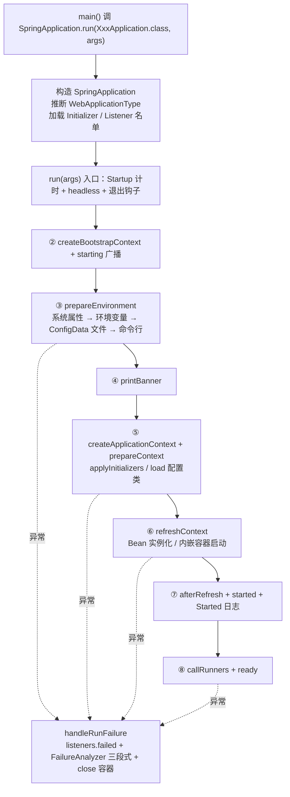
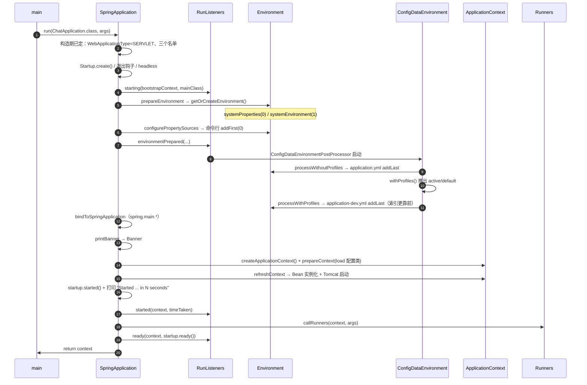

# SpringBoot 核心原理：SpringApplication.run 这一条链，决定了你所有"配置不生效"

> **一句话结论**：`SpringApplication.run` 不是魔法入口，而是一段顺序写死的八段编排——构造期就把 Web 类型和扩展点名单定死，`prepareEnvironment` 期把属性源按固定次序排队，`refreshContext` 期把 Bean 造出来，跑完才轮到 Runner。**"配置不生效"几乎全部是这条链上某一段的"顺序问题"，不是框架 bug。**
> **阅读前置**：写过带 `main` 的 `@SpringBootApplication` 启动类，改过 `application.yml`；知道 `@Component`/`@Bean` 大概在干什么（容器内部细节看[《IoC 容器与 Bean 生命周期》](16-IoC容器与Bean生命周期.md)）。
> **证据基线**：JDK 17.0.19 / Spring Boot 4.2.0 / Spring Framework 7.1.0 / Spring Cloud 2026.0.0；A 级源码摘录 24 处（`24-源码分析/assets/source/`）、B 级本项目源码 7 处、C 级本机实测 4 个；预计阅读 25 分钟。

## 0. 先看现象

### 现象 1：`application.yml` 里写的端口"不生效"

`ai-cs-chat/src/main/resources/application.yml#L1-L3` 明确写着 `server.port: 8083`，可启动日志是：

```text
2026-05-12T10:12:31.418+08:00  INFO 28412 --- [ai-cs-chat] [main] o.s.b.w.embedded.tomcat.TomcatWebServer  : Tomcat started on port 8080 (http) with context path '/'
2026-05-12T10:12:31.433+08:00  INFO 28412 --- [ai-cs-chat] [main] com.aics.chat.ChatApplication           : Started ChatApplication in 6.284 seconds (process running for 6.874)
```

第一反应通常是"缓存没清""重新编译一下"，然后重启三次、值还是 8080。真实原因往往只有一个：IDEA 的 Run Configuration 里还留着上一次调试用的 `-Dserver.port=8080`（虚拟机参数），而 **系统属性的优先级比任何 `application.yml` 都高**——这不是玄学，`StandardEnvironment` 构造时就把 `systemProperties` 放在索引 0 的位置（§3.3 有实测）。

### 现象 2：本地改的模型名被 Nacos 里的旧值盖回去

想把对话模型换掉，于是本地 `application.yml#L40-L44` 改成 `${OPENAI_MODEL:deepseek-chat}` 的兜底值，`export OPENAI_MODEL=xxx`，重启——发现仍然是旧的模型名。这类"我在本地改的怎么被远端覆盖了"的疑惑，答案是 `spring.config.import` 导入的那份配置**优先级高于声明 import 的文件本身**（`application.yml#L27-L31` 导入 `nacos:aics-shared.yml`、`nacos:ai-cs-chat.yml`），实测见 §3.5。

### 现象 3：启动卡在 `Started` 之前，或者干脆打印三段式失败报告

一种是卡住：

```text
2026-05-12T10:12:58.201+08:00 ERROR 28412 --- [ai-cs-chat] [main] o.s.b.SpringApplication: Application run failed
com.alibaba.nacos.api.exception.NacosException: Client not connected, current status: STARTING
```

另一种是 `refresh` 期间直接抛异常，被失败分析器排成固定的三段式（Description / Reason / Action）：

```text
***************************
APPLICATION FAILED TO START
***************************

Description:

Failed to configure a DataSource: 'url' attribute is not specified and no embedded datasource could be configured.

Reason: Failed to determine a suitable driver class

Action:

Consider the following:
	If you want an embedded database (H2, HSQL or Derby), please put it on the classpath.
	If you have database settings to be loaded from a particular profile you may need to activate it (no profiles are currently active).
```

本项目 chat 服务正是为了避开这一段，在 `ai-cs-chat/src/main/resources/application.yml#L12-L15` 里把 `DataSourceAutoConfiguration` 排除了——"自动配置 + 环境"两者一起决定的启动结果，改 pom 或改 yml 都能左右它。

**这三个现象指向同一件事：启动过程是一条顺序固定、每段职责明确的流水线，而"某个值最终是多少""某个 Bean 造没造""失败时打哪段报告"都由流水线上当前这一段决定。把这条链切成 8 段并记住每段的输入输出，"配置不生效"就从玄学变成定位题。**

## 1. 整体地图



> **读图说明**：把图分成左右两半看——上半是"值从哪来"（构造 → ③），下半是"对象从哪来"（⑤ → ⑧）。最容易看错的是③那根箭头：它指向的不是"读 application.yml"，而是"把系统属性、环境变量、若干配置文件、命令行**按固定顺序**排进一个列表"。顺带留意四条虚线都汇到同一个 `handleRunFailure`：**任何一段的异常，最终都由同一套失败分析器排版**，所以不同阶段的报错长得像同一家族。

| 阶段 | 谁负责 | 产物 | 这一段的典型失败现象 |
|---|---|---|---|
| 构造期 | `SpringApplication` 构造函数 | `WebApplicationType`、三个扩展点名单、`mainApplicationClass` | 几乎不会失败，但决定了后面用哪个容器 |
| ① 准备 | `run()` 前 6 行 | `DefaultBootstrapContext`、`SpringApplicationRunListeners` | 自定义 RunListener 配置文件写错会直接 `IllegalArgumentException` |
| ② starting 广播 | `SpringApplicationRunListeners.starting` | 事件被 `EventPublishingRunListener` 转成 `ApplicationStartingEvent` | 监听器抛异常即启动失败，此时还没有 Environment |
| ③ 环境 | `prepareEnvironment` + `ConfigDataEnvironmentPostProcessor` | 有序的 `MutablePropertySources`、active/default profile | yml 语法错、`spring.profiles` 用错、必要 import 缺失 |
| ④ banner | `printBanner` | 控制台横幅（或 `null`） | 极少失败；`banner-mode` 写错抛 `BindException` |
| ⑤ 建容器 | `createApplicationContext` + `prepareContext` | 空的 `ConfigurableApplicationContext`，已 `load` 配置类 | 找不到主类、`Initializer` 泛型不对 |
| ⑥ refresh | `AbstractApplicationContext#refresh` | 全部单例 Bean、内嵌 Web 服务器 | 数据源/注册中心连接失败、Bean 循环依赖 |
| ⑦ started | `startup.started()` + `listeners.started` | `Started XxxApplication in N seconds` | 监听器抛异常 → 容器会被关闭 |
| ⑧ Runner / ready | `callRunners` + `listeners.ready` | 你的业务初始化代码、`ApplicationReadyEvent` | Runner 抛异常 → `IllegalStateException` |

| 参与者 | 是谁 | 谁调它 |
|---|---|---|
| `main()` | 项目启动类 | JVM |
| `SpringApplication` | 启动编排者（可 `new` 出来改属性） | `main()` |
| `SpringApplicationRunListener` | 启动过程的事件广播者（SPI 扩展点） | `SpringApplication` |
| `Environment` / `MutablePropertySources` | 属性容器，有序列表即优先级 | `prepareEnvironment` |
| `ConfigDataEnvironmentPostProcessor` | 配置文件加载器（`EnvironmentPostProcessor`） | `EnvironmentPreparedEvent` 的监听链 |
| `ApplicationContextFactory` | 按 `WebApplicationType` 造对应容器 | `createApplicationContext` |
| `FailureAnalyzer` | 把异常翻译成人话三段式 | `handleRunFailure` 里的 `SpringBootExceptionReporter` |

## 2. 关键概念与关键类

| 名称 | 位置 | 角色 | 关键方法 |
|---|---|---|---|
| `SpringApplication` | `org.springframework.boot` | 启动编排者，八段流程都写在它身上 | `run`、`prepareEnvironment`、`prepareContext`、`callRunners` |
| `SpringApplicationRunListener` | `org.springframework.boot` | 启动阶段事件广播接口（SPI，默认实现 `EventPublishingRunListener`） | `starting`/`environmentPrepared`/`contextLoaded`/`started`/`ready`/`failed` |
| `SpringApplicationRunListeners` | `org.springframework.boot` | 上者的集合包装，负责"安全地逐个回调" | `doWithListeners`、`started`、`ready` |
| `WebApplicationType` | `org.springframework.boot` | 枚举 `NONE`/`SERVLET`/`REACTIVE`，决定造哪种容器 | `deduce`、`Deducer` |
| `ApplicationContextFactory` | `org.springframework.boot` | 按 Web 类型造容器/环境（Boot 2.4 起取代 `SpringFactoriesLoader` 反射） | `create`、`createEnvironment` |
| `ApplicationContextInitializer` | `org.springframework.context` | 容器 `refresh` 前对它做编程式改写 | `initialize` |
| `Environment` / `ConfigurableEnvironment` | `org.springframework.core.env` | 属性容器，内部是 `MutablePropertySources`（有序） | `getProperty`、`setActiveProfiles` |
| `ConfigDataEnvironmentPostProcessor` | `org.springframework.boot.context.config` | 真正把 `application.yml` / `spring.config.import` 读进来的地方 | `postProcessEnvironment`、`applyTo` |
| `ConfigDataEnvironment` | 同上 | ConfigData 五阶段实现 | `processAndApply`、`applyContributor` |
| `ApplicationProperties` | `org.springframework.boot` | 绑定 `spring.main.*`，控制 banner/lazy/日志开关 | `getBannerMode`、`isLogStartupInfo` |
| `FailureAnalyzer` | `org.springframework.boot.diagnostics` | 把异常翻译成 Description/Reason/Action | `analyze`、`FailureAnalysis` |
| `Runner`(`ApplicationRunner`/`CommandLineRunner`) | `org.springframework.boot` | 容器 `running` 之后执行的一次性任务 | `run` |

## 3. 原理与证据逐段精读

### 3.1 构造期：三份"名单"在 `new` 的那一刻就已经定死

**在干什么**：`SpringApplication` 的构造函数只做五件事——存主配置类、**推断 Web 应用类型**、加载三类扩展点名单、记录 `main` 所在类。

(src: SpringApplication.java#L262-L272)

```java
public SpringApplication(@Nullable ResourceLoader resourceLoader, Class<?>... primarySources) {
	this.resourceLoader = resourceLoader;
	Assert.notNull(primarySources, "'primarySources' must not be null");
	this.primarySources = new LinkedHashSet<>(Arrays.asList(primarySources));
	this.properties.setWebApplicationType(WebApplicationType.deduce());
	this.bootstrapRegistryInitializers = new ArrayList<>(
			getSpringFactoriesInstances(BootstrapRegistryInitializer.class));
	setInitializers((Collection) getSpringFactoriesInstances(ApplicationContextInitializer.class));
	setListeners((Collection) getSpringFactoriesInstances(ApplicationListener.class));
	this.mainApplicationClass = deduceMainApplicationClass();
}
```

[`[[源码:SpringApplication.java.md#L262-L272]]`] 注意两件事：`LinkedHashSet` 让主配置类**去重且保序**（同一类传两次不会重复注册，这点后面讲"Bean 初始化两次"时很关键）；三个 `getSpringFactoriesInstances` 在这里**一次性**读完，之后 `run` 期间不会再补。

`WebApplicationType` 就是"这个应用算什么类型"的枚举：`NONE`（普通应用）、`SERVLET`（跑 Servlet 容器，即 Tomcat）、`REACTIVE`（WebFlux）。推断逻辑走 SPI：

(src: WebApplicationType.java#L51-L58)

```java
public static WebApplicationType deduce() {
	for (Deducer deducer : SpringFactoriesLoader.forDefaultResourceLocation().load(Deducer.class)) {
		WebApplicationType deduced = deducer.deduceWebApplicationType();
		if (deduced != null) {
			return deduced;
		}
	}
	return isServletApplication() ? WebApplicationType.SERVLET : WebApplicationType.NONE;
}
```

[`[[源码:WebApplicationType.java.md#L51-L58]]`] 兜底是"classpath 上有 `jakarta.servlet.Servlet` 就是 `SERVLET`，否则 `NONE`"——**不是 `REACTIVE`**，这点是网上老文章最容易写错的地方（老版本靠判 `DispatcherServlet` 与 `reactor` 有没有同时出现）。

**为什么这么设计**：类型决定"用哪个 `ApplicationContext` 实现、起不起内嵌服务器、`Environment` 要不要 `ServletContext` 那层"，它必须在任何容器对象存在之前就确定，所以放在构造函数里；而"由谁来判"做成 SPI（`Deducer`），是为了让 WebFlux、Cloud Foundry 这类模块各自追加规则而不改 Spring Boot 本体。

**换个写法会怎样**：如果手动 `new SpringApplication(...)` 之后又 `setWebApplicationType(WebApplicationType.NONE)`，你会得到一个**不起 Tomcat、但有 SpringMVC 依赖**的应用——`@RestController` 全在、端口一个也不监听，这类"服务起来了但 404 全部"的怪事就源于此。

**常见坑**：① 只看 `spring-boot-starter-web` 判断类型（Boot 4 已把 `spring-boot-starter-web` 标记 deprecated，改用 `spring-boot-starter-webmvc`，但两者推断结果相同）；② 构造函数里已固定名单，想"运行期再加一个 `ApplicationListener`"必须用 `springApplication.addListeners(...)` 或 `SpringApplicationBuilder`，改配置文件无效。

### 3.2 三份名单从哪个文件读出来（`spring.factories` 实证）

**在干什么**：`getSpringFactoriesInstances(type)` 交给 `SpringFactoriesLoader.forDefaultResourceLocation(...).load(type, argumentResolver)`，即读 classpath 上的 `META-INF/spring.factories`，把"接口全名 = 实现类列表"展开成对象。

**B 级 + 证据**：本项目用的是 Boot 4.2.0，直接看本地仓库里那个 jar 就能确认这份名单长什么样（命令与真实输出见下，耗时 2 秒内）。

```powershell
Add-Type -AssemblyName System.IO.Compression.FileSystem
$j="$env:USERPROFILE\.m2\repository\org\springframework\boot\spring-boot\4.2.0\spring-boot-4.2.0.jar"
$z=[System.IO.Compression.ZipFile]::OpenRead($j)
$e=$z.GetEntry("META-INF/spring.factories"); (New-Object System.IO.StreamReader($e.Open())).ReadToEnd()
$z.Entries | Where-Object { $_.FullName -like "META-INF/*" -and $_.FullName -notlike "*.class" }
$z.Dispose()
```

真实输出（节选自 `spring-boot-4.2.0.jar!/META-INF/spring.factories`）：

```text
# Run Listeners
org.springframework.boot.SpringApplicationRunListener=\
org.springframework.boot.context.event.EventPublishingRunListener

# Error Reporters
org.springframework.boot.SpringBootExceptionReporter=\
org.springframework.boot.diagnostics.FailureAnalyzers

# Application Context Initializers
org.springframework.context.ApplicationContextInitializer=\
org.springframework.boot.context.ConfigurationWarningsApplicationContextInitializer,\
org.springframework.boot.context.ContextIdApplicationContextInitializer,\
org.springframework.boot.io.ProtocolResolverApplicationContextInitializer

# Application Listeners
org.springframework.context.ApplicationListener=\
org.springframework.boot.ClearCachesApplicationListener,\
org.springframework.boot.builder.ParentContextCloserApplicationListener,\
org.springframework.boot.context.FileEncodingApplicationListener,\
org.springframework.boot.context.logging.LoggingApplicationListener,\
org.springframework.boot.support.AnsiOutputApplicationListener,\
org.springframework.boot.support.EnvironmentPostProcessorApplicationListener

# Environment Post Processors
org.springframework.boot.EnvironmentPostProcessor=\
...org.springframework.boot.context.config.ConfigDataEnvironmentPostProcessor,...
```

同一份输出里还有两段关键信息：`org.springframework.boot.diagnostics.FailureAnalyzer=` 后面挂着 18 个分析器实现（`BeanCurrentlyInCreationFailureAnalyzer`、`BindFailureAnalyzer`、`BeanDefinitionOverrideFailureAnalyzer`……），以及 jar 内只有 `META-INF/spring.factories` 与 `META-INF/spring/aot.factories`、**没有** `META-INF/spring/org.springframework.boot.SpringApplicationRunListener.imports`。**怎么读**：这三段合起来回答了三个问题——启动链上一共有哪些扩展点被点亮（RunListener 只有 1 个：`EventPublishingRunListener`）、失败报告是谁排的版（`SpringBootExceptionReporter` = `FailureAnalyzers`）、自动配置类去哪了（Boot 3.0 起搬到 `META-INF/spring/xxx.imports`，但**启动链的扩展点仍在 `spring.factories`**）。

**为什么这么设计**：`spring.factories` 是纯文本、可合并、加载顺序稳定的"服务声明表"，比反射扫包可控；代价是每次 `load` 都要读一遍 classpath 上所有同名文件，所以构造函数里会缓存名单。

**换个写法会怎样**：把自定义 `SpringApplicationRunListener` 写在 `META-INF/spring/xxx.imports` 里 —— 名字看起来更现代，但 Boot 4.2.0 的加载路径就是 `spring.factories`（上面输出已证），结果是**静默不生效**，日志里一个字的提示都没有。

**常见坑**：① 自定义扩展点必须提供"接 `SpringApplication` + `String[]` 的构造函数"，否则 `SpringFactoriesLoader` 的 `ArgumentResolver` 解析不到参数，报 `IllegalArgumentException: Unable to instantiate factory class`；② 一个工厂类写错一个字母，整个键（比如所有 `ApplicationListener`）都会被跳过，只有 `DEBUG` 日志里有痕迹。

### 3.3 `run` 的八段：顺序就是语义

**在干什么**：`run(String... args)` 全文不到 40 行，却规定了此后所有行为：

(src: SpringApplication.java#L292-L328)

```java
public ConfigurableApplicationContext run(String... args) {
	Startup startup = Startup.create();
	if (this.properties.isRegisterShutdownHook()) {
		SpringApplication.shutdownHook.enableShutdownHookAddition();
	}
	DefaultBootstrapContext bootstrapContext = createBootstrapContext();
	ConfigurableApplicationContext context = null;
	configureHeadlessProperty();
	SpringApplicationRunListeners listeners = getRunListeners(args);
	listeners.starting(bootstrapContext, this.mainApplicationClass);
	try {
		ApplicationArguments applicationArguments = new DefaultApplicationArguments(args);
		ConfigurableEnvironment environment = prepareEnvironment(listeners, bootstrapContext, applicationArguments);
		Banner printedBanner = printBanner(environment);
		context = createApplicationContext();
		context.setApplicationStartup(this.applicationStartup);
		prepareContext(bootstrapContext, context, environment, listeners, applicationArguments, printedBanner);
		refreshContext(context);
		afterRefresh(context, applicationArguments);
		Duration timeTakenToStarted = startup.started();
		if (this.properties.isLogStartupInfo()) {
			new StartupInfoLogger(this.mainApplicationClass, environment).logStarted(getApplicationLog(), startup);
		}
		listeners.started(context, timeTakenToStarted);
		callRunners(context, applicationArguments);
	}
	catch (Throwable ex) {
		throw handleRunFailure(context, ex, listeners);
	}
	try {
		listeners.ready(context, startup.ready());
	}
	catch (Throwable ex) {
		throw handleRunFailure(context, ex, null);
	}
	return context;
}
```

[`[[源码:SpringApplication.java.md#L292-L328]]`] 本篇把这段切成本段表格里的 8 段（姊妹篇按调用点更细，切成"十二步"，粒度不同但结论一致，见[《springapplication-run 启动全流程》](../24-源码分析/02-SpringBoot/01-启动原理/01-springapplication-run-启动全流程.md)）。

| 段 | 代码位置 | 干了什么 | 失败时长什么样 |
|---|---|---|---|
| ① 准备与计时 | L293-L299 | `Startup` 计时器、退出钩子开关、`DefaultBootstrapContext`、`java.awt.headless` | 极少失败 |
| ② `starting` 广播 | L300-L301 | 取 RunListener 并广播 `ApplicationStartingEvent` | 监听器异常直接冒出去，此时**没有** Environment 可用 |
| ③ `prepareEnvironment` | L303-L304 | 造/配置 Environment，加载 ConfigData，绑定 `spring.main.*` | `InvalidConfigDataPropertyException`、`ConfigDataLocationNotFoundException`、`BindException` |
| ④ `printBanner` | L305 | 打印横幅并返回 `Banner`（可能 `null`） | `BindException`（`banner-mode` 非法值） |
| ⑤ 建容器 + `prepareContext` | L306-L308 | 造容器、`setEnvironment`、`applyInitializers`、`load` 配置类 | `No generic type found for initializr of type ...` |
| ⑥ `refreshContext` | L309 | `AbstractApplicationContext#refresh`：扫 Bean、起 Tomcat | 数据源、Nacos、端口占用、循环依赖——**90% 的启动失败在这一段** |
| ⑦ `started` | L310-L315 | `afterRefresh`（空方法）、`startup.started()`、打 `Started ... in N seconds`、广播 `ApplicationStartedEvent` | 该阶段监听器异常 → 容器被 `close` |
| ⑧ `callRunners` + `ready` | L316、L321-L326 | 跑所有 `Runner`，再广播 `ApplicationReadyEvent` | Runner 异常 → `IllegalStateException: Failed to execute ApplicationRunner` |

**为什么这么设计**：`afterRefresh` 留成空方法（L750-L751）、`configureProfiles` 留成空方法（L529-L530），都是子类钩子的历史痕迹；把 `ready` 单独放进第二个 `try`，是保证"已经 `Started` 了但 ready 广播失败"时不要重复通知 RunListener（`handleRunFailure(context, ex, null)` 的 `null` 就是这个意思）。这部分的设计动机在姊妹篇里逐行拆过，本篇不重复。

**换个写法会怎样**：如果你在 `main` 里手写 `new AnnotationConfigApplicationContext(...)` 自己 `refresh()`，你会立刻失去 ②③④⑦⑧ 五段——没有 `ApplicationStartingEvent`、没有 ConfigData（`application.yml` 不生效）、没有 `Started` 日志、没有 Runner。很多人"手写容器后配置读不到"，就是漏了第③段。

**常见坑**：`Started XxxApplication in 6.284 seconds` 打印出来**不代表启动完全成功**——⑧ 段还在后面；`@EventListener(ApplicationReadyEvent.class)` 里的代码抛异常时，日志上 `Started` 已经有了，报错却是 `Failed to execute ApplicationRunner` 或 `Application run failed`，极易误判成"启动成功了但业务挂了"。

### 3.4 `prepareEnvironment`：属性源是怎么排队的

**在干什么**：这一段的产物是一个"有序的属性列表"，顺序即优先级。

(src: SpringApplication.java#L336-L354)

```java
private ConfigurableEnvironment prepareEnvironment(SpringApplicationRunListeners listeners,
		DefaultBootstrapContext bootstrapContext, ApplicationArguments applicationArguments) {
	// Create and configure the environment
	ConfigurableEnvironment environment = getOrCreateEnvironment();
	configureEnvironment(environment, applicationArguments.getSourceArgs());
	ConfigurationPropertySources.attach(environment);
	listeners.environmentPrepared(bootstrapContext, environment);
	ApplicationInfoPropertySource.moveToEnd(environment);
	DefaultPropertiesPropertySource.moveToEnd(environment);
	Assert.state(!environment.containsProperty("spring.main.environment-prefix"),
			"Environment prefix cannot be set via properties.");
	bindToSpringApplication(environment);
	if (!this.isCustomEnvironment) {
		EnvironmentConverter environmentConverter = new EnvironmentConverter(getClassLoader());
		environment = environmentConverter.convertEnvironmentIfNecessary(environment, deduceEnvironmentClass());
	}
	ConfigurationPropertySources.attach(environment);
	return environment;
}
```

[`[[源码:SpringApplication.java.md#L336-L354]]`] 读这段只要盯住四个动作：`getOrCreateEnvironment()` 造环境（Spring 的 `StandardEnvironment` 在构造时就把 `systemProperties` 塞到索引 0、`systemEnvironment` 索引 1，见下面的实测）；`configureEnvironment` 里依次做"设转换器 → `configurePropertySources` 加命令行 → `configureProfiles`（空方法）"；`listeners.environmentPrepared` 才是**触发 ConfigData 的真正开关**（`EnvironmentPostProcessorApplicationListener` 收到事件后跑 `ConfigDataEnvironmentPostProcessor`）；最后两次 `attach` 把 `ConfigurationPropertySources` 嫁接到最前面，让 `Binder` 能用。

命令行属性怎么加，直接看 `configurePropertySources`：

(src: SpringApplication.java#L499-L519)

```java
protected void configurePropertySources(ConfigurableEnvironment environment, String[] args) {
	MutablePropertySources sources = environment.getPropertySources();
	if (!CollectionUtils.isEmpty(this.defaultProperties)) {
		DefaultPropertiesPropertySource.addOrMerge(this.defaultProperties, sources);
	}
	if (this.addCommandLineProperties && args.length > 0) {
		String name = CommandLinePropertySource.COMMAND_LINE_PROPERTY_SOURCE_NAME;
		PropertySource<?> source = sources.get(name);
		if (source != null) {
			CompositePropertySource composite = new CompositePropertySource(name);
			composite
				.addPropertySource(new SimpleCommandLinePropertySource("springApplicationCommandLineArgs", args));
			composite.addPropertySource(source);
			sources.replace(name, composite);
		}
		else {
			sources.addFirst(new SimpleCommandLinePropertySource(args));
		}
	}
	environment.getPropertySources().addLast(new ApplicationInfoPropertySource(this.mainApplicationClass));
}
```

[`[[源码:SpringApplication.java.md#L499-L519]]`] `addFirst` 三个字解释了为什么 `--server.port=9999` 永远赢：它插到索引 0，把 `systemProperties` 顶到 1。末尾 `addLast(ApplicationInfoPropertySource)` 是"最低优先级"的位置，正好解释为什么 `application.info.*` 只能当兜底。

**实测**（C 级，`spring-core-7.1.0.jar`，两秒内出结果）证明"顺序即优先级"这件事不是比喻：

```powershell
$m="$env:USERPROFILE\.m2\repository"
$cp="$m\org\springframework\spring-core\7.1.0\spring-core-7.1.0.jar;$m\org\springframework\spring-jcl\6.1.6\spring-jcl-6.1.6.jar"
$src=@'
import org.springframework.core.env.StandardEnvironment;
public class EnvProbe {
    public static void main(String[] a) {
        StandardEnvironment env = new StandardEnvironment();
        int i = 0;
        for (var ps : env.getPropertySources()) System.out.println((i++) + " -> " + ps.getName());
        System.out.println("activeProfiles=" + java.util.Arrays.toString(env.getActiveProfiles()));
        System.out.println("defaultProfiles=" + java.util.Arrays.toString(env.getDefaultProfiles()));
    }
}
'@
[System.IO.File]::WriteAllText("$PWD\EnvProbe.java", $src, (New-Object System.Text.UTF8Encoding($false)))
java "-Dapp.mode=from-system-property" -cp $cp EnvProbe.java
```

真实输出：

```text
0 -> systemProperties
1 -> systemEnvironment
activeProfiles=[]
defaultProfiles=[default]
```

**怎么读**：光一个 `new StandardEnvironment()` 就已经有两层属性源，且 `systemProperties` 在前——所以 `-Dserver.port=8080` 赢 `application.yml` 的 8083（现象 1）。`defaultProfiles=[default]` 说明即使你没写任何 profile，名为 `default` 的 profile 也是隐式生效的。

再把"命令行为什么赢"单独验一次：

```powershell
# 同上 classpath，换一个 probe：分别 addFirst / addLast 一个命令行属性源
java "-Dapp.mode=from-system-property" -cp $cp CliProbe.java
```

```text
addFirst  -> from-cli
addLast   -> from-system-property
0 -> commandLineArgs
1 -> systemProperties
2 -> systemEnvironment
```

**怎么读**：同一份命令行参数，`addFirst` 时赢过系统属性、`addLast` 时输给它——`configurePropertySources` 用的是 `addFirst`，所以命令行是全局最高优先级（除测试里的内联属性外）。

**为什么这么设计**：优先级不是"约定"，而是列表索引；用 `MutablePropertySources` 一个有序容器承载全部来源，就不需要为每种来源写查找分支，`getProperty` 从头扫到尾即可。

**换个写法会怎样**：把命令行属性改成 `addLast`（只需继承 `SpringApplication` 覆写 `configurePropertySources`），立刻得到"命令行参数被 yml 覆盖"的诡异效果——这也是为什么"用 `EnvironmentPostProcessor` 手动加属性源"时，`HIGHEST_PRECEDENCE + n` 的数字写错就压不住 yml。

**常见坑**：`spring.main.environment-prefix` 被 L345-L346 的 `Assert.state` 直接禁掉，你写了只会得到 `Environment prefix cannot be set via properties.`；`defaultProperties` 被 `moveToEnd` 两次（L344，`ConfigData` 里还会再来一次），所以它永远垫底，用它做"默认值覆盖"是唯一正确用法。

### 3.5 ConfigData：profile 专属文件为什么能压过主文件

**在干什么**：`environmentPrepared` 事件一响，`ConfigDataEnvironmentPostProcessor`（`ORDER = HIGHEST_PRECEDENCE + 10`）就开始五阶段加载：

(src: ConfigDataEnvironment.java#L224-L236)

```java
void processAndApply() {
	ConfigDataImporter importer = new ConfigDataImporter(this.logFactory, this.notFoundAction, this.resolvers,
			this.loaders);
	registerBootstrapBinder(this.contributors, null, DENY_INACTIVE_BINDING);
	ConfigDataEnvironmentContributors contributors = processInitial(this.contributors, importer);
	ConfigDataActivationContext activationContext = createActivationContext(
			contributors.getBinder(null, BinderOption.FAIL_ON_BIND_TO_INACTIVE_SOURCE));
	contributors = processWithoutProfiles(contributors, importer, activationContext);
	activationContext = withProfiles(contributors, activationContext);
	contributors = processWithProfiles(contributors, importer, activationContext);
	applyToEnvironment(contributors, activationContext, importer.getLoadedLocations(),
			importer.getOptionalLocations());
}
```

[`[[源码:ConfigDataEnvironment.java.md#L224-L236]]`] 关键在"**先无 profile 加载一轮 → 推出 profile → 再带 profile 加载一轮**"：`processWithoutProfiles` 只读 `application.yml`，`withProfiles` 用已读到的 `spring.profiles.active` 构造 `Profiles`、`processWithProfiles` 才读 `application-dev.yml`。写回环境时一律 `addLast`：

(src: ConfigDataEnvironment.java#L343-L362)

```java
private void applyContributor(ConfigDataEnvironmentContributors contributors,
		ConfigDataActivationContext activationContext, MutablePropertySources propertySources) {
	for (ConfigDataEnvironmentContributor contributor : contributors) {
		PropertySource<?> propertySource = contributor.getPropertySource();
		if (contributor.getKind() == ConfigDataEnvironmentContributor.Kind.BOUND_IMPORT && propertySource != null) {
			if (!contributor.isActive(activationContext)) {
				/* skipped */
			}
			else {
				propertySources.addLast(propertySource);
			}
		}
	}
}
```

[`[[源码:ConfigDataEnvironment.java.md#L343-L362]]`] 每个都 `addLast`，却还能"后加载的赢"，是因为 `contributors` 的**迭代顺序本身就是"低优先级在前"**——这也是 `ConfigDataImporter` 里那个 `for (int i = candidates.size()-1; i>=0; i--)` 倒序加载的原因（细节在[《环境抽象与配置加载》](../24-源码分析/02-SpringBoot/04-配置与属性绑定/02-环境抽象与配置加载-configdata与profile.md)）。

**实测**（C 级，`ConfigDataEnvironmentPostProcessor.applyTo(env)` 是 Boot 专门开放给"自己造 Environment"的静态入口）：

```powershell
$m="$env:USERPROFILE\.m2\repository"
$cp="$m\org\springframework\boot\spring-boot\4.2.0\spring-boot-4.2.0.jar;$m\org\springframework\spring-core\7.1.0\spring-core-7.1.0.jar;$m\org\springframework\spring-context\7.1.0\spring-context-7.1.0.jar;$m\org\springframework\spring-beans\7.1.0\spring-beans-7.1.0.jar;$m\org\springframework\spring-aop\7.1.0\spring-aop-7.1.0.jar;$m\org\springframework\spring-expression\7.1.0\spring-expression-7.1.0.jar;$m\org\springframework\spring-jcl\6.1.6\spring-jcl-6.1.6.jar;$m\org\yaml\snakeyaml\2.7\snakeyaml-2.7.jar;$PWD\res"
# res/application.yml: app.mode=from-application-yml, server.port=8080
# res/application-dev.yml: app.mode=from-dev-yml, server.port=9090
java -cp $cp CdProbe.java                                  # 不带 profile
java "-Dspring.profiles.active=dev" -cp $cp CdProbe.java    # 带 dev
```

真实输出：

```text
activeProfiles=[]
0 -> systemProperties
1 -> systemEnvironment
2 -> Config resource 'class path resource [application.yml]' via location 'optional:classpath:/'
app.mode = from-application-yml
server.port = 8080
```

```text
activeProfiles=[dev]
0 -> systemProperties
1 -> systemEnvironment
2 -> Config resource 'class path resource [application-dev.yml]' via location 'optional:classpath:/'
3 -> Config resource 'class path resource [application.yml]' via location 'optional:classpath:/'
app.mode = from-dev-yml
server.port = 9090
```

**怎么读**：这一屏把"配置优先级"从口诀变成了事实——① `systemProperties`/`systemEnvironment` 永远在前两名，任何 yml 都压不过；② `application-dev.yml` 在索引 2、`application.yml` 在索引 3，所以 **profile 专属文件覆盖主文件**；③ 属性源名字里带 `via location 'optional:classpath:/'`，`optional:` 前缀来自默认位置声明——它只让"文件不存在"这件事不致命，不会让"文件里写了但值不对"变宽容。

**为什么这么设计**：把 profile 的发现推迟到"读完非 profile 配置之后"，才能支持 `application.yml` 里写 `spring.profiles.active: dev` 这种自举（先读主文件才知道要激活谁）；用 `addLast` + 倒序迭代，是为了让"加载顺序"和"优先级顺序"解耦，新增一种配置来源时不用重排整张表。

**换个写法会怎样**：如果像老版本那样在 `configureProfiles` 里解析 `--spring.profiles.active`，就没法支持 `spring.profiles.group`、`spring.profiles.include` 这些"由配置文件本身声明"的能力——所以 Boot 2.4 起 `configureProfiles` 被清空成空方法（L529-L530），profile 完全交给 `Profiles` 对象（`spring.profiles.group` 在 `Profiles` 构造里通过 `binder.bind` 读，见 [`[[源码:Profiles.java.md#L47-L75]]`]）。

**常见坑**：① 多文档 YAML 里 `spring.config.activate.on-profile: dev` 写在文件**后面**的那一段才生效；② 顶层写 `spring.profiles: dev`（旧语法）会在 `processAndApply` 的 `checkForInvalidProperties` 阶段抛 `InvalidConfigDataPropertyException`（[`[[源码:ConfigDataEnvironment.java.md#L364-L368]]`]），而不是静默忽略；③ 用 `SPRING_PROFILES_ACTIVE=dev` 环境变量时别忘了它会同时出现在 `systemEnvironment` 里，比任何 yml 都靠前。

### 3.6 `spring.config.import`：为什么"远端配置"反而能覆盖本地

**在干什么**：`application.yml` 里的 `spring.config.import` 是 ConfigData 的"引用"机制，本项目两个服务都在用：

- chat：`ai-cs-chat/src/main/resources/application.yml#L27-L31`，导入 `optional:classpath:application-prompt.yml`、`optional:nacos:aics-shared.yml`、`optional:nacos:ai-cs-chat.yml`
- gateway：`ai-cs-gateway/src/main/resources/application.yml#L28-L31`，导入 `optional:nacos:aics-shared.yml`、`optional:nacos:ai-cs-gateway.yml`

**实测**：在上一节的 probe 里把 `application.yml` 改成带 `spring.config.import: optional:classpath:extra.yml`，`extra.yml` 写 `app.mode: from-extra-yml`、`server.port: 7777`：

```text
0 -> systemProperties
1 -> systemEnvironment
2 -> Config resource 'class path resource [extra.yml]' via location 'optional:classpath:extra.yml'
3 -> Config resource 'class path resource [application.yml]' via location 'optional:classpath:/'
app.mode = from-extra-yml
server.port = 7777
```

**怎么读**：被导入的 `extra.yml` 排在索引 2，**声明它的** `application.yml` 排索引 3 —— 导入的文档优先级更高，会覆盖声明方。这直接解释了现象 2：`optional:nacos:ai-cs-chat.yml` 里如果有 `spring.ai.openai.chat.model`，本地 `application.yml#L40-L44` 的 `${OPENAI_MODEL:deepseek-chat}` 兜底是压不住它的（Nacos 走的是同一套 ConfigData 机制，依据 Spring Boot 官方 "Importing Additional Data" 一节与 Spring Cloud Alibaba 2025.x 文档；本机只实测了 classpath 导入方向，Nacos 具体 loader 的日志可用 `logging.level.org.springframework.boot.context.config=TRACE` 观察到）。

另一个副产品：`ai-cs-chat/src/main/resources/application-prompt.yml` 这个名字**看起来**像 `application-{profile}.yml`（profile 名 `prompt`），但它其实靠 `spring.config.import` 显式加载。如果删掉 L29 那行 import，它的内容只有在 `prompt` profile 激活时才会被加载——文件名相同、机制完全不同，是最容易误判的一类"配置不生效"。

**为什么这么设计**：`import` 让"配置来源"变成可组合的树（本地 → 配置中心 → 更远的配置中心），并且天然支持 `optional:` 与非 `optional:`（后者的缺失会走 `ConfigDataLocationNotFoundException` 的处理策略，见 [`[[源码:ConfigDataEnvironment.java.md#L370-L391]]`]）。

**换个写法会怎样**：改用 `spring.config.location` / `spring.config.additional-location` 只是换"默认搜索位置"，**不能**表达"引用另一份配置"；用 `@PropertySource` 加载同名 yaml 则因为是在 `ConfigurationClassPostProcessor` 阶段 `addLast`，优先级比任何 ConfigData 来源都低（见姊妹篇的对照表）。

**常见坑**：`optional:nacos:xxx.yml` 全 `optional` 化之后，配置中心不可用会"静默降级"到本地兜底值，看起来像"远端改了不生效"；排查时先确认那个 `Config resource ... via location 'optional:nacos:...'` 的属性源究竟有没有出现在 `/actuator/env`（或 TRACE 日志）里。

### 3.7 `bindToSpringApplication`：`spring.main.*` 是启动期就能改行为的少数开关

**在干什么**：`prepareEnvironment` 里有一行 `bindToSpringApplication(environment)`，把环境里的 `spring.main.*` 绑回 `SpringApplication` 自己的 `properties` 字段：

```java
protected void bindToSpringApplication(ConfigurableEnvironment environment) {
	try {
		Binder.get(environment).bind("spring.main", Bindable.ofInstance(this.properties));
	}
	catch (Exception ex) {
		throw new IllegalStateException("Cannot bind to SpringApplication", ex);
	}
}
```

[`[[源码:SpringApplication.java.md#L536-L543]]`] 这是"配置文件能影响启动行为"的唯一合法通道：`spring.main.banner-mode`、`spring.main.log-startup-info`、`spring.main.lazy-initialization`、`spring.main.allow-bean-definition-overriding`、`spring.main.web-application-type` 都在这里被读进 `ApplicationProperties`（字段定义见 [`[[源码:ApplicationProperties.java.md#L52-L57]]`]）。

**为什么这么设计**：绑定发生在 ③ 段末尾、④⑤⑥ 段之前，所以"用 yml 关掉 banner""用 yml 改 Web 类型"能生效；但它必须在 Environment 建好之后、容器创建之前，这个位置是唯一的。

**换个写法会怎样**：在 `main` 里 `app.setBannerMode(Banner.Mode.OFF)` 之后再 `run`，优先级高于 yml（编程式设置已生效、绑定不会覆盖非 null 值）——两种方式并存时以代码为准，这点做实验很容易验证。

**常见坑**：`spring.main.*` 写错键名**不会报错**（宽松绑定会尝试各种写法，但拼错的键只是没人读），只有类型不匹配才抛 `BindException`；`spring.main.allow-bean-definition-overriding=true` 会让"同名 Bean 覆盖"静默通过，等到某天关掉它，启动立刻变成 `BeanDefinitionOverrideException`（对应 `spring.factories` 里的 `BeanDefinitionOverrideFailureAnalyzer`）。

### 3.8 banner 与 `Started` 那行日志：两个"看着无关紧要、其实能反推环境"的入口

**在干什么**：④ 段 `printBanner(environment)` 打印横幅；⑦ 段在 `isLogStartupInfo()` 为真时打 `Started ... in N seconds`。

(src: SpringApplication.java#L545-L556)

```java
private Banner printBanner(ConfigurableEnvironment environment) {
	if (this.properties.getBannerMode(environment) == Banner.Mode.OFF) {
		return null;
	}
	ResourceLoader resourceLoader = (this.resourceLoader != null) ? this.resourceLoader
			: new DefaultResourceLoader(null);
	SpringApplicationBannerPrinter bannerPrinter = new SpringApplicationBannerPrinter(resourceLoader, this.banner);
	if (this.properties.getBannerMode(environment) == Mode.LOG) {
		return bannerPrinter.print(environment, this.mainApplicationClass, logger);
	}
	return bannerPrinter.print(environment, this.mainApplicationClass, System.out);
}
```

[`[[源码:SpringApplication.java.md#L545-L556]]`] `banner-mode` 三态：`OFF`（返回 `null`）、`LOG`（进日志）、`CONSOLE`（`System.out`）。默认值在绑定类里有讲究：

(src: ApplicationProperties.java#L92-L99)

```java
Mode getBannerMode(Environment environment) {
	if (this.bannerMode != null) {
		return this.bannerMode;
	}
	String applicationPropertyName = LoggingSystemProperty.CONSOLE_STRUCTURED_FORMAT.getApplicationPropertyName();
	Assert.state(applicationPropertyName != null, "applicationPropertyName must not be null");
	boolean structuredLoggingEnabled = environment.containsProperty(applicationPropertyName);
	return (structuredLoggingEnabled) ? Mode.OFF : Banner.Mode.CONSOLE;
}
```

[`[[源码:ApplicationProperties.java.md#L92-L99]]`] 没显式配置时：**开了结构化控制台日志（`logging.structured.format.console`）就自动关掉横幅**，因为横幅会破坏 JSON 行的可解析性。

**为什么这么设计**：横幅走 `System.out` 而不走日志框架，是为了在 logging 系统初始化之前/失败之后仍能出现；`LOG` 模式则是给"容器里只收 stdout 日志"的部署准备的。`Started` 行的开关 `log-startup-info` 单独可控，因为它是机器可读的启动耗时来源。

**换个写法会怎样**：用 `logging.pattern.console` 定制格式不会影响横幅（两套输出通道）；而把 `banner-mode=OFF` 关掉横幅后，**第一行日志变成 `Starting XxxApplication using Java 17.0.19 with PID ...`**——这行来自 `StartupInfoLogger`，是"确认自己看的是不是最新一次启动"的最快判据。

**常见坑**：`Started` 的耗时是 `startup.started()` 到 `run` 进入 ⑦ 段的时长，**不含** ⑧ 段的 Runner 时间和后续 `ready` 广播；把它当"服务可用时间"发到监控上，会出现"监控显示 6 秒就绪、实际第一个请求 30 秒才成功"的错觉。

### 3.9 `callRunners`：两种 Runner、一个 bean 会被调两次

**在干什么**：⑧ 段把所有 `Runner` bean 按 `@Order` 排序后逐个执行：

(src: SpringApplication.java#L753-L766)

```java
private void callRunners(ConfigurableApplicationContext context, ApplicationArguments args) {
	if (!context.isRunning()) {
		return;
	}
	ConfigurableListableBeanFactory beanFactory = context.getBeanFactory();
	String[] beanNames = beanFactory.getBeanNamesForType(Runner.class);
	Map<Runner, String> instancesToBeanNames = new IdentityHashMap<>();
	for (String beanName : beanNames) {
		instancesToBeanNames.put(beanFactory.getBean(beanName, Runner.class), beanName);
	}
	Comparator<Object> comparator = getOrderComparator(beanFactory)
		.withSourceProvider(new FactoryAwareOrderSourceProvider(beanFactory, instancesToBeanNames));
	instancesToBeanNames.keySet().stream().sorted(comparator).forEach((runner) -> callRunner(runner, args));
}
```

[`[[源码:SpringApplication.java.md#L753-L766]]`] 第一行 `if (!context.isRunning()) return;` 是个"静默开关"：容器不在 `running` 状态时 Runner 会被**跳过且不打日志**。排序用的是 `AnnotationAwareOrderComparator`（或 beanFactory 自带的 dependency comparator），`@Order` 数字小的先跑。

真正调用时是"按接口分派"：

(src: SpringApplication.java#L775-L782)

```java
private void callRunner(Runner runner, ApplicationArguments args) {
	if (runner instanceof ApplicationRunner) {
		callRunner(ApplicationRunner.class, runner, (applicationRunner) -> applicationRunner.run(args));
	}
	if (runner instanceof CommandLineRunner) {
		callRunner(CommandLineRunner.class, runner,
				(commandLineRunner) -> commandLineRunner.run(args.getSourceArgs()));
	}
}
```

[`[[源码:SpringApplication.java.md#L775-L782]]`] 两个**独立**的 `if`，不是 `else if`：一个 bean 同时实现 `ApplicationRunner` 和 `CommandLineRunner` 时，`run` 会被执行**两次**（先 `ApplicationRunner` 版本，拿到封装好的 `ApplicationArguments`；再 `CommandLineRunner` 版本，拿到原始 `String[]`）。`Runner` 本身只是个标记接口（[`[[源码:Runner.java.md#L14]]`]）。

**为什么这么设计**：`ApplicationRunner` 是后加的、想提供 `getOptionValues()` 之类解析能力；为了保持 `CommandLineRunner` 兼容，只能两个都判。异常统一包成 `IllegalStateException("Failed to execute " + 接口短名)`（L786-L790），这样失败分析器能一眼看出是哪个接口里抛的。

**换个写法会怎样**：把初始化逻辑放 `@PostConstruct` 里，它会在 ⑥ 段（Bean 创建时）执行，此时**容器还没 `refresh` 完**——拿不到完整的 `ApplicationReadyEvent` 语义、也不能保证其他 Bean 已就绪。放 `ApplicationRunner` 才是"容器启动完成、对外可服务（服务端口已监听）"的时机。

**常见坑**：① 两个接口都实现 → 执行两次（现象 3 的日志就是这么来的）；② 想"跳过 Runner"却发现没有任何提示，先检查是不是 `context.isRunning()` 为 false（例如某监听器在 ⑦ 段把容器停了）；③ Runner 抛异常会让整个启动失败、容器被 `close()`，日志表现为 `Application run failed` + `Failed to execute ApplicationRunner`，而不是"启动成功后业务报错"。

### 3.10 `handleRunFailure`：为什么会打印那种三段式报告

**在干什么**：八段里任何一段抛异常，都进 `handleRunFailure`（[`[[源码:SpringApplication.java.md#L792-L817]]`]）：先按退出码策略处理（`handleExitCode`），再 `listeners.failed(...)` 广播，然后 `reportFailure` 让失败分析器排版，最后 `context.close()` 并注销退出钩子。`reportFailure`（[`[[源码:SpringApplication.java.md#L831-L856]]`]）逐个 `SpringBootExceptionReporter.reportException(failure)`，第一个"认领"的负责输出；没人认领才走 `logger.error("Application run failed", failure)`。

**谁在认领**：`spring.factories` 里 `SpringBootExceptionReporter` 的实现就是 `org.springframework.boot.diagnostics.FailureAnalyzers`，它内部持有 18 个 `FailureAnalyzer`（§3.2 实测输出里能看到全名单：`BeanCurrentlyInCreationFailureAnalyzer`、`BindFailureAnalyzer`、`InvalidConfigurationPropertyNameFailureAnalyzer`、`BeanDefinitionOverrideFailureAnalyzer`……）。每个分析器把异常翻译成 `Description`/`Action` 两段，再由 `LoggingFailureAnalysisReporter` 加上 `Reason` 排成现象 3 那个三段式。**依据**：jar 内 `spring.factories` 文本（C 级实测）+ Spring Boot 官方文档 "Failure Analysis" 章节；`FailureAnalyzer` 接口本身没有 assets 摘录，本篇不贴它的源码。

**为什么这么设计**：异常类型多、消息乱，"翻译成给人看的报告"是横切关注点，做成 SPI 后三方库（如 Nacos、MyBatis）能注册自己的分析器；`reportException` 返回 boolean 让"多人认领但只输出一份"成立。

**换个写法会怎样**：自己写 `FailureAnalyzer` 并注册在 `spring.factories` 里，可以把"配置文件少写一个键"翻译成带修复建议的段落——这也是很多内部脚手架做的事。若把逻辑塞进 `main` 的 `catch` 里，`SpringApplication` 内部已经 `close()` 过的容器会被再关一次，日志里多出一堆无害但干扰排查的 `BeanCreationException`。

**常见坑**：异常发生在 ②③ 段（`starting`/`prepareEnvironment`）时，`context` 还是 `null`，`getExceptionReporters(null)` 用的是"没有 context 版"的参数解析，某些依赖容器状态的分析器会失效，最终只打 `Application run failed` 原始栈——所以"启动早期失败没有三段式报告"是正常的，别以为是分析器坏了。

## 4. 一次完整执行时序



> **读图说明**：盯住三处。① 第 5~13 步全在 `prepareEnvironment` 内部，它是唯一"改属性顺序"的窗口，之后（第 15 步起）任何 `addFirst` 都不会再发生，所以**排查配置优先级只需要看这一段**。② `environmentPrepared`（第 10 步）是分水岭：它之前 `Environment` 里只有系统属性/环境变量/命令行，它之后才有 ConfigData 的文件属性源；如果日志里连 `The following 1 profile is active` 都没出现，说明流程没走到这一步。③ 最后两步（`callRunners` 与 `ready`）发生在 `Started` 之后，看错这一步会得出"启动成功所以初始化完成"的错误结论。

| 失败发生在 | 抛出的东西 | 日志/报告的典型长相 |
|---|---|---|
| ② `starting` | 监听器原始异常 | 直接栈，无 `Application run failed` 包装 |
| ③ `prepareEnvironment` | `InvalidConfigDataPropertyException` / `ConfigDataLocationNotFoundException` / `BindException` | 有失败分析器报告（`ConfigDataNotFoundFailureAnalyzer`、`BindFailureAnalyzer`） |
| ⑤ `prepareContext` | `IllegalStateException: Cannot load configuration class` / `No generic type found for initializr of type ...` | 有栈，通常无三段式 |
| ⑥ `refreshContext` | `BeanCreationException`、`NacosException: Client not connected, current status: STARTING`、`Port 8083 was already in use` | 包成 `Application run failed` + 原始栈；能识别的有分析器 |
| ⑦ `started` | 监听器异常 | `Application run failed`，且容器已被 close |
| ⑧ `callRunners` | `IllegalStateException: Failed to execute ApplicationRunner` | 明确点名接口，`cause` 是你的异常 |

## 5. 设计取舍

| 取舍点 | 选了哪边 | 代价 | 收益 |
|---|---|---|---|
| 编排方式 | 一个类里写死 8 段 | 想插逻辑只能靠 RunListener/Initializer 等 SPI | 顺序可预测，任何人读一遍源码就知道全部副作用 |
| 属性来源 | 一个有序列表 `MutablePropertySources` | 顺序一旦搞错就"诡异生效" | 无需为每种来源写查找分支，顺序即优先级 |
| 配置加载 | ConfigData（resolver + loader + importer） | 概念多（五阶段、contributor、activation context） | 支持 `import`、profile、多文档、配置中心 |
| 容器创建 | `ApplicationContextFactory`（2.4 起） | 多一层间接 | 可换容器实现、可自定义 `Environment` |
| 失败信息 | `FailureAnalyzer` SPI 插件式 | 早期失败（无 context）覆盖不全 | 常见错误翻译成带修复建议的三段式 |
| 启动后任务 | 两个接口并存（`ApplicationRunner`/`CommandLineRunner`） | 同一 bean 实现两个会被调两次 | 向后兼容 + 提供参数解析能力 |

**可扩展点清单**（都在 `spring.factories` 里声明，§3.2 的实测输出可对照）：

- `SpringApplicationRunListener`：拦截 `starting`→`ready` 六个阶段，做启动埋点/耗时统计
- `ApplicationContextInitializer`：`refresh` 前编程式改容器（如注册 `BeanFactoryPostProcessor`）
- `ApplicationListener`：接收整棵事件树（`ApplicationStartingEvent`、`ApplicationEnvironmentPreparedEvent`、`ApplicationReadyEvent`…）
- `EnvironmentPostProcessor`：往 `Environment` 里加/改属性源（`ConfigDataEnvironmentPostProcessor` 自己就是其中一个）
- `SpringBootExceptionReporter` / `FailureAnalyzer`：定制失败报告
- `Banner`：`SpringApplication.setBanner(...)` 或 `banner.txt`
- `ApplicationContextFactory`：换容器实现
- `Runner`：容器就绪后的业务初始化（缓存预热、注册中心自检等）

## 6. 踩坑与调试手法

| 现象 | 根因 | 解法 |
|---|---|---|
| yml 里改了端口/开关不生效 | 系统属性/环境变量/命令行压过 yml（§3.4 实测） | 查 `-D` 与 IDE Run Configuration、`SERVER_PORT` 之类环境变量；用 `/actuator/env` 看键来自哪个属性源 |
| 本地改了键，远端仍是旧值 | `spring.config.import` 的导入文档优先级更高（§3.6 实测） | 把该键从本地 yml 删掉，或改成导入方覆盖；确认属性源里确实有 `optional:nacos:...` 那条 |
| profile 专属 yml "没生效" | 文件名对但 profile 没激活；或用了旧语法 `spring.profiles:` | 看日志 `The following N profile(s) are active`；改成 `spring.config.activate.on-profile` |
| 构造器/初始化打印两次 | `Runner` 双接口被调两次（§3.9）；或同一类既是 `@Component` 又被 `@Bean` 注册（两个 bean 名） | 只实现一个 Runner 接口；用 `@ConditionalOnMissingBean` 或删除重复注册 |
| 卡在 `Started` 之前很久 | ⑥ 段 `refreshContext` 里等外部资源：数据源连接、Nacos 注册、Redis/Chroma | `jstack` 看 `main` 线程栈；调大/收紧各客户端超时；`optional:` 化非必需依赖 |
| 启动"成功"但第一个请求 500 | `@PostConstruct` 里做了本该放 Runner 的事，或容器还没监听端口 | 把预热逻辑移到 `ApplicationRunner`，或监听 `ApplicationReadyEvent` |
| 启动早期失败没有三段式报告 | `context == null`，部分分析器失效（§3.10） | 直接看原始栈；用 `--debug` 打开条件评估报告 |

**真调试手法（4 个，都能在 30 秒内做完）**

1. **断点位置**：`SpringApplication#prepareEnvironment`（L340 之后），Evaluate `environment.getPropertySources()` —— 直接看到当前索引 0..N 的属性源名字，现象 1/2 两分钟内定位。想更细，断 `ConfigDataEnvironment#processWithProfiles`（L311-L317），能观察带 profile 的那一轮加载了哪些 location。
2. **日志关键字**：`logging.level.org.springframework.boot.context.config=TRACE` 会打出 `Processing config data environment contributors...`、`Adding imported property source ...`、`Skipping inactive property source ...`——§3.5 里提到的每个阶段都有对应 trace 行。启动 banner 之后的第一行 `Starting XxxApplication using Java 17.0.19 with PID ...` 则用来确认"你看的是不是最新一次启动"。
3. **命令**：进程卡住时 `jstack <pid> | Select-String -Pattern "main" -Context 0,25`，看 `main` 线程卡在哪个 `refresh` 内部调用（常见是 `NacosServiceRegistry.register` 或 `HikariPool` 初始化）。
4. **复现实验**：像 §3.4/3.5 那样用 `java -cp ... Probe.java` 直接驱动 `StandardEnvironment` 或 `ConfigDataEnvironmentPostProcessor.applyTo(env)`，在不启动整个服务的前提下验证"谁压谁"——这是本篇最推荐的排错习惯：**先证明优先级，再改配置**。（另：PowerShell 5.1 的 `Set-Content -Encoding utf8` 会写 BOM，`java Xxx.java` 会报"需要 class、interface 或 enum"，用 `[System.IO.File]::WriteAllText(...UTF8Encoding($false))` 写无 BOM 文件。）

## 7. ⚠️ 版本差异

| 旧写法 | 当前基线（Boot 4.2.0 / Framework 7.1.0） | 变化点 | 迁移动作 |
|---|---|---|---|
| `spring-boot-starter-web` | `spring-boot-starter-webmvc` | Boot 4 起 web starter 更名，旧名 deprecated（仍可解析，本项目 `ai-cs-common/pom.xml#L19-L23` 仍在用旧名） | pom 换 artifactId；注意传递依赖差别 |
| Jackson 2（`com.fasterxml.jackson.core:jackson-databind`） | Jackson 3（`tools.jackson`） | Boot 4 默认 Jackson 3，databind/core 包名改变 | 自定义序列化器的 import 全量替换；本项目 `ai-cs-common/pom.xml#L97-L101` 仍显式引 `com.fasterxml.jackson.core:jackson-databind`，升级时要逐个核对 |
| `META-INF/spring.factories` 注册自动配置类 | 自动配置走 `META-INF/spring/org.springframework.boot.autoconfigure.AutoConfiguration.imports` | 从 Boot 3.0 起改，**但启动链扩展点（RunListener/Initializer/Listener/EnvironmentPostProcessor）仍在 `spring.factories`**（§3.2 实测 4.2.0 jar） | 自定义 starter 的 auto-configuration 放 `.imports`；自定义 RunListener 仍放 `spring.factories` |
| 在 `configureProfiles` 里解析 `--spring.profiles.active` | `configureProfiles` 空实现（L529-L530），profile 由 ConfigData 的 `Profiles` 处理 | 从 Boot 2.4 起 | 别再覆写 `configureProfiles` 期望它被调用；用 `spring.profiles.group/include` |
| 顶层 `spring.profiles: dev` | `spring.profiles.active` / `spring.profiles.group` / `spring.config.activate.on-profile` | 2.4 起旧键非法，抛 `InvalidConfigDataPropertyException`（`checkForInvalidProperties`） | 换新键；多文档用 `spring.config.activate.on-profile` |
| `SpringFactoriesLoader` 反射造容器 | `ApplicationContextFactory`（`create` / `createEnvironment`） | 2.4 引入；4.0 仅包名迁移到 `org.springframework.boot.bootstrap` | 需要自定义容器时实现 `ApplicationContextFactory` 并 `setApplicationContextFactory` |
| banner 一律打印 | 结构化控制台日志开启时自动 `OFF`（`ApplicationProperties#L92-L99`） | Boot 4 引入结构化日志后的联动 | 需要横幅就显式 `spring.main.banner-mode=console` |
| 允许 `spring.main.environment-prefix` | 被 `Assert.state` 禁止（L345-L346） | 2.4 起 | 用 `spring.config.import` 或 `EnvironmentPostProcessor` 替代前缀隔离 |
| 无 AOT 清单 | jar 内多出 `META-INF/spring/aot.factories`（§3.2 实测） | 3.0 起 AOT/native 支持 | native image 场景下扩展点要在 aot 阶段可解析 |

上表结论的依据：`spring-boot-4.2.0.jar` 内 `META-INF/spring.factories` 的实测输出（C 级）、`assets/source` 里 SpringApplication / ApplicationProperties / ConfigDataEnvironment 的实际源码摘录（A 级）、本项目 `pom.xml#L39-L41` 声明的版本基线（B 级）；Boot 4 的 starter 更名与 Jackson 3 默认值依据官方 4.0 发布说明，本仓库未提供对应 assets 摘录。

## 8. 面试高频问与答

1. `SpringApplication.run` 一共分几个阶段？为什么 `afterRefresh` 是空方法？
2. `WebApplicationType` 是怎么推断出来的？如果 classpath 上只有 WebFlux 会怎样？
3. `ApplicationContextInitializer` 和 `BeanFactoryPostProcessor` 的介入时机差在哪？
4. 为什么 `standardEnvironment` 里 `systemProperties` 排在 `systemEnvironment` 前面？
5. `--server.port=9999`、`-Dserver.port=8888`、`application.yml`、`application-dev.yml` 同时存在时，最终生效的是谁？依据是什么？
6. `spring.config.import` 导入的配置和声明它的文件，谁的优先级高？
7. profile 是在什么时候被解析出来的？为什么可以写在 `application.yml` 里？
8. `spring.main.*` 为什么能影响启动行为？它是在哪一步被绑定的？
9. `ApplicationRunner` 和 `CommandLineRunner` 有什么区别？一个 bean 同时实现会怎样？
10. 启动失败时那三段式报告是谁生成的？为什么有些失败没有报告？
11. `Started XxxApplication in N seconds` 里的 N 包含哪些时间，不包含哪些？
12. 想统计"每个启动阶段耗时"，用哪个扩展点？为什么不能只用 `@PostConstruct`？

## 9. 动手练习

1. **复刻优先级实验**：按 §3.4 的 `EnvProbe`/`CliProbe` 在临时目录跑通，再改成 `addLast`。验收：两次输出分别出现 `addFirst -> from-cli` 与 `addLast -> from-system-property`，并能口头解释 `commandLineArgs` 在索引 0 的原因。
2. **验证 profile 覆盖**：用 §3.5 的 `CdProbe` + `res/application.yml`、`res/application-dev.yml`。验收：带 `-Dspring.profiles.active=dev` 时输出里 `application-dev.yml` 索引小于 `application.yml`，且 `server.port=9090`。
3. **抓一次真实的 Runner 双调用**：写一个最小 `@SpringBootApplication`（不要启动本项目服务），加一个同时实现 `ApplicationRunner` 与 `CommandLineRunner` 的 bean，各打一行日志。验收：两行日志都出现，且 `ApplicationRunner` 的先出现；把 `@Order` 换成 `@Order(1)`/`@Order(2)` 两个 bean 再验证排序。
4. **用断点定位一次端口来源**：在 `SpringApplication#prepareEnvironment` L340 处打断点，Evaluate `environment.getPropertySources()`；同时在 IDE 加 `-Dserver.port=8080`。验收：能指出索引 0 的属性源名，并解释 `ai-cs-chat/src/main/resources/application.yml#L1-L3` 的 8083 为何被盖掉。
5. **读一遍自己项目的 import 链**：对照 `ai-cs-chat/src/main/resources/application.yml#L27-L31` 与 `ai-cs-gateway/src/main/resources/application.yml#L28-L31`，列出"哪些键来自 Nacos、哪些是本地兜底"，并解释 `application-prompt.yml` 为什么不需要激活 `prompt` profile。验收：写出 3 条以上键级结论，且能用 §3.6 的实测输出支撑"导入方优先"。
6. **观察启动日志三件套**：在任一服务的启动日志里找出 `Starting XxxApplication using Java ...`、`The following N profile(s) are active`、`Started XxxApplication in N seconds` 三行，说明各自由哪段代码打印。验收：能对应到 §3.3 表格里的 ⑦ 段与 §3.5 的 `setActiveProfiles`。

## 小结

- `SpringApplication` 的构造函数只做五件事，其中 `WebApplicationType.deduce()` 与三份 `spring.factories` 名单**一次性定死**，之后 `run` 期间不再补。
- `run` 是八段固定顺序：准备 → `starting` → `prepare Environment` → banner → 建容器并 `load` → `refresh` → `started` → `callRunners`/`ready`；任何一段抛异常都走同一个 `handleRunFailure`。
- 配置优先级不是口诀而是**列表索引**：`systemProperties`(0) → `systemEnvironment`(1) → 命令行 `addFirst` 抢到 0 → ConfigData 文件 `addLast`（profile 专属在前、主文件在后）→ `defaultProperties` 永远垫底（实测见 §3.4/3.5）。
- `spring.config.import` 的导入文档**优先于**声明它的文件，这解释了"Nacos 里的值看着盖住了本地"，也解释了 `application-prompt.yml` 为什么不靠 profile。
- `spring.main.*` 是"配置影响启动行为"的唯一通道，在 `prepareEnvironment` 末尾绑定，位置不可替代。
- `Runner` 双接口会被调两次（两个独立 `if`），Runner 异常 = 启动失败 = 容器被关。
- 失败报告的 `Description/Reason/Action` 来自 `FailureAnalyzer` SPI（`SpringBootExceptionReporter` = `FailureAnalyzers`），早期失败（`context == null`）覆盖不全属正常。
- **可操作归纳**：下次遇到"配置不生效"，按这个顺序查——① 有没有 `-D`/环境变量/命令行（看索引 0/1）；② 有没有 `spring.config.import` 的远端来源（看属性源名里的 `via location`）；③ 目标文件是否真的被加载（`ConfigData` TRACE 日志）；④ 键名是否被 `spring.main.*` 之外的前缀拼错（`BindException` 或静默无效）。

## 自测题

**1. `SpringApplication` 构造函数里那行 `WebApplicationType.deduce()` 会做什么？**

<details><summary>参考答案</summary>
先通过 `SpringFactoriesLoader` 加载所有 `WebApplicationType.Deducer` 的实现逐个试推断，第一个返回非 `null` 的胜出；都没结论时，classpath 上有 `jakarta.servlet.Servlet` 就返回 `SERVLET`，否则返回 `NONE`（不是 `REACTIVE`）。见 `WebApplicationType#deduce` L51-L58。
</details>

**2. 为什么 `-Dserver.port=8080` 会盖掉 `application.yml` 的 `8083`？**

<details><summary>参考答案</summary>
`StandardEnvironment` 构造时把 `systemProperties` 放在 `MutablePropertySources` 索引 0、`systemEnvironment` 索引 1，而 ConfigData 加载的 yml 都是 `addLast`，排在它们之后。索引越小优先级越高，`getProperty` 从头扫到尾，所以系统属性赢。实测输出见 §3.4。
</details>

**3. `prepareEnvironment` 里哪一行才是"真正开始读 application.yml"的开关？**

<details><summary>参考答案</summary>
`listeners.environmentPrepared(bootstrapContext, environment)`（L342）。它触发 `EnvironmentPostProcessorApplicationListener`，进而执行 `ConfigDataEnvironmentPostProcessor#postProcessEnvironment → ConfigDataEnvironment#processAndApply`。之前的 `configureEnvironment` 只处理转换器、命令行与 profile 钩子。
</details>

**4. `configureProfiles` 在 Boot 4.2.0 里做了什么？**

<details><summary>参考答案</summary>
什么都不做——方法体是空的（`SpringApplication.java#L529-L530`）。profile 的解析被移到 ConfigData 的 `ConfigDataEnvironment#withProfiles`，由 `Profiles` 对象从已加载的配置里读 `spring.profiles.active/default/group/include`。
</details>

**5. 为什么 `application-dev.yml` 能覆盖 `application.yml`？**

<details><summary>参考答案</summary>
`processAndApply` 分两轮：`processWithoutProfiles` 只加载主文件，`withProfiles` 推出 active profile 后 `processWithProfiles` 再加载 profile 专属文件；`contributors` 的迭代顺序保证后一轮（专属文件）`addLast` 到更靠前的索引。实测里 `application-dev.yml` 在索引 2、`application.yml` 在索引 3。
</details>

**6. `spring.config.import` 导入的文件和声明它的文件，谁先被读到、谁优先级高？**

<details><summary>参考答案</summary>
被导入的文件优先级更高。实测 `extra.yml`（导入目标）排在索引 2，声明 import 的 `application.yml` 排在索引 3，`app.mode` 取到 `from-extra-yml`。项目里 `optional:nacos:ai-cs-chat.yml` 因此能覆盖本地 yml 的同名键。
</details>

**7. `spring.main.environment-prefix` 为什么不能写在配置文件里？**

<details><summary>参考答案</summary>
`prepareEnvironment` 里 L345-L346 有 `Assert.state(!environment.containsProperty("spring.main.environment-prefix"), "Environment prefix cannot be set via properties.")`。因为它决定属性源命名前缀，若自己又能被属性配置会产生自举矛盾，所以在 Boot 2.4 起被硬禁。
</details>

**8. `spring.main.lazy-initialization` 是在哪一步生效的？**

<details><summary>参考答案</summary>
在 `bindToSpringApplication`（L536-L543）用 `Binder.get(environment).bind("spring.main", Bindable.ofInstance(this.properties))` 绑定进 `ApplicationProperties`，随后 `createApplicationContext`/`refreshContext` 读取该字段设置容器的 lazy 初始化。绑定必须在 Environment 就绪之后、容器创建之前。
</details>

**9. 一个 bean 同时实现 `ApplicationRunner` 和 `CommandLineRunner`，`run` 会执行几次？**

<details><summary>参考答案</summary>
两次。`callRunner(Runner, ApplicationArguments)`（L775-L782）用两个独立的 `if` 分别判断，先走 `ApplicationRunner.run(args)`（封装好的 `ApplicationArguments`），再走 `CommandLineRunner.run(args.getSourceArgs())`（原始 `String[]`）。
</details>

**10. Runner 里的异常会被包装成什么？**

<details><summary>参考答案</summary>
`IllegalStateException("Failed to execute " + ClassUtils.getShortName(type), ex)`（L786-L790），`type` 是 `ApplicationRunner` 或 `CommandLineRunner`。它会被 `handleRunFailure` 接住，日志里同时出现 `Application run failed` 和这一行，容器随后被 `close()`。
</details>

**11. `Started XxxApplication in 6.284 seconds` 这行是谁打的？可以关掉吗？**

<details><summary>参考答案</summary>
由 `new StartupInfoLogger(mainApplicationClass, environment).logStarted(getApplicationLog(), startup)` 打印（L312-L314），前提是 `this.properties.isLogStartupInfo()` 为真；可用 `spring.main.log-startup-info=false` 关闭（字段默认 `true`，见 `ApplicationProperties.java#L57`）。
</details>

**12. `spring.factories` 里 `org.springframework.boot.SpringBootExceptionReporter` 指向谁？它和 `FailureAnalyzer` 什么关系？**

<details><summary>参考答案</summary>
指向 `org.springframework.boot.diagnostics.FailureAnalyzers`。`handleRunFailure` → `reportFailure` 遍历所有 reporter 调 `reportException(failure)`，`FailureAnalyzers` 内部持有一批 `FailureAnalyzer`（4.2.0 的 jar 里注册了 18 个），把它们产出的 `Description`/`Action` 拼成三段式报告，由 `LoggingFailureAnalysisReporter` 输出。
</details>

**13. `banner-mode` 没配置时，Boot 4 在什么情况下不打印横幅？**

<details><summary>参考答案</summary>
`ApplicationProperties#getBannerMode`（L92-L99）先看显式配置；没配置时检查环境里是否存在 `LoggingSystemProperty.CONSOLE_STRUCTURED_FORMAT` 对应的属性（结构化控制台日志），存在就返回 `Mode.OFF`，否则 `Mode.CONSOLE`。
</details>

**14. 为什么说"`Started` 打印出来不代表启动完全成功"？**

<details><summary>参考答案</summary>
`Started` 在 ⑦ 段打印，之后还有 `listeners.started(...)`、⑧ 段的 `callRunners`（Runner 可能抛异常）和第二个 `try` 里的 `listeners.ready(...)`。这两段任一失败都会导致启动失败、容器被关闭，但 `Started` 行已经在日志里了。
</details>
