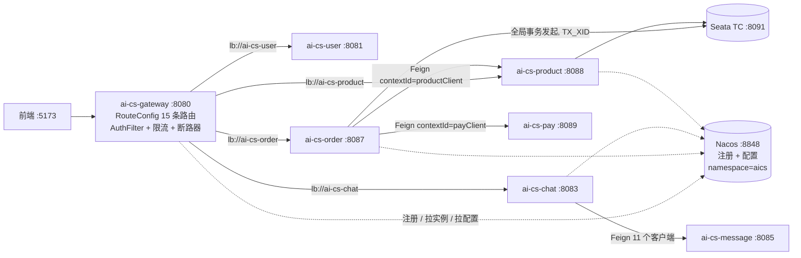
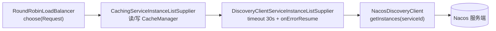
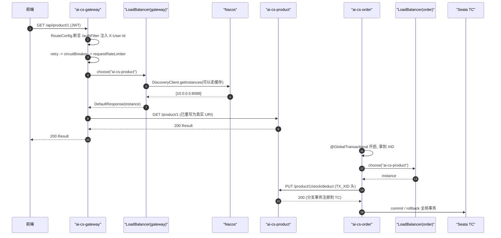

# Spring Cloud 微服务架构：12 个服务靠什么粘在一起，以及"版本不对齐"为什么必然炸

> **一句话结论**：这套系统的微服务能力不是业务代码写出来的，而是由五个横切层粘起来的——Nacos 负责"彼此在哪"、Spring Cloud LoadBalancer 负责"选谁"、OpenFeign 负责"怎么调"、Gateway 负责"外面怎么进来"、Sentinel/Seata 负责"出事了怎么办"；而这五层之间只靠**运行期字符串**（服务名）和**jar 版本**连接，没有编译期契约，所以任何一处错位都不在编译时报，只会在第一次跨服务调用时变成 `NoSuchMethodError` 或 503。
> **阅读前置**：已读 [01-SpringBoot核心原理](./01-SpringBoot核心原理.md)（知道自动装配、条件注解、starter 的装配入口），并对"注册中心"有直觉即可；Nacos 客户端内部细节不在这里重复，见 [03-Nacos注册与配置中心](./03-Nacos注册与配置中心.md)。
> **证据基线**：JDK 17.0.19 / Spring Boot 4.2.0 / Spring Cloud 2026.0.0（各子项目 5.1.0）/ Spring Cloud Alibaba 2025.1.0.0；A 级摘自 `24-源码分析/assets/source`，B 级取自本仓库 pom 与 application.yml，C 级为本机可复现命令输出。预计阅读 45 分钟。

## 0. 先看现象

四个真实形态，从外层往里层排。它们不是四个 bug，而是同一条链上的四个断点。

**现象一：前端打网关，回 503，body 只有一行英文。**

```text
HTTP/1.1 503 Service Unavailable
Content-Type: text/plain;charset=UTF-8

Unable to find instance for ai-cs-product
```

这行字不是业务代码写的，是网关的负载均衡过滤器里拼出来的：

```java (src: ReactiveLoadBalancerClientFilter.java.md#L109-L115)
return choose(lbRequest, serviceId, supportedLifecycleProcessors).doOnNext(response -> {

	if (!response.hasServer()) {
		supportedLifecycleProcessors.forEach(lifecycle -> lifecycle
			.onComplete(new CompletionContext<>(CompletionContext.Status.DISCARD, lbRequest, response)));
		throw NotFoundException.create(properties.isUse404(), "Unable to find instance for " + url.getHost());
	}
```

看到这一行，排查范围立刻收敛到一件事：`ai-cs-product` 的**实例列表**在网关这个进程里是空的。跟接口、数据库、参数全都无关。

**现象二：服务内部 Feign 调用回 503，body 也是英文。**

```text
Load balancer does not contain an instance for the service ai-cs-product
```

同样来自框架而非业务：`FeignBlockingLoadBalancerClient` 在 `instance == null` 时直接构造一个 503 响应体 [[源码:FeignBlockingLoadBalancerClient.java.md#L94-L107]]。注意它和现象一**不是同一个类**，只是症状长得像——这就是"跨服务调用没有编译期契约"的第一个代价：同一个根因，两个地方报，两套日志。

**现象三：上面两条的上游，日志里的三行关键字。**

按出现顺序排：

```text
Can not get hosts from nacos server. serviceId: ai-cs-product
Exception occurred while retrieving instances for service ai-cs-product
No servers available for service: ai-cs-product
```

三行分别出自 `NacosDiscoveryClient` 的 catch 分支 [[源码:NacosDiscoveryClient.java.md#L68-L74]]、`DiscoveryClientServiceInstanceListSupplier` 的 `onErrorResume` [[源码:DiscoveryClientServiceInstanceListSupplier.java.md#L117-L121]]、`RoundRobinLoadBalancer` 的空列表分支 [[源码:RoundRobinLoadBalancer.java.md#L99-L105]]。第一行说明"拿不到"，第二行说明"拿不到被翻译成空列表"，第三行说明"空列表被翻译成空响应"。**这三行连起来，才是 503 的完整证据链。**

**现象四：一升级就炸，且只在运行期炸。**

典型形态是 `java.lang.NoSuchMethodError`，栈顶往往落在 `org.springframework.cloud.client.*` 或 `...loadbalancer.*`。这类错误不看业务、不看配置，只看 classpath 上同一个类被解析成了哪个 jar。本机 `~/.m2` 里同时躺着两代坐标（详见 §6.7），`ServiceInstance.createUri` 这种静态方法只有 5.1.0 才有（详见 §7.2），一旦 classpath 混用，第一次调用就 `NoSuchMethodError`。

还有一种更土、但更常见的"版本不对齐"：**配置键重复**。`ai-cs-order/src/main/resources/application.yml#L10` 与 `#L25` 各写了一个 `spring.cloud:`，用 Boot 4.2.0 的加载器解析立刻失败：

```text
org.yaml.snakeyaml.constructor.DuplicateKeyException :
while constructing a mapping | in 'reader', line 6, column 3: lifecycle: ^
found duplicate key cloud | in 'reader', line 25, column 3: cloud: ^
```

这些现象指向同一件事：**微服务之间只有"服务名字符串 + jar 版本"这两个隐性契约，服务名错了报 503，版本错了报 NoSuchMethodError，配置键错了连启动都过不去，而三者都不会在编译期被检查。**

## 1. 整体地图



> **读图说明**：实线是**业务请求**方向，虚线是**控制面**（注册、拉实例列表、拉配置）。看三件事：①外部流量只有一条入口（gateway），所有 `lb://` 后面的服务名必须与各服务 `spring.application.name` 逐字相同；②服务之间的实线全部是 Feign 调用，没有一条是 Maven 依赖——这就是"禁止服务间直接依赖"在图上的样子；③控制面虚线全部指向 Nacos，一旦 Nacos 不可达，实线全部退化成 §0 的三行日志。

| 组件 | 在本项目中的落点 | 责任 | 谁调用它 | 证据 |
|---|---|---|---|---|
| Nacos 注册中心 | 所有服务 `spring.cloud.nacos.discovery` | 保存"服务名 → 实例地址列表"，并提供推送/轮询 | 每个服务进程启动时注册；`DiscoveryClient` 反查 | `ai-cs-order/src/main/resources/application.yml#L10-L20` |
| Nacos 配置中心 | 所有服务 `spring.config.import` | 下发 `aics-shared.yml` / `ai-cs-<服务>.yml` | Spring 启动期 `ConfigDataLoader` | `ai-cs-gateway/src/main/resources/application.yml#L28-L31` |
| Spring Cloud Gateway | `ai-cs-gateway` 模块 | 路由断言 + 过滤器链 + `lb://` 解析 | 前端、外部调用方 | `ai-cs-gateway/src/main/java/com/aics/gateway/config/RouteConfig.java#L60-L149` |
| Spring Cloud LoadBalancer | gateway / order / chat / pay 的 pom | 从实例列表中选一个，并（可选）重试、粘性 | 网关过滤器、Feign 的 `Client` | `ai-cs-gateway/pom.xml#L37-L41` |
| OpenFeign | `ai-cs-order`、`ai-cs-chat` | 声明式 HTTP 客户端，把接口变代理 | 业务 Service | `ai-cs-order/src/main/java/com/aics/order/client/ProductClient.java#L27-L28` |
| Sentinel | 只有 `ai-cs-chat` 引了 starter | 流控、熔断降级（QPS/线程数维度） | chat 的 Controller/Service | `ai-cs-chat/pom.xml#L207` |
| Resilience4j | gateway（reactor 版）、order、chat | 断路器、重试、限流（本项目主用） | 网关每路由、Feign 每 clientId | `ai-cs-gateway/pom.xml#L100-L104` |
| Seata | `ai-cs-order`（发起方）+ 参与方 | AT 模式全局事务，XID 跨服务传播 | `@GlobalTransactional` 方法 | `ai-cs-order/src/main/resources/application.yml#L35-L49` |
| Spring Cloud Bus | **本项目未使用** | 广播配置刷新事件 | —— | 全仓库无 `spring-cloud-bus` 依赖 |

## 2. 关键概念与关键类

先把术语钉死：**服务发现**是"给定服务名，拿到实例地址列表"这件事的总称；**注册中心**是保存这份映射的外部组件（这里是 Nacos）；**实例**是"一台机器上的一个进程"，用 `host:port` 加元数据描述；**负载均衡**是从列表里挑一个的策略；**版本列车（release train）**是 Spring Cloud 给一组互测过的子项目打的统一版本号，比如 `2026.0.0` 这一列车里 commons、loadbalancer、gateway、openfeign 全是 `5.1.0`。

| 名称 | 位置（jar / 模块） | 角色 | 关键方法 |
|---|---|---|---|
| `DiscoveryClient` | spring-cloud-commons 5.1.0 | 服务发现的**唯一抽象**，屏蔽 Nacos/Eureka/Consul | `getInstances(String)`、`getServices()`、`description()`、`probe()` |
| `ServiceInstance` | spring-cloud-commons 5.1.0 | 一个实例的值对象 | `getHost()`、`getPort()`、`isSecure()`、`getUri()`、`getMetadata()` |
| `NacosDiscoveryClient` | spring-cloud-alibaba nacos-discovery | `DiscoveryClient` 的 Nacos 实现，带失败容错 | `getInstances` → `NacosServiceDiscovery` |
| `ServiceInstanceListSupplier` | spring-cloud-loadbalancer 5.1.0 | **实例列表的供应者**，可层层装饰（发现/缓存/健康检查/同区优先） | `get()`、`get(Request)`、`getServiceId()` |
| `DiscoveryClientServiceInstanceListSupplier` | 同上 | 最底层：包 `DiscoveryClient`，**异常吞成空列表** | 构造器里 `timeout(...)` + `onErrorResume(...)` |
| `CachingServiceInstanceListSupplier` | 同上 | 缓存层，避免每次请求打 Nacos | `get()` 走 `CacheManager` |
| `ReactorLoadBalancer<T>` | 同上 | 负载均衡器抽象（响应式） | `choose(Request)`、`choose()` |
| `RoundRobinLoadBalancer` | 同上 | 默认策略：轮询，用 `AtomicInteger` 记位置 | `choose(Request)` → `getInstanceResponse(List)` |
| `LoadBalancerClientFactory` | 同上 | **每个 clientId 一个子容器**，放着该 clientId 的 LB 与 supplier | `getInstance(serviceId, Class)`、`PROPERTY_NAME` |
| `ReactiveLoadBalancerClientFilter` | spring-cloud-gateway 5.1.0 | 网关侧把 `lb://svc` 换成真实 URI | `filter(...)`，order = 10150 |
| `FeignBlockingLoadBalancerClient` | spring-cloud-openfeign-core 5.1.0 | Feign 侧把 `http://svcName/path` 换成真实 URI | `execute(Request, Options)` |
| `RouteLocator` / `RouteConfig` | ai-cs-gateway 模块 | 路由表的**唯一来源**（Java DSL，不是 yml） | `customRouteLocator(...)` |
| `LeastConnectionsLoadBalancer` | ai-cs-gateway 模块 | 本项目自研策略：按在途请求数选实例 | `chooseInstance(List)` |
| `AuthFilter` | ai-cs-gateway 模块 `filter` 包 | 鉴权并注入 `X-User-Id`，供限流 KeyResolver 使用 | `filter(...)` |

## 3. 原理与证据逐段精读

### 3.1 服务名是唯一契约：`DiscoveryClient` 与 `ServiceInstance`

**在干什么。** `DiscoveryClient` 只有三个抽象方法，是整个 Spring Cloud 里最薄的一层抽象：

```java (src: DiscoveryClient.java.md#L32-L68)
public interface DiscoveryClient extends Ordered {

	/**
	 * A human-readable description of the implementation, used in HealthIndicator.
	 */
	int DEFAULT_ORDER = 0;

	String description();

	List<ServiceInstance> getInstances(String serviceId);

	List<String> getServices();

	default void probe() {
		getServices();
	}
```

而"实例"要变成可用的 URL，只发生在一个静态方法里：

```java (src: ServiceInstance.java.md#L82-L90)
static URI createUri(ServiceInstance serviceInstance) {
	String scheme = serviceInstance.isSecure() ? "https" : "http";
	int port = serviceInstance.getPort();
	if (port <= 0) {
		port = serviceInstance.isSecure() ? 443 : 80;
	}
	return URI.create(String.format("%s://%s:%s", scheme, serviceInstance.getHost(), port));
}
```

**为什么这么设计。** 抽象薄，实现才能换：注册中心从 Eureka 换到 Nacos，业务代码一行不动，因为大家只依赖 `getInstances(serviceId)` 这个签名。`probe()` 做成 default 是为了给健康检查一个"不查具体列表、只探活"的低成本入口。

**换写法会怎样。** 如果允许业务直接 `new RestTemplate().getForObject("http://192.168.1.10:8088/product/1")`，你就把 IP 写死进了代码：扩容要改代码、下线要改代码、灰度无从谈起。`lb://` / `http://服务名` 的全部价值就是把"地址"从代码里挪到注册中心。

**常见坑。** `serviceId` 是**大小写敏感的字符串**，与目标服务 `spring.application.name` 必须逐字相同。本仓库里 `ai-cs-product/src/main/resources/application.yml` 的 name 是 `ai-cs-product`，Feign 端 `@FeignClient(name = "ai-cs-product")` 也必须是这个串——写成 `ai_cs_product` 或 `aics-product` 不会编译报错，只会在调用时报 §0 的 503。

### 3.2 实例列表的装饰链：`withDiscoveryClient().withCaching()`

**在干什么。** 负载均衡器不直接问 Nacos，中间隔着一串 `ServiceInstanceListSupplier` 装饰器。默认那条链在自动配置里就写死了：

```java (src: LoadBalancerClientConfiguration.java.md#L91-L98)
@Bean
@ConditionalOnBean(ReactiveDiscoveryClient.class)
@ConditionalOnMissingBean
@Conditional(DefaultConfigurationCondition.class)
public ServiceInstanceListSupplier discoveryClientServiceInstanceListSupplier(
		ConfigurableApplicationContext context) {
	return ServiceInstanceListSupplier.builder().withDiscoveryClient().withCaching().build(context);
}
```

链的形状是：



> **读图说明**：请求从右往左回流。注意每一层都可能"把错误变成正常值"：最右层可以抛异常，往左一层把它变成空列表，再往左一层把空列表缓存起来（只要缓存被写入了空值），最后负载均衡器只能返回 `EmptyResponse`。读这条链的目的是：**看到 503 时，要判断是"没人注册"还是"拉不到"**——两者的日志关键字不同（§6.3）。

**为什么这么设计。** 每个关注点独立成一层：发现只负责找，缓存只负责省流量，健康检查只负责剔除坏实例。想加"同机房优先"就 `withZonePreference()`，想按权重就 `withWeighted()`，都不用改负载均衡器本身。

**换写法会怎样。** 不做缓存、每次请求都问 Nacos，单机 QPS 一上去 Nacos 先被打挂；反过来只用缓存不问发现，实例扩缩容就要等缓存过期才生效（所以缓存层才需要在"空列表"时不落缓存——见下一条坑）。

**常见坑。** `DiscoveryClientServiceInstanceListSupplier` 对**空结果**的处理是有意为之的：

```java (src: DiscoveryClientServiceInstanceListSupplier.java.md#L67-L75)
this.serviceInstances = Flux.defer(() -> Mono.fromCallable(() -> delegate.getInstances(serviceId)))
	.timeout(timeout, Flux.defer(() -> {
		logTimeout();
		return Flux.just(new ArrayList<>());
	}), Schedulers.boundedElastic())
	.onErrorResume(error -> {
		logException(error);
		return Flux.just(new ArrayList<>());
	});
```

超时（默认 30s，键 `spring.cloud.loadbalancer.service-discovery.timeout`）和异常**都变成空列表**，不向上抛。这样设计是为了"抖动一次不要炸整条链路"，代价就是 §0 那个 503 —— 错误被翻译成了"没有可用实例"这种语义上很误导的话。想排查必须去看 `logException` 打的那行 error 日志。

### 3.3 拉不到实例时的三层降级：从 Nacos 异常到空响应

**在干什么。** 把 §3.2 的链拆开看，一次"拉不到"会经过三次语义转换：

1. `NacosDiscoveryClient.getInstances` 失败：若 `spring.cloud.nacos.discovery.failure-tolerance-enabled=false`（默认），**抛** `RuntimeException("Can not get hosts from nacos server. serviceId: ...")`；为 `true` 时改用本地 `ServiceCache` [[源码:NacosDiscoveryClient.java.md#L68-L74]]。
2. 上一层 `DiscoveryClientServiceInstanceListSupplier` 的 `onErrorResume` 把异常**吞成空列表**。
3. `RoundRobinLoadBalancer.getInstanceResponse` 见空列表，打 `warn("No servers available for service: ...")` 并返回 `new EmptyResponse()` [[源码:RoundRobinLoadBalancer.java.md#L99-L105]]。
4. 再往上，网关的 `!response.hasServer()` 抛 `NotFoundException` 503；Feign 的 `instance == null` 返回 503 响应体。

**为什么这么设计。** 三层的"降级"各有各的动机：Nacos 客户端怕网络抖动，所以给了 `failure-tolerance-enabled` 一个开关让你选"宁可错杀还是宁可错用"；LB 层避免异常上浮污染 Reactor 链；最上层把"没选到实例"翻译成 HTTP 503，语义上是可以重试的。

**换写法会怎样。** 如果让异常一路抛出去，网关会变成 500，前端拿不到"服务暂不可用"这个可重试信号，重试逻辑（`RouteConfig` 里 `.retry(...)`）也认不出来——它只对 500/502 配置了重试，503 是负载均衡自己的语义。

**常见坑。** 把 `failure-tolerance-enabled` 设成 `true` 后，Nacos 挂了你只会看到"用的是旧实例列表"，日志里没有 error（因为走了缓存分支），于是"明明加了新实例却调不到"这类问题会非常难查。**要么容忍（接受陈旧），要么显式失败（接受 503），不要既设容忍又抱怨不一致。**

### 3.4 轮询策略与"位置不回退"

**在干什么。** 默认策略只有一个 `AtomicInteger`：

```java (src: RoundRobinLoadBalancer.java.md#L99-L120)
private Response<ServiceInstance> getInstanceResponse(List<ServiceInstance> instances) {
	if (instances.isEmpty()) {
		if (log.isWarnEnabled()) {
			log.warn("No servers available for service: " + serviceId);
		}
		return new EmptyResponse();
	}

	// Do not move position when there is only 1 instance, especially some suppliers
	// have already filtered instances
	if (instances.size() == 1) {
		return new DefaultResponse(instances.get(0));
	}

	// Ignore the sign bit, this allows pos to loop sequentially from 0 to
	// Integer.MAX_VALUE
	int pos = this.position.incrementAndGet() & Integer.MAX_VALUE;

	ServiceInstance instance = instances.get(pos % instances.size());
```

**为什么这么设计。** `& Integer.MAX_VALUE` 是防溢出：`AtomicInteger` 跑满 21 亿次会翻负，屏蔽符号位就变成 0 重新轮回。单实例时不推进位置是性能考虑——避免无意义自增。

**换写法会怎样。** 并发下如果先 `get` 再 `set`，两个线程会选到同一个实例（经典 ABA 式撕裂），`AtomicInteger.incrementAndGet` 一次解决。这就是本项目自研的 `LeastConnectionsLoadBalancer` 也用 `AtomicInteger` 做并列打破的原因：`Math.floorMod(position.getAndIncrement(), candidates.size())` `ai-cs-gateway/src/main/java/com/aics/gateway/loadbalancer/LeastConnectionsLoadBalancer.java#L74-L75` —— 注意它用 `floorMod` 而不是 `%`，因为 `getAndIncrement` 可能返回负数，`%` 会得到负下标直接 `IndexOutOfBounds`。

**常见坑。** 轮询是**进程内**状态。网关 3 个实例时，每个进程各自从随机种子（`new Random().nextInt(1000)`，见构造器 #L58-L61）开始轮，所以"全局严格轮流"并不成立；观察日志时看到 `order-1, order-1, order-2` 不是 bug，是三个独立计数器。

### 3.5 网关侧：`lb://` 是谁换成真实地址的

**在干什么。** 网关的 `GlobalFilter` 链里有一个 order=10150 的过滤器，它只做一件事：把 `lb://` scheme 的请求换成真实 URI。

```java (src: ReactiveLoadBalancerClientFilter.java.md#L88-L114)
public Mono<Void> filter(ServerWebExchange exchange, GatewayFilterChain chain) {
	URI url = exchange.getAttribute(GATEWAY_REQUEST_URL_ATTR);
	String schemePrefix = exchange.getAttribute(GATEWAY_SCHEME_PREFIX_ATTR);
	if (url == null || (!"lb".equals(url.getScheme()) && !"lb".equals(schemePrefix))) {
		return chain.filter(exchange);
	}
	// preserve the original url
	addOriginalRequestUrl(exchange, url);

	if (log.isTraceEnabled()) {
		log.trace(ReactiveLoadBalancerClientFilter.class.getSimpleName() + " url before: " + url);
	}

	URI requestUri = exchange.getAttribute(GATEWAY_REQUEST_URL_ATTR);
	Objects.requireNonNull(requestUri, "requestUri can not be null");
	String serviceId = requestUri.getHost();
```

关键一行是 `String serviceId = requestUri.getHost()`：**URL 的 host 段就是服务名**。所以 `lb://ai-cs-product` 里的 `ai-cs-product` 不是域名，是 Nacos 里的服务名。

**为什么这么设计。** 复用 URL 语法：`lb://host/path` 里的 host 天然就是一个字符串标识，不需要额外的 DSL；而且 `http://` 的路由可以原样透传（`filter` 第一段就 `return chain.filter(exchange)`）。

**换写法会怎样。** 若写成 `.uri("http://ai-cs-product")`，则 `scheme` 是 `http` 不是 `lb`，这个过滤器直接跳过，网关会去 DNS 解析 `ai-cs-product` 这个主机名，报 `UnknownHostException`。**`lb://` 与 `http://` 只差两个字符，行为差一个服务发现。**

**常见坑。** 换了负载均衡器实现（比如 §3.8 的 `least-connections`）后，如果那个 bean 没注册进**该 clientId 的子容器**，`choose()` 里 `loadBalancer == null` 会抛 `No loadbalancer available for ai-cs-product` [[源码:ReactiveLoadBalancerClientFilter.java.md#L158-L167]]——这是网关侧第三种 503 文案，和第 114 行那句要分清楚。

### 3.6 Feign 侧：同一个动作，另一条实现路径

**在干什么。** Feign 的 `Client` 装饰器干的是同一件事，但它走的是阻塞式 `LoadBalancerClient`：

```java (src: FeignBlockingLoadBalancerClient.java.md#L79-L107)
public Response execute(Request request, Request.Options options) throws IOException {
	final URI originalUri = URI.create(request.url());
	String serviceId = originalUri.getHost();
	Assert.state(serviceId != null, "Request URI does not contain a valid hostname: " + originalUri);
	String hint = getHint(serviceId);
	DefaultRequest<RequestDataContext> lbRequest = new DefaultRequest<>(
			new RequestDataContext(buildRequestData(request), hint));
	Set<LoadBalancerLifecycle> supportedLifecycleProcessors = LoadBalancerLifecycleValidator
		.getSupportedLifecycleProcessors(
				loadBalancerClientFactory.getInstances(serviceId, LoadBalancerLifecycle.class),
				RequestDataContext.class, ResponseData.class, ServiceInstance.class);
	supportedLifecycleProcessors.forEach(lifecycle -> lifecycle.onStart(lbRequest));
	ServiceInstance instance = loadBalancerClient.choose(serviceId, lbRequest);
```

**为什么这么设计。** Feign 的 `Client` 是"给我一个 Request，我给你一个 Response"的 SPI，负载均衡必须包在 `Client` 外面而不是塞进编码器里，这样才能同时支持 `RestTemplate`、`WebClient`、`Feign` 三种调用方式共享同一套 LB 与 `LoadBalancerLifecycle` 回调（指标、trace）。

**换写法会怎样。** 若项目漏了 `spring-cloud-starter-loadbalancer`，`FeignBlockingLoadBalancerClient` 装配不上，Feign 直接对 `http://ai-cs-product/product/1` 发请求，报 `UnknownHostException: ai-cs-product`。这就是 `ai-cs-order/pom.xml#L55` 那行 loadbalancer 依赖的意义——它不是"锦上添花"，是 Feign 走服务名的前提。

**常见坑。** Feign 侧 503 的 body 是纯文本，不是项目统一的 `Result` 包装。前端或上层服务若把它当 `Result` 反序列化，会得到"Unexpected character 'L'"这类二次错误，把真正的根因埋掉。**统一异常处理要显式放行非 JSON 的 5xx 响应体。**

### 3.7 每个 clientId 一个子容器：`LoadBalancerClientFactory`

**在干什么。** 为什么 `ai-cs-order` 里 `productClient` 和 `payClient` 可以有不同的超时、不同的策略？因为每个服务名都有自己的 Spring 子容器：

```java (src: LoadBalancerClientFactory.java.md#L48-L67)
public class LoadBalancerClientFactory extends NamedContextFactory<LoadBalancerClientSpecification>
		implements ReactiveLoadBalancer.Factory<ServiceInstance> {

	private static final Log log = LogFactory.getLog(LoadBalancerClientFactory.class);

	/**
	 * Property source name for load balancer.
	 */
	public static final String NAMESPACE = "loadbalancer";

	/**
	 * Property for client name within the load balancer namespace.
	 */
	public static final String PROPERTY_NAME = NAMESPACE + ".client.name";

	private final LoadBalancerClientsProperties properties;

	public LoadBalancerClientFactory(LoadBalancerClientsProperties properties) {
		super(LoadBalancerClientConfiguration.class, NAMESPACE, PROPERTY_NAME, new HashMap<>());
		this.properties = properties;
	}
```

子容器里被注入一个属性 `loadbalancer.client.name=ai-cs-product`，所以任何 `@Bean` 方法只要 `environment.getProperty(LoadBalancerClientFactory.PROPERTY_NAME)` 就能知道自己"为谁服务"。这既是 §3.8 自研 LB 的取服务名方式，也是 `@LoadBalancerClient(name = "...")` 能按 clientId 定制的前提。

**为什么这么设计。** 单一容器里放多个 LB bean 会互相冲突（同类型多实例）；用 named context 隔离后，每个 clientId 的 bean 都"刚好一个"，且互不可见。

**换写法会怎样。** 如果把自研 LB 注册到**父容器**（普通 `@Configuration` + `@Bean`）而不是 `@LoadBalancerClients(defaultConfiguration=...)` 指定的配置类，结论是：父容器里的 `ReactorLoadBalancer` 不会被 `getInstance(serviceId, ReactorServiceInstanceLoadBalancer.class)` 找到（子容器默认不看祖先的同类型多例），于是又回到 §3.5 的 `No loadbalancer available`。

**常见坑。** 子容器是**懒加载**的：`getLazyProvider(...)` 是延迟取，所以在 `@Bean` 方法里 `@Autowired` 一个 `ServiceInstanceListSupplier` 可能拿到代理而不是实例。项目里 `LoadBalancerConfig` 用 `loadBalancerClientFactory.getLazyProvider(serviceId, ServiceInstanceListSupplier.class)` 正是遵循这个约定 `ai-cs-gateway/src/main/java/com/aics/gateway/config/LoadBalancerConfig.java#L49-L51`。

### 3.8 自定义策略怎么顶掉默认轮询

**在干什么。** 默认轮询 bean 上有 `@ConditionalOnMissingBean`：

```java (src: LoadBalancerClientConfiguration.java.md#L71-L78)
@Bean
@ConditionalOnMissingBean
public ReactorLoadBalancer<ServiceInstance> reactorServiceInstanceLoadBalancer(Environment environment,
		LoadBalancerClientFactory loadBalancerClientFactory) {
	String name = environment.getProperty(LoadBalancerClientFactory.PROPERTY_NAME);
	return new RoundRobinLoadBalancer(
			loadBalancerClientFactory.getLazyProvider(name, ServiceInstanceListSupplier.class), name);
}
```

于是"顶掉它"在 Spring 里只有一条正路：提供一个同类型、更靠前的 bean，让条件不成立。本项目用的是 `@LoadBalancerClients(defaultConfiguration = ...)` + `@ConditionalOnProperty` 的组合，开关放在 `aics.gateway.loadbalancer.algorithm`：

```java
@Configuration
@LoadBalancerClients(defaultConfiguration = LoadBalancerConfig.LeastConnectionsConfiguration.class)
public class LoadBalancerConfig {

    @Configuration
    @ConditionalOnProperty(name = "aics.gateway.loadbalancer.algorithm", havingValue = "least-connections")
    static class LeastConnectionsConfiguration {

        @Bean
        public ReactorLoadBalancer<ServiceInstance> leastConnectionsLoadBalancer(
                Environment environment, LoadBalancerClientFactory factory,
                InstanceInFlightRegistry registry) {
            String serviceId = environment.getProperty(LoadBalancerClientFactory.PROPERTY_NAME);
            return new LeastConnectionsLoadBalancer(serviceId,
                    factory.getLazyProvider(serviceId, ServiceInstanceListSupplier.class), registry);
        }
    }
}
```

（节选自 `ai-cs-gateway/src/main/java/com/aics/gateway/config/LoadBalancerConfig.java#L33-L54`，为可读性调整了缩进。）

**为什么这么设计。** 用 `@ConditionalOnProperty` 而不是删代码，是为了**两种策略都能编译、都能上线，靠配置切换**；默认值 `round-robin` 写在 `ai-cs-gateway/src/main/resources/application.yml#L54-L57`，所以不开开关时行为与框架默认完全一致，回滚成本为零。

**换写法会怎样。** 若直接 `@Primary` 一个 `ReactorLoadBalancer` bean 到父容器，`@ConditionalOnMissingBean` 判断的是**容器内可见性**（含祖先），可能把默认 bean 也一起毙掉，而自研 bean 又不在子容器里 —— 结果两边都没有。这是最容易踩的"看起来能跑、一压测就 503"。

**常见坑。** `LeastConnectionsLoadBalancer` 的空列表分支返回 `new EmptyResponse()` 而不是抛异常，所以实例列表为空时它的表现与轮询一致（503），不会额外告警。切策略排查时别以为"换了策略问题该消失"——**策略只管选谁，不管列表从哪来。**

### 3.9 路由表在 Java DSL，不在 yml

**在干什么。** 15 条路由全部用 `builder.routes()` 声明，每条都是"断言 → 三层韧性过滤器 → `lb://服务名`"：

```java
@Bean
public RouteLocator customRouteLocator(RouteLocatorBuilder builder,
                                       RedisRateLimiter redisRateLimiter,
                                       KeyResolver userKeyResolver) {
    return builder.routes()
            // 用户服务
            .route("ai-cs-user", r -> r
                    .path("/api/user/**")
                    .filters(f -> addResilience(f.stripPrefix(1), "cb-user", redisRateLimiter, userKeyResolver))
                    .uri("lb://ai-cs-user"))
```

（节选自 `ai-cs-gateway/src/main/java/com/aics/gateway/config/RouteConfig.java#L60-L69`。）

`addResilience` 给每条路由叠三层，顺序就是执行顺序：

```java
f.retry(c -> c.setRetries(2)
                .setMethods(HttpMethod.GET)
                .setStatuses(HttpStatus.INTERNAL_SERVER_ERROR, HttpStatus.BAD_GATEWAY))
        .circuitBreaker(c -> c.setName(cbName)
                .setFallbackUri("forward:/gateway-fallback"))
        .requestRateLimiter(c -> {
            c.setRateLimiter(redisRateLimiter);
            c.setKeyResolver(userKeyResolver);
        });
```

（节选自 `ai-cs-gateway/src/main/java/com/aics/gateway/config/RouteConfig.java#L174-L187`。）

**为什么这么设计。** 三个理由：①断路器实例名必须按路由独立（`cb-user`、`cb-order`…），共享实例会让失败统计互相污染；②`circuitBreaker` 必须先于业务语义确定，否则降级 URI 无法统一；③限流 Key 取 `X-User-Id`（`AuthFilter` 注入），未认证退化为 IP，保证"登录用户按人限、匿名按 IP 限"。

**换写法会怎样。** 改用 yml `spring.cloud.gateway.routes` 也能实现路由，但**过滤器 Bean 引用和按路由独立断路器名写起来更绕**（要写 `${...}` 或自定义 filter 工厂），而且 yml 里改路由无法在编译期被 IDEA 检查。本项目选择 DSL，代价是"改路由要发版"——所以 `RouteConfig` 的注释里明确写了"生产环境建议通过 Nacos 配置中心动态管理路由，此处仅作本地开发兜底"。

**常见坑。** 该 yml 里**没有任何 `spring.cloud.gateway.*` 键**（可用 §6.6 的命令自查）。很多人照着旧教程往 yml 里加 `spring.cloud.gateway.routes`，结果与 DSL 里的路由并存，同一个 `path` 匹配两次，报 `Only one connection receive subscriber allowed` 之类莫名其妙的重放错误。

### 3.10 BOM 是唯一的版本闸门

**在干什么。** 根 pom 里四次 BOM 导入，顺序即优先级（后者不覆盖前者的已管理项，先到先得）：

```xml
<!-- Spring Boot BOM -->
<dependency>
    <groupId>org.springframework.boot</groupId>
    <artifactId>spring-boot-dependencies</artifactId>
    <version>${spring-boot.version}</version>
    <type>pom</type>
    <scope>import</scope>
</dependency>
```

（原文见 `pom.xml#L88-L94`；Spring Cloud BOM 在 `#L97-L103`，Spring Cloud Alibaba BOM 在 `#L106-L112`，Spring AI BOM 在 `#L115-L121`。）

**为什么这么设计。** BOM 只解决"版本号写在哪"，解决不了"版本组对不对"。Spring Cloud 的 `2026.0.0` 这一列车的 pom 里明确写了它的构建基线：`<spring-boot.version>4.2.0</spring-boot.version>`，以及 `<spring-cloud-commons.version>5.1.0</spring-cloud-commons.version>`（C 级，见 §7.1）。也就是说 **train 号 ≠ 子项目版本号**，`2026.0.0` 是"列车"，`5.1.0` 是车厢；你在依赖里看不到 `2026.0.0` 这个字符串，只会在 BOM 的 `<version>` 里看到它。

**换写法会怎样。** 如果把某个 Cloud 子项目**单独**钉版本（比如显式写 `spring-cloud-starter-openfeign:4.1.1`），Maven 的"最近者优先"会让 openfeign 拿 4.1.1、commons 拿 5.1.0 —— 编译期一切正常（编译只校验你用到的 API），运行期一调用就 `NoSuchMethodError`。**这就是"版本不对齐必然炸"的机制本身。**

**常见坑。** 反过来，Cloud BOM **不导入** Boot BOM（C 级验证：`spring-cloud-dependencies-2026.0.0.pom` 里没有 `spring-boot-dependencies` 的 import），所以 **Boot 与 Cloud 的对齐完全靠人**：写了 `spring-boot.version=4.2.0` 却忘了改 Cloud train，Maven 一声不响，你在第一次跨服务调用时才收到账单。

## 4. 一次完整执行时序

场景：前端请求 `GET http://localhost:8080/api/product/1`，网关路由到 `ai-cs-product`；同一业务里 `ai-cs-order` 通过 Feign 也调一次商品服务（库存扣减）。



> **读图说明**：两条链路**共享同一个"选实例"机制**，但走的是两个不同的对象——网关是 `ReactiveLoadBalancerClientFilter` → 响应式 `ReactorLoadBalancer`；order 是 `FeignBlockingLoadBalancerClient` → 阻塞式 `LoadBalancerClient`。第 5、6 步是唯一与 Nacos 交互的地方（命中缓存时连这两步都省），所以"服务列表为空"永远发生在服务端注册环节或这里；第 14 步的 `TX_XID` 是 Seata 跨服务传播 XID 的唯一通道（由 `SeataFeignRequestInterceptor` 自动写入，见 `ai-cs-order/src/main/java/com/aics/order/client/ProductClient.java#L18-L24` 的类注释）。

哪一步失败报什么错，逐条对照：

| 失败点 | 典型报错（原文） | 说明 |
|---|---|---|
| 第 2 步 断言不匹配 | `404 Not Found`（网关默认） | 路径没被任何路由命中，与 LB 无关 |
| 第 2 步 鉴权失败 | `401` | `AuthFilter` 拦下，未进入 LB |
| 第 3 步 限流超限 | `429 Too Many Requests` | `RequestRateLimiter` 内置默认响应 |
| 第 5 步 Nacos 不可达 | `Can not get hosts from nacos server. serviceId: ai-cs-product` | `NacosDiscoveryClient` 抛出（`failure-tolerance-enabled=false` 时） |
| 第 5 步 超时/异常被吞 | `Exception occurred while retrieving instances for service ai-cs-product` | supplier 的 `onErrorResume` 打 error 日志后返回空列表 |
| 第 6 步 列表为空 | `No servers available for service: ai-cs-product` | LB warn，返回 `EmptyResponse` |
| 第 7~8 步 网关选不到实例 | `503 Unable to find instance for ai-cs-product` | `ReactiveLoadBalancerClientFilter` 抛 `NotFoundException` |
| 第 12~14 步 Feign 选不到实例 | `503 Load balancer does not contain an instance for the service ai-cs-product` | `FeignBlockingLoadBalancerClient` 构造响应体 |
| 全局 | `java.lang.NoSuchMethodError: ...ServiceInstance.createUri...` | jar 版本错位，与运行时状态无关 |

## 5. 设计取舍

| 决策 | 备选方案 | 代价 | 本项目选择理由 |
|---|---|---|---|
| 服务名做唯一契约（`lb://` + Feign `name`） | 写死 IP / 用 DNS + Nginx | 名字错了运行期才炸；无静态检查 | 扩缩容零改代码；与 K8s 服务名同构，迁移平滑 |
| 只让 gateway 暴露端口 | 每个服务直接对外 | 网关成为单点与瓶颈 | 鉴权、限流、CORS、trace 收敛一处；内部服务可用内网 ACL 兜底 |
| 故障容忍默认**关闭**（`failure-tolerance-enabled=false`） | 默认用本地缓存 | Nacos 抖动直接 503 | 宁可明确失败也不要"悄悄用陈旧实例"，避免灰度时调不到新实例 |
| 实例列表缓存（`withCaching`） | 每请求实时拉取 | 扩容感知有延迟 | 保护 Nacos，且 Nacos 本身有推送，缓存只兜底 |
| 自研 `least-connections` + 配置开关 | 只用默认轮询 | 多一份要维护的代码 | 网关侧长连接/慢接口场景下，轮询会把请求堆到已饱和实例上，需要按在途数分流 |
| 断路器 + 重试放在**网关每条路由** | 只在服务内部做 | 路由表变长，`cb-*` 名字要人工保证唯一 | 下游整体不可用时，网关快速失败比让请求穿透到底层更快、更省 |
| 熔断主用 Resilience4j，Sentinel 只在 chat | 全量 Sentinel | 两套熔断语义并存，指标不统一 | chat 需要按 QPS/热点参数精细流控；其余服务的场景用 Resilience4j 足够 |
| 路由写 Java DSL | yml `spring.cloud.gateway.routes` | 改路由要发版 | 能在编译期检查断言/过滤器 API；配合 Nacos 动态配置留了后路 |
| Seata 用 `registry.type=file` + `grouplist` | `registry.type=nacos` | 多环境要改配置，集群扩展要手改 | 本地开发直连 TC（`127.0.0.1:8091`），不额外依赖注册中心；注释里已写明集群部署可切 nacos |

可扩展点清单（想加能力时，改哪里、不改哪里）：

- **加一个新服务**：建模块 → `pom.xml#L14-L27` 加 `<module>` → application.yml 配 `spring.cloud.nacos` 与 `spring.config.import` → `RouteConfig` 加一条 `route("ai-cs-xxx", ...)` → 端口顺延（当前最大 8090，见 §7.4）。不需要动任何其他服务（这就是"禁止服务间直接依赖"的红利）。
- **换负载均衡策略**：实现 `ReactorServiceInstanceLoadBalancer` → 挂到 `@LoadBalancerClients` 的配置类 → 用 `@ConditionalOnProperty` 开关，默认值保持框架默认。
- **换注册中心**：只实现 `DiscoveryClient`（可选再实现 `ReactiveDiscoveryClient`），业务代码不动；`ServiceInstanceListSupplier` 与 LB 全部复用。
- **加一个 Feign 客户端**：在 `@EnableFeignClients(basePackages=...)` 扫描路径下加接口，**同一服务多个客户端必须给 `contextId`**（见 §6.4）。
- **加超时/重试差异化**：`spring.cloud.loadbalancer.clients.<serviceId>.*` 或 `spring.cloud.openfeign.client.config.<contextId>.*`，不用改代码。
- **加链路追踪**：已由 `micrometer-tracing-bridge-otel` + `management.otlp.tracing.endpoint` 就位（`ai-cs-gateway/pom.xml#L110-L119`），新服务照抄 yml 的 `management` 段即可。

## 6. 踩坑与调试手法

### 6.1 `lb://` 写成 `http://` 或写成 `lb://ai_cs_product`

前者让 `ReactiveLoadBalancerClientFilter` 直接跳过（scheme 不是 `lb`）→ `UnknownHostException`；后者服务名对不上 → 实例列表为空 → 503。**判别方法**：看异常类型。`UnknownHostException` 是"根本没进负载均衡"，503 是"进了但列表空"。

### 6.2 网关误引了 Servlet 栈

`ai-cs-common` 里有 `spring-boot-starter-web`（`ai-cs-common/pom.xml#L22`），而网关是 WebFlux。所以 `ai-cs-gateway/pom.xml#L44-L53` 必须把它排除：

```xml
<dependency>
    <groupId>com.aics</groupId>
    <artifactId>ai-cs-common</artifactId>
    <exclusions>
        <exclusion>
            <groupId>org.springframework.boot</groupId>
            <artifactId>spring-boot-starter-webmvc</artifactId>
        </exclusion>
    </exclusions>
</dependency>
```

踩坑点：Boot 4 里 artifact 名是 `spring-boot-starter-webmvc`（`starter-web` 已 deprecated），排除项必须与**实际引入的坐标**对齐，写错 artifactId 时 Maven 不报错、排除静默失效，启动直接报"Spring MVC found on classpath, which is incompatible with Spring Cloud Gateway"。

### 6.3 看日志就能定位"空列表"发生在哪一层（真调试手法）

按顺序 grep，谁先出现就先治谁：

```powershell
# 三个关键字的出处分别对应 §0 的三层降级
Get-ChildItem ai-cs-*\target\*.log -ErrorAction SilentlyContinue |
    Select-String -Pattern 'Can not get hosts from nacos server|Exception occurred while retrieving instances|No servers available for service' |
    Select-Object -First 20
```

读法：只有第三行 → 服务确实没注册（去 Nacos 控制台看实例）；有第二行 → 拉取超时/异常（调 `spring.cloud.loadbalancer.service-discovery.timeout` 或查网络）；有第一行 → Nacos 连不上或 namespace/group 写错（本项目 namespace 是 `aics`，不是 `public`，这是最常见的配置错）。

### 6.4 同一服务多个 `@FeignClient` 必须给 `contextId`（真调试手法）

`ai-cs-chat` 下有 6 个客户端指向 `ai-cs-message`（`AgentTraceFeignClient`、`ModelUsageFeignClient`、`OnlineEvalFeignClient`、`SecurityEventFeignClient`、`TraceFeignClient`、`MessageFeignClient`），它们都靠 `contextId` 区分：

```java
@FeignClient(name = "ai-cs-pay", contextId = "payClient", path = "/pay",
        fallbackFactory = com.aics.order.client.fallback.PayClientFallbackFactory.class)
```

（原文见 `ai-cs-order/src/main/java/com/aics/order/client/PayClient.java#L17`。）

不给 `contextId` 时，Spring 用 `name` 当 bean 名，第二个接口注册即冲突，报 `The bean 'ai-cs-message.FeignClientSpecification' could not be registered`。**这是纯编译期看不出的问题，只有在加客户端时才会炸。**

### 6.5 Nacos 通了但服务不在同一命名空间

本项目所有服务 yml 都写 `namespace: aics`。若某个服务漏了这一行，它会注册到 `public`，其余服务在 `aics` 里查不到它，症状与"没启动"完全一样。**自查命令**（本地 Nacos，30 秒内）：

```powershell
# namespaceId 是命名空间 ID（不是名字 aics），groupName 要显式给
curl.exe -s "http://127.0.0.1:8848/nacos/v1/ns/instance/list?serviceName=ai-cs-product&groupName=DEFAULT_GROUP&namespaceId=<aics 的 namespaceId>"
```

返回 `{"hosts":[]}` 说明名字/命名空间/分组三者之一不对；有 hosts 但网关 503，则是网关进程的缓存或版本问题。

### 6.6 确认"路由不在 yml 里"

```powershell
Get-ChildItem -Recurse -Include application*.yml |
    Where-Object { $_.FullName -notmatch '\\target\\' } |
    Select-String -Pattern 'gateway'
```

本项目真实输出只有四类命中：`ai-cs-gateway` 应用名、Nacos dataId `ai-cs-gateway.yml`、`aics.gateway.rate-limit` 注释、`aics.gateway.loadbalancer` —— **没有任何 `spring.cloud.gateway.routes`**。想改路由就去 `RouteConfig`，不要被旧教程带偏。

### 6.7 盘点本地到底解析了哪些版本（真调试手法）

```powershell
Get-ChildItem "$env:USERPROFILE\.m2\repository\org\springframework\cloud" -Recurse -Filter *.jar |
    Where-Object { $_.Name -notmatch 'sources|javadoc' } |
    ForEach-Object { $_.Directory.Parent.Name + ':' + $_.Directory.Name } | Sort-Object -Unique
```

本机真实输出（节选）：

```text
spring-cloud-commons:4.1.2
spring-cloud-commons:5.1.0
spring-cloud-loadbalancer:4.1.2
spring-cloud-loadbalancer:5.1.0
spring-cloud-openfeign-core:4.1.1
spring-cloud-openfeign-core:5.1.0
```

读法：`~/.m2` 是**仓库缓存**，有多个版本不代表构建会混用（Maven 解析后每个 artifact 只剩一个版本）。但它告诉你"这台机器曾经解析过上一代坐标"，一旦某个模块漏改版本或单独钉版，被选中的就是这两个里的某一个——而且编译期不报错。

### 6.8 三个断点位置，覆盖 90% 的"调不通"

| 想确认的事 | 断点 | 看到什么算正常 |
|---|---|---|
| 实例列表到底有没有 | `RoundRobinLoadBalancer#getInstanceResponse` 入参 `instances` | 长度 ≥1；空说明问题在上下游（§3.3） |
| 网关选到了谁 | `ReactiveLoadBalancerClientFilter#filter` 第 109 行的 `doOnNext` 回调 | `response.hasServer()==true`，`getServer()` 的 host:port 合理 |
| Feign 选的实例与重建的 URL | `FeignBlockingLoadBalancerClient#execute` 里 `instance` 与 `reconstructedUrl` | URL 的 host 已变成 IP，path 未被重复拼接（`path` 与 `@RequestMapping` 前缀易叠） |

网关还提供 actuator 端点自查（需先放开暴露：`management.endpoints.web.exposure.include=gateway,health`）：`/actuator/gateway/routes` 列出已装配路由，`/actuator/health` 的 `discoveryComposite` 项显示各 `DiscoveryClient` 状态。

## 7. ⚠️ 版本差异

### 7.1 列车号与子项目版本号的对应关系

| 旧写法（会误解的写法） | 当前基线 | 变化点 | 迁移动作 |
|---|---|---|---|
| `<spring-cloud.version>2026.0.0</spring-cloud.version>` 却以为依赖里能看到 `2026.0.0` | 2026.0.0 是**列车**；子项目实际版本是 5.1.0 | train 号与子项目版本自 2020 年代起彻底解耦 | 引用依赖时**只写 artifactId 不写 version**，让 BOM 决定 |
| 以为 Cloud BOM 会锁 Boot 版本 | Cloud BOM 只声明基线属性，不 import Boot BOM | `<spring-boot.version>4.2.0</spring-boot.version>` 只是元数据 | Boot 版本必须自己写对（本项目 `pom.xml#L39` 写 4.2.0，与 Cloud BOM 声明的基线一致） |

C 级依据（本机 m2 里的 BOM 原文）：

```text
spring-cloud-dependencies-2026.0.0.pom
L7  <artifactId>spring-cloud-dependencies-parent</artifactId>   L8  <version>5.1.0</version>
L92 <spring-boot.version>4.2.0</spring-boot.version>
L94 <spring-cloud-gateway.version>5.1.0</spring-cloud-gateway.version>
L101 <spring-cloud-commons.version>5.1.0</spring-cloud-commons.version>
```

怎么读：这一列车的 parent 是 `spring-cloud-dependencies-parent:5.1.0`，它声明的 Boot 基线是 `4.2.0`——与本项目 `pom.xml#L39` 完全一致，说明"Boot 4.2.0 + Cloud 2026.0.0"是官方互测组合，不是拍脑袋配的。

### 7.2 真正会 `NoSuchMethodError` 的地方：从哪版起变了

| 旧写法 | 当前基线（5.1.0） | 变化点 | 迁移动作 |
|---|---|---|---|
| `ServiceInstance.getUri()` 之外别无他法 | 新增 `static URI createUri(ServiceInstance)` | 5.1.0 **新增**静态方法（4.1.2 的 jar 里没有） | 调用方若来自第三方旧 jar，会 `NoSuchMethodError`；统一走 `getUri()` 或自写拼接 |
| `LoadBalancerProperties` 只有 hint/retry 等属性 | 新增 `getStats()/setStats()`、`getApiVersion()/setApiVersion()` | 5.1.0 新增子配置（统计与 API 版本选择） | 别在旧 jar 上配 `spring.cloud.loadbalancer.stats.*`，静默无效 |

**"从哪版起未变"的部分**（这部分写清楚，避免过度升级）：

| 稳定项 | 结论 | 依据 |
|---|---|---|
| `DiscoveryClient` 接口 | 4.1.2 与 5.1.0 **方法签名完全一致**（`description/getInstances/getServices/probe/getOrder`） | `javap -classpath <jar> org.springframework.cloud.client.discovery.DiscoveryClient` 两版输出逐行相同；源码侧见 [[源码:DiscoveryClient.java.md#L32-L68]] |
| `ReactiveLoadBalancer` 接口 | 两版 IDENTICAL | `javap` 对比输出无差异 |

结论：**错位通常不在最底层的抽象上炸，而在"底层 4.x + 上层 5.x 新增 API"的组合上炸**——这正好解释了为什么 §0 的 `NoSuchMethodError` 栈顶经常落在 `loadbalancer` 而不是 `commons`。

### 7.3 Gateway starter 与 Boot 4 的 artifact 变化

| 旧写法 | 当前基线 | 变化点 | 迁移动作 |
|---|---|---|---|
| `spring-cloud-starter-gateway` | `spring-cloud-starter-gateway-server-webflux` | SCG 5.x 按"服务端+传输栈"重命名，明确声明 WebFlux 实现 | 改名即可；若曾引 `spring-cloud-starter-gateway-mvc`，需改用对应的 mvc 坐标（本项目不用） |
| `spring-boot-starter-web` | `spring-boot-starter-webmvc` | Boot 4 起 `starter-web` **deprecated**，artifact 名显式化 | 本项目现状：11 个业务模块的 pom 仍写 `spring-boot-starter-web`（如 `ai-cs-order/pom.xml#L24`），只有 `ai-cs-gateway/pom.xml#L50` 的排除项写了 `spring-boot-starter-webmvc`；改造时逐模块替换，网关的 exclusion 无需改（它本来就对） |
| `@EnableDiscoveryClient` 必须有 | 不是必需（有 starter 就自动注册） | 自 3.x 起注解变为可选 | 本项目 10 个模块保留了它（如 `ai-cs-order/src/main/java/com/aics/order/OrderApplication.java#L14`），保留无害，可逐步删 |

### 7.4 Seata 版本：以仓库为准

任务基线文档提到 Seata 2.7.0，但**本仓库根 pom 写的是 `1.7.1`**（`pom.xml#L52`）。两者差异会影响 `seata.tx-service-group`/`vgroup-mapping` 等键的写法。本文只引用项目自身配置（`ai-cs-order/src/main/resources/application.yml#L35-L49`），**不摘录任何"看起来像 Seata 源码"的代码**：Seata 2.7.0 在 Maven Central 无 sources jar，`assets/source` 里也没有摘录，任何贴出来的 Seata 源码都是伪证据。Seata 侧的深入分析见 [06-Seata分布式事务AT模式](./06-Seata分布式事务AT模式.md) 与 [../../24-源码分析/04-SpringCloud/07-分布式事务与链路追踪/01-分布式事务-seata-at模式源码.md](../24-源码分析/04-SpringCloud/07-分布式事务与链路追踪/01-分布式事务-seata-at模式源码.md)。

### 7.5 Spring Cloud Bus：本项目未启用

全仓库 grep 不到 `spring-cloud-bus`。配置刷新目前靠 Nacos 配置监听（`spring.config.import: optional:nacos:...`），没有广播总线。**所以不要照 "Bus + `/actuator/busrefresh`" 的教程排查本项目问题**——那个端点根本不存在。Bus 的机制见 [../../24-源码分析/04-SpringCloud/05-配置中心与Bus/02-配置刷新-refreshscope与bus.md](../24-源码分析/04-SpringCloud/05-配置中心与Bus/02-配置刷新-refreshscope与bus.md)。

### 7.6 各服务端口现状（排障时按这个查）

| 模块 | 端口 | 模块 | 端口 |
|---|---|---|---|
| ai-cs-gateway | 8080 | ai-cs-order | 8087 |
| ai-cs-user | 8081 | ai-cs-product | 8088 |
| ai-cs-knowledge | 8082 | ai-cs-pay | 8089 |
| ai-cs-chat | 8083 | ai-cs-mq | 8090 |
| ai-cs-search | 8084 | Seata TC | 8091 |
| ai-cs-message | 8085 | Nacos | 8848 |
| ai-cs-notify | 8086 | | |

## 8. 面试高频问与答

1. Spring Cloud 的"版本列车"是什么？`2026.0.0` 和 `5.1.0` 是什么关系？
2. 为什么 Spring Cloud 项目里引依赖通常不写 `<version>`？BOM 的"先到先得"规则怎么影响排障？
3. Cloud BOM 会不会帮你锁定 Spring Boot 版本？为什么这会导致"升级一半"的事故？
4. `DiscoveryClient` 和 `ServiceInstance` 各自抽象了什么？换成 Consul 需要改哪一层？
5. `ReactorLoadBalancer`、`ReactorServiceInstanceLoadBalancer`、`ServiceInstanceListSupplier` 三者的职责边界在哪？
6. 默认的实例列表装饰链是什么？`withCaching()` 带来了什么延迟问题？
7. 为什么"拉不到实例"最终表现为 503 而不是 500？这条链上错误被谁吞掉了？
8. 网关侧和 Feign 侧的负载均衡是同一个实现吗？两者的错误文案为什么不一致？
9. `LoadBalancerClientFactory` 为什么要为每个 clientId 建一个子容器？自研策略该注册到哪一层？
10. 自定义负载均衡器怎么顶掉默认轮询？直接 `@Primary` 会出什么问题？
11. 为什么 `@FeignClient` 同一服务多个接口必须写 `contextId`？不写会报什么？
12. 为什么禁止微服务之间直接加 Maven 依赖？这样做换来了什么、又失去了什么？
13. `lb://` 和 `http://` 在网关里的处理路径有何不同？写错会报什么？
14. 一次跨服务调用的完整路径是什么？Seata 的 XID 是靠什么机制跨过去的？
15. 如果让你把 Nacos 换成 K8s Service + CoreDNS，哪些层要改、哪些不用改？

## 9. 动手练习

每条都绑定本篇的具体分支或类，做完必须能通过"验收标准"。

1. **断网验证三层降级**。停掉本地 Nacos（或把 `NACOS_ADDR` 指到一个黑洞地址），启动 `ai-cs-order`，再手工触发一次 `productClient` 调用。
   验收：日志里依次出现 `Can not get hosts from nacos server` → `Exception occurred while retrieving instances` → `No servers available for service`，且 Feign 返回 503 纯文本 body。把这三行贴进笔记，标注各自出自哪个类。
2. **切换负载均衡策略并下断点**。把 `ai-cs-gateway/src/main/resources/application.yml#L54-L57` 的 `algorithm` 改成 `least-connections`，在 `LeastConnectionsLoadBalancer#chooseInstance` 下断点，并发打同一路由。
   验收：断点能命中，`InFlightRegistry` 的值随并发上升；改回 `round-robin` 后该断点**不再命中**（证明 `@ConditionalOnProperty` 生效），且 `RouteConfig` 里 15 条路由行为不变。
3. **修掉 `ai-cs-order` 的 YAML 重复键**。把 `#L25-L31` 的 `openfeign` 段并入 `#L10` 那个 `spring.cloud:` 块。
   验收：用 Boot 4.2.0 的 `YamlPropertySourceLoader` 解析该文件不再抛 `DuplicateKeyException`；`spring.cloud` 下同时能看到 `nacos` 与 `openfeign` 两个键（用 §6.7 同款方式验证，或启动服务观察 `openfeign.circuitbreaker.enabled` 是否生效）。
4. **给某条路由加一个新服务**。假设新增 `ai-cs-audit`（端口 8092），在 `RouteConfig#L60-L149` 里仿照 `ai-cs-user` 加一条 `route("ai-cs-audit", ...)`，`cb` 名取 `cb-audit`。
   验收：`/actuator/gateway/routes` 能看到新路由；故意不给 `ai-cs-audit` 起服务，请求它返回 503 `Unable to find instance for ai-cs-audit`；同时确认其余 15 条路由的 `cb-*` 名字没有被复用（`grep -c 'cb-' RouteConfig.java` 与路由条数一致）。
5. **版本错位复现实验（不改代码，只观察）**。用 `javap` 对比本机 `spring-cloud-commons:4.1.2` 与 `5.1.0` 的 `ServiceInstance`。
   验收：能说出 `createUri` 只在哪一版存在；并写出"若上层 jar 调 `createUri` 但 classpath 解析到 4.1.2，会抛什么异常"的完整因果链（异常类 + 栈顶类 + 为什么编译期不报）。
6. **对比 ReadTimeout 的两种配法**。给 `productClient` 加 `spring.cloud.openfeign.client.config.productClient.read-timeout: 2000`，同时把 `spring.cloud.loadbalancer.clients.ai-cs-product.*` 留空。
   验收：能解释这两个配置分别作用在"选实例之后"和"选实例之前/周围"的哪一段，并指出为什么"只调 Feign 超时仍然可能卡在拉实例上"（提示：`spring.cloud.loadbalancer.service-discovery.timeout` 默认 30s）。

## 小结

- 12 个后端服务之间**没有任何 Maven 依赖关系**，全部粘合发生在运行期：Nacos 提供"名字→地址"，LoadBalancer 提供"选谁"，Feign/Gateway 提供"怎么调/怎么进"。
- 服务发现的最小抽象只有两个类型（`DiscoveryClient`、`ServiceInstance`），换注册中心只改这一层；`probe()`、`DEFAULT_ORDER` 这类 default 方法是给健康检查留的低成本入口。
- 实例列表是**装饰链**：`DiscoveryClient` ← `DiscoveryClientServiceInstanceListSupplier`（超时/异常 → 空列表）← `CachingServiceInstanceListSupplier` ← `LoadBalancer`。看到 503 先判断断在哪一环。
- 空列表被系统性地"降级"了三次（异常→空列表→空响应→503），所以 503 的含义是"没有可用实例"，**不等于"服务没启动"**，必须靠日志关键字区分。
- 网关与 Feign 走两套 LB 实现（响应式 vs 阻塞式），错误文案不同但根因相同；自定义策略必须注册进 `LoadBalancerClientFactory` 的**子容器**，并且默认值要与框架默认一致以便零成本回滚。
- 版本上只有一条铁律：**Cloud BOM 管子项目、Boot BOM 管 Boot，两者互不覆盖**；train `2026.0.0` ↔ 子项目 `5.1.0` ↔ Boot `4.2.0` 是官方互测组合，任何单独钉版都会在运行期以 `NoSuchMethodError` 结账。
- 可操作归纳：**排"调不通"先分三层——注册有没有（Nacos 实例列表）、列表拿没拿到（三行日志关键字）、选到谁没有（LB 断点）；排"升级炸"先盘版本——`~/.m2` 里有哪些代、`javap` 两个版本差在哪、有没有哪个模块单独钉了 version。**

## 自测题

**1. `lb://ai-cs-product` 里的 `ai-cs-product` 在代码里是怎么被取出来的？如果写成 `http://ai-cs-product` 会怎样？**
<details><summary>参考答案</summary>`ReactiveLoadBalancerClientFilter#filter` 先判断 `url.getScheme()` 或 `GATEWAY_SCHEME_PREFIX_ATTR` 是否为 `lb`，是则用 `requestUri.getHost()` 取出服务名。写成 `http://` 时该过滤器直接 `return chain.filter(exchange)` 跳过，网关会去 DNS 解析 `ai-cs-product`，报 `UnknownHostException`。</details>

**2. 实例列表为空时，`RoundRobinLoadBalancer` 返回什么？这个返回值最终在网关变成几开头的状态码？**
<details><summary>参考答案</summary>`getInstanceResponse` 在 `instances.isEmpty()` 时打 `log.warn("No servers available for service: " + serviceId)` 并返回 `new EmptyResponse()`。网关侧 `!response.hasServer()` 成立，抛 `NotFoundException.create(properties.isUse404(), "Unable to find instance for " + host)`，默认映射为 503。</details>

**3. 为什么 Feign 侧的 503 body 是纯文本？这对统一异常处理有什么要求？**
<details><summary>参考答案</summary>`FeignBlockingLoadBalancerClient#execute` 在 `instance == null` 时用 `Response.builder().status(HttpStatus.SERVICE_UNAVAILABLE.value()).body(message, UTF_8)` 直接构造响应，body 是 `"Load balancer does not contain an instance for the service " + serviceId` 这段纯文本，不经过项目的 `Result` 序列化。因此全局异常/解码逻辑必须放行非 JSON 的 5xx，否则会二次报"JSON 解析失败"掩盖根因。</details>

**4. `spring.cloud.nacos.discovery.failure-tolerance-enabled=true` 与 `false` 的行为差异是什么？各自的风险？**
<details><summary>参考答案</summary>`NacosDiscoveryClient#getInstances` 捕获异常后：为 `true` 时返回 `ServiceCache.getInstances(serviceId)`（本地陈旧缓存、不抛错）；为 `false` 时抛 `RuntimeException("Can not get hosts from nacos server. serviceId: ...")`。风险分别是"悄悄用陈旧实例、灰度调不到新实例"和"Nacos 一抖就 503"。</details>

**5. 默认的 `ServiceInstanceListSupplier` 装饰链是怎么搭的？缓存层解决什么问题？**
<details><summary>参考答案</summary>`LoadBalancerClientConfiguration.ReactiveSupportConfiguration#discoveryClientServiceInstanceListSupplier` 返回 `ServiceInstanceListSupplier.builder().withDiscoveryClient().withCaching().build(context)`，即"发现客户端 + 缓存"两层。缓存层 `CachingServiceInstanceListSupplier` 用 `CacheManager` 按 `serviceId` 缓存实例列表，避免每次请求都打 Nacos。</details>

**6. 自定义 `ReactorLoadBalancer` 应该注册在哪一层？为什么不能直接 `@Primary` 到父容器？**
<details><summary>参考答案</summary>应通过 `@LoadBalancerClients(defaultConfiguration = ...)` 或 `@LoadBalancerClient(name=...)` 指定配置类，让 bean 落在 `LoadBalancerClientFactory` 为该 clientId 创建的子容器里。直接 `@Primary` 到父容器时，默认轮询 bean 上的 `@ConditionalOnMissingBean`（判断含祖先可见性）可能被抑制，而子容器又找不到自研 bean，最终 `choose()` 里 `loadBalancer == null` 抛 `No loadbalancer available for ...`。</details>

**7. `LoadBalancerClientFactory.PROPERTY_NAME` 的值是什么？谁往里塞的？**
<details><summary>参考答案</summary>值为 `"loadbalancer.client.name"`（`NAMESPACE + ".client.name"`），由 `NamedContextFactory` 为每个 clientId 创建子容器时作为属性注入。因此 `@Bean` 方法里 `environment.getProperty(LoadBalancerClientFactory.PROPERTY_NAME)` 就能拿到"我为哪个服务做负载均衡"。</details>

**8. 为什么本项目网关的路由不写在 `application.yml` 里？写 Java DSL 的代价是什么？**
<details><summary>参考答案</summary>路由由 `RouteConfig#customRouteLocator` 用 `builder.routes()` 声明（15 条），因为需要按路由独立的断路器名（`cb-user` 等）、自定义 `RedisRateLimiter` 与 `KeyResolver`，DSL 能获得编译期检查。代价是改路由要发版，所以类注释里写明生产建议改由 Nacos 动态管理，并保留了"本地开发兜底"的定位。</details>

**9. Spring Cloud `2026.0.0` 与子项目 `5.1.0` 是什么关系？怎么从 pom 里证明？**
<details><summary>参考答案</summary>`2026.0.0` 是 release train 版本，子项目各自独立发版，本列车里 commons/loadbalancer/gateway/openfeign 均为 `5.1.0`。证据是 `spring-cloud-dependencies-2026.0.0.pom` 里 `<spring-cloud-commons.version>5.1.0</spring-cloud-commons.version>` 以及 parent 为 `spring-cloud-dependencies-parent:5.1.0`。</details>

**10. Cloud BOM 会不会锁定 Spring Boot 版本？这会造成什么典型事故？**
<details><summary>参考答案</summary>不会。`spring-cloud-dependencies-2026.0.0.pom` 只声明 `<spring-boot.version>4.2.0</spring-boot.version>` 这个基线属性，并没有 import `spring-boot-dependencies`。所以只改 Boot 版本（或只改 Cloud train）时 Maven 不会报任何错，直到运行期才以 `NoSuchMethodError`/`ClassNotFoundException` 暴露。</details>

**11. `ServiceInstance.createUri` 在 4.1.2 和 5.1.0 之间的差异，能解释哪类 `NoSuchMethodError`？**
<details><summary>参考答案</summary>该静态方法只在 5.1.0 存在（`javap` 对比可见）。若上层 jar 编译时按 5.1.0 调用它，而运行期 classpath 把 `spring-cloud-commons` 解析成 4.1.2，就会在第一次调用时报 `NoSuchMethodError: org.springframework.cloud.client.ServiceInstance.createUri(...)`——这就是"单独钉某个 Cloud 子项目版本"的典型后果。</details>

**12. `ai-cs-order` 的 `application.yml` 为什么用 Boot 4.2.0 的加载器解析会失败？修法是什么？**
<details><summary>参考答案</summary>文件里有两个 `spring.cloud:` 顶层键（`#L10` 的 nacos 段与 `#L25` 的 openfeign 段），Boot 的 YAML 加载走 `OriginTrackedYamlLoader`，未开启 `allowDuplicateKeys`，于是抛 `DuplicateKeyException: found duplicate key cloud`。修法是把 `openfeign.circuitbreaker.enabled` 并入第一个 `spring.cloud` 块，保持一个 `cloud` 键。</details>

**13. 为什么本项目 `ai-cs-chat` 下 6 个指向 `ai-cs-message` 的 Feign 接口必须写 `contextId`？**
<details><summary>参考答案</summary>Spring 默认用 `@FeignClient` 的 `name` 作为 Feign 子容器的 bean 名/上下文标识，同一 name 的多个接口会因 `FeignClientSpecification` 重复注册而冲突。写 `contextId`（如 `agentTrace`、`modelUsage`、`llmTrace`）后每个接口有独立上下文，可以各自配置超时与 `fallbackFactory`。</details>

**14. 为什么禁止微服务之间加 Maven 依赖？本项目靠什么替代？**
<details><summary>参考答案</summary>加依赖会把两个服务的编译期、发布节奏、类路径耦合成一个整体，任一方改 API 就要一起重发，且共享 jar 内嵌框架版本会引发冲突（例如一方带 4.x commons、一方带 5.x）。本项目用 Feign（HTTP + 服务名）+ 各服务自身的 DTO（如 `ProductRemoteDTO`）替代，调用方只依赖接口定义，运行期解耦。</details>

**15. 网关报 `No loadbalancer available for ai-cs-product` 和 `Unable to find instance for ai-cs-product`，区别是什么？**
<details><summary>参考答案</summary>前者来自 `choose()`：`clientFactory.getInstance(serviceId, ReactorServiceInstanceLoadBalancer.class)` 返回 `null`，说明该 clientId 的子容器里根本没装配负载均衡器（配置类没生效/被条件排除）；后者来自 `!response.hasServer()`，说明负载均衡器存在但选了空，问题在实例列表来源（注册、发现、缓存）。</details>
