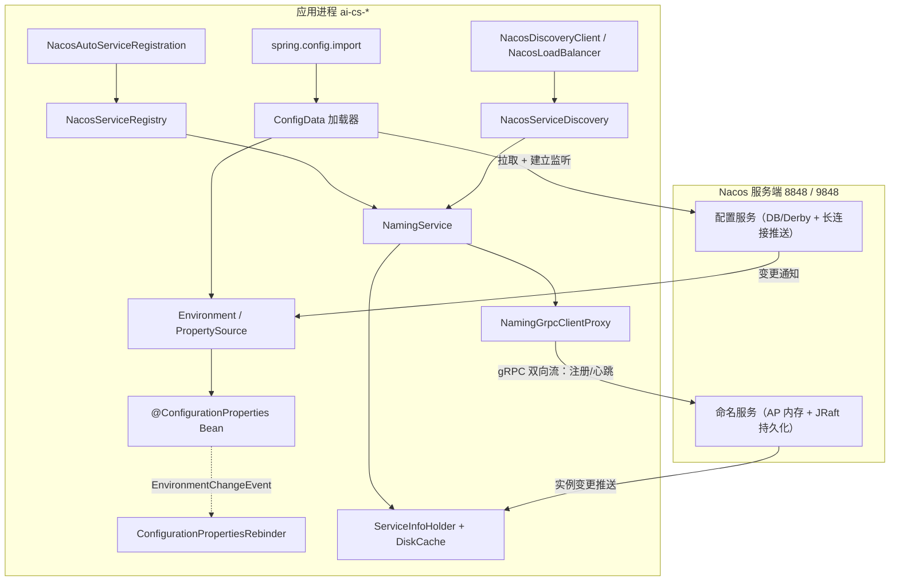
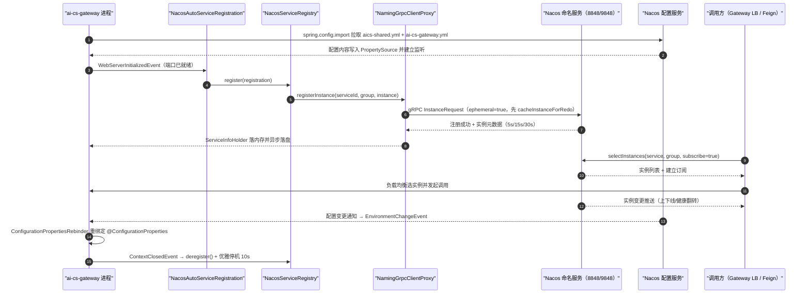

# Nacos 注册与配置中心：两条链路的真实机制与"改了没生效"定位法

> 一句话结论：`spring.cloud.nacos.discovery` 与 `spring.cloud.nacos.config` 是**两条互不相干**的链路——前者回答"我该被谁调用"（注册 → 心跳 → 推送 → 客户端缓存），后者回答"我该读哪份配置"（三元组寻址 → 快照 → 监听 → Bean 重绑定）；线上"注册不上、下线还在、配置不生效"全部落在这两条链路的**键对不对、缓存停在哪层、谁负责重绑定**三个点上。
> 阅读前置：读过 [02-SpringCloud微服务架构](./02-SpringCloud微服务架构.md)，知道本项目 Nacos 同时承担注册中心与配置中心；能读懂 `@ConfigurationProperties` 绑定、Boot 启动期 `Environment` 的来源；会用 pwsh 与 `curl`。
> 证据基线：JDK 17.0.19 / Spring Boot 4.2.0 / Spring Cloud 2026.0.0（子项目 5.1.0）/ Spring Cloud Alibaba 2025.1.0.0 / nacos-client 3.3.0；本篇引源码摘录 11 处（`nacos-client:3.3.0` 与 `spring-cloud-context`）、项目代码与配置 10 处、可复现实测 6 组。预计阅读 40~55 分钟。

## 0. 先看现象

### 现象 1：进程已经停了，网关还在往它身上打请求

复现方式很土：把 `ai-cs-product`（8088）从 IDE 里点"停止"，然后连续请求网关的商品接口。大约 10~40 秒内，请求仍然会打到那个已经死掉的 IP 上，网关侧刷的是这类错误：

```text
org.springframework.web.reactive.function.client.WebClientRequestException:
    Connection refused: /192.168.1.48:8088
```

如果这一批实例全死光，负载均衡器拿到的列表变空，控制台会出现 `NacosLoadBalancer` 的那句固定告警：

```text
No servers available for service: ai-cs-product
```

一句归因：这不是"下线没生效"，而是三档超时叠加——实例心跳 5 秒、判定不健康 15 秒、服务端摘除 30 秒，再叠加调用方本地 10 秒的实例缓存。

### 现象 2：配置明明发布成功了，服务就是读不到

在 Nacos 里把 `ai-cs-notify.yml` 发好（data_id、group `DEFAULT_GROUP`、namespace `aics` 三项全对），重启 `ai-cs-notify`，`rocketmq.name-server` 依然是本地默认值，跟没配一样。控制台里配置内容一字不差，服务端也查得到。

真实原因在本仓库里：`ai-cs-notify/src/main/resources/application.yml#L21-L23` 的 `spring.config.import` 只有一行 `- optional:nacos:aics-shared.yml`，**没有点名 `ai-cs-notify.yml`**。三元组对，不等于"会被加载"。

```yaml
# ai-cs-notify/src/main/resources/application.yml#L21-L23（真实内容）
  config:
    import:
      - optional:nacos:aics-shared.yml
```

一句归因：`spring.config.import` 是一张白名单，没列进去的 dataId 即使存在也不会被拉取；而 `optional:` 前缀又让"缺失"变成静默，连报错都不给你。

### 现象 3：本机能连、线上连不上，而且"配置串味"

换一台机器部署，`namespace` 写成了 `public`（或者干脆漏了这一行），服务照样启动成功、端口正常，但：

- 注册中心控制台在 `aics` 命名空间里看不到任何实例；
- 服务端 `nacos.log` 里这条连接写着 `tenant='null'`；
- 更隐蔽的是配置：公共命名空间里躺着一份**同名的旧** `aics-shared.yml`，服务读到的是它，于是 Redis 连接报 AUTH 失败（Lettuce/Redisson 的典型文案是 `ERR Client sent AUTH, but no password is set`）——因为那份旧文件里写着 `password: ""`，而 `aics` 命名空间里那份已经把这一行改成空值并加了注释提醒。

两份同名配置在本仓库**同时存在**，这就是"配置串味"的物证：

```text
tools\nacos\data\config-data\DEFAULT_GROUP\aics-shared.yml                    436 字节   ← public，password: ""
tools\nacos\data\tenant-config-data\aics\DEFAULT_GROUP\aics-shared.yml       1094 字节   ← aics，password:（空）+ 注释
```

一句归因：namespace 是**最外层**的隔离维度，它不是"分组"，写错等于换了一个完全平行的配置宇宙，而且不会报错。

这些现象指向同一件事：**Nacos 的两条链路都靠"键 + 缓存 + 推送"三件套生效，键错位就静默、缓存没更新就看到旧世界、没人重绑定就是改了白改。** 下面把两条链路拆开看。

## 1. 整体地图



> **读图说明**：
> - 图里两个入口是**并列**的：`NacosAutoServiceRegistration` 那条（发现链路）只负责"我是谁、我在哪"，`spring.config.import` 那条（配置链路）只负责"我读什么"。二者共享同一个 `server-addr`，其余互不影响。
> - 推送（push）有两个方向，别混：命名服务把**实例列表**推给 `ServiceInfoHolder`（客户端缓存）；配置服务把**变更通知**推给 `Environment` 那一侧，再由 `ConfigurationPropertiesRebinder` 去动 Bean。
> - 唯一能"改一行配置就让运行中的对象变形"的节点是右下角 `PB`（`@ConfigurationProperties` Bean）；不经过它的 Bean，重启才会变。
> - `ServiceInfoHolder + DiskCache` 是调用方"看起来还能用"的根源：它同时是内存缓存和磁盘快照，服务端短时不可用也不会立刻炸。

| 组件 | 责任 | 调用方 |
| --- | --- | --- |
| `NacosAutoServiceRegistration` | 监听"Web 端口就绪"事件，把启动完成翻译成一次注册 | Spring Cloud `AbstractAutoServiceRegistration` |
| `NacosServiceRegistry` | 组装 `Instance`（IP/端口/权重/集群/是否临时）并调 SDK | `NacosAutoServiceRegistration` |
| `NacosServiceDiscovery` / `NacosDiscoveryClient` | 查实例、把 `Instance` 转成 `ServiceInstance`、过滤不健康 | 网关 `NacosLoadBalancer`、Feign、`DiscoveryClient` 使用方 |
| `NamingService`（`NacosNamingService`） | 客户端命名服务门面：注册、订阅、查询 | 上面两个 |
| `NamingGrpcClientProxy` | 真正发 gRPC 请求的那层；临时/永久两条分支在这里分叉 | `NamingClientProxyDelegate` |
| `ServiceInfoHolder` + `DiskCache` | 订阅推送后的内存缓存 + 磁盘快照 | `NamingPushRequestHandler` |
| `NacosLoadBalancer` | 选一个实例；空列表、跨集群在这里告警 | Gateway 的 `ReactiveLoadBalancer` |
| `spring.config.import` + ConfigData 加载器 | 启动期把 `nacos:<dataId>` 拉进 `Environment` | Boot `ConfigDataEnvironmentPostProcessor` |
| `ConfigurationPropertiesRebinder` | 收到 `EnvironmentChangeEvent` 后重绑定所有 `@ConfigurationProperties` | spring-cloud-context 的事件机制 |
| Nacos 服务端（8848 HTTP / 9848 gRPC） | 命名服务 + 配置服务 | 所有客户端 |

## 2. 关键概念与关键类

先把五个会反复出现的词钉死，后面所有"为什么不生效"都要用到它们。

| 概念 | 一句话定义 | 在本项目里的具体值 |
| --- | --- | --- |
| **临时实例（ephemeral）** | 只活在服务端内存里、靠客户端持续续约维持的实例，默认类型 | 默认 `true`，全项目**没有**任何一处改成 `false` |
| **永久实例（persistent）** | 落盘、进 Raft 一致性协议、服务端主动探测健康的实例 | 未使用（K8s 场景也很少用） |
| **三层键** | `namespace`（租户）→ `group`（分组）→ `dataId`（配置文件名或服务名） | `aics` / `DEFAULT_GROUP` / `aics-shared.yml`、`ai-cs-gateway.yml` 等 |
| **订阅（subscribe）** | 客户端向服务端登记"这个服务的实例变了请推我" | `NacosWatch`、`selectInstances(..., subscribe=true)` 都会建立订阅 |
| **快照（snapshot）** | 客户端把"最后一次拿到的正确内容"落盘，用于服务端不可用时兜底 | 命名侧 `<用户目录>\nacos\naming\aics\...`；配置侧 `...\snapshot-tenant\aics\DEFAULT_GROUP\*.yml` |

| 类 / 文件 | 位置 | 角色 | 关键方法 |
| --- | --- | --- | --- |
| `NacosServiceRegistry` | `spring-cloud-alibaba-nacos-discovery` | 注册动作的执行者 | `register` / `deregister` / `getNacosInstanceFromRegistration` |
| `NacosAutoServiceRegistration` | 同上 | 注册时机的开关（端口就绪、是否启用） | `register` / `getRegistration` / `onNacosDiscoveryInfoChangedEvent` |
| `NacosDiscoveryProperties` | 同上 | 所有 `spring.cloud.nacos.discovery.*` 的绑定目标 | 字段默认值就是"事实基线" |
| `NamingGrpcClientProxy` | `nacos-client` | gRPC 通道；临时/永久分支 | `registerService` / `doRegisterServiceForPersistent` / `deregisterService` |
| `ServiceInfoHolder` | `nacos-client` | 实例列表内存缓存 + 空推送保护 | `processServiceInfo` / `isLoadCacheAtStart` |
| `ServiceInfoUpdateService` | `nacos-client` | 订阅的兜底轮询（推送的备份方案） | `scheduleUpdateIfAbsent` / `UpdateTask#run` |
| `DiskCache` / `CacheDirUtil` | `nacos-client` | 实例列表落盘与目录规则 | `writeWithResult` / `read` / `initCacheDir` |
| `NacosServiceDiscovery` | `spring-cloud-alibaba-nacos-discovery` | 实例查询 + 健康过滤 | `getInstances` / `hostToServiceInstance` |
| `NacosLoadBalancer` | 同上 | 从候选列表里选一个 | `choose` / `getInstanceResponse` |
| `NacosWatch` | 同上 | 订阅实例变更并广播 Spring 事件 | `start` / `buildKey` |
| `NacosDiscoveryHeartBeatPublisher` | 同上 | **发的是 Spring `HeartbeatEvent`，不是实例心跳** | `publishHeartBeat` |
| `ConfigurationPropertiesRebinder` | `spring-cloud-context` | 配置变更后重绑定 `@ConfigurationProperties` | `onApplicationEvent` / `rebind` / `bindFreshInstance` |
| `ClientWorker` / `CacheData` / `LocalConfigInfoProcessor` | `nacos-client` | 配置侧长连接、缓存、快照（本仓库无源码摘录，见 §3.8） | —— |

## 3. 原理与证据逐段精读

### 3.1 注册到底做了什么：一次 `register` 写进去四个字段

**在干什么。** 服务启动到 Web 端口就绪后，`NacosAutoServiceRegistration` 触发一次注册，落到 `NacosServiceRegistry#register`：

```java
// (src: NacosServiceRegistry.java#L60-L89)
	public void register(Registration registration) {

		if (StringUtils.isEmpty(registration.getServiceId())) {
			log.warn("No service to register for nacos client...");
			return;
		}

		NamingService namingService = namingService();
		String serviceId = registration.getServiceId();
		String group = nacosDiscoveryProperties.getGroup();

		Instance instance = getNacosInstanceFromRegistration(registration);

		try {
			namingService.registerInstance(serviceId, group, instance);
			log.info("nacos registry, {} {} {}:{} register finished", group, serviceId,
					instance.getIp(), instance.getPort());
		}
		catch (Exception e) {
			if (nacosDiscoveryProperties.isFailFast()) {
				log.error("nacos registry, {} register failed...{},", serviceId,
						registration.toString(), e);
				rethrowRuntimeException(e);
			}
			else {
				log.warn("Failfast is false. {} register failed...{},", serviceId,
						registration.toString(), e);
			}
		}
	}
```

真正"填字段"的是 `getNacosInstanceFromRegistration`（同文件 L170-L180）：IP、端口、权重、集群名、是否 enabled、metadata，最后一行是 **`instance.setEphemeral(nacosDiscoveryProperties.isEphemeral())`**。也就是说：**临时/永久不是服务端判定的，是客户端自报的。**

**为什么这么设计。** 注册是"自证式"的：客户端说"我在 192.168.1.48:8083，请记下"，服务端不主动去探活（否则大规模集群里服务端要被探测流量压死）。代价是服务端只能相信客户端会持续续约，所以必须有心跳/长连接。

**换写法会怎样。** 如果把 `spring.cloud.nacos.discovery.register-enabled` 设成 `false`，`NacosAutoServiceRegistration#register` 里那句 `log.debug("Registration disabled.")` 会直接返回（L72-L81），服务变成"只消费不提供服务"——这是消费者服务（比如纯前端 BFF）省一份注册的常见做法，本项目没这么配。

**常见坑。**
- `failFast` 默认 `true`（`NacosDiscoveryProperties` L231）：**服务端没起来时应用直接启动失败**，报 `com.alibaba.nacos.api.exception.NacosException: failed to req API:...`。想宽松就配 `fail-fast: false`，代价是服务"看起来活着"但其实没注册。
- 注册成功日志是 `nacos registry, DEFAULT_GROUP ai-cs-chat 192.168.1.48:8083 register finished`。**先搜这句**，能立刻区分"没注册"和"注册了但看不到"（后者多半是 namespace 不同）。

### 3.2 临时实例 vs 永久实例：一条 `if` 决定走 AP 还是 CP

**在干什么。** 同一份 `Instance` 对象，进 `NamingGrpcClientProxy#registerService` 后立刻分叉：

```java
// (src: NamingGrpcClientProxy.java#L153-L171)
    @Override
    public void registerService(String serviceName, String groupName, Instance instance)
        throws NacosException {
        NAMING_LOGGER.info("[REGISTER-SERVICE] {} registering service {} with instance {}",
            namespaceId, serviceName,
            instance);
        if (instance.isEphemeral()) {
            registerServiceForEphemeral(serviceName, groupName, instance);
        } else {
            doRegisterServiceForPersistent(serviceName, groupName, instance);
        }
    }
    
    private void registerServiceForEphemeral(String serviceName, String groupName,
        Instance instance)
        throws NacosException {
        redoService.cacheInstanceForRedo(serviceName, groupName, instance);
        doRegisterService(serviceName, groupName, instance);
    }
```

永久实例那条分支短得多，而且**没有 redo**：

```java
// (src: NamingGrpcClientProxy.java#L296-L303)
    public void doRegisterServiceForPersistent(String serviceName, String groupName,
        Instance instance)
        throws NacosException {
        PersistentInstanceRequest request =
            new PersistentInstanceRequest(namespaceId, serviceName, groupName,
                NamingRemoteConstants.REGISTER_INSTANCE, instance);
        requestToServer(request, Response.class);
    }
```

两处差异值得背下来：**临时实例先 `cacheInstanceForRedo` 再发请求**（连接断了重连后能把注册重做一遍），**永久实例发完就完事**。这就是"临时实例不怕抖动、永久实例一锤定音"的实现层解释。

**为什么这么设计。** 临时实例走 AP：宁可短暂不一致，也不能因为一次选举让整个服务发现停摆；永久实例走 CP：数据必须落盘、必须多数派确认，因为它代表"人工登记的、真正常驻的"服务（典型是 DNS 型或数据库类资源）。落到磁盘上的物证在本地安装目录里——三个 JRaft 组各有一套 `log / snapshot / meta-data`：

```text
tools\nacos\data\protocol\raft\naming_instance_metadata
tools\nacos\data\protocol\raft\naming_persistent_service_v2
tools\nacos\data\protocol\raft\naming_service_metadata
```

**换写法会怎样。** 配 `spring.cloud.nacos.discovery.ephemeral: false` 后，你的实例不再依赖心跳：进程被 `kill -9` 也不会被摘除，必须自己调注销接口或去控制台删。好处是"实例列表不会因为网络抖动清空"，坏处是**僵尸实例会永久留在列表里**，调用方拿到的是必然超时的地址。

**常见坑。**
- 只在"服务本身就是注册数据的真相来源"时才用永久实例；普通 Spring Boot 服务用永久实例 = 自己给自己制造僵尸。
- 临时实例的续约是长连接 + 心跳两条腿，`kill -9` 时两条都断，服务端要等超时才知道；`SIGTERM`（正常停止）会走注销，见 §3.4。

### 3.3 5 秒 / 15 秒 / 30 秒：三个数字是谁下发的

**在干什么。** 打开客户端的实例缓存文件，三个超时参数**原样躺在服务端返回的 JSON 里**（这是本项目实跑后留下的真实文件）：

```json
{
  "name": "ai-cs-chat", "groupName": "DEFAULT_GROUP", "cacheMillis": 10000,
  "hosts": [{
    "ip": "192.168.1.48", "port": 8083, "weight": 1.0,
    "healthy": true, "enabled": true, "ephemeral": true, "clusterName": "DEFAULT",
    "metadata": { "preserved.register.source": "SPRING_CLOUD", "IPv6": "[2409:8a50:...]" },
    "instanceHeartBeatTimeOut": 15000,
    "instanceHeartBeatInterval": 5000,
    "ipDeleteTimeout": 30000
  }],
  "reachProtectionThreshold": false, "valid": true
}
```

读法：`instanceHeartBeatInterval=5000`（每 5 秒续约一次）、`instanceHeartBeatTimeOut=15000`（15 秒没续约标不健康）、`ipDeleteTimeout=30000`（30 秒没续约直接摘掉），`cacheMillis=10000` 是**客户端自己**的列表缓存时长。三个服务端参数 + 一个客户端参数，才是现象 1 里那 10~40 秒的全部来源。

**为什么这么设计。** 参数由服务端下发而不是写死在客户端，是为了运维能在服务端一次调优所有客户端，不用挨个发版。

**换写法会怎样。** `NacosDiscoveryProperties` 里确实有 `heartBeatInterval / heartBeatTimeout / ipDeleteTimeout` 三个字段（L199/L204/L209），但**本项目一处都没配**，全走默认。真要在客户端改，注意它们只是"上报意图"，临时实例的实际判定仍以服务端下发的值为准——这也是为什么排查超时问题要看上面的 JSON，而不是翻 yml。

**常见坑。** 名字撞车：`NacosDiscoveryHeartBeatPublisher` 里那个 30 秒（`watchDelay = 30000`，`NacosDiscoveryProperties` L113）发的是 Spring 的 `HeartbeatEvent`，源码 javadoc 写得很明白：`nacos doesn't support watch now , publish an event every 30 seconds.`。它跟实例心跳**完全无关**，别把日志里的 `HeartbeatEvent` 当成续约证据。

### 3.4 优雅下线：注销请求到底有没有发出去

**在干什么。** 正常停止（`SIGTERM` / IDE 停止按钮）会走 `NacosServiceRegistry#deregister`（L92-L115）。这段代码的关键不是它做了什么，而是**它什么都不抛**：

```java
// (src: NacosServiceRegistry.java#L92-L115) 关键片段
	@Override
	public void deregister(Registration registration) {
		log.info("De-registering from Nacos Server now...");
		// ...
		catch (Exception e) {
			log.error("ERR_NACOS_DEREGISTER, de-register failed...{},", ...);
		}
	}
```

注销失败只打一行 `ERR_NACOS_DEREGISTER`，绝不阻塞停机。配套的等待时间来自 `NacosDiscoveryProperties` 的最后几行（L233-L238），注释把语义写清楚了：

```java
// (src: NacosDiscoveryProperties.java#L233-L238)
	/**
	 * graceful shutdown wait time. Time unit: millisecond.
	 * default is 10s
	 * When the Springboot shutdown hook is executed, remove the Nacos service, wait for 10 seconds, and then Tomcat rejects the request
	 */
	private Integer gracefulShutdownWaitTime = 10 * 1000;
```

**为什么这么设计。** 先摘流量、再拒请求，是对"调用方还在用旧列表"的补偿：这 10 秒是留给别人刷新实例列表的窗口。项目里网关显式打开了优雅停机 `server.shutdown: graceful`（`ai-cs-gateway/src/main/resources/application.yml#L2`），否则这套 Hook 根本不会完整执行。

**换写法会怎样。** 直接 `kill -9`（或 Docker `docker kill`、Pod 强杀）时 `ContextClosedEvent` 不触发，注销请求根本不会发出去，只能等服务端 30 秒摘除——这就是"容器环境下线特别慢"的真相。

**常见坑。**
- 看到 `De-registering from Nacos Server now...` 但列表里还有实例：说明注销发出去了但服务端还在处理，或者调用方缓存没刷新（下一节）。
- 反过来，只有 `ERR_NACOS_DEREGISTER` 没有 `register finished`：说明这个实例本来就是启动时没注册成功的（配合 §3.1 的 `failFast` 一起看）。

### 3.5 订阅与本地缓存：为什么"下线后还看得见"

**在干什么。** 服务端把实例列表推过来，落地逻辑在 `ServiceInfoHolder#processServiceInfo`：先做"空推送保护"，再比对差异，最后才更新缓存并广播事件。

```java
// (src: ServiceInfoHolder.java#L137-L172) 关键片段
        ServiceInfo oldService = serviceInfoMap.get(serviceKey);
        if (isEmptyOrErrorPush(serviceInfo)) {
            //empty or error push, just ignore
            NAMING_LOGGER.warn(
                "process service info but found empty or error push, serviceKey: {}, "
                    + "pushEmptyProtection: {}, hosts: {}",
                serviceKey, pushEmptyProtection, serviceInfo.getHosts());
            return oldService;
        }
        serviceInfoMap.put(serviceKey, serviceInfo);
        // ...
        if (diff.hasDifferent()) {
            NAMING_LOGGER.info("current ips:({}) service: {} -> {}", serviceInfo.ipCount(),
                serviceKey,
                JsonUtils.toJson(serviceInfo.getHosts()));
            // ...
            NotifyCenter.publishEvent(new InstancesChangeEvent(...));
            publishDiskCacheRefreshEvent(serviceKey, serviceInfo);
        }
```

落盘就是另一段代码，文件名是 **URL 编码后的 `group@@serviceName`**：

```java
// (src: DiskCache.java#L58-L84) 关键片段
    static boolean writeWithResult(ServiceInfo dom, String dir) {
        try {
            makeSureCacheDirExists(dir);
            File file = new File(dir, dom.getKeyEncoded());
            createFileIfAbsent(file, false);
            StringBuilder keyContentBuffer = new StringBuilder();
            String json = dom.getJsonFromServer();
            if (StringUtils.isEmpty(json)) {
                json = JsonUtils.toJson(dom);
            }
            keyContentBuffer.append(json);
            //Use the concurrent API to ensure the consistency.
            ConcurrentDiskUtil.writeFileContent(file, keyContentBuffer.toString(),
                StandardCharsets.UTF_8.name());
            return true;
        }
        // ...
```

于是本机的缓存目录长这样（`CacheDirUtil#initCacheDir` 决定路径，L50-L73）：

```text
C:\Users\16680\nacos\naming\aics\DEFAULT_GROUP%40%40ai-cs-chat
C:\Users\16680\nacos\naming\aics\DEFAULT_GROUP%40%40ai-cs-product
```

**为什么这么设计。** 调用方不能因为注册中心抖一下就全站 500。空推送保护（`pushEmptyProtection`）尤其关键：服务端偶尔推来一个"空列表"（通常是自己出问题），客户端选择**信旧值**，而不是把缓存清空——`isEmptyOrErrorPush` 的判断就是"列表为 null，或者开了保护但内容校验不过"。

**换写法会怎样。** 关掉保护（`push-empty-protection: false`）能获得更快的"真实下线"，代价是注册中心一次异常推送就会让调用方瞬间全空、报 `No servers available`。服务端还有另一层保护：`ProtectMode` 的 `protectThreshold` 默认 `0.8F`（L24-L30）——健康实例低于 20% 时，服务端干脆不下发任何变更，防止"大面积误判把实例全摘了"。

**常见坑。** 用 `DiscoveryClient` 查到的列表**已经是过滤过的**：`NacosServiceDiscovery#hostToServiceInstance` 里 `instance == null || !instance.isEnabled() || !instance.isHealthy()` 直接返回 null 并跳过（L87-L91）。所以"控制台看到 3 个实例、代码里只有 2 个"不是 bug，是那 1 个被标了不健康或被下线（enabled=false）。

### 3.6 调用侧：谁把请求送到了死掉的实例

**在干什么。** 查询侧只有一个入口，重点是那个 `subscribe=true`：

```java
// (src: NacosServiceDiscovery.java#L56-L61)
	public List<ServiceInstance> getInstances(String serviceId) throws NacosException {
		String group = discoveryProperties.getGroup();
		List<Instance> instances = namingService().selectInstances(serviceId, group,
				true);
		return hostToServiceInstanceList(instances, serviceId);
	}
```

`subscribe=true` 意味着"顺便订阅"，于是后续变更走推送；如果订阅通道挂了，`ServiceInfoUpdateService` 会兜底定时拉取：`UpdateTask#run` 用 `delayTime = serviceObj.getCacheMillis() * 6`（即 10s × 6 = 60s），失败时退避且最长不超过 60 秒（`Math.min(delayTime << failCount, DEFAULT_DELAY * 60)`，L190-L236）。

选实例那一步在 `NacosLoadBalancer#getInstanceResponse`，两个告警值得记住：

```java
// (src: NacosLoadBalancer.java#L134-L160) 关键片段
	private Response<ServiceInstance> getInstanceResponse(Request<?> request,
			List<ServiceInstance> serviceInstances) {
		if (serviceInstances.isEmpty()) {
			log.warn("No servers available for service: {}", this.serviceId);
			return new EmptyResponse();
		}
		try {
			String clusterName = this.nacosDiscoveryProperties.getClusterName();
			// ...按 metadata 的 nacos.cluster 过滤
			else {
				log.warn(
						"A cross-cluster call occurs，name = {}, clusterName = {}, instance = {}",
						serviceId, clusterName, serviceInstances);
			}
```

**为什么这么设计。** 先过滤集群、再走 `ServiceInstanceFilter` 链、最后按 `serviceId` 找算法，是为了把"就近调用""权重""同 IP 优先"这些策略做成可插拔的，而不是写死在选实例方法里。

**换写法会怎样。** 项目里**没有**任何一处配置 `cluster-name`，所以上面那条 `A cross-cluster call occurs` 的告警分支永远不会出现在本仓库日志里；一旦你看到它，说明有人配了集群名但有一批实例的 `nacos.cluster` metadata 对不上——那是配置错位，不是网络问题。

**常见坑。** "下线还在被调用"的最后一段延迟藏在这里：即使 `ServiceInfoHolder` 已经拿到新列表，`ServiceInstanceListSupplier` 自己还有一层缓存（默认 35 秒级别，由 Spring Cloud LoadBalancer 的 caffeine 缓存控制，依据官方文档）。排查时先看 `ServiceInfoHolder` 的 `current ips:(N)` 日志，再看 LB 层的缓存，不要一上来就怀疑 Nacos。

### 3.7 配置下发（一）：三元组对还不够，得有人点名

**在干什么。** 本项目是 Boot 4 时代的标准写法——全部配置来源在一处声明：

```yaml
# ai-cs-gateway/src/main/resources/application.yml#L17-L31（真实内容）
  cloud:
    nacos:
      discovery:
        server-addr: ${NACOS_ADDR:127.0.0.1:8848}
        namespace: aics
        group: DEFAULT_GROUP
      config:
        server-addr: ${NACOS_ADDR:127.0.0.1:8848}
        namespace: aics
        group: DEFAULT_GROUP
        file-extension: yml
  config:
    import:
      - optional:nacos:aics-shared.yml
      - optional:nacos:ai-cs-gateway.yml
```

三个要点：`nacos.config` 段只提供**连接信息与默认值**（server-addr、namespace、group、file-extension），它**不指定任何 dataId**；真正决定"读哪些配置"的是 `spring.config.import` 里那几行。

三元组是怎么落到磁盘上的？看项目自带的推送脚本更直观——它绕过服务端直接写库，所以表结构就是键的定义：`INSERT INTO config_info (data_id, group_id, content, md5, ..., tenant_id, type) VALUES (?, 'DEFAULT_GROUP', ?, ?, ..., ?, 'yaml')`（`tools\nacos-config\lib\PushConfigs.java` L41-L43）。`tenant_id` = namespace，`group_id` = group，`data_id` = 文件名。

**为什么这么设计。** Boot 2.4 起配置加载统一成 Config Data API，`bootstrap.yml` 那套早于 Environment 的"上下文父子"模型被废弃。`spring.config.import` 的好处是顺序显式可控、来源可枚举、缺文件可以选报错还是忽略。

**换写法会怎样。** 把 `optional:` 去掉（写成 `nacos:ai-cs-notify.yml`），配置缺失会**直接启动失败**并指出缺哪个 dataId——这正是排查"改名/漏配"最省事的手段；代价是任何一个环境缺文件都起不来，所以项目里全加了 `optional:`，用**静默**换取**弹性**。

**常见坑。** `optional:` 的静默是双刃剑：`ai-cs-notify` 的 import 里根本没有 `ai-cs-notify.yml` 这一行，于是"少一条 import"这种错误不会产生任何日志。检查手法见 §6.4：直接看客户端快照目录里有没有这个文件。

### 3.8 配置下发（二）：变更通知之后，谁去改 Bean

**在干什么。** 变更通知到达后，Spring Cloud 广播 `EnvironmentChangeEvent`，`spring-cloud-context` 的 `ConfigurationPropertiesRebinder` 接住它。它的 javadoc（就是设计文档）把行为、竞态和已知缺陷写得很全：

```java
// (src: ConfigurationPropertiesRebinder.java#L64-L99) javadoc 摘录
 * Listens for {@link EnvironmentChangeEvent} and rebinds beans that were bound to the
 * {@link Environment} using {@link ConfigurationProperties}.
 *
 * ...
 * The bean is still mutated in place, field by field, so a reader can observe a mix of
 * old and new values while a rebind is in progress. Beans that need a consistent view
 * across a refresh should use {@link RefreshScope} instead, which serializes reads
 * against refreshes via a per-bean ReadWriteLock.
 *
 * Known limitation: a collection property that has a value in the {@link Environment} can
 * be briefly empty during a rebind. ...
```

两个关键事实：**（1）它只处理 `@ConfigurationProperties` Bean**；**（2）重绑定是"就地逐字段覆盖"，没有原子性**，需要一致视图就得用 `@RefreshScope`（每 Bean 一把 `ReadWriteLock`）。

**为什么这么设计。** 直接重绑定 bean 比重建 bean 快得多，也不会打断调用方持有的引用；无法精确回退的集合类型（`List`/`Map`）只能用 `mergeCollection` / `mergeMap`（L468 / L499）折中。

**换写法会怎样。** 用 `@Value("${aics.gateway.rate-limit.qps}")` 注入的字段**永远不刷新**，除非所在 Bean 是 `@RefreshScope`。项目里把这个结论直接写进了注释：`ai-cs-gateway/src/main/java/com/aics/gateway/config/RateLimitProperties.java#L6-L18` 明确写着"选 `@ConfigurationProperties` 而非 `@Value` + `@RefreshScope`：Nacos 配置变更触发 ContextRefresher 后……会自动重绑定所有 `@ConfigurationProperties` Bean，无需给使用方加 `RefreshScope`"。全项目只有 `ModelRouterProperties` 一处额外加了 `@RefreshScope`（`ai-cs-chat/src/main/java/com/aics/chat/modelrouter/ModelRouterProperties.java#L17-L23`），因为它的 `validate()` 要求"要么整份新配置、要么整份旧配置"。

| 对比项 | `@ConfigurationProperties` | `@Value` | `@RefreshScope` + `@ConfigurationProperties` |
| --- | --- | --- | --- |
| 配置变更后是否生效 | 生效（`Rebinder` 自动重绑定） | **不生效** | 生效（销毁 Bean 后整份重建） |
| 一致性 | 逐字段就地覆盖，可能读到新旧混合值 | —— | `ReadWriteLock`，读写串行 |
| 校验失败时 | 半新半旧（危险） | —— | 构造失败则保留旧 Bean |
| 适用场景 | 绝大多数配置类 | 常量、极端简单值 | 需要整体一致 + 自定义校验 |
| 本项目实例 | 19 个 `@ConfigurationProperties` | 零散 `@Value` 不刷新 | `ModelRouterProperties` |

**常见坑。** 只加 `@ConfigurationProperties` 不加 `@EnableConfigurationProperties` / `@ConfigurationPropertiesScan` / `@Component`，类根本不会成为 Bean。项目里 `ai-cs-gateway/src/main/java/com/aics/gateway/GatewayApplication.java#L12` 用 `@ConfigurationPropertiesScan("com.aics.gateway.config")` 兜住扫描——新建配置类忘写 `@Component` 时它就是救命的那一行。

### 3.9 故障兜底：快照到底救了谁

**在干什么。** 命名侧的兜底是"启动时是否读磁盘缓存"，由 `namingLoadCacheAtStart` 决定，**默认关闭**：

```java
// (src: NacosDiscoveryProperties.java#L142-L144) 字段附近
	private String namingLoadCacheAtStart = "false";
```

`ServiceInfoHolder` 的构造器（L64-L79）据此决定要不要 `DiskCache.read(cacheDir)`；配置侧同理，客户端会把每份配置写进 `snapshot-tenant\<namespace>\<group>\<dataId>`，服务端不可用时读快照继续启动。

**为什么这么设计。** 默认关闭是刻意的：**宁可启动时拿不到实例（报错早现），也不要拿着一份几小时前的死列表启动**——后者会让服务"看起来健康、实际上全在打空气"。

**换写法会怎样。** 配 `naming-load-cache-at-start: true` 后，注册中心整体挂掉时服务仍能启动并读到上次的实例列表，适合"宁可打到旧地址也不许宕"的场景；必须配合监控，否则你在给调用方供货一份僵尸名单。

**常见坑。** 手动改本地快照文件想"骗过"客户端是无效的：配置侧靠服务端内容与 md5 比对（服务端日志 `[dump] md5 changed, save to disk cache ,groupKey=aics-shared.yml+DEFAULT_GROUP+aics, newMd5=...,oldMd5=...`）来决定是否覆盖，命名侧靠推送覆盖。快照只读不写回服务端。真正想强制读本地文件得走 failover 目录（`LocalConfigInfoProcessor#getFailover`，见 §6.6 的 `javap` 证据）。

## 4. 一次完整执行时序

下面这条时序把两条链路串起来：启动拉配置 → 注册 → 被别人订阅 → 配置热更新 → 停机注销。



> **读图说明**：
> - 前两步（拉配置）和第三步之后（注册）没有依赖关系，但**顺序是固定的**：端口没就绪不会注册，配置没进 `Environment` 就不会 bind；所以"启动日志里先看到配置、后看到 `register finished`"是正常的。
> - 第 7 步之后的 8~10 是**订阅建立**，只有建立了订阅，第 12 步的推送才有对象；Gateway 这类纯消费方只有 8~10，没有 3~7。
> - 第 13~15 是配置链路的热更新，与实例列表**完全无耦合**：注册中心挂了不影响配置刷新，配置中心挂了也不影响调用（已建立的实例列表还在缓存里）。
> - 第 16 步之后进程才真正退出，这中间有 `gracefulShutdownWaitTime` 的 10 秒等待。

| 失败步骤 | 现象 | 典型报错 / 日志 | 先查什么 |
| --- | --- | --- | --- |
| 1 拉配置 | 启动正常但读不到远程值 | 无报错（`optional:` 静默） | `spring.config.import` 是否点名该 dataId |
| 4~5 注册 | 启动失败或注册不上 | `NacosException: failed to req API:/nacos/v1/ns/instance after all servers([127.0.0.1:8848]) tried` | 服务端是否启动、`server-addr`/`namespace` |
| 6 注册返回 | 注册"成功"但控制台看不到 | 日志有 `register finished` 但实例在 `public` | `namespace: aics` 是否生效（看 `tenant`） |
| 8~10 订阅 | 实例列表长期不变 | `Can't update serviceName: {}, reason: {}` | 长连接是否建立（`connectType='GRPC'`） |
| 11 选实例 | 调用 503 / 连接拒绝 | `No servers available for service: xxx` | 实例是否 healthy/enabled |
| 13~15 刷新 | 配置变了 Bean 不变 | 无报错 | Bean 是否 `@ConfigurationProperties` |
| 16 注销 | 停止后 30 秒仍被调用 | `De-registering from Nacos Server now...` | 是否 `kill -9`、是否 `shutdown: graceful` |

## 5. 设计取舍

| 取舍点 | 本项目/基线选了什么 | 代价 | 换成另一种会怎样 |
| --- | --- | --- | --- |
| 实例状态传播 | 客户端续约 + 服务端推送（AP） | 下线有 10~40 秒窗口 | 服务端主动探测（CP/永久实例）→ 无窗口但有僵尸实例 |
| 一致性协议 | 临时实例 Distro（AP），永久实例 JRaft（CP） | 两套存储与语义并存 | 全 CP → 服务发现随选举抖动；全 AP → 永久数据可能丢 |
| 多环境隔离 | `namespace`（本项目固定 `aics`） | 多环境要多开 namespace + 重复发布 | 只用 group 隔离 → 键更长、易错、控制台无物理隔离 |
| 配置引入方式 | `spring.config.import` + `optional:` | 缺文件静默 | `bootstrap.yml` → Boot 4 已不通；去掉 `optional:` → 环境缺文件起不来 |
| 热更新粒度 | `@ConfigurationProperties` 就地重绑定 | 可能读到新旧混合值 | 全用 `@RefreshScope` → 每次刷新销毁重建 Bean，有状态组件会丢状态 |
| 启动兜底 | `naming-load-cache-at-start=false`（默认） | 注册中心挂了启动即失败 | 设 `true` → 能用旧列表启动，但可能全打僵尸实例 |
| 部署形态 | 学习环境单机（Derby / 或 MySQL 单实例） | 无高可用 | 3 节点集群 + 共享 MySQL（见 §7） |

**可扩展点清单**（想改造时优先动这些）：

1. `ServiceInstanceFilter` 链：`NacosLoadBalancer` 在选实例前会跑一遍过滤器（L164-L166），权重、同 IP 优先都挂在这里。
2. `LoadBalancerAlgorithmMap`：按 `serviceId` 换算法（`NacosLoadBalancer` L170-L176 找不到就回落 `DEFAULT_SERVICE_ID`）。
3. `spring.cloud.nacos.discovery.register-enabled`：单机多实例调试时关掉注册，避免把本机实例污染到共享注册中心。
4. `NacosServiceManager`：`server-addr` 运行期变更时由它重建 `NamingService`（`onNacosDiscoveryInfoChangedEvent` → `restart()`，`NacosAutoServiceRegistration` L110-L117）。
5. `spring.config.import` 的扩展写法：`optional:nacos:<dataId>?group=xxx&refreshEnabled=false`，可按 dataId 关闭刷新（语法依据 Spring Cloud Alibaba 官方文档）。
6. `NacosConfigManager#getConfigAndSignListener`：需要"配置变更时自己写回调"而不想影响全局 Bean 时用（本项目未使用，属可选扩展）。
7. `tools\nacos-config\lib\PushConfigs.java`：现有脚本直写 `config_info` 表，可改造成走 Open API 发布，从而触发服务端通知（见 §6.7）。

## 6. 踩坑与调试手法

### 6.1 实例已下线仍被路由：用"三档超时"倒推

判定顺序固定：`SIGTERM` 是否触发（决定有没有第 0 档）→ 服务端 30 秒摘除 → 客户端 `cacheMillis` 10 秒 → LB 层缓存。所以：

| 停止方式 | 期望摘除耗时 | 典型证据 |
| --- | --- | --- |
| IDE 停止 / `SIGTERM` + `shutdown: graceful` | 立刻（注销成功） | `De-registering from Nacos Server now...` |
| `SIGTERM` 但注销失败 | ≤30s | `ERR_NACOS_DEREGISTER, de-register failed` |
| `kill -9` / 容器强杀 / OOM | 30~40s | 只有心跳停止，无注销日志 |
| 进程还在但线程池打满 | 15s 后标不健康，但**不摘除**（enabled 仍为 true，可用性判定交给调用方） | 控制台实例变红 |

### 6.2 "改了配置没生效"：五问决策树

1. **键对不对**：namespace / group / dataId 三项，与本服务 `application.yml` 里那段逐字比。`tenant_id` 差一个字母就是另一个宇宙（§0 现象 3）。
2. **import 有没有点名**：`spring.config.import` 里有没有这一行？`ai-cs-notify` 就是漏了（真事）。
3. **是否被 `optional:` 静默**：去掉 `optional:` 再启动一次，缺什么立刻报出来。
4. **Bean 会不会重绑定**：`@Value` 不刷新；`@ConfigurationProperties` 会刷新；需要整体一致才加 `@RefreshScope`。
5. **是不是读到了另一份同名配置**：公共命名空间里的旧 `aics-shared.yml` 就是活标本。

### 6.3 本地能连、线上连不上：先看 `tenant`

`namespace` 没生效时，服务端日志里的连接信息会直白地写出 `tenant='null'`（下一节有真实行）。另一个高频原因是 `server-addr` 用了 `${NACOS_ADDR:127.0.0.1:8848}` 但环境变量没注入——注意这个写法**有默认值**，所以"连上本地了"这件事本身不会报错，只会悄悄地注册到本地。

### 6.4 调试手法一：直接读客户端的磁盘缓存与快照

```powershell
# 命名侧：实例列表缓存（文件名是 URL 编码的 group@@serviceName）
Get-ChildItem "$env:USERPROFILE\nacos\naming\aics" | Select-Object Name, Length
Get-Content "$env:USERPROFILE\nacos\naming\aics\DEFAULT_GROUP%40%40ai-cs-chat" -Encoding UTF8

# 配置侧：每个 dataId 的快照（有文件=拉取过；没文件=从没加载）
Get-ChildItem "$env:USERPROFILE\nacos\config\fixed-aics-127.0.0.1_8848_nacos\snapshot-tenant\aics\DEFAULT_GROUP" |
  Select-Object Name, Length
```

怎么读：命名侧 JSON 里 `hosts` 为空数组说明"这个服务当前确实没有健康实例"；`healthy/enabled` 才是判定字段，不是 `port` 是否存在。配置侧目录里**列出 13 个 yml 却没有 `ai-cs-notify.yml`**，这件事直接证明了 `ai-cs-notify` 从未拉过自己那份配置，比翻半小时日志快得多。目录名 `fixed-aics-127.0.0.1_8848_nacos` 本身就编码了 `serverAddr + namespace`，一眼能看出客户端连的是谁。

### 6.5 调试手法二：抓服务端日志的两个关键字

```powershell
cd D:\Projects\Persion\ai-customer-service\tools\nacos\logs
Select-String -Path nacos.log -Pattern "ConnectionMetrics|connectType|tenant=" | Select-Object -Last 5
Select-String -Path config-dump.log -Pattern "groupKey=" | Select-Object -Last 5
```

真实输出片段：

```text
ConnectionMetrics, totalCount = 22, detail = {long_connection=22, long_polling=0}
new connection registered successfully ... metaInfo=ConnectionMeta{connectType='GRPC',
  clientIp='192.168.1.48', ..., localPort=9848, version='Nacos-Java-Client:v2.3.2',
  ..., tenant='null', labels={source=sdk, module=naming, ...}}

[dump] md5 changed, save to disk cache ,groupKey=aics-shared.yml+DEFAULT_GROUP+aics, newMd5=f32e...,oldMd5=5d5c...
[dump-ignore] ignore to save to disk cache. md5 consistent,groupKey=ai-cs-user.yml+DEFAULT_GROUP+aics
```

怎么读：`connectType='GRPC'` + `long_polling=0` 证明这条链路走的是 gRPC 长连接而不是 1.x 的 HTTP 长轮询；`version='Nacos-Java-Client:v2.3.2'` 告诉你**客户端真实版本**（依赖冲突时这里是唯一的真相）；`tenant='null'` 就是 namespace 没带上的铁证；`config-dump.log` 里的 `groupKey=<dataId>+<group>+<namespace>` 与 md5 比对，直接展示了"变更判定"的机制。

### 6.6 调试手法三：Open API、actuator 与断点位置

```powershell
# 服务端视角：这个服务在 aics 命名空间里到底有几个实例
curl "http://127.0.0.1:8848/nacos/v1/ns/instance/list?serviceName=ai-cs-chat&groupName=DEFAULT_GROUP&namespaceId=aics"
# 应用视角：配置有没有进 Environment、Bean 绑到了什么值
curl http://127.0.0.1:8080/actuator/env | Select-String "aics-shared"
curl http://127.0.0.1:8080/actuator/configprops | Select-String "rate-limit"
```

配置侧客户端没有源码摘录，但可以用 `javap` 看类结构（本地 `.m2` 里只有 `nacos-client` 2.3.2 与 3.1.1、没有 sources jar，所以这里标的是 **3.1.1** 的签名，与 3.3.0 的方法名一致）：

```powershell
javap -p -classpath "$env:USERPROFILE\.m2\repository\com\alibaba\nacos\nacos-client\3.1.1\nacos-client-3.1.1.jar" `
  com.alibaba.nacos.client.config.impl.LocalConfigInfoProcessor
```

```text
public static final java.lang.String LOCAL_SNAPSHOT_PATH;
private static final java.lang.String SUFFIX;        // "_nacos"
private static final java.lang.String ENV_CHILD;     // "snapshot"
public static java.lang.String getSnapshot(java.lang.String, java.lang.String, java.lang.String, java.lang.String);
public static java.lang.String getFailover(java.lang.String, java.lang.String, java.lang.String, java.lang.String);
public static void saveSnapshot(java.lang.String, java.lang.String, java.lang.String, java.lang.String, java.lang.String);
static java.io.File getSnapshotFile(java.lang.String, java.lang.String, java.lang.String, java.lang.String);
```

怎么读：`SUFFIX` / `ENV_CHILD` 就是快照目录名与后缀的来源，`getSnapshot`（正常快照，只读兜底）与 `getFailover`（本地容灾覆盖，**优先级高于服务端**）是两条不同的读路径。顺带还能在 `ClientWorker` 上看到 `private final ClientWorker$ConfigRpcTransportClient agent` 字段——这就是"配置链路走 gRPC 而不是 HTTP 长轮询"的类结构证据。

断点位置（按"想确认什么"选）：`NacosServiceRegistry#register`（注册是否被调用、`Instance` 的 `ephemeral/weight` 到底是什么）、`ServiceInfoHolder#processServiceInfo`（推送是否到了、`isEmptyOrErrorPush` 是否把这次推送丢了）、`NacosServiceDiscovery#hostToServiceInstance`（实例是被哪个条件过滤掉的）、`ConfigurationPropertiesRebinder#rebind`（刷新时哪些 Bean 参与了重绑定）。注意 `env`/`configprops` 端点需要 `management.endpoints.web.exposure.include` 里包含它们；本项目共享配置只暴露了 `health,info,prometheus`（`tools\nacos-config\aics-shared.yml`），临时排查请改 `application.yml` 而不是改远程配置。

### 6.7 两套环境在打架：Derby、MySQL 与"直写库"的坑

本项目同时存在三套 Nacos 数据来源，混用就会解释不了现象：

| 来源 | 位置 | 特征 |
| --- | --- | --- |
| 本地内嵌 Derby | `tools\nacos\conf\application.properties#L38` `spring.sql.init.platform=derby`（`db.url.0` 在 L44 **被注释**） | 单机、数据在 `tools\nacos\data\derby-data` |
| MySQL 持久化 | `deploy/docker-compose/docker-compose-all.yml#L51-L73`（`MODE: standalone` + `SPRING_DATASOURCE_PLATFORM: mysql` + `MYSQL_SERVICE_DB_NAME: nacos_config`） | 容器化，健康检查 `curl -f http://localhost:8848/nacos/v1/console/health/readiness` |
| 脚本直写 MySQL | `tools\nacos-config\lib\PushConfigs.java` | 直接 `INSERT ... ON DUPLICATE KEY UPDATE config_info`，**绕过服务端发布流程，因此不会触发变更推送** |

最后一行是最大的坑：`PushConfigs` 写完库后，已经在运行的服务**收不到通知**（没经过服务端的发布/通知链路），必须重启或等下一次全量拉取，或者去控制台"编辑-发布"一次同内容触发通知。

## 7. ⚠️ 版本差异

| 主题 | 旧写法（Boot 2.x / Nacos 1.x~2.3） | 当前基线（Boot 4.2 / SC 2026.0 / nacos-client 3.3.0） | 变化点 | 迁移动作 |
| --- | --- | --- | --- | --- |
| 配置引入 | `bootstrap.yml` + `spring-cloud-starter-bootstrap` | `application.yml` 里 `spring.config.import` | Boot 2.4 起 Config Data 取代 bootstrap 上下文；Boot 4 下 bootstrap 已不是默认路径 | 删依赖、删文件，把 dataId 列表搬进 `spring.config.import`（本项目已完成） |
| 传输层 | HTTP 长轮询（30s 挂起，`long_polling`） | gRPC 长连接 + 推送 | 2.x 起客户端默认走 gRPC；`ClientWorker` 内部持有 `ConfigRpcTransportClient` | 无需改代码；确认 9848 端口可达（`deploy/docker-compose/docker-compose-all.yml#L58` 已映射） |
| 端口 | 只开 8848 | 8848（HTTP）+ 9848（客户端 gRPC，`+1000` 规则） | 2.x 新增 gRPC 端口，缺它客户端连不上 | 防火墙/安全组同时放行；k8s Service 要暴露两个端口（`deploy/k8s/nacos.yaml#L53-L56`） |
| 控制台 | 内嵌在 8848 的 `/nacos` 页面 | 3.x 起控制台独立部署（独立端口） | 依据 Nacos 官方 3.0 升级说明；本项目 `tools\nacos\target\nacos-server.jar` 的 MANIFEST 仍是 `Implementation-Title: nacos-console 2.3.2` | 升级到 3.x 时按官方步骤单独部署 console，别指望 8848 还有页面 |
| 实例存储 | 临时=内存/Distro，永久=JRaft | 同左，**从 2.x 到 3.x 未变** | 依据：`tools\nacos\data\protocol\raft\` 下 `naming_instance_metadata`、`naming_persistent_service_v2`、`naming_service_metadata` 三个组目录 + 官方文档 | 无 |
| 单机存储 | Derby 内嵌 | Derby 内嵌，**未变** | `tools\nacos\conf\application.properties#L38` `spring.sql.init.platform=derby` | 生产换 MySQL：放开 `db.url.0` 并配 `db.num`/`db.user.0`（L41/L45） |
| 三元组隔离 | namespace / group / dataId | 未变 | `config_info.tenant_id/group_id/data_id` 三列（`tools\nacos-config\lib\PushConfigs.java` L41-L43） | 无 |
| 序列化 | Jackson 2（`com.fasterxml.jackson`） | Boot 4 默认 Jackson 3（`tools.jackson`） | 配置内容里的 JSON 值由框架解析，与 Nacos 无关 | 本项目远程配置无 JSON 结构，无迁移动作；自定义 `ObjectMapper` 处需改包名 |

补一句实话：**本文档基线写 nacos-client 3.3.0（SCA 2025.1.0.0 自带），但本项目实际部署物仍是 2.3.2**——`deploy/docker-compose/docker-compose-all.yml#L53` 与 `deploy/k8s/nacos.yaml#L51` 的镜像都是 `nacos/nacos-server:v2.3.2`，本地 `tools\nacos` 的 jar MANIFEST 也是 2.3.2。客户端 3.x 连服务端 2.3.2 可用，但 3.x 的新特性（独立控制台、新的鉴权插件体系）在这套部署里没有。

## 8. 面试高频问与答

1. Nacos 的临时实例和永久实例，在客户端代码里是哪一行决定的？走的一致性协议有什么不同？
2. 一个服务被 `kill -9` 之后，调用方最长要多久才不再把请求打到它身上？这几个秒数分别由谁控制？
3. 为什么 Nacos 客户端的空推送要"信旧值"？如果关掉这个保护会发生什么？
4. `spring.cloud.nacos.config` 段配了 namespace 和 group，为什么还读不到配置？
5. `@RefreshScope` 和 `@ConfigurationProperties` 在配置刷新上的区别是什么？`ConfigurationPropertiesRebinder` 具体做了什么？
6. 配置刷新过程中，"读到新旧混合值"是怎么产生的？要一致的视图怎么办？
7. namespace、group、dataId 三层隔离分别解决什么问题？为什么不能只靠 group 隔离环境？
8. 服务注册到 Nacos 成功了，但控制台上在预期的命名空间里看不到实例，可能有哪些原因？
9. Nacos 1.x 的 HTTP 长轮询和 2.x/3.x 的 gRPC 长连接，对"配置变更延迟"和"实例列表实时性"各有什么影响？
10. `ServiceInfoUpdateService` 是干什么的？既然有推送，为什么还需要它？
11. `ProtectMode` 的 `protectThreshold` 默认 0.8 是什么意思？它和客户端的空推送保护是同一层吗？
12. 集群部署 Nacos 时，`cluster.conf`、共享 MySQL、9848 端口这三件事分别为什么必须做？
13. 为什么直接往 `config_info` 表里写配置，运行中的服务不会重新加载？

## 9. 动手练习

以下练习都基于本仓库当前分支的真实文件，改完可用 §6.4/§6.6 的命令自证。

1. **修掉 `ai-cs-notify` 的配置黑洞。** 在 `ai-cs-notify/src/main/resources/application.yml` 的 import 列表里补上 `- optional:nacos:ai-cs-notify.yml`，重启前先跑 §6.4 的快照目录命令。验收：重启后 `snapshot-tenant\aics\DEFAULT_GROUP\` 下出现 `ai-cs-notify.yml`，且 `/actuator/env` 能搜到 `rocketmq.name-server`。
2. **对比两种 `optional:` 行为。** 把 gateway 的 `optional:nacos:ai-cs-gateway.yml` 临时改成 `nacos:ai-cs-gateway.yml`，然后在**删掉**该 dataId 的情况下启动。验收：启动失败并明确指出缺失的 dataId；恢复 `optional:` 后启动正常——理解"静默"是怎么来的。
3. **读一次真实实例列表缓存。** 启动任意一个服务（如 `ai-cs-user`），用 §6.4 的命令打开 `%USERPROFILE%\nacos\naming\aics\DEFAULT_GROUP%40%40ai-cs-user`。验收：能指出 `cacheMillis`、`instanceHeartBeatInterval`、`instanceHeartBeatTimeOut`、`ipDeleteTimeout` 四个值，并据此算出"强杀后最长多久不被路由"。
4. **验证 `@Value` 不刷新。** 在任意服务里加一个 `@Value("${aics.demo.flag:off}")` 字段和一个 `@ConfigurationProperties` 字段，同时绑定 `aics.demo.flag`；在 Nacos 控制台改值发布。验收：`@Value` 字段保持旧值，`@ConfigurationProperties` 字段更新——把结论写进 commit message。
5. **给 `RateLimitProperties` 加一次刷新实测。** 通过控制台把 `aics.gateway.rate-limit.qps` 从 5 改成 50，观察 `/actuator/configprops`。验收：`configprops` 里 `qps` 变 50 且无需重启；同时确认 `enabled` 仍为 false（`ai-cs-gateway/src/main/resources/application.yml#L40`），说明"值刷新"与"功能开关"是两件事。
6. **读一遍宿主上的服务端身份。** 用 pwsh 打开 `tools\nacos\target\nacos-server.jar` 的 `META-INF/MANIFEST.MF`。验收：能报出 `Implementation-Title` 与 `Spring-Boot-Version`，并解释为什么这决定了"控制台在 8848 还是独立端口"。
7. **对照集群模板。** 读 `tools\nacos\conf\cluster.conf.example` 与 `deploy\k8s\nacos.yaml`。验收：说出从单机改 3 节点集群至少要改的三处（`cluster.conf`、`MODE=cluster`、共享 MySQL 连接）。

## 小结

- 注册与配置是两条独立链路，共享的只有 `server-addr`；把它们的故障分开排查能省掉一半时间。
- 临时/永久由**客户端**通过 `instance.setEphemeral(...)` 自报，服务端据此走 AP（Distro）或 CP（JRaft）；永久实例没有 redo，适合"人工登记"型服务。
- 下线延迟是四段叠加：注销是否成功（0 或 30s 量级）+ 客户端 `cacheMillis` 10s + 负载均衡器自身缓存。
- 配置生效需要四件事同时成立：三元组对、`spring.config.import` 点名、客户端成功拉取落快照、Bean 由 `@ConfigurationProperties` 承载（必要时 `@RefreshScope`）。
- `optional:` 用"静默"换"弹性"，代价是漏配不报错——`ai-cs-notify` 少一行 import 就是活教材。
- 客户端的磁盘缓存/快照是最快的取证点：命名侧看 `healthy`/`enabled`，配置侧看文件在不在。
- 关键日志关键字背三个就够：`register finished`、`De-registering from Nacos Server now...`、`groupKey=<dataId>+<group>+<namespace>`。
- 可操作归纳：**遇到"改了没生效"，先跑 §6.4 的两条命令定位在哪一层（拉没拉 → 进没进 Environment → 绑没绑 Bean），再去翻日志和断点，顺序别反。**

## 自测题

**1. `NacosServiceRegistry#register` 里，实例的"临时/永久"是在哪一步定下来的？**
<details><summary>参考答案</summary>
在 `getNacosInstanceFromRegistration`（L170-L180）里，最后一行 `instance.setEphemeral(nacosDiscoveryProperties.isEphemeral())` 把配置值抄进 `Instance`。真正的分叉发生在 `NamingGrpcClientProxy#registerService`（L153-L164）的 `if (instance.isEphemeral())`。所以临时/永久是客户端自报，不是服务端判定。</details>

**2. 为什么临时实例的注册方法里多一步 `redoService.cacheInstanceForRedo`，永久实例没有？**
<details><summary>参考答案</summary>
临时实例依赖长连接续约，连接断开重连后需要把注册"重做"一遍才能恢复（`registerServiceForEphemeral`，L166-L171）；永久实例的数据已经落盘并由 Raft 保证，重连不需要重放注册（`doRegisterServiceForPersistent` 只发 `PersistentInstanceRequest`）。</details>

**3. `instanceHeartBeatInterval=5000`、`instanceHeartBeatTimeOut=15000`、`ipDeleteTimeout=30000` 这三个值来自哪里？**
<details><summary>参考答案</summary>
来自服务端随实例列表下发的元数据，会原样写进客户端磁盘缓存 JSON（`%USERPROFILE%\nacos\naming\<namespace>\<group@@service>`）。`NacosDiscoveryProperties` 里虽然有同名字段，但本项目未配置，实际以服务端下发值为准。</details>

**4. 执行 `kill -9` 之后，为什么注销日志不会出现？**
<details><summary>参考答案</summary>
`deregister` 是由 Spring 容器关闭事件驱动的，`kill -9` 不触发 `ContextClosedEvent`，所以 `NacosServiceRegistry#deregister`（L92-L115）根本不会被调用，服务端只能靠心跳超时（30 秒）摘除。</details>

**5. `ServiceInfoHolder#processServiceInfo` 中 `isEmptyOrErrorPush` 为 true 时，为什么返回的是旧实例？**
<details><summary>参考答案</summary>
这是空推送保护：服务端异常时可能推来空列表或校验不过的内容，客户端选择维护旧值而不是清空缓存，避免全站瞬间无实例可用。判断条件是 `hosts == null || (pushEmptyProtection && !serviceInfo.validate())`（L186-L188），命中时会打 `found empty or error push` 告警。</details>

**6. 控制台看到 3 个实例，代码里 `DiscoveryClient` 只返回 2 个，最可能的原因是什么？**
<details><summary>参考答案</summary>
`NacosServiceDiscovery#hostToServiceInstance`（L87-L91）会过滤 `!instance.isEnabled() || !instance.isHealthy()` 的实例并返回 null。所以那个被过滤掉的实例要么被下线（enabled=false），要么健康检查未通过。这不是 Nacos 少推了数据。</details>

**7. `NacosLoadBalancer` 打印 `No servers available for service: xxx` 说明什么？**
<details><summary>参考答案</summary>
说明传入的实例列表已经为空（`getInstanceResponse` L136-L139），直接返回 `EmptyResponse`。常见于所有实例都被摘除/不健康，或上游 `ServiceInstanceListSupplier` 还没拿到任何列表（启动瞬间）。此时应先用 Open API 查服务端是否真有实例。</details>

**8. 本项目 `ai-cs-notify` 的配置为什么"发布了不生效"？**
<details><summary>参考答案</summary>
它的 `spring.config.import` 只有 `optional:nacos:aics-shared.yml`（`ai-cs-notify/src/main/resources/application.yml#L21-L23`），从未点名 `ai-cs-notify.yml`；`optional:` 又让缺失变成静默。客户端快照目录里没有该文件，就是最直接的证据。</details>

**9. `@Value` 注入的字段为什么不随 Nacos 配置变更而变？**
<details><summary>参考答案</summary>
`ConfigurationPropertiesRebinder` 监听 `EnvironmentChangeEvent` 后只重绑定 `@ConfigurationProperties` Bean（javadoc L64-L99），`@Value` 是在 Bean 创建时一次性解析的，不会被重绑定；除非该 Bean 是 `@RefreshScope`，刷新时整份重建。</details>

**10. 为什么 `ModelRouterProperties` 既要 `@ConfigurationProperties` 又要 `@RefreshScope`？**
<details><summary>参考答案</summary>
因为它带 `validate()`（`ai-cs-chat/src/main/java/com/aics/chat/modelrouter/ModelRouterProperties.java#L33-L60`），要求"要么整份新配置、要么整份旧配置"。`@ConfigurationProperties` 单独用时是逐字段就地覆盖，可能读到半新半旧的模型路由表。`@RefreshScope` 提供每 Bean 的读写锁与重建语义。</details>

**11. 配置刷新期间"读到集合属性为空"的风险从哪来？**
<details><summary>参考答案</summary>
`ConfigurationPropertiesRebinder` 的已知限制：Binder 对已存在的可变集合是"先清空再填充"，所以有值的集合在重绑定瞬间可能短暂为空；Map 不受影响（javadoc L90-L94）。需要强一致就用 `@RefreshScope`。</details>

**12. 想让服务在注册中心整体不可用时仍能启动，该配什么？代价是什么？**
<details><summary>参考答案</summary>
配 `spring.cloud.nacos.discovery.naming-load-cache-at-start: true`，让 `ServiceInfoHolder` 构造时 `DiskCache.read(cacheDir)` 读磁盘快照（L64-L79）。代价是可能带着一份过期的实例列表启动，调用方会持续打到已经消失的地址。</details>

**13. 为什么直接往 `config_info` 表写配置，运行中的服务不会重新加载？**
<details><summary>参考答案</summary>
因为少了服务端的"发布 → 计算 md5 → 通知客户端"链路。客户端靠服务端推送（或长连接通知）感知变更，`tools\nacos-config\lib\PushConfigs.java` 用 `ON DUPLICATE KEY UPDATE` 直写库，绕过了通知环节。要在控制台"编辑并发布"一次同内容，或重启服务。</details>

**14. 从单机改成 3 节点集群，最少要动哪三件事？**
<details><summary>参考答案</summary>
`conf/cluster.conf` 填三个节点的 `ip:port`（模板见 `tools\nacos\conf\cluster.conf.example`）、启动参数从 `-m standalone` 改为 `cluster`（`tools\nacos\bin\startup.cmd` L55-L68 对应 JVM 也从 512m 升到 2g）、所有节点共享同一个 MySQL（放开 `db.url.0`，配 `db.num` 与账号）。另外 9848 端口必须互通。</details>

---

延伸阅读（同主题源码级拆解）：[`01-nacos-服务注册与发现源码`](../24-源码分析/04-SpringCloud/02-注册中心Nacos/01-nacos-服务注册与发现源码.md)、[`02-服务发现与拉取-服务实例列表如何更新`](../24-源码分析/04-SpringCloud/02-注册中心Nacos/02-服务发现与拉取-服务实例列表如何更新.md)、配置侧 [`01-config-client-配置拉取原理`](../24-源码分析/04-SpringCloud/05-配置中心与Bus/01-config-client-配置拉取原理.md) 与 [`02-配置刷新-refreshscope与bus`](../24-源码分析/04-SpringCloud/05-配置中心与Bus/02-配置刷新-refreshscope与bus.md)。
