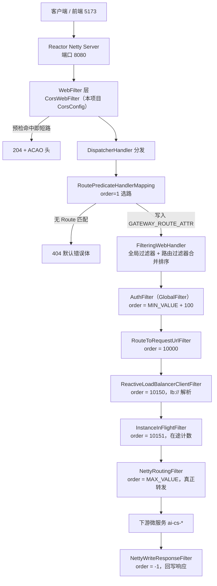
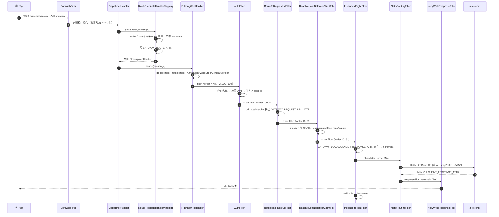

# Spring Cloud Gateway：唯一入口上的那条过滤器链

> **一句话结论**：网关的"路由"不是一张配置表，而是 `RoutePredicateHandlerMapping` 选一条 `Route`、`FilteringWebHandler` 把全局过滤器与路由过滤器合成一条有序链、最后由 `NettyRoutingFilter` 真正转发的三段式响应式管道；404 / 401 / 503 全部产生在这三段的某一处，而且大部分失败默认**不打日志**。
>
> **阅读前置**：会用 Reactor 的 `Mono`/`flatMap` 读代码；知道 HTTP 代理与 CORS 预检的基本概念；了解 Spring Boot 自动装配。不需要读过网关源码。
>
> **证据基线**：Spring Framework 7.1.0 / Spring Boot 4.2.0 / Spring Cloud 2026.0.0（`spring-cloud-gateway-server-webflux` 5.1.0）/ JDK 17.0.19；A 级证据取自 `24-源码分析/assets/source/` 的源码摘录，B 级为 `ai-cs-gateway` 本项目代码，C 级为本机可复现命令。预计阅读 35~45 分钟。

---

## 0. 先看现象

**现象一：新增路由"配了但不生效"，一律 404，网关日志干净得像没事发生。**

运维同学在 `application.yml` 里加了一段路由，重启后接口仍然 404。响应体是 Boot 的默认错误结构（示意，字段以实际环境为准）：

```text
HTTP/1.1 404 Not Found
Content-Type: application/json

{"timestamp":"2026-11-27T03:02:11.482Z","path":"/api/agent/run","status":404,"error":"Not Found","requestId":"8f2c1a9e-3"}
```

日志里没有 ERROR、没有 WARN。原因有两层：本项目 `ai-cs-gateway/src/main/resources/application.yml#L1-L3` 到 `#L57` 之间**根本没有 `routes:` 段落**（路由全在 Java DSL 里），改 yml 天然无效；而"没有任何路由匹配"在框架里只是一行 **TRACE** 日志 `No RouteDefinition found for [...]`（[[源码:RoutePredicateHandlerMapping.java.md#L102-L108]]），默认级别下你永远看不见。

**现象二：前端登录接口正常，一调别的接口浏览器就报 CORS 错误，网关日志却是 401。**

浏览器控制台：

```text
Access to fetch at 'http://127.0.0.1:8080/api/chat/session' from origin 'http://localhost:5173'
has been blocked by CORS policy: Response to preflight request doesn't pass access control check:
No 'Access-Control-Allow-Origin' header is present on the requested resource.
```

网关日志（`AuthFilter.java#L131` 那行 `log.warn`）：

```text
WARN  c.aics.gateway.filter.AuthFilter - 请求未携带Token: /api/chat/session
```

返回体是 `AuthFilter` 手写的 401（`AuthFilter.java#L237-L242`）：

```json
{"code":401,"message":"未认证，请先登录","data":null,"timestamp":1764200000000}
```

即：预检 `OPTIONS` 请求没被当作预检，直接进了业务链，被鉴权拦下——而 `AuthFilter` 里**没有任何 OPTIONS 分支**。

**现象三：`503 Service Unavailable`，且不知道是哪个服务没起来。**

```text
HTTP/1.1 503 Service Unavailable
Content-Type: application/json

{"timestamp":"2026-11-27T03:05:40.117Z","path":"/api/product/list","status":503,"error":"Service Unavailable","requestId":"c71b"}
```

这是 `ReactiveLoadBalancerClientFilter` 抛的 `NotFoundException`（`ReactiveLoadBalancerClientFilter.java#L111-L115`，消息是 `Unable to find instance for ai-cs-product`）。但 Boot 默认 `server.error.include-message=never`，**消息不会出现在响应体里**；这个异常继承自 `ResponseStatusException`，由 WebFlux 的响应状态异常处理器直接映射成 503，默认也不打堆栈。于是"503 但没日志"成为网关最常见的排查困境。

**现象四（更隐蔽）：白名单被前缀匹配放大成"鉴权穿透"。**

`AuthFilter` 的白名单判断是 `path::startsWith`（`AuthFilter.java#L179-L181`），白名单里有 `/health`、`/api/user/login`。于是 `/healthz`、`/api/user/login-by-sms`、`/doc.html-anything` 全部被当作白名单放行，客户端还能顺手伪造 `X-User-Id`（虽然被剥离，但请求本身已经不鉴权了）。

这些现象指向同一件事：**网关不是"转发配置"，而是一条"选路 → 组链 → 排序 → 转发"的响应式管道，每一环的失败都被设计成了"安静地走下一个 / 安静地返回空"，所以你必须知道在哪一环下断点、开哪条日志。**

---

## 1. 整体地图



> **读图说明**：从 `DispatcherHandler` 开始就是本篇的主线。上半部分（Netty Server、`CorsWebFilter`）是 WebFlux 容器层，**跨域预检在这里就能结束**，所以预检是否被拦与后面整条网关链无关——这一点是理解"OPTIONS 401"现象的关键。中间 `E → F` 是"选路"，写进 exchange 的属性 `GATEWAY_ROUTE_ATTR`；`F → K` 是"组链"，图里的 order 都是框架常量或本项目 `getOrder()` 的返回值，数值越小越先执行，`NettyWriteResponseFilter` 的 -1 让它最早进入链、最后才真正写响应体（它靠 `CLIENT_RESPONSE_ATTR` 等下游响应）。

| 组件 | 责任 | 谁调用它 | 证据 |
| --- | --- | --- | --- |
| `RoutePredicateHandlerMapping` | 遍历所有 `Route`，用断言筛出第一条匹配的，把 `Route` 塞进 exchange | WebFlux `DispatcherHandler`（它是 `HandlerMapping`，order 默认 1） | [[源码:RoutePredicateHandlerMapping.java.md#L88-L108]] |
| `RouteLocator` / `CachingRouteLocator` | 提供 `Flux<Route>`；`CachingRouteLocator` 缓存并响应 `RefreshRoutesEvent` | 上面的 HandlerMapping | 本项目 `RouteConfig#customRouteLocator`（B 级） |
| `FilteringWebHandler` | 把 `List<GlobalFilter>` 与 `route.getFilters()` 合并、排序，合成一条链执行 | HandlerMapping 返回的就是它 | [[源码:FilteringWebHandler.java.md#L119-L125]] |
| `GlobalFilter` | 对所有路由生效的过滤器（鉴权、埋点、LB、转发都属于此类） | `FilteringWebHandler` | 本项目 `AuthFilter`、`InstanceInFlightFilter` |
| `GatewayFilter` | 只对声明它的路由生效的过滤器（`stripPrefix`、`rewritePath`、`retry`…） | 同上，由 `RouteDefinitionRouteLocator` 从 DSL/yml 解析 | [[源码:RouteDefinitionRouteLocator.java.md#L181-L197]] |
| `RouteToRequestUrlFilter` | 把路由的 `uri` 拼成真实目标 URL，写 `GATEWAY_REQUEST_URL_ATTR` | 链上 order=10000 | [[源码:RouteToRequestUrlFilter.java.md#L44]] |
| `ReactiveLoadBalancerClientFilter` | `lb://serviceId` → 具体实例 URI，失败抛 `NotFoundException` | 链上 order=10150 | [[源码:ReactiveLoadBalancerClientFilter.java.md#L88-L124]] |
| `NettyRoutingFilter` | 用 Reactor Netty `HttpClient` 发出请求，把响应放进 `CLIENT_RESPONSE_ATTR` | 链上 order=最末 | [[源码:NettyRoutingFilter.java.md#L115-L129]] |
| `NettyWriteResponseFilter` | 把下游响应体写回客户端 | 链上 order=-1 | [[源码:NettyWriteResponseFilter.java.md#L55]] |
| `CorsWebFilter`（本项目 `CorsConfig`） | WebFilter 层处理 CORS，预检直接短路 | WebFlux 容器 | `ai-cs-gateway/src/main/java/com/aics/gateway/config/CorsConfig.java#L17-L29` |

---

## 2. 关键概念与关键类

先把术语钉死：**Route（路由）**= 一个 id + 一组断言（predicate）+ 一组过滤器 + 一个目标 uri；**断言**是 `AsyncPredicate<ServerWebExchange>`，输入一个 exchange 返回 `Mono<Boolean>`；**过滤器**接收 `(exchange, chain)` 返回 `Mono<Void>`，调 `chain.filter(exchange)` 表示"继续往下"、不调就是"到此为止"；`ServerWebExchange` 是一次请求-响应的上下文，本质是个 `Map<String,Object>` 属性包 + 请求响应对象。

| 名称 | 位置 | 角色 | 关键方法 |
| --- | --- | --- | --- |
| `Route` | `org.springframework.cloud.gateway.route` | 路由的运行时形态（断言已编译、过滤器已实例化） | `getId()`、`getPredicate()`、`getFilters()`、`getUri()` |
| `RouteDefinition` | 同上 | 路由的"配置形态"（字符串断言/过滤器定义） | `getPredicates()`、`getFilters()` |
| `RoutePredicateHandlerMapping` | `...gateway.handler` | 选路入口 | `lookupRoute()`、`getHandlerInternal()` |
| `RoutePredicateFactory` | `...gateway.handler.predicate` | 断言工厂，DSL/yml 里的 `path()`、`header()` 都对应一个工厂 | `apply(Config)`、`shortcutFieldOrder()` |
| `AsyncPredicate` | `...gateway.support` | 组合多个断言（`and`/`or`/`negate`），把异常转成 `false` | `apply()`、`and()` |
| `FilteringWebHandler` | `...gateway.handler` | 组链 + 执行 | `handle()`、`getAllFilters()` |
| `GlobalFilter` | `...gateway.filter` | 全局过滤器接口 | `filter(exchange, chain)` |
| `GatewayFilter` / `GatewayFilterChain` | 同上 | 路由级过滤器接口 / 链 | `filter()` |
| `OrderedGatewayFilter` | `...gateway.filter` | 给没有 order 的过滤器强塞一个序号 | `getOrder()` |
| `RouteDefinitionRouteLocator` | `...gateway.route` | 把 `RouteDefinition` 转成 `Route` | `convertToRoute()`、`loadGatewayFilters()` |
| `CachingRouteLocator` | `...gateway.route` | 缓存 `Route` 列表，监听刷新事件 | `getRoutes()`、`refresh()` |
| `ReactiveLoadBalancerClientFilter` | `...gateway.filter` | `lb://` 解析成实例 | `filter()`、`choose()` |
| `NettyRoutingFilter` | `...gateway.filter` | 实际 HTTP 转发 | `filter()`、`getResponseTimeout()` |
| `KeyResolver` | `...gateway.filter.ratelimit` | 限流键（谁在被限） | `resolve(exchange)` |
| `RateLimiter` / `RedisRateLimiter` | 同上 | 令牌桶算法实现 | `isAllowed(routeId, key)` |
| `RequestRateLimiterGatewayFilterFactory` | 同上 | 限流过滤器工厂 | `apply(Config)` |
| `ServerWebExchangeUtils` | `...gateway.support` | 所有 exchange 属性常量都在这 | `GATEWAY_ROUTE_ATTR` 等 |
| `NameUtils` | `...gateway.support` | 类名→配置名的规范化 | `normalizeFilterFactoryName()` |

本项目的网关自有类（B 级证据，行号均按当前工作副本核对过）：

| 名称 | 完整路径 | 角色 |
| --- | --- | --- |
| `RouteConfig` | `ai-cs-gateway/src/main/java/com/aics/gateway/config/RouteConfig.java` | Java DSL 声明 16 条路由；定义 `KeyResolver`；覆盖自动装配的 `RedisRateLimiter` |
| `AuthFilter` | `ai-cs-gateway/src/main/java/com/aics/gateway/filter/AuthFilter.java` | `GlobalFilter` 鉴权：JWT + API Key 双凭证，白名单放行 |
| `CorsConfig` | `ai-cs-gateway/src/main/java/com/aics/gateway/config/CorsConfig.java` | 注册 `CorsWebFilter` |
| `InstanceInFlightFilter` | `ai-cs-gateway/src/main/java/com/aics/gateway/loadbalancer/InstanceInFlightFilter.java` | 按实例统计"在飞请求"，供最少连接策略取数 |
| `GatewayFallbackController` | `ai-cs-gateway/src/main/java/com/aics/gateway/controller/GatewayFallbackController.java` | 断路器降级终点，主动返回 503 |

> **引用约定**：下文出现 `AuthFilter.java#L131`、`CorsConfig.java#L17-L29` 这类简写，指的就是上表里那个完整路径的文件，行号可直接对照；框架源码一律写成 `[[源码:文件.md#L起-L止]]` 的锚点形式。

> 本项目 `ai-cs-gateway/pom.xml#L96-L99` 引入的是 `spring-boot-starter-data-redis-reactive`，这正是 `RedisRateLimiter` 需要的响应式 Redis 模板；换成阻塞版 `spring-boot-starter-data-redis` 会让限流过滤器起不来。

---

## 3. 原理与证据逐段精读

### 3.1 选路：为什么"没匹配"等于"静默 404"

**在干什么。** `RoutePredicateHandlerMapping` 遍历 `RouteLocator` 给出的所有 `Route`，对每个 Route 执行它的断言；第一个返回 `true` 的就是本次请求的路由，写进 exchange 属性 `GATEWAY_ROUTE_ATTR`，然后把 `FilteringWebHandler` 作为 handler 返回。

```java (src: RoutePredicateHandlerMapping.java.md#L131-L151)
protected Mono<Route> lookupRoute(ServerWebExchange exchange) {
	return this.routeLocator.getRoutes().filterWhen(route -> {
		// add the current route we are testing
		exchange.getAttributes().put(GATEWAY_PREDICATE_ROUTE_ATTR, route.getId());
		try {
			return route.getPredicate().apply(exchange);
		}
		catch (Exception e) {
			logger.error("Error applying predicate for route: " + route.getId(), e);
		}
		return Mono.just(false);
	})
		.next()
		// TODO: error handling
		.map(route -> {
			if (logger.isDebugEnabled()) {
				logger.debug("Route matched: " + route.getId());
			}
			validateRoute(route, exchange);
			return route;
		});
}
```

**为什么这么设计。** 三个决定值得注意：一是 `filterWhen` + `next()`，即**按 `Route` 的顺序取第一个匹配**，不做"最精确匹配"加权——所以路由顺序本身就是优先级（§3.3 会看到本项目为此专门拆了 `ai-cs-agent-chat`）；二是断言抛异常被 `catch` 成 `false`，一条写坏的断言只让"这条路由永不匹配"，而不是把整个网关 500；三是无路由时返回 `Mono.empty()`，交给上层 `switchIfEmpty` 记一行 TRACE。

**换写法会怎样。** 如果像 MVC 的 `RequestMappingHandlerMapping` 那样按最长前缀匹配，`/api/agent/chat` 就不需要单独成一条路由；但网关要支持任意断言（Header、Cookie、时间窗、权重），"精确度"根本无法定义，所以框架选了最简单的线性首个命中。若把异常直接抛出去，任何一条自定义断言的 bug 都会让**整个网关**对所有请求 500，比现在危险得多。

**常见坑。** 看到 404 时不要先怀疑下游：先确认 exchange 有没有 `GATEWAY_ROUTE_ATTR`。无匹配时 `getHandlerInternal` 走的是这段（[[源码:RoutePredicateHandlerMapping.java.md#L102-L108]]）：

```java (src: RoutePredicateHandlerMapping.java.md#L102-L108)
.switchIfEmpty(Mono.empty().then(Mono.fromRunnable(() -> {
	exchange.getAttributes().remove(GATEWAY_PREDICATE_ROUTE_ATTR);
	ServerWebExchangeUtils.clearCachedRequestBody(exchange);
	if (logger.isTraceEnabled()) {
		logger.trace("No RouteDefinition found for [" + getExchangeDesc(exchange) + "]");
	}
})));
```

TRACE 级别才有这行——这就是"404 无日志"的机制来源，也是 §6 第一条调试手法的依据。

### 3.2 组链：全局过滤器与路由过滤器是"两堆合并再排序"

**在干什么。** handler 拿到 `Route` 后，`FilteringWebHandler.handle()` 把 `this.globalFilters`（Spring 容器里所有 `GlobalFilter` Bean）与 `route.getFilters()`（这条路由自己的过滤器）合并，用 `AnnotationAwareOrderComparator.sort` 排序，再把它包成一条递归链执行。

```java (src: FilteringWebHandler.java.md#L119-L125)
protected List<GatewayFilter> getAllFilters(Route route) {
	List<GatewayFilter> gatewayFilters = route.getFilters();
	List<GatewayFilter> combined = new ArrayList<>(this.globalFilters);
	combined.addAll(gatewayFilters);
	AnnotationAwareOrderComparator.sort(combined);
	return combined;
}
```

**为什么这么设计。** `GlobalFilter` 不是 `GatewayFilter`，不能直接放进 `List<GatewayFilter>`。框架为此在加载阶段做了适配（[[源码:FilteringWebHandler.java.md#L74-L89]]）：每个 `GlobalFilter` 先用 `GatewayFilterAdapter` 包一层，如果它实现了 `Ordered` 就取 `getOrder()`，否则找类上的 `@Order`，两者都没有就**裸放**——没有 order 的过滤器在排序里等价于 `LOWEST_PRECEDENCE`，会掉到链尾，紧挨着转发过滤器。这是"写了 GlobalFilter 却发现它跑在最末/最先"的根因。

**换写法会怎样。** 如果只按 `@Order` 排全局过滤器、路由过滤器固定追加在后面，那么 `RequestRateLimiter`（路由级）就永远排在 `NettyRoutingFilter`（全局）之后，限流形同虚设；所以必须是"两堆混排"。

**常见坑。** `AnnotationAwareOrderComparator` 排序是**稳定排序**，order 相同的过滤器保持"先全局、后路由"的原始顺序。本项目的 `AuthFilter` 用 `Ordered.HIGHEST_PRECEDENCE + 100`（`ai-cs-gateway/src/main/java/com/aics/gateway/filter/AuthFilter.java#L171-L174`），故意不用 `HIGHEST_PRECEDENCE` 本身——留出 100 个名额给"必须在鉴权之前"的过滤器（例如指标、链路追踪）。

链的执行方式是这样的（[[源码:FilteringWebHandler.java.md#L148-L159]]）：索引递增 + `Mono.defer` 惰性递归，每个过滤器调 `chain.filter(exchange)` 才继续下一个；到末尾 `Mono.empty()` 表示"链正常结束"。所以**任何过滤器不调 `chain.filter` 就是短路**——这正是 `AuthFilter` 返回 401、`RequestRateLimiter` 返回 429 的实现方式。

### 3.3 DSL 到 Route：路由过滤器为什么自带序号

**在干什么。** `RouteDefinitionRouteLocator.getFilters()` 把 `RouteDefinition` 上字符串形式的过滤器（`stripPrefix`、`rewritePath`…）交给对应工厂产出 `GatewayFilter`，并且**先加 `default-filters`，再加路由自己的，最后统一排序**。

```java (src: RouteDefinitionRouteLocator.java.md#L181-L196)
private List<GatewayFilter> getFilters(RouteDefinition routeDefinition) {
	List<GatewayFilter> filters = new ArrayList<>();
	Objects.requireNonNull(routeDefinition.getId(), "Route id must be set");
	// TODO: support option to apply defaults after route specific filters?
	if (!this.gatewayProperties.getDefaultFilters().isEmpty()) {
		filters.addAll(loadGatewayFilters(routeDefinition.getId(),
				new ArrayList<>(this.gatewayProperties.getDefaultFilters())));
	}

	final List<FilterDefinition> definitionFilters = routeDefinition.getFilters();
	if (!CollectionUtils.isEmpty(definitionFilters)) {
		filters.addAll(loadGatewayFilters(routeDefinition.getId(), definitionFilters));
	}

	AnnotationAwareOrderComparator.sort(filters);
	return filters;
}
```

**为什么这么设计。** 路由级过滤器天然需要"按声明顺序执行"：`stripPrefix(1)` 必须在 `rewritePath` 之前才有意义。但 `GatewayFilter` 接口**不带 order**，于是 `loadGatewayFilters` 在工厂不是 `Ordered` 时给它包上 `OrderedGatewayFilter(gatewayFilter, i + 1)`（序号 = 声明位置 + 1，[[源码:RouteDefinitionRouteLocator.java.md#L139-L179]]）。这一层序号只解决"路由内相对顺序"，跨全局过滤器的顺序仍由 §3.2 的统一排序决定。

**换写法会怎样。** 本项目用的是 Java DSL（`RouteConfig#customRouteLocator`），`f.stripPrefix(1)` 这类调用已经是**直接构造好的 `GatewayFilter`**，走的是 `Route.Builder#filters` 而不是 `RouteDefinition` 解析路径，因此"每条路由内的过滤器按代码书写顺序"由 DSL 保证，`getFilters()` 那段排序主要作用于 yml 定义的路由。若你以为 yml 里的 `- StripPrefix=1` 列表顺序无关紧要，就会写出 `RewritePath` 先执行的诡异结果。

**常见坑。** 工厂名写错时报错很直白：`IllegalArgumentException: Unable to find GatewayFilterFactory with name xxx`（[[源码:RouteDefinitionRouteLocator.java.md#L145-L146]]）——这个错发生在**启动期**，不是请求期，所以只要网关起来了，就说明过滤器名都解析对了；反过来，"起来了但行为不对"一定是顺序问题，不是名字问题。

### 3.4 断言工厂与自定义断言：名字是你定的，规则是 `NameUtils` 定的

**在干什么。** `RoutePredicateFactory` 的"配置名"由类名机械推导：去掉 `RoutePredicateFactory` 后缀再规范成小写连字符（[[源码:NameUtils.java.md#L47-L53]]）。所以 `PathRoutePredicateFactory` → `path`，`HeaderRoutePredicateFactory` → `header`。本项目 DSL 里写的 `.path("/api/user/**")` 就是这个 `path` 断言的快捷方式（`shortcutFieldOrder` 机制把单参数映射到 Config 的第一个字段）。

**为什么这么设计。** yml 是弱类型文本，工厂必须能按名字找到实现；用类名推导避免了额外注册表，也让第三方扩展"只要类名对，就能被 yml 识别"。同理 `normalizeFilterFactoryName` 负责 `StripPrefixGatewayFilterFactory` → `StripPrefix`。

**换写法会怎样。** 自定义断言如果命名为 `TenantRoutePredicateFactory`，yml 里就得写 `- Tenant=...`；写成 `TenantCheckPredicateFactory`（少了 `Route`）则推导结果为 `TenantCheck`，与类名直觉不符，最容易在配置期排错半小时。

**常见坑。** 自定义断言里抛异常 → 被 §3.1 的 `catch` 吞掉 → 该路由永不匹配 → 表现为"某些请求莫名 404"。调试时在 `lookupRoute` 的 `catch` 分支下断点，或按关键字 `Error applying predicate for route` 搜日志。

### 3.5 `lb://` 怎么变成真实地址：`RouteToRequestUrlFilter` + 负载均衡过滤器

**在干什么。** 路由的 `uri` 是 `lb://ai-cs-chat` 这样的"逻辑地址"。`RouteToRequestUrlFilter`（order 10000）把它与请求路径拼成一个 URI 写进 `GATEWAY_REQUEST_URL_ATTR`，此时 scheme 还是 `lb`；紧接着 `ReactiveLoadBalancerClientFilter`（order 10150）发现 scheme 是 `lb`，向 `LoadBalancerClientFactory` 要一个实例，`reconstructURI` 换成 `http://192.168.x.x:9003/...` 再写回同一个属性。

```java (src: ReactiveLoadBalancerClientFilter.java.md#L109-L124)
return choose(lbRequest, serviceId, supportedLifecycleProcessors).doOnNext(response -> {

	if (!response.hasServer()) {
		supportedLifecycleProcessors.forEach(lifecycle -> lifecycle
			.onComplete(new CompletionContext<>(CompletionContext.Status.DISCARD, lbRequest, response)));
		throw NotFoundException.create(properties.isUse404(), "Unable to find instance for " + url.getHost());
	}

	ServiceInstance retrievedInstance = response.getServer();
```

**为什么这么设计。** 用 exchange 属性在过滤器之间传递"当前请求将要打到哪"，而不是靠方法参数——这样任何过滤器（含你写的）都能读写同一个事实，`InstanceInFlightFilter` 就是这么干的。`NotFoundException` 的 `properties.isUse404()` 也留了开关：想让"服务没实例"表现为 404 而不是 503，改负载均衡属性即可（`LoadBalancerProperties#use404`，属性前缀 `spring.cloud.loadbalancer`，依据官方文档）。

**换写法会怎样。** 如果路由直接写 `uri: http://127.0.0.1:9003`，就绕过了整个负载均衡段（scheme 非 `lb` 时过滤器直接放行，[[源码:ReactiveLoadBalancerClientFilter.java.md#L91-L93]]），Nacos 上的实例扩缩容与你无关——本地调试方便，生产上等于放弃了服务发现。

**常见坑。** 503 的三种来源要分清：① 这里 `Unable to find instance`（Nacos 没实例/服务名拼错）；② `choose()` 里没有均衡器 `No loadbalancer available for xxx`（少了 `spring-cloud-starter-loadbalancer`，本项目 `ai-cs-gateway/pom.xml#L37-L41` 显式引入）；③ 断路器降级到 `/gateway-fallback` 后由 `GatewayFallbackController` 主动返回 503（`ai-cs-gateway/src/main/java/com/aics/gateway/controller/GatewayFallbackController.java#L20-L24`）。

### 3.6 真正转发：`NettyRoutingFilter` 的三个隐性契约

```java (src: NettyRoutingFilter.java.md#L115-L129)
public Mono<Void> filter(ServerWebExchange exchange, GatewayFilterChain chain) {
	URI requestUrl = exchange.getRequiredAttribute(GATEWAY_REQUEST_URL_ATTR);

	String scheme = requestUrl.getScheme();
	if (isAlreadyRouted(exchange) || (!"http".equalsIgnoreCase(scheme) && !"https".equalsIgnoreCase(scheme))) {
		return chain.filter(exchange);
	}
	setAlreadyRouted(exchange);

	ServerHttpRequest request = exchange.getRequest();

	final HttpMethod method = HttpMethod.valueOf(request.getMethod().name());
	final String url = requestUrl.toASCIIString();

	HttpHeaders filtered = filterRequest(getHeadersFilters(), exchange);
```

**在干什么。** 取 `GATEWAY_REQUEST_URL_ATTR`，只处理 `http/https`；用 `setAlreadyRouted` 打标记防重复转发；用 `HttpHeadersFilter` 过滤请求头；然后交给 Reactor Netty 的 `HttpClient` 发出去。

**为什么这么设计（三个契约）。** ① **响应不在这个过滤器里写**：下游响应先放进 `CLIENT_RESPONSE_ATTR`，注释写得很直白（[[源码:NettyRoutingFilter.java.md#L152-L158]]）：

```java (src: NettyRoutingFilter.java.md#L152-L158)
}).responseConnection((res, connection) -> {

	// Defer committing the response until all route filters have run
	// Put client response as ServerWebExchange attribute and write
	// response later NettyWriteResponseFilter
	exchange.getAttributes().put(CLIENT_RESPONSE_ATTR, res);
	exchange.getAttributes().put(CLIENT_RESPONSE_CONN_ATTR, connection);
```

这样做是为了让"转发之后"还能加过滤器（改响应头、埋点、重试判定），真正写响应体的是 order=-1 的 `NettyWriteResponseFilter`。② **超时按路由可配**，超了抛 `ResponseStatusException(GATEWAY_TIMEOUT)`（[[源码:NettyRoutingFilter.java.md#L202-L210]]），客户端看到 504。③ **`responseFlux.then(chain.filter(exchange))`**（第 212 行）——先等响应，再继续链上后续（写响应）过滤器。

**换写法会怎样。** 如果在 `NettyRoutingFilter` 里直接 `response.writeWith(...)`，响应提交后任何下游过滤器再改状态码都会抛 `IllegalStateException: Status already set`，可观测性与统一错误包装全废。

**常见坑。** 自定义 GlobalFilter 若 order 大于 `NettyRoutingFilter`（即更大、更靠后），它看到的已经是"响应已生成但尚未写回"的状态，**不能改状态码，只能改 body 或加头**；要改状态码必须放到 `NettyWriteResponseFilter` 之前、转发之后的位置（本项目没有这类过滤器，属于扩展点）。

### 3.7 限流：`RequestRateLimiter` 的 `EMPTY_KEY` 与"429 是怎么来的"

```java (src: RequestRateLimiterGatewayFilterFactory.java.md#L119-L132)
return (exchange, chain) -> resolver.resolve(exchange).defaultIfEmpty(EMPTY_KEY).flatMap(key -> {
	if (EMPTY_KEY.equals(key)) {
		if (denyEmpty) {
			setResponseStatus(exchange, emptyKeyStatus);
			return exchange.getResponse().setComplete();
		}
		return chain.filter(exchange);
	}
	String routeId = config.getRouteId();
	if (routeId == null) {
		Route route = exchange.getAttribute(ServerWebExchangeUtils.GATEWAY_ROUTE_ATTR);
		routeId = Objects.requireNonNull(route, "Route not found").getId();
	}
	return limiter.isAllowed(routeId, key).flatMap(response -> {
```

**在干什么。** 先用 `KeyResolver` 算一个 key（"谁在被限"）；key 为空且 `denyEmptyKey` 为默认 `true` 时**直接拒绝**；否则拿 `(routeId, key)` 问 `RateLimiter`，不允许就 `setResponseStatus(429)` 并 `setComplete()` 短路（`Config.statusCode` 默认 `HttpStatus.TOO_MANY_REQUESTS`，[[源码:RequestRateLimiterGatewayFilterFactory.java.md#L163]]）。

**为什么这么设计。** 空 key 必须拒绝而不是放行：否则任何"取不到用户身份"的请求都能绕过限流（典型的"清空 header 就无限量"）。这也是 `redis` 不可用时把 `aics.gateway.rate-limit.enabled` 切回本地兜底的原因（`ai-cs-gateway/src/main/resources/application.yml#L34-L46` 的注释就写了这件事）。

**本项目的接法。** 16 条路由每条都套了同一个三段式 `addResilience`（`ai-cs-gateway/src/main/java/com/aics/gateway/config/RouteConfig.java#L174-L187`）：`retry(2 次 / 仅 GET / 500,502)` → `circuitBreaker(fallbackUri=forward:/gateway-fallback)` → `requestRateLimiter`。`RedisRateLimiter` 这个 Bean 被 `RouteConfig#redisRateLimiter`（L50-L54）**用同名 Bean 覆盖**掉了 SCG 自动装配的同名默认 Bean（自动装配带 `@ConditionalOnMissingBean`），速率来自 `aics.gateway.rate-limit.replenish-rate=5` / `burst-capacity=10`。

**换写法会怎样。** 只配 `RequestRateLimiter` 不配 `KeyResolver`，默认解析器多半解析不出 key → 全部 429（`denyEmptyKey=true`），这是最常见的"一上线全站 429"。本项目把 `KeyResolver` 显式定义成 Bean（`RouteConfig.java#L155-L167`）：优先读 `X-User-Id`（即 `AuthFilter` 注入的可信身份）→ `u:<userId>`，否则退化到 `ip:<addr>`。

**常见坑。** 限流键依赖 `AuthFilter` 先跑——它 order 是 `MIN_VALUE+100`，远早于 `RequestRateLimiter`（路由级，几百~几千），所以顺序天然正确；但如果你把它们调换（比如把鉴权改成路由级过滤器并排在限流之后），所有人都会退化成 `ip:` 粒度，登录用户共享 NAT 出口 IP 互限。

### 3.8 CORS：两条完全不同的实现路径，混用就是坑

**在干什么。** 网关处理跨域有两条路径：

| 路径 | 配置方式 | 生效位置 | 预检在哪结束 |
| --- | --- | --- | --- |
| `CorsWebFilter`（本项目采用） | `@Bean CorsWebFilter`（`CorsConfig.java#L17-L29`） | WebFilter 层，早于 `DispatcherHandler` | WebFilter 里直接短路 |
| `globalcors` 属性 | `spring.cloud.gateway.server.webflux.globalcors.*` | `CorsGatewayFilterApplicationListener` 把配置写进 `RoutePredicateHandlerMapping` | HandlerMapping 层返回 `PreFlightHandler` |

后者的自动装配证据（[[源码:GatewayAutoConfiguration.java.md#L293-L305]]）：

```java (src: GatewayAutoConfiguration.java.md#L293-L305)
@Bean
public GlobalCorsProperties globalCorsProperties() {
	return new GlobalCorsProperties();
}

@Bean
@ConditionalOnProperty(name = "spring.cloud.gateway.server.webflux.globalcors.enabled", matchIfMissing = true)
public CorsGatewayFilterApplicationListener corsGatewayFilterApplicationListener(
		GlobalCorsProperties globalCorsProperties, RoutePredicateHandlerMapping routePredicateHandlerMapping,
		RouteLocator routeLocator) {
	return new CorsGatewayFilterApplicationListener(globalCorsProperties, routePredicateHandlerMapping,
			routeLocator);
}
```

**为什么这么设计。** WebFilter 方案对整个网关"一刀切"，实现简单、顺序最早；属性方案能按 `PathPattern` 差异化配不同来源（多前端域名的场景）。两者可以共存，但**任何一个都需要"请求真的是 CORS 请求"才生效**——判定条件（`CorsUtils.isPreFlightRequest`）要求同时具备 `OPTIONS` 方法、`Origin` 头、`Access-Control-Request-Method` 头；三者缺一，请求就不被当预检，直接进业务链。这一点属框架行为（依据 `spring-web` 的 `CorsUtils` 官方文档；`assets/source` 未收录该类摘录，此处不算 A 级）。

**换写法会怎样。** 本项目 `CorsConfig` 用 `setAllowCredentials(true)` + `allowedOriginPatterns("*")`，这是能带 Cookie 的唯一合法组合（`allowCredentials` + `allowedOrigins("*")` 在规范上被禁止，必须用 pattern）。若改成 `allowedOrigins("*")`，浏览器会拒绝携带凭证，表现为"登录态丢失但接口 200"。

**常见坑（现象二的真因）。** `AuthFilter` 完全没有 OPTIONS 分支，白名单里也没有 `OPTIONS` 相关条目。所以只要预检没被识别（缺 `Origin` 的 `curl -X OPTIONS`、某些反向代理剥离 `Access-Control-Request-Method`、CDN 健康检查），请求就会一路走到 `AuthFilter` → `401`，而且**响应没有 CORS 头**（不走 CORS 包装分支），前端只能看到 CORS 报错。排查口径：先用带全套预检头的 curl 复现一次，再逐个去掉头做对照（§6 第 5 条）。

### 3.9 鉴权过滤器：白名单、双凭证与"身份可信透传"

**在干什么。** `AuthFilter` 是 `GlobalFilter`（`AuthFilter.java#L42-L43`），order `MIN_VALUE+100`，逻辑三段：路径命中白名单 → 剥掉客户端伪造的 `X-User-Id/X-User-Name/X-User-Roles` 后放行；否则取 `Authorization: Bearer`（只认这个前缀，`#L226-L232`）；Token 缺失/无效时回退 API Key（`#L188-L221`，`keyId:secret` + `MessageDigest.isEqual` 常量时间比较）；两条都失败才 401。

```java
// (ai-cs-gateway/src/main/java/com/aics/gateway/filter/AuthFilter.java#L112-L133)
if (isWhiteListed(path)) {
    ServerHttpRequest stripped = request.mutate()
            .headers(headers -> {
                headers.remove(USER_ID_HEADER);
                headers.remove(USER_NAME_HEADER);
                headers.remove(USER_ROLES_HEADER);
            })
            .build();
    return chain.filter(exchange.mutate().request(stripped).build());
}

// 获取 Token
String token = extractToken(request);
if (token == null || token.isEmpty()) {
    // 无 Bearer Token：回退 API Key 认证（机器调用场景）
    Mono<Void> apiKeyResult = tryApiKeyAuth(exchange, chain);
    if (apiKeyResult != null) {
        return apiKeyResult;
    }
    log.warn("请求未携带Token: {}", path);
    return unauthorized(exchange.getResponse(), "未认证，请先登录");
}
```

**为什么这么设计。** 下游服务只信任网关注入的身份头（"身份可信透传"），所以白名单分支也要**主动剥离**伪造头——否则一个白名单接口就成了伪造身份进入下游的跳板。API Key 与 JWT 两条路径最终注入**完全相同的三个头**，下游对"人/机器"无感知；校验通过后 `X-API-Key` 立即被移除，密钥不向下游扩散。

**换写法会怎样。** 白名单用 `path::startsWith`（`#L179-L181`）而不是精确匹配/带分隔符匹配，会把 `/api/user/login-anything`、`/healthz` 一起放行。如果想更严格，可改成"精确匹配 + 允许的子树（结尾带 `/`）"两段式判断；代价是每加一个白名单接口都要维护两条规则。

**常见坑。** ① 白名单里同时写了 `/user/login` 和 `/api/user/login`，是因为鉴权发生在 `stripPrefix` **之前**（`AuthFilter` order `MIN_VALUE+100` 远早于路由级 `stripPrefix`），网关看到的永远是 `/api/...`；`/user/...` 那几条是为"绕过网关直连服务"的调用方留的，容易让人误以为有两条规则在生效。② 401 响应是手写 JSON（`#L237-L242`），与 Boot 默认的 404/503 错误体结构**不一致**，前端统一错误处理必须能兼容两种格式。

### 3.10 WebFlux 与 MVC 不能共存：pom 里那行 exclusion 到底在挡什么

**在干什么。** Boot 启动时要判断"这是一个 Servlet 应用还是响应式应用"。Boot 4 用 `Deducer` SPI 做这件事（[[源码:WebApplicationType.java.md#L51-L59]]）：

```java (src: WebApplicationType.java.md#L51-L59)
public static WebApplicationType deduce() {
	for (Deducer deducer : SpringFactoriesLoader.forDefaultResourceLocation().load(Deducer.class)) {
		WebApplicationType deduced = deducer.deduceWebApplicationType();
		if (deduced != null) {
			return deduced;
		}
	}
	return isServletApplication() ? WebApplicationType.SERVLET : WebApplicationType.NONE;
}
```

两个 `Deducer` 的优先级决定了胜负：`WebMvcWebApplicationTypeDeducer` 带 `@Order(10) // Ordered before WebFlux`，只要 classpath 上有 `jakarta.servlet.Servlet` + `DispatcherServlet` + `ConfigurableWebApplicationContext` 就判 SERVLET（[[源码:WebMvcWebApplicationTypeDeducer.java.md#L22-L27]]）；`WebFluxWebApplicationTypeDeducer` 带 `@Order(20) // Ordered after MVC`，需要 `Mono` + `DispatcherHandler`（[[源码:WebFluxWebApplicationTypeDeducer.java.md#L22-L26]]）。

**为什么这么设计。** "两个都在 classpath 时优先 MVC"是 Boot 的兼容取向：老应用加了 `spring-boot-starter-webflux`（比如为了用 `WebClient`）不应该突然变成 Netty 启动。代价是：**网关这种必须跑在响应式栈上的应用，一旦被依赖带进 `spring-webmvc`，就会以 Servlet 应用身份启动**——Tomcat 起来了、端口也通，但 `RoutePredicateHandlerMapping` 不会被 `DispatcherHandler` 使用，所有路由 404。

**本项目现状（需要你动手核对的一条）。** 网关 `ai-cs-gateway/pom.xml#L43-L53` 的注释写着"排除 Spring MVC"，实际排除的坐标是 `org.springframework.boot:spring-boot-starter-webmvc`；而它排除的对象 `ai-cs-common` 声明的是**弃用名** `spring-boot-starter-web`（`ai-cs-common/pom.xml#L20-L23`，无 `optional`）。而 `spring-boot-starter-web:4.2.0` 的 pom 里，依赖项是 `spring-boot-starter-jackson` / `spring-boot-starter-tomcat` / `spring-boot-http-converter` / **`spring-boot-webmvc`**——**没有** `spring-boot-starter-webmvc` 这个节点。按 Maven 排除语义（按 `groupId:artifactId` 精确匹配子树节点），这行 exclusion 匹配不到任何东西。要真正砍掉 MVC，应排除 `spring-boot-starter-web`（或把 common 的 web 依赖改成 `optional`，再拆出 `common-web` 模块）。验证命令见 §6 第 7 条与 §9 练习 6。

**换写法会怎样。** 有人图省事把 `spring-boot-starter-web` 加到网关（为了用某个 Servlet 工具类），结果是"网关能启动、路由全 404、日志无异常"，排查成本极高——这正是"两栈不共存"这条铁律的来源。

**常见坑。** 判断"我到底跑在哪个栈上"最快的方法不是猜，而是看启动日志的服务器名：`Netty started on port 8080` 是响应式，`Tomcat started on port 8080` 就是被 MVC 抢了。

---

## 4. 一次完整执行时序

以一次成功的 `POST http://127.0.0.1:8080/api/chat/session`（带 JWT）为例：



> **读图说明**：第 3~6 步是"选路"，只要这一步拿不到 Route，后面全部不执行，直接 404；第 8 步是"组链排序"，链的顺序在图上的 order 注释里；第 9~11 步是鉴权，它是唯一会主动短路的业务过滤器；第 13、15 步是两次"地址改写"（逻辑地址 → 真实地址 → 实例地址）；第 17 步才真正出网。注意 `InstanceInFlightFilter` 用 `doFinally` 包住了 `chain.filter` 的整个 `Mono`，所以请求成功、失败、客户端断开三种情况都会减一。

**哪一步失败报什么错**：

| 失败步骤 | 直接表现 | 异常 / 日志关键字 | 默认有日志吗 |
| --- | --- | --- | --- |
| 选路（断言全不匹配） | 404 + Boot 默认错误体 | `No RouteDefinition found for [...]`（TRACE） | 否 |
| 断言实现抛异常 | 该路由被跳过，最终 404 | `Error applying predicate for route: <id>`（ERROR） | 是 |
| 鉴权（无/坏 Token） | 401 + `{"code":401,...}` | `请求未携带Token: <path>` / `Token无效或已过期`（WARN） | 是 |
| 鉴权（白名单前缀过宽） | 该请求不鉴权通过 | 无任何日志 | 否（安静放行） |
| 限流（key 为空） | 429（`denyEmptyKey` 默认 true） | 无 | 否 |
| 限流（超桶） | 429 | 无 | 否 |
| LB 无实例 | 503 | `Unable to find instance for <serviceId>`（异常消息，可能不入日志） | 否 |
| LB 无均衡器 | 503 | `No loadbalancer available for <serviceId>` | 否 |
| 断路器打开 | 503，走 `/gateway-fallback` | 报文来自 `GatewayFallbackController` | 取决于日志配置 |
| 下游响应超时 | 504 | `ResponseStatusException(GATEWAY_TIMEOUT)` | 否 |
| 下游连不上 | 500/503 | Netty `ConnectException` | 视日志级别 |

---

## 5. 设计取舍

| 取舍点 | 框架/本项目的选择 | 代价 | 什么场景该反过来 |
| --- | --- | --- | --- |
| 选路算法 | 线性遍历 + 首个命中 | 路由多时 O(n)，顺序即优先级 | 路由上百条且强依赖精确度 → 前置 Nginx 或自写 `HandlerMapping` |
| 全局 vs 路由过滤器 | 两堆合并排序，统一 order 体系 | `GlobalFilter` 忘了 order 会掉到链尾 | 只有一两个过滤器的小网关可全用路由级 |
| 配置位置 | 本项目用 Java DSL（`RouteConfig`） | 改路由要重启/重新编译，不能热更新 | 多环境、需灰度 → 迁到 yml 或 Nacos 动态配置 |
| 限流算法 | `RedisRateLimiter`（令牌桶，跨实例一致） | 依赖 Redis 可用性，每次请求多一跳 | Redis 抖动频繁 → `aics.gateway.rate-limit.enabled=true` 走本地内存兜底 |
| 限流维度 | 优先用户、退化 IP | 未登录用户共享 IP 配额 | 对外 API → 按 API Key 维度 |
| 鉴权位置 | 网关统一鉴权 + 下游信任身份头 | 网关是单点，白名单维护要谨慎 | 强合规场景 → 下游再验一次（零信任） |
| 跨域 | `CorsWebFilter`（WebFilter 层） | 无法按路径差异化 | 多前端域名不同策略 → `globalcors` 属性 |
| 响应提交时机 | `NettyRoutingFilter` 只放属性，由 `NettyWriteResponseFilter` 写 | 多一层间接、调试时链路更长 | 需要流式/SSE 低延迟时可缩短这层（注意状态码语义） |
| 重试 | 只重试 GET + 500/502（`addResilience`） | 写请求不自动重试 | 幂等写（带幂等键）可放开 |
| 韧性组件 | Resilience4j 断路器 + 统一 fallback | fallback 对所有异常一视同仁，掩盖根因 | 需要区分超时/限流/熔断 → 按异常类型定制 fallback |

**可扩展点清单**（都是框架预留的位置，不需要改框架代码）：

1. 自定义 `GlobalFilter` + `getOrder()`：鉴权、埋点、租户隔离。
2. 自定义 `RoutePredicateFactory`（类名决定配置名，见 §3.4）。
3. 自定义 `GatewayFilterFactory`（同上，且可用 `@ConditionalOnEnabledFilter` 开关）。
4. 自定义 `KeyResolver`（本项目 `RouteConfig#userKeyResolver`）。
5. 自定义 `RateLimiter` 实现（`aics.gateway.rate-limit.algorithm` 已有 `sliding-window` / `token-bucket` 两种本地实现的先例）。
6. `ReactorLoadBalancer` 自定义（本项目 `LeastConnectionsLoadBalancer` + `InstanceInFlightRegistry`）。
7. `HttpHeadersFilter`（转发前增删请求头）。
8. `GlobalFilter` 的 `@ConditionalOnEnabledGlobalFilter` 开关（类名规则见 [[源码:NameUtils.java.md#L55-L62]]）。

---

## 6. 踩坑与调试手法

1. **"改 yml 加路由不生效"**：本项目路由在 `RouteConfig#customRouteLocator` 的 Java DSL 里，`application.yml` 没有 `routes:` 段。新增路由必须改代码；若要动态化，得把路由搬进 Nacos 的 `ai-cs-gateway.yml`（`application.yml#L27-L30` 已 `spring.config.import` 两个 Nacos 配置，但**动态刷新 `RouteDefinition` 还需要 `RefreshRoutesEvent` 才生效**）。

2. **断点一：`RoutePredicateHandlerMapping#lookupRoute`**（`#L132` 的 `filterWhen` 回调内）。在这里看每次候选 `route.getId()` 与实际 `exchange.getRequest().getURI().getPath()`，能立刻分辨"路径写错"还是"顺序被更宽的路由抢走"。进阶：给断点加条件 `route.getId().equals("ai-cs-agent-chat")`。

3. **断点二：`FilteringWebHandler#handle`**（`#L101` 之后）。第 103 行有一句 debug 日志会打印整条链：`Sorted gatewayFilterFactories: [...]`（[[源码:FilteringWebHandler.java.md#L99-L108]]）。把它开出来（`logging.level.org.springframework.cloud.gateway=DEBUG`）就能直接看到顺序，比数 order 值快得多。

4. **"404 什么日志都没有"**：`No RouteDefinition found for [...]` 和 `Route matched: xxx` 分别是 TRACE / DEBUG 级。临时开 `logging.level.org.springframework.cloud.gateway=TRACE`，两个都能看到；关掉后请务必改回，TRACE 会打印每条路由的 apply 过程，日志量极大。

5. **"OPTIONS 预检 401"复现与定位**：分两次 curl，一次带全套预检头、一次不带：

   ```bash
   curl -s -o /dev/null -w '%{http_code}\n' -X OPTIONS http://127.0.0.1:8080/api/chat/session \
     -H 'Origin: http://localhost:5173' -H 'Access-Control-Request-Method: POST' -H 'Access-Control-Request-Headers: authorization'
   curl -s -o /dev/null -w '%{http_code}\n' -X OPTIONS http://127.0.0.1:8080/api/chat/session
   ```

   第一条应得 2xx（`CorsWebFilter` 短路）；第二条得 401 就证明"缺少 `Origin` / `Access-Control-Request-Method` 时预检判定不成立、请求进了业务链被 `AuthFilter` 拦"。想彻底防这一类，可在 `AuthFilter` 最前面加 `OPTIONS` 直接放行（并让 CORS 层统一处理），代价是要保证 CORS 层真的覆盖了该路径。

6. **"503 但没有日志"**：`NotFoundException` 继承 `ResponseStatusException`，被 WebFlux 状态异常处理器直接映射，默认不打印堆栈，`server.error.include-message=never` 又让消息不进响应体。定位手段：在 `ReactiveLoadBalancerClientFilter#filter` 的 `doOnNext`（`#L109`）下断点看 `response.hasServer()`；或临时设 `logging.level.org.springframework.cloud.loadbalancer=DEBUG` 观察选实例过程；再或把 `spring.cloud.loadbalancer.use404` 打开，让"无实例"变成 404 好与"没匹配路由"区分开。

7. **核对 classpath 到底有没有 MVC**（对应 §3.10 那条待核对的 exclusion）：

   ```powershell
   mvn -o -pl ai-cs-gateway dependency:tree "-Dincludes=org.springframework.boot:spring-boot-starter-web*"
   mvn -o -pl ai-cs-gateway dependency:tree "-Dincludes=org.springframework.web.servlet:spring-webmvc"
   ```

   本机实测第一条输出（节选）：

   ```text
   [INFO] com.aics:ai-cs-gateway:jar:1.0.0-SNAPSHOT
   [INFO] \- org.springframework.cloud:spring-cloud-starter-gateway-server-webflux:jar:5.1.0:compile
   [INFO]    \- org.springframework.boot:spring-boot-starter-webflux:jar:4.2.0:compile
   ```

   这证明网关自身是 `webflux` 栈；第二条命令若真列出 `spring-webmvc`，说明 `ai-cs-common` 那条 `spring-boot-starter-web` 没被排掉（注意：本机 `~/.m2` 里 `ai-cs-common` 尚未 install 时，Maven 会提示 `The POM for com.aics:ai-cs-common:jar:1.0.0-SNAPSHOT is missing`，此时看不到 common 的子树，需先 `mvn -pl ai-cs-common install -DskipTests` 或在完整 reactor 里跑）。

8. **看路由运行态快照**：本项目 `application.yml` 只配了 tracing，没有 `management.endpoints.web.exposure.include`，所以默认只有 health 暴露。临时加 `management.endpoints.web.exposure.include=health,gateway` 后访问 `/actuator/gateway/routes` 可看到每条 Route 的 `route_id/predicate/filters/uri`（gateway 端点由 SCG 提供，属性细节以官方文档为准；本项目未开启，属待验证项）。用它验证"我改的路由到底有没有被加载"比读代码快。

9. **验证限流键粒度**：`redis-cli --scan --pattern "*rate_limiter*"` 观察 key 的数量与命名，能直接看出是 `u:` 维度还是 `ip:` 维度在计数（key 结构以 `RedisRateLimiter` 源码为准）。若发现全是 `ip:`，说明 `AuthFilter` 没跑或没注入 `X-User-Id`。

---

## 7. ⚠️ 版本差异

| 旧写法（3.x/4.x 常见） | 当前基线（Boot 4.2.0 / Cloud 2026.0.0） | 变化点 | 迁移动作 |
| --- | --- | --- | --- |
| `spring-cloud-starter-gateway` | `spring-cloud-starter-gateway-server-webflux`（`ai-cs-gateway/pom.xml#L20-L23`） | 5.x 把网关拆成 webflux / webmvc 两个 server starter | 换坐标；MVC 版对应 `-server-webmvc`（依据官方文档，本项目未用） |
| `spring.cloud.gateway.routes` / `...globalcors.enabled` / `...default-filters` | `spring.cloud.gateway.server.webflux.*` | 配置前缀整体下沉一级到 `server.webflux` | 所有 `spring.cloud.gateway.` 开头的键补 `server.webflux.`；证据见 [[源码:GatewayAutoConfiguration.java.md#L298-L305]] |
| `spring-boot-starter-web`（本项目 `ai-cs-common/pom.xml#L20-L23` 仍在用） | `spring-boot-starter-webmvc` | Boot 4 起 `-web` 弃用；本机 pom 描述原文为 `deprecated in favor of spring-boot-starter-webmvc`，其依赖项已变成 `spring-boot-webmvc` + `spring-boot-starter-tomcat` | 新代码改用 `-webmvc`；**排除时按 `spring-boot-starter-web` 这个实际坐标排，别写 `-webmvc`**（见 §3.10） |
| 用 `WebApplicationType.deduceFromClasspath()` 判断应用类型 | `WebApplicationType.deduce()` + `Deducer` SPI（`@since 4.0.1`） | 判定逻辑搬到各模块自己的 `Deducer`，MVC 队 `@Order(10)`、WebFlux 队 `@Order(20)` | 自定义 web 类型判定请实现 `WebApplicationType.Deducer` 并在 `META-INF/spring.factories` 注册；证据 [[源码:WebApplicationType.java.md#L46-L59]] |
| `Route` 每次请求重新合并过滤器 | 带 `routeFilterCacheEnabled` 缓存 + `RefreshRoutesEvent` 清理（[[源码:FilteringWebHandler.java.md#L91-L96]] `#L110-L117`） | 组链结果按 `Route` 缓存，路由刷新才重算 | 动态改路由后确认 `RefreshRoutesEvent` 真的发出了，否则旧链一直生效 |
| 认为路由过滤器按"声明顺序"执行即可，不看序号 | 有 `Ordered`/`@Order` 的 GlobalFilter 参与全局排序；路由级过滤器被包 `OrderedGatewayFilter(i+1)` | 千级 order 的路由过滤器可能排到 `AuthFilter` 之前 | 新写路由级过滤器时不要随便实现 `Ordered`；需要早执行就用 GlobalFilter |
| 全局过滤器无法单独关闭 | `NettyRoutingFilter` 等由 `@ConditionalOnEnabledGlobalFilter` 装配（`GatewayAutoConfiguration#L908-L913`），名字由 `NameUtils#normalizeGlobalFilterName` 推导 | 可按类名派生属性开关 | 自定义 GlobalFilter 若需要开关，命名别带多余后缀 |
| 默认 Jackson 2（`com.fasterxml.jackson`） | Boot 4 默认 Jackson 3（`tools.jackson`） | `ObjectMapper` 包名变化 | 本项目的 `AuthFilter` 手写 JSON 字符串，**不受影响**；若把 401 改成 `ObjectMapper` 序列化，注意包名与自动装配的 Bean 类型 |

从哪个版本起未变（写明依据，便于判断"要不要继续查"）：`FilteringWebHandler` 的"合并 + `AnnotationAwareOrderComparator.sort`"、`RoutePredicateHandlerMapping` 的"首个命中 + 异常吞成 false"、`NettyRoutingFilter` 的"响应交给 `NettyWriteResponseFilter` 写"这三条从 SCG 2.x 至今结构一致，本篇引用的 5.1.0 摘录即为当前基线；因此网上 2.x/3.x 的路由排查经验大部分仍然适用，**不适用的是坐标名与属性前缀**。

---

## 8. 面试高频问与答

1. Gateway 的请求处理链路里，谁负责"选路由"、谁负责"执行过滤器"、谁负责"真正转发"？三者如何传递状态？
2. `GlobalFilter` 和 `GatewayFilter` 有什么区别？框架怎么把 `GlobalFilter` 塞进 `List<GatewayFilter>`？没有实现 `Ordered` 的 `GlobalFilter` 会排到哪里？
3. 为什么网关里"路由顺序"就是"优先级"？`/api/agent/chat` 与 `/api/agent/**` 谁该写在前面？
4. 断言里抛异常会怎样？为什么框架选择"吞掉并返回 false"而不是 500？
5. `RouteToRequestUrlFilter` 和 `ReactiveLoadBalancerClientFilter` 的分工是什么？`lb://` 到 `http://ip:port` 的转换发生在哪一步？
6. 下游服务没实例时网关返回 503 还是 404？由哪个类决定？怎么改？
7. `NettyRoutingFilter` 为什么不直接写响应体？`NettyWriteResponseFilter` 的 order 是多少、为什么是负数？
8. `RequestRateLimiter` 的 `denyEmptyKey` 默认值是什么？为什么默认要拒绝空 key？`KeyResolver` 解析不出 key 会有什么现象？
9. 网关怎么处理 CORS？`CorsWebFilter` 与 `spring.cloud.gateway.server.webflux.globalcors` 的生效位置有什么区别？
10. 为什么 `OPTIONS` 预检请求会被鉴权过滤器拦住？`CorsUtils.isPreFlightRequest` 的判定条件是什么？
11. 为什么网关必须跑在 WebFlux 上？如果 classpath 同时有 `spring-webmvc`，Boot 会怎么判定？依据是什么？
12. 网关里的鉴权为什么要在转发前把 `X-User-Id` 这类头先删再注入？白名单用 `startsWith` 有什么风险？
13. 路由刷新（动态路由）靠哪个事件？`FilteringWebHandler` 的过滤器缓存怎么失效？
14. 网关的超时该怎么配？`NettyRoutingFilter` 超时后客户端看到什么状态码？

---

## 9. 动手练习

1. **复现"路由顺序坑"**：把 `RouteConfig` 里的 `ai-cs-agent`（`/api/agent/**`）挪到 `ai-cs-agent-chat`（`/api/agent/chat`）之前，重启后 `POST /api/agent/chat`。
   验收：能说出实际转发到下游的路径（提示：`rewritePath` 会把 `/api/agent/chat` 变成 `/chat/agent/chat`），并通过 `Route matched: ai-cs-agent` 的 DEBUG 日志证明选错了路由；恢复顺序后日志变成 `ai-cs-agent-chat`。

2. **证明白名单前缀放大的风险**：不改代码，直接 `curl -i http://127.0.0.1:8080/healthz` 与 `curl -i http://127.0.0.1:8080/api/health` 对比。
   验收：两者都不返回 401（前者是因为 `startsWith("/health")`）；然后给出把 `isWhiteListed` 改成"精确匹配 + 以 `/` 结尾的子树"的补丁，并说明代价。

3. **CORS 预检对照实验**：按 §6 第 5 条的两条 curl 各跑一次，再补第三次（带 `Origin` 但不带 `Access-Control-Request-Method`）。
   验收：画出三组结果，并说明哪一组会进入 `AuthFilter`、为什么响应里没有 `Access-Control-Allow-Origin`。

4. **给一条路由加限流并观察 429**：把 `aics.gateway.rate-limit.replenish-rate` 调到 1、`burst-capacity` 调到 2，跑 5 次 `POST /api/chat/session`。
   验收：第 3 次起返回 429；用 §6 第 9 条的 Redis 命令看到 key 从 `u:` 变成 `ip:`（不带 Token 时）的变化，并解释 `KeyResolver` 的退化逻辑。

5. **写一个自定义断言工厂**：实现 `HeaderRoutePredicateFactory`（例如 `X-Tenant-Id` 匹配指定值），在 `RouteConfig` 里给 `ai-cs-chat` 加一条新路由用它。
   验收：不改任何配置就生效，并说明为什么名字是 `Header`（`NameUtils#normalizeRoutePredicateName`）；再故意把类名改成 `HeaderCheckPredicateFactory`，观察配置名变化（若走 yml 定义则启动期报工厂找不到）。

6. **核对并修复 pom exclusion**：先跑 §6 第 7 条两条命令记录现状，再把 `ai-cs-gateway/pom.xml#L43-L53` 的排除坐标改成 `spring-boot-starter-web`（或在 `ai-cs-common` 里把它标 `optional`）。
   验收：`spring-webmvc` / `tomcat-embed-core` 从网关依赖树消失；启动日志里服务器名必须是 `Netty`，且 `GET /api/user/health` 走网关仍能正常路由（说明 common 里那些类没有真的用到 MVC 特有 API）。

7. **验证在途计数与最少连接**：把 `aics.gateway.loadbalancer.algorithm` 改成 `least-connections`，启动两个 `ai-cs-chat` 实例，用一个慢接口（或 `?sleep=` 参数）压 10 个并发。
   验收：在 `InstanceInFlightRegistry` 的 `increment/decrement` 处观察到两实例计数不均等；解释为什么统计必须放在 `InstanceInFlightFilter`（order 10151）而不是均衡器内部。

---

## 小结

- 网关是"三段式管道"：`RoutePredicateHandlerMapping` 选路 → `FilteringWebHandler` 组链排序 → `NettyRoutingFilter` 转发、`NettyWriteResponseFilter` 回写。404/401/429/503/504 分别落在固定的几段上。
- 选路是"线性遍历、首个命中"，所以**路由声明顺序就是优先级**；断言抛异常被吞成 `false`，表现为"某路由永不匹配"。
- 链的顺序由 `order` 统一决定：`AuthFilter` 是 `MIN_VALUE+100`、`RouteToRequestUrlFilter` 10000、LB 10150、`InstanceInFlightFilter` 10151、`NettyRoutingFilter` 最大、`NettyWriteResponseFilter` 是 -1；`GlobalFilter` 忘记 order 会掉到链尾。
- 大部分失败**默认无日志**：无路由是 TRACE、LB 无实例是裸 `NotFoundException`、限流是静默短路。排查结论应落在"开哪条日志/在哪下断点"，而不是"再重启一次"。
- CORS 在 WebFilter 层（本项目 `CorsWebFilter`），预检判定要求 `OPTIONS` + `Origin` + `Access-Control-Request-Method` 三者齐备；`AuthFilter` 没有 OPTIONS 豁免，这就是"预检 401"的机制。
- `denyEmptyKey=true` 让"解析不出限流键"直接 429；限流键优先用 `AuthFilter` 注入的可信 `X-User-Id`，否则退化 IP。
- 网关必须跑在 WebFlux 上，Boot 4 的 `WebMvcWebApplicationTypeDeducer`（`@Order(10)`）会抢在 WebFlux 之前把应用判成 Servlet——所以 `spring-webmvc` 绝不能进网关 classpath；本项目 `pom.xml` 里那行排除写的是 `spring-boot-starter-webmvc`，而 common 声明的是 `spring-boot-starter-web`，**这行疑似空转，需按 §9 练习 6 核对**。
- 可操作归纳：任何"网关行为不对"的问题，先用 §6 的三把刀定位——`logging.level.org.springframework.cloud.gateway=TRACE` 看选路 → `FilteringWebHandler#handle` 看链序 → `dependency:tree` 看栈。三者都正常，问题一定在下游服务，不在网关。

---

## 自测题

**1. 一条请求从进入网关到转发到下游，分别由哪些类负责"选路由""执行过滤器""真正转发"？它们靠什么传递状态？**

<details><summary>参考答案</summary>选路由由 `RoutePredicateHandlerMapping#lookupRoute` 完成，它用 `filterWhen` 逐个 apply 断言并 `next()` 取第一个匹配；执行过滤器由 `FilteringWebHandler#handle` 负责，它把 `globalFilters` 与 `route.getFilters()` 合并后 `AnnotationAwareOrderComparator.sort`；真正出网的是 `NettyRoutingFilter`。三者通过 `ServerWebExchange` 属性传递状态，核心是 `GATEWAY_ROUTE_ATTR` 与 `GATEWAY_REQUEST_URL_ATTR`。</details>

**2. `GlobalFilter` 与 `GatewayFilter` 的区别是什么？一个既没实现 `Ordered` 也没标 `@Order` 的 `GlobalFilter` 会排到链的哪里？**

<details><summary>参考答案</summary>`GlobalFilter` 对所有路由生效，`GatewayFilter` 只对声明它的路由生效。`FilteringWebHandler#loadFilters` 用 `GatewayFilterAdapter` 把 `GlobalFilter` 包成 `GatewayFilter`；实现了 `Ordered` 或用 `@Order` 标注的会被包成 `OrderedGatewayFilter`，两者都没有的裸放，排序时等价于 `LOWEST_PRECEDENCE`，会排到链尾靠近转发的位置。</details>

**3. 为什么说"路由声明顺序就是优先级"？`ai-cs-agent-chat` 与 `ai-cs-agent` 谁必须写在前面？**

<details><summary>参考答案</summary>选路是 `routeLocator.getRoutes().filterWhen(...).next()`，返回 `Flux` 顺序里的第一条，没有精确度加权，所以声明顺序即优先级。因此 `ai-cs-agent-chat`（`/api/agent/chat` 精确路径）必须写在 `ai-cs-agent`（`/api/agent/**`）之前，否则前者永远选不中。</details>

**4. 断言在求值时抛异常会发生什么？框架为什么选择吞掉它而不是直接 500？**

<details><summary>参考答案</summary>断言抛出的异常会被 `lookupRoute` 里的 `catch (Exception e)` 捕获，打一条 `Error applying predicate for route: <id>` 的 ERROR 日志后返回 `false`，等于"这条路由不匹配"。这样设计是为了让单条路由的 bug 只影响它自己，而不是让整个网关对所有请求 500。</details>

**5. `lb://` 变成 `http://ip:port` 经过哪两个过滤器？它们各自往 exchange 里写了什么属性？**

<details><summary>参考答案</summary>`RouteToRequestUrlFilter`（order 10000）把路由的 `uri` 与请求路径拼成目标 URI 写入 `GATEWAY_REQUEST_URL_ATTR`，此时 scheme 仍是 `lb`；`ReactiveLoadBalancerClientFilter`（order 10150）看到 scheme 是 `lb` 就去 `LoadBalancerClientFactory` 选实例，用 `reconstructURI` 换成真实 `http://ip:port` 并写回同一属性，同时把选中的 `Response` 放进 `GATEWAY_LOADBALANCER_RESPONSE_ATTR`。</details>

**6. 下游服务没有可用实例时，网关默认返回 503 还是 404？由谁决定、怎么改成 404？**

<details><summary>参考答案</summary>默认 503，由 `ReactiveLoadBalancerClientFilter` 里的 `NotFoundException.create(properties.isUse404(), "Unable to find instance for " + url.getHost())` 决定；`use404` 来自 `LoadBalancerProperties`，把 `spring.cloud.loadbalancer.use404` 设为 `true` 就变成 404。</details>

**7. `NettyRoutingFilter` 为什么不直接写回响应体？`NettyWriteResponseFilter` 的 order 是多少、为什么是负数？**

<details><summary>参考答案</summary>因为响应提交后过滤器就无法再修改状态码或响应头，所以 `NettyRoutingFilter` 只把下游响应放进 `CLIENT_RESPONSE_ATTR`，由 `NettyWriteResponseFilter` 统一写出。它的 order 常量 `WRITE_RESPONSE_FILTER_ORDER = -1`，是负数以便最早进入链、能包住后续所有过滤器，最后才把响应体写回客户端。</details>

**8. `RequestRateLimiter` 的 `denyEmptyKey` 默认值是什么？为什么必须拒绝空 key？`KeyResolver` 解析不出 key 时用户看到什么？**

<details><summary>参考答案</summary>`denyEmptyKey` 默认是 `true`，key 解析为空时直接返回拒绝状态码（`emptyKeyStatus`，默认 429）。原因是空 key 意味着无法识别"谁在被限"，若放行则任何人都能通过去掉身份头绕过限流。`KeyResolver` 解析不出 key 的现象就是"所有请求 429"，本项目靠 `RouteConfig#userKeyResolver` 显式提供 key 来避免。</details>

**9. `CorsWebFilter` 与 `spring.cloud.gateway.server.webflux.globalcors` 两种 CORS 配置的生效位置有什么不同？**

<details><summary>参考答案</summary>`CorsWebFilter` 是 WebFilter，跑在 `DispatcherHandler` 之前，预检请求在容器层就被短路；`spring.cloud.gateway.server.webflux.globalcors` 则由 `CorsGatewayFilterApplicationListener` 把配置写进 `RoutePredicateHandlerMapping`，在 HandlerMapping 层返回预检处理器。前者一刀切、最早生效，后者可按路径差异化配置。</details>

**10. `OPTIONS` 预检为什么会被鉴权过滤器拦住？一次请求要被判定为"预检"需要同时具备哪些条件？**

<details><summary>参考答案</summary>因为预检只有同时具备 `OPTIONS` 方法、`Origin` 头、`Access-Control-Request-Method` 头时才算数（`CorsUtils.isPreFlightRequest`），缺任意一个就不是预检，会一路进入网关的过滤器链。本项目 `AuthFilter` 没有 OPTIONS 分支，于是被判成"没带 Token 的普通请求"并返回 401。</details>

**11. 网关为什么必须跑在 WebFlux 上？classpath 同时存在 `spring-webmvc` 时 Boot 4.2.0 会怎么判定？依据哪些类？**

<details><summary>参考答案</summary>因为 Gateway 的 `RoutePredicateHandlerMapping`、`NettyRoutingFilter` 等全部建立在 WebFlux 之上。Boot 4 通过 `WebApplicationType.deduce()` 加载 `Deducer`，`WebMvcWebApplicationTypeDeducer` 带 `@Order(10)`，只要 classpath 有 `jakarta.servlet.Servlet` 与 `DispatcherServlet` 就判成 `SERVLET`，且它排在 WebFlux 的 deducer（`@Order(20)`）之前，所以两个栈共存时 MVC 赢，网关的路由链不会被使用。</details>

**12. 网关为什么要"先删除身份头、再注入身份头"？白名单用 `startsWith` 匹配会带来什么风险？**

<details><summary>参考答案</summary>因为下游服务"只信任网关"，如果客户端自己带上 `X-User-Id: 1` 而网关只是"有值就不覆盖"，就能越权。所以白名单分支和鉴权成功分支都是先 `headers.remove(...)` 再 `.header(...)` 注入。白名单用 `path::startsWith` 的风险是前缀放大：`/health` 会放行 `/healthz`，`/api/user/login` 会放行 `/api/user/login-by-sms`，等于把未鉴权面扩大到所有同前缀路径。</details>

**13. 动态路由刷新靠哪个事件？`FilteringWebHandler` 里的过滤器缓存怎么失效？**

<details><summary>参考答案</summary>路由刷新由 `RefreshRoutesEvent` 驱动：`CachingRouteLocator` 重新拉取 `Route`，`FilteringWebHandler#onApplicationEvent` 在 `routeFilterCacheEnabled` 为真时清空 `routeFilterMap`，下次请求重新 `getAllFilters` 组链。所以动态改路由后必须确保事件被发布，否则请求仍在用缓存的旧链。</details>

**14. 网关的响应超时怎么配？超时后客户端看到什么状态码？连接超时又算什么？**

<details><summary>参考答案</summary>超时按路由配置（`NettyRoutingFilter#getResponseTimeout` 读路由 metadata），超了会 `timeout` 后 `onErrorMap` 成 `ResponseStatusException(HttpStatus.GATEWAY_TIMEOUT, ...)`，客户端看到 504；连接超时则读 `CONNECT_TIMEOUT_ATTR`，连不上通常是 500/503，取决于异常类型与错误处理。</details>
