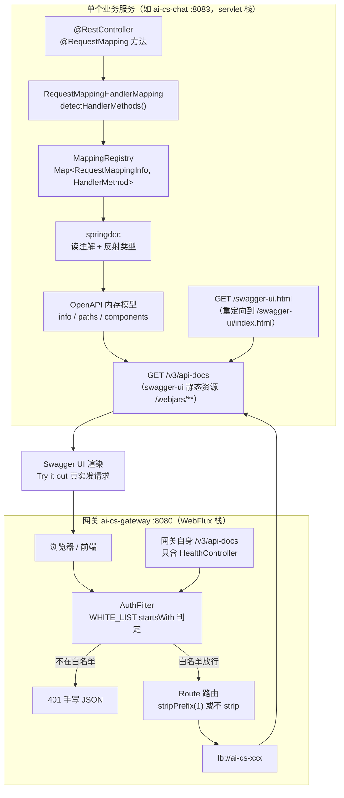
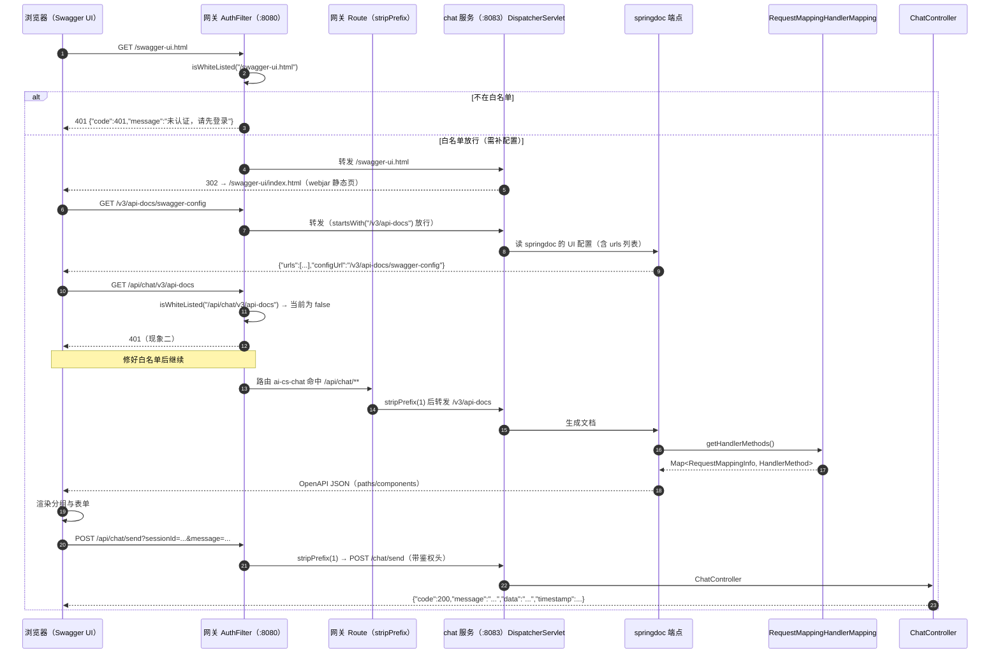

# SpringDoc 接口文档：网关聚合出来的一纸契约

> **一句话结论**：接口文档不是一个"启动后顺手能打开的页面"，而是三条互相独立的纪律同时成立才有结果——`@RequestMapping` 把方法注册进映射表（文档的**数据源**）、springdoc 把映射表 + OpenAPI 注解翻译成 `/v3/api-docs` 的 JSON（文档的**内容**）、网关路由与白名单让浏览器真的取得到这份 JSON（文档的**可达性**）。本项目前两条做到了八成，第三条**整条断**，所以 `docs/03-微服务开发.md#L835` 写的"网关（统一入口）"实际打不开。
>
> **阅读前置**：写过一个 `@RestController` 并用 Postman 调过它；分得清 401 与 404 的产生位置；能读懂 Spring Boot 的 `application.yml`；MVC 的 `DispatcherServlet` 全链路不必精通（缺口在文末"延伸阅读"里补）。
>
> **证据基线**：JDK 17.0.19 / Spring Framework 7.1.0 / Spring Boot 4.2.0 / Spring Cloud 2026.0.0（`spring-cloud-gateway-server-webflux` 5.1.0）/ **springdoc 2.3.0（本项目根 pom 锁定值，非 3.x）**；A 级证据 5 处取自 `24-源码分析/assets/source/`，B 级 14 处为本仓库源码与配置，C 级 5 个本机命令的真实输出。**springdoc 自身在 assets 里没有任何摘录**（依据说明见 §3.2）。预计阅读 40~50 分钟。

---

## 0. 先看现象

**现象一：按项目文档访问"网关统一入口"，浏览器直接收到 401。**

`docs/03-微服务开发.md#L825-L835` 给了一张表，其中网关一行是 `http://localhost:8080/swagger-ui.html`。实际请求得到的是 `AuthFilter` 手写的 401 体（不是 Boot 默认错误页）：

```json
{"code":401,"message":"未认证，请先登录","data":null,"timestamp":1764200000000}
```

原因不在 springdoc，而在网关白名单：`ai-cs-gateway/src/main/java/com/aics/gateway/filter/AuthFilter.java#L83-L96` 的 `WHITE_LIST` 里**没有** `/swagger-ui.html`，也没有 `/swagger-ui/`，只有 `/doc.html`、`/webjars/`、`/v3/api-docs`、`/swagger-resources` 四条"当年给 knife4j / springfox 用的"老路径。判定方式是前缀匹配 `path::startsWith`（`#L179-L181`），所以 `/swagger-ui.html` 进不了白名单，接着 `#L131` 打一行 `请求未携带Token: /swagger-ui.html` 就返回了。

**现象二：想绕过 UI 只要 JSON，也一样拿不到；而且有的服务返回 401，有的服务返回 404。**

```text
GET http://localhost:8080/api/chat/v3/api-docs        -> 401 {"code":401,...}     # 被 AuthFilter 拦
GET http://localhost:8080/api/message/v3/api-docs     -> 404 (下游收到的路径是 /api/message/v3/api-docs)
GET http://localhost:8083/v3/api-docs                 -> 200 (直连 chat 服务，正常)
```

401 与 404 的区别正对着两条纪律：`/api/chat/**` 在 `RouteConfig` 里 `stripPrefix(1)`（`ai-cs-gateway/src/main/java/com/aics/gateway/config/RouteConfig.java#L81-L84`），转发后服务端路径正好是 springdoc 的默认 `/v3/api-docs`；而 `/api/message/**` 是**不 strip** 的透传（`#L113-L122`，因为 `MessageController` 自己就映射在 `/api/message`），于是服务端收到 `/api/message/v3/api-docs`，springdoc 没有这个路径，404。

**现象三：把服务端口直接打开、UI 出来了，但那份"契约"是半成品。**

三个具体症状叠在一起：

- `POST /chat/stream` 的 200 响应在 UI 里 `data` 是空对象 `{}`——该方法签名是 `Result<Map<String, Object>>`（`ai-cs-chat/src/main/java/com/aics/chat/controller/ChatController.java#L144-L149`），泛型实参是 `Object`，schema 只能生成空壳。
- 商品服务的 13 个接口在 UI 左侧全无名称，只按类名自动归成 `product-controller` 一组——`ProductController` 上没有任何 `@Tag`/`@Operation`（`ai-cs-product/src/main/java/com/aics/product/controller/ProductController.java#L27-L30`）。
- 统一返回体 `Result<T>` 的四个字段在 UI 里没有一句中文（`ai-cs-common/src/main/java/com/aics/common/result/Result.java#L12-L27`，类上没有任何 `@Schema`），前端联调只能逐个问后端。

同一个 `/v3/api-docs` 在生产上还**不需要 token**：白名单里 `/v3/api-docs` 是前缀放行（`AuthFilter.java#L94`），任何人 `curl` 网关就拿到接口清单。

这些现象指向同一件事：**文档的"内容"由映射表和注解决定，文档的"可达"由网关路由与两套白名单（网关 `AuthFilter`、服务内 Spring Security）决定；本项目把内容做了八成，可达性一处没做，于是"打开文档"这个动作在网关入口、服务路径、字段描述三处各断一次。**

---

## 1. 整体地图



> **读图说明**：左上是**服务内部**的三段：注解 → `RequestMappingHandlerMapping` 的映射表 → springdoc 的翻译结果。这张图的关键是 `C` 这个节点——文档里能出现的每一条路径，都是 `MappingRegistry` 里的一条记录，没进映射表的方法（例如 `ChatController#chatSendBlocked` 这种不带 `@*Mapping` 的熔断兜底方法）永远不会出现在文档里。右下是**网关侧**的两道闸门：先 `AuthFilter` 白名单（前缀匹配，`/api/chat/v3/api-docs` 匹配不上 `/v3/api-docs`），再路由的 `stripPrefix`（决定服务端最终收到的路径是不是 `/v3/api-docs`）。`L` 那条虚线路径是"网关统一入口"的真相：网关自己也有一份 `/v3/api-docs`，但它的数据源只有网关自己的 `@RestController`，与十个业务服务无关。

| 组件 | 责任 | 谁调用它 | 证据 |
| --- | --- | --- | --- |
| `RequestMappingHandlerMapping` | 启动期扫描 bean，把每个带 `@*Mapping` 的方法注册成 `HandlerMethod` | Spring MVC 的 `AbstractHandlerMethodMapping#initHandlerMethods` | [[源码:AbstractHandlerMethodMapping.java.md#L270-L288]] |
| `AbstractHandlerMethodMapping#getHandlerMethods()` | 对外暴露只读的 `Map<RequestMappingInfo, HandlerMethod>`，**这就是文档的数据源** | springdoc 的文档生成器 | [[源码:AbstractHandlerMethodMapping.java.md#L144-L153]] |
| `HandlerMethod` | 一条映射的运行时描述：bean 类型、`Method`、方法参数注解 | 被 springdoc 逐个读取 | [[源码:HandlerMethod.java.md#L265-L267]] |
| OpenAPI 注解（`@Tag`/`@Operation`/`@Parameter`/`@Schema`） | 覆盖"默认推导"的人工描述层 | 编译器 + springdoc 运行时读取 | 本项目用法见 `ai-cs-chat/src/main/java/com/aics/chat/controller/ChatController.java#L48-L54` |
| springdoc（`/v3/api-docs`） | 把映射表 + 注解拼成 OpenAPI JSON 并暴露一个 GET 端点 | 浏览器 / 前端 / 网关 | 本项目只引依赖不写配置，见 §3.2 |
| springdoc 的 Swagger UI 静态资源 | `/swagger-ui.html` 页面 + `/webjars/**` 资源 | 浏览器直接加载 | 白名单只放行了 `/webjars/`，见 `AuthFilter.java#L92-L95` |
| `AuthFilter`（本项目） | 网关侧鉴权 + 白名单前缀放行 | WebFlux 全局过滤器链，order = `HIGHEST_PRECEDENCE + 100` | `ai-cs-gateway/src/main/java/com/aics/gateway/filter/AuthFilter.java#L105-L133` |
| `RouteConfig#customRouteLocator`（本项目） | 把 `/api/**` 路由到 `lb://ai-cs-*`，决定是否 `stripPrefix` | 网关 HandlerMapping | `ai-cs-gateway/src/main/java/com/aics/gateway/config/RouteConfig.java#L64-L148` |
| `SecurityFilterChain`（user 服务） | 服务内部授权；已显式放行文档路径 | Spring Security 过滤器链 | `ai-cs-user/src/main/java/com/aics/user/security/UserSecurityConfig.java#L34-L37` |
| `OnPropertyCondition` | 判定 `springdoc.*.enabled=false` 这类开关是否让自动配置生效 | 应用装配期 | [[源码:OnPropertyCondition.java.md#L44-L56]] |

---

## 2. 关键概念与关键类

先把术语钉死：**OpenAPI** 是描述 HTTP 接口的规范（JSON/YAML，字段为 `info`/`paths`/`components` 三大块）；**Swagger UI** 只是这份 JSON 的一个前端渲染器（纯静态资源）；**springdoc** 才是"读 Spring MVC 元数据 → 生成 OpenAPI JSON"的那个库；**`@Tag` / `@Operation` / `@Parameter` / `@Schema`** 属于 swagger-core 的 `io.swagger.v3.oas.annotations` 包（OpenAPI 3 时代），它们既不被 Spring 理解、也不影响业务，只被 springdoc 读；**分组（GroupedOpenApi）** 是"一个进程里出多份文档"；**聚合**是"多个进程各出一份，用一份 UI 显示"——这两个概念经常被混用，是本篇后面两条独立主线。

| 名称 | 位置 | 角色 | 关键方法 / 属性 |
| --- | --- | --- | --- |
| `@Tag(name=...)` | `io.swagger.v3.oas.annotations.tags` | 给一个 Controller 的接口打组名（UI 左侧的分组标题） | `name`、`description` |
| `@Operation(summary=...)` | `io.swagger.v3.oas.annotations` | 描述单个接口 | `summary`、`description`、`operationId`、`deprecated` |
| `@Parameter` | 同上 | 描述方法参数，**参数级文档的唯一手段** | `description`、`required`、`example`、`in` |
| `@Schema` | `io.swagger.v3.oas.annotations.media` | 描述模型/字段 | `description`、`example`、`requiredMode`、`implementation` |
| `@Hidden` | 同上 | 把某个接口/类从文档里摘掉 | 无属性 |
| `OpenAPI` / `Info` | `io.swagger.v3.oas.models` | 文档根模型 / 文档元信息 | `info()`、`addSecurityItem()`、`components()` |
| `GroupedOpenApi` | `org.springdoc.core.models` | 声明一份"分组文档" | `builder().group().pathsToMatch()` |
| `SwaggerUiConfigProperties` | springdoc 的 UI 属性类 | 绑定 `springdoc.swagger-ui.*`（含 `urls[]`） | `urls`、`disableSwaggerDefaultUrl` |
| `SpringDocConfigProperties` | springdoc 的属性类 | 绑定 `springdoc.api-docs.*` | `path`、`enabled`、`groupsEnabled` |
| `AbstractHandlerMethodMapping` | `org.springframework.web.servlet.handler` | 维护映射表，`getHandlerMethods()` 是文档数据源 | `detectHandlerMethods()`、`getHandlerMethods()` |
| `RequestMappingHandlerMapping` | `org.springframework.web.servlet.mvc.method.annotation` | 把类级 + 方法级 `@RequestMapping` 合成 `RequestMappingInfo` | `getMappingForMethod()`、`createRequestMappingInfo()` |
| `HandlerMethod` | `org.springframework.web.method` | 映射的运行时形态 | `getBeanType()`、`getMethodParameters()` |
| `AuthFilter`（本项目） | `ai-cs-gateway/.../filter` | 网关鉴权 + 文档路径白名单 | `filter()`、`isWhiteListed()`、`getOrder()` |
| `Result<T>`（本项目） | `ai-cs-common/.../result` | 统一返回体，**文档里所有接口的外壳** | `code/message/data/timestamp` |

> 说明：`SwaggerUiConfigProperties` / `SpringDocConfigProperties` / `GroupedOpenApi` 均**不在** `24-源码分析/assets/source/` 的摘录范围内（本仓库只有 Spring / Boot / Cloud 系的摘录）。本篇涉及 springdoc 内部类名与属性名的地方，一律标注"依据 springdoc 官方文档"，**不伪装成已验证的源码结论**。

---

## 3. 原理与证据逐段精读

### 3.1 文档的数据源：映射表里没有，文档里就一定没有

**在干什么**：`AbstractHandlerMethodMapping` 是 MVC 所有 `HandlerMapping` 的基类。启动期它在 `initHandlerMethods()` 后按 bean 名逐个调用 `detectHandlerMethods(handler)`，用 `MethodIntrospector.selectMethods(userType, method -> getMappingForMethod(method, userType))` 找出"这个方法该映射成什么"，返回值不是 `null` 才登记进 `MappingRegistry`：

```java (src: AbstractHandlerMethodMapping.java.md#L270-L288)
protected void detectHandlerMethods(Object handler) {
    Class<?> handlerType = (handler instanceof String beanName ?
            obtainApplicationContext().getType(beanName) : handler.getClass());

    if (handlerType != null) {
        Class<?> userType = ClassUtils.getUserClass(handlerType);
        Map<Method, T> methods = MethodIntrospector.selectMethods(userType,
                (MethodIntrospector.MetadataLookup<T>) method -> {
                    try {
                        return getMappingForMethod(method, userType);
                    }
                    catch (Throwable ex) {
                        throw new IllegalStateException("Invalid mapping on handler class [" +
                                userType.getName() + "]: " + method, ex);
                    }
                });
```

逐行翻译要点：`getUserClass` 剥代理类（`@Transactional`/AOP 后的 CGLIB 子类上的注解与你写的类不是同一份，这是"加了事务注解后映射变了"的根源）；`selectMethods` 遍历**所有方法**并让 `getMappingForMethod` 决定"这条算不算一个映射"，返回 `null` 就不算——所以一个 Controller 里的普通 `public` 方法（如 `ChatController.java#L100-L104` 的 `chatSendBlocked` 熔断兜底）不会进文档；`catch (Throwable)` 那句 `"Invalid mapping on handler class [...]"` 是排查"启动期报映射错误"时**唯一该抓的日志关键字**。

`@RequestMapping("/chat")` 怎么变成文档里的 `/chat/send`？看 `RequestMappingHandlerMapping#getMappingForMethod`——类级与方法级的 `RequestMappingInfo` 是 `combine` 出来的：

```java (src: RequestMappingHandlerMapping.java.md#L200-L217)
protected @Nullable RequestMappingInfo getMappingForMethod(Method method, Class<?> handlerType) {
    validateCglibProxyMethodVisibility(method, handlerType);

    RequestMappingInfo info = createRequestMappingInfo(method);
    if (info != null) {
        RequestMappingInfo typeInfo = createRequestMappingInfo(handlerType);
        if (typeInfo != null) {
            info = typeInfo.combine(info);
        }
        if (info.isEmptyMapping()) {
            info = info.mutate().paths("", "/").options(this.config).build();
        }
        String prefix = getPathPrefix(handlerType);
        if (prefix != null) {
            info = RequestMappingInfo.paths(prefix).options(this.config).build().combine(info);
        }
    }
    return info;
```

这里有一个 Framework 7 才显眼的细节：`createRequestMappingInfo` 的另一个分支处理的是 `@HttpExchange`（声明式 HTTP 接口）——也就是说 `@HttpExchange` 标注的接口方法在 Framework 7 里也会被注册成 handler，从而有机会进文档。本项目 `@HttpExchange` 命中数为 0（C 级证据见 §6），这条链路目前空转。

最后，任何人都能拿到这张表：

```java (src: AbstractHandlerMethodMapping.java.md#L144-L153)
public Map<T, HandlerMethod> getHandlerMethods() {
    this.mappingRegistry.acquireReadLock();
    try {
        return this.mappingRegistry.getRegistrations().entrySet().stream()
                .collect(Collectors.toUnmodifiableMap(Map.Entry::getKey, entry -> entry.getValue().handlerMethod));
    }
    finally {
        this.mappingRegistry.releaseReadLock();
    }
}
```

**为什么这么设计**：把"发现映射"（启动期一次）和"使用映射"（每次请求 / 每次生成文档）彻底分开，读侧返回 `unmodifiableMap` 加读锁，保证运行期拿到的是稳定快照。springdoc 是这条设计的直接受益者——它不需要重新解析 `@RequestMapping`，只要遍历 `getHandlerMethods()`，每个 `HandlerMethod` 上的 `getBeanType()` / `getMethodParameters()` 就够它拼出参数与返回类型。

**换写法会怎样**：如果 springdoc 改成"直接扫 classpath 上的 `@RestController`"，就会漏掉 `<mvc:annotation-driven>` 之外的自定义处理器映射，也会把没真正注册的方法写进文档（文档里有一条路径，实际请求 404）。反过来，如果你的接口是"手写 `HandlerMapping`"实现的，springdoc 也看不见它——文档里没有不代表接口不存在，这是排查"文档缺接口"时的第二个方向。

**常见坑**：
- 接口写成 `@RequestMapping` 在接口（interface）上、实现类没加注解——`getUserClass` + `AnnotatedElementUtils` 的合并规则能救一部分，但组合注解、`@AliasFor` 用错就丢。
- 类上加了 `@Validated` 但方法是包级私有，`validateCglibProxyMethodVisibility` 会直接抛异常（Framework 7 的显式校验），报错信息同样是 `Invalid mapping on handler class`。
- 同名路径两个方法（`GET /chat/history` 与 `POST /chat/history` 不算冲突；但 `produces` 不区分导致 `Ambiguous mapping`）在启动期就失败，表现是服务起不来而不是文档错——别往 springdoc 上找。

### 3.2 为什么是 springdoc 而不是 springfox（本段无 A 级证据）

**在干什么**：springfox 是 2015~2020 年的事实标准，它用 `documentationPluginsBootstrapper` 这个 bean 在启动期扫描接口；springdoc 是从零重写的实现，直接挂在 MVC 的 `HandlerMapping` 上（就是上一节的 `getHandlerMethods()`），对外暴露 `/v3/api-docs`。

**为什么这么设计**：springfox 3.0.0（2020 年 7 月）之后再无正式版本，2023 年官方仓库转为归档；而 Spring Boot 2.6 起 MVC 默认把路径匹配器从 `AntPathMatcher` 换成 `PathPatternParser`，springfox 的启动期扫描随即炸掉，最典型的报错是 `Failed to start bean 'documentationPluginsBootstrapper'; nested exception is java.lang.NullPointerException`，社区偏方是 `spring.mvc.pathmatch.matching-strategy=ant_path_matcher`（把新默认值改回旧值）。到 Boot 3 时代，`javax.*` → `jakarta.*` 的迁移让 springfox 彻底不可用，springdoc 成了唯一现实选择。

> **证据声明**：本段全部内容**没有 A 级证据**——`24-源码分析/assets/source/` 的 905 份摘录里没有任何 `springdoc` / `springfox` / `swagger` 文件（本机 `Get-ChildItem` 确认）。上述结论依据 springdoc 官方文档与 Springfox 仓库归档说明，**未在本机启动验证**。凡是要求你"贴 springfox 源码"的场合，请按此声明标注。

**换写法会怎样**：本项目若为了"兼容老教程"把 springfox 加回来，`spring-boot-starter-web` 与 `springfox-boot-starter` 会在 Boot 4 上直接编译期报 `javax.servlet` 找不到；即便强行排除，两套 OpenAPI 实现会同时注册 `/v3/api-docs`（springdoc）与 `/v2/api-docs`（springfox），后者永远 404 而前者被覆盖。

**常见坑**：项目白名单里还留着 springfox / knife4j 时代的两条死路径——`/swagger-resources`（springfox 2.x 的元数据端点）和 `/doc.html`（knife4j 的 UI 入口）。本仓库 `knife4j` 与 `springfox` 的出现次数都是 0（C 级证据见 §6），说明这两条白名单从来没有对应实现，只是历史复制粘贴。

### 3.3 webmvc-ui 与 webflux-ui：同一个 UI，两个不同世界

**在干什么**：springdoc 的 starter 按栈分家：`springdoc-openapi-starter-webmvc-ui` 给 servlet 栈（`DispatcherServlet` + `spring-webmvc`），`springdoc-openapi-starter-webflux-ui` 给响应式栈（`DispatcherHandler` + `spring-webflux`）。本项目十个业务模块全用前者，只有网关用后者：

```xml
<!-- ai-cs-chat/pom.xml#L113-L117（其余业务模块同构，版本由父 pom 统一管理） -->
<dependency>
    <groupId>org.springdoc</groupId>
    <artifactId>springdoc-openapi-starter-webmvc-ui</artifactId>
</dependency>
```

```xml
<!-- ai-cs-gateway/pom.xml#L61-L65 -->
<dependency>
    <groupId>org.springdoc</groupId>
    <artifactId>springdoc-openapi-starter-webflux-ui</artifactId>
</dependency>
```

**为什么这么设计**：`-ui` 后缀的 starter 会把 Swagger UI 的静态资源（`swagger-ui` 的 webjar）挂到对应栈的资源处理器上——servlet 栈用 `WebMvcConfigurer#addResourceHandlers`，响应式栈用 `WebFluxConfigurer`。UI 页面本质是纯静态资源 + 一段读 `/v3/api-docs` 的 JS，所以"哪套资源处理器注册了，UI 就在哪套栈上能访问"，同一个应用里混用两个 starter 只会让其中一套白挂。

本项目网关的 pom 还做了另一件事：把 `ai-cs-common` 带进来的 servlet 栈剔掉。

```xml
<!-- ai-cs-gateway/pom.xml#L43-L53（注释原文：网关基于 WebFlux，两者不兼容） -->
<dependency>
    <groupId>com.aics</groupId>
    <artifactId>ai-cs-common</artifactId>
    <exclusions>
        <exclusion>
            <groupId>org.springframework.boot</groupId>
            <artifactId>spring-boot-starter-webmvc</artifactId>
        </exclusion>
    </exclusions>
</dependency>
```

**换写法会怎样**：如果在网关里改成引 `webmvc-ui`，`spring-boot-starter-webmvc` 会被传递进来，Spring Cloud Gateway 启动时会警告 classpath 上存在 Spring MVC（`GatewayClassPathWarningAutoConfiguration` 的职责），严重时 `DispatcherHandler` 与 `DispatcherServlet` 抢同一批自动配置，表现为网关所有路由 404 或启动直接失败。这也是"网关为什么不能直接复用业务模块的 common 依赖"的教科书案例。

**常见坑**：网关用 `webflux-ui` 后，它自己的 `/v3/api-docs` **只描述网关自己的接口**——本项目就是 `HealthController`（1 个端点）与 `GatewayFallbackController`（0 个 `@*Mapping`，只有 `@RequestMapping` 类级注解）。所以 `http://localhost:8080/swagger-ui.html` 就算被放行，看到的也永远不是十个服务的接口总览。这是"网关统一入口"最大的认知陷阱，也是 §3.6 要解决的问题。

### 3.4 注解三件套：`@Operation` / `@Parameter` / `@Schema`

**在干什么**：springdoc 对每个 `HandlerMethod` 的推导顺序是"反射能拿到什么就先写什么，注解只做覆盖"。方法名 → `summary` 的默认值不是方法名（默认 `summary` 为空，UI 上只显示路径）；`@Operation.summary` 补标题、`@Parameter.description` 补参数说明、`@Schema.description` 补字段说明。三者缺一，UI 上就少一层信息，而**三者都没有 A 级证据可引**（springdoc 侧无摘录），所以这里全部用本项目代码做 B 级对照。

一个"加了注解"的正面样本：

```java
// ai-cs-chat/src/main/java/com/aics/chat/controller/ChatController.java#L48-L54, #L77-L82
@Tag(name = "AI对话")
@RestController
@Slf4j
@RequestMapping("/chat")
@RequiredArgsConstructor
@Validated
public class ChatController {

    @Operation(summary = "发送对话消息")
    @PostMapping("/send")
    @SentinelResource(value = SentinelRules.RESOURCE_CHAT_SEND, blockHandler = "chatSendBlocked")
    public Result<String> chat(@RequestParam("sessionId") @NotBlank(message = "会话ID不能为空") String sessionId,
                               @RequestParam("message") @NotBlank(message = "消息内容不能为空") String message,
                               @RequestHeader(value = "X-User-Id", required = false) Long userId) {
```

注意这里的边界：`@NotBlank(message = "会话ID不能为空")` 是 **Bean Validation** 注解，springdoc 在部分场景下能把它转成 `required`/说明，但它不保证；**参数的中文说明与示例值只有 `@Parameter` 能可靠给出**。而本项目 `@Parameter` 的全仓库命中数是 **0**（C 级证据见 §6）——109 个 `@Operation` 全都只是"标题"，没有一个参数有说明。给 `chat` 方法的三个参数补上参数级文档是标准写法：

```java
// 建议写法（本项目尚未采用，仅示范；属性名依据 springdoc / swagger-core 官方文档）
@Operation(summary = "发送对话消息", description = "同步等待 LLM 返回完整回复，非流式")
@PostMapping("/send")
public Result<String> chat(
        @Parameter(description = "会话 ID，用于历史隔离与持久化", example = "s-20261127-001") @RequestParam("sessionId") String sessionId,
        @Parameter(description = "用户消息内容", example = "帮我查一下订单 1001") @RequestParam("message") String message,
        @Parameter(description = "用户 ID，由网关鉴权后透传", example = "1001") @RequestHeader(value = "X-User-Id", required = false) Long userId) {
```

模型侧的正面样本在 `ai-cs-user/src/main/java/com/aics/user/dto/LoginRequest.java#L12-L24`：类上有 `@Schema(description = "账号密码登录请求")`，两个字段各有 `@Schema(description=..., example=...)`，于是 UI 的请求示例里直接出现 `{"username":"admin","password":"admin123"}`——这就是"文档能直接拿去联调"和"文档只能看个路径"的差别。

反面样本是统一返回体：`Result<T>` 四个字段一个 `@Schema` 都没有（`ai-cs-common/src/main/java/com/aics/common/result/Result.java#L12-L27`）。它的连带影响被严重低估：**每个接口的响应都套在这个壳里，壳没描述，等于所有接口的响应都没描述**。修一次 `Result`，全项目 109 个接口的响应文档同时变好，这是本篇性价比最高的一处改动。

**为什么这么设计**：把"结构"交给反射（永远准），把"语义"交给注解（人来写）。这样不用注解也能出一份结构正确的文档，注解只提升可读性——代价就是"没写注解 = 结构对、语义空"，而这恰恰是多数团队的真实状态。

**换写法会怎样**：如果你用"契约先行"（先手写 `openapi.yml`，再用 codegen 生成接口），文档与实现对不上时会**编译失败或接口签名不匹配**，安全性更高；代价是改一次字段要改两个地方，且生成代码不可手改。springdoc 的注解驱动是"零额外维护、语义靠自觉"，两者是不同量级的工程选择（§5 展开）。

**常见坑**：注解**不影响运行**，写错也不报错。典型的三类静默错误：
- `@Operation` 写在 private 方法上（没映射，等于没写）；
- `@Tag` 名字重复两个 Controller（UI 里两组接口并成一组，看不出谁是谁）；
- 泛型 `Result<Map<String, Object>>`（`ChatController.java#L144-L149`）——`Map` 的实参是 `Object`，springdoc 只能生成空 schema。要修得用具体 DTO，或 `@Schema(implementation = Xxx.class)` / `@Content` 显式指定，本项目 `@Content` 命中数也是 0。

### 3.5 分组 GroupedOpenApi：一个进程里的多份文档

**在干什么**：`GroupedOpenApi.builder().group("chat").pathsToMatch("/chat/**").build()` 会额外暴露一份 `/v3/api-docs/chat`，只含匹配的路径；UI 顶部会多一个下拉框。它的作用域是**同一个 Spring 应用**，与"多个服务"无关。

**为什么需要**：本项目的 chat 服务一个进程里塞了 8 个 Controller（`ChatController`、`AgentController`、`ObservabilityController`、`PromptController`、`RagEvalController`、`RetrieveController`、`ChartController`、`GraphController`）+ 全项目 31 个不同 `@Tag` 名（C 级证据见 §6）——一份文档里 109 个接口平铺，前端要在里面找 `/chat/agent/runs` 很难。按前缀分组（如 `/chat/**`、`/chat/agent/**`、`/api/observability/**`、`/api/prompts/**`）能把它切成"对话 / Agent 编排 / 可观测 / Prompt 管理"四份。

**本项目现状**：`GroupedOpenApi`、`new OpenAPI(`、`OpenApiConfig`、`SecurityScheme` 四个关键字的全仓库命中数**都是 0**（C 级证据见 §6）。也就是说：没有分组、没有自定义文档标题（UI 上显示的是默认的 `OpenAPI definition`）、没有声明 JWT 安全方案（`Authorize` 按钮不存在，所以任何需要 `Authorization` 头的接口在 UI 上都无法直接调试）。

**换写法会怎样**：用 `springdoc.group-configs[0].group=...` 的**属性式**分组（官方支持的另一种写法）可以不写 Java 代码，适合"只是按前缀切一刀"的场景；一旦要按注解或包名过滤，还是得写 `GroupedOpenApi` bean。两种写法不能重复定义同一个 group 名，否则后定义的覆盖前者且没有任何警告——排查"分组丢了"时先看有没有同名覆盖。

**常见坑**：分组不改变 `/v3/api-docs` 默认那一份的内容——默认那份仍然是全量。**想让默认那份也受控，得用 `springdoc.paths-to-match` 或 `paths-to-exclude`**（属性名依据官方文档）。很多人以为建了分组就等于"分组之外不可见"，结果默认入口把内部接口全暴露了。

### 3.6 网关聚合：`springdoc.swagger-ui.urls` 与三条硬约束

**在干什么**：springdoc 的 UI 支持"一份 UI 显示多份文档"，靠的是 `springdoc.swagger-ui.urls[n].name` + `springdoc.swagger-ui.urls[n].url`（官方属性）。页面加载时先 GET `{api-docs.path}/swagger-config` 拿到这个列表，再逐个拉 JSON 渲染成顶部下拉框。**关键语义**：这些 `url` 是**浏览器直接去请求的地址**，不是服务端之间的地址——所以它必须写成"从浏览器能打通的网关地址"。

**为什么本项目"以为做了、实际没做"**：全仓库 94 个 `*.yml` / `*.yaml` 里 `springdoc` 关键字的命中数是 **0**（C 级证据见 §6）。没有 `urls` 配置 → UI 使用默认单条 URL `/v3/api-docs` → 在网关上打开的就是网关自己那份几乎没有内容的文档。要让聚合真的成立，下面三条必须同时满足，缺一条就是 401 或 404：

| 约束 | 要求 | 本项目现状 | 证据 |
| --- | --- | --- | --- |
| ① 路由能把该路径送到目标服务，且 strip 后正好等于对方的 `springdoc.api-docs.path`（默认 `/v3/api-docs`） | `/api/chat/v3/api-docs` → stripPrefix(1) → `/v3/api-docs` ✅ | chat/user/knowledge/search/order/cart/pay/mq/product 都是 `stripPrefix(1)`，成立 | `ai-cs-gateway/src/main/java/com/aics/gateway/config/RouteConfig.java#L64-L148` |
| 同上 | `/api/message/v3/api-docs`、`/api/notify/v3/api-docs` → **不 strip** → 服务端收到 `/api/message/v3/api-docs` ❌ 404 | message / notify 两条路由刻意不 strip（Controller 自身前缀就是 `/api/message`） | `RouteConfig.java#L113-L122` |
| ② 网关白名单必须放行该**网关路径**（前缀匹配） | 白名单里的 `/v3/api-docs` 匹配不了 `/api/chat/v3/api-docs` ❌ 401 | 白名单共 12 条，无 `/api/*/v3/api-docs` 形态 | `AuthFilter.java#L83-L96`、`#L179-L181` |
| ③ 服务自身的 Security 要放行文档路径 | user 服务已显式放行 `/v3/api-docs/**`、`/swagger-ui/**`、`/swagger-ui.html` ✅ | 其余服务未引入 Spring Security 的 `FilterChain`（无该配置类），默认放行 | `ai-cs-user/src/main/java/com/aics/user/security/UserSecurityConfig.java#L34-L37` |

既然三条都要改，最小可用方案（属性名依据官方文档，**本项目尚未配置，效果未在本机验证**）是：

```yaml
# ai-cs-gateway/src/main/resources/application.yml 里新增（示意，未落地）
springdoc:
  swagger-ui:
    path: /swagger-ui.html
    disable-swagger-default-url: true      # 去掉默认的 /v3/api-docs 单条，只留下面的 urls
    urls:
      - name: 用户服务
        url: /api/user/v3/api-docs
      - name: AI 对话
        url: /api/chat/v3/api-docs
      - name: 商品服务
        url: /api/product/v3/api-docs
      # message / notify 两条先不加：它们的路由不 strip，需要先改路由或改 springdoc.api-docs.path
```

配套的两处代码改动是硬要求，不是可选：

- `AuthFilter` 白名单补 `/swagger-ui.html`、`/swagger-ui/`，并且**不要**天真地补一条 `/api/` —— 那是把整个网关的前缀匹配白名单放大成"全部放行"。正确做法是为文档单开一条带精确前缀的放行规则（例如 `/api/` + 服务名 + `/v3/api-docs` 三段拼出来的白名单），或者干脆给文档单独开一条 `/api/docs/{svc}/**` 路由。
- message / notify：要么给文档单开一条 `stripPrefix` 路由，要么这两个服务把 `springdoc.api-docs.path` 改成 `/api/message/v3/api-docs`（这样转发后路径正好对齐），二选一，别在 `urls` 里写一条注定 404 的地址。

**换写法会怎样**：不走网关、直接让前端连十个端口（`8081~8090`），聚合问题立刻消失——代价是前端要配十个 baseURL、跨域要开十次、生产上等于把十个服务全暴露在公网。这正是"网关聚合"存在的唯一理由，也是它值得费劲的地方。

**常见坑**：`/v3/api-docs/swagger-config` 这个请求本身会被 `startsWith("/v3/api-docs")` 放行，导致"配置能取到、列表里每条都 401"的分裂现象——排查时先看浏览器网络面板里**哪一条**红了，不要把整体判成"springdoc 坏了"。

### 3.7 生产关闭：关 UI ≠ 关文档

**在干什么**：springdoc 有两个独立开关——`springdoc.api-docs.enabled`（是否生成并暴露 JSON）与 `springdoc.swagger-ui.enabled`（是否暴露 UI 页面）。两个都默认 `true`。

**为什么这么设计**：生成 JSON 的代价（启动期扫描 + 每次请求序列化）和暴露 UI 的风险不是一回事，框架把它们拆开是合理的；但**这正好诱发了最常见的错误**：只写 `swagger-ui.enabled: false`，以为"生产关了文档"，实际 `/v3/api-docs` 仍然可读，接口清单（含内部接口、字段结构）照样裸奔。本项目的现实风险正在这里：白名单里 `/v3/api-docs` 是前缀放行，**网关自己的 `/v3/api-docs` 当前就是免鉴权可读的**。

这两个开关是怎么生效的？它们不是业务代码在 `if` 里判断，而是挂在自动配置类上的 `@ConditionalOnProperty`，在**应用装配期**求值：

```java (src: OnPropertyCondition.java.md#L44-L56)
public ConditionOutcome getMatchOutcome(ConditionContext context, AnnotatedTypeMetadata metadata) {
    MergedAnnotations mergedAnnotations = metadata.getAnnotations();
    List<MergedAnnotation<Annotation>> annotations = stream(mergedAnnotations).toList();
    List<ConditionMessage> noMatch = new ArrayList<>();
    List<ConditionMessage> match = new ArrayList<>();
    for (MergedAnnotation<Annotation> annotation : annotations) {
        ConditionOutcome outcome = determineOutcome(annotation, context.getEnvironment());
        (outcome.isMatch() ? match : noMatch).add(outcome.getConditionMessage());
    }
    if (!noMatch.isEmpty()) {
        return ConditionOutcome.noMatch(ConditionMessage.of(noMatch));
    }
    return ConditionOutcome.match(ConditionMessage.of(match));
}
```

"值等于什么才算匹配"的判定在同类的 `isMatch` 里，这段是**踩坑源头**：

```java (src: OnPropertyCondition.java.md#L170-L175)
private boolean isMatch(@Nullable String value, String requiredValue) {
    if (StringUtils.hasLength(requiredValue)) {
        return requiredValue.equalsIgnoreCase(value);
    }
    return !"false".equalsIgnoreCase(value);
}
```

三条可操作的推论：
1. 没写 `havingValue` 时，**只有字符串 `false`（不区分大小写）算不匹配**。所以 `enabled: false`、`enabled: FALSE` 都关；而 `enabled: off`、`enabled: no`、`enabled: 0` 都**不会**关——配置文件里写 `no` 是真实事故，别笑。
2. 判定发生在装配期（`getMatchOutcome` 拿的是 `ConditionContext#getEnvironment` 的快照），所以 Nacos 里改这个开关**必须重启**才生效；`@RefreshScope` 刷不动一个"没被创建的 bean"。
3. 条件不满足时自动配置整体不生效，**不是**"bean 在但功能关"——这也是为什么关掉以后 `/v3/api-docs` 的表现是 404（没有该 handler）而不是 403/空文档。

**生产该怎么关（三档，按力度递增）**：

| 档位 | 做法 | 覆盖什么 | 代价 |
| --- | --- | --- | --- |
| 环境级 | `springdoc.api-docs.enabled: false` + `springdoc.swagger-ui.enabled: false`（放 prod 的 Nacos 配置里，本项目 `spring.config.import: optional:nacos:aics-shared.yml` 已经支持集中覆盖） | 直连端口也拿不到文档 | 需要重启；测试环境仍完整可用 |
| 网关级 | 白名单**不放行**文档路径 + 文档相关路由只在非 prod 的 profile 里注册 | 外部经网关彻底不可达 | 网关配置要按环境区分（本项目路由写在 `RouteConfig` 的 Java DSL 里，得改成条件装配） |
| 代码级 | 内部接口加 `@Hidden`；不该公开的 Controller 干脆不写 `@Operation`/不加 `@Tag` | 减少泄露的信息量 | 只是"少暴露"，不是"不暴露"；本项目 `@Hidden` 命中数 0 |

**常见坑**：只关 UI 不关 JSON（最常见）；用 `management.endpoints.web.exposure` 的思路去关 springdoc（两者毫无关系）；以为删掉 `pom` 依赖就安全了——`ai-cs-common` 里如果将来引入文档相关类型，删依赖会连带编译失败。

### 3.8 Boot 4 / Framework 7 下的兼容性债务

**在干什么**：本项目**基线是 Boot 4.2.0，而 springdoc 锁在 2.3.0**（`pom.xml#L70` 的 `<springdoc.version>2.3.0</springdoc.version>`，父 pom 的 `dependencyManagement` 同时管了 webmvc-ui 与 webflux-ui 两个 artifact，`pom.xml#L260-L270`）。2.3.0 是 Boot 3.x 时代发布的版本线，这里有三处需要盯的兼容风险：

1. **Jackson 版本**：Boot 4 起默认 Jackson 3，包名从 `com.fasterxml.jackson` 变为 `tools.jackson`。而 swagger-core / springdoc 2.x 的模型序列化建立在 Jackson 2 上，两者共存需要 classpath 上仍有 Jackson 2（本项目现状恰恰如此：全仓库 `import com.fasterxml.jackson` 有 **47 处**、`import tools.jackson` **0 处**，C 级证据见 §6）。这不是"能跑就行"的问题——一旦有人清理掉 Jackson 2 依赖，文档端点会在**运行期**序列化失败（编译期完全看不出来）。
2. **starter 更名**：Boot 4 起 `spring-boot-starter-web` 已 deprecated，应改用 `spring-boot-starter-webmvc`。本项目多数模块仍在用旧名（父 `pom.xml#L22` 等，C 级证据见 §6），`springdoc-openapi-starter-webmvc-ui` 传递依赖里也可能继续带旧名——升级时以"编译告警 + 官方迁移指南"为准，别只看本项目自己写的 `<artifactId>`。
3. **springdoc 是否有适配 Boot 4 的版本线**：本机 `~/.m2/repository/org/springdoc` 下**只有 2.3.0**（六个 artifact 全部 2.3.0，C 级证据见 §6），离线环境无法验证 3.x 是否存在、行为如何。**因此本篇不给"升到 X.Y.Z 就好"的结论**，只给核对清单：升级前必须验证 `/v3/api-docs` 能返回 200、UI 能渲染、`@Schema` 字段仍在、`urls` 聚合仍生效。

**为什么值得单独一节**：接口文档是唯一一个"编译通过、启动成功、单元测试全绿、但功能已经坏了"的组件——它没有任何业务断言覆盖，坏掉时也没人报警。

**换写法会怎样**：如果团队把文档作为 CI 门禁（§9 练习 5），这类兼容问题会在流水线上暴露；否则只能等前端来问"文档打不开了"。

**常见坑**：在 Boot 4 项目里照抄 Boot 2 时代的 `springfox` 教程（§3.2）；把 `springdoc.api-docs.path` 与 `server.servlet.context-path` 一起改却没同步网关路由，路径变成双前缀。

---

## 4. 一次完整执行时序

下面这条时序是"前端打开网关 UI → 下拉选服务 → Try it out 真调一次 `/chat/send`"的全过程，也是排查"文档打不开"的路线图：



> **读图说明**：`autonumber` 的 1~3 步是"页面能不能打开"，4~7 步是"文档内容能不能取到"，8 步往后才是"接口能不能调"——三件事的失败点完全不同，**绝大多数人把它们混成一个"文档坏了"**。注意第 2 步的判定发生在**路由之前**（`AuthFilter#getOrder()` 返回 `Ordered.HIGHEST_PRECEDENCE + 100`，见 `AuthFilter.java#L171-L174`），所以判的是浏览器发出的**原始网关路径** `/api/chat/v3/api-docs`，而不是 strip 之后的 `/v3/api-docs`；同理第 5 步的 `/v3/api-docs/swagger-config` 能通过，是沾了 `startsWith("/v3/api-docs")` 的光。第 6 步之后的"修好白名单"是分界点：修之前链路断在网关，修之后才轮到 springdoc 干活。

**哪一步失败报什么错（按现象定位，别猜）**：

| 失败步 | 浏览器/客户端看到什么 | 该去哪儿看 |
| --- | --- | --- |
| 2 | `401` + `{"code":401,"message":"未认证，请先登录",...}` | 网关日志 `请求未携带Token: /swagger-ui.html`（`AuthFilter.java#L131`），白名单 `#L83-L96` |
| 3 | `404`（页面打不开，静态资源缺失） | 该服务是否引了 `-ui` 版 starter（`-api` 版没有 UI 静态资源） |
| 5/6 | `500` + 长篇堆栈 | springdoc 内部异常，先看 `/v3/api-docs` 直连是否也 500（是→文档模型问题，否→网关路径问题） |
| 7 | `401`（同 2）或 `404`（下游路径错） | 401 看白名单；404 看你配的 `url` 与该路由 strip 后是否等于 `/v3/api-docs` |
| 8 之后 | `401`/`403`/`500` 由**业务接口**产生 | 与文档无关，按业务接口排查（网关鉴权 → 服务 Security → 业务异常） |

---

## 5. 设计取舍

| 取舍点 | 选 A | 选 B | 本项目现状与建议 |
| --- | --- | --- | --- |
| 文档来源 | 注解驱动（springdoc 运行时生成，零额外维护） | 契约先行（手写 `openapi.yml` + codegen，签名强约束） | 现状 A；109 个 `@Operation` 说明团队愿意写注解，继续 A，但补 `@Parameter` |
| 生成时机 | 运行期（始终与代码一致） | 构建期（可用 `springdoc-openapi-maven-plugin` 之类产出静态文件，便于评审/加速） | 现状运行期；如需"接口变更走 review"，把构建期产物纳入 CI 更划算 |
| 一份文档 vs 分组 | 全量一份（简单，适合接口少的服务） | `GroupedOpenApi` 分组（chat 这种 8 Controller / 31 Tag 必须分） | 现状全量；chat 建议按 `/chat/**`、`/chat/agent/**`、`/api/observability/**`、`/api/prompts/**` 分组 |
| UI 放哪儿 | 各服务直连 `http://localhost:808x/swagger-ui.html`（开发期最省事） | 网关聚合（前端只认一个地址） | 现状"文档声称聚合、实际没有"；开发期可两者并存，生产只留一条路 |
| 关闭策略 | 只关 UI（快速止血，JSON 仍泄露） | 关 JSON + UI + 白名单三处 | 现状三处都没关；生产必须按 §3.7 三档一起做 |
| 文档是否鉴权 | 文档视为公开契约（前端/测试都要读） | 文档走鉴权（内部系统，接口清单本身敏感） | 现状公开且**免 token**（`/v3/api-docs` 前缀放行）；内网也建议加鉴权 |

**可扩展点清单**（都能在现有结构上增量做，不推翻任何设计）：

- 统一返回体 `Result<T>` 加 `@Schema`（一次改动，109 个接口的响应文档同时受益）。
- 全局配置 `OpenAPI` bean：补 `info.title/version/description`、补 `SecurityScheme`（Bearer JWT）让 UI 出现 `Authorize` 按钮。
- 给内部 Controller 加 `@Hidden`（如 `MockPayController`、`GatewayFallbackController`）。
- 网关 `springdoc.swagger-ui.urls` 聚合 + 白名单精确放行 + message/notify 路由对齐（§3.6）。
- 把 `/v3/api-docs` 的状态码纳入探活脚本（契约回归）。
- 在 CI 里对 `components.schemas` 做 diff，字段删除即失败（接口向后兼容门禁）。

---

## 6. 踩坑与调试手法

1. **`/swagger-ui.html` 直接 401，而你以为是 springdoc 没配好。** 先分清是谁返回的 401：网关 `AuthFilter#unauthorized`（`AuthFilter.java#L237-L242`）与 user 服务的 `UserSecurityConfig#writeError`（`#L47-L58`）**手写了同一个响应体**，光看 body 分辨不出来。【调试手法】二分端口：直连 `http://127.0.0.1:8083/v3/api-docs` 通、经网关不通 → 问题在网关；两边都 401 → 问题在服务 Security。

2. **白名单"看起来有 `/v3/api-docs`"，实际不放行任何服务的文档。** 因为判定是 `path::startsWith`（`AuthFilter.java#L179-L181`），白名单条目必须是网关路径的**前缀**。`/api/chat/v3/api-docs` 不以 `/v3/api-docs` 开头。C 级复现命令与真实输出见 §6 末"C-1"。

3. **`/api/message/v3/api-docs` 永远 404，chat 的却能返回。** 差别只在 `RouteConfig` 有没有 `stripPrefix(1)`（`#L81-L84` vs `#L113-L117`）。【调试手法】`curl -i http://127.0.0.1:8085/v3/api-docs`（直连服务）与 `curl -i http://localhost:8080/api/message/v3/api-docs`（经网关）对比：前者 200、后者 404 → 这是路由问题，一个字都不用改 springdoc。要修：给文档单开 strip 路由，或把该服务的 `springdoc.api-docs.path` 改成 `/api/message/v3/api-docs`。

4. **文档里某个新接口不出现。** 【断点位置】`RequestMappingHandlerMapping#getMappingForMethod`（`RequestMappingHandlerMapping.java#L200`，A 级）——断点命中说明方法被识别成映射，没命中说明连"候选"都不是（常见原因：方法 private、类没被扫描到、注解写在接口上而实现类被代理）。【断点位置 2】`AbstractHandlerMethodMapping#getHandlerMethods`（A 级 `#L144`）——在这里看返回的 `Map` 里有没有你那条 `RequestMappingInfo`，有就说明文档数据源没问题，问题在注解/过滤。

5. **启动期报映射错误，日志只有一句。** 【日志关键字】`Invalid mapping on handler class`（A 级证据：`AbstractHandlerMethodMapping.java#L282-L283` 的异常文案）。这句后面会拼上类名与方法签名，直接定位。同类错误还有 `Ambiguous mapping`（两个方法映射到同一路径+方法+consumes/produces）。另可开 `logging.level.org.springframework.web=DEBUG`，`detectHandlerMethods` 里有 `formatMappings(...)` 的 debug 输出（A 级同文件 `#L286-L290`）。

6. **想看完整映射表，`/actuator/mappings` 却 404。** 本项目 Nacos 共享配置只暴露了三个端点：`tools/nacos-config/aics-shared.yml#L28-L31` 的 `management.endpoints.web.exposure.include: health,info,prometheus`。【做法】临时把 `mappings` 加进 `include`（改共享配置会影响所有服务，本地验证建议改单体 `application.yml` 覆盖），再 `GET /actuator/mappings` 就能看到每个 `RequestMappingInfo` 对应的 handler。

7. **UI 能打开但顶部没有下拉框、"选服务"不存在。** 说明 `springdoc.swagger-ui.urls` 一条都没配（本项目 94 个 yml 里 `springdoc` 命中 0）。先 `curl http://<网关>/v3/api-docs/swagger-config` 看返回的 `urls` 是空数组还是默认的单条 `/v3/api-docs`。

8. **参数说明全靠猜。** 全仓库 `@Parameter` 命中 0：`/chat/send` 的 `sessionId`、`message` 在 UI 上只有名字和类型（`ChatController.java#L80-L82`）。这是"文档写了但没法联调"的典型——前端只能去读 Java 源码。

**本节 C 级证据（本机真实命令与输出，均可 30 秒内复现）**

C-1 网关白名单对文档路径的判定（把 `AuthFilter` 的 `WHITE_LIST` 原样抽出来做 `startsWith` 判定）：

```pwsh
# 在仓库根目录执行
$wl = @(Get-Content ai-cs-gateway\src\main\java\com\aics\gateway\filter\AuthFilter.java |
        Select-String -Pattern '^\s+"/[^"]*",?$').Line.Trim().TrimEnd(',').Trim('"')
"whitelist_count=$($wl.Count)"
foreach($p in '/swagger-ui.html','/swagger-ui/index.html','/v3/api-docs','/v3/api-docs/swagger-config','/api/chat/v3/api-docs','/webjars/swagger-ui/index.js','/doc.html'){
  $hit = $wl | Where-Object { $p.StartsWith($_) } | Select-Object -First 1
  "{0,-32} {1}" -f $p, $(if($hit){"放行(matched $_ -> $hit)"}else{'被 AuthFilter 拦成 401'})
}
```

真实输出：

```text
whitelist_count=12
/swagger-ui.html                 被 AuthFilter 拦成 401
/swagger-ui/index.html           被 AuthFilter 拦成 401
/v3/api-docs                     放行(matched  -> /v3/api-docs)
/v3/api-docs/swagger-config      放行(matched  -> /v3/api-docs)
/api/chat/v3/api-docs            被 AuthFilter 拦成 401
/webjars/swagger-ui/index.js     放行(matched  -> /webjars/)
/doc.html                        放行(matched  -> /doc.html)
```

怎么读：`whitelist_count=12` 证明白名单只有 12 条；`/swagger-ui.html` 与 `/swagger-ui/index.html` 双双 401（§0 现象一的根因）；`/webjars/swagger-ui/index.js` 放行说明**静态资源能过、页面入口过不了**——这是一种很误导人的中间状态（资源 200、页面 401）；`/v3/api-docs/swagger-config` 靠前缀蹭到放行；`/api/chat/v3/api-docs` 401 证明"聚合的每条 url 都会被打回"。注意输出里 `matched` 后为空是因为 `$_` 在 `$( )` 子表达式里的作用域问题，不影响判定结果。

C-2 OpenAPI 注解的真实覆盖度：

```pwsh
$j = Get-ChildItem -Recurse -Include *.java -File | Where-Object {$_.FullName -notmatch "\\target\\|\\test\\"}
"java_files=$($j.Count)"
foreach($p in @("@Tag\(","@Operation\(","@Parameter\(","@Schema\(","@ApiResponse\(")){ "$p -> $(($j | Select-String -Pattern $p).Count)" }
$j | Where-Object {$_.Name -match "Controller\.java$"} | ForEach-Object {
  $t = Get-Content $_.FullName -Raw
  if($t -notmatch "@Tag\("){ "$($_.Name): mappings=$(([regex]::Matches($t,'@(Get|Post|Put|Delete|Patch|Request)Mapping')).Count)" }
}
```

真实输出：

```text
java_files=529
@Tag\( -> 32
@Operation\( -> 109
@Parameter\( -> 0
@Schema\( -> 214
@ApiResponse\( -> 0
--- controllers without @Tag ---
CacheStatsController.java: mappings=2
GatewayFallbackController.java: mappings=1
HealthController.java: mappings=2
ProductController.java: mappings=14
```

怎么读：529 个 java 文件里 32 个 `@Tag`、109 个 `@Operation`，但 `@Parameter` 与 `@ApiResponse` 都是 **0**——即"接口有标题、参数和响应码没描述"。`mappings` 这一列把类级 `@RequestMapping` 也算进去了，所以 `ProductController` 的 14 = 1 个类级 + **13 个端点**且 `@Tag`/`@Operation` 全无；`GatewayFallbackController` 的 1 只是类级注解，端点数为 0。

C-3 springdoc 配置的存在性：

```pwsh
$y = Get-ChildItem -Recurse -Include *.yml,*.yaml -File | Where-Object {$_.FullName -notmatch "node_modules|\\target\\"}
"yml files=$($y.Count) springdoc_lines=$(($y | Select-String -Pattern 'springdoc').Count)"
```

真实输出：

```text
yml files=94 springdoc_lines=0
```

怎么读：94 个配置文件没有一行 springdoc 配置——没有 `api-docs.enabled`、没有 `swagger-ui.urls`、没有 `group-configs`。§3.6 的"聚合从未落地"由此成立。

C-4 关键类名/依赖的时代痕迹：

```pwsh
$j = Get-ChildItem -Recurse -Include *.java -File | Where-Object {$_.FullName -notmatch "\\target\\"}
"GroupedOpenApi=" + ($j | Select-String -Pattern "GroupedOpenApi").Count
"new OpenAPI=" + ($j | Select-String -Pattern "new OpenAPI").Count
"@Hidden=" + ($j | Select-String -Pattern "@Hidden").Count
"@HttpExchange=" + ($j | Select-String -Pattern "@HttpExchange").Count
"jackson2_import=" + ($j | Select-String -Pattern "import com.fasterxml.jackson").Count
"jackson3_import=" + ($j | Select-String -Pattern "import tools.jackson").Count
```

真实输出：

```text
GroupedOpenApi=0
new OpenAPI=0
@Hidden=0
@HttpExchange=0
jackson2_import=47
jackson3_import=0
```

怎么读：没有分组、没有自定义文档信息、没有隐藏接口；`jackson2_import=47` / `jackson3_import=0` 是 §3.8 兼容债务的直接证据（Boot 4 基线默认 Jackson 3，而代码全在 Jackson 2 上）。

C-5 本地 springdoc 依赖只有一条版本线：

```pwsh
Get-ChildItem "$env:USERPROFILE\.m2\repository\org\springdoc" -Directory | ForEach-Object {
  $svc = $_.Name; Get-ChildItem $_.FullName -Directory | ForEach-Object { "$svc -> $($_.Name)" } }
```

真实输出：

```text
springdoc-openapi -> 2.3.0
springdoc-openapi-starter-common -> 2.3.0
springdoc-openapi-starter-webflux-api -> 2.3.0
springdoc-openapi-starter-webflux-ui -> 2.3.0
springdoc-openapi-starter-webmvc-api -> 2.3.0
springdoc-openapi-starter-webmvc-ui -> 2.3.0
```

怎么读：六个 artifact 全是 2.3.0，没有 3.x —— 升级路径在离线环境无法验证，所以 §3.8 只给核对清单，不给版本结论。

---

## 7. ⚠️ 版本差异

| 旧写法 | 当前基线 | 变化点 | 迁移动作 |
| --- | --- | --- | --- |
| `@Api` / `@ApiOperation` / `@ApiModelProperty`（swagger 2 / springfox） | `@Tag` / `@Operation` / `@Schema`（`io.swagger.v3.oas.annotations`，OpenAPI 3） | 注解包整体换名，字段语义也从 `value` 改 `summary`/`description` | 全项目替换；本项目已完成（32 处 `@Tag`、109 处 `@Operation`），只剩 `@Parameter`、`@ApiResponse` 未用 |
| `springfox-boot-starter` + `documentationPluginsBootstrapper` | `springdoc-openapi-starter-*-ui` | springfox 3.0.0 后停止维护、仓库归档；Boot 2.6 起 `PathPatternParser` 成默认，老实现启动期 NPE | 不要加回 springfox；老教程里的 `spring.mvc.pathmatch.matching-strategy=ant_path_matcher` 在新项目里属于"给已废弃实现续命" |
| `/v2/api-docs`、`/swagger-resources`（springfox / knife4j 时代） | `/v3/api-docs`、`/v3/api-docs/swagger-config`（springdoc 2.x） | 元数据端点整体换代 | 本项目 `AuthFilter` 白名单里仍留着 `/swagger-resources`、`/doc.html` 两条死路径，且 `knife4j`/`springfox` 依赖命中均为 0，可安全清理 |
| `spring-boot-starter-web` | `spring-boot-starter-webmvc`（Boot 4 起 `-web` deprecated） | 同一份能力改名，Boot 4 引入 webmvc 语义化 starter | 本项目多数模块仍在用旧名（父 `pom.xml#L22`、各模块 `#L19`/`#L22`/`#L24` 等），随 Boot 4 收尾一并改；注意 springdoc starter 的传递依赖也要看 |
| Jackson 2（`com.fasterxml.jackson.databind`） | Jackson 3（`tools.jackson`，Boot 4 默认） | 包名与部分 API 变化 | 本项目仍是 Jackson 2（47 处 import，0 处 `tools.jackson`）；升级时要同时验证 springdoc 的 JSON 序列化与 `ObjectMapper` 注入点（如 `ai-cs-user/src/main/java/com/aics/user/security/UserSecurityConfig.java#L3`） |
| `springdoc` 2.x 的默认路径 `/v3/api-docs`、默认 UI 路径 `/swagger-ui.html` | 同左 | **从 springdoc 2.0 起未变**（依据 springdoc 官方文档的 properties 说明：`springdoc.api-docs.path` 默认 `/v3/api-docs`、`springdoc.swagger-ui.path` 默认 `/swagger-ui.html`） | 无需迁移；但 3.x 是否变化**未在本机验证**（本地只有 2.3.0） |
| Spring Framework 6 的 `@RequestMapping` 映射发现 | Framework 7 额外支持 `@HttpExchange` 声明式接口参与映射（`RequestMappingHandlerMapping#getMappingFromMethod` 分支可见 `HttpExchange` 处理） | 声明式 HTTP 接口也能成为 handler，从而进文档 | [[源码:RequestMappingHandlerMapping.java.md#L285-L293]]；本项目 `@HttpExchange` 命中 0，暂不涉及 |

> **一句话取舍**：本项目在"注解换代"上是干净的（没有 springfox 残留依赖），但在"栈换代"（Boot 4 / Jackson 3 / starter 更名）上还欠着账；文档能不能用，取决于你升级时有没有把 `/v3/api-docs` 当功能点回归。

---

## 8. 面试高频问与答

> 本节只列问题，答案自己组织；能答出"证据在哪"比答出"结论"更重要。

1. SpringDoc 生成的文档，数据是从哪儿来的？为什么有些 public 方法不出现在文档里？
2. `@RequestMapping("/chat")` 加在类上、`@PostMapping("/send")` 加在方法上，最终路径 `/chat/send` 是谁拼出来的？
3. springfox 为什么被 springdoc 取代？`ant_path_matcher` 那个配置到底在治什么病？
4. `springdoc-openapi-starter-webmvc-ui` 与 `-webflux-ui` 的区别是什么？在网关里混用会怎样？
5. 为什么网关的 `/v3/api-docs` 只显示网关自己的接口，看不到十个业务服务的接口？
6. `springdoc.swagger-ui.urls` 里的 `url` 是给谁请求的？为什么不能写成 `http://127.0.0.1:8083/v3/api-docs`？
7. 网关里加路由 `stripPrefix(1)` 之后，`/api/chat/v3/api-docs` 为什么能命中 springdoc 的默认端点，而 `/api/message/v3/api-docs` 不能？
8. 一个路径同时被"网关白名单"与"服务 Spring Security"两套规则控制，排查时怎么快速定位是谁拦的？
9. 生产环境只设 `springdoc.swagger-ui.enabled=false`，够不够？不够在哪？
10. `springdoc.api-docs.enabled=no` 能不能关掉文档？为什么？
11. `@Parameter` 和 Bean Validation 的 `@NotBlank(message=...)`，哪个能保证参数说明出现在文档里？
12. 返回 `Result<Map<String, Object>>` 时文档里 `data` 为什么是空的？三种修法各有什么代价？
13. `GroupedOpenApi` 分组与网关多服务聚合，解决的是同一个问题吗？
14. Boot 4 默认 Jackson 3 对 springdoc 2.x 意味着什么风险？怎么在 CI 里把这类风险挡住？
15. 如果让你把本项目的接口文档做到"前端拿来就能联调"，你会按什么顺序改？（提示：收益排序不按代码量排）

---

## 9. 动手练习

> 建议单开分支 `docs/05-springdoc-contract` 做，每步都是一次可回滚的小提交；全部练习都不需要启动完整微服务（涉及网关的用手动 curl 验证）。

1. **给统一返回体补一次 `@Schema`。** 改动点：`ai-cs-common/src/main/java/com/aics/common/result/Result.java#L17-L27` 四个字段各加 `@Schema(description=..., example=...)`。验收标准：任选一个已启动的服务，`curl http://127.0.0.1:<port>/v3/api-docs` 输出里 `components.schemas.Result` 的四个字段都带 `description`（用 `Select-String -Pattern '"Result"'` 定位那段再肉眼核）。

2. **给 `/chat/send` 补参数级文档。** 改动点：`ai-cs-chat/src/main/java/com/aics/chat/controller/ChatController.java#L77-L82`，三个参数加 `@Parameter`。验收标准：全仓库 `@Parameter` 命中数从 0 变 3（用 §6 C-2 的命令复核），UI 里该接口的 params 表出现中文说明与 example。

3. **把商品服务的 13 个接口从"无名"变"有名"。** 改动点：`ai-cs-product/src/main/java/com/aics/product/controller/ProductController.java#L27-L30` 类上加 `@Tag(name="商品管理")`，13 个映射方法各加 `@Operation(summary=...)`。验收标准：§6 C-2 的"无 `@Tag` 的 Controller"清单里不再出现 `ProductController`；UI 左侧分组标题从 `product-controller` 变成"商品管理"。

4. **在网关落地聚合配置（不改代码，只加配置 + 白名单）。** 改动点：`ai-cs-gateway/src/main/resources/application.yml` 增加 §3.6 的 `springdoc.swagger-ui.urls` 段；`ai-cs-gateway/src/main/java/com/aics/gateway/filter/AuthFilter.java#L83-L96` 补 `/swagger-ui.html`、`/swagger-ui/` 与文档专用前缀。验收标准：C-1 脚本里 `/swagger-ui.html` 与 `/api/chat/v3/api-docs` 由"被拦"变"放行"；且新增的白名单条目**不超过精确前缀**（不允许出现 `"/api/"`）。

5. **修掉 message 服务的文档 404。** 改动点：二选一——`ai-cs-gateway/src/main/java/com/aics/gateway/config/RouteConfig.java#L113-L117` 给文档单开一条带 `stripPrefix` 的路由；或在 `ai-cs-message` 的 `application.yml` 里设 `springdoc.api-docs.path: /api/message/v3/api-docs`。验收标准：`curl -i http://localhost:8080/api/message/v3/api-docs` 与直连 `curl -i http://127.0.0.1:8085/v3/api-docs` 返回的 JSON 内容一致。

6. **做一次"生产关闭"三档验证。** 改动点：本地 `application.yml` 里设 `springdoc.api-docs.enabled: false`、`springdoc.swagger-ui.enabled: false`。验收标准：`/v3/api-docs` 与 `/swagger-ui.html` 都变成 404（不是 403、不是空文档）；再单独把 `api-docs.enabled` 改回 `true`、`swagger-ui.enabled` 保持 `false`，确认 `/v3/api-docs` **恢复 200**——这一步就是为了让你亲眼看到"只关 UI 等于没关"。

7. **把"文档契约"加进自检脚本。** 改动点：在 scripts 目录下新增 `check-api-docs.ps1`（30 秒内跑完，不联网、不启服务），对 `docs` 里承诺的端口列表逐个 `curl -s -o $null -w "%{http_code}"` 检查 `/v3/api-docs`，并把结果打到控制台。验收标准：服务未启动时脚本输出清晰的"未启动/超时"而不是抛异常；脚本本身 < 40 行。

---

## 小结

- 接口文档的"内容"来自 `AbstractHandlerMethodMapping` 维护的映射表 + OpenAPI 注解，"可达性"来自网关路由与白名单——**两件事完全解耦，任何一方缺失都表现为"文档打不开"**。
- `@RequestMapping` 的类级与方法级 `RequestMappingInfo` 是 `combine` 出来的（`RequestMappingHandlerMapping#getMappingForMethod`），没进 `MappingRegistry` 的方法永远不会出现在文档里。
- springfox 的退场是"停止维护 + `PathPatternParser` 不兼容 + `jakarta` 迁移"三件事叠加；本项目注解已换代，但白名单里仍留着两条 springfox/knife4j 时代的死路径。
- 本项目 springdoc 锁在 **2.3.0**，与 Boot 4.2.0 基线之间存在 Jackson 2→3、starter 更名两类兼容债务，且本机只有 2.3.0 可验证（无 3.x）。
- 全仓库 `springdoc` 配置命中 **0**：没有聚合 `urls`、没有分组、没有自定义 `OpenAPI`、没有 `@Parameter`——所以 `docs/03-微服务开发.md#L835` 承诺的"网关统一入口"从来没有落地。
- 网关白名单是 `startsWith` 前缀匹配，`/v3/api-docs` 放行的是**网关自己**那份文档，不仅不含业务服务，还在生产上免鉴权可读。
- 生产关闭必须"JSON + UI + 白名单"三处一起：`enabled` 只认字面 `false`（不区分大小写），写 `no`/`off` 无效，且改动要重启。
- **可操作归纳**：把接口文档当契约维护的三步走——① 补齐 `Result` 与高频 DTO 的 `@Schema`、给参数补 `@Parameter`；② 用 `GroupedOpenApi` 把 chat 的 31 个 Tag 切块；③ 在网关用 `springdoc.swagger-ui.urls` + 精确白名单 + 路由 strip 对齐把聚合真正打通，并按环境关掉 prod 的 JSON 与 UI。

---

## 自测题

**1. springdoc 生成文档时，"有哪些接口"这件事是从哪里读到的？**

<details><summary>参考答案</summary>从 `RequestMappingHandlerMapping`（`AbstractHandlerMethodMapping` 的子类）维护的映射表读：`getHandlerMethods()` 返回只读的 `Map<RequestMappingInfo, HandlerMethod>`。它由启动期 `detectHandlerMethods` 逐方法调用 `getMappingForMethod` 建立，返回 `null` 的方法不会进表。</details>

**2. 一个 Controller 里的 `public Result<String> chatSendBlocked(...)` 为什么不出现在文档里？**

<details><summary>参考答案</summary>它没有 `@*Mapping` 注解，`RequestMappingHandlerMapping#getMappingForMethod` 对它返回 `null`，因此不进入 `MappingRegistry`。它是 Sentinel 的 `blockHandler` 兜底方法（`ChatController.java#L100-L104`），只被框架按名字反射调用，不是 HTTP 端点。</details>

**3. `/chat/send` 这个路径是谁拼出来的？**

<details><summary>参考答案</summary>`RequestMappingHandlerMapping#getMappingForMethod`：先 `createRequestMappingInfo(method)` 拿到方法级信息，再 `createRequestMappingInfo(handlerType)` 拿类级 `@RequestMapping("/chat")`，用 `typeInfo.combine(info)` 合并，最后落在 `RequestMappingInfo` 里。</details>

**4. 启动日志出现 `Invalid mapping on handler class [com.aics.XxxController]: ...`，说明什么？**

<details><summary>参考答案</summary>说明 `AbstractHandlerMethodMapping#detectHandlerMethods` 在调 `getMappingForMethod` 时抛了异常（该方法用 `catch (Throwable)` 包成 `IllegalStateException` 并带上类名+方法签名）。常见原因是 CGLIB 代理方法可见性不合法（`validateCglibProxyMethodVisibility`）、注解属性冲突、`@AliasFor` 误用。</details>

**5. 业务模块为什么引 `springdoc-openapi-starter-webmvc-ui`，而网关引 `-webflux-ui`？**

<details><summary>参考答案</summary>业务模块是 servlet 栈（`DispatcherServlet` + `spring-webmvc`），网关是响应式栈（`DispatcherHandler` + `spring-webflux`，SCG 依赖）。`-ui` 版 starter 把 Swagger UI 静态资源挂到对应栈的资源处理器上，混用会让 UI 那套资源白挂甚至引发 MVC 自动配置冲突；本项目网关还在 `pom.xml#L43-L53` 显式排除了 common 带进来的 `spring-boot-starter-webmvc`。</details>

**6. 为什么在网关打开 Swagger UI 看不到业务服务的接口？**

<details><summary>参考答案</summary>因为没配 `springdoc.swagger-ui.urls`（全仓 94 个 yml 里 `springdoc` 命中 0），UI 用默认单条 URL `/v3/api-docs`；而网关的这份文档只描述网关自己的 `@RestController`（本项目只有 `HealthController` 一个端点）。要看到业务接口必须显式配 `urls` 指向各服务的网关路径。</details>

**7. `/api/chat/v3/api-docs` 能通、`/api/message/v3/api-docs` 404，差异在哪一行代码？**

<details><summary>参考答案</summary>在 `RouteConfig#customRouteLocator`：chat 那条是 `f.stripPrefix(1)`（`#L81-L84`），转发后服务端收到的正是 springdoc 默认的 `/v3/api-docs`；message 那条不 strip（`#L113-L117`，因为 `MessageController` 自身映射在 `/api/message`），服务端收到 `/api/message/v3/api-docs`，springdoc 没有这个路径。</details>

**8. `AuthFilter` 白名单里有 `/v3/api-docs`，为什么 `/api/chat/v3/api-docs` 还是 401？**

<details><summary>参考答案</summary>因为 `isWhiteListed` 用的是 `path::startsWith`（`#L179-L181`），判的是浏览器发出的原始网关路径 `/api/chat/v3/api-docs`，它不以 `/v3/api-docs` 开头。白名单条目必须是网关路径的前缀，而不是 strip 之后的路径。</details>

**9. 生产只配 `springdoc.swagger-ui.enabled=false`，风险是什么？**

<details><summary>参考答案</summary>JSON 端点仍在：`/v3/api-docs` 会继续返回全量接口与模型结构，接口清单等于照样泄露。必须同时关 `springdoc.api-docs.enabled`，并在网关白名单里不放行文档路径。</details>

**10. 配 `springdoc.api-docs.enabled: no` 能关掉文档吗？**

<details><summary>参考答案</summary>不能。`OnPropertyCondition#isMatch`（`#L170-L175`）在没写 `havingValue` 时只把字符串 `"false"`（忽略大小写）判为不匹配，`no`/`off`/`0` 都会被当成"有值且不是 false"从而匹配成功、自动配置照常生效。写错这个值等于没关。</details>

**11. 为什么 `springdoc.api-docs.enabled` 改了必须重启？**

<details><summary>参考答案</summary>它是通过 `@ConditionalOnProperty` 在**装配期**求值的（`OnPropertyCondition#getMatchOutcome` 读 `ConditionContext#getEnvironment` 快照），决定自动配置类要不要生效。条件不满足时相关 bean 根本没被创建，`@RefreshScope` 刷新的是已存在的 bean，所以只能重启。</details>

**12. `/chat/send` 的三个参数在 UI 上只有名字没有说明，最小改动是什么？**

<details><summary>参考答案</summary>给三个参数分别加 `@Parameter(description=..., example=...)`（`ChatController.java#L80-L82`）。`@NotBlank(message=...)` 属于 Bean Validation，springdoc 只在部分场景把它转成 required/说明，不能替代 `@Parameter`；本项目 `@Parameter` 命中数为 0。</details>

**13. 返回 `Result<Map<String, Object>>` 时，文档里 `data` 为什么是空对象？两种修法？**

<details><summary>参考答案</summary>泛型实参是 `Object`，springdoc 只能推出"任意对象"，生成空 schema（`ChatController.java#L144-L149`）。修法一：换成具体 DTO（同时前端拿到字段说明）；修法二：用 `@Schema(implementation=Xxx.class)` 或 `@Content(schema=@Schema(...))` 显式指定——本项目 `@Content` 命中数为 0。</details>

**14. `GroupedOpenApi` 分组和网关聚合 `urls`，解决的是同一个问题吗？**

<details><summary>参考答案</summary>不是。`GroupedOpenApi` 是"同一个 Spring 应用内按路径/包名切出多份文档"（如 chat 服务的对话、Agent、可观测、Prompt 各一份）；网关 `urls` 是"一个 UI 拉取多个**进程**各自的文档"。前者解决单服务内部太杂，后者解决多服务太多，两者可叠加使用。</details>

**15. Boot 4 基线 + springdoc 2.3.0，最需要盯的一个兼容点是什么？**

<details><summary>参考答案</summary>Jackson 版本：Boot 4 默认 Jackson 3（包名 `tools.jackson`），而 springdoc 2.x 的序列化模型基于 Jackson 2，本项目代码也全是 Jackson 2（47 处 `import com.fasterxml.jackson`、0 处 `tools.jackson`）。一旦有人清理掉 Jackson 2 依赖，编译通过但 `/v3/api-docs` 会在运行期序列化失败，而没有任何业务测试会覆盖到它。</details>

**16. 排查"文档 401"时，怎么快速判断是网关拦的还是服务 Security 拦的？**

<details><summary>参考答案</summary>两者手写的响应体几乎一样（`AuthFilter#unauthorized` 与 `UserSecurityConfig#writeError` 都是 `{"code":401,"message":"未认证，请先登录",...}`），所以看 body 没用。用二分法：直连服务端口请求 `/v3/api-docs`，通说明拦截在网关（看 `AuthFilter` 白名单与那条 `请求未携带Token:` 日志）；同样 401 说明拦截在服务 Security（看 `SecurityFilterChain` 的 `requestMatchers` 是否放行 `/v3/api-docs/**`，本项目 user 服务已放行）。</details>
