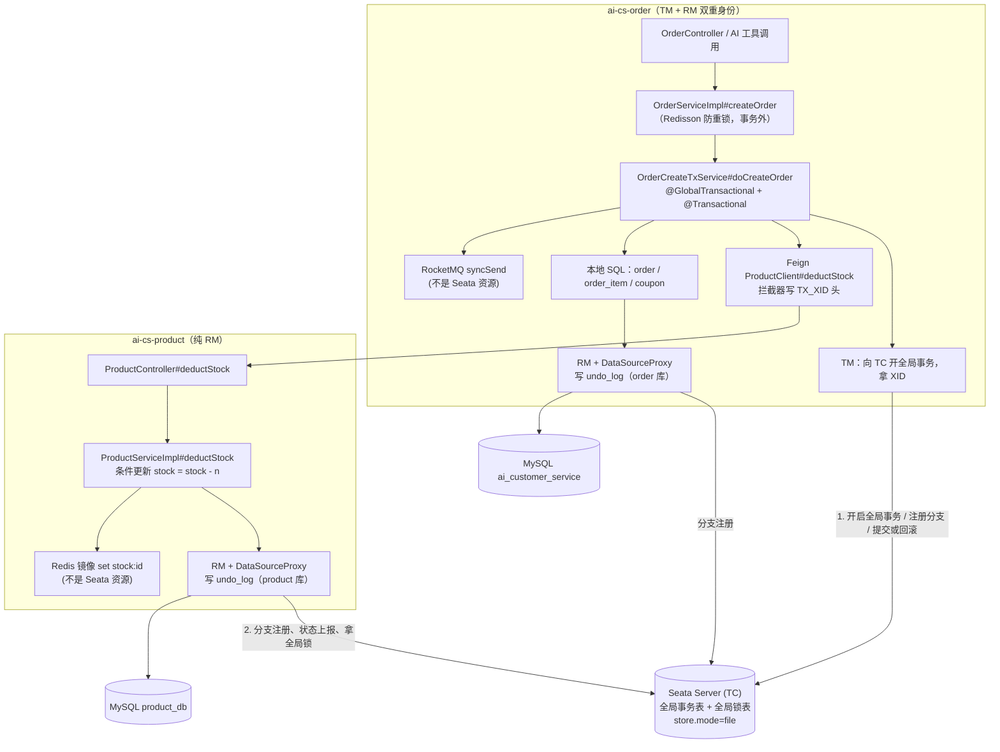
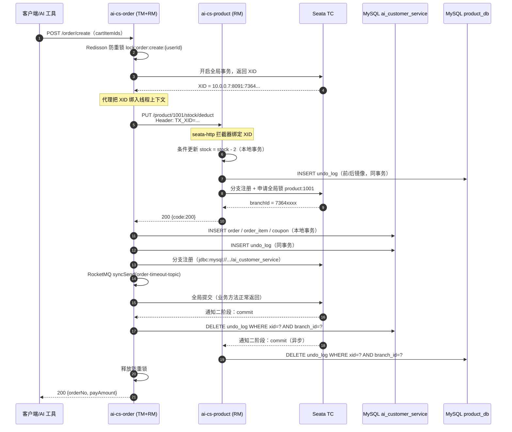

# Seata AT 分布式事务：下单扣库存时它到底做了什么，什么时候救不了你

> **一句话结论**：`OrderCreateTxService#doCreateOrder` 上的 `@GlobalTransactional` 把"扣库存 + 建订单 + 核销券"打包成一个全局事务（XID），order 库的 `order`/`order_item`/`coupon` 与 product 库的 `product.stock` 各自走"一阶段本地提交 + 写 undo_log、二阶段由 TC 驱动异步提交或反向补偿"；但 **undo_log 只记录"被 Seata 数据源代理接管的关系型库写操作"**——Redis 库存镜像、RocketMQ 延迟消息、Feign 响应体里的失败码、`@CacheEvict` 的缓存删除，全都不在保护范围内。
> **阅读前置**：能读懂 Spring 声明式事务的代理机制（`@Transactional` 为什么必须走代理）、JDBC 本地事务、OpenFeign 调用。本篇不要求读过 Seata 源码——Seata 2.7.0 在 Maven Central 无 `-sources.jar`，`24-源码分析/assets/source/` 里也没有任何 Seata 摘录，所以**本篇 A 级证据 0 处、不给 Seata 类标行号**，Seata 侧一律标"依据官方文档"。
> **证据基线**：JDK 17.0.19 / Spring Framework 7.1.0 / Spring Boot 4.2.0 / Spring Cloud 2026.0.0（子项目 5.1.0）/ Spring Cloud Alibaba 2025.1.0.0；文档事实基线 Seata 2.7.0，**但本仓库 pom 与容器实锁 1.7.1**（§7 有完整说明）。A 级 5 处（Spring 事务侧源码摘录，去重后 5 个锚点）、B 级 34 处（本项目代码/配置/SQL，去重后）、C 级 3 组（本机可复现命令）。预计阅读 35 分钟。

---

## 0. 先看现象

这四个现象，前两个是"以为它管了、其实没管"，后两个是"它确实管了、但你要付账"。

**现象 1：全局回滚了，数据库的库存回去了，Redis 的库存没回去。**

```text
mysql> SELECT id, stock FROM product_db.product WHERE id = 1001;
+------+-------+
| id   | stock |
+------+-------+
| 1001 |    50 |   -- DB 已被 AT 二阶段反向补偿回滚到 50
+------+-------+

redis> GET stock:1001
"47"                -- Redis 镜像停在 47：一阶段扣减后写入的那个值
```

看起来像"Seata 回滚不彻底"，实际是 AT 的回滚边界问题：`deductStock` 在**同一个本地事务里**既更了 MySQL，又写了 Redis 镜像（`ai-cs-product/src/main/java/com/aics/product/service/impl/ProductServiceImpl.java#L209-L211`）。undo_log 里只有 MySQL 的前后镜像，Redis 没有"前镜像"可言，二阶段补偿自然补不到它。

**现象 2：库存不足，下单接口却返回成功，订单照样落库。**

```text
2026-11-27T10:21:44.812+08:00  INFO  [order] Begin new global transaction [10.0.0.7:8091:7364...]
2026-11-27T10:21:44.888+08:00  INFO  [order] branch register success, xid:... branchId:7364... resourceId:jdbc:mysql://mysql:3306/ai_customer_service
2026-11-27T10:21:44.905+08:00  WARN  [product] 业务异常 [PUT] /product/1001/stock/deduct: code=4004, msg=商品库存不足，当前库存: 0
2026-11-27T10:21:44.912+08:00  INFO  [order] 订单创建成功: orderNo=202611271021448812 payAmount=199.00
2026-11-27T10:21:44.913+08:00  INFO  [order] Branch commit / Global commit
```

日志示意（级别与文案取自本项目 logback 输出，XID/订单号已脱敏）。这条链最刺眼的地方是：**product 侧明明报了业务异常，order 侧却"订单创建成功"并且全局提交了**。根因在 `ai-cs-common/src/main/java/com/aics/common/exception/GlobalExceptionHandler.java#L35-L39`——`handleBusinessException` 只 `return Result.fail(...)`，**没有 `@ResponseStatus`**，HTTP 状态码仍是 200；Feign 默认只在非 2xx 时抛异常，于是 `deductStock` 正常返回一个 `code=4004` 的 `Result`，而调用点 `ai-cs-order/src/main/java/com/aics/order/service/impl/OrderCreateTxService.java#L93-L95` **把返回值丢了**。一阶段已提交、TC 认为分支成功，全局事务没有任何理由回滚。

**现象 3：`undo_log` 表暴涨，磁盘告警。**

```sql
mysql> SELECT COUNT(*) AS rows_total,
    ->        SUM(log_status = 1) AS defensive,
    ->        MIN(log_created) AS oldest
    -> FROM product_db.undo_log;
+------------+-----------+---------------------+
| rows_total | defensive | oldest              |
+------------+-----------+---------------------+
|    1284391 |        17 | 2026-09-02 08:11:03 |
+------------+-----------+---------------------+
```

AT 的"二阶段异步提交"意思是：全局提交后，TC 通知各 RM 删掉本次分支的 undo_log；删除是异步的、且依赖 TC 能再次通知到 RM。TC 重启丢会话、RM 下线、网络抖动之后，这批 undo_log 就永远躺在那儿——每行 `rollback_info` 是 `LONGBLOB`，前后镜像都在里面。

**现象 4：爆款商品下单 RT 从 60ms 抖到 900ms，日志里刷全局锁冲突。**

```text
io.seata.rm.datasource.exec.LockConflictException: get global lock fail, xid:10.0.0.7:8091:7364..., lockKeys: product:1001
	at io.seata.rm.datasource.exec.LockRetryController.sleep(...)
	... 30 attempts ...
```

这不是 bug，是 AT 的全局锁在工作：同一个 `product:1001` 的写，在**全局事务结束前**都要向 TC 申请全局锁，拿不到就按 `client.rm.lock.retryInterval` × `retryTimes` 重试。同一商品的并发下单被串行化，RT 抖动是设计代价，不是故障。

> 这些现象指向同一件事：**AT 只保护"被 Seata 数据源代理接管的 DB 写"，而"事务边界有没有真的打开""失败有没有以异常的形式抛出去""被写的到底是不是 DB"这三件事，AT 一个都不负责。**

---

## 1. 整体地图

AT 模式没有"中心调度器帮你执行 SQL"这回事，它只在**每个服务进程内**包一层数据源代理，把 SQL 执行前后的镜像写进本地 undo_log，然后把"我做了哪些行的改动"报给 TC。



> **读图说明**：
> 1. 图里唯一"始终在线"的第三者是 TC（Seata Server，本项目 `SEATA_ADDR` 默认 `127.0.0.1:8091`）；TM 和 RM 都是**嵌在业务进程里的客户端库**，不是独立服务——这点决定了"TC 挂了会怎样"（§6）。
> 2. 两处最容易被忽略的"擦边"箭头：`A8`（MQ 发送）和 `B4`（Redis 写）。它们不走 DataSourceProxy，因此既没有 undo_log、也不参与二阶段，是本篇 §3.7 的主角。
> 3. `A2 → A3` 分成两个 Bean 不是风格问题：`createOrder` 若直接写注解并调用同类方法，代理被绕过，事务根本不生效（§3.5、`docs/28-故障案例库.md` 的 C1）。
> 4. 全局锁由 TC 持有（图里 `B3 → TC`），**不是**数据库行锁，所以 `SHOW ENGINE INNODB STATUS` 里查不到它。

| 组件 | 责任 | 本项目落点 | 调用方/被谁调 |
| --- | --- | --- | --- |
| TC（Transaction Coordinator） | 维护全局事务与分支状态、驱动二阶段、持有全局锁 | `tools/seata/seata/`（1.7.1）、`deploy/docker-compose/docker-compose-host1.yml#L92-L105` 的 `seata-server` | 被所有 TM/RM 通过 RPC 调用 |
| TM（Transaction Manager） | 定义全局事务边界：begin / commit / rollback | `OrderCreateTxService#doCreateOrder`（`@GlobalTransactional`） | 被 `OrderServiceImpl#createOrder` 调用 |
| RM（Resource Manager） | 管一个库：注册分支、写 undo_log、执行二阶段、申请全局锁 | order 与 product 各自的数据源代理 | 被本地事务流程隐式驱动 |
| 全局事务 XID | 贯穿全链路的唯一标识，形如 `ip:port:transactionId` | `TX_XID` HTTP 头 / `RootContext.getXID()` | Feign 客户端、seata-http 服务端 |
| undo_log | 一阶段把前后镜像落库，二阶段据此补偿 | `deploy/mysql/seata-undo-log.sql#L14-L23`（order 库）、`#L25-L34`（product 库） | 数据源代理独写独读 |

---

## 2. 关键概念与关键类

先把术语钉死（首次出现的都在这张表里解释）：

| 术语 | 含义 | 一句话记忆 |
| --- | --- | --- |
| 全局事务（Global Transaction） | 跨多个库/服务的一组本地事务，全部提交或全部回滚 | 由 TC 记账，TM 起止 |
| 分支事务（Branch Transaction） | 某个 RM 上的一个本地事务，注册到全局事务下拿一个 `branchId` | 一个库一个分支，**不是**一个方法一个分支 |
| 两阶段（2PC 变体） | 一阶段各分支本地提交并留 undo_log；二阶段异步删 log 或反向补偿 | 一阶段"先干了再说"，二阶段"不对就撤回" |
| 前镜像/后镜像（before/after image） | 改动前和改动后那几行的完整字段值，序列化后存 `rollback_info` | 回滚靠前镜像，冲突校验靠后镜像 |
| 全局锁（Global Lock） | TC 侧按"表名:主键"维度登记的行级锁，覆盖整个全局事务期间 | 防的是跨服务的脏写，不是 DB 行锁 |
| AT 资源 | 被 `DataSourceProxy` 接管的数据源 | 没有代理 = 没有 AT |

Seata 侧的关键类名（**依据官方实现，仅表示"有这么个类"，本篇不提供行号**）：

| 名称 | 位置 | 角色 | 关键方法/字段 |
| --- | --- | --- | --- |
| `@GlobalTransactional` | `io.seata.spring.annotation` | 标记全局事务边界，可配 `name`/`timeoutMills`/`rollbackFor` | 被 `GlobalTransactionalInterceptor` 拦截 |
| `GlobalTransactionScanner` | `io.seata.spring.annotation` | 扫描 `@GlobalTransactional` 并生成代理 | `AbstractAutoProxyCreator` 子类 |
| `GlobalTransactionalInterceptor` | 同上 | 拦截标记方法，调 `TransactionalTemplate` | `invoke()` |
| `TransactionalTemplate` | `io.seata.tm.api` | TM 的模板：begin → 业务 → commit/rollback | `execute()` |
| `RootContext` | `io.seata.core.context` | 当前线程 XID 的 ThreadLocal 容器 | `getXID()` / `bind()` / `unbind()` |
| `DataSourceProxy` / `ConnectionProxy` / `StatementProxy` | `io.seata.rm.datasource` | 包住 JDBC，产生镜像、写 undo_log、申请全局锁 | `prepareStatement` / `execute` |
| `UpdateExecutor`（及 `Insert`/`Delete` 变体） | `io.seata.rm.datasource.exec` | SQL 执行前后取镜像、生成反向 SQL | `beforeImage()` / `afterImage()` |
| `UndoLogManager` | `io.seata.rm.datasource.undo` | 序列化/反序列化 undo_log，二阶段回滚入口 | `undo()` / `deleteUndoLog()` |
| `LockRetryController` | `io.seata.rm.datasource.exec` | 全局锁冲突时的重试睡眠 | `sleep()` / `retryLock()` |
| `SeataFeignRequestInterceptor` | `spring-cloud-starter-alibaba-seata` | 把 XID 写进 `TX_XID` 请求头 | `apply()` |
| `JakartaSeataWebMvcConfigurer` | `io.seata:seata-http` | 服务端从 `TX_XID` 头恢复绑定 | `addInterceptors()` |

请注意最后两行：**XID 的跨服务传播不是 Seata 核心做的，是"客户端 Feign 拦截器 + 服务端 MVC 拦截器"这一对拼出来的**——这解释了为什么本项目 product 侧要多引一个依赖（`ai-cs-product/pom.xml#L125-L135` 的 `io.seata:seata-http`），而 order 侧不需要。

本项目的关键类（B 级，行号已核对）：

| 名称 | 位置 | 角色 | 关键方法 |
| --- | --- | --- | --- |
| `OrderCreateTxService` | `ai-cs-order/src/main/java/com/aics/order/service/impl/OrderCreateTxService.java#L78-L95` | 全局+本地事务边界、调 product 扣库存 | `doCreateOrder` |
| `OrderServiceImpl` | `ai-cs-order/src/main/java/com/aics/order/service/impl/OrderServiceImpl.java#L50-L60` | 事务外做防重锁，再委托事务 Bean | `createOrder` / `refundConfirm` / `doCancelOrder` |
| `OrderCreateLockService` | `ai-cs-order/src/main/java/com/aics/order/lock/OrderCreateLockService.java#L44-L63` | Redisson 用户级防重锁 | `withCreateLock` |
| `ProductClient` | `ai-cs-order/src/main/java/com/aics/order/client/ProductClient.java#L35-L42` | Feign 契约：扣/补库存 | `deductStock` / `restoreStock` |
| `ProductServiceImpl` | `ai-cs-product/src/main/java/com/aics/product/service/impl/ProductServiceImpl.java#L189-L213` | 条件更新扣库存 + 同步 Redis 镜像 | `deductStock` / `restoreStock` |
| `GlobalExceptionHandler` | `ai-cs-common/src/main/java/com/aics/common/exception/GlobalExceptionHandler.java#L35-L39` | 业务异常 → HTTP 200 + `Result.fail` | `handleBusinessException` |

---

## 3. 原理与证据逐段精读

### 3.1 三角色与 XID 的产生：一次下单里 XID 是怎么冒出来的

**在干什么**：`doCreateOrder` 被代理拦截后，TM 先向 TC 申请一个全局事务，拿到 `XID`；`XID` 被绑到当前线程（`RootContext`），后续任何 RM 操作、任何 Feign 调用都从这里取。

```java
// ai-cs-order/src/main/java/com/aics/order/service/impl/OrderCreateTxService.java#L78-L80
@GlobalTransactional(rollbackFor = Exception.class, name = "order-create")
@Transactional(rollbackFor = Exception.class)
public OrderVO doCreateOrder(Long userId, List<Long> cartItemIds, Long couponId, String paymentMethod) {
```

依据官方文档，`@GlobalTransactional` 生效需要三件事同时成立，缺一件就只有"半个事务"：

| 前提 | 本项目现状 | 证据 |
| --- | --- | --- |
| 调用必须穿过代理（不能自调用） | 拆成独立 Bean，由 `OrderServiceImpl` 注入调用 | `OrderServiceImpl.java#L57-L60` |
| 客户端要引 seata starter 且 `seata.enabled=true` | order/product 都引了；两边的 yml 都开着 | `ai-cs-order/pom.xml#L148-L152`、`ai-cs-order/src/main/resources/application.yml#L35-L49` |
| 数据源要被代理（`enable-auto-data-source-proxy`） | 两边都 `true`，模式 `AT` | `ai-cs-order/src/main/resources/application.yml#L48-L49` |

本地事务那一半也一样"绑在线程上"——Spring 把 JDBC 连接作为资源绑到当前线程，绑第二次会直接抛错：

```java
// (src: TransactionSynchronizationManager.java#L160-L177)
/**
 * Bind the given resource for the given key to the current thread.
 * <p><b>Note: Any bound resource needs to get explicitly unbound through
 * {@link #unbindResource}. For automatic unbinding after transaction
 * completion, use {@link #bindSynchronizedResource} instead.</b>
 * ...
 */
public static void bindResource(Object key, Object value) throws IllegalStateException {
	Object actualKey = TransactionSynchronizationUtils.unwrapResourceIfNecessary(key);
	Object oldValue = doBindResource(actualKey, value);
	if (oldValue != null) {
		throw new IllegalStateException(
				"Already value [" + oldValue + "] for key [" + actualKey + "] bound to thread");
	}
}
```

**为什么这么设计**：全局事务的"边界"不能靠数据库，只能靠一个**能跨进程传递的字符串**。XID 就是那个字符串；TM/RM 都只是它的读写者。把 XID 放 ThreadLocal + HTTP 头，等于用"线程上下文 + 请求头"两条最廉价的通道完成了分布式上下文传播，代价是**一旦线程切换或跨线程池，XID 就丢了**——同理，`bindResource` 的那句 `bound to thread` 也说明本地事务的连接归属是线程，不是"方法调用"。两套机制住在同一个线程里，这就是为什么它们总是一起生效、也一起失效。

**换写法会怎样**：如果用裸 `RestTemplate` 调 product，XID 不会自动写进请求头，product 侧 `RootContext.getXID()` 为 null，`deductStock` 就变成一个普通本地事务——它照样扣库存，但**不是分支事务**，全局回滚时谁也补不回来。这也是本项目坚持用 Feign 而不是 `RestTemplate` 的真实原因（`ai-cs-order/src/main/java/com/aics/order/client/ProductClient.java#L27` 的 `@FeignClient`；传播细节见姊妹篇 [07-服务调用统一与SeataXID传播](./07-服务调用统一与SeataXID传播.md)）。

**常见坑**：在全局事务里用 `@Async`、线程池、`CompletableFuture` 里发起的 DB 写或 RPC，XID 不会自动传过去，表现为"日志里一个分支都没有，回滚也回滚不到它"。

### 3.2 一阶段：本地事务与 undo_log 是同一次提交

**在干什么**：product 侧执行 `UPDATE ... SET stock = stock - n` 时，`StatementProxy` 先查前镜像、执行、再查后镜像，把两份镜像序列化后 `INSERT INTO undo_log`，然后**和业务 SQL 在同一个本地事务里一起提交**。

```sql
-- deploy/mysql/seata-undo-log.sql#L14-L23（order 库；product 库见 #L25-L34）
CREATE TABLE IF NOT EXISTS ai_customer_service.undo_log (
    branch_id     BIGINT       NOT NULL COMMENT '分支事务ID',
    xid           VARCHAR(128) NOT NULL COMMENT '全局事务ID',
    context       VARCHAR(128) NOT NULL COMMENT '上下文（序列化方式等）',
    rollback_info LONGBLOB     NOT NULL COMMENT '前后镜像数据',
    log_status    INT          NOT NULL COMMENT '状态：0-正常 1-防御状态',
    log_created   DATETIME(6)  NOT NULL COMMENT '创建时间',
    log_modified  DATETIME(6)  NOT NULL COMMENT '修改时间',
    UNIQUE KEY ux_undo_log (xid, branch_id)
) ENGINE = InnoDB DEFAULT CHARSET = utf8mb4 COMMENT = 'Seata AT undo_log（order 库）';
```

业务侧的扣减是"条件更新"，本身已是原子的：

```java
// ai-cs-product/src/main/java/com/aics/product/service/impl/ProductServiceImpl.java#L195-L208
int rows = productMapper.update(null, new LambdaUpdateWrapper<Product>()
        .eq(Product::getId, productId)
        .ge(Product::getStock, quantity)
        .setSql("stock = stock - " + quantity)
        .setSql("sales = sales + " + quantity));
if (rows == 0) {
    Product product = productMapper.selectById(productId);
    if (product == null) {
        throw new BusinessException(ResultCode.PRODUCT_NOT_FOUND, "商品不存在");
    }
    throw new BusinessException(ResultCode.PRODUCT_STOCK_INSUFFICIENT,
            "商品库存不足，当前库存: " + product.getStock());
}
```

**为什么这么设计**：两阶段提交的经典难题是"一阶段提交后、二阶段决定前崩溃"。AT 的答案是：**把'怎么撤回'这件事，连同业务改动一起原地落盘**。undo_log 与业务 SQL 同事务提交，意味着"只要业务改动可见，撤回信息就一定可见"——不需要额外的 WAL，也不需要 TC 存 SQL。这也是 `UNIQUE KEY (xid, branch_id)` 存在的理由：分支重试注册时靠它做幂等。

**换写法会怎样**：如果 undo_log 与业务 SQL 分两次提交，就会出现"业务已提交但撤回信息丢失"的窗口，二阶段只能干瞪眼。所以**不要手动往 undo_log 里插数据、也不要改表名**——表名 `undo_log` 是硬编码的。

**常见坑**：一阶段提交意味着**脏数据对其他事务是可见的**（`stock` 真的少了），AT 靠的是"全局锁 + 二阶段补偿"，而不是隔离。所以：
- 别人用普通连接读 product 库，会在全局事务进行中读到"已扣但可能回滚"的库存；
- 一阶段本地事务里做非 DB 副作用（Redis、MQ、文件），这些副作用**没有容器装它们**——这就是现象 1。

### 3.3 二阶段：异步提交只删日志，回滚才生成反向 SQL

**在干什么**：全局提交时，TC 通知各 RM 删掉该 `xid` 的 undo_log（异步、可批量）；全局回滚时，RM 按 undo_log 里的**前镜像 + 后镜像校验**生成反向 SQL 并执行，同时还要做"空回滚/悬挂"防护。

| 二阶段动作 | 触发条件 | 做什么 | 幂等保证 |
| --- | --- | --- | --- |
| 异步提交（Commit） | 全局事务成功 | 删除 `undo_log where xid=? and branch_id=?` | 删除天然幂等；删不掉会长留（现象 3） |
| 反向补偿（Rollback） | 全局事务失败 | 校验后镜像未被他人改过 → 用前镜像生成 `UPDATE ... SET 各列=旧值 WHERE 主键=...` | `ux_undo_log` 唯一键 + `log_status` 防御位 |
| 防御（`log_status=1`） | 镜像与当前数据不一致 | 拒绝自动补偿，留人工/告警处理 | 避免"把别人的改动覆盖掉" |

依据官方文档，回滚阶段的校验逻辑是：用前镜像 + 后镜像**拼出一条"当前数据必须是后镜像"的校验 SQL**，查到了才补偿；查不到说明数据已被外部改动，置 `log_status=1` 放弃自动回滚。这句话解释了为什么**手工改过的行，AT 不敢回滚**——它怕覆盖你的改动。

**为什么这么设计**：AT 的目标是"业务零侵入"，那就不能像 XA 那样全程锁住资源。于是它把"强一致"换成"最终一致 + 事后校验"，把成本从"全局事务期间的锁等待"挪到"二阶段的一次反查 + 一次反向 SQL"。

**换写法会怎样**：换成 XA，一阶段是 `prepare` 而不是提交，`stock` 对外不可见，隔离性好但资源占用时间长、还要数据库支持 XA；换成 TCC，就没有 undo_log 这套东西了，改由你手写 `try/confirm/cancel` 三个方法，靠业务幂等表兜底（对照见 §5）。

**常见坑**：
- **二阶段是异步的，所以"提交成功"之后的一小段时间里 undo_log 还在**，别看到残留就以为没提交成功；
- 回滚依赖"主键"，`undo_log` 里存的是主键定位方式，**无主键表的更新会退化成全表条件匹配，甚至拒绝**（依据官方文档对无主键表的限制）；
- 一阶段把 `sales = sales + n` 一起改了，回滚时这两个字段都会还原——但如果业务里存在"跨全局事务的并发自增"，前镜像会冲突，走 `log_status=1` 分支。

### 3.4 全局锁防的是"跨服务的脏写"，不是数据库行锁

**在干什么**：分支事务提交前，RM 把本次改动的行（`表名:主键值`）报给 TC 申请全局锁；TC 登记后一直持有到全局事务结束。别人想改同一行，得先拿到锁，拿不到就在 `LockRetryController` 里睡一会儿再试。

```text
配置项（依据官方文档的默认值，本项目未显式覆盖）：
client.rm.lock.retryInterval = 10   # 每次重试间隔（ms）
client.rm.lock.retryTimes    = 30   # 重试次数；用尽后抛 LockConflictException
```

**为什么这么设计**：一阶段已经提交，"回滚"本质是补偿。如果 A 事务扣了 `product:1001` 又回滚，而 B 事务在这期间把同一行改成了别的值，A 的补偿就会覆盖 B 的写——这就是脏写。全局锁把"同一行的全局事务"串起来，让补偿有意义。注意它**只在 AT 的写路径上生效**，直连数据库的普通更新完全不受约束。

**换写法会怎样**：不用全局锁（例如关掉 `client.rm.lock` 相关校验）能换来吞吐，代价是并发场景下的补偿可能覆盖别人的写，`log_status=1` 与人工对账会变多。业务上更强硬的替代是**把热点行拆开**（库存分桶）或**串行化入口**——本项目在入口处已经有一层用户级防重锁：

```java
// ai-cs-order/src/main/java/com/aics/order/lock/OrderCreateLockService.java#L44-L53
public <T> T withCreateLock(Long userId, Supplier<T> action) {
    RLock lock = redissonClient.getLock(KEY_PREFIX + userId);
    boolean acquired = false;
    try {
        // waitTime=0：快速失败；未指定 leaseTime → 触发看门狗自动续期
        acquired = lock.tryLock(0, TimeUnit.SECONDS);
        if (!acquired) {
            log.warn("下单防重锁竞争失败: userId={}", userId);
            throw new BusinessException(ResultCode.TOO_MANY_REQUESTS, "您有订单正在创建中，请勿重复提交");
        }
```

**常见坑**：
- 这把锁的粒度是 **userId**，防的是"同一用户重复下单"，**防不住"不同用户抢同一件商品"**——后者才轮到全局锁，所以爆款场景 RT 抖动依旧（现象 4）；
- 锁在**全局事务外层**（`OrderServiceImpl.java#L57-L60` 先加锁再进事务），这是对的：锁内不空占事务资源，否则 30s 看门狗续期会和全局事务超时打架；
- `tryLock(0, ...)` 意味着并发下单直接失败，别在压测里把它误判成"锁坏了"。

### 3.5 `@GlobalTransactional` 和 `@Transactional` 谁在外层，以及自调用为什么会全废

**在干什么**：两个注解叠在同一方法上时，实际是**两层 Spring AOP 代理**：外层开全局事务（绑 XID），内层开本地事务（绑 JDBC 连接）。顺序必须是"全局在外、本地在内"，因为本地事务的提交/回滚必须发生在全局事务决议之前。

```java
// (src: TransactionInterceptor.java#L118-L135)
// Work out the target class: may be {@code null}.
// The TransactionAttributeSource should be passed the target class
// as well as the method, which may be from an interface.
Class<?> targetClass = (invocation.getThis() != null ? AopUtils.getTargetClass(invocation.getThis()) : null);

// Adapt to TransactionAspectSupport's invokeWithinTransaction...
return invokeWithinTransaction(invocation.getMethod(), targetClass, new InvocationCallback() {
	@Override
	public @Nullable Object proceedWithInvocation() throws Throwable {
		return invocation.proceed();
	}
```

这段是 Spring 本地事务代理的入口：先算目标类、再进 `invokeWithinTransaction`。真正决定"新建还是加入"的，是事务管理器：

```java
// (src: AbstractPlatformTransactionManager.java#L372-L384)
@Override
public final TransactionStatus getTransaction(@Nullable TransactionDefinition definition)
		throws TransactionException {

	// Use defaults if no transaction definition given.
	TransactionDefinition def = (definition != null ? definition : TransactionDefinition.withDefaults());

	Object transaction = doGetTransaction();
	boolean debugEnabled = logger.isDebugEnabled();

	if (isExistingTransaction(transaction)) {
		// Existing transaction found -> check propagation behavior to find out how to behave.
		return handleExistingTransaction(def, transaction, debugEnabled);
	}
```

```java
// (src: AbstractPlatformTransactionManager.java#L494-L499)
// PROPAGATION_REQUIRED, PROPAGATION_SUPPORTS, PROPAGATION_MANDATORY:
// regular participation in existing transaction.
if (debugEnabled) {
	logger.debug("Participating in existing transaction");
}
if (isValidateExistingTransaction()) {
```

**这三段合起来说清两件事**：
1. 本地事务的"加入"语义只看**当前线程有没有已绑定的 `TransactionSynchronization`/资源**（`isExistingTransaction`），不看方法名、不看调用栈——所以"同一个方法被自己调用"时，只要代理没经过，就压根没有事务，连"加入"的机会都没有。
2. 全局事务的 XID 也是**线程级**上下文（`RootContext` 的 ThreadLocal）。两个代理都靠"线程上下文"传递状态，因此**任何绕过代理的调用、任何换线程的执行，都会同时废掉两层**。

用 Spring 提供的探针可以精确验证这一点——本项目就是这么测的：

```java
// ai-cs-order/src/test/java/com/aics/order/service/impl/OrderCreateTxWiringTest.java#L88-L99
// 在 orderMapper.insert 被调用的瞬间检查当前线程是否绑定了事务
AtomicBoolean transactionActive = new AtomicBoolean(false);
when(orderMapper.insert(any(Order.class))).thenAnswer(invocation -> {
    transactionActive.set(TransactionSynchronizationManager.isActualTransactionActive());
    return 1;
});

orderService.createOrder(1L, List.of(100L), null, "MOCK");

assertThat(transactionActive.get())
        .as("doCreateOrder 必须在事务中执行；若为 false，说明 @Transactional 被同类自调用绕过（docs/28 C1）")
        .isTrue();
```

`isActualTransactionActive()` 的语义在源码里写得很清楚：

```java
// (src: TransactionSynchronizationManager.java#L488-L501)
/**
 * Return whether there currently is an actual transaction active.
 * This indicates whether the current thread is associated with an actual
 * transaction rather than just with active transaction synchronization.
 * ...
 */
public static boolean isActualTransactionActive() {
	return (actualTransactionActive.get() != null);
}
```

**换写法会怎样**：如果不拆 Bean，而是把注解直接写在 `createOrder` 上、内部 `this.doCreateOrder()`，那么 `doCreateOrder` 的两个注解都失效——`docs/28-故障案例库.md` 的 C1 就是这么踩的，修复前测试断言 `Expecting value to be true but was false`（证明方法根本不在事务里），修复后走"拆 Bean"方案，`Tests run: 85, Failures: 0, Errors: 0`。备选方案（`@Lazy` 注入自身代理、`TransactionTemplate`、`AopContext.currentProxy()`）都能让本地事务生效，但**全局事务仍然要求调用穿过拦截器**，所以拆 Bean 是最省心的。

**常见坑**：`rollbackFor` 要写。`@Transactional` 默认只对 `RuntimeException` 回滚；`@GlobalTransactional` 的 `rollbackFor` 也只管"抛出去的异常"。两者都**只认异常**，不认返回值——这正好接上 §0 现象 2。

### 3.6 undo_log 表结构与清理

**在干什么**：`undo_log` 是"撤回数据的行李箱"。每一列都有具体用途：

| 列 | 类型 | 用途 | 排障时的读法 |
| --- | --- | --- | --- |
| `branch_id` | BIGINT | 分支事务 ID，由 TC 分配 | 与日志 `branchId` 对齐，定位是哪个库哪个分支 |
| `xid` | VARCHAR(128) | 全局事务 ID，形如 `ip:port:txId` | 与日志 `Begin new global transaction [xid]` 对齐 |
| `context` | VARCHAR(128) | 序列化方式等上下文 | 一般是 `serializer=jackson` 之类；换序列化器后老记录可能读不了 |
| `rollback_info` | LONGBLOB | 前后镜像（JSON/压缩后） | 表暴涨的主因，平均每行几 KB 到几十 KB |
| `log_status` | INT | 0 正常 / 1 防御状态 | **`=1` 的行必须人工处理**，它表示自动回滚已放弃 |
| `log_created` / `log_modified` | DATETIME(6) | 落库/最后修改时间 | 按 `log_created` 找僵尸行 |

清理有两条路径，**不要手写 DELETE 当日常运维**：

```sql
-- 只看不改：确认僵尸 undo_log 的年龄与数量（本项目排障用的巡检 SQL）
SELECT xid, branch_id, log_status, log_created,
       ROUND(LENGTH(rollback_info)/1024) AS kb
FROM product_db.undo_log
WHERE log_created < NOW() - INTERVAL 2 HOUR
ORDER BY log_created
LIMIT 20;
```

正常情况下二阶段提交会把这些行删掉；超过 2 小时还在，说明 TC 没有完成二阶段通知（TC 重启、file 存储丢会话、RM 下线）。**正确处置顺序**：先看 TC 日志里这些 XID 是否已 `commit/rollback` → 确认业务数据已一致 → 再按 `xid` 精确删除 → 对 `log_status=1` 的行单独对账。

**为什么这么设计**：undo_log 必须与业务库同库（才能同事务提交），所以它天然是"每个参与库各一张"。这也意味着**它跟着业务库一起扩容、一起备份、一起被慢查询拖累**。本项目把它显式建在两个库里，就是让这件事可见：

```text
deploy/mysql/seata-undo-log.sql
├── ai_customer_service.undo_log   (order：order / order_item / coupon 的改动)
└── product_db.undo_log            (product：product.stock 的改动)
```

**换写法会怎样**：把 undo_log 放到独立库/独立实例，就丢掉了"同事务提交"这个根本前提，AT 直接不成立。这也是"跨库事务内做 RPC"这类场景 AT 无能为力的原因之一。

**常见坑**：
- 新库、新环境上线**只建了业务表、忘了 undo_log**，第一个分支写日志就报 `Table 'xxx.undo_log' doesn't exist`；
- `log_status=1` 是**证据不是垃圾**，删之前一定先对账；
- 分库分表后每个物理库都要有，数量等于物理库数。

### 3.7 AT 的边界：一次下单里，它管不到的四类写

**在干什么**：把 `doCreateOrder` 从头到尾的每个副作用列出来，标注"谁负责回滚"：

| 步骤 | 代码位置 | 是 AT 资源？ | 全局回滚时谁负责 |
| --- | --- | --- | --- |
| 扣 product 库存（DB） | `ProductServiceImpl.java#L195-L208` | ✅ 是 | undo_log 反向补偿 |
| 写 order / order_item / coupon | `OrderCreateTxService.java#L117-L141` | ✅ 是 | undo_log 反向补偿 |
| 写 Redis 库存镜像 | `ProductServiceImpl.java#L209-L211` | ❌ 否 | **没人管**（现象 1） |
| 发 RocketMQ 延迟消息 | `OrderCreateTxService.java#L143-L146` | ❌ 否 | **没人管** |
| 删本地缓存 `@CacheEvict` | `ProductServiceImpl.java#L191` | ❌ 否 | **没人管** |
| Feign 响应体里的失败码 | `OrderCreateTxService.java#L93-L95` | ❌ 不是"写" | **没人检查**（现象 2） |

MQ 这一条，本项目在代码里已经写下了"自我安慰"式的结论：

```java
// ai-cs-order/src/main/java/com/aics/order/service/impl/OrderCreateTxService.java#L87-L95
// 2. 实时扣减库存（以商品服务 DB 为权威源，原子扣减）
//    学习要点（Seata AT）：扣库存是 Feign 调用 product 的分支事务——XID 随请求头传播，
//    product 侧数据源代理生成 undo_log；任一环节失败（如库存不足），
//    全局事务二阶段回滚时按 undo_log 反向补偿已提交的分支，无需手写「失败回滚」。
//    注意：MQ 不是 Seata 资源，全局回滚时下方延迟消息已发出——但消费侧
//    cancelExpiredOrder 查不到订单会直接返回，天然幂等安全。
for (CartItem item : cartItems) {
    productClient.deductStock(item.getProductId(), item.getQuantity());
}
```

**为什么这么设计**：MQ 的"回滚"只能是业务补偿（消费侧查不到订单就跳过）。这段注释的推理是成立的，但它揭示了一个必须写进心里的原则：**凡是非 DB 副作用，都必须自证幂等或自带补偿**。

**换写法会怎样**：
- 想让 MQ 可靠，改成"事务消息 + 本地事务表"或"发消息放到事务提交后（`TransactionSynchronization#afterCommit`）"；
- 想让 Redis 镜像可靠，把它从本地事务里挪出去，改成"DB 提交后同步/订阅 binlog 同步"，或者干脆不缓存库存、只缓存展示；
- 想让失败码可靠，**必须在调用点检查 `Result#getCode`**，或统一把业务失败映射成非 2xx（§9 练习 2）。

**常见坑**：`@CacheEvict` 在方法抛异常时不执行、在事务回滚后也不会"回补"，缓存与 DB 短暂不一致是设计内的；但如果你依赖缓存做库存校验，就会出现"回滚了、库存回来了、用户看到的还是 0"。

---

## 4. 一次完整执行时序

正常路径（下单两件商品，库存充足）：



> **读图说明**：
> 1. 关键分水岭在第 20 步（全局提交）——**在它之前，DB 里的改动早已可见**；AT 的"提交"只是删日志。
> 2. 第 12 步的 `INSERT undo_log` 与业务 SQL 是**同一个本地事务**（图里画成两步，实际同一次 commit）。
> 3. 第 21、23 步的删除是异步的，所以接口返回后立刻查 `undo_log` 可能还看得到——不是 bug（§3.3）。
> 4. 第 21/23 步失败不会让全局事务失败，只会留垃圾（现象 3）。

失败路径与"哪一步失败报什么错"：

| 失败点 | 现象 | 报错原文/关键字 | 全局事务动作 |
| --- | --- | --- | --- |
| product 库存不足（业务异常） | 接口可能仍返回成功 | `code=4004, msg=商品库存不足`（HTTP 200） | **不回滚**（现象 2） |
| product 服务不可用 | 下单失败 | `BusinessException: 商品服务暂不可用，下单失败`（fallback 抛出） | 回滚 |
| 全局锁拿不到 | RT 抖动后失败 | `LockConflictException: get global lock fail, lockKeys: product:1001` | 回滚 |
| 分支注册失败 | 下单失败 | `can not register branch` / `RM register failed` | 回滚 |
| 二阶段补偿时数据被改 | 回滚不彻底 | 日志 `undo_log` 校验不通过，`log_status` 置 1 | 已"回滚"，留人工 |
| 一阶段 SQL 抛 `Error`（如主键冲突） | 下单失败 | 原生 SQLException | 回滚（异常穿透） |
| 事务超时（默认 60s） | 下单"成功"但仍回滚 | `Global transaction timeout` / `TransactionException: global transaction timeout` | 回滚 |

---

## 5. 设计取舍

**结论先说**：本项目选 AT，是因为下单链路"三个库的一次性写 + 零业务侵入"这个组合下，只有 AT 的成本最低；一旦链路里出现外部系统（支付渠道、短信、MQ 必达），AT 就不再是正确选择，必须换 TCC/SAGA 或加补偿表。

| 维度 | AT（本项目） | TCC | SAGA | XA |
| --- | --- | --- | --- | --- |
| 业务侵入 | 无（只加注解） | 高（三个方法 + 幂等/悬挂处理） | 中（每步一个补偿） | 无 |
| 一阶段是否提交 | 提交 | 不提交（Try 只是预占） | 提交 | `prepare`（未提交） |
| 隔离性 | 弱（脏读可见，靠全局锁） | 由业务设计决定 | 无 | 强 |
| 回滚方式 | undo_log 反向 SQL | Cancel 接口 | 反向业务动作 | 数据库回滚 |
| 资源要求 | 必须是支持本地事务的关系型库 | 任意（含非 DB） | 任意 | 需 DB/中间件支持 XA |
| 典型失败 | 锁冲突、undo_log 堆积、非 DB 副作用漏保护 | 空回滚/悬挂/幂等三件套写漏 | 补偿不可逆（发过的短信收不回） | 性能与连接占用 |
| 本项目的边界 | 下单扣库存、订单/券落库 | 支付渠道扣款（宜用） | 跨系统履约 | 未使用 |

**可扩展点清单**（在不换模式的前提下，能就地加固的地方）：

1. `OrderCreateTxService#L93-L95`：检查 `Result#getCode`，失败即抛——**最高优先级**，它决定"下单能不能在库存不足时停下来"。
2. `GlobalExceptionHandler#L35-L39`：给 `BusinessException` 加 `@ResponseStatus`，或为 Feign 配 `ErrorDecoder`，让"业务失败"对调用方等价于"HTTP 失败"。
3. 为全局事务加显式 `timeoutMills`，避免默认 60s 与接口 SLA 错配。
4. `product` 侧的 Redis 镜像写入移出本地事务（`afterCommit` 或 binlog 同步），消除现象 1。
5. 为 `undo_log` 加巡检任务（§3.6 的 SQL）+ `log_status=1` 告警。
6. 热点商品库存分桶或排队，降低全局锁冲突（现象 4）。
7. 把"下单"里可异步的部分（发券通知、积分）拆到事务外，缩短全局事务持有时间。

---

## 6. 踩坑与调试手法

**先给结论**：AT 的问题九成集中在四处——**边界没开、异常没抛、资源不认识、日志被清理**。下面每条都给出可执行的定位手段。

**① 断点位置：确认 undo_log 真的被写了**

在 `ProductServiceImpl#deductStock` 的条件更新那一行（`ProductServiceImpl.java#L195`）下断点，观察调用栈：正常应看到 `ConnectionProxy.prepareStatement` → `StatementProxy.executeUpdate` → `UpdateExecutor.beforeImage/afterImage`。**如果栈里只有 `HikariProxyPreparedStatement`、没有 Seata 的 Proxy**，说明数据源没被代理（`enable-auto-data-source-proxy` 没生效或数据源是手工 new 的），此时扣库存根本不是分支事务。

**② 断点位置：确认 XID 在 product 侧存在**

在 `ProductController#deductStock`（`ai-cs-product/src/main/java/com/aics/product/controller/ProductController.java#L134-L140`）第一行下断点，`Evaluate` 里执行 `io.seata.core.context.RootContext.getXID()`：
- 返回 null → XID 没传过来：查 Feign 是否走了拦截器（是否用了裸 HTTP 客户端）、`TX_XID` 头是否被网关/反代丢掉；
- 返回非 null 但仍无 undo_log → 数据源没代理（回到 ①）。

**③ 日志关键字表（对着 grep，比读代码快）**

```text
order/product 侧（RM/TM）
  Begin new global transaction [        → TM 已开全局事务，含 XID
  branch register success               → 分支注册成功，含 branchId
  Branch commit / Branch rollback       → 二阶段通知到达
  get global lock fail                  → 全局锁冲突（现象 4）
  Global transaction timeout            → 全局事务超时（默认 60s）
  Failed to register / can not register → 分支注册失败
  Already value [...] bound to thread   → 资源重复绑定：多数据源/手动 new DataSource 与自动代理打架
TC 侧（tools/seata/seata/logs 或容器日志）
  Transaction begin / commit / rollback → 全局事务生命周期
  undo undo_log for xid                 → 二阶段回滚执行
  Global lock ... conflict              → 锁竞争，定位热点 key
```

**④ 命令巡检：undo_log 与 TC 存储**

```sql
-- 当前"在飞"的全局事务分支（正常只应有秒级存活的行）
SELECT xid, branch_id, log_status, log_created FROM ai_customer_service.undo_log
ORDER BY log_created DESC LIMIT 10;

-- 防御状态行：自动回滚已放弃，必须人工对账
SELECT xid, branch_id, log_created FROM product_db.undo_log WHERE log_status = 1;
```

TC 若用 `store.mode=file`（本项目本地就是这样），二阶段状态在**内存 + 本地文件**里，**TC 一重启，未完成的全局事务就没人推进了**——这就是"undo_log 僵尸行"最常见的成因，也是 `store.mode=db` 在生产更稳的原因（依据官方文档）。

**⑤ 命令实测：TC 的 8091 到底从哪来**

客户端 `grouplist` 配的是 `127.0.0.1:8091`，但 TC 的配置文件里只有 `7091`——一开始会以为配错了。真相在配置注释里：

```text
PS> Select-String -Path tools\seata\seata\conf\application.yml -Pattern "^server:|  port:|^seata:|  registry:|    type:|  store:|    mode:|    service:"
15: server:
16:   port: 7091
37: seata:
40:     type: file
41:   registry:
43:     type: file
44:   store:
46:     mode: file
```

```yaml
# tools/seata/seata/conf/application.yml#L15-L48
server:
  port: 7091
...
  store:
    # support: file 、 db 、 redis
    mode: file
#  server:
#    service-port: 8091 #If not configured, the default is '${server.port} + 1000'
```

读法：`server.port=7091` 是**控制台端口**；`server.service-port` 被注释掉了，按注释规则取 `7091 + 1000 = 8091`，正好等于客户端 `grouplist`。所以"配置不一致"是错觉，**先按 port+1000 推一遍再改配置**。

**⑥ 坑：业务异常被"包装成成功"（本项目真实缺口）**

见 §0 现象 2。最快的一次性摸排命令是统计"哪些异常处理器没有设置 HTTP 状态"：

```text
PS> $t = Get-Content "ai-cs-common\src\main\java\com\aics\common\exception\GlobalExceptionHandler.java" -Raw -Encoding UTF8
PS> $parts = $t -split '@ExceptionHandler\('; $i=0; $rows=@()
PS> foreach ($p in $parts[1..($parts.Count-1)]) { $i++; $rows += [pscustomobject]@{ idx=$i; handled=(($p -split '\r?\n')[0]).Trim(')'); hasResponseStatus = ($p -match '@ResponseStatus') } }
PS> $rows | Format-Table -AutoSize; "带 @ResponseStatus 的处理器: " + ($rows | Where-Object hasResponseStatus).Count + " / " + $rows.Count

 idx handled                                  hasResponseStatus
 --- -------                                  -----------------
   1 BusinessException.class                              False
   2 MethodArgumentNotValidException.class                 True
   3 BindException.class                                   True
  ... （略）
  11 Exception.class                                       True
带 @ResponseStatus 的处理器: 10 / 11
```

读法：**11 个处理器里只有 `BusinessException` 没设状态码**，而它恰好是库存不足、券不可用这类"必须让调用方失败"的业务错误。Feign 只看 HTTP 状态，于是这些错误在跨服务调用里全部被降级成"成功"。`ProductClient` 的注释写着"库存不足返回 4xx → Feign 抛 FeignException"，**这条注释与实现不符**——这是文档与代码打架时要相信代码的典型案例。

**⑦ 坑：自调用把两层事务一起废掉**

症状：`@GlobalTransactional` 打了，日志里既没有 `Begin new global transaction`，也没有 `branch register`，但业务照跑。原因见 §3.5。验证方式：`TransactionSynchronizationManager.isActualTransactionActive()` 探针（`OrderCreateTxWiringTest.java#L88-L99`），或直接在 `doCreateOrder` 打一行 `RootContext.getXID()`——为 null 就是没进全局事务。

**⑧ 坑：把 Feign 超时当成"只是慢"**

`@GlobalTransactional` 期间每个 Feign 调用都持着 XID 和全局锁。product 慢 3 秒，全局锁就多持 3 秒，其他请求排队；再叠加 `spring.cloud.openfeign.circuitbreaker.enabled=true`（`ai-cs-order/src/main/resources/application.yml#L25-L31`）的降级，`deductStock` 会被 `ProductClientFallbackFactory` 抛成 `BusinessException`（`ai-cs-order/src/main/java/com/aics/order/client/fallback/ProductClientFallbackFactory.java#L36-L38`）——这次是**真异常**，全局事务会正确回滚。所以"降级"在写路径上的语义是"失败"，而不是"跳过"。

---

## 7. ⚠️ 版本差异

**结论先说**：本篇有两条版本线，**必须分开看**——(a) 文档事实基线是 Seata 2.7.0；(b) 本仓库 pom 与容器锁的是 **1.7.1**。两者不是"新旧写法"关系，而是"文档写的版本比仓库实跑的版本新"，阅读代码时以仓库为准，阅读机制时以官方文档为准。

```text
C:\...\ai-customer-service> Get-ChildItem tools\seata\seata\lib -Filter "seata-common-*.jar"
    seata-common-1.7.1.jar

C:\...\ai-customer-service> Select-String -Path .\pom.xml -Pattern "seata.version"
52:        <seata.version>1.7.1</seata.version>

C:\...\ai-customer-service> Select-String -Path deploy\docker-compose\docker-compose-host1.yml -Pattern "image: seataio|SEATA_PORT"
93:    image: seataio/seata-server:1.7.1
100:      SEATA_PORT: 8091
```

| 变化点 | 旧写法 | 当前基线 | 依据 | 迁移动作 |
| --- | --- | --- | --- | --- |
| Seata 版本 | 1.7.1（本仓库实锁，`pom.xml#L52`） | 2.7.0（文档基线） | 仓库 `pom.xml`、`tools/seata/seata/lib/`、`deploy/docker-compose/docker-compose-host1.yml#L92-L105` | 升级前先确认 `tx-service-group`/`vgroup-mapping` 键名与 TC 侧一致；本篇所述机制（AT 两阶段、undo_log、全局锁、XID 传播）在 1.x→2.x **未变** |
| 源码可查性 | `-sources.jar` 可下载 | **2.7.0 三个坐标的 sources jar 均为 404** | `24-源码分析/04-SpringCloud/07-分布式事务与链路追踪/01-分布式事务-seata-at模式源码.md` 已实测记录 | 任何"贴出来的 Seata 源码"都是伪证据；本篇 A 级 0 处即因此 |
| undo_log 表结构 | 1.0 起就是 `xid`+`branch_id`+`rollback_info` 七列 + `(xid, branch_id)` 唯一键 | 同左 | `deploy/mysql/seata-undo-log.sql#L14-L23`（依据官方 DDL） | 从 1.0 起**未变**；升级不需要改表，但需要复核字符集与 `LONGBLOB` 容量 |
| 客户端配置键 | `seata.enable-auto-data-source-proxy` | 同左（本项目两服务都在用） | `ai-cs-order/src/main/resources/application.yml#L48-L49` | 键名沿用；开启后**不要**再手工 new `DataSource`，否则绕开代理 |
| 注册/配置中心 | `registry.type=file` + `grouplist`（本地开发） | 生产宜 `nacos` | `ai-cs-order/src/main/resources/application.yml#L44-L47`（本项目明确注释"集群部署可切 nacos registry"） | 集群化时切 nacos，并确认 TC 注册的 `service-port` 可被客户端访问 |
| Spring Boot 4 相关 | `spring-boot-starter-web` | `spring-boot-starter-webmvc`（Boot 4 起原 starter deprecated） | 事实基线；本项目各业务模块已按新 starter | 新增服务时用 `webmvc` starter；`seata-http` 依赖的 MVC 拦截器按 Jakarta 命名空间装配 |
| Jackson | Boot 4 默认 Jackson 3（包名 `tools.jackson`） | 同左 | 事实基线 | undo_log 的 `context` 里记录序列化方式；**自定义序列化器升级时要考虑历史镜像**（老记录可能读不出来） |

---

## 8. 面试高频问与答

1. AT 模式的一阶段为什么要"提交"？提交了还能回滚，本质是什么？
2. TC、TM、RM 分别部署在哪里？TC 挂掉后正在跑的全局事务会怎样？
3. XID 是怎么从一个服务传到另一个服务的？`RestTemplate` 为什么传不过去？
4. undo_log 为什么必须和业务表在同一个库、同一个本地事务里？
5. 全局锁和数据库行锁有什么区别？全局锁解决的是什么问题？
6. 全局提交后 undo_log 没删掉，会影响业务吗？什么时候必须人工介入？
7. `log_status = 1` 意味着什么？为什么 AT 会"放弃"回滚？
8. `@GlobalTransactional` 和 `@Transactional` 叠在一个方法上，谁在外层？为什么不能反过来？
9. 同类自调用为什么会让两个注解同时失效？有哪几种修法，各自的代价是什么？
10. 库存不足这种"业务失败"，为什么可能不会触发全局回滚？怎么从网关到 Feign 一路杜绝？
11. AT、TCC、SAGA、XA 分别适合什么场景？支付渠道对接你选哪个，为什么？
12. 一阶段里写了 Redis / 发了 MQ / 删了缓存，全局回滚时怎么办？各给一个工程解法。
13. 热点商品并发下单，AT 下会出现什么问题？有哪些不换模式的缓解手段？
14. 生产环境 undo_log 每天涨几百万行，你怎么定位是"正常残留"还是"二阶段失败"？
15. 用 file 存储模式的 TC 适合生产吗？为什么？

---

## 9. 动手练习

每条都绑定到具体代码位置，做完必须能"用证据说话"。

**练习 1：让库存不足真的回滚（最高优先级）**

改 `ai-cs-order/src/main/java/com/aics/order/service/impl/OrderCreateTxService.java#L93-L95`，在循环里检查 `Result#getCode`，非成功即抛 `BusinessException`。
验收：在 `OrderCreateTxWiringTest` 里加一个"product 返回 `code=4004` 时 `doCreateOrder` 抛异常"的用例，先看它 RED（当前实现会静默通过），改完后 GREEN；再说明这与 `docs/28` 里"先红后绿"的纪律一致。

**练习 2：让业务失败对 Feign 可见（二选一）**

方案 A：给 `GlobalExceptionHandler#L35-L39` 加 `@ResponseStatus(HttpStatus.BAD_REQUEST)`；方案 B：在 order 侧注册一个 `ErrorDecoder`，把非 200 的 `code` 转成异常。
验收：用 `curl -i` 直接打 `PUT /product/{id}/stock/deduct?quantity=999999`，贴出改造前后的**状态行对比**（`HTTP/1.1 200` → `HTTP/1.1 400`），并说明为什么方案 A 会波及所有业务异常、方案 B 只影响调用方。

**练习 3：亲手看一次 undo_log 的生命周期**

在本地起 MySQL + TC，按 `deploy/mysql/seata-undo-log.sql` 建表，把 `logging.level.io.seata=DEBUG` 打开，跑一次下单，然后在 `product_db.undo_log` 上：一阶段结束后立刻 `SELECT`（应能看到 rows）→ 等 2 秒再 `SELECT`（应被删）。
验收：交出两条 SQL 的时间戳与行数变化截图/输出，并解释"为什么第二次查询为空不等于没执行二阶段"。

**练习 4：复现自调用失效**

把 `@GlobalTransactional` 从 `OrderCreateTxService#doCreateOrder` 挪到 `OrderServiceImpl#createOrder`（`OrderServiceImpl.java#L50-L60`），改成内部 `this.doCreateOrder(...)`。
验收：`OrderCreateTxWiringTest` 断言失败，日志里搜不到 `Begin new global transaction`；随后用 `@Lazy` 自注入代理修好，并写出"为什么全局事务比本地事务更怕自调用"的一段结论。

**练习 5：把 Redis 镜像移出事务**

把 `ProductServiceImpl.java#L209-L211` 的 Redis 写入改成"事务提交后同步"（`TransactionSynchronization#afterCommit` 或事件监听）。
验收：构造一次全局回滚（让 order 侧在建订单后抛异常），贴出改造前后 `GET stock:{id}` 与 `SELECT stock` 的一致性对比——改造前 DB 回滚而 Redis 不回滚，改造后两者一致；并说明失败回滚时"少扣一次"与"多补一次"哪个代价更高。

**练习 6：写一个 undo_log 巡检脚本**

基于 §3.6 的 SQL，写一个只读巡检：统计"超过阈值时长未删除的行数 + `log_status=1` 的行数"，输出到日志/指标。
验收：手工插一条伪造的 `undo_log`（`xid='test-xid', branch_id=1`，`rollback_info` 随便填），巡检能把它报出来；再按 `xid` 精确删掉，证明脚本不会误删他人数据。

---

## 小结

- **AT 全貌**：TM 开全局事务拿 XID → 各 RM 一阶段本地提交并写 undo_log → TC 二阶段通知"删日志（提交）"或"按前镜像反向补偿（回滚）"。三个角色里只有 TC 是独立进程。
- **XID 靠两条通道传播**：客户端 Feign 拦截器写 `TX_XID` 头、服务端 seata-http 拦截器绑回 `RootContext`。换 HTTP 客户端或换线程，XID 就断。
- **undo_log 是 AT 的全部底牌**：必须与业务 SQL 同库同事务提交，`UNIQUE(xid, branch_id)` 保证幂等，`log_status=1` 是"放弃自动回滚"的证据而不是垃圾。
- **全局锁买的是"补偿的正确性"**：一阶段已提交、改动对外可见，没有全局锁就会出现"回滚覆盖别人的写"，代价是热点行串行化、RT 抖动。
- **两个注解的层次**：全局在外、本地在内；都依赖代理 + 线程上下文，所以自调用会把两层一起废掉（本项目用"拆 Bean"解决，`OrderCreateTxWiringTest` 守住这条线）。
- **AT 的边界要背下来**：非关系型资源（Redis/MQ/文件）、Feign 响应体里的业务失败码、`@CacheEvict`、跨线程执行——一类都不在 undo_log 的保护里。
- **本项目当前最值得修的一处**：`GlobalExceptionHandler` 的 `BusinessException` 分支没有 `@ResponseStatus`（11 个处理器里唯一一个），叠上 `OrderCreateTxService#L93-L95` 丢弃返回值，导致"库存不足但全局提交"。
- **可操作归纳**：判断一个写操作"AT 管不管"只问三句——**它是不是 DB 写？它的数据源被代理了吗？失败时有没有异常抛出去？**三个"是"，AT 负责；任何一个"否"，你自己负责，并且要有幂等或补偿。

---

## 自测题

1. AT 模式的一阶段提交了本地事务，为什么还能回滚？
<details><summary>参考答案</summary>因为回滚信息已经随业务 SQL 落在同一个本地事务里（`undo_log.rollback_info` 存前后镜像），二阶段 RM 用 `UndoLogManager` 读前镜像生成反向 SQL 执行。它不是"撤销提交"，而是"提交后再做一次反向写"，所以必须靠全局锁和镜像校验保证补偿不会覆盖别人的改动。</details>

2. `undo_log` 的唯一键为什么是 `(xid, branch_id)`？
<details><summary>参考答案</summary>一个全局事务在每个 RM（库）上对应一个分支，`xid` 定全局事务、`branch_id` 定分支，组合即唯一。分支注册/重试是幂等的，重试时靠这个唯一键避免插入重复日志（DDL 见 `deploy/mysql/seata-undo-log.sql#L22`）。</details>

3. 全局提交时 undo_log 是怎样消失的？删不掉会怎样？
<details><summary>参考答案</summary>TC 二阶段通知各 RM 执行 `DELETE FROM undo_log WHERE xid=? AND branch_id=?`，异步执行。删不掉不影响业务正确性（数据已提交），但 `rollback_info` 是 LONGBLOB，长期堆积会撑大表、拖慢该库，需要巡检与清理（§3.6、§6 ④）。</details>

4. `log_status = 1` 是什么状态？出现后怎么处理？
<details><summary>参考答案</summary>防御状态：二阶段回滚时用前镜像/后镜像拼出的校验 SQL 查不到"当前数据仍是后镜像"，说明该行已被外部改动，AT 放弃自动补偿。处理方式是人工对账（对比镜像与实际值）后决定补偿还是接受现状，绝不能直接删行。</details>

5. 库存不足为什么可能不触发全局回滚？给出至少两层原因。
<details><summary>参考答案</summary>第一层在 HTTP：`GlobalExceptionHandler#handleBusinessException` 没有 `@ResponseStatus`，业务失败也是 HTTP 200，Feign 默认不抛异常；第二层在调用点：`OrderCreateTxService#L93-L95` 丢弃了 `Result` 的 `code`。两层叠加 → 分支一阶段提交、TC 认为成功 → 全局提交。</details>

6. `@GlobalTransactional` 和 `@Transactional` 叠在同一方法上，代理顺序为什么不能反过来？
<details><summary>参考答案</summary>全局事务必须先开，才能让内层本地事务的提交/回滚上报到正确的 XID；若本地在外层，它会在全局事务决议之前提交并向 TC 注册，全局回滚时该分支的边界已经不成立。两者都依赖代理和线程上下文（`RootContext`、`TransactionSynchronizationManager`），所以顺序由 advisor 顺序和"先 begin 全局再 begin 本地"的语义共同决定。</details>

7. 自调用为什么会让两个注解同时失效？本项目怎么修、怎么测？
<details><summary>参考答案</summary>自调用不经过代理，`@GlobalTransactional` 的 `GlobalTransactionalInterceptor` 和 `@Transactional` 的 `TransactionInterceptor` 都拦不到，XID 与 JDBC 资源都不会绑定。本项目拆出 `OrderCreateTxService` 由外部 Bean 调用（`OrderServiceImpl.java#L57-L60`），并用 `OrderCreateTxWiringTest` 里 `TransactionSynchronizationManager.isActualTransactionActive()` 断言守住（`#L88-L99`）。</details>

8. 全局锁和数据库行锁的区别是什么？为什么 `SHOW ENGINE INNODB STATUS` 看不到全局锁冲突？
<details><summary>参考答案</summary>数据库行锁在一阶段本地事务结束（提交）时释放；全局锁登记在 TC，持有到全局事务结束。全局锁不是 InnoDB 的锁，所以 InnoDB 的状态视图里没有它，冲突临床表现是客户端 `LockConflictException: get global lock fail`。</details>

9. 一阶段里写了 Redis 和发了 MQ，全局回滚时怎么处理？
<details><summary>参考答案</summary>AT 不管它们，必须业务自备幂等或补偿。MQ：消费侧判空（本项目 `cancelExpiredOrder` 查不到订单直接返回），或改事务消息/本地消息表、把发送移到 `afterCommit`。Redis：移到事务提交后同步或订阅 binlog 同步，不要放在本地事务里（`ProductServiceImpl.java#L209-L211` 就是反例）。</details>

10. TC 用 `store.mode=file` 有什么风险？和 undo_log 僵尸行什么关系？
<details><summary>参考答案</summary>file 模式下全局事务状态在内存 + 本地文件，TC 重启会丢失未完成的会话，二阶段通知再也发不出去，于是 RM 侧 undo_log 无人删除，形成僵尸行（现象 3）。生产宜 `store.mode=db`，本地开发（本项目 `tools/seata/seata/conf/application.yml#L44-L46`）用 file 可接受。</details>

11. 客户端 `grouplist` 写 8091，而 TC 配置里只有 `port: 7091`，谁错了？
<details><summary>参考答案</summary>都没错。`server.port` 是控制台端口，`server.service-port` 未配置时按官方规则取 `port + 1000 = 8091`（配置注释就在 `tools/seata/seata/conf/application.yml#L47-L48`）。所以客户端连 8091 是对的；排查连通性时先按 port+1000 推算，再动配置。</details>

12. 为什么本篇不贴 Seata 源码行号，却给了 Spring 事务的 `(src: ...)`？
<details><summary>参考答案</summary>Seata 2.7.0 在 Maven Central 无 `-sources.jar`（`24-源码分析` 的同主题篇章已实测记录），`assets/source/` 里也没有任何 Seata 摘录，贴出来就是伪证据；而 Spring Framework 7.1.0 的 `TransactionInterceptor`、`AbstractPlatformTransactionManager`、`TransactionSynchronizationManager` 有可验证摘录，所以只用它们来证明"本地事务/代理"这一半的机制，Seata 侧一律标"依据官方文档"。</details>

13. 如果 product 的扣库存方法改成了 MongoDB 写入，AT 还能用吗？
<details><summary>参考答案</summary>不能。AT 要求资源是能被 `DataSourceProxy` 接管的关系型数据源，才有"前后镜像 + undo_log + 局部事务"这套机制。非关系型只能走 TCC/SAGA（Cancel 由业务实现）或最终一致（对账 + 补偿表）。这也是"AT 失效场景"里最硬的一条边界。</details>
