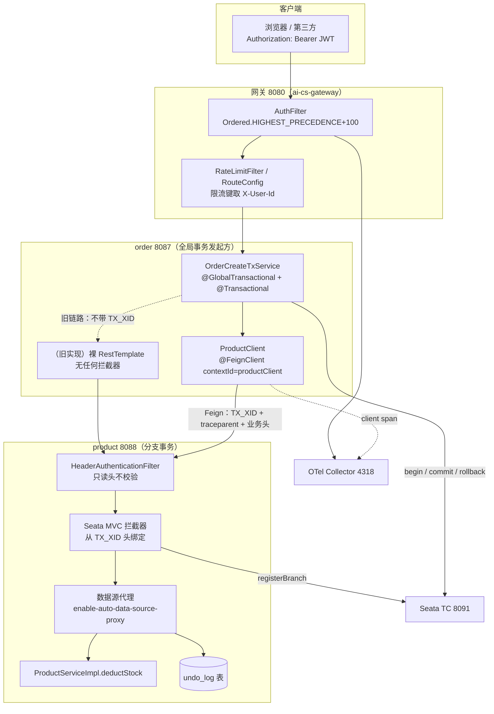
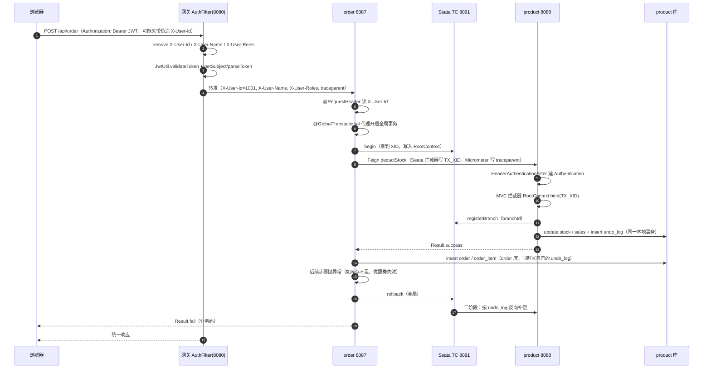

# 07. 服务调用统一与 Seata XID 传播

> **一句话结论**：一次下单从网关 → order → product 要跨三跳，身份（`X-User-Id` 等）、链路标识（`traceparent` / `requestId`）、全局事务号（`TX_XID`）这三样东西都要跨进程搬运；每一类都有"**发起方注入 → 接收方绑定 → 用完清理**"三段式，缺任何一段都**不抛异常**，只是悄悄失效。
> **阅读前置**：先读 [06-Seata分布式事务AT模式.md](./06-Seata分布式事务AT模式.md)（知道 AT 的 undo_log 与两阶段）、[08-Feign熔断与降级语义.md](./08-Feign熔断与降级语义.md)（知道 Feign 的 fallbackFactory），再看 [../24-源码分析/04-SpringCloud/03-负载均衡与调用/02-openfeign-动态代理与请求拼接.md](../24-源码分析/04-SpringCloud/03-负载均衡与调用/02-openfeign-动态代理与请求拼接.md) 补 Feign 动态代理细节。
> **证据基线**：JDK 17（本地 17.0.19）/ Spring Boot 4.2.0 / Spring Cloud 2026.0.0（`spring-cloud-openfeign-core` 5.1.0、`spring-cloud-gateway-server-webflux` 5.1.0）/ Spring Cloud Alibaba 2025.1.0.0 / **Seata 1.7.1（项目根 pom 实际钉住的版本，与你手上的 2.7.0 基线不一致，差异与迁移动作见 §7）**。A 级证据取自 `24-源码分析/assets/source/` 的机械抓取摘录；B 级为本仓库源码（行号当次核对）；C 级为离线可复现命令（javap / jar 清单）。预计阅读 50 分钟。

## 0. 先看现象

### 现象 1：库存扣掉了没回滚，product 库的 `undo_log` 一行都没有

order 侧下单失败后会看到这样的两条日志（文本取自本项目真实日志语句）：

```text
# order 服务（全局事务发起方）
订单创建成功: orderNo=SO202611270001, userId=1001, payAmount=199.00
# product 服务（被调用的分支）
库存扣减成功(实时): productId=88, quantity=2, remaining=18
```

前者来自 `ai-cs-order/src/main/java/com/aics/order/service/impl/OrderCreateTxService.java#L156`，后者来自 `ai-cs-product/src/main/java/com/aics/product/service/impl/ProductServiceImpl.java#L212`。问题出在"失败之后"：order 里后续步骤抛了业务异常（例如 `ResultCode.PRODUCT_STOCK_INSUFFICIENT`，消息原文 `商品库存不足`），`@GlobalTransactional` 按理要把已经扣掉的库存反向补偿回来，可是库存停在 18 再没动过；此时用 `mysql -e "select xid,branch_id from product_db.undo_log"` 查，结果是空表——**product 这一支从来没注册成 AT 分支事务**，它只是自己开了一个本地事务提交完就结束了。

这类故障最难受的地方是：它不报错。全局事务以为自己"回滚成功"，product 以为自己"扣减成功"，只有库存数字是错的。

### 现象 2：三条日志明明是同一次请求，却串不起来

下单链路上会同时出现 order 与 product 的日志，但每条日志里都没有任何可以关联的字段：

```text
2026-11-27T10:42:11.317  INFO 1 --- [ai-cs-order] [http-nio-8087-exec-4] c.a.o.s.i.OrderCreateTxService : 订单创建成功: orderNo=SO202611270001, userId=1001, payAmount=199.00
2026-11-27T10:42:11.298  INFO 1 --- [ai-cs-product] [http-nio-8088-exec-2] c.a.p.s.i.ProductServiceImpl  : 库存扣减成功(实时): productId=88, quantity=2, remaining=18
```

两行只能靠时间戳猜先后。原因是本项目**没有任何 `logback-spring.xml`**（全仓库只剩 `ai-cs-order/eff-order.xml` 这个 Maven 产物带 logback 字样），也没有任何地方写 `%X{...}` MDC 占位符，日志 pattern 用的是 Spring Boot 默认值；默认 pattern 不含 MDC，所以哪怕 `TraceContextHolder` 已经往 MDC 塞了 `requestId`、哪怕 Seata 已经往 MDC 塞了 XID，也一个都不会打印出来。

### 现象 3：把网关绕过，`X-User-Id` 就变成了"想要谁就是谁"

`ai-cs-user/src/main/java/com/aics/user/security/HeaderAuthenticationFilter.java#L17-L23` 的类注释写得很直白：本过滤器**不校验 JWT**，认证是网关 `AuthFilter` 做的，"客户端直连服务端口必须禁止"。也就是说，谁把 `X-User-Id: 1002` 直接打到 `8087`（order 端口），谁就能用 1002 的身份查订单。网关测试里对这种注入行为有明确断言，失败信息原文是 `下游应只收到可信 X-User-Id`（`ai-cs-gateway/src/test/java/com/aics/gateway/guardrail/GatewayGuardrailSteps.java#L135-L144`）——注意它守的是"下游收到的头"，不是"下游自己会校验"。

这三个现象指向同一件事：**身份、链路 ID、XID 都是跨进程上下文，它们的正确性不靠接收方自觉，而靠一条"注入—绑定—清理"的链路；链路上任何一段没接上，业务代码都不会报错，只会默默算错账。**

## 1. 整体地图



> **读图说明**：图里最关键的是从 `ProductClient` 到 `HeaderAuthenticationFilter` 那条实线——**它一根线同时带了三种上下文**（业务身份头、`TX_XID`、`traceparent`），而且这三样分别由三套不同机制写入，任何一套没配好，另外两套仍然能正常工作，所以故障表现只会在其中一类上出现；其次是 `TX -.-> RT` 这条虚线，它代表被删掉的旧 RestTemplate 链路，**不带 `TX_XID`**，这正是现象 1 的历史成因。看错的地方通常是把 `DS --> UL` 当成"Seata 自动帮你记 undo_log"——不是，前提是 `enable-auto-data-source-proxy: true` 且 SQL 真的走了被代理的数据源。

组件与责任一眼看清：

| 组件 | 位置 | 责任 | 谁调用它 |
| --- | --- | --- | --- |
| `AuthFilter` | `ai-cs-gateway` | 唯一认证点：验 JWT，**先删**客户端传来的 `X-User-Id`/`X-User-Name`/`X-User-Roles`，**再注入**从 JWT 解析出的可信值 | Gateway 过滤器链（`HIGHEST_PRECEDENCE + 100`） |
| `RateLimitFilter` / `UserKeyResolver` | `ai-cs-gateway` | 用 `X-User-Id` 做限流桶键，未认证退化为 IP | 认证之后 |
| `HeaderAuthenticationFilter` | `ai-cs-user` | 把 `X-User-Id` 头变成 `SecurityContext` 的 `Authentication`，**不校验真伪** | Servlet 容器（`OncePerRequestFilter`） |
| `ProductClient` | `ai-cs-order` | 声明式契约，`@RequestHeader` 参数负责业务头 | `OrderCreateTxService` |
| Seata Feign 拦截器 | `spring-cloud-starter-alibaba-seata` 内置 | 全局事务内把 `RootContext.getXID()` 写进 `TX_XID` 头 | Feign 的 `RequestInterceptor` 链 |
| Seata MVC 拦截器 | `seata-http` / `seata-spring-boot-starter` | 从 `TX_XID` 头 `RootContext.bind(xid)`，请求结束 `unbind` | Spring MVC `HandlerInterceptor` |
| 数据源代理 | Seata 自动配置 | 每条 DML 前写 `undo_log`、向 TC 注册分支 | MyBatis / 事务管理器 |
| `TraceContextHolder` / `TraceInterceptor` | `ai-cs-chat` | 自建 `requestId` → MDC + ThreadLocal，落 `llm_trace` | `ObservabilityWebConfig` 注册在 `/chat/**`、`/agent/**` |

三类上下文各自靠什么载体、断了会怎样：

| 上下文 | 进程内载体 | 跨进程载体 | 断了的表现 |
| --- | --- | --- | --- |
| 身份 | `SecurityContextHolder` / `ChatUserContext`（ThreadLocal） | HTTP header `X-User-Id` / `X-User-Name` / `X-User-Roles` | 401/403，或**越权查到别人数据**（更常见） |
| 链路 | MDC、Micrometer `Observation` / OTel `Context` | W3C `traceparent` 头 | 日志无法串联、trace 断成两个根 span |
| 全局事务 | Seata `RootContext`（ThreadLocal） | HTTP header `TX_XID` | 分支退化为本地事务，**回滚补偿不到** |

## 2. 关键概念与关键类

| 名称 | 位置 | 角色 | 关键方法 / 字段 |
| --- | --- | --- | --- |
| `AuthFilter` | `ai-cs-gateway/src/main/java/com/aics/gateway/filter/AuthFilter.java` | 身份唯一签发点 | `filter()`（L106-169）、`tryApiKeyAuth()`（L188-221）、`getOrder()` = `HIGHEST_PRECEDENCE + 100` |
| `HeaderAuthenticationFilter` | `ai-cs-user/src/main/java/com/aics/user/security/HeaderAuthenticationFilter.java` | 身份消费点（服务端） | `doFilterInternal()`：读 `X-User-Id` → `UsernamePasswordAuthenticationToken` → `SecurityContextHolder`；`finally clearContext()`（L50-55） |
| `RateLimitFilter` | `ai-cs-gateway/src/main/java/com/aics/gateway/filter/RateLimitFilter.java` | 说明"认证前不可信" | L43 `USER_ID_HEADER`、L53 注释：认证前伪造可刷不同限流桶 |
| `RouteConfig` | `ai-cs-gateway/src/main/java/com/aics/gateway/config/RouteConfig.java` | 路由 + 限流键 + 重试范围 | `userKeyResolver()`（L155-167）、`addResilience()`（L174-187，重试只对 GET） |
| `ChatUserContext` | `ai-cs-chat/src/main/java/com/aics/chat/util/ChatUserContext.java` | 控制器 → 深层 `@Tool` 方法的身份传递 | `setUserId()` / `getUserId()` / `clear()`（L31-41） |
| `OrderFeignClient` | `ai-cs-chat/src/main/java/com/aics/chat/feign/OrderFeignClient.java` | 显式头部传递的范例 | `getOrderDetail(@RequestHeader("X-User-Id") Long userId, ...)`（L25-27） |
| `ProductClient` | `ai-cs-order/src/main/java/com/aics/order/client/ProductClient.java` | 分支事务入口 | `deductStock()`（L35-36）、`restoreStock()`（L41-42） |
| `FeignClientFactoryBean` | A 级：`FeignClientFactoryBean.java` | 组装每个 Feign 客户端的 `Builder` | `configureUsingConfiguration()`（L205-267）、`addDefaultRequestHeaders()`（L395-405）、`getInheritedAwareInstances()`（L437-444） |
| `FeignClientsConfiguration` | A 级：`FeignClientsConfiguration.java` | Feign 的默认 Bean 来源 | `feignRetryer()` 返回 `Retryer.NEVER_RETRY`（L148-152）、`MicrometerConfiguration`（L290-310） |
| `SpringMvcContract` | A 级：`SpringMvcContract.java` | 把方法参数注解翻译成请求部件 | `getDefaultAnnotatedArgumentsProcessors()`：含 `RequestHeaderParameterProcessor`（L451-464） |
| `FeignBlockingLoadBalancerClient` | A 级：`FeignBlockingLoadBalancerClient.java` | 选实例后重建 URL | `execute()`（L79-112）、`buildRequest()`（L114-117，headers 原样带入） |
| `RootContext` | Seata（C 级 javap 实测） | 全局事务号的进程内载体 | `KEY_XID="TX_XID"`、`getXID()`、`bind(String)`、`unbind()`、`inGlobalTransaction()` |
| `TransactionPropagationInterceptor` | `seata-http`（C 级 javap 实测） | 接收方从 header 绑定 XID | `preHandle(javax.servlet...)`、`bindXid(String)`、`cleanXid(String)` |
| `TraceContextHolder` | `ai-cs-chat/src/main/java/com/aics/chat/observability/TraceContextHolder.java` | 自建链路 ID 的 ThreadLocal + MDC | `begin()`（L40-61）、`restore()`（L87-95）、`clear()`（L104-107）、`MDC_REQUEST_ID="requestId"` |
| `TraceSpanObservationHandler` | `ai-cs-chat/src/main/java/com/aics/chat/observability/TraceSpanObservationHandler.java` | 把 Micrometer `Observation` 桥到业务 `TraceContext` | `onStop()`（L41-93） |

术语先对齐：**MDC**（Mapped Diagnostic Context）是 SLF4J 给线程挂的"日志附带字段"表，日志 pattern 里写 `%X{key}` 才会打印；**Observation** 是 Micrometer 的观测抽象，一个 Observation 通常对应一个 span；**AT 分支事务**是 Seata 里"被全局事务裹住的一次本地事务 + undo_log"。

## 3. 原理与证据逐段精读

### 3.1 身份头：网关先"删干净"再"注入真值"

**这一段在干什么**：`AuthFilter` 是整条链路上唯一验证凭证的地方，它做两件事——把客户端可能伪造的身份头全部 `remove`，再用 JWT 里的值 `header(...)` 写回去。

```java
// ai-cs-gateway/src/main/java/com/aics/gateway/filter/AuthFilter.java#L155-L163
.headers(headers -> {
    headers.remove(USER_ID_HEADER);
    headers.remove(USER_NAME_HEADER);
    headers.remove(USER_ROLES_HEADER);
})
.header(USER_ID_HEADER, userId)
.header(USER_NAME_HEADER, String.valueOf(claims.get("username")))
.header(USER_ROLES_HEADER, normalizedRole)
.build();
```

同一个方法里，白名单分支（`/user/login`、`/v3/api-docs` 等，L83-96）也会做同样的 `remove`，只是不注入——因为登录接口不需要身份，但也没有理由把伪造的身份放进去。

**为什么这么设计**：HTTP 头是"最后一层获胜"的语义，`headers.remove` 后 `header` 才保证下游拿到的是唯一值；`ServerHttpRequest.mutate()` 返回新对象，不动原始请求，便于过滤器链上其它组件按需取用。角色还要做 `ROLE_` 前缀归一（L150-151），因为下游 `HeaderAuthenticationFilter` 直接把字符串塞进 `SimpleGrantedAuthority`，前缀不对 `@PreAuthorize("hasRole('ADMIN')")` 就永远不成立。

**换写法会怎样**：如果只在"认证成功"分支删除而不在"白名单"分支删除，那么 `POST /api/user/login` 这条公开路径就成了一条把任意 `X-User-Id` 送进用户服务的通道；如果改用"覆盖而不删除"，`HTTPS` 层以下任何中间代理、日志回放工具、甚至 `curl` 多发一次头，都可能让下游收到两个 `X-User-Id`，而 `getFirst()` 取到哪个取决于顺序——这就是无法复现的越权。

**常见坑**：网关只剥离"业务身份头"这一类。`RemoveHopByHopHeadersFilter` 剥的是标准跳转头（`connection`、`keep-alive`、`te` 等，见 [[源码:RemoveHopByHopHeadersFilter.java.md#L39-L46]]），它不会管 `X-User-Id`；所以"自定义头的清洗"必须自己写，别指望框架兜底。

### 3.2 服务间身份：项目里没有统一的 `RequestInterceptor`，靠参数显式传

**这一段在干什么**：order → product、chat → order 调用时，身份是**作为方法参数**一路写进 Feign 接口签名的：

```java
// ai-cs-chat/src/main/java/com/aics/chat/feign/OrderFeignClient.java#L25-L27
@GetMapping("/order/{orderNo}")
Result<OrderVO> getOrderDetail(@RequestHeader("X-User-Id") Long userId,
                               @PathVariable("orderNo") String orderNo);
```

`@RequestHeader` 不是给 Spring MVC 用的，而是给 Feign 的契约解析器用的。`SpringMvcContract` 在构造时注册了一批参数处理器，其中一个专门吃 `@RequestHeader`：

```java
// SpringMvcContract.java（spring-cloud-openfeign-core 5.1.0）#L455-L461
annotatedArgumentResolvers.add(new MatrixVariableParameterProcessor());
annotatedArgumentResolvers.add(new PathVariableParameterProcessor());
annotatedArgumentResolvers.add(new RequestParamParameterProcessor());
annotatedArgumentResolvers.add(new RequestHeaderParameterProcessor());
annotatedArgumentResolvers.add(new QueryMapParameterProcessor());
annotatedArgumentResolvers.add(new RequestPartParameterProcessor());
annotatedArgumentResolvers.add(new CookieValueParameterProcessor());
```

[[源码:SpringMvcContract.java.md#L451-L464]] 这段注册顺序说明了一件容易忽略的事：**接口方法上写什么注解，就是编译期定死的 HTTP 契约**，所以 `@RequestHeader("X-User-Id") Long userId` 既是"参数校验点"（漏传就 NPE 或 400），也是"文档"（读接口就知道要谁的身份）。

**为什么这么设计**：显式参数的最大好处是"身份来自哪里"在调用点可见，`userId` 从 Controller 里 `@RequestHeader` 读出来、一路传到工具方法、最后传到 Feign 参数，读代码就能追。代价是啰嗦：`ai-cs-order` 的 `CartController`/`OrderController`/`AfterSaleController` 共十几处 `@RequestHeader("X-User-Id")`，`ai-cs-chat` 的 11 个 Feign 客户端里只有带用户语义的那几个加了参数。

**换写法会怎样**：如果做一个全局 `RequestInterceptor` 从 `SecurityContextHolder`/`ThreadLocal` 取 userId 自动注入，接口签名会干净很多，但会立刻遇到"上下文从哪来"的问题——`ChatUserContext` 的注释已经把这个坑写死了：ThreadLocal 在**线程池复用**和**异步/流式**场景下会串用户（L17-21），所以它才要 `finally clear()`。对比一下 `ChatUserContext` 的三件套就明白项目为什么选择显式：

```java
// ai-cs-chat/src/main/java/com/aics/chat/util/ChatUserContext.java#L26-L41（结构示意）
private static final ThreadLocal<Long> USER_ID = ...;   // 每个请求线程一份
public static void setUserId(Long userId) { ... }        // Controller 读头后写入
public static Long getUserId() { ... }                   // 深层 @Tool 方法读取
public static void clear() { USER_ID.remove(); }         // finally 必须清
```

**常见坑**：`@RequestHeader Long userId` 这种写法在"内部调用没有身份"的场景会直接炸——比如定时任务触发下单。项目的做法是在工具层兜住：`AgentController` 里 `@RequestHeader(value = "X-User-Id", required = false)`，缺省时把上下文写成 `null`，业务再决定降级策略。反过来，`TraceInterceptor.preHandle` 读同一个头时也允许失败（`Long.valueOf` 包 `catch (NumberFormatException ignore)`），因为**观测不能变成业务故障点**（注释 L34-35）。

### 3.3 真要做统一注入：`RequestInterceptor` 的收集、排序与"不覆盖"语义

**这一段在干什么**：Feign 允许你注册 `RequestInterceptor`，在每个请求发出前改写 `RequestTemplate`。Spring Cloud 会在**构建每个 Feign 客户端代理**时把拦截器收集起来，排序后塞进 `Builder`：

```java
// FeignClientFactoryBean.java（spring-cloud-openfeign-core 5.1.0）#L236-L242
Map<String, RequestInterceptor> requestInterceptors = getInheritedAwareInstances(context,
        RequestInterceptor.class);
if (requestInterceptors != null) {
    List<RequestInterceptor> interceptors = new ArrayList<>(requestInterceptors.values());
    AnnotationAwareOrderComparator.sort(interceptors);
    builder.requestInterceptors(interceptors);
}
```

[[源码:FeignClientFactoryBean.java.md#L236-L242]]

三个细节值得记住：

1. **按 `@Order` 排序**：`AnnotationAwareOrderComparator.sort` 说明多个拦截器的执行顺序是可控的，而 header 是"后者覆盖前者"，顺序直接决定谁说了算。
2. **"继承父上下文"开关**：`getInheritedAwareInstances` 内部是 `inheritParentContext ? context.getInstances(...) : context.getInstancesWithoutAncestors(...)`（L437-444），字段 `inheritParentContext = true`（L113）。这就是为什么把 `@Bean RequestInterceptor` 放在 `@Configuration` 里会"意外"作用于所有 Feign 客户端，而放在 `@FeignClient(configuration = X.class)` 指定类里则是该客户端的私有配置。
3. **JSON 配置的头只补缺不覆盖**：

```java
// FeignClientFactoryBean.java#L397-L404
builder.requestInterceptor(requestTemplate -> {
    Map<String, Collection<String>> headers = requestTemplate.headers();
    defaultRequestHeaders.keySet().forEach(key -> {
        if (!headers.containsKey(key)) {
            requestTemplate.header(key, defaultRequestHeaders.get(key));
        }
    });
});
```

[[源码:FeignClientFactoryBean.java.md#L395-L405]] 这段是 `spring.cloud.openfeign.client.config.default.default-request-headers` 的实现——`if (!headers.containsKey(key))` 意味着它**只给没设置的头补值**，方法上显式 `@RequestHeader` 传的值赢。

**为什么这么设计**：Feign 的拦截器是"链 + 模板"模型，保留"只补缺"语义是为了让"全局默认值"和"单接口显式值"能共存且可预测；如果把 `default-request-headers` 做成覆盖，那就再也没法在某个接口上临时传另一个用户。

**换写法会怎样**：项目中**没有**自定义 `RequestInterceptor`（全仓库 `RequestInterceptor` 字符串只出现在 `ai-cs-order/src/main/java/com/aics/order/client/ProductClient.java#L20` 的注释里，讲的是 Seata 的内置拦截器）。要加一个身份透传拦截器，正确的形状大致是：

```java
// 示例：统一注入身份与租户（本项目当前没有这个类，仅示范写法）
@Configuration
public class IdentityHeaderInterceptor {
    @Bean
    public RequestInterceptor identityHeaders() {
        return template -> {
            Long userId = ChatUserContext.getUserId();          // 或从 SecurityContext 取
            if (userId != null && !template.headers().containsKey("X-User-Id")) {
                template.header("X-User-Id", String.valueOf(userId));
            }
            String tenant = TenantContext.current();
            if (tenant != null) {
                template.header("X-Tenant-Id", tenant);
            }
        };
    }
}
```

**常见坑**：①拦截器里无条件 `template.header("X-User-Id", ...)` 会盖掉方法参数显式传的值——同一个用户查 A 和查 B 就没法区分了；②把拦截器声明在 `@Configuration`（被 `@ComponentScan` 扫到）里，等于给所有 Feign 客户端都装上，包括调用第三方（`UnionpayChannel` 那种外网地址）的场景，身份头就泄给外部了；③拦截器拿不到请求上下文时不要抛异常，观测/传递类逻辑一律"取不到就当没有"。

### 3.4 XID 传播的三段式：注入 → 绑定 → 数据源代理

**这一段在干什么**：Seata 的全局事务号 XID 在进程内挂在线程上下文里，类是 `io.seata.core.context.RootContext`。用 `javap` 直接把它的常量与方法签名打出来（离线可复现，见 §6.7）：

```text
$ javap -classpath %USERPROFILE%\.m2\repository\io\seata\seata-core\1.7.1\seata-core-1.7.1.jar -p -constants io.seata.core.context.RootContext
  public static final java.lang.String KEY_XID = "TX_XID";
  public static final java.lang.String HIDDEN_KEY_XID = ".TX_XID";
  public static final java.lang.String KEY_TIMEOUT = "TX_TIMEOUT";
  public static final java.lang.String MDC_KEY_XID = "X-TX-XID";
  public static final java.lang.String MDC_KEY_BRANCH_ID = "X-TX-BRANCH-ID";
  public static final java.lang.String KEY_BRANCH_TYPE = "TX_BRANCH_TYPE";
  public static final java.lang.String KEY_GLOBAL_LOCK_FLAG = "TX_LOCK";
  public static java.lang.String getXID();
  public static void bind(java.lang.String);
  public static java.lang.String unbind();
  public static boolean inGlobalTransaction();
```

两条信息一眼可读：**`KEY_XID = "TX_XID"` 就是 HTTP 头名**（Seata 用同一个 key 既做 header 也做上下文键），**`MDC_KEY_XID = "X-TX-XID"`** 说明 Seata 自己会往 MDC 里塞 XID——这就是"日志里能打 `%X{X-TX-XID}`"的由来（项目自带的 Seata server 发行包 `tools/seata/seata/conf/logback/kafka-appender.xml` 的注释里就写着 `%X{X-TX-XID:-}|%X{X-TX-BRANCH-ID:-}`）。

分支事务成立要三段齐备，缺一不可：

| 段 | 责任方 | 证据 | 缺了会怎样 |
| --- | --- | --- | --- |
| ① 发起方注入 `TX_XID` 头 | SCA 的 `spring-cloud-starter-alibaba-seata` 内置 Feign 拦截器 | 本仓库无 Seata 源码摘录（Maven Central 无对应 sources 抽取），依据 `ai-cs-order/src/main/java/com/aics/order/client/ProductClient.java#L18-L21` 的注释 + SCA 官方文档 | product 收到的是"没有 XID 的普通请求" |
| ② 接收方绑定 XID | `seata-http` / starter 的 MVC 拦截器 | C 级：`javap` 出 `TransactionPropagationInterceptor`，含 `bindXid(String)` / `cleanXid(String)` | 就算头上有 XID，product 线程上下文里仍是 `null` |
| ③ 数据源代理 + `undo_log` | Seata 自动代理数据源 | `ai-cs-product/src/main/resources/application.yml` 的 `seata.enable-auto-data-source-proxy: true` + `deploy/mysql/seata-undo-log.sql` 建的两张 `undo_log`（order 库与 product 库各一张，`UNIQUE KEY ux_undo_log (xid, branch_id)`） | 分支能注册但没有回滚镜像，二阶段回滚时**无 SQL 可执行** |

接收方这一段的实现细节（C 级实测，这条直接决定 Boot 4 上能不能用）：

```text
$ javap -classpath ...\io\seata\seata-http\1.7.1\seata-http-1.7.1.jar -p io.seata.integration.http.HandlerInterceptorAdapter
public interface io.seata.integration.http.HandlerInterceptorAdapter extends org.springframework.web.servlet.HandlerInterceptor {
  public default boolean preHandle(javax.servlet.http.HttpServletRequest, javax.servlet.http.HttpServletResponse, java.lang.Object) throws java.lang.Exception;
  ...
}
```

注意 `javax.servlet`。Spring Framework 7.1.0（Boot 4.2 的基线）里 `HandlerInterceptor.preHandle` 的签名是 `jakarta.servlet.http.HttpServletRequest`，两者**不是同一个类型**。1.7.1 的 `seata-http` 里也没有 `JakartaSeataWebMvcConfigurer`（jar 清单只有 `SeataWebMvcConfigurer`、`TransactionPropagationInterceptor`、`HandlerInterceptorAdapter`、`XidResource`、`HttpExecutor` 等），只有 `org.apache.seata:seata-all:2.5.0` 才有 Jakarta 变体。而项目根 `pom.xml#L52` 把 `seata.version` 钉在 `1.7.1`，`product/pom.xml` 又是按这个属性拿 `seata-http`——所以"第 ② 段到底绑没绑上"必须实测，不能看配置推断（见 §7 与 §9 练习 3）。

**为什么这么设计**：Seata 把"跨进程传参"这件脏活压到两端的集成层（Feign 拦截器负责写、MVC 拦截器负责读），业务代码只看得见 `RootContext.getXID()`；这样 AT 模式对业务的侵入就是一行 `@GlobalTransactional`。代价是**集成层必须成对存在**：A 端有写、B 端没读，等于没配。

**换写法会怎样**：用 RestTemplate 就得自己往 header 塞 `TX_XID`——项目里 `ai-cs-pay/src/main/java/com/aics/pay/config/PayRestTemplateConfig.java#L12-L17` 就是反例：`new RestTemplate()`，没有任何拦截器，`ai-cs-pay/pom.xml` 里也既无 `seata` 也无 `openfeign`。它今天不出问题，只是因为 pay → order 的这几个接口（`ai-cs-pay/src/main/java/com/aics/pay/client/OrderPayClient.java#L25-L29`）本来就不在全局事务里；一旦有人在其中加扣款逻辑，同一个坑会再踩一次。

**常见坑**：①只加 `spring-cloud-starter-alibaba-seata` 不加 `seata-http`，接收方根本不会装配 MVC 拦截器（`@ConditionalOnClass` 判断的就是那几个类）；②加了 `seata-http` 但 `enable-auto-data-source-proxy: false`，分支能注册、undo_log 却没人写；③`@GlobalTransactional` 方法被**同类自调用**，代理不生效，全局事务压根没开——项目为此把下单拆到独立 Bean，`ai-cs-order/src/main/java/com/aics/order/service/impl/OrderCreateTxService.java#L34-L45` 的类注释说得很清楚（细节见 [15-SpringAOP与声明式事务原理.md](./15-SpringAOP与声明式事务原理.md)）。

### 3.5 链路 ID：项目里同时存在两套机制

**这一段在干什么**：一条请求要"可追"，需要给它一个 ID，并且这个 ID 要出现在三处：日志、跨进程的头、trace 后端。

第一套是**框架级**：Micrometer Tracing + OTLP。Feign 侧由上层装配提供观测能力：

| 事实 | 证据 |
| --- | --- |
| Feign 客户端默认带 Micrometer 观测能力 | `FeignClientsConfiguration` 的 `MicrometerConfiguration`（L290-310），条件 `spring.cloud.openfeign.micrometer.enabled`，`matchIfMissing = true` |
| 项目确实引了追踪桥与导出器 | `ai-cs-order/pom.xml`、`ai-cs-product/pom.xml`、`ai-cs-gateway/pom.xml` 都有 `micrometer-tracing-bridge-otel` + `opentelemetry-exporter-otlp` |
| 采样与导出端点 | `ai-cs-order/src/main/resources/application.yml` 的 `management.tracing.sampling.probability: ${TRACING_SAMPLING:1.0}` 与 `management.otlp.tracing.endpoint: ${OTLP_ENDPOINT:http://127.0.0.1:4318/v1/traces}` |

跨进程靠的是 W3C `traceparent` 头：注入/提取由 OTel 的 propagator 完成（依据 OpenTelemetry 与 Micrometer Tracing 官方文档；本项目没有手写任何 `traceparent` 代码，全仓库 grep `traceparent|X-Request-Id` 在网关与业务模块的 java/yml 中零命中，只有各模块 yml 的 OTLP 注释）。

第二套是**业务自建**：`ai-cs-chat` 的 LLM 调用链追踪。它不用 `traceparent`，而是自己生成 `requestId` 放进 MDC 和 ThreadLocal：

```java
// TraceContextHolder.java#L54-L59（chat 模块自建链路 ID）
TraceContext ctx = new TraceContext(UUID.randomUUID().toString(), userId, sessionId, scenario);
...
HOLDER.set(ctx);
...
MDC.put(MDC_REQUEST_ID, ctx.getRequestId());
```

`TraceInterceptor`（`ai-cs-chat/src/main/java/com/aics/chat/observability/TraceInterceptor.java`）在 `preHandle` 里 `begin`，`afterCompletion` 里 `record` + `clear`；注册入口是 `ai-cs-chat/src/main/java/com/aics/chat/config/ObservabilityWebConfig.java#L33-L39`，只挂 `/chat/**` 与 `/agent/**`。两套机制的桥是 `TraceSpanObservationHandler`：它在每个 `Observation` `onStop` 时把 span 挂到当前 `TraceContext` 上（L41-93），于是在没有 OTLP 后端时也能以 `log.info("LLM trace span: requestId=...")` 的形式落日志。

**为什么这么设计**：框架级 tracing 解决"服务之间"的串联，业务自建解决"一次 LLM 调用内部很多 span、需要按业务语义（intent/retrieval/llm/tool）聚合、还要落库给前端展示"的问题。两者叠加不冲突：一个进 OTLP，一个进 `llm_trace` 表。

**换写法会怎样**：只留框架级——`llm_trace` 表就没有业务粒度；只留自建——跨服务的 order/product 日志仍然串不起来，因为自建 `requestId` 没有写进 Feign 请求头（`TraceContextHolder` 里没有任何 Feign 拦截器引用它）。

**常见坑**：①**MDC 写了但日志 pattern 没打**。本项目没有 `logback-spring.xml`、也没有任何 `%X{` 配置，所以 `TraceContextHolder` 的 `requestId`、Seata 的 `X-TX-XID` 全都不会出现在日志里——这是"日志串不起来"最直接的原因。要串起来，得加一个 pattern，例如：

```xml
<!-- 建议写法：项目当前没有 logback-spring.xml，需要新建 src/main/resources/logback-spring.xml -->
<pattern>%d{HH:mm:ss.SSS} %-5level [%thread] %logger{36} traceId=%X{traceId:-} spanId=%X{spanId:-} xid=%X{X-TX-XID:-} - %msg%n</pattern>
```

②**不清理**。`TraceContextHolder.clear()`（L104-107）同时 `HOLDER.remove()` 与 `MDC.remove(...)`，注释 L100-102 明确写了不清的后果：线程复用会读到上一个请求的 `requestId`（trace 串线）并造成 ThreadLocal 泄漏。`HeaderAuthenticationFilter` 在 `finally` 里 `SecurityContextHolder.clearContext()`（L50-55）是同一个道理——**Tomcat 的线程是共享的，上下文不是**。

### 3.6 超时与重试：为什么 Feign 默认"一次就放弃"

**这一段在干什么**：Feign 的 `Retryer` 决定传输层失败要不要重发。Spring Cloud 给的默认实现是"永不重试"：

```java
// FeignClientsConfiguration.java#L148-L152
@Bean
@ConditionalOnMissingBean
public Retryer feignRetryer() {
    return Retryer.NEVER_RETRY;
}
```

`Retryer.NEVER_RETRY` 是 Feign 内置常量，可用 `javap` 直接确认（§6.7 命令 1 的输出里第一个字段就是它）。它在 `configureUsingConfiguration` 里通过 `builder.retryer(retryer)` 装进每个客户端（L210-213）。

**为什么这么设计**：HTTP 重试对**非幂等**操作是灾难。本项目 `ProductClient.deductStock` 走的是 `PUT /product/{id}/stock/deduct`，下游是条件更新：

```java
// ai-cs-product/src/main/java/com/aics/product/service/impl/ProductServiceImpl.java#L193-L199（结构示意）
new LambdaUpdateWrapper<Product>()
    .eq(Product::getId, productId)
    .ge(Product::getStock, quantity)
    .setSql("stock = stock - " + quantity)
    .setSql("sales = sales + " + quantity);
```

`ge(stock, quantity)` 只保证"不会扣成负数"，**不保证重复请求只扣一次**——第二个请求照样满足 `stock >= quantity`，于是再扣一遍。库存多扣、销量虚增，事后只能靠对账。

**换写法会怎样**：真正需要重试的只有查询。项目在**网关层**也表达了这个立场：`RouteConfig` 的 `addResilience` 里 `.retry(c -> c.setRetries(2).setMethods(HttpMethod.GET)...)`（L174-187），类注释 L32-33 原文写着"重试只对幂等 GET：POST/PUT 重试可能造成重复下单/重复扣款，网关层只在 GET 上对 5xx 重试"。所以是"两层都克制"：网关不给写请求重试，Feign 默认也不重试。

**常见坑**：①项目没有配 `spring.cloud.openfeign.client.config.*.connect-timeout/read-timeout`（`ai-cs-order/src/main/resources/application.yml` 的 openfeign 段只有 `circuitbreaker.enabled`），于是走 Feign 默认的连接/读取超时（Feign 官方默认 connect 10s、read 60s）；一个 60 秒的读超时 + 全局事务的行锁，很容易变成"上游以为失败、下游其实提交成功"。②重试 + 超时 + 全局事务三者叠加时，**幂等键必须是业务层的**（订单号、请求号），不能靠"重试间隔够长"这种假设。设计方法见 [14-分布式幂等设计.md](./14-分布式幂等设计.md)。③项目对"重复回补"也没有硬防护：`restoreStock` 的 `sales = GREATEST(0, sales - qty)`（L215-230）只能兜住"销量不为负"，重复调用仍会把 `stock` 加多——所以 cancel 路径必须自己保证"只退一次"。

## 4. 一次完整执行时序



> **读图说明**：三个关键箭头——第 7 步（`begin`）之后才有 XID，**在它之前任何 Feign 调用都不可能是分支事务**；第 9 步是 XID 真正跨进程的那一刻，这一步靠的是 Feign 拦截器自动写头；第 12 步（`registerBranch`）证明"绑定成功"，只有它发生了，第 18 步的补偿才有对象可补。最容易看错的是把第 13 步（写 undo_log）当成 TC 干的——写 `undo_log` 的是 product 自己的数据源代理，和 TC 在同一个本地事务里提交，TC 只在二阶段读它。

每一步失败会看到什么：

| 失败点 | 现象 / 报错原文 | 归属层 |
| --- | --- | --- |
| 第 2-3 步：无 Token 或 Token 失效 | 网关手写 JSON：`{"code":401,"message":"未认证，请先登录","data":null,"timestamp":...}` / `Token无效或已过期` | 认证 |
| 第 5 步：order 实例不存在 | Feign 侧日志 `Load balancer does not contain an instance for the service ai-cs-order`，返回 503 | 负载均衡 |
| 第 8 步：product 无可用实例 | `Load balancer does not contain an instance for the service ai-cs-product` → 503 → 被 `ProductClientFallbackFactory` 接住 | 负载均衡 / 容错 |
| 第 9 步：Feign 超时 | `feign.RetryableException`（读超时）/ `feign.FeignException`，**默认不会自动重试** | 传输 |
| 第 10 步：product 侧没绑定 XID | **无报错**。`RootContext.getXID()` 返回 `null`，product 走独立本地事务 | 事务（静默） |
| 第 13 步：库存不足 | product 抛 `BusinessException(PRODUCT_STOCK_INSUFFICIENT)`，消息 `商品库存不足`；Feign 收到非 2xx 抛 `FeignException` | 业务 |
| 第 12 步：TC 不可达 | Seata 客户端连不上 `127.0.0.1:8091`（`seata.service.grouplist.default`），全局事务 `begin` 失败 | 事务基础设施 |
| 第 18 步：undo_log 缺失/被清理 | 二阶段回滚只打印警告，业务数据不回滚 | 事务（静默） |

## 5. 设计取舍

| 取舍点 | 本项目选择 | 备选 | 代价 / 收益 |
| --- | --- | --- | --- |
| 身份怎么传 | 方法参数 `@RequestHeader("X-User-Id")` 显式传 | 全局 `RequestInterceptor` 自动注入 | 显式：可读、可测、线程安全；代价是每一层都要人工传递，新接一个 Feign 接口容易漏 |
| 谁校验身份 | 只在网关校验，服务端只"读头"（`HeaderAuthenticationFilter`） | 每个服务自己验 JWT | 单点：性能好、逻辑集中；代价是"服务端口必须不可直连"成为硬性部署要求 |
| 客户端伪造头怎么办 | 网关 `remove` 后注入（含白名单路径） | 服务端白名单校验、mTLS | 剥头：零成本；代价是依赖"只有网关能进"，且要记得每加一个身份头就同步加一次 `remove` |
| 服务间调用方式 | OpenFeign（`ProductClient`/`PayClient` 等 11+ 个客户端） | RestTemplate + 手写拼 URL | Feign：声明式契约、自动带 LB/观测/Seata 拦截器；代价是"魔法"藏在自动配置里，缺依赖时静默降级 |
| 分布式事务 | Seata AT + `@GlobalTransactional`，靠 undo_log 自动补偿 | 手写 `restoreStock` 反向补偿、Saga/TCC | AT：业务零侵入；代价是依赖代理数据源 + `seata-http` 接收端，且补偿语义受 SQL 可逆性限制 |
| 链路 ID | Micrometer Tracing（服务间）+ chat 自建 `requestId`（LLM 内部） | 全自建；只用一个 | 双轨：各取所长；代价是两套 ID 都要进日志 pattern 才有意义（当前都缺） |
| 重试 | 网关只重试 GET（最多 2 次），Feign 默认 `NEVER_RETRY` | 全局重试 3 次 | 克制：不会重复下单；代价是偶发网络抖动要人工重试 |

可扩展点清单（都是框架留好的口子，不需要改框架代码）：

1. `RequestInterceptor`：统一注入身份、租户、灰度标记（§3.3），注意"只补缺"语义。
2. `LoadBalancerFeignRequestTransformer`：选完实例后按实例改写请求（跨 region 时的路由头），`@Order(DEFAULT_ORDER)`，接口只有一个方法 `transformRequest(Request, ServiceInstance)`，见 [[源码:LoadBalancerFeignRequestTransformer.java.md#L30-L45]]。
3. Spring Cloud Gateway 的 `HttpHeadersFilter`：自定义头的脱敏/清洗（`RemoveHopByHopHeadersFilter` 同款扩展点）。
4. Seata 的 `RootContext.bind/unbind`：自定义协议（WebSocket、MQ 消费）里手动接续全局事务。
5. `ObservationHandler`：把框架观测翻译成业务指标（`TraceSpanObservationHandler` 就是范例）。
6. `ErrorDecoder` / `fallbackFactory`：把下游错误语义化成业务异常（见 [08-Feign熔断与降级语义.md](./08-Feign熔断与降级语义.md)）。

## 6. 踩坑与调试手法

| # | 坑 | 为什么发生 | 怎么防 |
| --- | --- | --- | --- |
| 1 | 分支事务没进全局事务，还不报错 | 发起方没注入 `TX_XID`（旧 RestTemplate 链路），或接收方没绑（缺 `seata-http` / 没开数据源代理） | 三条件写进评审清单；用 §6.7 手法 2/3 验证 |
| 2 | 服务端口被直连，`X-User-Id` 想写谁写谁 | 认证只在网关，`HeaderAuthenticationFilter` 不验签 | 部署层限制端口暴露（K8s Service / 安全组只放行网关）；本地联调也别把 8087 暴露到公网 |
| 3 | 白名单路径成"身份注入通道" | 只在认证成功分支剥头 | 剥头逻辑放在方法最前面（本项目 L112-121 与 L155-159 两处都剥） |
| 4 | 加了 `@RequestHeader` 参数但下游仍是 `null` | 参数名/头名拼错，或走了 `required = false` 分支 | 用 `FeignContractTest` 这类契约测试固化为断言 |
| 5 | 日志里搜不到 traceId / XID | 没有 `logback-spring.xml`，pattern 不含 `%X{...}` | 新建 pattern（§3.5）、把 `traceId`/`X-TX-XID` 都打出来 |
| 6 | 多线程/异步后身份串线、XID 消失 | ThreadLocal 不继承，`MDC` 也不继承 | `TraceContextHolder.restore()` 显式传上下文；`finally clear()` |
| 7 | 升级到 Boot 4 后 XID 突然不传播 | Seata 1.7.1 的 HTTP 拦截器是 `javax.servlet` 签名，与 `jakarta.servlet` 不匹配 | 用 `javap` 确认实际装入的类；升到带 `JakartaSeataWebMvcConfiguration` 的版本（§7） |

### 6.7 真调试手法

**手法 1：断点打在"上下文刚被写/刚被读"的那一行**（比打断点看业务结果快得多）

| 想看什么 | 断点位置 | 看什么 |
| --- | --- | --- |
| 网关有没有注入对 | `AuthFilter.filter()` 的 `return chain.filter(...)` 前（L164） | `mutatedRequest.getHeaders()` 里 `X-User-Id` 是否只有一个、值是否等于 JWT 的 subject |
| Feign 有没有带 XID | `io.seata` 的 Feign 拦截器 `apply()`（条件断点：`RootContext.getXID() != null`） | `template.headers()` 是否含 `TX_XID` |
| product 有没有绑定 | `TransactionPropagationInterceptor.preHandle`（若绑定失败，这个断点**根本不会进来**，所以先确认它是否命中） | 命中后再看 `RootContext.getXID()` |
| 分支有没有生成 undo_log | `ProductServiceImpl.deductStock`（L189 起）方法体内 | 单步执行 `update` 后，`select * from product_db.undo_log` 是否多一行 |

**手法 2：日志关键字（比看全量日志快）**

| 关键字 | 出处 | 说明 |
| --- | --- | --- |
| `Load balancer does not contain an instance for the service` | [[源码:FeignBlockingLoadBalancerClient.java.md#L94-L106]] | 说明是"没实例"而不是业务错，先查 Nacos 注册 |
| `库存扣减成功(实时)` / `库存回补成功(实时)` | `ProductServiceImpl` L212 / L229 | 判断 product 到底提交了没有；有这条但库存没回来 = 补偿缺失 |
| `订单创建成功: orderNo=` | `OrderCreateTxService` L156 | 与上一条对照可确认跨服务执行顺序 |
| `LLM trace span: requestId=` | `TraceSpanObservationHandler` L89 | 无 OTLP 后端时的链路证据 |
| `xid=` / `X-TX-XID` | 需自建 pattern | Seata 把 XID 放 MDC 的 key（C 级实测常量值） |

**手法 3：离线命令（不启动服务也能验证传播链是否具备条件）**

```bash
# 1) Feign 默认不重试：确认 NEVER_RETRY 常量存在
javap -classpath %USERPROFILE%\.m2\repository\io\github\openfeign\feign-core\13.17\feign-core-13.17.jar -p feign.Retryer
#    输出第一行即 public interface feign.Retryer extends java.lang.Cloneable { public static final feign.Retryer NEVER_RETRY; ... }

# 2) XID 的 header 名与 MDC key（决定你该搜什么日志、抓什么包）
javap -classpath %USERPROFILE%\.m2\repository\io\seata\seata-core\1.7.1\seata-core-1.7.1.jar -p -constants io.seata.core.context.RootContext

# 3) 接收端拦截器是不是 javax 时代产物（Boot 4 上的常见断点）
javap -classpath %USERPROFILE%\.m2\repository\io\seata\seata-http\1.7.1\seata-http-1.7.1.jar -p io.seata.integration.http.HandlerInterceptorAdapter
#    若输出 javax.servlet.http.HttpServletRequest，则它无法复写 jakarta 版 preHandle（见 §7）
```

怎么读：命令 1 决定"要不要自己实现幂等"；命令 2 决定"日志检索键、抓包头名"；命令 3 决定"XID 到底能不能在 Boot 4 上绑上"。

**手法 4：库表与运行态**

```sql
-- 分支是否注册（product 侧应该有行；为空 = 分支游离）
select xid, branch_id, status from product_db.undo_log;
-- 全局事务侧（order 库）
select xid, branch_id, status from ai_customer_service.undo_log;
```

```bash
# Spring Boot 4 actuator：确认 seata 与 tracing 配置真的生效（端点需暴露）
curl -s localhost:8087/actuator/env | grep -i -E "seata|tracing|otlp"
# 线程上下文确认（线程池复用导致的串线，看线程名最有说服力）
curl -s localhost:8087/actuator/threaddump | grep -A2 "http-nio-8087"
```

项目里 actuator 已在 `ai-cs-order/pom.xml` 引入（L167），端点是否暴露取决于 `management.endpoints.web.exposure.include`，未配置时默认只暴露 health/info——这点要先确认，否则会误以为"没有环境信息"。

## 7. ⚠️ 版本差异

| 旧写法 | 当前基线 | 变化点 | 迁移动作 |
| --- | --- | --- | --- |
| Seata 1.x + `io.seata` 坐标 | 你手上文档基线是 Seata 2.7.0；本仓库根 `pom.xml#L52` 仍钉 `1.7.1` | 1.7.1 的 `seata-http` 只提供 `javax.servlet` 版 `HandlerInterceptorAdapter`/`TransactionPropagationInterceptor`，**不含** `JakartaSeataWebMvcConfigurer`；2.x 的 `seata-all` 同时提供 `org.apache.seata.*` 与 `io.seata.*` 兼容包（含 Jakarta 变体） | 升到 2.x 后把 `seata-http` 从 `io.seata` 换到对应坐标；升级前后都用 §6.7 手法 3 的 `javap` 复核 |
| 只用 `spring-cloud-starter-alibaba-seata` | SCA 2025.1.0.0 | `effective-pom` 里同时解析出 `io.seata:seata-spring-boot-starter:1.7.1` 与 `org.apache.seata:seata-spring-boot-starter:2.5.0`（`ai-cs-order/eff-order.xml`），同一 classpath 两套 starter | 收敛成一套：删掉根 pom 的 `seata.version` 硬钉，交给 SCA BOM；改完看 `dependency:tree` 只剩一套 |
| `feign.*` 配置前缀 | `spring.cloud.openfeign.*` | `FeignClientProperties` 前缀已迁移（A 级摘录里条件注解是 `spring.cloud.openfeign.micrometer.enabled`）；项目 yml 用的是 `spring.cloud.openfeign.circuitbreaker.enabled` | 检查是否有历史 yml 还写 `feign.client.config`，旧前缀在新版本被静默忽略 |
| RestTemplate + 手拼 header | Feign `@RequestHeader` 参数 | 迁移后 Seata/观测/LB 全自动，但**身份仍要显式传** | `ai-cs-pay` 仍是 `new RestTemplate()`（`PayRestTemplateConfig.java#L12-L17`），是同类隐患的活样本 |
| `spring-boot-starter-web` | `spring-boot-starter-webmvc`（Boot 4 起 deprecated） | 网关已改用 `spring-boot-starter-webmvc`（`ai-cs-gateway/pom.xml#L50`），order/product/chat 仍是 `spring-boot-starter-web` | 逐模块替换，替换后跑一遍 Feign 契约测试 |
| 日志无 `%X{...}`（默认 pattern） | 建议显式 pattern | 从 Boot 1.x 至今，默认 pattern 都不含 MDC，**这一条从未变过**（依据：Spring Boot 默认 `logging.pattern.console` 定义） | 新增 `logback-spring.xml` 或设置 `logging.pattern.console`，把 `traceId`/`X-TX-XID` 打出来 |

**依据来源说明**：Seata 的类签名与 jar 内容来自本机 `~/.m2` 的 `javap` 与 `ZipFile` 枚举（C 级，可复现）；版本号来自根 `pom.xml` 与 `ai-cs-order/eff-order.xml`；Feign 行为来自 `assets/source` 的 5.1.0 摘录。Seata 2.x 的完整 API 变更（如 `io.seata` → `org.apache.seata` 的官方弃用时间表）不在本次可验证范围内，**以 Seata 官方迁移文档为准**。

## 8. 面试高频问与答

1. 微服务之间到底要传哪些"上下文"？为什么它们不能靠框架自动完成？
2. 网关已经把 `X-User-Id` 注入了，为什么服务端不能只信这个头？你们怎么保证它不被伪造？
3. `ServerHttpRequest.mutate()` 的 `remove` + `header` 为什么要成对出现？只 `header` 会怎样？
4. 为什么身份用方法参数 `@RequestHeader` 显式传，而不用一个全局 `RequestInterceptor` 自动注入？两种方案各自的失效场景是什么？
5. Feign 的 `RequestInterceptor` 是怎么被收集的？多个拦截器谁先执行？`default-request-headers` 为什么"只补缺不覆盖"？
6. `spring.cloud.openfeign.client.config.<contextId>.request-interceptors` 和 `@FeignClient(configuration = X.class)` 有什么区别？
7. Seata 的 XID 是怎么跨进程传的？接收方在哪一步把 XID 绑定到线程上下文？绑定不过来会有什么现象？
8. 为什么"只加 starter 不加 seata-http"会导致分支游离？`@ConditionalOnClass` 在这中间起什么作用？
9. `enable-auto-data-source-proxy` 关掉之后，分支事务还能注册吗？undo_log 还会写吗？
10. Feign 的 `Retryer` 默认是什么？为什么默认不重试？非幂等接口被重试会发生什么？
11. 网关的重试与 Feign 的重试，哪个更危险？为什么网关只在 GET 上重试？
12. 一次 LLM 对话里既要 `traceparent` 又要自建 `requestId`，两者职责怎么划分？MDC 里的东西什么时候才会出现在日志里？
13. `@GlobalTransactional` 和 `@Transactional` 同时标在一个方法上，谁在外谁在里？自调用为什么会失效？

## 9. 动手练习

1. **验证网关剥头**：启动网关与 order（8087），用 `curl -s -H "X-User-Id: 999" -H "Authorization: Bearer <有效JWT>" localhost:8080/api/order/list`，同时在 `AuthFilter` L164 处断点看 `mutatedRequest`。**验收**：下游只收到一个 `X-User-Id`，值等于 JWT 的 subject；把 `Authorization` 去掉后返回 `{"code":401,"message":"未认证，请先登录",...}`。
2. **白名单路径同样剥头**：对 `/api/user/login` 发一个带 `X-User-Id: 999` 的请求。**验收**：`AuthFilterTest` 里"白名单路径 `X-User-Id` 必须为 null"的用例保持绿色（`ai-cs-gateway/src/test/java/com/aics/gateway/filter/AuthFilterTest.java`）。
3. **确认 XID 在 Boot 4 上到底能不能绑**：跑 §6.7 手法 3 的第 3 条命令。**验收**：写出结论——`preHandle` 的参数是 `javax` 还是 `jakarta`；如果是 `javax`，则 `TransactionPropagationInterceptor` 无法复写 `jakarta` 版接口方法，需要在 `ProductServiceImpl.deductStock` 打断点用 `RootContext.getXID()` 实测为 `null` 来证实，并给出升级方案。
4. **造一次分支游离**：把 `ai-cs-product/src/main/resources/application.yml` 的 `seata.enable-auto-data-source-proxy` 改成 `false`，下单一次并让 order 回滚。**验收**：product 的 `undo_log` 表无新行、库存没回补，日志无异常——写下"静默失效"的证据链。
5. **给日志加 traceId 与 XID**：在 `ai-cs-order` 模块的 `src/main/resources/` 下新建 `logback-spring.xml`，pattern 含 `%X{traceId:-}` 与 `%X{X-TX-XID:-}`，下单一次。**验收**：order 与 product 日志里都能按同一个 `xid` 值 `grep` 出来（这同时验证了 Seata 往 MDC 写 XID 的常量 `X-TX-XID`）。
6. **给 `ai-cs-pay` 补 XID（不启动服务的设计题）**：`OrderPayClient` 用的是裸 `RestTemplate`。写出两种改造方案（换 Feign / 给 RestTemplate 加 `ClientHttpRequestInterceptor` 读 `RootContext.getXID()` 写 `TX_XID` 头）。**验收**：方案里必须说明"pay 目前没有 Seata 依赖、也不在全局事务里"，以及改造后要同步给 pay 加 `spring-cloud-starter-alibaba-seata` 与接收端 `seata-http`。
7. **给 Feign 加统一身份拦截器但不破坏显式传值**：按 §3.3 写一个 `RequestInterceptor`，条件必须包含 `!template.headers().containsKey("X-User-Id")`。**验收**：`OrderFeignClient.getOrderDetail(userId=2, ...)` 在下游仍收到 `X-User-Id: 2`（而不是 ThreadLocal 里的 1）。

## 小结

- 跨服务要搬的三样上下文——身份头、链路 ID、`TX_XID`——都是"注入 → 绑定 → 清理"三段式，缺一段**不会报错**，只会静默失效。
- 身份的唯一签发点是网关 `AuthFilter`：先 `remove` 掉客户端可能伪造的 `X-User-Id`/`X-User-Name`/`X-User-Roles`，再用 JWT 解析值注入；白名单路径也要剥（`AuthFilter` L112-121）。
- 服务端（如 `HeaderAuthenticationFilter`）只负责"把可信头翻译成 `SecurityContext`"，**不验签**；所以"服务端口不可直连"是硬性部署约束，不是建议。
- 本项目**没有**自定义 Feign `RequestInterceptor`，身份靠 `@RequestHeader("X-User-Id")` 方法参数显式传；`SpringMvcContract` 的 `RequestHeaderParameterProcessor` 负责把它变成真实 header。
- Seata 的三段是：SCA 的 Feign 拦截器写 `TX_XID` → 接收方 MVC 拦截器 `RootContext.bind` → 数据源代理写 `undo_log`；`RootContext.KEY_XID` 就是 `"TX_XID"`，MDC key 是 `"X-TX-XID"`（javap 实测）。
- 本项目钉的 Seata 1.7.1 在 Boot 4 上有真风险：`seata-http` 1.7.1 的 `HandlerInterceptorAdapter.preHandle` 是 `javax.servlet` 签名，且不含 `JakartaSeataWebMvcConfigurer`（javap 实测），必须实测"第 ② 段"是否生效。
- 链路 ID 有两条线：Micrometer Tracing（跨服务，走 `traceparent`）与 chat 自建 `requestId`（LLM 内部，进 `llm_trace`）；两者进日志的前提是 pattern 里有 `%X{...}`，而本项目**没有** `logback-spring.xml`。
- **可操作归纳**：接手任何"跨服务一致性问题"，先按"发起方有没有注入 / 接收方有没有绑定 / 有没有清理"三问定位到具体那一段，再用 `javap`、断点、`undo_log` 表三条离线/在线证据交叉验证——不要用"配置看起来是对的"当结论。

## 自测题

**1. `RootContext.KEY_XID` 的值是什么？它同时被用作什么？**

<details><summary>参考答案</summary>值是 `"TX_XID"`（javap -constants 实测）。Seata 把它既当作线程上下文的键，也当作跨进程传递的 HTTP header 名；另外 `MDC_KEY_XID = "X-TX-XID"` 是写进 MDC 的键，日志里要用 `%X{X-TX-XID}` 才能打出来。</details>

**2. 网关 `AuthFilter` 在认证成功分支做了哪两步？为什么顺序不能反？**

<details><summary>参考答案</summary>先 `headers.remove(USER_ID_HEADER/USER_NAME_HEADER/USER_ROLES_HEADER)`（L155-159），再 `.header(...)` 注入 JWT 解析出的值（L160-162）。HTTP 头是"后者生效"语义，若不先删，下游可能收到两个 `X-User-Id`，`getFirst()` 取到哪个不可控，形成无法复现的越权。</details>

**3. 为什么白名单路径也要剥离身份头？**

<details><summary>参考答案</summary>白名单只是"不需要认证"，不等于"可以携带任意身份"。`AUTH_HEADER` 之外客户端仍可塞 `X-User-Id: 999`，若不剥，`/user/login` 等公开接口就成了把伪造身份送进下游的通道。代码在 `AuthFilter.filter()` 的 `isWhiteListed(path)` 分支（L112-121）。</details>

**4. `HeaderAuthenticationFilter` 校验 JWT 吗？它把什么放进了什么？**

<details><summary>参考答案</summary>不校验（类注释 L17-23 明说认证由网关完成）。它读 `X-User-Id`，把 `X-User-Roles` 拆逗号并补 `ROLE_` 前缀，构造 `UsernamePasswordAuthenticationToken(userId, null, authorities)`，`setDetails(X-User-Name)` 后放进 `SecurityContextHolder`，并在 `finally` 里 `clearContext()` 防线程复用串身份。</details>

**5. 本项目服务间传递用户身份的主流方式是什么？**

<details><summary>参考答案</summary>Feign 接口方法参数显式声明，如 `OrderFeignClient.getOrderDetail(@RequestHeader("X-User-Id") Long userId, ...)`。全仓库 `RequestInterceptor` 只在 `ProductClient` 的注释里出现过一次，说明项目没有自定义 Feign 拦截器来自动注入身份。</details>

**6. `@RequestHeader` 参数是怎么变成真实 HTTP 头的？**

<details><summary>参考答案</summary>由 Feign 的契约解析器完成：`SpringMvcContract.getDefaultAnnotatedArgumentsProcessors()` 注册了 `RequestHeaderParameterProcessor`（`SpringMvcContract.java#L455-L461`），它在解析方法元数据时把该参数登记为请求头；请求发出前 `RequestTemplate` 里就有这个 header 了。</details>

**7. 多个 `RequestInterceptor` 的执行顺序由什么决定？**

<details><summary>参考答案</summary>由 `AnnotationAwareOrderComparator.sort(interceptors)` 决定，即 `@Order`/`Ordered` 值（`FeignClientFactoryBean.java#L236-L242`）。因为 header 是后者覆盖前者，顺序决定了最终值；`default-request-headers` 的实现则在 `addDefaultRequestHeaders` 里用 `if (!headers.containsKey(key))` 保证"只补缺不覆盖"（L397-404）。</details>

**8. `@FeignClient(configuration = X.class)` 和把拦截器声明为全局 `@Bean` 的区别？**

<details><summary>参考答案</summary>区别在"配置上下文是否被继承"：`FeignClientFactoryBean` 的 `inheritParentContext` 默认 `true`，`getInheritedAwareInstances` 会回退到祖先上下文取 Bean（L437-444），所以全局 `@Bean` 对该子上下文的客户端都可见；而 `configuration` 指定的类只登记到该客户端的子上下文，不会被 `@ComponentScan` 扫到全局。</details>

**9. Feign 默认的 `Retryer` 是什么？为什么？**

<details><summary>参考答案</summary>`Retryer.NEVER_RETRY`（`FeignClientsConfiguration.feignRetryer()`，L148-152；`javap` 可确认该常量存在）。因为 Feign 调用可能是写操作，重试会放大重复副作用；本项目 `deductStock` 的条件更新 `ge(stock, quantity)` 并不能防重复扣减，所以默认不重试是安全的选择。</details>

**10. 负载均衡换了 host 之后，请求头会丢吗？**

<details><summary>参考答案</summary>不会。`FeignBlockingLoadBalancerClient.buildRequest(Request, String)` 用 `Request.create(request.httpMethod(), reconstructedUrl, request.headers(), ...)` 重建请求（L114-117），headers 原样带入；之后还可以通过 `LoadBalancerFeignRequestTransformer` 按选定实例再改写（L119-127）。</details>

**11. product 侧"分支没注册"时有哪些可观察信号？**

<details><summary>参考答案</summary>①`ProductServiceImpl.deductStock` 里 `RootContext.getXID()` 为 `null`（`inGlobalTransaction()` 为 false）；②`product_db.undo_log` 无新增行；③TC 侧没有该全局事务的分支记录；④业务上表现为"order 回滚了但库存没回来"，且**没有任何异常日志**。</details>

**12. 为什么 MDC 里塞了 `requestId` 日志里却看不到？**

<details><summary>参考答案</summary>因为日志 pattern 没引用 MDC。SLF4J 的 MDC 只是线程级键值表，必须由 pattern 的 `%X{key}` 占位符显式输出；本项目没有 `logback-spring.xml`、全仓库无 `%X{` 配置，走的是 Spring Boot 默认 pattern，所以 `TraceContextHolder`（`MDC_REQUEST_ID = "requestId"`）与 Seata（`X-TX-XID`）写的值都不会出现在日志里。</details>

**13. `@GlobalTransactional` 与 `@Transactional` 同时标注时，为什么必须走代理调用？**

<details><summary>参考答案</summary>两个注解都靠 Spring AOP 代理生效：`@GlobalTransactional` 由 Seata 的 `GlobalTransactionScanner` 织入，`@Transactional` 由 `TransactionInterceptor` 织入。同类自调用不经过代理，两者都不会触发——项目因此把下单逻辑单独拆成 `OrderCreateTxService`（类注释 L34-45），并用 `OrderCreateTxWiringTest` 固化这个约束。</details>
