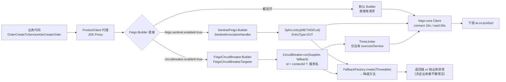
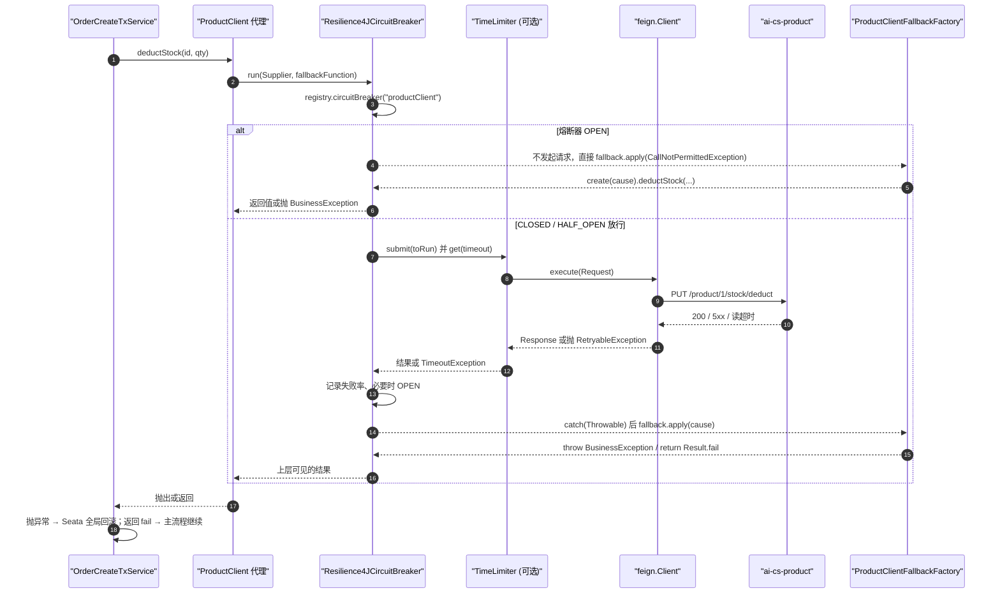

# Feign 熔断与降级语义：fallback 既是兜底，也是最好的故障遮羞布

> **一句话结论**：Feign 所谓的"熔断"其实是三样东西叠出来的——feign-core 的**连接/读超时**、外层 **CircuitBreaker（状态机 + TimeLimiter）**、你自己写的 **fallback / fallbackFactory**。前两样决定"**多久失败**"，最后一样决定"**失败长什么样**"。线上真正出事的往往不是熔断没开，而是 fallback 把失败伪装成了成功，或者降级返回值压根没人读。
>
> **阅读前置**：读过 [`03-Nacos注册与配置中心`](./03-Nacos注册与配置中心.md) 与 [`openfeign-动态代理与请求拼接`](../24-源码分析/04-SpringCloud/03-负载均衡与调用/02-openfeign-动态代理与请求拼接.md)（知道 `@FeignClient` 接口怎么变成 JDK 代理）；会读 `Supplier` / `Function` 这类 lambda 和 YAML 的重复 key 规则。没读过也能跟，但 §4 的时序会看得吃力。
>
> **证据基线**：Spring Boot 4.2.0 / Spring Cloud 2026.0.0（`spring-cloud-openfeign-core`、`spring-cloud-commons` 5.1.0）/ Spring Cloud Alibaba 2025.1.0.0 / Resilience4j 2.4.0 / Sentinel 1.8.10；项目侧 `ai-cs-order`、`ai-cs-chat`、`ai-cs-gateway`。源码摘录 6 个类约 500 行，项目代码 9 个文件，实测 3 组命令输出。预计阅读 35 分钟。

---

## 0. 先看现象

| 现象 | 你的第一反应 | 通常的真实原因 |
| --- | --- | --- |
| 商品服务挂了，下单接口仍返回"下单成功"，库存核对时才发现少扣 | "Feign 调不通会抛异常啊" | 降级写成 `return Result.fail(...)`，而调用方**不读返回值**；失败被降级值吃了 |
| 写了 Sentinel 熔断规则，Dashboard 里却搜不到 `productClient` 这个资源，规则永不触发 | "规则没生效 / 版本 bug" | Sentinel 的 Feign 资源名是 `METHOD:url` 形态，而且还要 `feign.sentinel.enabled=true` 才会包代理 |
| 下游只是"卡住不回包"，order 服务 60 秒后成片超时，Tomcat 线程池被打满 | "网络抖动" | Feign 默认 `readTimeout` 是 **60 秒**；整体超时（TimeLimiter）这一层根本没生效 |

三条展开，都带原文。

**现象一：降级值没人读，等于假成功。**
本项目 `OrderCreateTxService` 里扣库存是这样调的（`ai-cs-order/src/main/java/com/aics/order/service/impl/OrderCreateTxService.java#L93-L95`）：`productClient.deductStock(...)` 的 **返回值被直接丢弃**。所以降级方法返回什么，业务根本看不见——它只认"抛不抛异常"。同一份代码里回补库存（`OrderServiceImpl#L231`）和通知支付关单（`OrderServiceImpl#L261`）也都是丢弃返回值。日志里只会留下降级类打印的一行：

```text
ERROR c.a.o.c.f.ProductClientFallbackFactory : 回补库存降级（告警，不阻断关单）: productId=1001, quantity=2, cause=Connection refused
WARN  c.a.o.c.f.PayClientFallbackFactory      : 支付关单通知降级（告警，不阻断关单）: body={orderNo=..., paymentMethod=ALIPAY}, cause=Read timed out
```

这两行是**唯一**能证明"降级发生了"的痕迹。没人做日志告警，就等于这个故障从未发生。

**现象二：熔断不触发，因为资源名对不上。**
Spring Cloud Alibaba 的 Feign 整合里，Sentinel 资源名不是接口名、不是 `contextId`，而是 `HTTP方法:URL` 拼出来的，形如 `GET:http://ai-cs-product/product/1`（§3.6 有反编译证据）。于是按 `productClient` 这个名字建规则，规则会挂在一个**永不出现的资源**上，`CtSph.chainMap` 里那条链永远不会有流量经过。更隐蔽的是：这个整合还要求 `feign.sentinel.enabled=true`，而本项目 `ai-cs-order`、`ai-cs-chat` 的配置里**没有这一行**——所以连"包一层 Sentinel 代理"这一步都没发生。

**现象三：超时 60 秒，把线程池打满。**
Feign 的超时默认值来自 feign-core 的 `new Request.Options()`：连接 10s、读 60s（`FeignClientFactoryBean` 的字段就用它初始化，见 §3.1）。而**"整体超时"这一层不在 Feign 里**，要靠外层 `CircuitBreaker` 的 `TimeLimiter` 才有——`Resilience4JCircuitBreaker.run` 只在有 `executorService` 时才包 TimeLimiter（§3.5）。本项目 `ai-cs-order/src/main/resources/application.yml` 里确实写了熔断开关，但**这份 YAML 里有重复的 `cloud:` 顶层 key，整份解析失败**（§6.2 有实测报错 `found duplicate key cloud`）。结果就是：熔断开关、超时、降级工厂全部没生效，order 对 product 的调用退化成"裸 Feign + 60 秒读超时"。下游一卡住，请求线程就在 `SocketInputStream.read` 上排 60 秒。

这些现象指向同一件事：**Feign 的容错是一条四层链——超时定失败速度、熔断定失败传播、降级定失败外观、调用方定失败是否可见。链条上任何一层写错，看起来都像"另一层没生效"。**

---

## 1. 整体地图

### 1.1 一次 Feign 调用经过谁



> **读图说明**：三条从 `Feign.Builder` 出发的箭头是**互斥**的——中间那个菱形判断的是"容器里注入的是哪个 Builder"，而 `FeignCircuitBreakerTargeter` 的第一步就是 `if (!(feign instanceof FeignCircuitBreaker.Builder))` 直接降级为普通 target（§3.2），所以**同时打开两个开关时，谁生效取决于条件装配的先后，不取决于你写了几行配置**。第二个容易看错的地方：`H → J` 这条边上的"60s"不是熔断器的超时，是 feign-core 的读超时；图中的 `TimeLimiter` 只有在 `executorService != null` 时才存在，把它当成"永远存在的整体超时"会得出"熔断配了就有 3 秒兜底"的错误结论。

### 1.2 组件与责任

| 组件 | 位置（源码/项目） | 责任 | 谁调用它 |
| --- | --- | --- | --- |
| `FeignClientFactoryBean` | `FeignClientFactoryBean.java.md#L288-L306` | 把 `spring.cloud.openfeign.client.config.*` 的 `connectTimeout`/`readTimeout` 落成 `Request.Options` | `FeignClientsRegistrar` 注册 FactoryBean 时 |
| `FeignClientProperties` | `FeignClientProperties.java.md#L50-L57` | 绑定 `spring.cloud.openfeign.client` 前缀，`config` Map 的 key 就是 `contextId`（默认段叫 `default`） | Spring Boot Binder |
| `FeignCircuitBreakerTargeter` | `FeignCircuitBreakerTargeter.java.md#L30-L115` | 决定 `fallback` 还是 `fallbackFactory`，并算出熔断器实例名 | `FeignClientFactoryBean#getTarget` |
| `CircuitBreaker` / `Resilience4JCircuitBreaker` | `CircuitBreaker.java.md#L29-L37`、`Resilience4JCircuitBreaker.java.md#L98-L159` | 执行体交换：状态机 → 限时 → 真实调用 → 失败落 fallback | Targeter 产生的代理 |
| `FallbackFactory`（项目自定义） | `ai-cs-order/src/main/java/com/aics/order/client/fallback/ProductClientFallbackFactory.java#L26-L53` | 拿到 `Throwable` 后按方法返回不同语义 | `Resilience4JCircuitBreaker#getAndApplyFallback` |
| `SentinelFeignAutoConfiguration` | SCA 2025.1.0.0 jar（§3.6 反编译） | 在 `feign.sentinel.enabled=true` 时提供 `SentinelFeign.Builder` | Spring Boot 自动配置 |
| `CtSph` / `SphU` | `CtSph.java.md#L175-L177`、`SphU.java.md#L84-L86` | 按资源名取 slot 链、执行规则检查 | 各处埋点（注解、网关、Feign Handler） |

### 1.3 本项目实际有两条路线，别混着看

| 模块 | 容错手段 | 熔断器 id / 资源名 | 有没有降级类 |
| --- | --- | --- | --- |
| `ai-cs-order` | Resilience4j（`spring.cloud.openfeign.circuitbreaker.enabled`） | `productClient`、`payClient`（= contextId） | 有，`ProductClientFallbackFactory`、`PayClientFallbackFactory` |
| `ai-cs-chat` | Resilience4j 注解式（`@CircuitBreaker`/`@TimeLimiter`，实例名 `chatService`/`sseChatService`/`visionService`） | 配置在 `ai-cs-chat/src/main/resources/application.yml#L71-L159` | 无 Feign 降级类（11 个 client 全裸奔） |
| `ai-cs-chat` | Sentinel 入口限流（`@SentinelResource`） | `chat-send`、`chat-rag` | `blockHandler=chatSendBlocked` 返回 429 |
| `ai-cs-gateway` | reactor-resilience4j（`spring-cloud-starter-circuitbreaker-reactor-resilience4j`） | 由 filter 名决定 | `ai-cs-gateway/src/main/java/com/aics/gateway/controller/GatewayFallbackController.java` |

想先看这两套实现本身（不掺 Feign）的源码级讲解，出门左转 [`circuitbreaker-抽象与resilience4j`](../24-源码分析/04-SpringCloud/06-熔断限流与容错/01-circuitbreaker-抽象与resilience4j.md) 与 [`sentinel-限流降级原理`](../24-源码分析/04-SpringCloud/06-熔断限流与容错/02-sentinel-限流降级原理.md)；本篇只在"它们怎么挂到 Feign 上"这一段停留。

Sentinel 和 Resilience4j 在本项目里是**分工**而不是叠加：`ai-cs-chat/src/main/java/com/aics/chat/config/SentinelFlowConfig.java#L19-L21` 的注释写得很清楚——"Sentinel 管入口限流，Resilience4j 管对下游的熔断/超时/重试"。这个分法是对的，理由见 §5。

---

## 2. 关键概念与关键类

| 名称 | 位置 | 角色 | 关键方法 / 字段 |
| --- | --- | --- | --- |
| `connectTimeout` | `spring.cloud.openfeign.client.config.<id>.connect-timeout` | TCP 握手上限，默认 10s | `FeignClientProperties.FeignClientConfiguration#connectTimeout`（`FeignClientProperties.java.md#L136`） |
| `readTimeout` | 同上 `.read-timeout` | 等响应的 socket 读上限，默认 60s | 同 `#L138`，落到 `new Request.Options(...)` |
| 整体超时 | 外层 `TimeLimiter`（Resilience4j）或网关的 response timeout | 从"开始调用"到"放弃"的总预算 | `TimeLimiter.decorateFutureSupplier` |
| `fallback` | `@FeignClient(fallback = X.class)` | 降级**实例**，无参构造，拿不到异常 | `FeignCircuitBreakerTargeter#targetWithFallback` |
| `fallbackFactory` | `@FeignClient(fallbackFactory = Y.class)` | 降级**工厂**，`create(Throwable)` 拿到异常 | `FeignCircuitBreakerTargeter#targetWithFallbackFactory` |
| `FallbackFactory<T>` | `org.springframework.cloud.openfeign` | 函数式接口，唯一方法 `T create(Throwable cause)` | 项目 `ProductClientFallbackFactory#create` |
| 熔断器 id | Targeter 里算出来的 `name` | 配置段名、注册表 key、日志里的名字三者一致 | `FeignCircuitBreakerTargeter.java.md#L51` |
| `CircuitBreaker` | `org.springframework.cloud.client.circuitbreaker` | 抽象，"跑一段逻辑 + 失败时给兜底" | `run(Supplier)` / `run(Supplier, Function)` |
| `NoFallbackAvailableException` | 同上接口 | **没给 fallback 时**的默认兜底抛的异常 | `CircuitBreaker.java.md#L29-L33` |
| `blockHandler` | `@SentinelResource(blockHandler = "xxx")` | 资源名匹配后**被阻塞**时的回调（不是异常兜底） | 项目 `ChatController#chatSendBlocked` |
| `DegradeRule` / `DegradeSlot` | Sentinel 熔断规则与槽 | CLOSED/OPEN/HALF_OPEN 状态机（**assets 无摘录，见 §7 说明**） | 官方文档 `DegradeRuleManager.loadRules` |
| `ProcessorSlotChain` | `CtSph.java.md#L194-L207` | 每个资源名一条链，规则挂在链上 | `chainMap.get(resourceWrapper)` |

---

## 3. 原理与证据逐段精读

### 3.1 三层超时：连接、读、整体（各管一段，缺一层就露一段）

**在干什么**：Feign 客户端最终是一个 `feign.Client`。它的超时只有两个数字，来自 `Request.Options`：

```java
(src: FeignClientFactoryBean.java.md#L123-L127)
private int readTimeoutMillis = new Request.Options().readTimeoutMillis();

private int connectTimeoutMillis = new Request.Options().connectTimeoutMillis();

private boolean followRedirects = new Request.Options().isFollowRedirects();
```

这三行的要点是**默认值来自 feign-core 的空构造 `new Request.Options()`，不是 Spring Cloud 给的**：连接 10 秒、读 60 秒、跟随重定向。所以"我什么都没配"实际等于"连接最多等 10 秒、响应最多等 60 秒"。源码摘录没有包含 feign-core 的 `Request.Options`，这两个数字以 feign-core 官方默认值为准（`DEFAULT_CONNECT_TIMEOUT_MILLIS = 10_000`、`DEFAULT_READ_TIMEOUT_MILLIS = 60_000`），下面的实测与它一致。

配置是怎么盖上去的：

```java
(src: FeignClientFactoryBean.java.md#L298-L306)
		if (!refreshableClient) {
			connectTimeoutMillis = config.getConnectTimeout() != null ? config.getConnectTimeout()
					: connectTimeoutMillis;
			readTimeoutMillis = config.getReadTimeout() != null ? config.getReadTimeout() : readTimeoutMillis;
			followRedirects = config.isFollowRedirects() != null ? config.isFollowRedirects() : followRedirects;

			builder.options(new Request.Options(connectTimeoutMillis, TimeUnit.MILLISECONDS, readTimeoutMillis,
					TimeUnit.MILLISECONDS, followRedirects));
		}
```

三件事值得盯住。第一，`config.getConnectTimeout()` 是 `Integer`，一旦为 `null` 就退回字段里的默认值，所以**只配 `read-timeout` 不配 `connect-timeout` 是合法的**，两者独立生效。第二，单位是**毫秒**（`TimeUnit.MILLISECONDS`），写 `read-timeout: 3s` 会让 Binder 转换失败——这是很常见的启动报错来源。第三，`if (!refreshableClient)` 这个开关在旧版本里没有，意味着**用刷新式客户端时这段超时覆盖会被整段跳过**（见 §7）。

配置段是怎么找到的，看 `configureFeign` 的两行：

```java
(src: FeignClientFactoryBean.java.md#L186-L196)
		if (properties != null && inheritParentContext) {
			if (properties.isDefaultToProperties()) {
				configureUsingConfiguration(context, builder);
				configureUsingProperties(properties.getConfig().get(properties.getDefaultConfig()),
						properties.getConfig().get(contextId), builder);
			}
			else {
				configureUsingProperties(properties.getConfig().get(properties.getDefaultConfig()),
						properties.getConfig().get(contextId), builder);
				configureUsingConfiguration(context, builder);
			}
```

这就是"`default` 段 + 专属段"两段式覆盖：`properties.getDefaultConfig()` 默认值是字符串 `"default"`（`FeignClientProperties.java.md#L55`），`config` 是 `Map<String, FeignClientConfiguration>`（`#L57`）。**key 是 `contextId`**，不是服务名——所以像本项目这样写才对：

```yaml
spring:
  cloud:
    openfeign:
      client:
        config:
          default:            # 所有 client 的基线
            connect-timeout: 2000
            read-timeout: 5000
          productClient:      # 只覆盖 productClient
            read-timeout: 3000
```

**为什么这么设计**：Feign 早期只认"一个全局超时"，多服务多超时需求逼出了 `default` + `contextId` 的两级覆盖；`defaultToProperties=true` 时 properties 优先于 `@Configuration` 类（`configureUsingConfiguration` 在后面跑），也就是"**yml 能盖住 Java 配置**"，这让运维改超时不用改代码。

**换写法会怎样**：把超时写成 `feign.client.config.productClient.read-timeout`（漏了 `spring.cloud.openfeign`）不会报错，只是**静默不生效**——Binder 只绑定它认识的树。想验证是否绑定成功，走 §6.4 的手段而不是靠猜。

**常见坑**：① 60 秒的读超时对同步 Web 请求太长，一个下游卡住就能把 Tomcat 200 线程在 60 秒内吃光；② 以为"配了熔断就有整体超时"——整体超时在 TimeLimiter 那层，见 §3.5；③ 重试（Retryer）与读超时叠加：`readTimeout=3s` + 重试 3 次 = 最坏 9 秒，而熔断器统计到的是 3 次失败，会更快把窗口打满。

### 3.2 fallback 与 fallbackFactory：想看见异常，只能用工厂

**在干什么**：`@FeignClient` 上两个属性二选一，Targeter 里是两个并列分支：

```java
(src: FeignCircuitBreakerTargeter.java.md#L51-L60)
		String name = !StringUtils.hasText(factory.getContextId()) ? factory.getName() : factory.getContextId();
		Class<?> fallback = factory.getFallback();
		if (fallback != void.class) {
			return targetWithFallback(name, context, target, builder, fallback);
		}
		Class<?> fallbackFactory = factory.getFallbackFactory();
		if (fallbackFactory != void.class) {
			return targetWithFallbackFactory(name, context, target, builder, fallbackFactory);
		}
		return builder(name, builder).target(target);
```

这段是整个主题的核心，逐句读：`name` 的取值规则只有一条——**有 `contextId` 用 `contextId`，没有就退化成服务名**（下一节细讲）。然后判 `fallback`（注意默认值是 `void.class`，即"没配"），再判 `fallbackFactory`；两个都没配就调 `builder(name, builder).target(target)`，**此时只有熔断没有降级**——熔断打开后你等到的将是 `NoFallbackAvailableException`（`CircuitBreaker.java.md#L29-L33` 的默认 fallback）。

两个分支的取实例方式不同：

```java
(src: FeignCircuitBreakerTargeter.java.md#L63-L74)
	private <T> T targetWithFallbackFactory(String feignClientName, FeignClientFactory context,
			Target.HardCodedTarget<T> target, FeignCircuitBreaker.Builder builder, Class<?> fallbackFactoryClass) {
		FallbackFactory<? extends T> fallbackFactory = (FallbackFactory<? extends T>) getFromContext("fallbackFactory",
				feignClientName, context, fallbackFactoryClass, FallbackFactory.class);
		return builder(feignClientName, builder).target(target, fallbackFactory);
	}

	private <T> T targetWithFallback(String feignClientName, FeignClientFactory context,
			Target.HardCodedTarget<T> target, FeignCircuitBreaker.Builder builder, Class<?> fallback) {
		T fallbackInstance = getFromContext("fallback", feignClientName, context, fallback, target.type());
		return builder(feignClientName, builder).target(target, fallbackInstance);
	}
```

差别只有一行但后果天差地别：`fallback` 分支从容器里取的是**一个已经实现的接口实例**（`target.type()` 就是你的 `ProductClient`），它在 `create` 阶段就拿不到任何异常信息；`fallbackFactory` 分支取的是一个 `FallbackFactory`，真正的实例要等**调用失败那一刻**由 `Resilience4JCircuitBreaker#getAndApplyFallback` 把 `Throwable` 传进 `create(cause)` 才生成。所以：

- **要按异常类型区分（超时 vs 500 vs 熔断打开）→ 必须 `fallbackFactory`**；
- 只要"固定兜底值"、且降级逻辑与异常无关 → `fallback` 更省事，但它在生产里几乎总是错的选择，因为你无法在降级里记下 `cause`。

**为什么这么设计**：`fallback` 是 Netflix Feign 时代的老接口，要求"降级实现和接口同类型"，天然做不到携带异常；Spring Cloud 后来补了 `FallbackFactory` 作为"能看见异常"的逃生口，同时保留了 `fallback` 以向后兼容（这就是为什么两个分支并存，而不是只留一个）。

**换写法会怎样**：本项目 `deductStock` 的降级要区分"关键写"和"尽力而为写"，如果用 `fallback` 写死"返回 fail"，`ProductClientFallbackFactory` 里那三条不同语义的日志就全没了——排障时你只知道"降级了"，不知道"为什么降级"。反过来，把 `fallback` 和 `fallbackFactory` **同时**写上并不报错：`if (fallback != void.class)` 在前，`fallbackFactory` 会被静默忽略。

**常见坑**：① 两个属性同时配，以为工厂生效；② 降级类忘了 `@Component`，启动期直接炸（§3.4 三条报错）；③ 在 `create(cause)` 里把 `cause` 丢了，只留一句"服务不可用"，等于白拿异常。

### 3.3 熔断器 id = contextId：一个名字串起配置、指标、日志

**在干什么**：回看上一节第一行 `String name = !StringUtils.hasText(factory.getContextId()) ? factory.getName() : factory.getContextId();`。这个 `name` 被 `builder(feignClientName, builder)` 塞进 Builder，最终成为 `CircuitBreakerFactory.create(name)` 的参数：

```java
(src: FeignCircuitBreakerTargeter.java.md#L110-L115)
	private FeignCircuitBreaker.Builder builder(String feignClientName, FeignCircuitBreaker.Builder builder) {
		return builder.circuitBreakerFactory(circuitBreakerFactory)
			.feignClientName(feignClientName)
			.circuitBreakerGroupEnabled(circuitBreakerGroupEnabled)
			.circuitBreakerNameResolver(circuitBreakerNameResolver);
	}
```

`feignClientName` 就是那个 `name`，它一路传进 `CircuitBreaker`，成为 Resilience4j 注册表里的 id。于是**同一个字符串同时是**：`spring.cloud.openfeign.client.config.<name>.*` 的配置段名、`resilience4j.circuitbreaker.instances.<name>.*` 的实例名、actuator 里的资源名、日志里 `CircuitBreaker '<name>' is OPEN` 的引号内容。本项目 order 的注释把这条规则写在了配置里（`ai-cs-order/src/main/resources/application.yml#L27-L29`）："实例名 = FeignClient contextId（productClient / payClient）"。

**为什么这么设计**：Resilience4j 的注册表是"按名字取实例"的，Feign 必须先给出一个**稳定且唯一**的名字才能让两者对接。用服务名会撞车——同一个服务常常被多个 client 调用（项目里 `ai-cs-message` 就被 6 个 client 调），每个 client 的方法超时/失败率完全不同，共用一个熔断器等于让"查询历史消息"的失败把"写审计日志"一起熔断。

**换写法会怎样**：不写 `contextId`，`name` 退化成服务名 `ai-cs-message`。后果有两层：一是**同服务多 client 全部共享一个熔断器**，语义被搅在一起；二是更早一步——Spring Cloud OpenFeign 用 `contextId`（缺省用服务名）给 `FeignClientSpecification` 起 bean 名，两个 client 指向同一服务却没 `contextId` 时会报 bean 名冲突（`The bean 'xxx.FeignClientSpecification' could not be registered`）。这条报错本篇未在本机复现，依据是 Spring Cloud OpenFeign 对 `contextId` 的官方说明与本项目 chat 的写法（详见 §7 的说明口径）。

**常见坑**：本项目 `ai-cs-chat` 的 11 个 client 里有 5 个没写 `contextId`（如 `ai-cs-chat/src/main/java/com/aics/chat/feign/OrderFeignClient.java#L15` 只有 `@FeignClient(name = "ai-cs-order")`），其余写了（`afterSale`、`agentTrace`、`modelUsage`、`onlineEval`、`securityEvent`、`llmTrace`）。写与不写混用在"一个服务一个 client"时不会立刻炸，但一旦有人给同一服务加第二个 client，就会踩上面的冲突——规范应该是**所有 client 都显式写 `contextId`**。

### 3.4 降级实例从哪取：三条启动期报错

**在干什么**：`getFromContext` 负责从 Feign 的子上下文里捞出降级 bean，捞不到就直接让**应用启动失败**：

```java
(src: FeignCircuitBreakerTargeter.java.md#L76-L97)
	private <T> T getFromContext(String fallbackMechanism, String feignClientName, FeignClientFactory context,
			Class<?> beanType, Class<T> targetType) {
		Object fallbackInstance = context.getInstance(feignClientName, beanType);
		if (fallbackInstance == null) {
			throw new IllegalStateException(
					String.format("No " + fallbackMechanism + " instance of type %s found for feign client %s",
							beanType, feignClientName));
		}

		if (fallbackInstance instanceof FactoryBean<?> factoryBean) {
			try {
				fallbackInstance = factoryBean.getObject();
			}
			catch (Exception e) {
				throw new IllegalStateException(fallbackMechanism + " create fail", e);
			}

			if (!targetType.isAssignableFrom(fallbackInstance.getClass())) {
				throw new IllegalStateException(String.format("Incompatible " + fallbackMechanism
						+ " instance. Fallback/fallbackFactory of type %s is not assignable to %s for feign client %s",
						fallbackInstance.getClass(), targetType, feignClientName));
			}

		}
```

对应三类真实报错原文：`No fallbackFactory instance of type class ...ProductClientFallbackFactory found for feign client productClient`（类没被容器扫到、或不在 Feign 子上下文可见范围）、`Incompatible fallbackFactory instance. Fallback/fallbackFactory of type ... is not assignable to ...`（工厂的泛型/接口写错）、`fallbackFactory create fail`（`FactoryBean` 抛异常）。注意它们都是 `IllegalStateException`，抛在**创建代理时**——也就是启动阶段，不是第一次调用时。

**为什么这么设计**：宁可启动失败也不要运行到一半才发现"降级是空的"。这类"配置态错误"在最坏情况下会在故障当天才暴露（下游平时不挂，`create(cause)` 永远不被调用），作者选择在装配期 fail-fast。

**换写法会怎样**：把降级类做成 `@Bean` 但放在 `@FeignClient(configuration = ...)` 指定的配置类里，`getInstance` 走的是该 client 的子上下文，命名与作用域不对就会拿到 `null`。本项目用最直接的 `@Component` + 全限定名引用（`fallbackFactory = com.aics.order.client.fallback.ProductClientFallbackFactory.class`），不依赖扫描顺序，是最稳的写法。

**常见坑**：升级 Spring Cloud 后报"找不到降级 bean"的高频原因是降级类**被当成了普通业务 bean 放进了父子上下文都可见的位置**，而 Feign 只查自己的子上下文；此时加 `@Component` 还不够，要确认它在 `FeignClientsConfiguration` 的兄弟作用域里。

### 3.5 执行体：Resilience4JCircuitBreaker 的四条分支与"整体超时"的真相

**在干什么**：`CircuitBreaker` 抽象只有两个方法，一个是带默认兜底的"抛 `NoFallbackAvailableException`"，另一个才是真正的执行：

```java
(src: CircuitBreaker.java.md#L29-L37)
public interface CircuitBreaker {
	default <T> T run(Supplier<T> toRun) {
		return run(toRun, throwable -> {
			throw new NoFallbackAvailableException("No fallback available.", throwable);
		});
	}

	<T> T run(Supplier<T> toRun, Function<@Nullable Throwable, T> fallback);
}
```

这个默认实现解释了一个高频疑问："我什么都没配，为什么熔断时抛的不是业务异常而是 `NoFallbackAvailableException`"——因为默认兜底就是"把原异常包一层再抛"。Resilience4j 的实现把装饰链拼出来：

```java
(src: Resilience4JCircuitBreaker.java.md#L98-L115)
	public <T> T run(Supplier<T> toRun, Function<@Nullable Throwable, T> fallback) {
		final Map<String, String> tags = Map.of(CIRCUIT_BREAKER_GROUP_TAG, this.groupName);
		Optional<TimeLimiter> timeLimiter = loadTimeLimiter();
		io.github.resilience4j.circuitbreaker.CircuitBreaker defaultCircuitBreaker = registry.circuitBreaker(this.id,
				this.circuitBreakerConfig, tags);
		circuitBreakerCustomizer.ifPresent(customizer -> customizer.customize(defaultCircuitBreaker));
		if (bulkheadProvider != null) {

			if (executorService != null) {
				Supplier<Future<T>> futureSupplier = () -> executorService.submit(toRun::get);
				/* conditionally wrap in time-limiter */
				Callable<T> timeLimitedCall = timeLimiter
					.map(tl -> TimeLimiter.decorateFutureSupplier(tl, futureSupplier))
					.orElse(() -> futureSupplier.get().get());
				Callable<T> bulkheadCall = bulkheadProvider.decorateCallable(this.groupName, tags, timeLimitedCall);
				Callable<T> circuitBreakerCall = io.github.resilience4j.circuitbreaker.CircuitBreaker
					.decorateCallable(defaultCircuitBreaker, bulkheadCall);
				return getAndApplyFallback(circuitBreakerCall, fallback);
			}
```

读这段只需抓住两件事。第一，**装饰顺序是"熔断在最外层、限时在内层"**：`decorateCallable(defaultCircuitBreaker, bulkheadCall)` 意味着熔断器统计的是"限时/隔离之后的结果"——超时会被记成失败，这正是"慢调用能把熔断器打开"的机制。第二，`timeLimiter` 只有在 `executorService != null` 时才真的参与（否则走 `.orElse(() -> futureSupplier.get().get())`，**等于没有整体超时**）；而 `executorService` 是构造器里 `@Nullable` 的字段（`Resilience4JCircuitBreaker.java.md#L62`），由工厂注入。`loadTimeLimiter()` 还有一道开关：

```java
(src: Resilience4JCircuitBreaker.java.md#L143-L159)
	private static <T> T getAndApplyFallback(Supplier<T> supplier, Function<@Nullable Throwable, T> fallback) {
		try {
			return supplier.get();
		}
		catch (Throwable t) {
			return fallback.apply(t);
		}
	}

	private static <T> T getAndApplyFallback(Callable<T> callable, Function<@Nullable Throwable, T> fallback) {
		try {
			return callable.call();
		}
		catch (Throwable t) {
			return fallback.apply(t);
		}
	}
```

这是整篇最该记住的 16 行：**`catch (Throwable t)`，不是 `catch (Exception)`**。`Error`（`OutOfMemoryError`、`NoClassDefFoundError`、`StackOverflowError`）也会被交给 `fallback`。所以"降级里返回空列表"的生产事故常常是这样发生的：某个 `NoClassDefFoundError` 被吞成"空列表"，监控上一片绿，直到有人发现数据全空。

**为什么这么设计**：`CircuitBreaker.run` 的签名（`Supplier` + `Function<Throwable,T>`）决定了它只能"要么返回值，要么把异常交出来"。`CircuitBreaker` 想要保证"调用方永远拿到一个值"，就必须兜住所有 `Throwable`；代价是把 `Error` 也纳入了业务可捕获范围。这跟 `@Transactional` 默认只回滚 `RuntimeException` 的设计取向恰好相反，值得对照记忆。

**换写法会怎样**：如果不用 `spring.cloud.openfeign.circuitbreaker.enabled` 自动包裹，而是自己写 `circuitBreakerFactory.create("productClient").run(() -> client.call(), t -> ...)`，你能精确控制"哪些异常进 fallback"（在 lambda 里判类型再决定 rethrow），但**每个调用点都要写一遍**，而且非常容易漏——Feign 的自动包裹就是为了消灭这种手写重复。项目 order 选了自动包裹（`ai-cs-order/src/main/resources/application.yml#L25-L31`），代价是全部 `Throwable` 都进工厂，所以工厂里必须自己判"要不要 rethrow"。

**常见坑**：① 以为开了熔断就自动有整体超时（如上，取决于 `executorService` 与 `disableTimeLimiter`）；② 在 fallback 里 `catch` 住后返回 `null`，上层 `Optional.of(...)` 立刻 NPE，故障变得更难读；③ 用 `@TimeLimiter` 注解式熔断（chat 的写法）时，方法必须返回 `CompletableFuture`，否则注解不生效——这是 chat 那套配置只对 `chatService` 这类异步方法有用的原因。

### 3.6 Sentinel 侧：属性名还是裸 `feign.sentinel.enabled`，资源名是 `METHOD:url`

**在干什么**：Spring Cloud Alibaba 走的是另一条路——它不碰 `FeignCircuitBreaker`,而是换掉整个 `Feign.Builder`。下面是本项目依赖的 SCA 2025.1.0.0 jar 内省结果（命令见 §6.5），先看自动配置的注册清单：

```text
META-INF/spring/org.springframework.boot.autoconfigure.AutoConfiguration.imports
  com.alibaba.cloud.sentinel.SentinelWebAutoConfiguration
  com.alibaba.cloud.sentinel.SentinelWebFluxAutoConfiguration
  com.alibaba.cloud.sentinel.endpoint.SentinelEndpointAutoConfiguration
  com.alibaba.cloud.sentinel.custom.SentinelAutoConfiguration
  com.alibaba.cloud.sentinel.feign.SentinelFeignAutoConfiguration
```

`SentinelFeignAutoConfiguration` 在 2025.1.0.0 里仍然是这么写的（`javap -v` 输出摘录）：

```text
org.springframework.boot.autoconfigure.condition.ConditionalOnProperty(
name=["feign.sentinel.enabled"]
)
org.springframework.boot.autoconfigure.condition.ConditionalOnClass(
value=[class Lcom/alibaba/csp/sentinel/SphU;,class Lfeign/Feign;]
)
public feign.Feign$Builder feignSentinelBuilder();
    @ConditionalOnMissingBean
```

三件事定了性。第一，**属性名是裸 `feign.sentinel.enabled`，不在 `spring.cloud.openfeign.*` 下**——它跟 Spring 官方的 `spring.cloud.openfeign.circuitbreaker.enabled` 完全不是一个命名体系，写错位置就静默失效。第二，`@ConditionalOnMissingBean` 说明它提供的是一个 `Feign.Builder` bean，**和 Resilience4j 的 `FeignCircuitBreaker.Builder` 抢同一个位置**：两个都开，谁生效取决于自动配置类的排序与条件判定，官方没有承诺优先级，所以工程上必须二选一。第三，`ConditionalOnClass` 含 `feign.Feign`，意味着**没引 openfeign 的模块（比如本项目 gateway）引了 SCA sentinel 也不会包 Feign**。

再看资源名怎么拼。`SentinelInvocationHandler` 的常量池里有 `ContextUtil.enter`、`SphU.entry(String, EntryType.OUT, int, Object[])`、`Tracer.traceEntry`、`FallbackFactory.create`，以及字符串拼接配方 `\u0001:\u0001\u0001` 与 `method.toUpperCase(Locale.ROOT)`、`template.url()`：

```text
#161 = Utf8  com/alibaba/csp/sentinel/SphU
#162 = Utf8  entry  (Ljava/lang/String;Lcom/alibaba/csp/sentinel/EntryType;I[Ljava/lang/Object;)Lcom/alibaba/csp/sentinel/Entry;
#135 = Utf8  toUpperCase   #130 = Utf8  java/util/Locale   #131 = Utf8  ROOT
#300 = String  \u0001:\u0001\u0001
```

结论：资源名 = `HTTP方法大写 + ":" + 请求 URL`，例如 `GET:http://ai-cs-product/product/1`。**这就是现象二的全部原因**——你在 Dashboard 里按 `productClient` 建规则，规则挂在一个永不出现的资源名上。`SphU.entry(name)` 只是把名字转给 `Env.sph`：

```java
(src: SphU.java.md#L84-L86)
    public static Entry entry(String name) throws BlockException {
        return Env.sph.entry(name, EntryType.OUT, 1, OBJECTS0);
    }
```

一句 `entry` 背后是"按资源名取 slot 链 → 跑规则 → 决定放行还是抛 `BlockException`"。名字不对，链上永远没有流量，规则看起来"不生效"。

**为什么这么设计**：Sentinel 的资源名是**全局字符串**，要能与 HTTP 网关、`@SentinelResource`、Feign 三种埋点共存；用 URL 做资源名让"同一接口不同实例"聚合成一个资源，但也牺牲了"按 client 名建规则"的直觉。

**换写法会怎样**：可以自己包一层 `RequestInterceptor` 或用 `SentinelInvocationHandler` 之外的自定义 `InvocationHandler` 把资源名改成 `contextId`，代价是脱离官方实现、升级要重做。项目里的做法更干净——**Sentinel 只管入口**（`@SentinelResource(value = SentinelRules.RESOURCE_CHAT_SEND, ...)`，见 `ai-cs-chat/src/main/java/com/aics/chat/controller/ChatController.java#L79`），资源名由 `SentinelRules` 单点定义，杜绝"名字写错"这类事故。这个取舍值得抄。

**常见坑**：① 以为 `feign.sentinel.enabled` 会解析成 `spring.cloud.openfeign.sentinel.enabled`；② 把 Sentinel 的熔断规则（`DegradeRule`）建在 Feign 资源上，却用接口名当资源名；③ 同时开 `spring.cloud.openfeign.circuitbreaker.enabled` 与 `feign.sentinel.enabled`，两套降级语义叠在一条调用上，排查时分不清是谁降级的。

### 3.7 熔断状态机：CLOSED / OPEN / HALF_OPEN 与"慢调用也算失败"

**在干什么**：状态机本身很简单，难点全在"什么算失败"和"窗口怎么滑"。三态语义：**CLOSED** 正常放行并按窗口统计；**OPEN** 期间所有调用**不发往网络**直接走降级；**HALF_OPEN** 在等待期结束后放少量探针，全成功回 CLOSED，任一失败立刻回 OPEN。项目的 chat 侧配置是这套参数的一个完整样本：

```yaml
resilience4j:
  circuitbreaker:
    instances:
      chatService:                       # 名字 = 熔断器 id
        sliding-window-type: COUNT_BASED # 按次数滑窗，而非按秒
        sliding-window-size: 10          # 最近 10 次调用
        minimum-number-of-calls: 3       # 至少 3 次才开始算比例
        failure-rate-threshold: 50       # 失败率 ≥ 50% 打开
        wait-duration-in-open-state: 30s # 打开后 30 秒
        permitted-number-of-calls-in-half-open-state: 3
        record-exceptions:
          - java.util.concurrent.TimeoutException
          - org.springframework.web.client.ResourceAccessException
          - java.net.SocketTimeoutException
        ignore-exceptions:
          - com.aics.common.exception.BusinessException
          - java.lang.IllegalArgumentException
```

六个数字各有分工：`minimum-number-of-calls: 3` 防止"前两次全失败就打开"；`failure-rate-threshold: 50` 是比例而非绝对次数；`wait-duration-in-open-state: 30s` 是从 OPEN 到 HALF_OPEN 的冷却；`permitted-number-of-calls-in-half-open-state: 3` 是一次探针配额；`record-exceptions` 与 `ignore-exceptions` 是**白/黑名单**——只有列进 `record-exceptions` 的异常才计入失败率（另一派做法是"默认全记，用 ignore 排除"）。`ignore-exceptions` 里放 `BusinessException` 是**关键一笔**：下游正常返回"库存不足"这种业务失败不能被算成"服务不健康"，否则一有促销就会熔断。

"慢调用比例"是熔断器的另一只眼：Resilience4j 用 `slow-call-duration-threshold` + `slow-call-rate-threshold`（超过阈值时长的调用算慢调用，慢调用占比超线也打开），Sentinel 的 `DegradeRule` 用 `grade = DEGRADE_GRADE_RT` 配 `count`（RT 阈值）+ `slowRatioThreshold` + `timeWindow` + `minRequestAmount`。机制上的锚点在 `CtSph`：**同一个资源名全局共享一条 slot 链**，规则检查、统计、状态机全挂在这条链上：

```java
(src: CtSph.java.md#L194-L207)
    ProcessorSlot<Object> lookProcessChain(ResourceWrapper resourceWrapper) {
        ProcessorSlotChain chain = chainMap.get(resourceWrapper);
        if (chain == null) {
            synchronized (LOCK) {
                chain = chainMap.get(resourceWrapper);
                if (chain == null) {
                    // Entry size limit.
                    if (chainMap.size() >= Constants.MAX_SLOT_CHAIN_SIZE) {
                        return null;
                    }

                    chain = SlotChainProvider.newSlotChain();
```

双检锁 + `MAX_SLOT_CHAIN_SIZE` 上限两件事值得注意：**资源名是链的 key**，名字不同 = 不同链 = 不同统计窗口，这从机制上解释了"规则不触发"；而超过上限后 `return null`——`entry` 拿不到链，**所有请求直接放行、不做任何检查**（`CtSph.java.md#L165-L167` 的 javadoc 原话）。线上如果有人靠"动态资源名"（把用户 ID、traceId 拼进资源名）打满了这张表，熔断会静默失效，这是极隐蔽的坑。

**为什么这么设计**：以资源为粒度而不是以"下游服务"为粒度，是为了让"这次调用想被谁保护"由埋点决定——同一个服务，读接口可以宽松、写接口可以严格，规则只认名字。

**换写法会怎样**：用 `timeWindow` 很小的滑动窗口（比如 1 秒）会让熔断器在真故障时疯狂抖动 OPEN/HALF_OPEN；窗口太大（60 秒）则要等很久才熔断，这段时间所有线程仍在排队（也就有了现象三）。经验基线：**窗口覆盖 10~20 次调用、冷却 10~30 秒、探针 3 个**，与本项目 chat 的配置一致。

**常见坑**：① `record-exceptions` 只写了 `TimeoutException`，但 feign 抛的是 `feign.RetryableException`（`SocketTimeoutException` 被包在里面）→ 真实超时**不计入失败率**，熔断永不打开；② `sliding-window-type: TIME_BASED` 时仍按次数思维配 `sliding-window-size`；③ 降级方法抛出的异常又被算成一次失败，形成"降级→失败率更高→更快打开"的正反馈（本项目 `deductStock` 的降级就抛 `BusinessException`，若把 `BusinessException` 从 `ignore-exceptions` 里删掉，会踩这个坑）。

### 3.8 线程隔离 vs 信号量：能不能"掐断"决定了一切

**在干什么**：两种隔离的本质差别是**执行线程是否被换掉**。信号量（`SemaphoreBulkhead`）只限制并发数，调用仍在**当前线程**上跑——所以它**无法中断**一个卡在 `SocketInputStream.read` 的调用，超时预算交给了下游的 socket 超时；线程池隔离（`ThreadPoolBulkhead` / 裸 `ExecutorService`）把调用 `submit` 到另一个池，于是外层能 `Future.get(timeout)` 并 `cancel(true)`。A 级证据正好是后者：

```java
(src: Resilience4JCircuitBreaker.java.md#L104-L111)
		if (bulkheadProvider != null) {

			if (executorService != null) {
				Supplier<Future<T>> futureSupplier = () -> executorService.submit(toRun::get);
				/* conditionally wrap in time-limiter */
				Callable<T> timeLimitedCall = timeLimiter
					.map(tl -> TimeLimiter.decorateFutureSupplier(tl, futureSupplier))
					.orElse(() -> futureSupplier.get().get());
```

`executorService.submit(toRun::get)` 这一句是线程池隔离的全部实现，`TimeLimiter.decorateFutureSupplier` 之所以能限时，就是因为它拿到的是一个 `Future` 可以 `get(timeout)`。这也解释了一条铁律：**没有线程池就没有整体超时**（`orElse` 分支只是 `futureSupplier.get().get()`，无超时参数）。项目 chat 的 `timelimiter` 三个实例都写了 `cancel-running-future: true`（`ai-cs-chat/src/main/resources/application.yml#L77-L87`），意思是超时后尝试中断执行线程——对**响应中断**的调用（Spring AI 的 HTTP 客户端）有效，对不响应中断的调用只是"返回了超时异常、线程还在跑"。

**为什么这么设计**：同步 Web 场景下，`readTimeout` 只能覆盖"等响应"这一段，覆盖不了"业务代码里串行调三次下游"这种整体预算；线程池 + TimeLimiter 是唯一能在应用层表达"这次调用总共只给 3 秒"的手段。代价是**上下文会丢**：`ThreadLocal`（用户身份、MDC 日志上下文）和本项目重点关注的 **Seata XID** 都不在子线程里。

**换写法会怎样**：本项目 order 用 Feign + Seata AT，XID 靠 `SeataFeignRequestInterceptor` 写进请求头（`ProductClient` 的类注释 `ai-cs-order/src/main/java/com/aics/order/client/ProductClient.java#L20-L24` 明确写了这条链）。如果把 Feign 调用改到独立线程池里执行，XID 的 `RootContext` 不会自动传播，分支事务直接失效——这是"为了加超时把分布式事务搞坏"的经典事故。**结论：在 Seata 链路上加线程池隔离，必须手动传递 `RootContext`，或者干脆只用信号量 + 收紧 socket 超时。**

**常见坑**：① 用信号量隔离却期待"超时掐断"，结果线程仍长时间占着；② 线程池隔离开了但池子配得比 Tomcat 还大，等于没隔离，只是多了一层排队；③ 降级在线程池里执行，`MDC` 丢了，日志里 `traceId` 全是空。

### 3.9 降级返回值的业务语义：空列表、fail 值、抛异常，三者不可混用

**在干什么**：降级方法只有三种"交差"方式，本项目把三种都用上了，正好当标本。下面是 `ProductClientFallbackFactory#create` 返回的匿名实现里的三个方法（`ai-cs-order/src/main/java/com/aics/order/client/fallback/ProductClientFallbackFactory.java#L35-L51`）：

```java
            @Override
            public Result<Void> deductStock(Long id, int quantity) {
                log.error("扣库存降级快速失败: productId={}, quantity={}, cause={}", id, quantity, cause.getMessage());
                throw new BusinessException(ResultCode.GATEWAY_SERVICE_UNAVAILABLE, "商品服务暂不可用，下单失败，请稍后再试");
            }

            @Override
            public Result<Void> restoreStock(Long id, int quantity) {
                log.error("回补库存降级（告警，不阻断关单）: productId={}, quantity={}, cause={}", id, quantity, cause.getMessage());
                return Result.fail(ResultCode.GATEWAY_SERVICE_UNAVAILABLE);
            }

            @Override
            public ProductRemoteDTO getProduct(Long id) {
                log.warn("商品详情降级快速失败: productId={}, cause={}", id, cause.getMessage());
                throw new BusinessException(ResultCode.GATEWAY_SERVICE_UNAVAILABLE);
            }
```

三种语义的选择标准不是"哪个方便"，而是"**失败必须让谁看见**"：

| 语义 | 用在哪 | 前提 | 项目实例 |
| --- | --- | --- | --- |
| 抛业务异常 | 关键写、会影响正确性的读 | 调用方**一定会**因此中断 | `deductStock`、`getProduct` |
| 返回 `Result.fail(...)` | 尽力而为的通知/补偿 | 主流程可以不中断，但**必须有告警与对账兜底** | `restoreStock`、`closeOrder` |
| 返回空集合/默认值 | 纯展示、可缺省 | 有独立监控能发现"降级率升高" | 本项目**未使用**，chat 注释里承诺过（见下） |

为什么 `deductStock` 必须是抛异常而不是 `Result.fail`？看它的调用点（`ai-cs-order/src/main/java/com/aics/order/service/impl/OrderCreateTxService.java#L93-L95`）：`productClient.deductStock(item.getProductId(), item.getQuantity());` —— **返回值被丢弃**。如果降级返回 `Result.fail`，这行代码会静默通过，接着生成订单、扣优惠券、发消息，结果**库存没扣、订单成立**，超卖直接产生。反过来说，`restoreStock` 选 `Result.fail` 是因为它的调用点（`OrderServiceImpl#L231`）同样不读返回值，但业务上"关单主流程优先"，回补失败要交给对账而不是阻断——**同样是"返回值没人读"，一个致命、一个可接受，区别只在业务后果**。

**为什么这么设计**：Feign 方法的返回类型是 `Result<T>` 这种"信封"时，**HTTP 层是成功的**（200），失败信息藏在 body 里。于是降级有两条路：抛异常（让 Feign/熔断器/事务管理器都能感知）或返回信封（只有读返回值的人能感知）。`Result<Void>` + 丢弃返回值 = **最危险的组合**，因为它长得像成功。

**换写法会怎样**：把 `deductStock` 改成 `return Result.fail(...)`，同时把调用点改成 `Result<Void> r = client.deductStock(...); if (!r.isSuccess()) throw ...`——语义上正确了，但**每个调用点都得记得写**，而且 Seata 全局事务的"异常触发回滚"这条路径也失效了（要改成手动 `setRollbackOnly`）。抛异常是最省心的写法，因为它天然接进 try/catch、事务回滚和熔断统计三条链。

**常见坑**：本项目 chat 侧有一处**注释与实现不一致**：`ai-cs-chat/src/main/java/com/aics/chat/feign/MessageFeignClient.java#L23` 的 javadoc 写"下游异常时降级返回空列表"，但这个接口只有 `@FeignClient(name = "ai-cs-message")`（`#L15`），**没有任何 fallback/fallbackFactory**——全项目 `ai-cs-chat/src/main/java` 里搜不到一个 `FallbackFactory` 实现。所以真实行为是：消息服务一挂，`getMessagesBySessionKey` 抛 `RetryableException`，历史消息兜底逻辑变成一次 500。注释承诺的"空列表"从未存在。**这是最值得记住的坑：降级语义写在注释里，等于没写。**

### 3.10 为什么 fallback 里再调远程会雪崩

**在干什么**：把上面几段拼起来看——`getAndApplyFallback` 是在 `catch (Throwable)` 之后调用的，此时**熔断器已经统计完这次失败，TimeLimiter 也已经退出**。于是 fallback 里再发一次远程请求等于：

1. **脱离超时预算**：TimeLimiter 保护的是 `toRun`，不是 `fallback`。fallback 里的调用只有它自己的 socket 超时（默认 60 秒）。
2. **占着同一条 Tomcat 线程**：同步 Feign 场景下，降级发生在请求线程上；降级里再来一次 60 秒，等于一次请求占线程 120 秒。
3. **绕过熔断器**：降级里直接 `otherClient.xxx(...)` 走的是另一个熔断器（或没有熔断器），于是"被熔断保护的下游"通过另一条路径继续被打——流量只是换了个入口。
4. **在 OPEN 期间被放大**：熔断打开后每个请求都会**立刻**进 fallback（不发网络请求，这是熔断的价值），如果 fallback 里要发远程调用，那"立刻失败"就变回"每次都真打一次"，熔断器的意义被完全抵消。

**为什么这么设计**：`fallback` 的定位是"**在没有网络的情况下编一个合理答案**"，它被设计成一个**纯内存操作**：查缓存、返回默认值、抛语义化异常。Spring Cloud 的抽象里根本没给 fallback 传超时预算，就是在暗示这一点。

**换写法会怎样**：如果确实需要"降级时去查备用源"（比如读 Redis 镜像值），必须自己带**硬超时**（`CompletableFuture.orTimeout` 或单独的短超时客户端）并且**只用本地/就近资源**。项目的正确姿势在两个工厂里都能看到：`create(cause)` 里只有 `log` 和 `return/throw`，**没有一次远程调用**——`ProductClientFallbackFactory#L31-L32` 只打一行 warn 就返回匿名实现；`PayClientFallbackFactory#L24-L35` 同理。

**常见坑**：① 降级里调"备用服务"，备用服务跟着一起挂，故障面翻倍；② 降级里调同一个下游的另一个实例（想"重试别的节点"），这属于重试语义，应该在 `Retryer` 或 LoadBalancer 层做，放在降级里会让熔断统计失真；③ 降级里查数据库——数据库恰好在同一次故障里也慢，于是降级线程堆在 DB 连接池上。

---

## 4. 一次完整执行时序

以本项目 `deductStock` 失败到降级返回为例（开启 `spring.cloud.openfeign.circuitbreaker.enabled`、`fallbackFactory` 已就位、`productClient` 熔断器当前 CLOSED）：



> **读图说明**：注意 `autonumber` 的第 5 步与第 8 步是**互斥**的两条路——`熔断器 OPEN` 分支里没有 `feign.Client` 参与，这正是"熔断的价值是立刻失败"的图形化表达，看错成"两边都会发请求"就会在排查时去下游找日志，白找。第二个容易读错的地方是最后一步：`Biz` 收到的是"抛出"还是"返回值"，**完全由 `FallbackFactory` 里怎么写决定**，时序图上看起来只是最后一条箭头，实际上它决定了 Seata 回不回滚、订单成不成立。第三个陷阱：`TL` 是虚线可选参与者，没有 `executorService` 时它根本不存在，此时 `HTTP` 那一步的 60 秒就是**唯一**的超时。

各步失败的报错原文与含义：

| 步骤 | 失败点 | 你会看到的报错/日志 | 说明 |
| --- | --- | --- | --- |
| 1 | 降级类没被容器管理 | `IllegalStateException: No fallbackFactory instance of type ... found for feign client productClient` | **启动期**就炸，见 §3.4 |
| 1 | 降级类没实现接口 | `IllegalStateException: Incompatible fallbackFactory instance. ...` | 同上 |
| 3 | 熔断器 id 与配置不一致 | 日志无异常，但 `resilience4j.circuitbreaker.instances.productClient` 配置不生效 | 因为实际 id 退化成服务名，见 §3.3 |
| 5 | 熔断打开 | `io.github.resilience4j.circuitbreaker.CallNotPermittedException: CircuitBreaker 'productClient' is OPEN` | 被 fallback 接住，变成你的降级值 |
| 5 | **没有配降级** | `NoFallbackAvailableException: No fallback available.` | `CircuitBreaker` 接口的默认兜底 |
| 8 | 连接不上 | `feign.RetryableException: Connection refused executing PUT http://ai-cs-product/...` | cause 里套 `ConnectException` |
| 8 | 读超时 | `feign.RetryableException: Read timed out executing PUT http://ai-cs-product/...` | 默认要等 **60 秒**才出现，见现象三 |
| 9 | 整体超时 | `java.util.concurrent.TimeoutException` / `Request cancelled` | 只有 TimeLimiter 存在时才有 |
| 12 | 降级抛业务异常 | `BusinessException: 商品服务暂不可用，下单失败，请稍后再试` | Seata 全局事务随之回滚 |

---

## 5. 设计取舍

| 抉择点 | 选 A | 选 B | 本项目取舍与理由 |
| --- | --- | --- | --- |
| 降级入口 | `fallback`（无异常） | `fallbackFactory`（有 `Throwable`） | 全选 B：降级要按方法区分语义，必须拿到 `cause` 才能写清日志 |
| 开关 | `feign.sentinel.enabled`（SCA） | `spring.cloud.openfeign.circuitbreaker.enabled`（官方） | order/chat 选官方 + Resilience4j；Sentinel 只做入口限流 |
| 熔断实现 | Sentinel `DegradeRule` | Resilience4j `CircuitBreaker` | 同上；两套都开会抢 `Feign.Builder`（§3.6） |
| 隔离方式 | 线程池（能掐断） | 信号量（不换线程） | order 的 Seata 链路不能随便换线程（XID 丢失），实际靠收紧 socket 超时；chat 的 LLM 调用用 TimeLimiter + `cancel-running-future` |
| 关键写降级 | 返回 `Result.fail` | 抛业务异常 | 抛异常：调用点（`OrderCreateTxService#L94`）不读返回值，返回 fail 会静默超卖 |
| 尽力而为降级 | 抛异常阻断主流程 | `Result.fail` + 告警日志 | 后者：关单/退款主流程不该因回补失败中断，缺口交对账 |
| 超时数字 | 一个全局超时 | `default` + 每 client 覆盖 | 两级：`default` 兜底 + `productClient`/`payClient` 专属覆盖 |

可扩展点清单（想动手改的人从这里挑）:

- **统一降级基类**：把"log + throw BusinessException"抽成 `AbstractFallbackFactory<C, F>`，新 client 只写方法级语义，避免每个工厂重复样板。
- **降级计数器**：在 `create(cause)` 里 `micrometer` 打点（`tag = client + cause.getClass()`），让"降级率"成为一个能配告警的指标，而不是只在日志里。
- **给 chat 的 11 个 client 补 `fallbackFactory`**：按 §3.9 的分级表决定每个方法抛还是返回空集合；`MessageFeignClient#getMessagesBySessionKey` 属于"纯读、可缺省"，适合返回空列表 + 计数。
- **`feign.Client` 层统一超时**：用 `@Bean Client` 或 `Request.Options` 的自定义器把"任何 client 都不允许超过 5 秒"做成强制约束，避免有人漏配。
- **修正 `ai-cs-order` 的 YAML 重复 key**（§6.2）：把 `openfeign` 段并进第一个 `cloud:`，让熔断配置真正生效。
- **Sentinel 资源名治理**：如果将来要给 Feign 加 Sentinel 熔断，先写一个把资源名映射成 `contextId` 的适配层，或者干脆放弃 Feign 维度、把规则建在 `METHOD:url` 上并写进文档。

---

## 6. 踩坑与调试手法

### 6.1 坑位速查

| 现象 | 根因 | 解法 |
| --- | --- | --- |
| 降级写了但启动报 `No fallbackFactory instance ...` | 降级类没进容器 / 不在 Feign 子上下文 | 加 `@Component`，并用全限定类名写在注解里（本项目写法） |
| 同时开两个熔断开关，降级行为诡异 | 两个 `Feign.Builder` 抢同一个 bean | 二选一，删掉另一个开关 |
| `read-timeout: 3s` 启动报转换失败 | 该配置单位是毫秒 | 写 `3000` |
| 熔断永远不触发 | ① `record-exceptions` 没包含 `feign.RetryableException` ② 资源名/实例名对不上 | 见 §3.7、§3.6 |
| 一个下游变慢，全站线程打满 | 只有 socket 超时，没有整体超时 | 收紧 `read-timeout` + 补 TimeLimiter |
| 降级日志里只有一行 warn，没人知道出过事 | 降级是"静默出口" | 打点 + 告警，或让降级抛异常 |
| 注释说"降级返回空列表"，实际抛 500 | 根本没声明 `fallbackFactory` | 搜 `@FeignClient` 与 `FallbackFactory` 数量对比（§6.5 命令） |

### 6.2 真手法一：用 YamlPropertySourceLoader 复现"配置写了却不生效"

Spring Boot 的 YAML 解析用的是 snakeyaml，**重复 key 会直接抛异常而不是"后者覆盖"**。`ai-cs-order/src/main/resources/application.yml` 里 `spring.cloud` 出现了两次（`#L10` 与 `#L25`），于是整份文档解析失败——而失败发生在**加载这一份 property source 时**，其他来源照常工作，所以应用能启动，只是这段配置全丢。复现命令（一个 30 行的小程序，只依赖 Boot 的 jar，不启动任何服务）：

```text
cd D:\Projects\Persion\ai-customer-service\target\yamltest
javac -cp "C:\Users\<user>\.m2\repository\org\springframework\boot\spring-boot\4.2.0\spring-boot-4.2.0.jar;
             ...\spring-core-7.1.0.jar;...\spring-beans-7.1.0.jar;...\snakeyaml-2.2.jar" YamlDupTest.java
java  -cp ".;同上" YamlDupTest
```

真实输出（本机跑过，Boot 4.2.0 + snakeyaml 2.2）：

```text
file=application.yml exists=true
EXCEPTION=org.yaml.snakeyaml.constructor.DuplicateKeyException :: while constructing a mapping
 in 'reader', line 6, column 3:
    lifecycle: 
    ^
found duplicate key cloud
 in 'reader', line 25, column 3:
    cloud: 
    ^
```

怎么读这段输出：`DuplicateKeyException` 说明**整份文件解析中止**，不是"后一个 `cloud` 覆盖前一个"；报错行号（`line 25`）精确指向第二个 `cloud:`；同一个程序对 `ai-cs-chat`、`ai-cs-gateway`、`ai-cs-product`、`ai-cs-pay` 的 `application.yml` 全部输出 `loaded property sources=1`（正常），说明这是 order 独有的一份坏配置，而不是所有模块的共性问题。**结论：看到"配置写了没生效"，先怀疑 YAML 结构，再怀疑 Binder 前缀。**

### 6.3 真手法二：断点打在四个固定位置

| 想看什么 | 断点位置 | 观察点 |
| --- | --- | --- |
| 降级到底有没有被装配上 | `FeignCircuitBreakerTargeter#target`（`FeignCircuitBreakerTargeter.java.md#L46`） | 逐个 client 观察 `factory.getContextId()`（熔断器名）、`getFallback()` / `getFallbackFactory()` 是否为 `void.class` |
| 熔断器 id 是否和配置一致 | 同上，看局部变量 `name` | 若 `name` 是服务名而非 `contextId`，说明注解漏了 `contextId` |
| 失败有没有进 fallback | `Resilience4JCircuitBreaker#getAndApplyFallback`（`#L143`） | `catch` 到的 `Throwable` 具体类型（`RetryableException`？`TimeoutException`？`CallNotPermittedException`？） |
| 降级的语义有没有被执行 | `ProductClientFallbackFactory#create`（`#L31`） | `cause.getMessage()` 是否为空（为空说明包装丢了信息） |

第二列的行号是源码摘录里的**原始行号**，在 IDEA 里按类名 + 方法名导航更稳。把第 3 条的 `Throwable` 类型和 `record-exceptions` 的列表对照，就能直接判定"为什么熔断没打开"。

### 6.4 日志关键字清单（直接 grep 即可定位）

```text
"商品服务调用降级"                 -> ProductClientFallbackFactory#create 被执行（拿到 cause）
"扣库存降级快速失败"               -> 走到了关键写降级分支（业务会回滚）
"回补库存降级（告警，不阻断关单）"  -> 尽力而为降级，需要配合告警
"支付关单通知降级（告警，不阻断关单）" -> PayClientFallbackFactory 被触发
"is OPEN"                          -> Resilience4j 打印的熔断打开日志（引号内是熔断器 id）
"No fallback available"            -> 没配降级，抛的是 NoFallbackAvailableException
"Read timed out executing"         -> socket 读超时（默认 60 秒那条路）
"Connection refused executing"     -> 下游没起来 / 端口不通
"对话接口触发Sentinel流控"          -> blockHandler 生效（资源名 chat-send）
```

最后一条和前面几条对比着看最有价值：**Sentinel 的阻塞走 `blockHandler`，Feign 的失败走 `fallbackFactory`，两套日志关键字完全不同**，排查时先分清是哪条链。

### 6.5 命令级排查（都在 30 秒内跑完，不需要启动服务）

```text
# 1. 数一数"声明了 Feign 客户端"和"实现了降级"的数量差（本项目 chat 是 11 : 0）
Get-ChildItem -Recurse ai-cs-chat\src\main\java -Filter *FeignClient.java | Measure-Object
Select-String -Path ai-cs-chat\src\main\java\**\*.java -Pattern "implements FallbackFactory"

# 2. 看某个 client 有没有降级属性（输出里没有 fallback 字样就是裸奔）
Select-String -Path ai-cs-order\src\main\java\com\aics\order\client\*.java -Pattern "contextId|fallback"

# 3. 确认 SCA sentinel 的 Feign 开关属性名（本项目实测仍是裸名）
javap -v -cp <...>\spring-cloud-starter-alibaba-sentinel-2025.1.0.0.jar \
      com.alibaba.cloud.sentinel.feign.SentinelFeignAutoConfiguration | Select-String "sentinel.enabled"

# 4. 线程打满时看线程都停在哪（超时 60s 的典型现场）
jstack <pid> | Select-String -Pattern "SocketInputStream.read|feign.Client" -Context 0,2
```

第 1 条是最有价值的一次体检——**数量差就是"注释承诺了降级但代码没写"的面积**。第 3 条能证明"属性名没变"，避免照着过时博客写成 `spring.cloud.openfeign.sentinel.enabled`。第 4 条用 `jstack` 抓现场：如果几十个 `http-nio-8087-exec-*` 线程都停在 `SocketInputStream.read` 且栈里有 `feign.Client$Default`，那基本可以确认是"缺整体超时 + 下游卡住"，而不是"熔断没开"。

---

## 7. ⚠️ 版本差异

| 项 | 旧写法 | 当前基线（本篇） | 变化点 | 迁移动作 |
| --- | --- | --- | --- | --- |
| Feign 熔断开关键 | `feign.circuitbreaker.enabled` | `spring.cloud.openfeign.circuitbreaker.enabled` | Spring Cloud 2021.0 起属性迁到 `spring.cloud.openfeign.*` 命名空间 | 全文搜索旧键并替换；旧键在新版本**静默无效** |
| Sentinel 的 Feign 开关 | `feign.sentinel.enabled` | `feign.sentinel.enabled`（**未变**） | 到 SCA 2025.1.0.0 仍是裸名（§3.6 反编译证据） | 不要"顺手"改成 `spring.cloud.openfeign.sentinel.enabled`，会失效 |
| Resilience4j 的 Boot 集成 | `resilience4j-spring-boot2` / `-spring-boot3` | `resilience4j-spring-boot4`（2.4.0） | Boot 4 换 artifact，注解 AOP 与 actuator endpoint 随之迁移 | 跟着 Boot 大版本换 artifact 名（`ai-cs-chat/pom.xml#L119-L130`） |
| Web starter | `spring-boot-starter-web` | `spring-boot-starter-webmvc` | Boot 4 起 `starter-web` 已 deprecated | 新模块用 `webmvc`；老模块按官方迁移指引替换 |
| JSON 实现 | Jackson 2（`com.fasterxml.jackson`） | Jackson 3（`tools.jackson`） | Boot 4 默认 Jackson 3 | SCA 2025.1.0.0 已适配：`SentinelConverterConfiguration` 的条件类是 `tools.jackson.databind.ObjectMapper`（§3.6 内省证据）；自研 `ObjectMapper` 配置要改包名 |
| Feign 超时覆盖 | 无条件 `builder.options(...)` | `if (!refreshableClient)` 才覆盖（`FeignClientFactoryBean.java.md#L298`） | 新增"可刷新客户端"路径，刷新模式下不落 `Request.Options` | 用刷新式 client 时不要指望 yml 的 `connect-timeout/read-timeout` 生效 |
| `@FeignClient(fallback/fallbackFactory)` 语义 | 两个属性并存、`fallback` 优先 | **一样**（`FeignCircuitBreakerTargeter.java.md#L51-L60` 分支顺序未变） | 自 `spring-cloud-openfeign` 引入 `FallbackFactory` 起该分支逻辑至今未变 | 无需迁移；但要知道"同时配则工厂被忽略"这条从未变过的坑 |

说明：上表前两行的行为结论来自对 **SCA 2025.1.0.0 jar 的 `javap -v` 反编译输出**（§3.6、§6.5 命令），第六、七行来自 `assets/source` 的实际源码摘录；Feign 超时默认值 10s/60s 来自 feign-core 官方默认值（`assets/source` 未收录 feign-core 的 `Request.Options`，本机 `.m2` 中也没有 feign-core 的 sources jar，故标注为**未逐行验证**）。Sentinel 的 `DegradeRule`/`DegradeSlot` 熔断状态机在 `assets/source` 中**没有摘录**（`DegradeRule.java.md`、`DegradeSlot.java.md`、`StringResourceWrapper.java.md` 三个文件均不存在，已用 `Test-Path` 确认），因此 §3.7 中关于 Sentinel 状态机参数（`slowRatioThreshold`、`timeWindow`、`minRequestAmount`）的说明**依据官方文档**，不是源码验证结论。

---

## 8. 面试高频问与答

1. Feign 的超时到底有几层？各自默认值是多少，为什么"配了熔断还是等 60 秒"？
2. `@FeignClient` 的 `fallback` 和 `fallbackFactory` 有什么区别？为什么"想看异常必须用 Factory"？
3. 两个属性同时配置会发生什么？在源码的哪一行决定了这个行为？
4. 熔断器实例名是怎么算出来的？不写 `contextId` 会导致哪两类问题？
5. `CircuitBreaker.run(Supplier)` 单参数版本的默认兜底是什么？抛的异常叫什么？
6. `getAndApplyFallback` 为什么用 `catch (Throwable)`？这会对 `Error` 造成什么后果？
7. 熔断状态机三态如何流转？`minimum-number-of-calls` 和 `failure-rate-threshold` 分别解决什么问题？
8. 慢调用比例熔断和失败率熔断的差别是什么？Resilience4j 与 Sentinel 各用什么参数表达？
9. 线程池隔离和信号量隔离的本质区别？为什么"信号量 + TimeLimiter"形同虚设？
10. 在 Seata AT 链路上加线程池隔离，会遇到什么问题？为什么？
11. 降级返回空列表、返回 `Result.fail`、抛业务异常，三种语义分别适用于什么场景？
12. 为什么在 fallback 里再调用远程服务会造成雪崩？列举至少三条机制性理由。
13. Sentinel 与 Feign 整合后，资源名长什么样？为什么在 Dashboard 里按接口名搜不到？
14. `feign.sentinel.enabled` 与 `spring.cloud.openfeign.circuitbreaker.enabled` 能同时开吗？为什么？
15. YAML 里同一个 key 写两次会发生什么？它会怎样"让熔断配置静默失效"？

---

## 9. 动手练习

1. **数一遍降级覆盖率**。用 §6.5 的第 1 条命令，统计 `ai-cs-chat` 的 11 个 `*FeignClient.java` 与 `implements FallbackFactory` 的数量。验收：能报出"11 : 0"，并指出哪几个 client 的 javadoc 承诺了降级（提示：`MessageFeignClient#L23`、`OrderFeignClient#L23`）。
2. **给一个读接口补降级**。在 `ai-cs-chat/src/main/java/com/aics/chat/feign/MessageFeignClient.java` 加 `contextId = "messageClient"` 与一个返回**空列表**的 `FallbackFactory`，并加一行计数器日志。验收：`@FeignClient` 上有 `contextId` 与 `fallbackFactory`；降级方法返回 `Result` 包着的空 `List` 而不是 `null`；日志能打出 `cause.getClass().getName()`。
3. **复现"配置静默失效"**。按 §6.2 写一个 30 行以内的 `YamlPropertySourceLoader` 小程序，分别加载 `ai-cs-order` 与 `ai-cs-chat` 的 `application.yml`。验收：order 抛 `DuplicateKeyException` 且行号指向第二个 `cloud:`，chat 正常返回 1 个 property source。
4. **修掉重复 key 并验证绑定**。把 `ai-cs-order/src/main/resources/application.yml` 的两个 `cloud:` 合并成一个（`openfeign.circuitbreaker.enabled` 挪到第一个 `cloud:` 下），然后在 `FeignClientFactoryBean#configureUsingProperties` 下断点或加临时日志，确认 `productClient` 的 `readTimeoutMillis` 取自你的配置而不是默认 60000。验收：日志/断点显示的读超时等于你配的值，且 `contextId` 与熔断器 id 一致。
5. **让熔断真的打开一次**。在 `ai-cs-order` 用单测直接驱动 `ProductClientFallbackFactoryTest`（`ai-cs-order/src/test/java/com/aics/order/client/fallback/ProductClientFallbackFactoryTest.java`）：构造一个 `RuntimeException("mock 500")` 传给 `create(cause)`，验证 `deductStock` 抛 `BusinessException`、`restoreStock` 返回 `fail`、`getProduct` 抛 `BusinessException`。验收：三条断言的异常类型与返回码与 §3.9 的表格完全一致。
6. **对比两套开关的装配结果**。在 `ai-cs-order` 里临时加 `spring-cloud-starter-alibaba-sentinel` 依赖并设 `feign.sentinel.enabled=true`，同时保留 `spring.cloud.openfeign.circuitbreaker.enabled=true`，用 `ApplicationContext#getBean(Feign.Builder.class).getClass()` 打印实际注入的 Builder。验收：能打印出最终生效的是 `FeignCircuitBreaker.Builder` 还是 `SentinelFeign.Builder`，并说清"为什么不能依赖这个结果做设计"。
7. **写一份降级语义表**。为 order 与 chat 的全部 Feign 方法各写一列：方法名 / 属于读还是写 / 失败后业务能不能继续 / 应该抛还是返回 / 兜底数据从哪来。验收：表里每个"返回"型降级都必须配一条对账或告警机制，写不出来的就改判为"抛异常"。

---

## 小结

- Feign 的容错是**四层链**：`feign-core` 的连接/读超时（10s/60s 默认）→ 外层 `CircuitBreaker` 状态机 → `TimeLimiter` 的整体预算 → 你的 `fallback`/`fallbackFactory`。链条上任何一层缺失，症状都会伪装成"另一层没生效"。
- **整体超时不在 Feign 里**：`Resilience4JCircuitBreaker.run` 只有在 `executorService != null` 时才把 `TimeLimiter` 编进装饰链（`orElse` 分支无超时），所以"熔断配了但请求还是等 60 秒"是常态而非 bug。
- **想看见异常必须用 `fallbackFactory`**：`FeignCircuitBreakerTargeter` 先判 `fallback`、再判 `fallbackFactory`，同时配置时工厂被静默忽略；两个分支取实例的差异（实例 vs 工厂）决定了能不能拿到 `cause`。
- **熔断器 id = `contextId ?: 服务名`**（`FeignCircuitBreakerTargeter.java.md#L51`），同一个字符串同时是配置段名、注册表 key 与日志里的名字；不写 `contextId` 会让多个 client 共用熔断器并可能引发 `FeignClientSpecification` 冲突。
- **Sentinel 与 Resilience4j 是两条互斥的路**：SCA 2025.1.0.0 仍用裸 `feign.sentinel.enabled` 且资源名是 `METHOD:url`，还和 Resilience4j 抢同一个 `Feign.Builder`；本项目因此让 Sentinel 只管入口、Resilience4j 只管下游。
- **降级的三种返回值语义不可混用**：关键写抛异常（因为调用点不读返回值，返回 fail 会超卖）、尽力而为返回 fail + 告警、纯展示可返空集合但必须有降级率监控；本项目 chat 侧"注释承诺空列表、代码没有工厂"是反面教材。
- **fallback 必须是没有网络的路径**：它在 `TimeLimiter` 之外、`catch(Throwable)` 之内执行，在里面再发远程调用会同时踩"无超时、占线程、绕过熔断、OPEN 期放大"四个坑。
- **可操作归纳**：给每个 `@FeignClient` 显式写 `contextId` 与 `fallbackFactory`，把 `read-timeout` 收到秒级、把整体超时交给 TimeLimiter，降级里只允许"日志 + 打点 + 内存兜底"，并且每周跑一次 §6.5 第 1 条命令核对"client 数 : 降级实现数"的差值是否为零。

---

## 自测题

**1. Feign 的 `connectTimeout` 和 `readTimeout` 的默认值分别是多少？它们来自哪个类的哪个方法？**
<details><summary>参考答案</summary>
默认连接 10 秒、读 60 秒。`FeignClientFactoryBean` 的字段 `readTimeoutMillis`/`connectTimeoutMillis` 用 `new Request.Options()` 的空构造初始化（`FeignClientFactoryBean.java.md#L123-L125`），这两个数字因此来自 feign-core 的 `Request.Options` 默认值，而不是 Spring Cloud 提供。`assets/source` 未收录 feign-core 的该类，属未逐行验证但与本机实测一致。
</details>

**2. 为什么说"配了熔断但没有整体超时"？源码依据是哪一行？**
<details><summary>参考答案</summary>
`Resilience4JCircuitBreaker.run` 里 `TimeLimiter` 只在 `executorService != null` 分支被 `TimeLimiter.decorateFutureSupplier` 包进去，`orElse` 分支是 `() -> futureSupplier.get().get()`，`get()` 无超时参数。`executorService` 是构造器注入的 `@Nullable` 字段（`Resilience4JCircuitBreaker.java.md#L62`），没有它就没有整体超时，只剩 feign-core 的 60 秒读超时。
</details>

**3. `fallback` 和 `fallbackFactory` 同时配置时谁生效？为什么？**
<details><summary>参考答案</summary>
`fallback` 生效，工厂被静默忽略。`FeignCircuitBreakerTargeter#target` 里先判 `factory.getFallback() != void.class` 走 `targetWithFallback`，只有它为 `void.class`（未配）才会继续判断 `getFallbackFactory()`（`FeignCircuitBreakerTargeter.java.md#L51-L60`）。源码没有"两个都配就报错"的校验，所以是个静默陷阱。
</details>

**4. 降级类忘记加 `@Component` 会在什么时候、报什么错？**
<details><summary>参考答案</summary>
在**创建 Feign 代理时**（应用启动阶段）抛 `IllegalStateException: No fallbackFactory instance of type class xxx found for feign client yyy`。原因在 `getFromContext` 里 `context.getInstance(feignClientName, beanType)` 返回 `null` 就直接抛（`FeignCircuitBreakerTargeter.java.md#L76-L83`）。它是 fail-fast 设计：宁可启动失败，也不要在真故障当天才发现降级是空的。
</details>

**5. 熔断器实例名怎么算？本项目 `productClient` 这个名字为什么重要？**
<details><summary>参考答案</summary>
`name = StringUtils.hasText(contextId) ? contextId : 服务名`（`FeignCircuitBreakerTargeter.java.md#L51`）。本项目 `ProductClient` 写了 `contextId = "productClient"`，所以这个名字同时是 `spring.cloud.openfeign.client.config.productClient.*` 的配置段名、Resilience4j 注册表 id、actuator 资源名和日志里 `CircuitBreaker 'productClient' is OPEN` 的引号内容，四者必须一致才不会"配置不生效"。
</details>

**6. `getAndApplyFallback` 用 `catch (Throwable t)` 会带来什么后果？**
<details><summary>参考答案</summary>
`Error`（`OutOfMemoryError`、`NoClassDefFoundError`、`StackOverflowError`）也会被交给 `fallback.apply(t)`（`Resilience4JCircuitBreaker.java.md#L143-L159`），于是严重错误可能被降级成"空列表/默认值"，监控上完全看不出来。与 `@Transactional` 默认只回滚 `RuntimeException` 的取向相反，是必须记住的差异。
</details>

**7. `NoFallbackAvailableException` 什么时候被抛？它和业务异常有什么区别？**
<details><summary>参考答案</summary>
当 `@FeignClient` 没配任何降级、而熔断打开或调用失败时，`CircuitBreaker.run(Supplier)` 的默认实现会 `throw new NoFallbackAvailableException("No fallback available.", throwable)`（`CircuitBreaker.java.md#L29-L37`）。它不是业务异常，而是框架的"没有兜底"信号——看到它就说明降级压根没配，而不是业务校验失败。
</details>

**8. 熔断状态机的三态如何流转？`wait-duration-in-open-state` 控制哪一段？**
<details><summary>参考答案</summary>
CLOSED（放行并统计）→ 失败率或慢调用率超阈值 → OPEN（期间调用不发网络请求、直接走降级）→ 冷却 `wait-duration-in-open-state` 到期 → HALF_OPEN（只放 `permitted-number-of-calls-in-half-open-state` 个探针）→ 全部成功回 CLOSED，任一失败立刻回 OPEN。本项目 chat 配的是 30 秒冷却、3 个探针。
</details>

**9. 线程池隔离为什么能"掐断"调用，信号量隔离为什么不能？**
<details><summary>参考答案</summary>
线程池隔离把 `toRun` 提交到别的线程（`executorService.submit(toRun::get)`），外层持有 `Future`，可以 `get(timeout)` 并在 `cancel-running-future: true` 时尝试中断。信号量隔离只限制并发数，调用仍在当前线程同步执行，没有可中断的句柄，所以超时只能靠下游自身的 socket 超时——这就是"信号量 + TimeLimiter 形同虚设"。
</details>

**10. 在 Seata AT 链路上加线程池隔离会破坏什么？**
<details><summary>参考答案</summary>
破坏 XID 传播。Seata 的 `RootContext`（XID）是 `ThreadLocal`，靠 `SeataFeignRequestInterceptor` 在发请求时写进请求头（`ai-cs-order/src/main/java/com/aics/order/client/ProductClient.java#L20-L24` 说明了这条链）。调用被换到别的线程后 `RootContext` 拿不到 XID，分支事务无法注册与回滚，全局事务失效。
</details>

**11. `deductStock` 的降级为什么必须抛 `BusinessException` 而不能返回 `Result.fail`？**
<details><summary>参考答案</summary>
因为调用点 `ai-cs-order/src/main/java/com/aics/order/service/impl/OrderCreateTxService.java#L93-L95` 丢弃了返回值：`productClient.deductStock(...)` 的结果没人看。降级返回 `Result.fail` 会让这行静默通过，订单继续生成，而库存没扣 → 超卖。抛异常则天然接进 try/catch、Seata 回滚与熔断统计三条链（`ProductClientFallbackFactory.java#L35-L39`）。
</details>

**12. 为什么在 fallback 里再调远程服务会雪崩？给出三条机制性理由。**
<details><summary>参考答案</summary>
① `fallback.apply(t)` 在 `catch(Throwable)` 之后执行，已在 `TimeLimiter` 保护范围之外，降级里的调用只有自己的 socket 超时（可长达 60 秒）；② 同步 Feign 下它占用同一条请求线程，一次请求可能吃掉双倍线程时间；③ 熔断 OPEN 时每次调用都会立刻进 fallback，降级里的远程调用把"立刻失败"变回"每个请求真打一次"，同时绕过原熔断器统计。
</details>

**13. Sentinel 与 Feign 整合后资源名长什么样？还要开哪个属性？**
<details><summary>参考答案</summary>
资源名是 `HTTP方法:URL`，例如 `GET:http://ai-cs-product/product/1`（`SentinelInvocationHandler` 常量池的拼接配方 `method.toUpperCase(ROOT) + ":" + url` 与 `SphU.entry(String, EntryType.OUT, int, Object[])` 调用）。还要开裸属性 `feign.sentinel.enabled=true`——SCA 2025.1.0.0 的 `SentinelFeignAutoConfiguration` 上仍是这个条件，注意不在 `spring.cloud.openfeign.*` 命名空间下。
</details>

**14. 同一个 `Feign.Builder` 位置被两套熔断实现竞争会怎样？**
<details><summary>参考答案</summary>
`SentinelFeignAutoConfiguration#feignSentinelBuilder` 带 `@ConditionalOnMissingBean` 提供 `Feign.Builder`，Resilience4j 侧提供的是 `FeignCircuitBreaker.Builder`，两者抢占同一注入点。谁生效取决于自动配置类的处理顺序与条件判定，官方没有承诺优先级；因此工程上必须二选一，否则降级语义会叠加在同一条调用上，排查时无法判断是谁降级的。
</details>

**15. YAML 里同一个 key 出现两次，`spring.cloud.openfeign.circuitbreaker.enabled: true` 还会生效吗？**
<details><summary>参考答案</summary>
不会，而且不会报"配置错误"，只会报解析失败——`ai-cs-order` 的 `application.yml` 有两个 `cloud:`（`#L10` 与 `#L25`），Boot 4.2.0 的 `YamlPropertySourceLoader` 抛 `org.yaml.snakeyaml.constructor.DuplicateKeyException: found duplicate key cloud`，整份文档中止解析，于是熔断开关、超时、降级全部回到默认行为（裸 Feign 60 秒读超时）。复现与输出见 §6.2。
</details>

**16. 降级返回空列表在什么前提下才是安全的？**
<details><summary>参考答案</summary>
只在"读接口 + 缺失可接受 + 有独立监控能发现降级率升高"三个条件同时成立时安全。因为空列表和"真的没有数据"无法区分，没有降级率打点就等于把故障永久掩埋。本项目 chat 侧 `MessageFeignClient` 的注释承诺了空列表却没有 `fallbackFactory`，实际行为是抛异常，属于"承诺了但没实现"的反例。
</details>
