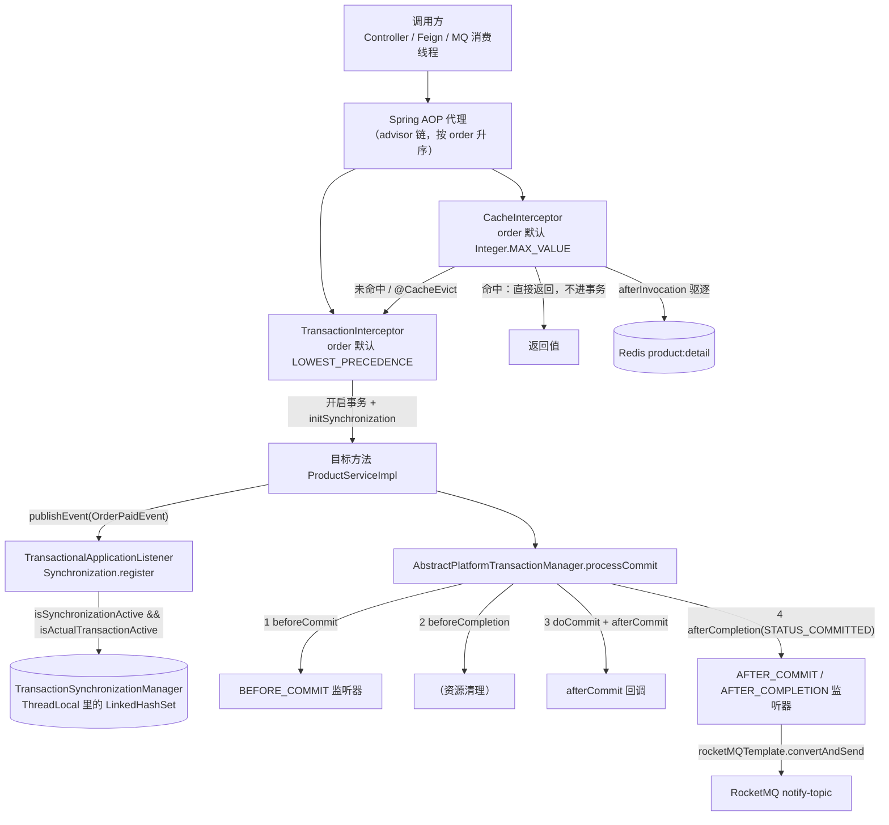
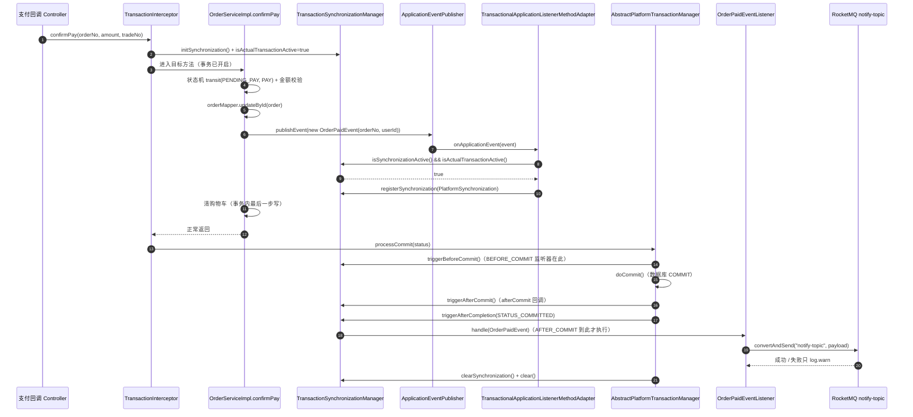

# Spring Cache 与事务领域事件：缓存时机、提交顺序与 AFTER_COMMIT

> **一句话结论**：`@Cacheable`/`@CacheEvict` 活在方法边界的**外面**（AOP 拦截），事务活在方法边界的**里面**（tx 拦截），两者默认同一个 advisor order，谁包谁不确定——这就是"事务回滚了缓存却已删/已写"的根源；`@TransactionalEventListener` 是把副作用钉在"提交之后"的唯一官方钩子，它的四个 phase 实际由 `TransactionSynchronization` 的四个回调实现。
> **阅读前置**：读过 [AOP 与自动代理创建](../24-源码分析/01-Spring框架/02-AOP与代理/01-aop-原理与自动代理创建.md) 与 [@Transactional 事务拦截器](../24-源码分析/01-Spring框架/03-事务管理/01-transactional-事务拦截器与传播行为.md)；知道 `ThreadLocal` 为什么能绑事务资源。
> **证据基线**：Spring Framework 7.1.0 / Spring Boot 4.2.0 / spring-tx 7.1.0 / spring-context 7.1.0 / spring-data-redis 4.2.0，本地 JDK 17.0.19；A 级摘录 8 份（`assets/source`）、本项目 B 级代码 6 处、C 级命令 5 条。预计阅读 35 分钟。

## 0. 先看现象

结论先给：这篇要解释的三个现象，本质是同一件事在三个层次上的表现——**"缓存的写删"和"事务的提交"没有被同一个时机约束住**。

**现象 1：事务回滚了，缓存却已经被清掉了。**

商品服务的扣库存方法 `deductStock` 同时标了 `@Transactional` 和 `@CacheEvict`（见 `ai-cs-product/src/main/java/com/aics/product/service/impl/ProductServiceImpl.java:189-191`）。库存不足时它抛的是业务异常：

```text
BusinessException: 商品库存不足，当前库存: 3
```

（原文见 `ProductServiceImpl.java:206-207`。）异常抛出 → 本地事务回滚、库存回到 5；但 Redis 里 `product:detail::1001` 这个 key 已经消失，或者更糟——如果一个方法上写的是 `@CachePut`，缓存里会被塞进那个**已经回滚**的库存值。于是详情页显示 4，下单时又说库存不足 3，用户看到的两个数字互相打架。

**现象 2：`@TransactionalEventListener` 写了但从来不触发。**

监听器方法打了日志，日志一条都没有；把日志级别调到 DEBUG 才看到一行：

```text
No transaction is active - skipping ...
```

这句是 `TransactionalApplicationListenerMethodAdapter` 的原话（`assets/source/TransactionalApplicationListenerMethodAdapter.java#L97-L102`）。它只会在一个前提下出现：`publishEvent` 执行时，当前线程**没有活动事务**（更准确说是没有活动的 synchronization）。常见成因有三个——事件在 MQ 消费线程里发布、发布方法被同类自调用绕过了代理（`@Transactional` 没生效，于是"事务里发布"变成了"无事务发布"）、事件被丢进 `@Async` 线程池后才发布。

**现象 3：事件链路失败了，但没人报错。**

`@TransactionalEventListener` 的 `AFTER_COMMIT` 阶段抛异常，日志里只有一行 warn，请求仍然 200；`afterCompletion` 的契约写得很清楚：

```text
@throws RuntimeException in case of errors; will be logged but not propagated
```

（`assets/source/TransactionSynchronization.java#L179-L180`。）项目里的 `OrderPaidEventListener` 干脆自己 catch 了异常只 `log.warn`（`ai-cs-order/src/main/java/com/aics/order/event/OrderPaidEventListener.java:38-40`），因为订单事务已经提交、不能反悔。结果就是：**通知丢了，只有一条没人看的 warn**。

这些现象指向同一件事：**缓存与副作用都必须在"事务提交"这个时刻被正确地排序或挂载，否则要么脏、要么丢、要么静默。**

## 1. 整体地图

结论先给：一个带 `@Cacheable` + `@Transactional` + `@TransactionalEventListener` 的方法，调用链上其实有**四个**不同层的组件在排队执行，理解顺序就理解了全部。



> **读图说明**：从左往右读是"一个 HTTP/Feign 调用进门后的排队顺序"，从上往下读是"一次事务的提交过程"。三个要点：① `CacheInterceptor` 与 `TransactionInterceptor` 是**两个独立的 advisor**，图上画成谁在上（更外层）由 order 决定，默认两者相同，所以别赌（见 3.6）；② 缓存命中时事务根本不开，这是声明式缓存的额外收益；③ 事件监听器不在调用链上同步执行，而是被登记进 `TransactionSynchronizationManager` 的 `ThreadLocal` 集合，由事务管理器在提交过程里回调——这张图的右半部分是理解四 phase 的关键。

| 组件 | 责任 | 调用方 / 被谁触发 |
| --- | --- | --- |
| `CacheInterceptor` | AOP `MethodInterceptor`，把方法调用包成 `CacheOperationInvoker` | AOP 代理（advisor 链） |
| `CacheAspectSupport` | 缓存操作的真正执行者：查缓存、调目标、写缓存、驱逐 | `CacheInterceptor.invoke` |
| `CacheManager` / `Cache` | 缓存容器抽象；Redis 实现是 `RedisCacheManager` / `RedisCache` | `CacheAspectSupport` |
| `TransactionInterceptor` | AOP `MethodInterceptor`，开/提交/回滚事务 | AOP 代理（advisor 链） |
| `AbstractPlatformTransactionManager` | 事务提交/回滚的模板，负责按顺序回调 synchronization | `TransactionInterceptor` |
| `TransactionSynchronizationManager` | 线程级注册表：synchronizations 集合 + 事务资源 Map | 事务管理器、事件监听器、业务代码 |
| `TransactionalApplicationListenerMethodAdapter` | `@TransactionalEventListener` 方法适配器，负责"注册"而不是"执行" | Spring 事件广播器 |
| `ApplicationEventPublisher` | `publishEvent` 入口，交给 `ApplicationEventMulticaster` | 业务代码 |
| `RocketMQTemplate` | 提交之后的跨服务副作用出口 | `OrderPaidEventListener` |

## 2. 关键概念与关键类

结论先给：缓存侧只需要记住 `CacheAspectSupport.execute` 一条流水线；事务事件侧只需要记住 `register → afterCompletion` 一条回调链。

| 名称 | 位置 | 角色 | 关键方法 |
| --- | --- | --- | --- |
| `CacheInterceptor` | `org.springframework.cache.interceptor`（spring-context） | 缓存 AOP 入口 | `invoke(MethodInvocation)` |
| `CacheAspectSupport` | 同上 | 缓存操作的执行引擎（抽象父类） | `execute(CacheOperationInvoker, Object, Method, Object[])`、`invokeOperation` |
| `CacheAspectSupport.CacheOperationContext` | 同上（内部类） | 单条缓存注解的上下文（key/condition/unless 求值） | `generateKey`、`isConditionPassing`、`canPutToCache` |
| `CacheAspectSupport.CachePutRequest` | 同上（内部类） | 延迟执行的"写缓存"请求 | `apply`、`performCachePut` |
| `KeyGenerator` / `SimpleKeyGenerator` | 同上 | 无 `key` 属性时的默认 key 生成 | `generate(target, method, args)` |
| `CacheOperationExpressionEvaluator` | 同上（包私有） | SpEL 求值，提供 `#result`、`#root`、`NO_RESULT` | `key`、`condition`、`unless` |
| `RedisCacheManager` / `RedisCache` | `org.springframework.data.redis.cache` | Redis 落地：TTL、序列化、`get(key, Callable)` 原子回源 | `get`、`put`、`evict`、`clear` |
| `TransactionInterceptor` | `org.springframework.transaction.interceptor` | 事务 AOP 入口 | `invoke` |
| `AbstractPlatformTransactionManager` | `org.springframework.transaction.support` | 提交/回滚模板 | `processCommit`、`triggerAfterCommit`、`triggerAfterCompletion` |
| `TransactionSynchronization` | 同上 | 事务生命周期回调接口（4 个方法 + 3 个状态常量） | `beforeCommit`、`beforeCompletion`、`afterCommit`、`afterCompletion` |
| `TransactionSynchronizationManager` | 同上 | 线程绑定的注册表与资源管理器 | `registerSynchronization`、`isSynchronizationActive`、`isActualTransactionActive` |
| `@TransactionalEventListener` | `org.springframework.transaction.event` | 把监听器挂到指定 phase | 属性 `phase`、`fallbackExecution` |
| `TransactionalApplicationListenerMethodAdapter` | 同上 | 注解方法的适配器 | `onApplicationEvent` |
| `TransactionalApplicationListenerSynchronization` | 同上 | 真正注册进事务的 synchronization | `register`、`afterCompletion` |
| `TransactionPhase` | 同上（枚举） | 四个挂载点 | `BEFORE_COMMIT`、`AFTER_COMMIT`、`AFTER_ROLLBACK`、`AFTER_COMPLETION` |
| `@EnableCaching` / `CacheManager` | `org.springframework.cache.annotation` | 开启声明式缓存、指定缓存管理器 | `order()`（默认 `Integer.MAX_VALUE`） |
| `@EnableTransactionManagement` | `org.springframework.transaction.annotation` | 开启事务 AOP、排序 | `order()`（默认 `Ordered.LOWEST_PRECEDENCE`） |

> **证据说明（重要）**：`CacheAspectSupport` 与 `CacheInterceptor` **没有**收录进 `learning-docs/24-源码分析/assets/source/`，所以本篇对这两个类不使用 A 级锚点，而是用 `javap` 反编译公开签名 + 官方文档结论（C 级，见 §6.6），并明确标注哪些是"结构事实"、哪些是"设计意图"。`assets/source/Cache.java.md` 是 MyBatis 的 `org.apache.ibatis.cache.Cache`，与本篇无关，别误引。事务事件侧的类则全部有 A 级摘录，可以直接对着源码读。

## 3. 原理与证据逐段精读

### 3.1 拦截入口：`CacheInterceptor.invoke` 只做两件事

**在干什么。** `CacheInterceptor` 是 `CacheAspectSupport` 的唯一子类级入口，自身只声明了一个方法，用 `javap` 可以直接确认（C 级，命令见 §6.6）：

```text
public class org.springframework.cache.interceptor.CacheInterceptor
        extends org.springframework.cache.interceptor.CacheAspectSupport
        implements org.aopalliance.intercept.MethodInterceptor,java.io.Serializable {
  public java.lang.Object invoke(org.aopalliance.intercept.MethodInvocation) throws java.lang.Throwable;
}
```

它做两件事：把 `invocation.proceed()` 包进一个 `CacheOperationInvoker`（这样"调用目标方法"这件事可以**被延迟、被跳过、被传给别人**执行），然后把控制权交给父类的 `execute(invoker, target, method, args)`。`CacheAspectSupport` 上的这个方法签名同样可以通过 `javap -p` 读到：

```text
protected java.lang.Object execute(org.springframework.cache.interceptor.CacheOperationInvoker,
                                   java.lang.Object, java.lang.reflect.Method, java.lang.Object[]);
```

`CacheInterceptor` 与 `CacheAspectSupport` 的源码摘录未收录进 `assets/source`，本节只使用 `javap` 输出的签名作为"结构事实"，不编造方法体。

**为什么这么设计。** 关键字是"延迟"：缓存命中时**根本不能**执行目标方法，所以拦截器不能自己 `proceed()`，必须把"要不要执行方法"的决定权交给缓存逻辑。这个 `invoker` 抽象还顺带解决了异常包装问题——目标方法抛的任何 `Throwable` 都被包成 `CacheOperationInvoker.ThrowableWrapper`，保证缓存侧能区分"业务异常"和"缓存异常"。

**换写法会怎样。** 如果像 MyBatis 一级缓存那样把缓存塞进 DAO 内部，就无法做到"命中即短路"，也拿不到返回值做 `unless` 判断，更没法在方法返回后决定要不要回填。

**常见坑。** 同类自调用（`this.getProductDetail(id)`）绕过代理，缓存与事务**同时**失效——这和 `@Transactional` 失效是同一个代理问题，`ai-cs-order/src/main/java/com/aics/order/service/impl/OrderCreateTxService.java:34-42` 的 javadoc 专门记了这件事。

### 3.2 `execute` 的五步流水线，决定"什么时候删缓存"

**在干什么。** `CacheAspectSupport` 的私有方法名本身就是流水线的自述（`javap -p` 输出，C 级）：

```text
private Object execute(CacheOperationInvoker, Method, CacheAspectSupport$CacheOperationContexts);
private Object executeSynchronized(CacheOperationInvoker, Method, CacheOperationContexts);
private Object findCachedValue(CacheOperationInvoker, Method, CacheOperationContexts);
private Object findInCaches(CacheOperationContext, Object, CacheOperationInvoker, Method, CacheOperationContexts);
private Object processCacheEvicts(Collection<CacheOperationContext>, boolean, Object);
private void collectPutRequests(Collection<CacheOperationContext>, Object, Collection<CachePutRequest>);
private boolean hasCachePut(CacheOperationContexts);
private Object invokeOperation(CacheOperationInvoker);
```

按方法名 + 参数语义可以还原出执行顺序（结构事实来自签名，语义来自官方文档）：

```java (示意：按方法签名与官方文档还原的流程，非逐字源码)
// 1. 先处理 beforeInvocation = true 的驱逐
processCacheEvicts(evictOps, true, NO_RESULT);
// 2. 查 @Cacheable
ValueWrapper hit = findCachedValue(...);
// 3. 未命中则先占位一个"待写"请求（此时还没有返回值）
if (hit == null) collectPutRequests(cacheableOps, NO_RESULT, putRequests);
// 4. 命中且没有 @CachePut → 直接返回；否则真的调方法
Object ret = (hit != null && !hasCachePut(contexts)) ? hit.get() : invokeOperation(invoker);
// 5. 用返回值补全写请求并执行，再处理 afterInvocation 驱逐
collectPutRequests(cachePutOps, ret, putRequests);
putRequests.forEach(p -> p.apply(ret));
processCacheEvicts(evictOps, false, ret);
```

**为什么这么设计。** 关键在写缓存与驱逐都被"推迟到方法返回之后"：因为 `key`/`unless` 可能需要 `#result`，方法没跑完就没有 `#result`；而 `@CacheEvict` 默认 `beforeInvocation = false`，语义是"方法成功返回才删"。项目里的契约测试把这条锁死了：

```java
// ai-cs-product/src/test/java/com/aics/product/config/ProductCacheContractTest.java:67
assertFalse(evict.beforeInvocation(), "默认 afterInvocation=true：方法成功后才驱逐，失败不删缓存");
```

**换写法会怎样。** 若把 `beforeInvocation` 改成 `true`，语义变成"进方法就删"：方法随后抛异常，缓存也已经被删（只是穿一次库，不脏）；但并发场景下"删完到回填"的窗口里，别的线程会把**旧值**读回来写进缓存——这就是经典的缓存脏读窗口。

**常见坑。** ① 以为 `afterInvocation` 等于"事务提交后"——它只是"方法返回后"，事务可能还没提交（3.6 详解）；② `@Cacheable` + `@CachePut` 同写一个方法时 `hasCachePut` 为真，方法一定会执行，缓存不会短路。

### 3.3 key、condition、unless 的求值时机

**在干什么。** 三个 SpEL 属性分别由 `CacheOperationContext.generateKey`、`isConditionPassing`、`canPutToCache` 求值，求值器是 `CacheOperationExpressionEvaluator`，它公开了三个哨兵与三个方法（`javap`，C 级）：

```text
public static final java.lang.Object NO_RESULT;
public static final java.lang.Object RESULT_UNAVAILABLE;
public static final java.lang.String RESULT_VARIABLE;
public boolean condition(String, AnnotatedElementKey, EvaluationContext);
public boolean unless(String, AnnotatedElementKey, EvaluationContext);
public java.lang.Object key(String, AnnotatedElementKey, EvaluationContext);
```

`NO_RESULT` 出现在"方法还没执行"的阶段（查缓存、早期驱逐），`RESULT_UNAVAILABLE` 表示"这条表达式在这个阶段根本不允许引用 `#result`"。

**为什么这么设计。** `condition` 是"要不要用缓存"，必须在查缓存**之前**判定，所以它拿不到 `#result`；`unless` 是"结果满足某条件就不缓存"，必须在方法执行**之后**判定，所以它能用 `#result`。两个属性名字像、时机完全不同，这是面试和排错的分水岭。

**换写法会怎样。** 想在 `condition` 里写 `#result.stock > 0`，只会在运行期报表达式错误；正确做法是写 `unless = "#result == null"` 或 `condition = "#id != null"`。

**常见坑。** key 表达式参数解析依赖编译期 `-parameters`，否则 `#id` 解析成 null，`javap` 里能读到这条断言原文（C 级字符串常量）：

```text
Null key returned for cache operation [%s]. If you are using named parameters,
ensure that the compiler uses the '-parameters' flag.
```

项目里的 key 都很克制：`key = "#id"`、`key = "#productId"`、`key = "'all'"`（`ProductServiceImpl.java:109/191/256`），最后一个用单引号把常量变成字符串字面量，避免 SpEL 把 `all` 当变量名。

### 3.4 `sync = true` 到底保证了什么

**在干什么。** 当上下文被标记为 synchronized（即 `@Cacheable(sync = true)`），`execute` 会改走 `executeSynchronized(...)`：它不是"先 get 再 put"两步，而是把"回源"作为一个 `Callable` 交给 `Cache` 实现，由缓存自己在内部串行化——`RedisCache` 的 `get(key, valueLoader)` 会用 Redis 的 `SETNX` 做互斥锁，未抢到锁的线程短暂等待后读缓存。

**为什么这么设计。** 缓存击穿（热点 key 失效瞬间 N 个线程同时回源）是缓存最常见的生产事故。`sync = true` 用一个**很轻**的机制挡住单机并发，代价是要求缓存实现支持原子回源，并且语义受限。

**换写法会怎样。** 官方文档明确的两条限制值得记住：`sync = true` 只允许**一个** `@Cacheable` 操作、且只作用于**一个** cache，并且不能与 `unless` 组合——违反时抛异常而不是静默降级。

**常见坑。** ① 把 `sync = true` 当分布式锁：它只在**单个 JVM 内**互斥，网关后面 3 个 product 实例同时 miss 仍然会打 3 次库；② `sync = true` + 事务内调用：回源线程在**别人的线程**里执行，如果回源逻辑依赖当前事务上下文，会读到不一致的数据（`RedisCache` 的 loader 在调用线程执行，但等待线程已经不在事务里）。

### 3.5 事务侧：commit 的四个回调阶段

**在干什么。** `@Transactional` 的提交不是"执行完方法就 COMMIT"，它是一段有严格顺序的模板方法：

```java (src: AbstractPlatformTransactionManager.java.md#L773-L776)
				prepareForCommit(status);
				triggerBeforeCommit(status);
				triggerBeforeCompletion(status);
				beforeCompletionInvoked = true;
```

（`processCommit` 位于 `AbstractPlatformTransactionManager.java#L766-L848`，上述四行是提交前的三连。）提交成功后的收尾在同一方法里：

```java (src: AbstractPlatformTransactionManager.java.md#L834-L838)
			try {
				triggerAfterCommit(status);
			}
			finally {
				triggerAfterCompletion(status, TransactionSynchronization.STATUS_COMMITTED);
```

四个回调接口与三个状态常量如下：

```java (src: TransactionSynchronization.java.md#L47-L54)
	/** Completion status in case of proper commit. */
	int STATUS_COMMITTED = 0;

	/** Completion status in case of proper rollback. */
	int STATUS_ROLLED_BACK = 1;

	/** Completion status in case of heuristic mixed completion or system errors. */
	int STATUS_UNKNOWN = 2;
```

回调的执行顺序是 `beforeCommit` → `beforeCompletion` → `afterCommit` → `afterCompletion(status)`；回滚路径则跳过 `afterCommit`，以 `afterCompletion(STATUS_ROLLED_BACK)` 收尾。

`triggerAfterCompletion` 还顺手清空了注册表，这是"事件只能注册一次"的底层原因：

```text
List<TransactionSynchronization> synchronizations = TransactionSynchronizationManager.getSynchronizations();
TransactionSynchronizationManager.clearSynchronization();
```

（`AbstractPlatformTransactionManager.java#L1014-L1030`，`triggerAfterCompletion` 全文。）

**为什么这么设计。** 四个回调各管一件事：`beforeCommit` 允许"提交前反悔"（抛异常阻止提交，注意不能抛 `TransactionException` 子类）；`beforeCompletion` 无论提交还是回滚都执行，用于关资源；`afterCommit` 保证"主事务成功了"；`afterCompletion` 拿到最终状态，可以做补偿或清理。

**换写法会怎样。** 若没有 `afterCommit/afterCompletion`，所有"提交后要做的事"都只能塞进业务代码末尾，与业务逻辑混在一起，且一旦后续步骤失败就前功尽弃——这正是老代码在 `confirmPay` 里直接发 MQ 的病根。

**常见坑。** `afterCommit` 里**不能**再写库并期待它提交。源码注释把话说尽了：

```java (src: TransactionSynchronization.java.md#L155-L161)
	 * <p><b>NOTE:</b> The transaction will have been committed already, but the
	 * transactional resources might still be active and accessible. As a consequence,
	 * any data access code triggered at this point will still "participate" in the
	 * original transaction, allowing to perform some cleanup (with no commit following
	 * anymore!), unless it explicitly declares that it needs to run in a separate
	 * transaction. Hence: <b>Use {@code PROPAGATION_REQUIRES_NEW} for any
	 * transactional operation that is called from here.</b>
```

翻译成人话：连接还挂在当前线程上，你写进去的东西**不会再有 commit**，必须显式 `@Transactional(propagation = REQUIRES_NEW)`。

### 3.6 缓存在事务的哪一侧：advisor order 决定"提交前删还是提交后删"

**在干什么。** 一个方法同时标 `@CacheEvict` 与 `@Transactional` 时，两个 advisor 会被排进同一个 AOP 链，**order 小的在外层**。而两者的默认 order 恰好都是最大值：

```java (src: EnableTransactionManagement.java.md#L197-L201)
	/**
	 * Indicate the order in which the {@link TransactionManagementConfiguration}
	 * {@code Advisor} should be applied.
	 * <p>The default is {@code Ordered.LOWEST_PRECEDENCE} in order to run
	 * in the outermost position possible.
	 */
	int order() default Ordered.LOWEST_PRECEDENCE;
```

`@EnableCaching` 没有 A 级摘录，用 `javap -v` 可以直接读出它的注解默认值（C 级）：

```text
  public abstract int order();
    descriptor: ()I
    AnnotationDefault:
      default_value: I#17
        2147483647
```

`2147483647` 就是 `Integer.MAX_VALUE`，也就是 `Ordered.LOWEST_PRECEDENCE`。

**为什么这么设计。** 事务"尽可能在外层"，是为了让更多逻辑落在事务边界内（连缓存操作也算），并且让 `@Transactional` 对自己方法上的所有副作用统一负责。但两个都要求"最外层"时，Spring 只能用稳定排序保持注册顺序——**顺序变成了实现细节**。

**换写法会怎样。** 三种组合的语义完全不同：

| 谁在外层 | 缓存动作发生在 | 结果 |
| --- | --- | --- |
| `CacheInterceptor` 在外（order 更小） | 事务提交/回滚**之后** | 接近"先更库后删缓存"，回滚则不删，安全 |
| `TransactionInterceptor` 在外（order 更小，默认常见） | 事务**提交之前**（方法返回后、提交前） | 回滚也会删缓存 → 只放大穿透，不会脏；但 `@CachePut` 会把已回滚的值写进缓存 → 脏读 |
| 显式 `@EnableCaching(order = 0)` | 缓存最外层 | 语义确定，推荐 |

本项目 `deductStock` 是典型的"双注解"方法（`ai-cs-product/src/main/java/com/aics/product/service/impl/ProductServiceImpl.java:189-191`），`@CacheEvict` 只会删 key，所以最坏情况是回滚后多一次穿透；但同样的写法若换成 `@CachePut`，就会变成"回滚了但缓存是新的"——这正是现象 1 的后半句。

**常见坑。** ① 以为"方法成功 = 数据已提交"；② 在 Seata AT 全局事务里更危险：`@CacheEvict` 执行在**分支事务本地提交**时，全局二阶段回滚（undo_log 反向补偿）**撤不回**已经删掉的缓存，也撤不回已经发出的 MQ——`ai-cs-order/src/main/java/com/aics/order/service/impl/OrderCreateTxService.java:87-95` 的注释把这条风险写在代码里了。

### 3.7 `@TransactionalEventListener`：注册与四个 phase

**在干什么。** 注解只声明默认 phase：

```java (src: TransactionalEventListener.java.md#L72-L78)
	/**
	 * Phase to bind the handling of an event to.
	 * <p>The default phase is {@link TransactionPhase#AFTER_COMMIT}.
	 * <p>If no transaction is in progress, the event is not processed at
	 * all unless {@link #fallbackExecution} has been enabled explicitly.
	 */
	TransactionPhase phase() default TransactionPhase.AFTER_COMMIT;
```

事件到达时，适配器**不执行**监听方法，而是先尝试把它登记到当前事务上：

```java (src: TransactionalApplicationListenerMethodAdapter.java.md#L85-L103)
	@Override
	public void onApplicationEvent(ApplicationEvent event) {
		if (TransactionalApplicationListenerSynchronization.register(event, this, this.callbacks)) {
			if (logger.isDebugEnabled()) {
				logger.debug("Registered transaction synchronization for " + event);
			}
		}
		else if (isDefaultExecution()) {
			if (getTransactionPhase() == TransactionPhase.AFTER_ROLLBACK && logger.isWarnEnabled()) {
				logger.warn("Processing " + event + " as a fallback execution on AFTER_ROLLBACK phase");
			}
			processEvent(event);
		}
		else {
			// No transactional event execution at all
			if (logger.isDebugEnabled()) {
				logger.debug("No transaction is active - skipping " + event);
			}
		}
	}
```

登记的准入条件是两个条件**同时**成立：

```java (src: TransactionalApplicationListenerSynchronization.java.md#L75-L94)
	public static <E extends ApplicationEvent> boolean register(
			E event, TransactionalApplicationListener<E> listener,
			List<TransactionalApplicationListener.SynchronizationCallback> callbacks) {

		if (org.springframework.transaction.support.TransactionSynchronizationManager.isSynchronizationActive() &&
				org.springframework.transaction.support.TransactionSynchronizationManager.isActualTransactionActive()) {
			org.springframework.transaction.support.TransactionSynchronizationManager.registerSynchronization(
					new PlatformSynchronization<>(event, listener, callbacks));
			return true;
		}
		else if (event.getSource() instanceof TransactionContext txContext) {
			org.springframework.transaction.reactive.TransactionSynchronizationManager rtsm =
					new org.springframework.transaction.reactive.TransactionSynchronizationManager(txContext);
			if (rtsm.isSynchronizationActive() && rtsm.isActualTransactionActive()) {
				rtsm.registerSynchronization(new ReactiveSynchronization<>(event, listener, callbacks));
				return true;
			}
		}
		return false;
	}
```

注意 `isSynchronizationActive()`（有没有 synchronization 集合）与 `isActualTransactionActive()`（有没有真正的事务）是两件事：`TransactionSynchronizationManager.isSynchronizationActive()` 的实现只是 `synchronizations.get() != null`（`TransactionSynchronizationManager.java#L307-L309`），而 `isActualTransactionActive()` 看的是另一个 `ThreadLocal`（`TransactionSynchronizationManager.java#L499-L501`）。空实现的事务同步（`PROPAGATION_SUPPORTS` 且无事务）会让前者成立、后者不成立，于是**事件被丢弃**。

四个 phase 的落点，就在下面这段 `if/else` 里：

```java (src: TransactionalApplicationListenerSynchronization.java.md#L107-L126)
		@Override
		public void beforeCommit(boolean readOnly) {
			if (getTransactionPhase() == TransactionPhase.BEFORE_COMMIT) {
				processEventWithCallbacks();
			}
		}

		@Override
		public void afterCompletion(int status) {
			TransactionPhase phase = getTransactionPhase();
			if (phase == TransactionPhase.AFTER_COMMIT && status == STATUS_COMMITTED) {
				processEventWithCallbacks();
			}
			else if (phase == TransactionPhase.AFTER_ROLLBACK && status == STATUS_ROLLED_BACK) {
				processEventWithCallbacks();
			}
			else if (phase == TransactionPhase.AFTER_COMPLETION) {
				processEventWithCallbacks();
			}
		}
```

**为什么这么设计。** 事件是"领域事实"，事实要么成立要么不成立；把它挂到 synchronization 上，就复用了事务管理器已有的回调机制，不需要额外的调度器。`fallbackExecution` 默认 `false`（`TransactionalEventListener.java#L105-L110`，通过 `@AliasFor(annotation = EventListener.class, attribute = "defaultExecution")` 对齐 6.0 引入的 `@EventListener(defaultExecution)`），保证"没有事务就干脆不执行"，避免副作用在错误时机发生。

**换写法会怎样。** 用普通 `@EventListener` + 手动判断 `TransactionSynchronizationManager.isSynchronizationActive()`，等价但啰嗦；用 `ApplicationEventPublisher` 发到 MQ 再消费，则从"进程内保证"降级为"最终一致"（本项目 `OrderTimeoutEvent` 走的就是这条路，见 5.1）。项目里两种都在用，分工写在 `ai-cs-order/src/main/java/com/aics/order/event/OrderTimeoutEventListener.java:9-15` 的 javadoc 里。

**常见坑。** ① phase 写 `BEFORE_COMMIT` 却在里面做不可回滚的副作用（发 MQ、调三方）——提交随后失败，副作用已泄漏；② 以为 `AFTER_COMMIT` 就等于"连接已释放"，于是直接调用一个 `@Transactional` 方法，结果它加入了那个**已经提交、无法再提交**的事务，写入静默丢失。

### 3.8 一个反直觉事实：`AFTER_COMMIT` 实际跑在 `afterCompletion` 里

**在干什么。** 上一节的 `PlatformSynchronization` 只重写了两个方法。用 `javap` 看它的字节码级声明（C 级）：

```text
class org.springframework.transaction.event.TransactionalApplicationListenerSynchronization$PlatformSynchronization<AE extends org.springframework.context.ApplicationEvent>
        extends org.springframework.transaction.event.TransactionalApplicationListenerSynchronization<AE>
        implements org.springframework.transaction.support.TransactionSynchronization {
  public void beforeCommit(boolean);
  public void afterCompletion(int);
}
```

**没有 `afterCommit`**。所以 `AFTER_COMMIT` 的监听器并不是在 `triggerAfterCommit` 时执行，而是在 `triggerAfterCompletion(STATUS_COMMITTED)` 时执行——也就是排在 `afterCommit` 回调**之后**、排在"其他 `TransactionSynchronization` 的 `afterCompletion`"之中。

**为什么这么设计。** 一个回调内既能判断"提交了"又能判断"回滚了"，比拆成两个方法更省代码；`afterCompletion` 还能保证"无论提交还是回滚都会被执行一次"，天然覆盖 `AFTER_COMPLETION` 的语义。

**换写法会怎样。** 如果你在同一事务里还注册了别的 `TransactionSynchronization`，并且它的 `afterCommit` 负责把某个值写进 ThreadLocal，那么 `AFTER_COMMIT` 监听器**能看到**这个值（因为在 `afterCommit` 之后执行）；反过来，指望监听器的结果被 `afterCommit` 回调看到是不成立的。排序细节不要依赖，但"谁先谁后"这个问题在这里有确定答案。

**常见坑。** 调试时在 `afterCommit` 上下断点等 `OrderPaidEventListener`，永远等不到——断点要下在 `TransactionalApplicationListenerSynchronization$PlatformSynchronization#afterCompletion`，条件是 `status == 0`。

### 3.9 `@Async` + 事务事件：三个边界同时被切开

**在干什么。** 项目当前**没有**使用 `@Async`（`ai-cs-*` 下 `@Async` 出现 0 次，见 §6.6 的 grep 证据），但这是最容易被"优化"引入的写法，必须知道它切开的是什么。`@Async` 做三件事：把方法调用丢进线程池、立刻返回 `Future`/`void`、**不传播** `ThreadLocal`。

**为什么这么设计。** 线程池是为了吞吐，但 Spring 的 `TransactionSynchronizationManager` 与事务资源都是 `ThreadLocal`（`bindResource` 见 `TransactionSynchronizationManager.java#L170`），跨线程后一个都带不过去。

**换写法会怎样。** 四种组合的实际效果：

| 写法 | 事务上下文 | 事件是否注册 | 结果 |
| --- | --- | --- | --- |
| `@Transactional` 方法内 `publishEvent` | 有 | 是 | 正常，提交后执行 |
| 在 `@Async` 方法里 `publishEvent` | **无**（新线程） | 否 | 事件被丢弃（debug 一行 `No transaction is active - skipping`） |
| `@TransactionalEventListener` + `@Async` 标注同一方法 | 注册时在事务线程，执行时在新线程 | 是 | 能执行，但看不到事务资源；异常不会回传到提交方 |
| `@Async` 方法里调 `@Transactional` 方法 | 新事务 | — | 事务能开，但与调用方事务完全独立，回滚互不影响 |

**常见坑。** ① `@Async` 返回 `void` 时异常被 `AsyncUncaughtExceptionHandler` 吞掉，与 `afterCompletion` "logged but not propagated" 叠加，形成**双重静默**；② 想"提交后异步发通知"，正确姿势是 `@TransactionalEventListener(AFTER_COMMIT)` + 方法上加 `@Async`（Spring 官方文档推荐组合），而不是在业务方法里 `asyncExecutor.submit(...)`。

## 4. 一次完整执行时序

结论先给：支付确认这条链路把本篇所有概念串了起来——事务内只记事实，提交后才发副作用，缓存与通知都在提交之后才允许"动外面"。



> **读图说明**：纵向时间轴分三段看。① **第 1–5 步**在事务内：只做数据库写和"登记事实"，没有任何外部副作用；② **第 6–9 步**是事件被"寄存"的过程，`publishEvent` 到此就返回了，监听器方法一行都没跑——这就是为什么"我看日志事件没执行"经常是误判：执行时机在很后面；③ **第 10–17 步**是提交过程，注意 `doCommit` 一定在 `triggerAfterCompletion` 之前，`AFTER_COMMIT` 监听器在 `afterCommit` 之后才跑（3.8）。若第 13 步回滚，则第 15–16 步整段不发生，监听器**一次都不会被调用**，这正是本项目要的语义。

各步失败的表现（排错时按这个表对照日志）：

| 失败位置 | 现象 | 关键线索 |
| --- | --- | --- |
| 状态机 / 金额校验（第 4 步） | 抛 `BusinessException`，事务回滚，通知不发 | 异常消息是 `订单状态不允许支付` 或 `ORDER_PAY_AMOUNT_MISMATCH` 对应文案 |
| `publishEvent` 时线程无事务 | 事件被丢弃，无任何错误 | DEBUG 级 `No transaction is active - skipping` |
| `doCommit` 失败（第 13 步） | 抛 `TransactionException`，走 `doRollbackOnCommitException` | 日志里 `Could not commit JPA/JDBC transaction` |
| `AFTER_COMMIT` 监听器抛异常 | 事务已提交、不会被回滚；异常被记录不传播 | `TransactionSynchronization.afterCompletion threw exception`（warn） |
| MQ 投递失败 | 订单已支付、通知没发出 | 本项目 `log.warn`（`OrderPaidEventListener.java:38-40`），需对账补偿 |

## 5. 设计取舍

结论先给：本项目在"一致性强度 vs 复杂度"上做了四次明确取舍，每次取舍都能在代码里找到注释。

| 取舍点 | 选择 | 放弃的另一种 | 理由（可查证的依据） |
| --- | --- | --- | --- |
| 缓存方式 | 声明式 `@Cacheable/@CacheEvict` | 手写 `redisTemplate` get/set | 命中/回源/序列化/TTL 从业务方法里剥离，测试可只断言注解契约（`ProductCacheContractTest`） |
| 缓存更新策略 | 先更库、方法返回后删缓存（Cache-Aside 变体） | 先删缓存再更库 / 双写 | 双写在并发下更易脏；删缓存失败最坏是"旧值 + TTL 兜底"（detail 30 分钟） |
| 缓存粒度 | 只缓存详情与分类，不缓存分页列表 | 全量缓存商品列表 | 分页 key 组合基数高、库存高频变，命中率低驱逐面大（`ProductCacheConfig.java:20`） |
| 通知副作用 | `AFTER_COMMIT` 事件 + MQ | 事务内直接发 MQ | 事务回滚时用户不能收到"支付成功"（`OrderPaidEventListener.java:19`） |
| 超时关单 | RocketMQ 延迟消息 → 领域事件 → 同步 `@EventListener` | 只用 Spring 事件 / 只用 MQ | MQ 提供跨时间可靠投递，事件提供进程内解耦与幂等入口（`OrderTimeoutEventListener.java:12-14`） |
| 幂等策略 | 状态机 + 查库守卫 | 去重表 / Redis token | `cancelExpiredOrder` 里 `order == null \|\| 非 PENDING_PAY` 直接返回（`OrderServiceImpl.java:171-173`） |
| 事件失败处理 | 只告警、不阻断主流程 | 失败重试/事务性发件箱 | 副作用最终一致，靠对账与告警兜底（`OrderPaidEventListener.java:20`） |

**可扩展点清单**（想动手时从这里挑，都绑定到具体类）：

- `CacheErrorHandler`：缓存读写异常不再向上抛（默认 `SimpleCacheErrorHandler` 是抛出的），适合"缓存挂了不能挂业务"。注册点：`CachingConfigurer#errorHandler`。
- 自定义 `KeyGenerator`：现在是默认 `SimpleKeyGenerator`，多参数方法会退化成 `SimpleKey`；业务可用 `#id` 显式指定，或全局自定义。
- 延迟双删：`@CacheEvict` 之后 `META-INF` 定时再删一次，或起一个 `@TransactionalEventListener(AFTER_COMMIT)` 删缓存事件 + MQ 重试。
- CDC / binlog 订阅（Canal）：把"删缓存"从应用侧移到数据变更侧，最终形态。
- 事务性发件箱（Outbox）：`afterCommit` 里落 outbox 表 + 独立投递器，替代"MQQ + 只告警"。
- 自定义 `TransactionSynchronization`：`@Transactional` 方法里手动 `registerSynchronization(...)`，实现按 order 排序的多个后置动作。
- `@EnableCaching(order = 0)` / `@EnableTransactionManagement(order = ...)`：把 §3.6 的不确定性变成显式契约。

## 6. 踩坑与调试手法

结论先给：这一类问题的排错顺序是"先确定事务有没有开 → 再确定缓存在事务的哪一侧 → 最后确定副作用挂在哪个 phase"，三步都能用日志/断点/命令定位。

**坑 1：回滚了但缓存已经动了。** 症状见现象 1。成因：`@CacheEvict/@CachePut` 在方法返回后执行，而事务提交在其后（或 Seata 全局回滚更晚）。判断方法：看 `ProductServiceImpl.deductStock` 这类"双注解"方法，`@CacheEvict` 的 `beforeInvocation` 是 `false` 只能说明"业务异常不删缓存"，**不能**说明"提交失败不删缓存"。修法：`@EnableCaching(order = 0)` 让缓存在最外层，或改成 `@TransactionalEventListener(AFTER_COMMIT)` 里删缓存。

**坑 2：`@TransactionalEventListener` 静默不触发。** 逐项排查：① 发布点是否在事务内（自调用绕过代理是最常见的一种，`OrderCreateTxService.java:37-41` 的 javadoc 记录了这个真实故障）；② 是否在 MQ 消费线程/`@Async` 线程里发布；③ 事件类型是否匹配（`record` 型事件泛型推断失败时监听器收不到）；④ 是否真的走到了提交（`@Transactional(rollbackFor = Exception.class)` 里抛异常，phase 是 `AFTER_COMMIT` 的监听器当然不跑）。

**坑 3：`afterCommit` 里写库"看起来成功但没进去"。** `TransactionSynchronization.java#L155-L161` 说得很明确：必须 `REQUIRES_NEW`。判断方法：在 `afterCommit` 里写一行，然后看数据库——没有 commit，只有 rollback 前的痕迹。

**坑 4：监听器里的异常被吞。** `afterCompletion` 的契约是"logged but not propagated"（`TransactionSynchronization.java#L179-L180`），加上本项目监听器自己 catch 只 warn，形成双重静默。对策：监听器内做**幂等 + 埋点**，并给"通知未送达"建对账任务（本项目尚未实现，属已知扩展点）。

**坑 5：`disableCachingNullValues` 与"缓存穿透"的错觉。** `ProductCacheConfig` 显式禁止缓存 null（`ProductCacheConfig.java:33`），所以 `getProductDetail` 查不到时必须**抛业务异常而不是返回 null**（`ProductServiceImpl.java:112-114`）——否则既没能缓存空值，又把异常语义换成 null 穿透。

**坑 6（调试手法一）：在正确的类上下断点。** 三个高价值断点位置：

1. `AbstractPlatformTransactionManager#triggerAfterCompletion(DefaultTransactionStatus, int)`（`AbstractPlatformTransactionManager.java#L999` 起）——条件断点 `completionStatus == 0`，看 synchronizations 集合里有几个监听器；
2. `TransactionalApplicationListenerSynchronization$PlatformSynchronization#afterCompletion(int)`——确认 `AFTER_COMMIT` 监听器是否被调用（`afterCommit` 上断点是等不到的，见 3.8）；
3. `CacheAspectSupport#processCacheEvicts(...)`——看它是在 `doCommit` **之前**还是之后命中，直接回答"缓存在事务哪一侧"。

**坑 7（调试手法二）：靠日志关键字定位。** 打开 `logging.level.org.springframework.transaction=DEBUG` 与事件适配器的 DEBUG：

| 关键字 | 含义 |
| --- | --- |
| `Registered transaction synchronization for` | 事件已挂上事务（`TransactionalApplicationListenerMethodAdapter.java#L88`） |
| `No transaction is active - skipping` | 事件被丢弃：发布点不在事务里 |
| `Initiating transaction commit` | 进入 `doCommit`，此后才轮到 `AFTER_COMMIT` |
| `Transaction synchronization is not active` | 在无 synchronization 的线程里注册（`TransactionSynchronizationManager.java#L339`） |
| `Null key returned for cache operation` | key 表达式解析失败（C 级断言原文） |

**坑 8（调试手法三）：直接问 Redis 和 classpath。** 缓存是否真的删了，别猜：

```text
redis-cli --scan --pattern 'product:detail::*'
redis-cli ttl product:detail::1001
```

（项目 `spring.cache.type=redis`，key 形如 `cacheName::key`；`ai-cs-product/src/main/resources/application.yml:14-15`。）类结构是否如你所想，也别猜，`javap` 一条命令：

```powershell
$ctx="C:\Users\16680\.m2\repository\org\springframework\spring-context\7.1.0\spring-context-7.1.0.jar"
javap -p -classpath $ctx org.springframework.cache.interceptor.CacheAspectSupport |
  Select-String -Pattern "processCacheEvicts|executeSynchronized|collectPutRequests"
```

真实输出（本机 JDK 17.0.19 实测）：

```text
  private java.lang.Object executeSynchronized(org.springframework.cache.interceptor.CacheOperationInvoker, java.lang.reflect.Method, org.springframework.cache.interceptor.CacheAspectSupport$CacheOperationContexts);
  private java.lang.Object processCacheEvicts(java.util.Collection<org.springframework.cache.interceptor.CacheAspectSupport$CacheOperationContext>, boolean, java.lang.Object);
  private void collectPutRequests(java.util.Collection<org.springframework.cache.interceptor.CacheAspectSupport$CacheOperationContext>, java.lang.Object, java.util.Collection<org.springframework.cache.interceptor.CacheAspectSupport$CachePutRequest>);
```

怎么读：`processCacheEvicts` 的第二个参数是 `boolean`，正是 `beforeInvocation`；它被调用两次（早/晚驱逐），这就是 §3.2 流水线的机器证据。

**坑 9（调试手法四）：确认本项目到底有没有 `@Async`。** 这条命令的输出是 0，它比任何猜测都可靠：

```powershell
Select-String -Path (Get-ChildItem -Recurse -Filter "*.java" -Path ai-cs-*) -Pattern "@Async" | Measure-Object -Line
```

真实输出：

```text
Lines Words Characters Property
----- ----- ---------- --------
    0
```

怎么读：全仓 0 处 `@Async`，所以"异步线程丢事务"是**潜在**风险而不是现网问题；同时 `@Cacheable/@CacheEvict/@CachePut` 共 7 处、`@TransactionalEventListener` 1 处、`@EventListener` 2 处，缓存与事件的用法面很窄，改动容易 review。

## 7. ⚠️ 版本差异

结论先给：本篇涉及的**语义**在 7.1 / 4.2 上没有变化，变的是**包名与可选序列化器**——这正是升级 Boot 4 时最容易踩的部分。

| 旧写法 | 当前基线 | 变化点 | 迁移动作 |
| --- | --- | --- | --- |
| `org.springframework.boot.autoconfigure.cache.RedisCacheManagerBuilderCustomizer` | `org.springframework.boot.cache.autoconfigure.RedisCacheManagerBuilderCustomizer` | Boot 4 把自动配置按技术拆成独立模块（`spring-boot-cache`），包名从 `boot.autoconfigure.*` 挪到 `boot.<tech>.autoconfigure` | 只改 import；本项目已按新包名写（`ProductCacheConfig.java:3`）。证据：`jar tf spring-boot-cache-4.2.0.jar` 输出 `org/springframework/boot/cache/autoconfigure/RedisCacheManagerBuilderCustomizer.class` |
| `spring.cache.type` / `spring.cache.redis.time-to-live` 等配置键 | 不变 | Boot 4.2.0 的 `spring-configuration-metadata.json` 仍声明这两个键 | 无需动作；本项目只用了 `spring.cache.type: redis`（`application.yml:14-15`） |
| `GenericJackson2JsonRedisSerializer`（Jackson 2） | 仍可用；4.2 新增 `GenericJacksonJsonRedisSerializer`（Jackson 3，包名 `tools.jackson`） | Boot 4 默认 Jackson 3，Spring Data Redis 4.2 同时提供新旧两个序列化器 | 可渐进迁移；本项目当前仍是 `GenericJackson2JsonRedisSerializer`（`ProductCacheConfig.java:35`），功能正常 |
| `@TransactionalEventListener` 无 reactive 支持 | 6.1 起支持响应式事务（事件源必须是 `TransactionContext`） | `register` 里的 `else if (event.getSource() instanceof TransactionContext)` 分支即为此新增 | WebFlux 场景才需要；本项目全同步栈，无需改动 |
| `@EventListener(defaultExecution=...)` 出现前，`fallbackExecution` 是独立属性 | 现在是 `@AliasFor(annotation = EventListener.class, attribute = "defaultExecution")` | 6.0 起事件监听统一了"默认执行"语义 | 旧代码不用改，读注释时注意两个名字指同一件事 |

**从哪版起未变（给"无差异"结论的依据）**：`@TransactionalEventListener` 自 4.2 引入（`TransactionalEventListener.java#L62` 的 `@since 4.2`），`phase()` 默认 `AFTER_COMMIT`（同文件 `#L78`）与四个 phase 的落点实现（`TransactionalApplicationListenerSynchronization.java#L107-L126`）在 7.1.0 中保持同一形态；`TransactionSynchronization` 的三个 `STATUS_*` 常量与四回调签名同样未变（`TransactionSynchronization.java#L47-L54`、`#L133-L187`）。`@EnableTransactionManagement.order` 仍默认 `Ordered.LOWEST_PRECEDENCE`（`EnableTransactionManagement.java#L197-L201`），`@EnableCaching.order` 仍默认 `Integer.MAX_VALUE`（C 级 `javap -v` 读取注解默认值）——两者相等这一"隐患"是从头就有的，不是新版本引入的。

## 8. 面试高频问与答

（只列问题，答案自己先在心里过一遍，再用 §自测题 校验。）

1. `@Cacheable`、`@CachePut`、`@CacheEvict` 三者的执行时机分别是什么？`beforeInvocation` 在什么场景必须设为 `true`？
2. 一个方法同时标 `@Cacheable` 和 `@CachePut`，会发生什么？缓存会短路吗？
3. `condition` 和 `unless` 的区别是什么？各自能引用 `#result` 吗？为什么？
4. `@Cacheable(sync = true)` 解决了什么问题，没解决什么问题？它和分布式锁的边界在哪？
5. 为什么 `key` 表达式偶尔会报 "Null key returned for cache operation"？怎么从编译参数层面解释？
6. `@CacheEvict` 和 `@Transactional` 同时标在一个方法上，删缓存发生在提交之前还是之后？由什么决定？
7. 为什么会话中出现"事务回滚了但缓存已被清空/写成新值"？给出两种根治方案。
8. Cache-Aside 为什么推荐"先更新数据库再删缓存"，而不是"先删缓存再更新数据库"或"双写"？延迟双删解决的是哪个窗口？
9. `@TransactionalEventListener` 的四个 phase 分别对应 `TransactionSynchronization` 的哪个回调？`AFTER_COMMIT` 真的在 `afterCommit` 里执行吗？
10. 事件在事务内发布，但监听器写在 `@Async` 方法里，会发生什么？事务上下文还看得见吗？
11. `fallbackExecution` 默认值是多少？它和 6.0 的 `@EventListener(defaultExecution=...)` 是什么关系？
12. `afterCommit` / `AFTER_COMMIT` 里想写数据库，为什么必须 `PROPAGATION_REQUIRES_NEW`？不加会怎样？
13. 监听器抛异常会不会导致事务回滚？异常最后去哪了？
14. Seata AT 全局事务回滚时，`@CacheEvict` 和已投递的 RocketMQ 消息能撤回吗？怎么保证最终一致？

## 9. 动手练习

结论先给：以下练习全部落在本模块的真实代码上，每条都有可验收的产物；不需要启动微服务、不需要跑全量构建。

1. **用 `javap` 画出缓存流水线**。对 `spring-context-7.1.0.jar` 执行 `javap -p` 导出 `CacheAspectSupport` 的私有方法表，按调用语义把 §3.2 的伪码五项与实际方法名一一对应。**验收**：产出一张"方法名 → 流水线步骤"的对照表，且能说明 `processCacheEvicts` 为什么出现两次（第二个参数为 `boolean`）。
2. **定位 `deductStock` 的缓存与事务先后**。在 `ai-cs-product` 的 `ProductServiceImpl.deductStock`（第 189–213 行）上，给 `AbstractPlatformTransactionManager#triggerBeforeCompletion` 与 `CacheAspectSupport#processCacheEvicts` 各下一个断点（条件：`key` 为 `product:detail::1001` 时），记录两者命中顺序。**验收**：写出一句结论——本项目当前配置下缓存驱逐发生在提交前还是提交后，并附上两次断点的线程栈首行。
3. **把"提交后删缓存"改成事件驱动**。新增一个 `ProductCacheEvictEvent(String cacheName, Object key)` 与一个 `@TransactionalEventListener(phase = AFTER_COMMIT)` 监听器，在 `deductStock`/`restoreStock` 里改为发布事件（保留原注解以做对照）。**验收**：`ProductCacheContractTest` 仍全绿（注解契约未被破坏），且新监听器在无事务发布时**不执行**（临时把发布点挪到 `@Transactional` 之外验证 `No transaction is active - skipping` 日志）。
4. **验证 `fallbackExecution` 的真实语义**。给 `OrderPaidEventListener.handle` 临时加 `fallbackExecution = true`，写一个不开启事务的测试方法直接 `publishEvent(new OrderPaidEvent("ORD-X", 1L))`，观察监听器是否执行；再改回默认值。**验收**：两次运行行为不同，且能对应到 `TransactionalApplicationListenerMethodAdapter.java#L91-L102` 的两个分支。
5. **复现"自调用绕过代理"导致事件不触发**。参照 `OrderCreateTxWiringTest`（`ai-cs-order/src/test/java/com/aics/order/service/impl/OrderCreateTxWiringTest.java:71-98`）的写法，在测试里从 `OrderServiceImpl` 内部 `this.confirmPay(...)` 调用，断言 `TransactionSynchronizationManager.isActualTransactionActive()` 为 `false`。**验收**：测试能稳定复现 false，并解释为什么 `publishEvent` 之后日志只有 `No transaction is active - skipping`。
6. **给缓存加一个"兜底不炸"的错误处理器**。实现 `CacheErrorHandler`（`handleCacheGetError/PutError/EvictError`），在 `ProductCacheConfig` 里通过实现 `CachingConfigurer` 注册，然后用一个连不上的 Redis 端口（如在测试里把 `spring.data.redis.port` 改成 1）验证商品查询仍能返回数据。**验收**：Redis 不可用时 `/api/products/{id}` 仍 200，日志有一条 cache error warn，且不是业务异常。
7. **量化 `sync = true` 的边界**。写一个纯 JVM 单测：10 个线程并发调同一个被 `@Cacheable(sync = true)` 标注、内部 `Thread.sleep(200)` 的方法（用 `ConcurrentMapCacheManager` 而非 Redis），统计实际执行次数；再把 `sync` 去掉重跑对照。**验收**：两次执行次数分别约为 1 次与 10 次，并写一句话说明"这只在单 JVM 内成立"。

## 小结

- 缓存是**方法边界的装饰**（`CacheInterceptor` → `CacheAspectSupport.execute`），事务是**方法边界的内容**（`TransactionInterceptor` → `processCommit`）；两者都在 AOP 链上，谁包谁由 advisor order 决定。
- `@CacheEvict` 默认 `beforeInvocation = false` 只保证"业务异常不删缓存"，**不保证**"事务回滚不删缓存"——这两件事被混为一谈是最常见的误解。
- 缓存的默认 TTL 与 per-cache TTL 都在 `ProductCacheConfig` 里（detail 30min / categories 10min），`disableCachingNullValues` 决定了"查不到要抛异常而不是返回 null"。
- `@TransactionalEventListener` 的本质是"把监听器注册成 `TransactionSynchronization`"，注册条件是 `isSynchronizationActive() && isActualTransactionActive()`，任一为假且 `fallbackExecution=false` → 事件被丢弃。
- `AFTER_COMMIT` 实际执行在 `afterCompletion(STATUS_COMMITTED)` 里（`PlatformSynchronization` 没重写 `afterCommit`），所以它排在 `afterCommit` 回调之后。
- 提交后写库必须 `REQUIRES_NEW`；提交后抛的异常"logged but not propagated"，必须靠幂等 + 对账兜底，而不是靠异常报警。
- **可操作归纳**：任何"方法里既改库又动缓存/发 MQ/发通知"的代码，先问一句"如果事务回滚，这一步还应该发生吗？"——答案是否，就把它挪进 `@TransactionalEventListener(AFTER_COMMIT)`；答案是是，就给它 `REQUIRES_NEW`。并且显式写 `@EnableCaching(order = 0)`，别让缓存与事务的外层顺序靠运气。

## 自测题

1. `@Cacheable` 命中缓存时，事务会不会开启？为什么？
<details><summary>参考答案</summary>不会。`CacheInterceptor` 在链上先于 `TransactionInterceptor` 执行（若缓存在外层），命中后由 `CacheAspectSupport.execute` 直接返回缓存值，`invokeOperation` 未被调用，目标方法与事务拦截器都不执行。若顺序相反（事务在外），则事务已开启、缓存命中后正常提交——两种顺序都安全，但前者少一次连接。</details>

2. `@CacheEvict(beforeInvocation = false)` 能保证"事务回滚就不删缓存"吗？
<details><summary>参考答案</summary>不能。`beforeInvocation=false` 只表示"目标方法正常返回后才删"，而事务提交发生在方法返回之后的 `AbstractPlatformTransactionManager#processCommit` 中。若方法是 `@Transactional` 且在提交阶段失败（或 Seata 全局二阶段回滚），缓存已经被 `processCacheEvicts(..., false, ...)` 删掉了。</details>

3. 为什么 `AFTER_COMMIT` 监听器在 `afterCommit` 断点上等不到？
<details><summary>参考答案</summary>`TransactionalApplicationListenerSynchronization$PlatformSynchronization` 只重写了 `beforeCommit(boolean)` 与 `afterCompletion(int)`，没有重写 `afterCommit()`。`AFTER_COMMIT` 阶段是在 `afterCompletion` 里以 `phase == AFTER_COMMIT && status == STATUS_COMMITTED` 的条件触发的，因此断点应下在 `afterCompletion`，条件 `status == 0`。</details>

4. 事件在 `@Async` 方法里 `publishEvent`，`@TransactionalEventListener` 会执行吗？
<details><summary>参考答案</summary>默认不会。`@Async` 切换到线程池线程，`TransactionSynchronizationManager` 的 synchronization 集合与事务资源都是 `ThreadLocal`，新线程上 `isSynchronizationActive()` 为 false，`register(...)` 返回 false，且 `fallbackExecution` 默认 false，于是 `TransactionalApplicationListenerMethodAdapter.onApplicationEvent` 走到 else 分支，只打一行 `No transaction is active - skipping`。</details>

5. `condition` 和 `unless` 分别在哪一步求值？能引用 `#result` 吗？
<details><summary>参考答案</summary>`condition` 在查缓存之前由 `CacheOperationContext.isConditionPassing` 求值，此时方法未执行，`#result` 不可用（求值器给的是 `NO_RESULT` / `RESULT_UNAVAILABLE`）；`unless` 在方法返回后由 `canPutToCache` 求值，可以使用 `#result`。写反了会在运行期报表达式错误。</details>

6. `sync = true` 的三个限制是什么？
<details><summary>参考答案</summary>依据官方文档：只能用于单个 `@Cacheable` 操作、只作用于一个 `Cache`，且不能与 `unless` 组合；因为它的实现是 `CacheAspectSupport.executeSynchronized` 把回源包装成 `Callable` 交给 `Cache#get(key, loader)` 原子执行，多缓存/多操作/后置条件都无法在原子块内表达。</details>

7. 一个方法同时有 `@Transactional` 与 `@CachePut`，回滚后缓存会怎样？
<details><summary>参考答案</summary>取决于 advisor 顺序。若缓存 advisor 在内层，`CachePutRequest.apply` 在方法返回后立刻把返回值写进缓存，随后事务提交失败/回滚，缓存里留下的是"已回滚的值"，形成脏读直到 TTL 过期。这类方法应改为 `@TransactionalEventListener(AFTER_COMMIT)` 里写缓存，或用 `@EnableCaching(order = 0)` 让缓存在事务外层。</details>

8. 为什么 `afterCommit` 里写数据库必须 `REQUIRES_NEW`？
<details><summary>参考答案</summary>`TransactionSynchronization#afterCommit` 的注释说明：事务已提交但资源仍活跃并可访问，此处任何数据访问"仍参与原事务"，不会再有 commit。必须用 `PROPAGATION_REQUIRES_NEW` 开启真正的新事务，否则写入静默丢失。</details>

9. `fallbackExecution` 的默认值和它的别名是什么？
<details><summary>参考答案</summary>默认 `false`，声明为 `@AliasFor(annotation = EventListener.class, attribute = "defaultExecution")`，即与 6.0 起 `@EventListener(defaultExecution=...)` 同一语义：没有事务时是否仍然执行监听器。设为 true 后，无事务发布会退化为普通同步事件，`AFTER_ROLLBACK` 阶段还会打一条 warn 说明是 fallback 执行。</details>

10. 为什么本项目 `getProductDetail` 查不到商品时抛异常而不返回 null？
<details><summary>参考答案</summary>因为 `ProductCacheConfig` 用了 `disableCachingNullValues()`，null 不会被缓存，返回 null 等于每次请求都打库（穿透）且丢失语义；抛 `BusinessException(ResultCode.PRODUCT_NOT_FOUND, "商品不存在")` 既能让 `@Cacheable` 正常跳过回填（异常不写缓存），又保留明确的业务语义。</details>

11. Seata AT 全局回滚时，`@CacheEvict` 的执行结果会被补偿吗？
<details><summary>参考答案</summary>不会。Seata 的 undo_log 只覆盖数据源分支（数据库），Redis 缓存与 RocketMQ 消息都不是 Seata 资源。分支本地提交时执行的 `@CacheEvict` 与已投递的延迟消息在全局回滚后依然存在。因此需要靠幂等（如 `cancelExpiredOrder` 的状态机守卫）与对账/校准（如 `syncStockCache`）兜底。</details>

12. `TransactionSynchronizationManager.registerSynchronization` 抛 `IllegalStateException` 的两种典型原因是什么？
<details><summary>参考答案</summary>一是当前线程的 synchronizations 集合为 null（未调用 `initSynchronization`，即不在 `@Transactional` 里），异常消息为 `Transaction synchronization is not active`；二是重复激活，`initSynchronization` 时集合已存在会抛 `Cannot activate transaction synchronization - already active`。两者的判断都基于 `synchronizations` 这个 `ThreadLocal<Set>`。</details>

13. `@TransactionalEventListener` 的监听方法抛异常，会不会导致事务回滚？
<details><summary>参考答案</summary>`AFTER_COMMIT`/`AFTER_ROLLBACK`/`AFTER_COMPLETION` 阶段不会——事务已经结束，异常在 `TransactionSynchronization#afterCompletion` 的契约里是 "logged but not propagated"。`BEFORE_COMMIT` 阶段会：它由 `triggerBeforeCommit` 调用，异常向上传播并阻止 `doCommit`，从而回滚（且不能抛 `TransactionException` 子类）。</details>

14. 为什么说"同一个 key 的缓存击穿"在 3 个 product 实例上仍会发生？
<details><summary>参考答案</summary>`sync = true` 的互斥发生在单个 JVM 内的 `Cache#get(key, loader)` 实现（`RedisCache` 用 Redis 做互斥仅限同一 key 的 loader 调用，但每个实例各自判断 miss），跨实例的 miss 判断无法共享，因此 3 个实例会并发回源 3 次。要跨实例收敛需要分布式锁、逻辑过期或热点 key 预热。</details>
