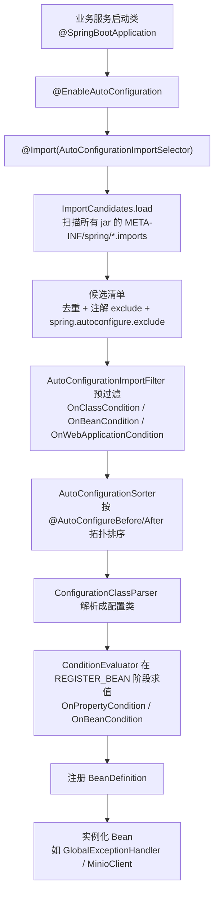
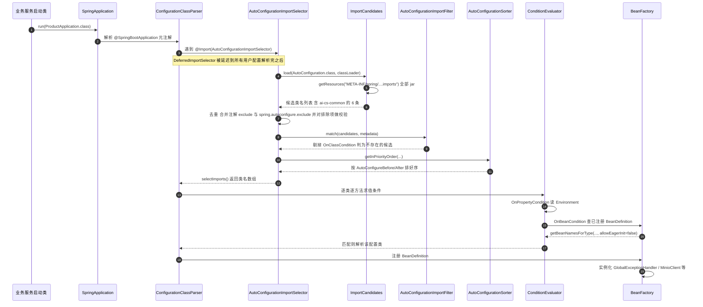

# 自定义 Starter 与自动装配：ai-cs-common 引依赖即生效的全链路

> **一句话结论**：ai-cs-common 之所以"加一行依赖就有统一异常处理、MinIO 客户端、幂等切面、Embedding 兜底模型"，不是因为它被扫到了，而是因为它的 jar 里有一个 `META-INF/spring/org.springframework.boot.autoconfigure.AutoConfiguration.imports` 把 6 个 `@AutoConfiguration` 类登记了进去，再由一组条件注解决定这几个类里到底装哪几个。
> **阅读前置**：知道 `@SpringBootApplication` 是 `@SpringBootConfiguration` + `@EnableAutoConfiguration` + `@ComponentScan` 的三合一；能区分 `BeanDefinition`（图纸）与 Bean 实例（对象）。自动配置全链路本身没读过的，先看 [《enableautoconfiguration 自动配置全链路》](../24-源码分析/02-SpringBoot/02-自动配置/01-enableautoconfiguration-自动配置全链路.md)。
> **证据基线**：Spring Boot 4.2.0 / Spring Framework 7.1.0 / JDK 17.0.19；A 级摘录取自 `learning-docs/24-源码分析/assets/source`，B 级为本仓库代码（本次逐行核对），C 级为命令实测输出。预计阅读 35 分钟。

## 0. 先看现象

**现象一：新服务里公共异常处理器"消失"，报错格式变了。**

`ai-cs-product`、`ai-cs-order` 这些服务的启动类是这么写的，只扫自己的包：

```java
// ai-cs-product/src/main/java/com/aics/product/ProductApplication.java#L11-L14
@SpringBootApplication(scanBasePackages = {"com.aics.product"}, exclude = {org.springframework.ai.model.openai.autoconfigure.OpenAiEmbeddingAutoConfiguration.class})
@EnableDiscoveryClient
@MapperScan("com.aics.product.mapper")
public class ProductApplication {
```

`GlobalExceptionHandler` 在 `com.aics.common.exception` 包下，**不在** `com.aics.product` 里。如果哪天 common 的 `imports` 文件漏登记 `CommonWebAutoConfiguration`（或者新服务忘了依赖 `ai-cs-common`），异常就不会被 `@RestControllerAdvice` 接住，客户端拿到的不再是统一 `Result`，而是容器默认的 `/error` 响应体：

```json
{"timestamp":"2026-11-27T02:10:44.512+00:00","status":500,"error":"Internal Server Error","path":"/api/product/1"}
```

为什么？因为 `@ComponentScan` 的搜索范围就是启动类所在包，跨模块的类**天生不在**扫描范围里。这也是历史写法 `@SpringBootApplication(scanBasePackages = {"com.aics.order","com.aics.common"})` 存在的原因——而它带来的新问题见 §3.8。

**现象二：`exclude` 写了个"不像自动配置类"的类名，启动直接失败。**

把某个普通 `@Component` 类（而不是 `@AutoConfiguration`/`@Configuration` 类）写进 `spring.autoconfigure.exclude`，容器不是"忽略"，而是**抛异常终止**：

```text
java.lang.IllegalStateException: The following classes could not be excluded because they are not auto-configuration classes:
	- com.aics.common.exception.GlobalExceptionHandler
```

这句原文来自 `AutoConfigurationImportSelector` 的排除校验，不是我们编的报错，见 §3.2 的 A 级证据。它说明一件容易被忽略的事：**排除名单是被"核对"的**，不是随便写个字符串就能糊弄过去。

**现象三：条件注解写了，但"该跳过的没跳过、该生效的没生效"。**

两种典型误判：

- `MinioAutoConfiguration` 上写着 `@ConditionalOnClass(MinioClient.class)`，看起来"没有 MinIO 依赖就会自动跳过"。但 `ai-cs-common/pom.xml` 里 minio 依赖**不是 optional**，所以只要依赖了 common，`MinioClient` 这个类必然在 classpath 上，这个条件**恒为真**。它守的是"类不存在"，不是"Bean 不存在"——而很多人以为它守的是后者。
- 反过来，`IdempotentAutoConfiguration` 的 Redis 依赖是 optional（`spring-boot-starter-data-redis` 在 pom 里标了 `optional`），于是 `@ConditionalOnClass(StringRedisTemplate.class)` 在这条链路上**真的**能起作用：没引 Redis 的服务，整个幂等装配静默跳过，不报错——静默到你以为它坏了。

这些现象指向同一件事：**Bean 到底装不装，不由"你写了什么类"决定，而由"imports 文件里有没有登记它"＋"那一串条件是否同时为真"决定；两者缺一，症状分别是"完全不生效"和"该跳的没跳"。**

## 1. 整体地图



> **读图说明**：看两处箭头。第一处是 `D → E`：候选清单的来源只有 `*.imports` 文件，**没有任何一条箭头来自 `spring.factories`**（§3.2 用实测证明 4.2.0 的 autoconfigure jar 里 `EnableAutoConfiguration` 这个键已经消失）。第二处是 `F → I`：同一个 `OnClassCondition`/`OnBeanCondition` 出现了两次，第一次是"粗筛"（把类都不在 classpath 的候选整体剔掉，省解析开销），第二次是"精判"（决定某个 `@Bean` 方法要不要注册）。如果你只看到 `F` 这一步，就会误以为"条件不满足 = 类被丢掉"，而实际上 `I` 这一步才是决定单个 Bean 生死的关卡——这也是 `@ConditionalOnMissingBean` 的类内顺序陷阱能被触发的原因。

| 组件 | 责任 | 调用方 |
| --- | --- | --- |
| `@AutoConfiguration` | 标记"我是自动配置类"，语义等价 `@Configuration(proxyBeanMethods = false)` | 本项目 6 个 AutoConfiguration 类 |
| `@EnableAutoConfiguration` | 一个 `@Import` 开关，把选择器挂到容器上 | 业务服务启动类（间接，被 `@SpringBootApplication` 组合） |
| `AutoConfigurationImportSelector` | 读候选、去重、排除、预过滤、排序，最后返回类名数组 | Spring 的 `ConfigurationClassParser`（`DeferredImportSelector` 机制） |
| `ImportCandidates` | 只干一件事：把 `META-INF/spring/<注解全名>.imports` 读成类名列表，**多 jar 全量合并** | `AutoConfigurationImportSelector.getCandidateConfigurations()` |
| `OnClassCondition` / `OnBeanCondition` / `OnPropertyCondition` | 三类条件的具体求值器 | `ConditionEvaluator`、`AutoConfigurationImportFilter` |
| `AutoConfigurationSorter` | 按 `@AutoConfigureBefore/After` 排顺序 | 选择器最后一步 |
| `ai-cs-common` 的 6 个 `*AutoConfiguration` | 提供公共能力，全部带 `@ConditionalOnMissingBean` 兜底 | 业务服务的容器（通过 imports 文件） |

## 2. 关键概念与关键类

先把四个术语钉死，后面不再解释：

- **自动配置（auto-configuration）**：写在**别人的 jar 里**、由框架自动加载的 `@Configuration` 类。它的特点是"不是我写的，但我要能随时替换掉它"。
- **Starter**：一个**空 jar**，唯一内容是 `pom.xml` 里的一组依赖。用户引它，等于引了一堆依赖。
- **回退（back off）**：条件不满足时自动配置主动退出，让位给用户自己写的 Bean。
- **条件装配**：把"装不装"写成注解，而不是写成 `if` 语句。

| 名称 | 位置 | 角色 | 关键方法 |
| --- | --- | --- | --- |
| `@AutoConfiguration` | `org.springframework.boot.autoconfigure`（spring-boot-autoconfigure 4.2.0） | 自动配置类的标记注解，元注解里带 `@Configuration(proxyBeanMethods = false)` | `before()/after()/beforeName()/afterName()`，见 `AutoConfiguration.java#L64-L111` |
| `@EnableAutoConfiguration` | 同上 | 容器侧的入口，组合 `@AutoConfigurationPackage` + `@Import(AutoConfigurationImportSelector.class)` | `exclude()` / `excludeName()`，见 `EnableAutoConfiguration.java#L84-L92` |
| `AutoConfigurationImportSelector` | `org.springframework.boot.autoconfigure` | 自动配置的总调度：候选→排除→过滤→排序 | `selectImports()`、`getAutoConfigurationEntry()`、`getCandidateConfigurations()` |
| `ImportCandidates` | `org.springframework.boot`（spring-boot 4.2.0） | imports 文件解析器 | `load(Class, ClassLoader)`、`readCandidateConfigurations()` |
| `OnClassCondition` | `org.springframework.boot.autoconfigure.condition` | 判"类在不在 classpath"，**同时**充当预过滤器 | `getMatchOutcome()`、`getOutcomes()` |
| `OnBeanCondition` | 同上 | 判"Bean 有没有"（`@ConditionalOnBean` / `OnMissingBean` / `OnSingleCandidate` 三者共用它） | `getMatchOutcome()`、`evaluateConditionalOnMissingBean()`、`getMatchingBeans()` |
| `OnPropertyCondition` | 同上 | 判"配置项存不存在/值对不对" | `determineOutcome()`、`collectProperties()`、`isMatch()` |
| `AutoConfigurationSorter` | `org.springframework.boot.autoconfigure` | 排序 | `getInPriorityOrder()` |
| `CommonWebAutoConfiguration` | `ai-cs-common/.../common/autoconfigure/` | 提供 `GlobalExceptionHandler`，仅 Servlet 环境 | `globalExceptionHandler()` |
| `Jackson2AutoConfiguration` | 同上 | 提供 Jackson 2 的 `ObjectMapper`（Boot 4 默认给的是 Jackson 3） | `jackson2ObjectMapper()` |
| `MinioAutoConfiguration` | 同上 | 提供 `MinioClient` 与 `FileStorageService` | `minioClient()`、`fileStorageService()` |
| `IdempotentAutoConfiguration` | `ai-cs-common/.../common/idempotent/` | 提供幂等切面，Redis 可选 | `idempotentAspect()` |
| `MessagePublisherAutoConfiguration` | `ai-cs-common/.../common/mq/` | 按 `aics.mq.type` 二选一装配 RocketMQ / Kafka 发布器 | 内部静态类 `RocketMqPublisherConfiguration`、`KafkaPublisherConfiguration` |
| `EmbeddingAutoConfig` | `ai-cs-common/.../common/ai/embedding/` | 本地哈希向量兜底 | `hashEmbeddingModel()` |

## 3. 原理与证据逐段精读

### 3.1 第一段：`@AutoConfiguration` 到底"自动"在哪

**在干什么。** 它没有魔法，就是 `@Configuration` 加两个额外语义：`proxyBeanMethods` 强制为 false，以及顺带带上 `@AutoConfigureBefore`/`@AutoConfigureAfter` 两个元注解。

```java (src: AutoConfiguration.java.md#L43-L49)
@Target(ElementType.TYPE)
@Retention(RetentionPolicy.RUNTIME)
@Documented
@Configuration(proxyBeanMethods = false)
@AutoConfigureBefore
@AutoConfigureAfter
public @interface AutoConfiguration {
```

`[[源码:AutoConfiguration.java.md#L43-L49]]`

javadoc 把这件事说得很直白（`AutoConfiguration.java#L22-L27`）：自动配置就是一个普通的 `@Configuration`，唯一例外是它的 `proxyBeanMethods()` 永远返回 false，而它"从哪来"这件事交给 `ImportCandidates` 解决。也就是说，**自动配置的"自动"全部发生在"它怎么被找到"这一侧，不在注解本身**。

**为什么这么设计。** 两个原因。

第一，`proxyBeanMethods = false` 是性能与语义双保险。`true` 时 Spring 要用 CGLIB 给配置类生成子类，拦截 `@Bean` 方法调用以保证"单例"，代价是启动期字节码生成；自动配置里动不动几十个配置类，这笔账不小。更关键的是语义：自动配置类里**不应该**直接用 `beanA()` 调 `beanB()` 那种写法（那会引入编译期看不到的耦合），要依赖注入就写成方法参数——本项目正是这么写的：

```java
// ai-cs-common/src/main/java/com/aics/common/autoconfigure/MinioAutoConfiguration.java#L29-L33
@Bean
@ConditionalOnMissingBean(FileStorageService.class)
public FileStorageService fileStorageService(MinioClient minioClient, MinioProperties properties) {
    return new FileStorageService(minioClient, properties);
}
```

上例（`ai-cs-common/src/main/java/com/aics/common/autoconfigure/MinioAutoConfiguration.java#L29-L33`）里的依赖关系靠**方法参数**表达，不靠方法调用，因此在 `proxyBeanMethods = false` 下完全安全。

第二，`@AutoConfigureBefore`/`@AutoConfigureAfter` 组合进来，是为了让"排序"成为自动配置的一等公民（见 §3.7 的 `MessagePublisherAutoConfiguration`）。

**换写法会怎样。** 把 `@AutoConfiguration` 换成手写 `@Configuration`，类还是能被容器加载——只要你把它放进 `@ComponentScan` 的路径里，或者手动 `@Import`。但排序失效：`AutoConfigurationSorter` 只认自动配置清单里的顺序信息，一个普通 `@Configuration` 在扫描阶段与别的配置类之间没有确定的先后。**顺序敏感的自动配置一旦失去排序，就会表现成"有时启动成功、有时 `NoSuchBeanDefinitionException`"**。

**常见坑。** `@AutoConfiguration` 的 `before()`/`after()` 是按**字节码**解析的，可以写一个当前 classpath 上根本没有的类名——这是特性不是 bug（`AutoConfiguration.java#L70-L74`）。但同一段 javadoc 给了一条硬约束：这种写法**只在注解直接标在被影响的组件上时**成立；一旦你把 `@AutoConfiguration` 当元注解去组合（自己写个 `@MyAutoConfig`），就必须改用 `beforeName()`/`afterName()`。组合场景写成 `after = XxxAutoConfiguration.class` 会导致排序静默失效——不报错，只是顺序不对。

### 3.2 第二段：imports 文件是唯一入口，`spring.factories` 的自动配置键已经没了

**在干什么。** `AutoConfigurationImportSelector` 找候选的代码只有一行关键调用：

```java (src: AutoConfigurationImportSelector.java.md#L188-L198)
protected List<String> getCandidateConfigurations(AnnotationMetadata metadata, AnnotationAttributes attributes) {
    List<String> configurations = ImportCandidates.load(this.autoConfigurationAnnotation, getBeanClassLoader());
    Assert.state(!configurations.isEmpty(),
            () -> "No auto configuration classes found in META-INF/spring/" + this.autoConfigurationAnnotation.getName()
                    + ".imports. If you are using a custom packaging, make sure that file is correct.");
    return configurations;
}
```

`[[源码:AutoConfigurationImportSelector.java.md#L188-L198]]`

`ImportCandidates.load` 拼路径的方式是 `String.format("META-INF/spring/%s.imports", annotation.getName())`（`ImportCandidates.java#L35`、`#L69-L80`），然后 `classLoader.getResources(location)` —— 注意是**复数** `getResources`，所以 classpath 上**每一个** jar 的同名文件都会被读到并合并。这就是"引依赖即生效"的物理基础：只要 `ai-cs-common.jar` 在 classpath 上，它里面那份 imports 文件就一定会被读到，与它是否被扫描、包名是否与启动类同源**毫无关系**。

文件格式极简（`ImportCandidates.java#L98-L124`）：UTF-8 逐行读，`#` 之后全部当注释截断，trim 后空行跳过。所以**不要**在这个文件里写 `key=value` 那种 `spring.factories` 语法，写了会被当成一个畸形类名。

**为什么这么设计。** 因为 `spring.factories` 是"一个文件装所有 SPI"。`EnableAutoConfiguration` 这个键下的类名列表在 Boot 2.x 时代膨胀到上千行，导致三个问题：①IDE 无法做类名补全与重命名重构；②任意一个键写错整份文件报废；③无法按注解区分——`@EnableAutoConfiguration`、`@EnableAutoConfiguration`-like 的新注解（如 `@EnableAsync` 之外的自定义扩展）都挤在同一个键里。改成"一个注解一个 imports 文件"后，路径即契约（文件名就是注解全名），一个文件只干一件事。

**这是可实测的，别只听我讲。** 打开本地仓里的 autoconfigure jar，把 `META-INF/spring.factories` 全文打出来：

```powershell
$j = "$env:USERPROFILE\.m2\repository\org\springframework\boot\spring-boot-autoconfigure\4.2.0\spring-boot-autoconfigure-4.2.0.jar"
Add-Type -AssemblyName System.IO.Compression.FileSystem
$z = [System.IO.Compression.ZipFile]::OpenRead($j)
$e = $z.Entries | Where-Object { $_.FullName -eq "META-INF/spring.factories" }
(New-Object System.IO.StreamReader($e.Open())).ReadToEnd()
$z.Dispose()
```

真实输出（节选，共 6 个键）：

```text
# ApplicationContext Initializers
org.springframework.context.ApplicationContextInitializer=\
org.springframework.boot.autoconfigure.SharedMetadataReaderFactoryContextInitializer,\
org.springframework.boot.autoconfigure.logging.ConditionEvaluationReportLoggingListener

# Auto Configuration Import Listeners
org.springframework.boot.autoconfigure.AutoConfigurationImportListener=\
org.springframework.boot.autoconfigure.condition.ConditionEvaluationReportAutoConfigurationImportListener

# Auto Configuration Import Filters
org.springframework.boot.autoconfigure.AutoConfigurationImportFilter=\
org.springframework.boot.autoconfigure.condition.OnBeanCondition,\
org.springframework.boot.autoconfigure.condition.OnClassCondition,\
org.springframework.boot.autoconfigure.condition.OnWebApplicationCondition
```

**怎么读这段输出**：`spring.factories` 文件**还在**，但它里面已经**没有** `org.springframework.boot.autoconfigure.EnableAutoConfiguration=` 这个键了。同一 jar 里另有 `META-INF/spring/org.springframework.boot.autoconfigure.AutoConfiguration.imports`（实测 12 条，如 `AopAutoConfiguration`、`TaskSchedulingAutoConfiguration`）。所以正确的表述不是"`spring.factories` 废了"，而是**"用 `spring.factories` 登记自动配置这条路废了，其它 SPI 键还活着"**。顺带一个反直觉但重要的细节：`AutoConfigurationImportFilter` 这个键仍在 `spring.factories` 里——因为过滤器必须在候选类被解析**之前**就加载好，它本身不能是候选之一。选择器读它走的是 `SpringFactoriesLoader`（`AutoConfigurationImportSelector.java#L266-L268`），不是 `ImportCandidates`。

**换写法会怎样。** 如果你在业务模块里新建 `META-INF/spring.factories` 并写：

```properties
org.springframework.boot.autoconfigure.EnableAutoConfiguration=com.aics.common.MyAutoConfiguration
```

Boot 4.2.0 **不会**加载它，而且**不会报错**。你会得到一个"配置类明明写了、日志里连 Condition Evaluation Report 都找不到它"的最难查的症状之一。

**常见坑。** 本项目 `ai-cs-common` 里同时存在三份 imports 文件（见 §6 的核对命令），登记了 6 个类。漏登记一个的症状是**完全静默**：没有异常、没有 warning，只有那个配置类对应的能力凭空消失。第二个坑是文件名必须逐字精确——`org.springframework.boot.autoconfigure.AutoConfiguration.imports` 少一个 `.boot` 就整份失效，仍然不报错。

### 3.3 第三段：条件注解族，以及它们的求值顺序

**在干什么。** 三类条件，各管一件事，名字就说明了它们看的维度：

| 注解 | 看的维度 | 实现类 | 求值时机 |
| --- | --- | --- | --- |
| `@ConditionalOnClass` / `@ConditionalOnMissingClass` | classpath 上有没有这个类 | `OnClassCondition` | 预过滤 + 解析期 |
| `@ConditionalOnBean` / `@ConditionalOnMissingBean` / `@ConditionalOnSingleCandidate` | 容器里有没有这个 Bean | `OnBeanCondition` | **注册 BeanDefinition 阶段** |
| `@ConditionalOnProperty` | Environment 里有没有这个键、值对不对 | `OnPropertyCondition` | 解析期 |
| `@ConditionalOnWebApplication` | 应用类型是 SERVLET 还是 REACTIVE | `OnWebApplicationCondition` | 预过滤 + 解析期 |

**顺序一：条件之间的顺序是写死的，不是"按注解书写顺序"。** 同一个类上挂多个条件时，`OnBeanCondition` 内部固定按 `ConditionalOnBean` → `ConditionalOnSingleCandidate` → `ConditionalOnMissingBean` 走，任一不匹配立刻返回：

```java (src: OnBeanCondition.java.md#L116-L143)
protected ConditionOutcome getMatchOutcome(AnnotationMetadata metadata, ConditionContext context) {
    if (metadata.isAnnotated(ConditionalOnBean.class.getName())) {
        // ... 求值，不匹配则 return noMatch
    }
    if (metadata.isAnnotated(ConditionalOnSingleCandidate.class.getName())) {
        // ... 求值，不匹配则 return noMatch
    }
    if (metadata.isAnnotated(ConditionalOnMissingBean.class.getName())) {
        // ... 求值，不匹配则 return noMatch
    }
    return ConditionOutcome.match();
}
```

`[[源码:OnBeanCondition.java.md#L116-L143]]`（原文结构一致，此处省略了各分支内部细节）

**顺序二：`@ConditionalOnMissingBean` 为什么必须留到最后。** 因为它要回答的是"**除我之外**还有没有人提供了这个 Bean"。如果它先于 `@ConditionalOnBean` 求值，就可能对着一份还没注册完的 BeanDefinition 表做判断。这也解释了它为什么实现 `ConfigurationCondition` 并把 `getConfigurationPhase()` 返回 `ConfigurationPhase.REGISTER_BEAN`（`OnBeanCondition.java#L76-L82`）——它被强制推到"注册 BeanDefinition 的阶段"求值，而不是"解析配置类"的阶段。`EnableAutoConfiguration` 的 javadoc 有原话：自动配置**总是在用户自定义 Bean 注册之后**才被应用（`EnableAutoConfiguration.java#L35-L36`）。

**顺序三：`OnClassCondition` 的 `@Order(HIGHEST_PRECEDENCE)`（`OnClassCondition.java#L33-L34`）与 `OnBeanCondition` 的 `@Order(LOWEST_PRECEDENCE)`（`OnBeanCondition.java#L76-L82`）不是巧合。** 类存在性是"静态事实"，查一次缓存即可，所以最早跑、最便宜、能一次性砍掉大量候选；Bean 存在性是"动态事实"，跟注册顺序有关，所以最晚跑。这也是它同时实现 `AutoConfigurationImportFilter`、参与 §1 流程图里 `F` 那一步粗筛的原因。

**`@ConditionalOnProperty` 的两个细节值得单独记。** 第一，`value`/`name` 互斥且有且必有一：`getNames()` 里两条 `Assert.state` 分别守"至少写一个"和"不能同时写"（`OnPropertyCondition.java#L140-L152`）；`prefix` 会自动补结尾的 `.`（`#L132-L138`）。第二，`havingValue` 为空时语义是"**不等于 false 就算匹配**"：

```java (src: OnPropertyCondition.java.md#L170-L175)
private boolean isMatch(String value, String requiredValue) {
    if (StringUtils.hasLength(requiredValue)) {
        return requiredValue.equalsIgnoreCase(value);
    }
    return !"false".equalsIgnoreCase(value);
}
```

`[[源码:OnPropertyCondition.java.md#L170-L175]]` —— 本项目 `EmbeddingAutoConfig` 写了 `havingValue = "local", matchIfMissing = true`，含义是"`aics.ai.embedding.provider` 不写或写 `local` 时生效，写 `openai` 时退出"。如果当初写成 `@ConditionalOnProperty("aics.ai.embedding.provider")`（不带 havingValue），那么 `provider=openai` 也会匹配——这就是"条件注解不生效"最常见的一种真实成因。

**为什么这么设计。** 三类条件对应三种"不确定性来源"：classpath（打包时确定）、Environment（配置时确定）、Bean 图（运行期确定）。把它们拆成三个独立条件类，用户就能组合出"类在才看配置、配置对才看 Bean"这种精细语义，而框架不用为每种组合写一个 if。

**换写法会怎样。** 用 `@Conditional` + 自写 `Condition` 实现同样逻辑，你会丢掉两样东西：一是预过滤能力（自定义 `Condition` 拿不到 `AutoConfigurationImportFilter` 那份提前量，所有候选都得解析一遍），二是 Condition Evaluation Report 里的可读输出（`--debug` 报告只认这几类标准条件，自写条件在报告里只有一行"did not match"）。

### 3.4 第四段：`@ConditionalOnMissingBean` 的类内顺序陷阱

**在干什么。** `@ConditionalOnMissingBean` 的判定依据是"容器里有没有这个类型的 BeanDefinition"，查法是：

```java (src: OnBeanCondition.java.md#L322)
String[] beanNames = beanFactory.getBeanNamesForType(type.resolvableType(), true, false);
```

`[[源码:OnBeanCondition.java.md#L322]]`

注意后两个参数：`includeNonSingletons = true`、`allowEagerInit = false`。**`allowEagerInit = false` 是关键**——它保证这个条件**不会提前实例化**任何 Bean，只看图纸。如果它为了判断而 eager init，那么一个 `FactoryBean` 或懒加载 Bean 会被条件判断顺手创建出来，副作用无法预料。

**坑在哪。** 判定发生在**注册 BeanDefinition 阶段**，所以它只能看见"已经注册完的" BeanDefinition。同一个自动配置类里，`@Bean` 方法的注册顺序就是声明顺序。于是：

```java
@AutoConfiguration
public class BadOrderAutoConfiguration {

    @Bean
    @ConditionalOnMissingBean
    public OrderService orderService() {
        return new OrderService(repository());   // 见下
    }

    @Bean
    @ConditionalOnMissingBean
    public Repository repository() {
        return new JdbcRepository();
    }
}
```

上面这段是**反例**，请勿照抄。当容器处理 `orderService()` 时，`repository()` 的 BeanDefinition **还没注册**，条件是真（"没有 `Repository` Bean"）——这里没问题；但反过来，如果你的 `orderService` 依赖了"用户可能已经定义"的 Bean，且这个依赖由本类的另一个 `@Bean` 方法提供，就会出现"条件看到的图和最终图不一致"。更典型的表现是：**用户明明在别的配置类里定义了 `Repository`，但因为注册顺序在你之后，你的条件仍然为真，最后两个 `Repository` BeanDefinition 撞名/撞类型**。

本项目的写法是安全的，因为它把"可能被覆盖的"都放在**同一个类里、彼此不互相判条件**，并且用户覆盖点都在类外：

```java
// ai-cs-common/src/main/java/com/aics/common/autoconfigure/CommonWebAutoConfiguration.java#L12-L20
@AutoConfiguration
@ConditionalOnWebApplication(type = ConditionalOnWebApplication.Type.SERVLET)
public class CommonWebAutoConfiguration {

    @Bean
    @ConditionalOnMissingBean(GlobalExceptionHandler.class)
    public GlobalExceptionHandler globalExceptionHandler() {
        return new GlobalExceptionHandler();
    }
}
```

上例（`ai-cs-common/src/main/java/com/aics/common/autoconfigure/CommonWebAutoConfiguration.java#L12-L20`）—— 业务模块只要自己写一个 `GlobalExceptionHandler` Bean（不一定是同包，只要类型一致），这里的条件就为假，自动配置让位。

**为什么这么设计。** 因为"用户优先"是自动配置的第一原则，而"是否用户定义"只能在注册阶段问。如果改成在解析阶段问，那时用户的 Bean 可能还没进图纸，自动配置就会永远抢注。`@Order(LOWEST_PRECEDENCE)` 也是在为这件事服务：让 `OnBeanCondition` 尽量晚一点求值，看到尽可能完整的图。

**换写法会怎样。** 把 `@ConditionalOnMissingBean` 去掉，让用户覆盖——那就必须开 `spring.main.allow-bean-definition-overriding=true`（默认是 **false**，实测见 §3.5），否则同名 Bean 直接抛 `BeanDefinitionOverrideException`；而如果 Bean 名不同、类型相同，则变成 `NoUniqueBeanDefinitionException`，注入点全炸。两种都是生产事故，前者启动期暴露还算幸运，后者只在某个 `@Autowired` 被用到时才炸。

**常见坑。** `@ConditionalOnMissingBean` 的"类型"不是随便推的。注解没写 `value`/`name`/`annotation` 时，若它标在 `@Bean` 方法上，框架用**方法返回类型**做被查类型（`OnBeanCondition.java#L582-L591`、`#L662-L687`）；推断失败会抛 `BeanTypeDeductionException`。三者皆空且推不出来时抛 `IllegalStateException(...did not specify a bean using type, name or annotation)`（`#L639-L647`）。所以 `@ConditionalOnMissingBean` 不带参数只适合"标在返回具体类型的 `@Bean` 方法上"这一种场景——本项目 `IdempotentAutoConfiguration#idempotentAspect` 就是这么用的（返回类型明确是 `IdempotentAspect`），成立。

### 3.5 第五段：Bean 覆盖与 `allow-bean-definition-overriding`

**在干什么。** 两个不同来源想注册**同名** Bean 时，容器问一个开关：允许覆盖吗？

```java (src: SpringApplication.java.md#L376)
listableBeanFactory.setAllowBeanDefinitionOverriding(this.properties.isAllowBeanDefinitionOverriding());
```

`[[源码:SpringApplication.java.md#L376]]` —— 启动时把这个配置项灌进 `DefaultListableBeanFactory`。工厂侧的默认语义是"没显式设过就当允许"：

```java (src: DefaultListableBeanFactory.java.md#L279-L280)
public boolean isAllowBeanDefinitionOverriding() {
    return !Boolean.FALSE.equals(this.allowBeanDefinitionOverriding);
}
```

`[[源码:DefaultListableBeanFactory.java.md#L279-L280]]`

**别被这两段骗了。** 工厂层面的"默认 true"不代表应用层面的默认是 true。实测 `spring-boot-4.2.0.jar` 里的配置元数据：

```powershell
$j = "$env:USERPROFILE\.m2\repository\org\springframework\boot\spring-boot\4.2.0\spring-boot-4.2.0.jar"
Add-Type -AssemblyName System.IO.Compression.FileSystem
$z = [System.IO.Compression.ZipFile]::OpenRead($j)
$e = $z.Entries | Where-Object { $_.FullName -eq "META-INF/spring-configuration-metadata.json" }
$meta = (New-Object System.IO.StreamReader($e.Open())).ReadToEnd() | ConvertFrom-Json
$meta.properties | Where-Object { $_.name -eq "spring.main.allow-bean-definition-overriding" } |
    ForEach-Object { "defaultValue=" + $_.defaultValue + " | " + $_.description }
$z.Dispose()
```

真实输出：

```text
defaultValue=False | Whether bean definition overriding, by registering a definition with the same name as an existing definition, is allowed.
```

**怎么读这个输出**：`defaultValue=False`，即 Boot 4.2.0 下**默认禁止覆盖**。而 `SpringApplication#L376` 这一行会把 `false` 显式设进去，于是工厂那个"默认允许"的分支永远不会走到——两份代码合起来看才是完整结论，只看其中一份都会得出相反答案。本项目全局 grep 未发现 `allow-bean-definition-overriding` 配置，即走默认 false。

**为什么这么设计。** 覆盖是"隐式覆盖"的温床：两个 jar 都定义了 `objectMapper`，谁赢取决于类路径顺序，出了问题极难定位。默认禁止后，冲突升级为启动即失败，即"快速失败、大声失败"。真要覆盖就显式开——代价是你得自己保证覆盖是有意的。

**换写法会怎样。** 不开覆盖，只用 `@ConditionalOnMissingBean`：这是**本项目选择的路线**。区别在于语义层级——`@ConditionalOnMissingBean` 是"我让位"，覆盖开关是"我抢位"。前者不会产生两个 BeanDefinition，后者会产生然后丢掉一个。前者的风险是条件判早了（§3.4），后者的风险是覆盖顺序不可预期。**自动配置永远应该用前者**，因为自动配置无法预知用户意图。

**常见坑。** `spring.autoconfigure.exclude`（排除整个自动配置类）与 `allow-bean-definition-overriding`（同名覆盖）经常被混用。前者粒度是"整个配置类"，后者粒度是"单个 Bean，且要求同名"。如果你想干掉某个自动配置类提供的**一个** Bean 但保留其它，两条路都不合适，正确做法是提供**同类型** Bean 让 `@ConditionalOnMissingBean` 回退——前提是那个自动配置老老实实写了 `@ConditionalOnMissingBean`（本项目 6 个类全部写了）。

### 3.6 第六段：`@ConfigurationProperties` + `@EnableConfigurationProperties`，以及 Properties 类为什么不该加 `@Component`

**在干什么。** `@ConfigurationProperties` 只声明"我这些字段绑 `aics.minio.*`"，它**自己不会**注册成 Bean。注册动作由 `@EnableConfigurationProperties(MinioProperties.class)` 触发，它 `@Import` 了 `EnableConfigurationPropertiesRegistrar` 去注册 BeanDefinition。本项目两个 Properties 类都没加 `@Component`：

```java
// ai-cs-common/src/main/java/com/aics/common/idempotent/IdempotentProperties.java#L10-L19
@Getter
@Setter
@ConfigurationProperties(prefix = "aics.idempotent")
public class IdempotentProperties {

    private boolean enabled = true;

    private String keyPrefix = "aics:idem:";
}
```

上例（`ai-cs-common/src/main/java/com/aics/common/idempotent/IdempotentProperties.java#L10-L19`），配套的自动配置类上是：

```java
// ai-cs-common/src/main/java/com/aics/common/idempotent/IdempotentAutoConfiguration.java#L20-L24
@AutoConfiguration
@ConditionalOnClass(StringRedisTemplate.class)
@ConditionalOnProperty(prefix = "aics.idempotent", name = "enabled", havingValue = "true", matchIfMissing = true)
@EnableConfigurationProperties(IdempotentProperties.class)
public class IdempotentAutoConfiguration {
```

上例（`ai-cs-common/src/main/java/com/aics/common/idempotent/IdempotentAutoConfiguration.java#L20-L24`）

**为什么这么设计。** 因为自动配置的第一原则是"能整体退出"。如果 `IdempotentProperties` 上有 `@Component`，它就会被组件扫描独立注册——**即使 `IdempotentAutoConfiguration` 因为没 Redis 而整体跳过，这个 Properties Bean 依然在容器里**。这会造成两个后果：①`@ConditionalOnMissingBean` 的判断被污染（你查"有没有 Properties Bean"永远为真）；②用户想用 `spring.autoconfigure.exclude` 关掉整个能力时，关不干净。绑定动作交给 `@EnableConfigurationProperties`，生命周期就跟着自动配置类走。

**换写法会怎样。** 用 `@Component + @ConfigurationProperties` 也行，但耦合到扫描；用 `Environment.getProperty` 手取值则丢掉类型转换、宽松绑定（`aics.minio.access-key` 与 `aics.minio.accessKey` 都认）、元数据提示与 IDE 补全。绑定的完整机制（`Binder`、宽松绑定规则、构造器绑定）见 [《configurationproperties 属性绑定原理》](../24-源码分析/02-SpringBoot/04-配置与属性绑定/01-configurationproperties-属性绑定原理.md)。

**常见坑。** `@ConditionalOnProperty(prefix = "aics.idempotent", name = "enabled", ...)` 的条件求值**早于** Properties 绑定，它直接读 Environment，与 `IdempotentProperties` 是否已注册无关。所以别指望"改了 Properties 字段名能让条件跟着变"——条件里写的是**原始键名**，是两套独立的字符串。

### 3.7 第七段：starter 的命名与分层，以及本项目实际的取舍

**在干什么。** 官方推荐的 starter 结构是三层：

| 层 | 命名约定 | 内容 | 是否含代码 |
| --- | --- | --- | --- |
| autoconfigure 模块 | `xxx-spring-boot-autoconfigure` | `@AutoConfiguration` 类、`@ConfigurationProperties` 类、imports 文件 | 是 |
| starter 模块 | `xxx-spring-boot-starter` | **只有 pom**，依赖 autoconfigure | 否 |
| 可选：starter 的变体 | `xxx-spring-boot-starter-webflux` 等 | 再包一层，固定场景的依赖组合 | 否 |

为什么要拆？因为用户可能需要**只要实现、不要自动配置**（自己 `@Import`），或者反过来只想引入依赖但不激活。合成一个 jar 就没得选。

**本项目实际怎么做的。** `ai-cs-common` 是**一个 jar 同时充当 autoconfigure 与 starter**：既有 `autoconfigure` 包和 imports 文件，又有业务无关的工具类（`GlobalExceptionHandler`、`FileStorageService`、`IdempotentAspect`）。这是一个明确取舍：

| 方案 | 优点 | 代价 |
| --- | --- | --- |
| 单 jar（本项目现状） | 模块数少、依赖图简单、内部项目不必对外发版 | 无法"只要实现不要自动配置"；`ai-cs-common` 的依赖会全量传导给使用方 |
| core + autoconfigure + starter 三拆 | 能力与装配解耦，可精细化控制 | 多两个 pom、多一层发布协调；内部项目收益有限 |

**关键点是第二个代价必须被显式管理**，因为 `ai-cs-common` 是**所有**服务的公共父依赖，它引什么，所有服务都会被传染。本项目的处理办法是：

- 会挑 Web 栈的依赖不做 optional（`spring-boot-starter-web`，`ai-cs-common/pom.xml#L20-L23`），因为大多数服务是 Servlet；
- 只有部分服务用得上的能力（Redis、RocketMQ、Kafka）标 `optional`，配合 `@ConditionalOnClass` 才真正"按需生效"；
- 网关这类**栈不兼容**的服务，在它自己的 pom 里做排除。`ai-cs-gateway/pom.xml#L43-L53` 依赖 `ai-cs-common` 时排除了 `spring-boot-starter-webmvc`，注释原话是"排除 Spring MVC，网关基于 WebFlux，两者不兼容"。

**为什么这么设计。** 因为 classpath 是一个**全局共享的资源**，公共 jar 往里面放东西的代价是全体承担。`@ConditionalOnClass` 只能让"配置不生效"，不能让"类不到 classpath 上"——所以 optional 与 exclusion 是**唯一**能真正控制 classpath 的手段，条件注解不是。

**换写法会怎样。** 把 Redis / MQ 依赖改成非 optional，那么连最小服务也会被迫带上 Lettuce、RocketMQ 客户端；启动变慢、漏洞扫描面变大，而且 `@ConditionalOnClass` 会全变恒真（参照 §0 现象三里 MinIO 的例子）。

**常见坑。** 排除的坐标必须与**实际链路上的坐标**一致。Gateway 那条 exclusion 排的是 `spring-boot-starter-webmvc`，但 `ai-cs-common` 在 `pom.xml#L20-L23` 声明的是 `spring-boot-starter-web`。而 `spring-boot-starter-web:4.2.0` 的实际依赖是 `spring-boot-starter-jackson`、`spring-boot-starter-tomcat`、`spring-boot-http-converter`、`spring-boot-webmvc`——**不含** `spring-boot-starter-webmvc`（见下面的实测）。也就是说这条 exclusion 排除的坐标不在这条链路上，Servlet 栈是从 `spring-boot-webmvc` 与 `spring-boot-starter-tomcat` 进来的。核对办法永远是看真实依赖树，而不是看排除语句"看起来对不对"。

C 级实测——直接读本地仓库里 starter 的 pom，拿到它的真实依赖清单（不需要联网、不需要构建）：

```powershell
$p = "$env:USERPROFILE\.m2\repository\org\springframework\boot\spring-boot-starter-web\4.2.0\spring-boot-starter-web-4.2.0.pom"
Select-String -Path $p -Pattern "<description>|<artifactId>spring-boot" | ForEach-Object { $_.Line.Trim() }
```

真实输出（6 行，`Get-Content` 版本核对过）：

```text
<artifactId>spring-boot-starter-web</artifactId>
<description>Starter for building web, including RESTful, applications using Spring MVC. Uses Tomcat as the default embedded container (deprecated in favor of spring-boot-starter-webmvc)</description>
<artifactId>spring-boot-starter-jackson</artifactId>
<artifactId>spring-boot-starter-tomcat</artifactId>
<artifactId>spring-boot-http-converter</artifactId>
<artifactId>spring-boot-webmvc</artifactId>
```

**怎么读这段输出**：第一行是 pom 自身坐标；第二行的 `<description>` 自带 `deprecated in favor of spring-boot-starter-webmvc`，这就是"Boot 4 起 `spring-boot-starter-web` 已废弃"的一手依据；后四行是它真正拖进来的四个坐标——注意其中是 `spring-boot-webmvc`（不带 `-starter-`），而 **不是** `spring-boot-starter-webmvc`。所以网关那条按 `spring-boot-starter-webmvc` 写的 exclusion 排不掉 Servlet 栈：它排的是一个这条链路上根本不存在的坐标。

### 3.8 第八段：为什么不要在业务模块里 `@ComponentScan` 别人的包

**在干什么。** 下面这行曾经出现在本项目的业务启动类里：

```java
@SpringBootApplication(scanBasePackages = {"com.aics.order", "com.aics.common"})
```

它让 common 的 `@Component` 也被注册，于是"公共能力"看起来生效了。现在所有业务启动类都只扫自己的包，`ai-cs-knowledge/src/main/java/com/aics/knowledge/KnowledgeApplication.java#L16-L17` 的注释把理由写在了代码里："`scanBasePackages` 只扫描 `com.aics.knowledge`；公共 Web/MinIO/Embedding 能力由 ai-cs-common 的 `AutoConfiguration.imports` 自动装配，不再依赖跨模块包扫描"。

**为什么必须改。** 三个理由，按危害排序：

1. **耦合是隐式的、单向不可见。** 你在 common 里加一个 `@Component`，7 个服务的启动行为同时改变，而 common 的 pom 里看不到任何"谁依赖我"的痕迹；出问题时的第一反应是"我没改业务代码啊"。
2. **条件装配失效。** 扫描注册的 Bean 不经过 `@ConditionalOnMissingBean` 的让位逻辑（那个逻辑只在本类内部判断），也无法用 `spring.autoconfigure.exclude` 关掉——你失去了卸载能力。
3. **栈不兼容时会直接炸。** common 里有 Servlet 相关组件时，WebFlux 的网关一扫描就出问题；这是网关必须做 exclusion 的根源。而 `@ConditionalOnWebApplication(type = SERVLET)` 这种"按栈生效"的保护，只在自动配置机制下才成立。

**换写法会怎样。** 坚持包扫描，就必须为每个服务维护一份"要扫哪些包"的清单，且 common 新增任何 `@Component` 都会静默影响全部服务。这正是"自动配置"要解决的问题——把"装配什么"的决策从**调用方**移到**提供方**，并且让调用方的默认行为（什么都不配）恰好是正确的。

**常见坑。** `@ComponentScan` 与 `@AutoConfiguration` 混用时，同一个类可能被注册两次（扫描一次、自动配置一次），此时是否报错取决于 Bean 名是否相同：同名则 `BeanDefinitionOverrideException`（默认禁止覆盖），不同名则两个实例。**一个类同时带 `@Component` 和出现在自动配置类里，是本项目代码评审中要专门拦的一种写法。**

## 4. 一次完整执行时序



> **读图说明**：关键在第 4 步到第 7 步——`ImportCandidates` 用的是 `getResources`（复数），所以**每一个** jar 的同名 imports 文件都会被读到并合并成一份候选清单；这就是"引依赖即生效"的全部物理机制，也是为什么"包不在扫描范围"完全不影响自动配置。第 9 步（`AutoConfigurationImportFilter` 预过滤）和第 15~17 步（`ConditionEvaluator` 精判）是两次条件求值，**如果把第 9 步当成唯一一次，就会误判"条件不满足会抛异常"**——预过滤阶段被剔掉的类是被**静默丢弃**的，只有第 15 步之后的求值失败才会在 `--debug` 报告里留下痕迹。第 18 步注册、第 19 步才实例化，两者的分离正是 `@ConditionalOnMissingBean` 能"只看图纸不造对象"的前提。

**哪一步失败，报什么错：**

| 失败步骤 | 典型报错 | 含义 |
| --- | --- | --- |
| 第 6 步捞不到任何候选 | `IllegalStateException: No auto configuration classes found in META-INF/spring/org.springframework.boot.autoconfigure.AutoConfiguration.imports. If you are using a custom packaging, make sure that file is correct.` | imports 文件不存在、路径拼错，或打包丢了 `META-INF` |
| 第 8 步排除项校验 | `IllegalStateException: The following classes could not be excluded because they are not auto-configuration classes:` | `exclude` 里写了非自动配置类 |
| 第 14 步解析配置类 | `BeanDefinitionStoreException` / `ClassNotFoundException` | imports 里登记了一个不存在的类名 |
| 第 17~18 步注册 | `BeanDefinitionOverrideException: Invalid bean definition with name 'xxx' defined in ...` | 同名 Bean 撞车且未开 overriding |
| 第 19 步实例化 | `NoUniqueBeanDefinitionException: No qualifying bean of type 'X' available: expected single matching bean but found 2` | 同类型两个 Bean，注入点无法唯一确定 |
| 第 19 步实例化 | `NoSuchBeanDefinitionException: No qualifying bean of type 'X' available` | 条件把该 Bean 判掉了，或 imports 漏登记 |

## 5. 设计取舍

| 位置 | 模式 | 说明 |
| --- | --- | --- |
| 能力注册 | imports 文件 + `@AutoConfiguration` | 提供方决定"默认装什么"，调用方零配置 |
| 生效条件 | 三段式组合：`@ConditionalOnClass` 守"依赖在不在"、`@ConditionalOnProperty` 守"配置对不对"、`@ConditionalOnMissingBean` 守"用户要不要" | 三者顺序固定（§3.3），且最后一个必须最后求值 |
| classpath 控制 | Maven `optional` + 使用方 `exclusions` | 唯一能真正"不引入"的手段，条件注解做不到 |
| 配置绑定 | `@ConfigurationProperties` + `@EnableConfigurationProperties`，Properties 类**不加** `@Component` | 生命周期跟随自动配置类，保证能整体退出 |
| 覆盖策略 | `@ConditionalOnMissingBean` 让位（**不**开 `allow-bean-definition-overriding`） | 本项目现状；全局无该配置，读默认 false |
| 模块拆分 | 单 jar 兼作 starter + autoconfigure | 内部项目，用"依赖 optional 化 + 使用方排除"代替三拆 |
| 变体分支 | 外层 `@AutoConfiguration` + 内部 `@Configuration` **静态嵌套类**按条件二选一 | `MessagePublisherAutoConfiguration` 的 RocketMQ / Kafka 分支 |
| 栈适配 | `@ConditionalOnWebApplication(type = SERVLET)` | 让 Servlet 专属能力在 WebFlux 服务里静默跳过 |

**可扩展点清单**（想加一项公共能力时，按这个顺序做，顺序本身就是判据）：

1. 新增 `XxxProperties`（`@ConfigurationProperties`，字段给默认值，**不加** `@Component`）。
2. 新增 `XxxAutoConfiguration`（`@AutoConfiguration`），类上先想清楚"最外层守哪个条件"，方法上统一 `@ConditionalOnMissingBean`。
3. 在 `ai-cs-common/src/main/resources/META-INF/spring/org.springframework.boot.autoconfigure.AutoConfiguration.imports` **追加一行**（不做这一步，前面全白做）。
4. 若能力依赖某个可选组件，把该依赖在 `ai-cs-common/pom.xml` 里标 `optional`，否则 `@ConditionalOnClass` 恒真。
5. 若与其它自动配置有顺序要求，用 `@AutoConfigureAfter(name = "...")` 而不是 `after = Xxx.class`（组合场景，§3.1）。
6. 写一个 `ApplicationContextRunner` 契约测试（§9 练习 3），断言"默认装"与"用户覆盖时让位"两条路径。
7. 用 `--debug` 确认 Condition Evaluation Report 里出现该类，且判定为 `matched`。

## 6. 踩坑与调试手法

| 现象 | 原因 | 解法 |
| --- | --- | --- |
| 新写的自动配置类完全不生效，日志里连类名都没有 | 忘了在 imports 文件登记，或文件名/路径拼错 | §6 核对命令 ①：逐行打印 imports 文件，确认有这一类名 |
| 条件明明满足却"跳过" | `@ConditionalOnProperty` 的 `prefix`/`name` 与实际键名对不上；或 `havingValue` 漏写导致"不等于 false 即匹配" | 用 `--debug` 看报告里 `found different value in property` 那一行 |
| 加了 `@Component` 后所有服务行为一起变 | Properties 类 / 能力类被 `@Component` 化，脱离自动配置生命周期 | 去掉 `@Component`，改 `@EnableConfigurationProperties` |
| 自定义 `@Bean` 没覆盖掉自动配置的 | 自动配置那个方法是 `@ConditionalOnMissingBean(name=...)` 按名匹配，而你的 Bean 名不同 | 要么改 Bean 名，要么让自动配置按类型判 |
| 网关启动报 Servlet 相关的类找不到 / Web 栈冲突 | `ai-cs-common` 传导了 Servlet 栈依赖 | 在使用方 pom 里排除，且**核对排除坐标与真实链路一致**（§3.7 的坑） |
| 想关掉某个能力，`spring.autoconfigure.exclude` 不生效 | 写的是普通类名而非自动配置类 | 报错原文会点出来（§0 现象二），改成 imports 里登记的那个类名 |

**调试手法（都是可执行的，不是"多打日志"）：**

1. **逐行核对登记文件。** 本项目 `ai-cs-common` 的 imports 文件在 `ai-cs-common/src/main/resources/META-INF/spring/org.springframework.boot.autoconfigure.AutoConfiguration.imports`，共 6 行。核对命令：

   ```powershell
   $p = "ai-cs-common\src\main\resources\META-INF\spring\org.springframework.boot.autoconfigure.AutoConfiguration.imports"
   $i = 0; Get-Content $p -Encoding UTF8 | ForEach-Object { $i++; "{0,3}: {1}" -f $i, $_ }
   ```

   **怎么读**：行数必须等于你预期的自动配置类个数；任何一行缩进、大小写异常都会导致该类被静默丢弃。

2. **打开 Condition Evaluation Report。** 两种入口：启动参数 `--debug`，或配置 `debug: true`。报告里 `Positive matches` 段会明确写出哪个自动配置类命中、因为哪个条件命中；`Negative matches` 段写它为什么没命中，形如 `OnClassCondition` / `did not find required class 'io.minio.MinioClient'`。查"为什么没生效"永远先看 `Negative matches`，因为类被预过滤掉时只会出现在这里。

3. **Actuator 端点。** 依赖 `spring-boot-starter-actuator` 时，`GET /actuator/conditions` 返回同一份报告（属 `management.endpoints.web.exposure.include` 需包含它）。本项目各服务均带 actuator，可在线查，不必重启。

4. **断点位置。** 想确认某个条件到底被求值了几次、以什么参数求值，在 `OnBeanCondition#getMatchOutcome`（`OnBeanCondition.java#L116` 起）与 `OnPropertyCondition#determineOutcome`（`OnPropertyCondition.java#L87` 起）下断点。想看候选清单被砍掉哪些，在 `AutoConfigurationImportSelector.ConfigurationClassFilter#filter`（`AutoConfigurationImportSelector.java#L376-L417`）下断点——注意这一层默认只在 `trace` 级别打印，IDE 断点比日志快。

5. **契约测试优先于重启服务。** `ai-cs-common/src/test/java/com/aics/common/autoconfigure/CommonAutoConfigurationTest.java#L22-L74` 用 `WebApplicationContextRunner` / `ApplicationContextRunner` 把"默认装"和"用户覆盖时让位"两条路径写成断言，无需启动任何服务、无需 Nacos 与 Redis：

   ```powershell
   mvn -pl ai-cs-common test "-Dtest=CommonAutoConfigurationTest"
   ```

   **怎么读**：5 个用例分别对应 §2 表里的三类能力；`minioAutoConfigurationShouldBackOff`（`#L45-L53`）是唯一验证"让位"语义的用例，它 `withBean` 注入一个自定义 `MinioClient` 后断言仍然只有一个——这行断言如果在你改动后开始报 `expected single matching bean but found 2`，说明你新加的 Bean 忘了写 `@ConditionalOnMissingBean`。

## 7. ⚠️ 版本差异

| 旧写法 | 当前基线（Boot 4.2.0） | 变化点 | 迁移动作 |
| --- | --- | --- | --- |
| `META-INF/spring.factories` 写 `org.springframework.boot.autoconfigure.EnableAutoConfiguration=...` | `META-INF/spring/org.springframework.boot.autoconfigure.AutoConfiguration.imports`，一行一个类 | Boot 3.0 起自动配置改由 `ImportCandidates` 从 imports 文件读取；`spring.factories` 里那个键不再被读取（其它 SPI 键仍在用，见 §3.2 实测） | 删掉旧键，把每个类名挪进 `.imports` 文件；文件名必须是注解全名 |
| `@Configuration` + `spring.factories` | `@AutoConfiguration` | `@AutoConfiguration` 是 `@Configuration(proxyBeanMethods=false)` + 排序元注解的组合（`AutoConfiguration.java#L43-L49`），2.7 引入 | 换注解；把原来的 `@AutoConfigureBefore/After` 移进 `@AutoConfiguration` 的属性里 |
| `spring-boot-starter-web` | `spring-boot-starter-webmvc` | Boot 4 起 `spring-boot-starter-web` 标记为 deprecated（本项目 `ai-cs-common/pom.xml#L20-L23` 仍用旧坐标） | 换成 `spring-boot-starter-webmvc`；顺带修正使用方按旧坐标写的 `exclusions` |
| Jackson 2 的 `com.fasterxml.jackson.databind.ObjectMapper` 作为默认序列化器 | Boot 4 默认 Jackson 3（`tools.jackson`），Jackson 2 需自行提供 | 包名与类型都变了，二者不是同一类型（本项目为此专门留了 `Jackson2AutoConfiguration`） | 业务代码若还 `@Autowired ObjectMapper`（Jackson 2），保留 common 的 `Jackson2AutoConfiguration`；新代码用 Jackson 3 的 `JsonMapper` |
| `spring.main.allow-bean-definition-overriding` 默认 true（Boot 2.1 之前） | 默认 **false**（实测元数据 `defaultValue=False`） | 2.1 起默认禁止同名覆盖 | 不要靠覆盖解决冲突，改用 `@ConditionalOnMissingBean`；确需覆盖再显式开启 |
| `@ConditionalOnProperty(value = ...)` 与 `name` 混用 | `value` 与 `name` 互斥，同时写会 `Assert` 失败 | `OnPropertyCondition#getNames` 的两条 `Assert.state`（`OnPropertyCondition.java#L140-L152`） | 只写一个；多个键时 `name` 用数组 |
| `ApplicationContextRunner` 需手动 `withConfiguration(XxxAutoConfiguration.class)` | 同样写法仍可用，另有 `AutoConfigurations.of(...)` 保证自动配置语义 | `AutoConfigurations.of` 已在项目测试中使用（`CommonAutoConfigurationTest.java#L26`、`#L34`） | 测试里用 `AutoConfigurations.of`，让排序与条件语义与生产一致 |

**从哪版起未变（写清依据，别当"我没查"）：**

- `@ConditionalOnMissingBean` 的"只查 BeanDefinition、不提前实例化"语义，从 Boot 1.x 至今未变。依据不是记忆，而是当前源码：`OnBeanCondition.java#L322` 仍然传 `getBeanNamesForType(type, true, false)`，且 `getConfigurationPhase()` 仍返回 `REGISTER_BEAN`（`#L76-L82`）。同一份 javadoc 里的原句 "Auto-configuration is always applied after user-defined beans have been registered."（`EnableAutoConfiguration.java#L35-L36`）也仍在。
- "自动配置总是在用户 Bean 之后生效"这条优先级原则，从 `@EnableAutoConfiguration` 诞生起未变。
- `.imports` 文件"`#` 打头即注释、多 jar 合并"的解析规则，从 Boot 2.7 引入到今天 4.2.0 未变（`ImportCandidates.java#L98-L124`）。

> 说明：本节第 1 行的"Boot 3.0 起"依据 Spring Boot 3.0 官方迁移说明；本地 `.m2` 只有 4.2.0 的 jar，没有 2.x/3.x 对照版本可供实测，故这一行的"起于哪版"属文档依据，而非本机验证。本节其余各行的"当前基线"行为均有 A 级源码或 C 级实测支撑。Seata 相关内容不在本篇范围（Seata 2.7.0 在 Maven Central 无 sources jar，`assets/source` 也无摘录，任何"Seata 源码"都是伪证据）。

## 8. 面试高频问与答

1. `@SpringBootApplication` 展开后是哪三个注解？`@EnableAutoConfiguration` 里到底是什么？
2. 自动配置类是怎么被发现的？`spring.factories` 和 `AutoConfiguration.imports` 的区别是什么？为什么后者要一个注解一个文件？
3. `ImportCandidates.load` 用 `getResources` 而不是 `getResource`，这个复数的意义是什么？
4. `@ConditionalOnClass` 与 `@ConditionalOnMissingBean` 的区别？各自在哪一瞬间求值？
5. 为什么 `@ConditionalOnMissingBean` 必须实现 `ConfigurationCondition` 并指定 `REGISTER_BEAN` 阶段？
6. `@ConditionalOnMissingBean` 查 Bean 时 `allowEagerInit = false` 意味着什么？如果不这么写会有什么后果？
7. 同一个自动配置类里两个 `@Bean` 方法互相依赖条件判断，会出现什么问题？怎么避免？
8. `@ConditionalOnProperty` 不写 `havingValue` 时的匹配语义是什么？这个默认值会造成什么误判？
9. 用户自己定义了同名 Bean 会发生什么？`allow-bean-definition-overriding` 默认值是多少，从哪版开始的？
10. 自动配置怎么做到"用户一覆盖我就退出"？为什么不该用 Bean 覆盖来实现这件事？
11. `@ConfigurationProperties` 类为什么不建议加 `@Component`？`@EnableConfigurationProperties` 做了什么？
12. 为什么 starter 推荐拆成 autoconfigure 与 starter 两个模块？单 jar 方案的代价是什么？
13. 为什么不要在业务模块里 `@ComponentScan` 别人模块的包？举一个会直接崩溃的场景。
14. `@AutoConfiguration` 的 `after` 与 `afterName` 有什么区别？什么时候必须用后者？
15. 怎么在测试里验证"条件装配正确"且不需要启动服务？用什么类、断言什么？
16. `spring.autoconfigure.exclude` 与 `excludeName` 有什么区别？写错类名会怎样？
17. 自定义 Starter 里把依赖标 `optional` 与不标，对 `@ConditionalOnClass` 的效果有什么本质差别？

## 9. 动手练习

1. **造一个"漏登记"故障并看它如何静默。**
   在 `ai-cs-common` 里新建 `com.aics.common.autoconfigure.ProbeAutoConfiguration`（`@AutoConfiguration`，提供一个 `String probe()` Bean），**先不登记**到 imports 文件，跑练习 3 的测试断言 `context.getBean(String.class)` 不存在；然后追加到 `ai-cs-common/src/main/resources/META-INF/spring/org.springframework.boot.autoconfigure.AutoConfiguration.imports` 再跑一次。
   *验收标准*：第一次断言通过（证明"不登记 = 无声消失"，没有任何异常或 warning）；第二次断言反转；两次命令输出都保留。

2. **用 `--debug` 抓一段 Negative matches。**
   任选一个 Servlet 业务服务，用 `--debug` 启动（若不便启动，改用练习 3 的 `ApplicationContextRunner` + 非 Web 上下文），在输出里定位 `CommonWebAutoConfiguration` 的位置。
   *验收标准*：能贴出报告里的类名与判定理由；非 Web 上下文下它应出现在 `Negative matches` 且理由指向 `@ConditionalOnWebApplication`。

3. **补一条契约测试。**
   在 `ai-cs-common/src/test/java/com/aics/common/autoconfigure/CommonAutoConfigurationTest.java` 里新增用例：`ApplicationContextRunner` + `AutoConfigurations.of(IdempotentAutoConfiguration.class)`，断言无 Redis 类时上下文里没有 `IdempotentAspect`（可用 `FilteredClassLoader(StringRedisTemplate.class)`）。
   *验收标准*：`mvn -pl ai-cs-common test "-Dtest=CommonAutoConfigurationTest"` 全绿；新用例的断言必须直接针对"条件不满足则 Bean 不存在"，不接受"启动不报错"作为断言。

4. **验证"用户覆盖 -> 自动配置让位"的完整链条。**
   写一个测试：`withBean(EmbeddingModel.class, 自定义实现)` + `withPropertyValues("aics.ai.embedding.provider=local")`，断言容器里只有一个 `EmbeddingModel` 且**不是** `HashEmbeddingModel`。
   *验收标准*：断言用 `hasSingleBean` 而非 `hasBean`（区别在于前者能抓出"两个同类型 Bean"这种事故）；跑通并把结果与现有 `embeddingAutoConfigurationShouldProvideLocalModel` 对照。

5. **核对一条 exclusion 是否真的排掉了东西。**
   读 `ai-cs-gateway/pom.xml` 里对 `ai-cs-common` 的排除块，然后对照 `~/.m2` 里 `spring-boot-starter-web-4.2.0.pom` 的依赖清单，判断被排除的坐标是否出现在这条链路上。
   *验收标准*：写出一句结论（"排掉了/没排掉"）+ 两条路径证据；不接受"看注释应该是对的"。

6. **把 `@ConditionalOnProperty` 的默认语义改坏再修回来。**
   临时把 `EmbeddingAutoConfig` 的条件改成 `@ConditionalOnProperty("aics.ai.embedding.provider")`（删掉 `havingValue` 与 `matchIfMissing`），跑现有测试；观察 `embeddingAutoConfigurationShouldDisableForOpenai` 是否失败。
   *验收标准*：能解释失败原因（`provider=openai` 仍然匹配，因为"不等于 false 即匹配"），并把它改回原文；改回后测试全绿。

## 小结

- 自动配置的"自动"全部发生在**发现**环节：`ImportCandidates` 用 `getResources`（复数）扫遍 classpath 上所有 jar 的 `META-INF/spring/<注解全名>.imports` 并合并，与被扫描包名无关。
- `spring.factories` 里登记自动配置这条路已经不通：实测 4.2.0 的 autoconfigure jar 中该文件只剩 6 个非自动配置键，`EnableAutoConfiguration` 键已消失；但 `AutoConfigurationImportFilter` / `AutoConfigurationImportListener` 仍走 `SpringFactoriesLoader`。
- 条件求值分两次：`AutoConfigurationImportFilter`（`OnClassCondition` 打头，`HIGHEST_PRECEDENCE`）做候选粗筛，`ConditionEvaluator` 在 `REGISTER_BEAN` 阶段做精判；`OnBeanCondition` 是 `LOWEST_PRECEDENCE`，因为它要看尽可能完整的 BeanDefinition 图。
- `@ConditionalOnMissingBean` 只查图纸不造对象（`allowEagerInit = false`），所以它的判定结果受**同配置类内 `@Bean` 方法的声明顺序**影响；避免方式是让被覆盖点落在类外，类内方法之间不互相判条件。
- Bean 覆盖的默认值是 **false**（`spring.main.allow-bean-definition-overriding`，实测元数据），所以自动配置的正确做法永远是"`@ConditionalOnMissingBean` 让位"，而不是"抢注 + 覆盖"。
- `@ConfigurationProperties` 类生命周期必须挂在自动配置类上（靠 `@EnableConfigurationProperties`，不加 `@Component`），否则能力关不掉、条件判断被污染。
- 公共 jar 对 classpath 的影响是全局的：`@ConditionalOnClass` 只能让配置不生效，真正控制 classpath 的手段只有 `optional` 与使用方 `exclusions`，且排除坐标必须与真实依赖链一致。
- **可操作归纳**：新加一项公共能力，照 §5 可扩展点清单的 7 步走；排查"没生效"时按顺序问四句话——登记了吗？类在 classpath 上吗？配置键名对吗？用户已经定义了吗？这四问覆盖了绝大多数故障。

## 自测题

**1. 自动配置类的候选清单是从哪里来的？**
<details><summary>参考答案</summary>`AutoConfigurationImportSelector.getCandidateConfigurations` 调用 `ImportCandidates.load(AutoConfiguration.class, classLoader)`，后者按 `String.format("META-INF/spring/%s.imports", annotation.getName())` 拼路径并用 `getResources` 读**所有** jar 的同名文件后合并。列表为空时 `Assert.state` 抛 `No auto configuration classes found in META-INF/spring/...`。</details>

**2. 为什么 `ImportCandidates` 必须用 `getResources` 而不是 `getResource`？**
<details><summary>参考答案</summary>因为公共模块的 imports 文件分散在多个 jar 里（`ai-cs-common` 一份、`spring-boot-autoconfigure` 一份、Spring Cloud 各模块各一份），`getResource` 只返回第一个匹配。只有 `getResources` 全量枚举才能把多个 jar 的登记项合并成一份完整候选清单——这是"引依赖即生效"的物理基础。</details>

**3. `spring.factories` 现在还能用来登记自动配置吗？**
<details><summary>参考答案</summary>不能。实测 `spring-boot-autoconfigure:4.2.0` 里的 `META-INF/spring.factories` 只剩 `ApplicationContextInitializer`、`ApplicationListener`、`AutoConfigurationImportListener`、`AutoConfigurationImportFilter`、`BackgroundPreinitializer`、`FailureAnalyzer` 六个键，`EnableAutoConfiguration` 键已消失。写了不会生效，也不会报错。</details>

**4. `@AutoConfiguration` 与 `@Configuration` 的两个实质差异是什么？**
<details><summary>参考答案</summary>一是 `proxyBeanMethods()` 恒为 false（见 `AutoConfiguration.java#L43-L49`），二是元注解里组合了 `@AutoConfigureBefore` / `@AutoConfigureAfter`，从而支持排序。javadoc 明说它就是普通 `@Configuration`，唯一例外是那个恒 false 的属性。</details>

**5. `@ConditionalOnMissingBean` 在哪一个阶段求值？为什么？**
<details><summary>参考答案</summary>在 `ConfigurationPhase.REGISTER_BEAN` 阶段（`OnBeanCondition#getConfigurationPhase`）。因为它要回答"除我之外还有没有人提供了这个 Bean"，而此时用户的 Bean 才刚注册完；`EnableAutoConfiguration` javadoc 也明确"自动配置总是在用户 Bean 注册之后应用"。</details>

**6. `OnBeanCondition` 查 Bean 时 `allowEagerInit` 传的是什么？为什么重要？**
<details><summary>参考答案</summary>传 `false`（`getBeanNamesForType(type, true, false)`）。这样条件判断只看 BeanDefinition 不会实例化 Bean；否则一个 `FactoryBean` 或懒加载 Bean 会被条件判断顺手创建，产生无法预料的副作用与循环依赖。</details>

**7. `@ConditionalOnProperty` 不写 `havingValue` 时是什么语义？**
<details><summary>参考答案</summary>只要属性值不等于 `false`（忽略大小写）就算匹配，缺失时看 `matchIfMissing`。实现是 `isMatch` 里的 `return !"false".equalsIgnoreCase(value)`。所以 `provider=openai` 这种写什么值都匹配，误判就出在这里。</details>

**8. `@ConditionalOnProperty` 的 `value` 和 `name` 能同时写吗？**
<details><summary>参考答案</summary>不能。`OnPropertyCondition#getNames` 有两条 `Assert.state`：至少写一个（`...must be specified`），且不能同时写（`...are exclusive`）。多个键请用 `name` 的数组形式。另外 `prefix` 会自动补结尾的 `.`。</details>

**9. `spring.main.allow-bean-definition-overriding` 默认值是多少？从哪里能验证？**
<details><summary>参考答案</summary>默认 `false`。可以从 `spring-boot-4.2.0.jar!/META-INF/spring-configuration-metadata.json` 读到 `defaultValue=False`；`SpringApplication#L376` 会把这个值显式灌进 `DefaultListableBeanFactory`，覆盖工厂自身"未设置即允许"的默认语义。</details>

**10. 两个不同 jar 注册了同名 Bean，且都没开 overriding，会报什么错？**
<details><summary>参考答案</summary>`BeanDefinitionOverrideException`（注册阶段抛出，`DefaultListableBeanFactory` 里 `throw new BeanDefinitionOverrideException(beanName, beanDefinition, existingDefinition)`）。如果是名字不同但类型相同，则启动能过，注入点才炸 `NoUniqueBeanDefinitionException`。</details>

**11. 为什么自动配置类里推荐用 `@ConditionalOnMissingBean` 而不是开 Bean 覆盖？**
<details><summary>参考答案</summary>`@ConditionalOnMissingBean` 是"我让位"：自动配置的 BeanDefinition 根本不注册，容器里只有一个 Bean，语义干净、可预测。开覆盖是"我抢位"：先注册两个再丢掉一个，谁赢取决于注册顺序。自动配置无法预知用户意图，只能用前者。</details>

**12. `IdempotentProperties` 为什么没有 `@Component`？**
<details><summary>参考答案</summary>它的注册由 `@EnableConfigurationProperties(IdempotentProperties.class)` 挂在 `IdempotentAutoConfiguration` 上完成。若加 `@Component`，即使整个自动配置因 `@ConditionalOnClass(StringRedisTemplate.class)` 不满足而跳过，这个 Properties Bean 仍会被组件扫描独立注册——能力就关不干净了。</details>

**13. 为什么不该在业务启动类里 `@ComponentScan` 公共模块的包？**
<details><summary>参考答案</summary>扫描注册绕过了自动配置的三件事：`@ConditionalOnMissingBean` 的让位、`spring.autoconfigure.exclude` 的卸载、`@ConditionalOnWebApplication` 的按栈保护。而且公共模块新增任何 `@Component` 会静默改变所有服务行为。本项目 `KnowledgeApplication` 的注释把这条写进了代码。</details>

**14. `@AutoConfiguration` 的 `after` 与 `afterName` 有什么区别？**
<details><summary>参考答案</summary>`after` 接受 `Class`，按字节码解析，可以写不在 classpath 的类；`afterName` 接受 `String`，不做类解析。硬约束是（`AutoConfiguration.java#L70-L74`）：`@AutoConfiguration` 作为元注解被组合时必须用 `afterName`，否则排序可能失效。本项目 `MessagePublisherAutoConfiguration` 就用 `@AutoConfigureAfter(name = {...})` 指向 RocketMQ / Kafka 的自动配置。</details>

**15. 怎么在测试里验证条件装配"不满足时不注册"，且不启动服务？**
<details><summary>参考答案</summary>用 `ApplicationContextRunner` / `WebApplicationContextRunner` + `AutoConfigurations.of(...)`，配合 `withPropertyValues` 与 `FilteredClassLoader` 构造各种条件分支，断言 `hasSingleBean` / `doesNotHaveBean`。本项目的 `CommonAutoConfigurationTest` 五个用例就是这个模式，其中 `minioAutoConfigurationShouldBackOff` 专门验证让位。</details>

**16. 为什么 `MinioAutoConfiguration` 上的 `@ConditionalOnClass` 在本项目里几乎是恒真的？**
<details><summary>参考答案</summary>因为 minio 依赖在 `ai-cs-common/pom.xml` 里不是 `optional`，任何依赖 common 的服务 classpath 上都必然有 `MinioClient`。对比 `IdempotentAutoConfiguration`：Redis 依赖被标了 `optional`，`@ConditionalOnClass(StringRedisTemplate.class)` 才真的能按需跳过。想真正控制 classpath，只能靠 `optional` 与使用方 `exclusions`。</details>

**17. 用户自定义了 `GlobalExceptionHandler` Bean，为什么不会报冲突？**
<details><summary>参考答案</summary>因为 `CommonWebAutoConfiguration#globalExceptionHandler` 上有 `@ConditionalOnMissingBean(GlobalExceptionHandler.class)`，用户 Bean 先注册，条件求值时命中"已存在"于是自动配置让位，BeanDefinition 根本不注册。注意这里靠的是**类型**匹配（注解显式写了 `GlobalExceptionHandler.class`），不是 Bean 名。</details>

**18. `exclude` 在 `@SpringBootApplication` 与 `spring.autoconfigure.exclude` 两处同时写同一个类，会不会重复/报错？**
<details><summary>参考答案</summary>不会，`getExclusions()` 会把注解的 `exclude`/`excludeName` 与属性值合并，随后 `checkExcludedClasses` 只校验"是否都是自动配置类"，重复项无害。本项目 `ai-cs-chat` 就是双写（`application.yml#L10-L15` 的注释写着"与 `@SpringBootApplication.exclude` 双保险"）。真正的风险是**只写一处**而另一处写错类名，后者会直接抛 `IllegalStateException`。</details>
