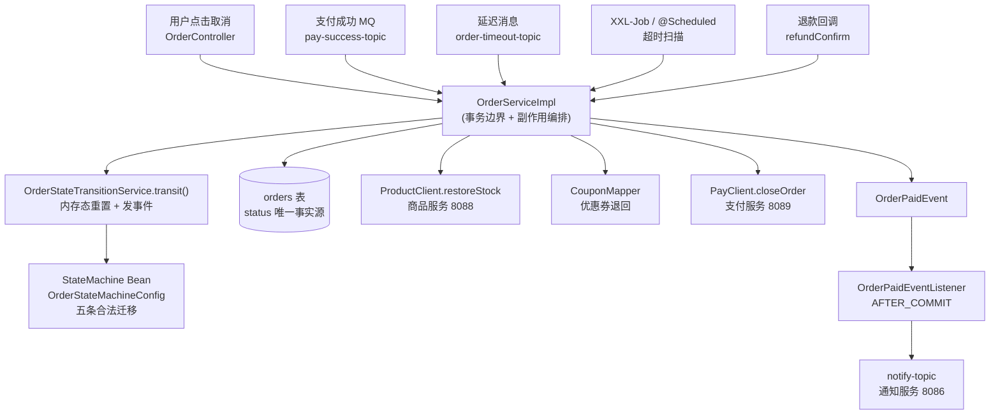
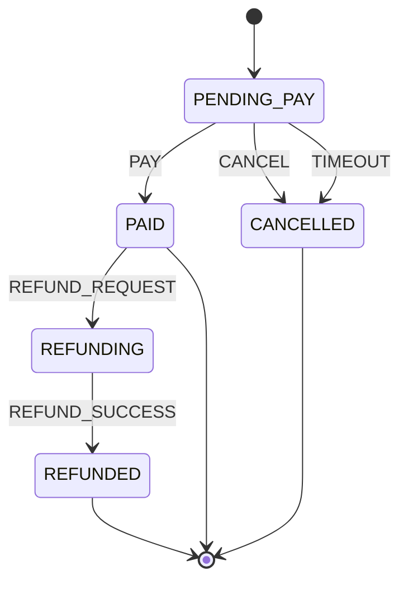
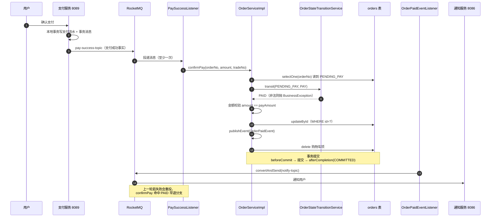

# 订单状态机治理：把"改状态"收进唯一入口，并让它只发生一次

> **一句话结论**：订单状态的正确性不靠"每个调用方都记得校验"，而靠三件事叠加——① 合法迁移集中声明成表；② 写入时带上旧状态条件并检查影响行数；③ 副作用挂在"事务已提交"这个事实之后，且自身幂等。本项目已经有①（Spring StateMachine 声明五条迁移），②③ 仍缺位，脏数据就是从这两个缺口漏进来的。
> **阅读前置**：先看 [15-SpringAOP与声明式事务原理](./15-SpringAOP与声明式事务原理.md)（知道 `@Transactional` 代理在哪一层生效）和 [13-支付渠道集成与回调一致性](./13-支付渠道集成与回调一致性.md)（知道支付回调从哪个方向进订单服务），再读本文。
> **证据基线**：Spring Framework 7.1.0 / Spring Boot 4.2.0 / Spring Cloud 2026.0.0 / Spring Cloud Alibaba 2025.1.0.0 / MyBatis 3.6 系列执行器摘录 / spring-statemachine 4.0.0（`pom.xml#L82` 声明）/ 本项目 ai-cs-order（端口 8087，JDK 17.0.19 实测）。预计阅读 40 分钟。

## 0. 先看现象

### 现象 1：钱付了，订单却是"已取消"；或者取消了，订单又变"已支付"

`confirmPay` 与 `cancelExpiredOrder` 是两条互不相干的入口：一条消费支付成功的 MQ 消息，一条来自延迟消息/定时扫描。两条路径都会先**读**订单（拿到 `status`），在**内存里**用状态机算出目标态，再 `updateById` 整行覆盖。两个事务并发时，读到的都是 `PENDING_PAY`，于是两份"合法"的迁移都通过了校验：

```text
2026-11-27T10:15:02.418 INFO  [order-timeout-consumer-group_1] c.a.o.e.OrderTimeoutEventListener - 订单超时自动取消: orderNo=20261127101500011234
2026-11-27T10:15:02.463 INFO  [pay-success-consumer-group_2]  c.a.o.s.i.OrderServiceImpl      - 支付确认成功: orderNo=20261127101500011234, userId=10086, tradeNo=2026112722001
2026-11-27T10:15:02.465 WARN  [order-timeout-consumer-group_1] c.a.o.s.i.OrderServiceImpl      - 订单状态不允许支付确认，忽略: orderNo=20261127101500011234, status=CANCELLED
```

第三条日志是最坏情况的注脚：钱在支付渠道已经扣了（`pay-success-topic` 里是成功事实），订单服务却只打一行 `WARN` 就返回，MQ 认为消费成功。数据库最终是 `CANCELLED`，用户看到"订单已取消"，钱在渠道侧挂着。反过来（取消事务后提交）则是订单显示 `PAID`，但库存已回补、优惠券已退回——同样脏。

### 现象 2：状态迁移成功了，通知却没发出去

`OrderPaidEventListener` 用的是 `@TransactionalEventListener(phase = AFTER_COMMIT)`，事件在事务内发布、通知在提交后发送。这条设计是对的，但它的生效依赖一个隐形前提：**发布事件时确实有活跃事务**。Spring 的做法是在发布时把回调"注册"到当前事务的同步器上，注册不上就直接丢弃（默认不降级执行）：

```java
// 依据本仓库 A 级源码摘录，见 3.6 节完整引用 [[源码:TransactionalApplicationListenerSynchronization.java.md#L75-L94]]
if (TransactionSynchronizationManager.isSynchronizationActive() &&
        TransactionSynchronizationManager.isActualTransactionActive()) {
    TransactionSynchronizationManager.registerSynchronization(new PlatformSynchronization<>(event, listener, callbacks));
    return true;
}
```

于是典型的线上形态是：某天有人为了"性能"把 `confirmPay` 上的 `@Transactional` 去掉（或者事件改在 `@Async`、在 MQ 消费线程里裸发），订单状态照常落库，`notify-topic` 却一条消息都没有，用户收不到支付成功通知，日志里连 `事务提交后支付成功通知投递失败` 都没有——因为监听器根本没被调用。

### 现象 3：同一次取消，库存回补了两次

取消路径的补偿副作用（回补库存、关闭渠道订单、退回优惠券）写在 `doCancelOrder` 里，而 `cancelExpiredOrder` 有**两条触发通道**：RocketMQ 延迟消息（30 分钟）和 `OrderTimeoutScheduler` 每 5 分钟的兜底扫描。两条通道在同一秒到达时，两笔事务读到的都是 `PENDING_PAY`，各自执行一次 `productClient.restoreStock(...)`，而商品服务的回补是纯加法、没有去重键：

```text
2026-11-27T10:16:41.203 INFO [order-timeout-consumer-group_1] c.a.p.s.i.ProductServiceImpl - 库存回补成功(实时): productId=3001, quantity=2, current=98
2026-11-27T10:16:41.257 INFO [scheduling-1]                     c.a.p.s.i.ProductServiceImpl - 库存回补成功(实时): productId=3001, quantity=2, current=100
```

100 件的库存本来就该是 98，现在多出 2 件。订单状态本身没坏（两次都写成 `CANCELLED`，幂等覆盖），坏的是副作用。

这些现象指向同一件事：**订单状态迁移缺一个"唯一入口 + 有条件写入 + 只执行一次"的骨架**；状态机的合法性校验只解决了"这一次调用讲不讲道理"，解决不了"两次并发都讲道理"和"讲完道理之后副作用跑了几遍"。

## 1. 整体地图

先看清"谁在改状态、改完谁负责副作用"。



| 组件 | 位置 | 责任 | 调用方 |
| --- | --- | --- | --- |
| `OrderStatus` | `ai-cs-order/src/main/java/com/aics/order/enums/OrderStatus.java` | 五个状态码与中文描述的唯一定义 | 全模块 |
| `OrderEvent` | `ai-cs-order/src/main/java/com/aics/order/statemachine/OrderEvent.java` | 五个触发事件 | `OrderStateTransitionService` |
| `OrderStateMachineConfig` | `ai-cs-order/src/main/java/com/aics/order/statemachine/OrderStateMachineConfig.java` | 声明合法迁移表（本项目的"规则书"） | Spring 容器装配 |
| `OrderStateTransitionService` | `ai-cs-order/src/main/java/com/aics/order/statemachine/OrderStateTransitionService.java` | 把 DB 的字符串状态适配成状态机调用，非法迁移抛业务异常 | `OrderServiceImpl` |
| `OrderServiceImpl` | `ai-cs-order/src/main/java/com/aics/order/service/impl/OrderServiceImpl.java` | 事务边界、状态落库、跨服务补偿、发布领域事件 | Controller、MQ 监听器、定时任务 |
| `OrderTimeoutScheduler` | `ai-cs-order/src/main/java/com/aics/order/task/OrderTimeoutScheduler.java` | `@Scheduled` 兜底扫描超时未支付订单 | Spring 调度器 |
| `OrderTimeoutScanJob` | `ai-cs-order/src/main/java/com/aics/order/task/OrderTimeoutScanJob.java` | XXL-Job 版关单入口，委托给上面的 Scheduler | XXL-Job 调度中心 |
| `OrderTimeoutListener` / `OrderTimeoutEventListener` | `ai-cs-order/src/main/java/com/aics/order/listener/OrderTimeoutListener.java`、`ai-cs-order/src/main/java/com/aics/order/event/OrderTimeoutEventListener.java` | 消费延迟消息并转成本地事件 | RocketMQ |
| `PaySuccessListener` | `ai-cs-order/src/main/java/com/aics/order/listener/PaySuccessListener.java` | 消费支付成功消息 → `confirmPay` | RocketMQ |
| `OrderPaidEventListener` | `ai-cs-order/src/main/java/com/aics/order/event/OrderPaidEventListener.java` | 事务提交后投递 `notify-topic` | Spring 事件机制 |

> **读图说明**：
> - 图里**只有 `OrderServiceImpl` 一条线连到 `orders` 表**，这是本设计最重要的事实：状态机的 Bean 是纯内存对象，它不知道数据库存在。看错成"状态机负责落库"会得出"状态机保证并发安全"的错误结论——它只保证"单次调用的迁移合法"。
> - 五条入口箭头全部汇到 `OrderServiceImpl`，而不是各自直连 `orders`：一旦有人新增第六条入口（比如运营后台强制关单），必须走同一处，否则迁移表形同虚设。
> - 右下角的 `OrderPaidEvent → OrderPaidEventListener` 是**事务之后**的支线，与 `orders` 的写入不在同一个原子单元里；把它误读成"事务内的第二步"是第二个常见误判。

## 2. 关键概念与关键类

| 名称 | 位置 | 角色 | 关键方法/字段 |
| --- | --- | --- | --- |
| 状态（State） | `OrderStatus` 枚举 | 订单此刻的事实，落在 `orders.status`（`VARCHAR(20)`，默认 `PENDING_PAY`） | `getCode()` / `getDescription()` |
| 事件（Event） | `OrderEvent` 枚举 | 改变状态的**请求**，本身不代表结果 | `PAY`、`CANCEL`、`TIMEOUT`、`REFUND_REQUEST`、`REFUND_SUCCESS` |
| 迁移（Transition） | `OrderStateMachineConfig` | (源状态, 事件) → 目标状态的合法映射 | `withExternal().source().target().event()` |
| 迁移入口 | `OrderStateTransitionService` | 唯一允许计算"下一状态"的地方 | `transit(String currentStatus, OrderEvent event)` |
| 条件更新 | 目标形态（本项目尚未实现） | `UPDATE ... WHERE order_no=? AND status=<旧值>`，用影响行数判定是否抢到迁移权 | MyBatis 中体现为返回 `int`/`boolean` 的 Mapper 方法 |
| 乐观锁 | 目标形态（`orders` 表无 `version` 列） | 用版本号做"整行 CAS"，失败者重读重试 | `@Version` + `OptimisticLockerInnerInterceptor` |
| 副作用（Side effect） | `doCancelOrder` / `refundConfirm` | 状态变化的对外影响：回补库存、关渠道单、退券、发通知 | `productClient.restoreStock`、`payClient.closeOrder`、`couponMapper.updateById` |
| 幂等（Idempotent） | 全链路要求 | 同一事件执行 N 次与 1 次效果相同 | `confirmPay` 的 `PAID` 早退、`cancelExpiredOrder` 的状态前置判断 |
| 事务后副作用 | `OrderPaidEventListener` | 只在本地事务提交成功后才执行 | `@TransactionalEventListener(phase = AFTER_COMMIT)` |
| 兜底通道 | `OrderTimeoutScheduler` / `OrderTimeoutScanJob` | 延迟消息可能丢，定时扫描补位 | `@Scheduled(fixedDelay = 300000)`、`@XxlJob("orderTimeoutScanJob")` |

术语首现解释：

- **状态机（State Machine）**：把"哪些 (状态, 事件) 组合能落到哪个状态"显式建模成一张表，运行时只做查表，不做业务判断。好处是规则可读、可测、可穷举。
- **条件更新（Conditional Update / CAS 更新）**：把"我读到的旧值"写进 `WHERE`。数据库用行锁保证同一行只有一个事务能命中，命中者影响行数 1，落败者 0。这是单机 `synchronized` 在分布式世界的对应物。
- **影响行数（Affected Rows）**：JDBC 的 `executeUpdate` 返回值，MyBatis 把它一路传成 Mapper 方法的返回值——这是本文最容易被忽略的一根线，见 3.4。
- **幂等**：同一事件重放不改变最终结果。注意它分两层：状态幂等（再写一次 `CANCELLED` 无害）与副作用幂等（再回补一次库存就有害）。

## 3. 原理与证据逐段精读

### 3.1 状态枚举与合法迁移表：五态、五事件、五条边

**在干什么。** 用两个枚举把"状态"和"事件"分开，用一份配置声明哪些组合合法。

`ai-cs-order/src/main/java/com/aics/order/enums/OrderStatus.java#L11-L20`：

```java
@Getter
@AllArgsConstructor
public enum OrderStatus {
    PENDING_PAY("PENDING_PAY", "待支付"),
    PAID("PAID", "已支付"),
    CANCELLED("CANCELLED", "已取消"),
    REFUNDING("REFUNDING", "退款中"),
    REFUNDED("REFUNDED", "已退款");

    private final String code;
    private final String description;
}
```

`ai-cs-order/src/main/java/com/aics/order/statemachine/OrderStateMachineConfig.java#L15-L31`：

```java
@Configuration
public class OrderStateMachineConfig {

    @Bean
    public StateMachine<OrderStatus, OrderEvent> orderStateMachine() throws Exception {
        StateMachineBuilder.Builder<OrderStatus, OrderEvent> builder = StateMachineBuilder.builder();
        builder.configureStates().withStates()
                .initial(OrderStatus.PENDING_PAY)
                .states(java.util.EnumSet.allOf(OrderStatus.class));
        builder.configureTransitions()
                .withExternal().source(OrderStatus.PENDING_PAY).target(OrderStatus.PAID).event(OrderEvent.PAY).and()
                .withExternal().source(OrderStatus.PENDING_PAY).target(OrderStatus.CANCELLED).event(OrderEvent.CANCEL).and()
                .withExternal().source(OrderStatus.PENDING_PAY).target(OrderStatus.CANCELLED).event(OrderEvent.TIMEOUT).and()
                .withExternal().source(OrderStatus.PAID).target(OrderStatus.REFUNDING).event(OrderEvent.REFUND_REQUEST).and()
                .withExternal().source(OrderStatus.REFUNDING).target(OrderStatus.REFUNDED).event(OrderEvent.REFUND_SUCCESS);
        return builder.build();
    }
}
```

把它画成图，就是这张表：



> **读图说明**：
> - `PENDING_PAY` 有两条不同的边指向同一个终点：`CANCEL`（用户主动取消）和 `TIMEOUT`（系统超时）。它们**不是同一个事件**——一个要通知用户"你取消了"，一个要通知"你的订单超时了"，日志、埋点、客服话术都不同。把两条边合并成一条 `CANCEL` 会丢掉这个区分，是旧文档最容易犯的简并错误。
> - 图里**没有任何一条边从 `CANCELLED` 出发**，这是"已取消不可复活"的硬约束；也**没有 `PENDING_PAY → REFUNDED` 的直达边**，退款必须先落到 `REFUNDING`。
> - 反过来，`REFUNDING` 也没有回到 `PAID` 的边——退款失败这条现实分支目前**没有建模**（见 5 节可扩展点 1）。

映射成矩阵更便于测试：

| 当前状态 \ 事件 | PAY | CANCEL | TIMEOUT | REFUND_REQUEST | REFUND_SUCCESS |
| --- | --- | --- | --- | --- | --- |
| `PENDING_PAY` | `PAID` | `CANCELLED` | `CANCELLED` | 拒绝 | 拒绝 |
| `PAID` | 拒绝 | 拒绝 | 拒绝 | `REFUNDING` | 拒绝 |
| `CANCELLED` | 拒绝 | 拒绝 | 拒绝 | 拒绝 | 拒绝 |
| `REFUNDING` | 拒绝 | 拒绝 | 拒绝 | 拒绝 | `REFUNDED` |
| `REFUNDED` | 拒绝 | 拒绝 | 拒绝 | 拒绝 | 拒绝 |

**为什么这么设计。** 业务规则最怕散落在 if-else 里：`cancelOrder` 里判一次、`confirmPay` 里再判一次，加了"部分发货"状态后必然漏改一处。把规则收敛成一张表，规则本身成为可阅读的资产，穷举测试也变成可能——`OrderStateTransitionServiceTest` 正是这么写的。

**换写法会怎样。** 如果只在 Service 里写 `if (PENDING_PAY.equals(status)) { setStatus(PAID) }`，读代码的人永远无法确认"全局到底允许哪些迁移"，只能靠 grep `setStatus`。表驱动写法的代价是多一个依赖（状态机库）、多一层间接（要 reset 内存态），见 5 节取舍。

**常见坑。** ① `configureStates().states(EnumSet.allOf(...))` 把所有枚举值都声明为状态，等于允许"孤儿状态"存在于图里而不被任何边指向，例如有人加了 `PARTIAL_SHIPPED` 却忘了加边，运行时表现为"所有事件都被拒"；② 忘记 `initial()`，某些版本会抛 `StateMachineException` 或在 reset 时缺省失败。

### 3.2 为什么不允许任意 `setStatus`：迁移必须走唯一入口

**在干什么。** `transit()` 把"DB 里的字符串状态"翻译成"状态机的当前态"，发一个事件，拿到目标态或抛异常。

`ai-cs-order/src/main/java/com/aics/order/statemachine/OrderStateTransitionService.java#L21-L42`：

```java
public OrderStatus transit(String currentStatus, OrderEvent event) {
    OrderStatus current = parse(currentStatus);
    synchronized (orderStateMachine) {
        orderStateMachine.stop();
        orderStateMachine.getStateMachineAccessor().doWithAllRegions(access ->
                access.resetStateMachine(new DefaultStateMachineContext<>(current, null, null, null)));
        orderStateMachine.start();
        boolean accepted = orderStateMachine.sendEvent(MessageBuilder.withPayload(event).build());
        if (!accepted) {
            throw new BusinessException(ResultCode.BAD_REQUEST,
                    "订单状态不允许迁移: " + current.getCode() + " --" + event + "--> ?");
        }
        return orderStateMachine.getState().getId();
    }
}

private OrderStatus parse(String status) {
    return java.util.Arrays.stream(OrderStatus.values())
            .filter(item -> item.getCode().equals(status))
            .findFirst()
            .orElseThrow(() -> new BusinessException(ResultCode.BAD_REQUEST, "未知订单状态: " + status));
}
```

**为什么这么设计。** 状态机对象是有内部状态的：它在内存里记着"我现在在哪"。多实例部署下，A 实例的内存态和 B 实例的内存态、以及数据库里的真实状态三方各说各话。所以这里刻意**不使用持久化器（persister）**，而是每次调用都拿数据库当前值 `resetStateMachine(...)`，让状态机退化成一个纯粹的函数：(当前态, 事件) → 目标态。`synchronized (orderStateMachine)` 保护的是这个 Bean 单例的**内存可变性**，不是订单的并发安全——这一点旧文档曾写成"状态机保证并发安全"，是错的（见 6.1）。

**换写法会怎样。** 三个替代方案：① 用 `StateMachinePersister` 把状态存进 Redis/DB——多实例下要么加分布式锁，要么读旧值覆盖，比现在更差；② 每次 `builder.build()` 出一个新状态机实例——省掉 `synchronized`，但每个订单每笔迁移都要重新装配配置，代价高；③ 干脆不用状态机库，用 `Map<OrderStatus, Set<OrderEvent>>` 手写查表——功能等价、启动更快、无 `synchronized`，代价是失去 guard/action/持久化的现成扩展点（见 5 节）。

**常见坑。** ① 忘记 `stop()/start()`，`sendEvent` 在未启动的机器上返回 `false`，被误判成"非法迁移"；② `resetStateMachine` 只重置 region 级的当前态，如果之前配了 extended state（变量区），它会被清掉——本项目没用变量区，暂时安全；③ 把 `transit()` 当成事务边界：它是纯内存计算，**没有任何 DB 写入**，异常抛出后调用方必须自己保证"内存里改过的 entity 不落库"。`confirmPay` 里状态在金额校验之前就被 `setStatus` 了，一旦金额不符抛异常，靠的是事务回滚兜住"脏 entity"，见 3.3 的坑。

### 3.3 缺口一：校验在内存，落库却没有守卫

**在干什么。** `confirmPay` 的骨架是：查 → 校验 → 内存改状态 → 整行 `updateById` → 发事件 → 清购物车。

`ai-cs-order/src/main/java/com/aics/order/service/impl/OrderServiceImpl.java#L117-L151`：

```java
public void confirmPay(String orderNo, String paymentMethod, BigDecimal amount, String tradeNo) {
    Order order = orderMapper.selectOne(
            new LambdaQueryWrapper<Order>().eq(Order::getOrderNo, orderNo));
    if (order == null) {
        log.warn("支付确认订单不存在: orderNo={}", orderNo);
        return;
    }
    if (OrderStatus.PAID.getCode().equals(order.getStatus())) {
        log.info("订单已支付，忽略重复确认: orderNo={}", orderNo);
        return;
    }
    try {
        order.setStatus(orderStateTransitionService.transit(order.getStatus(), OrderEvent.PAY).getCode());
    } catch (BusinessException e) {
        log.warn("订单状态不允许支付确认，忽略: orderNo={}, status={}", orderNo, order.getStatus());
        return;
    }
    if (amount != null && order.getPayAmount() != null
            && amount.compareTo(order.getPayAmount()) != 0) {
        log.error("支付金额与订单不一致: orderNo={}, callbackAmount={}, orderAmount={}",
                orderNo, amount, order.getPayAmount());
        throw new BusinessException(ResultCode.ORDER_PAY_AMOUNT_MISMATCH);
    }
    order.setPayTime(LocalDateTime.now());
    orderMapper.updateById(order);
```

而 `OrderMapper` 是全空的：

`ai-cs-order/src/main/java/com/aics/order/mapper/OrderMapper.java#L11-L12`：

```java
@Mapper
public interface OrderMapper extends BaseMapper<Order> {
}
```

`updateById` 生成的 SQL 是 `UPDATE orders SET status=?, pay_time=?, ... WHERE id=?`——**`WHERE` 里只有主键，没有 `status`**。这意味着"我刚校验过它是 `PENDING_PAY`"这个前提，在 `updateById` 执行的那一刻已经不作数了：中间隔着一次 `selectOne`（快照读，不加锁）到一次写（加锁），这中间的窗口就是现象 1 的生存空间。

用一段 30 行的小程序就能把这个窗口打开给人看（C 级证据，见 3.4 的实测输出）。

**为什么这么设计。** 不是疏忽，是"先跑通"的自然结果：单机串行、低并发下，读-改-写模型直观且够用；MyBatis-Plus 的 `updateById` 又是一行代码，很容易被当成"原子更新"。

**换写法会怎样。** 两条正路：

```sql
-- 正路 A：条件更新（CAS），把旧值写进 WHERE
UPDATE orders SET status = 'PAID', pay_time = NOW()
 WHERE order_no = '20261127101500011234' AND status = 'PENDING_PAY';
-- 影响行数 1 = 抢到迁移权；0 = 别人先动了，本事务放弃

-- 正路 B：乐观锁，版本号整行 CAS（需要先加列）
ALTER TABLE orders ADD COLUMN version INT NOT NULL DEFAULT 0;
UPDATE orders SET status = 'PAID', version = version + 1
 WHERE order_no = '20261127101500011234' AND version = 7;
```

**常见坑。** ① 以为 `@Transactional` 能防这个——它只保证"我这一串写要么全成要么全败"，不保证"我读到的东西在我写时没变"，隔离级别 `REPEATABLE READ` 下照样能覆盖别人的提交（写用的是当前读 + 行锁，判断用的却是快照）；② 在金额校验之前就把 `order.setStatus(PAID)` 写进内存实体，一旦后面抛异常，全靠事务回滚和"entity 不外泄"兜底——若换个 ORM 或有人把这段挪到事务外，脏数据立刻出现；③ `cancelExpiredOrder` 的 `if (order == null || !PENDING_PAY.equals(status)) return;` 看着像守卫，但它和 `updateById` 之间同样有窗口。

### 3.4 缺口二的解法：条件更新 + 影响行数判定

**在干什么。** 把"我读到的旧状态"塞进 `WHERE`，然后**看数据库告诉我影响了几行**。这是"读-判断-写"三步压成"数据库内一步"的唯一办法。

先说清这根线为什么成立：MyBatis 把 `executeUpdate()` 的行数一路传成了 Mapper 方法的返回值。

`(src: MapperMethod.java.md#L57-L74)`（`org.apache.ibatis:mybatis` 的 `MapperMethod#execute`，方言包版本由本项目 mybatis-plus 传递）：

```java
  public Object execute(SqlSession sqlSession, Object[] args) {
    Object result;
    switch (command.getType()) {
      case INSERT: {
        Object param = method.convertArgsToSqlCommandParam(args);
        result = rowCountResult(sqlSession.insert(command.getName(), param));
        break;
      }
      case UPDATE: {
        Object param = method.convertArgsToSqlCommandParam(args);
        result = rowCountResult(sqlSession.update(command.getName(), param));
        break;
      }
      case DELETE: {
        Object param = method.convertArgsToSqlCommandParam(args);
        result = rowCountResult(sqlSession.delete(command.getName(), param));
        break;
      }
```

`(src: MapperMethod.java.md#L106-L121)`（返回值怎么被"翻译"）：

```java
  private Object rowCountResult(int rowCount) {
    final Object result;
    if (method.returnsVoid()) {
      result = null;
    } else if (Integer.class.equals(method.getReturnType()) || Integer.TYPE.equals(method.getReturnType())) {
      result = rowCount;
    } else if (Long.class.equals(method.getReturnType()) || Long.TYPE.equals(method.getReturnType())) {
      result = (long) rowCount;
    } else if (Boolean.class.equals(method.getReturnType()) || Boolean.TYPE.equals(method.getReturnType())) {
      result = rowCount > 0;
    } else {
      throw new BindingException(
          "Mapper method '" + command.getName() + "' has an unsupported return type: " + method.getReturnType());
    }
  }
```

再往下，行数来自 `StatementHandler#update`：

`(src: BaseExecutor.java.md#L112-L119)`：

```java
  public int update(MappedStatement ms, Object parameter) throws SQLException {
    ErrorContext.instance().resource(ms.getResource()).activity("executing an update").object(ms.getId());
    if (closed) {
      throw new ExecutorException("Executor was closed.");
    }
    clearLocalCache();
    return doUpdate(ms, parameter);
  }
```

`(src: SimpleExecutor.java.md#L43-L53)`：

```java
  public int doUpdate(MappedStatement ms, Object parameter) throws SQLException {
    Statement stmt = null;
    try {
      Configuration configuration = ms.getConfiguration();
      StatementHandler handler = configuration.newStatementHandler(this, ms, parameter, RowBounds.DEFAULT, null, null);
      stmt = prepareStatement(handler, ms.getStatementLog());
      return handler.update(stmt);
    } finally {
      closeStatement(stmt);
    }
  }
```

结论很直接：**只要 Mapper 方法声明返回 `int` 或 `boolean`，你拿到的就是数据库告诉你的影响行数**。而本项目所有状态写入都走 `updateById`（返回 `int` 但从来没人看），且 `WHERE` 里没有状态条件，于是这个能力被白白丢掉了。

改造的最小形态（示意，本项目尚未落地）：

```java
// 目标形态：新增到 OrderMapper，返回值就是影响行数
@Update("UPDATE orders SET status = #{to}, pay_time = #{payTime}, cancel_time = #{cancelTime} " +
        "WHERE order_no = #{orderNo} AND status = #{from}")
int compareAndSetStatus(@Param("orderNo") String orderNo,
                        @Param("from") String from,
                        @Param("to") String to,
                        @Param("payTime") LocalDateTime payTime,
                        @Param("cancelTime") LocalDateTime cancelTime);
```

调用侧只需要判断一个数：

```java
// 目标形态：抢不到迁移权就当作"别人已经改过"，不是异常而是幂等早退
int rows = orderMapper.compareAndSetStatus(orderNo, "PENDING_PAY", "PAID",
        LocalDateTime.now(), null);
if (rows == 0) {
    log.info("状态已被其他流程推进，放弃本次迁移: orderNo={}", orderNo);
    return;
}
```

**为什么这么设计。** 因为它把"并发判定"交给了数据库的行锁，而不是应用层的锁：命中者拿到 1，落败者拿到 0，语义清晰、无死锁、无需额外中间件。这也是"条件更新比分布式锁更便宜"的根本原因。

**换写法会怎样。** 用 `synchronized` 或 Redis 分布式锁也能串行化，但代价是：锁粒度难调（订单号级锁要维护大量 key）、锁超时/续期带来新的失败模式、跨服务调用（`productClient`）时锁还握着导致连接堆积。用 `SELECT ... FOR UPDATE` 悲观锁也可行，但会把行锁持有时间拉长到跨服务调用结束，吞吐骤降。

**常见坑。** ① 只把 `status` 写进 `WHERE`，却忘了同时更新 `pay_time`/`cancel_time`——出现"状态变了但时间戳还是旧值"；② 把 `rows == 0` 当成系统错误抛出 500：对幂等回调来说，`rows == 0` 是**正常**结果（重复投递），应该记日志返回成功，否则 MQ 会不断重试；③ 条件更新之后又在同一事务里用旧 `order` 对象做别的判断——内存里的 `order.status` 并没有因为 SQL 变了而更新，必须重新 `select` 或显式 `order.setStatus(to)`。

下面这段 40 行的小程序把"没有条件"和"有条件"两种写法在**同一时间线**上跑一遍，可以直接复现现象 1（C 级证据，`java StatusWriteRace.java` 即可运行，无需任何依赖）：

```java
import java.util.LinkedHashMap;
import java.util.Map;
import java.util.Set;

public class StatusWriteRace {
    static final Map<String, Set<String>> LEGAL = new LinkedHashMap<>();
    static {
        LEGAL.put("PENDING_PAY+PAY", Set.of("PAID"));
        LEGAL.put("PENDING_PAY+CANCEL", Set.of("CANCELLED"));
        LEGAL.put("PENDING_PAY+TIMEOUT", Set.of("CANCELLED"));
        LEGAL.put("PAID+REFUND_REQUEST", Set.of("REFUNDING"));
        LEGAL.put("REFUNDING+REFUND_SUCCESS", Set.of("REFUNDED"));
    }
    static String target(String current, String event) {
        Set<String> t = LEGAL.get(current + "+" + event);
        return t == null ? null : t.iterator().next();
    }
    public static void main(String[] args) {
        String db = "PENDING_PAY";
        String payCallbackRead = db;                 // 支付回调先读到旧值
        db = target(db, "TIMEOUT");                  // 超时通道抢先提交
        System.out.println("timeout commits      : db=" + db);
        String payTarget = target(payCallbackRead, "PAY");   // 回调基于旧值算出 PAID
        System.out.println("unconditional update : rows=1, db=" + payTarget + "  <-- 脏写");
        db = "CANCELLED";
        int rows = db.equals(payCallbackRead) ? 1 : 0;       // UPDATE ... WHERE status=旧值
        System.out.println("conditional update   : rows=" + rows + ", db=" + db);
    }
}
```

真实输出（本机 JDK 17.0.19，`[exit=0]`）：

```text
timeout commits      : db=CANCELLED
unconditional update : rows=1, db=PAID  <-- 脏写
conditional update   : rows=0, db=CANCELLED
```

怎么读这段输出：第二行说明"整行覆盖"在任何并发顺序下都会成功，`rows=1` 是它的必然结果，所以它无法承担守卫职责；第三行说明条件更新把落败者的影响行数降为 `0`，调用方据此放弃，数据库保持 `CANCELLED`。

### 3.5 乐观锁：能力更全，代价是侵入表结构

**在干什么。** 给表加一列 `version`，每次写 `version = version + 1 WHERE version = 旧值`，用版本号代替"状态相等"作为 CAS 条件。

本项目当前**没有**这一层。可复现的核查（C 级，真实输出为空）：

```powershell
PS> cd ai-cs-order\src\main\java\com\aics\order
PS> Get-ChildItem -Recurse -Filter *.java | Select-String -Pattern "@Version|version"
CartAddDTO.java:18:    private static final long serialVersionUID = 1L;
```

唯一的命中是 DTO 的 `serialVersionUID`，说明全模块没有乐观锁注解、`Order` 实体也没有 `version` 字段；`orders` 表 DDL 同样没有该列（`deploy/mysql/order-init.sql#L24-L46`）。

**为什么（有人）这么设计。** `updateById` + `@Version` 的写法业务代码几乎零改动，适合"整行都可能被并发修改"的场景（例如商品信息编辑）。而订单状态只有有限的几个迁移点，状态本身就是最好的 CAS 条件，不必额外加列。

**换写法会怎样。** 用 `@Version` 需要：加列、实体加字段、注册 `OptimisticLockerInnerInterceptor`（MyBatis-Plus 需显式装配，依据官方文档"MyBatis-Plus 乐观锁插件"一节）、并处理 `updateById` 返回 `0` 的重试逻辑。代价不小，收益是"任何字段级并发写"都被保护。

**常见坑。** ① 以为加了 `@Version` 就够了——`LambdaUpdateWrapper` 的 `setSql` 自定义更新不会自动带版本条件；② 重试逻辑写成 `while(true)` 无上限，冲突风暴时把线程池打满；③ 版本号只保护"同一行的整行写"，保护不了跨服务副作用（库存回补、发通知）只执行一次。

### 3.6 迁移事件与副作用：只应发生一次

**在干什么。** 状态落库成功之后才允许对外宣告"订单支付成功"。实现方式是事务内发 Spring 事件，监听器挂在 `AFTER_COMMIT`。

`ai-cs-order/src/main/java/com/aics/order/event/OrderPaidEventListener.java#L30-L41`：

```java
@TransactionalEventListener(phase = TransactionPhase.AFTER_COMMIT)
public void handle(OrderPaidEvent event) {
    try {
        Map<String, String> notify = new LinkedHashMap<>();
        notify.put("userId", String.valueOf(event.userId()));
        notify.put("message", "您的订单 " + event.orderNo() + " 已支付成功，感谢您的购买！");
        rocketMQTemplate.convertAndSend("notify-topic", notify);
        log.info("事务提交后支付成功通知已投递: orderNo={}, userId={}", event.orderNo(), event.userId());
    } catch (Exception e) {
        log.warn("事务提交后支付成功通知投递失败: orderNo={}, err={}", event.orderNo(), e.getMessage());
    }
}
```

这条链能否生效，取决于 Spring 在**发布事件**那一刻有没有把回调挂上。默认阶段就是 `AFTER_COMMIT`：

`(src: TransactionalEventListener.java.md#L72-L78)`：

```java
	/**
	 * <p>The default phase is {@link TransactionPhase#AFTER_COMMIT}.
	 * ...
	 */
	TransactionPhase phase() default TransactionPhase.AFTER_COMMIT;
```

挂载条件（没有活跃事务 → 返回 `false` → 事件被丢弃）：

`(src: TransactionalApplicationListenerSynchronization.java.md#L75-L94)`：

```java
	public static <E extends ApplicationEvent> boolean register(
			E event, TransactionalApplicationListener<E> listener,
			List<TransactionalApplicationListener.SynchronizationCallback> callbacks) {

		if (org.springframework.transaction.support.TransactionSynchronizationManager.isSynchronizationActive() &&
				org.springframework.transaction.support.TransactionSynchronizationManager.isActualTransactionActive()) {
			org.springframework.transaction.support.TransactionSynchronizationManager.registerSynchronization(
					new PlatformSynchronization<>(event, listener, callbacks));
			return true;
		}
		else if (event.getSource() instanceof TransactionContext txContext) {
```

真正被调用的时点（注意是 `afterCompletion`，不是 `afterCommit`）：

`(src: TransactionalApplicationListenerSynchronization.java.md#L107-L126)`：

```java
		@Override
		public void afterCompletion(int status) {
			TransactionPhase phase = getTransactionPhase();
			if (phase == TransactionPhase.AFTER_COMMIT && status == STATUS_COMMITTED) {
				processEventWithCallbacks();
			}
			else if (phase == TransactionPhase.AFTER_ROLLBACK && status == STATUS_ROLLED_BACK) {
				processEventWithCallbacks();
			}
			else if (phase == TransactionPhase.AFTER_COMPLETION) {
				processEventWithCallbacks();
			}
		}
```

**为什么这么设计。** 副作用分两种命运：与订单状态强相关（通知用户"支付成功"）和不可回滚（发出去的 MQ 消息）。把它们放在事务提交之后，能保证"订单没提交成功就一定不会对外声称成功"——这正是"漏发通知/发了假通知"两类事故的分水岭。相反的写法（在事务内直接 `convertAndSend`）在事务回滚时会留下一条永远不会兑现的通知。

**换写法会怎样。** 三个替代：① 事务内直接发 MQ → 回滚时通知已发出，不可撤销；② 事务内用 RocketMQ 事务消息（本项目支付服务侧 `ai-cs-pay/src/main/java/com/aics/pay/mq/PaySuccessMessageProducer.java#L47-L55` 就是这种），可靠性更好但要处理回查；③ 事务内写本地 `outbox` 表、由独立任务扫描投递——最稳，代价是新增一张表和一次扫描。

**常见坑。** ① 监听器里抛异常：此时事务已提交，异常会冒到 `commit()` 调用处，调用方以为"下单失败"却已经落库——本项目用 try/catch + `log.warn` 把它降级成"投递失败"，属于**故意牺牲可靠性换不污染主流程**，代价是这一条通知永久丢失；② `AFTER_COMMIT` 的实际执行点是 `afterCompletion(STATUS_COMMITTED)`，所以它比 `afterCommit` 回调更晚，此时 `TransactionSynchronizationManager` 里的事务资源已解绑，监听器内**不能**再依赖"加入当前事务"的行为；③ 默认 `fallbackExecution = false`——没有事务时事件被静默丢弃，是 3.2 现象 2 的成因，排查时先确认调用方是否真的在事务里。

### 3.7 超时关单：延迟消息主路径 + 定时扫描兜底

**在干什么。** 下单时发一条 30 分钟延迟消息；到点消费，走 `cancelExpiredOrder`；另有 `@Scheduled` 和 XXL-Job 两个扫描器兜底，防止消息丢失。

`ai-cs-order/src/main/java/com/aics/order/service/impl/OrderCreateTxService.java#L143-L146`：

```java
        // 7. 发送延迟消息（超时取消）
        rocketMQTemplate.syncSend("order-timeout-topic",
                MessageBuilder.withPayload(orderNo).build(),
                5000, 16); // delayLevel 16 ≈ 30min
```

`ai-cs-order/src/main/java/com/aics/order/task/OrderTimeoutScheduler.java#L29-L54`：

```java
    @Scheduled(fixedDelay = 300000, initialDelay = 60000)
    public void scanExpiredOrders() {
        log.info("定时任务：扫描超时未支付订单...");
        List<Order> expired = orderMapper.selectList(
                new LambdaQueryWrapper<Order>()
                        .eq(Order::getStatus, OrderStatus.PENDING_PAY.getCode())
                        .lt(Order::getExpireTime, LocalDateTime.now()));
        if (expired.isEmpty()) {
            log.info("定时任务：无超时订单");
            return;
        }
        for (Order order : expired) {
            try {
                orderService.cancelExpiredOrder(order.getOrderNo());
                log.info("定时任务：已取消超时订单 orderNo={}", order.getOrderNo());
            } catch (Exception e) {
                log.error("定时任务：取消订单失败 orderNo={}", order.getOrderNo(), e);
            }
        }
    }
```

`delayLevel = 16` 的含义依据 RocketMQ 官方文档「定时消息与延时消息」一节的 delayLevel 表（1s 5s 10s 30s 1m 2m 3m 4m 5m 6m 7m 8m 9m 10m 20m 30m 1h 2h，从 1 开始计数），第 16 档 = 30 分钟，与 `order.timeout-minutes` 默认 30 对齐（`ai-cs-order/src/main/java/com/aics/order/service/impl/OrderCreateTxService.java#L61-L62`）。

**为什么这么设计。** 延迟消息是"准时"的但可能丢（Broker 重启、发送失败、消费异常导致重试耗尽），定时扫描是"必定会到但可能晚"的，两者互补。项目内自带两种扫描入口：`@Scheduled` 跟随进程，XXL-Job（`ai-cs-order/src/main/java/com/aics/order/task/OrderTimeoutScanJob.java#L27-L32`）由调度中心统一触发、可观测、可手动补跑。

**换写法会怎样。** 只用延迟消息：消息丢失后订单永久挂 `PENDING_PAY`，库存与优惠券被长期占用。只用定时扫描：关单延迟取决于扫描周期（本项目 5 分钟），`expire_time` 与用户感知之间出现最长 5 分钟的窗口，且大数据量下 `lt(expire_time, now)` 会扫出大批行——这里 `idx_status` + `idx_expire_time` 只是单列索引，靠 `idx_status` 过滤后仍要回表比较时间，订单量大时应该考虑 `(status, expire_time)` 联合索引。

**常见坑。** ① 两条通道并发（现象 3）；② `syncSend(..., timeout, delayLevel)` 的第 4 个参数是**延迟级别**不是分钟数，写 `30` 会得到 2 小时；③ 定时任务里 `catch` 住异常只打日志，单条失败不影响其他订单，但也意味着**没有失败告警**——如果每条都失败，日志里只会出现一片 `定时任务：取消订单失败`。

### 3.8 逆向迁移与补偿：两段退款、三段取消

**在干什么。** 退款把一次迁移拆成两段，先占位再落地：

`ai-cs-order/src/main/java/com/aics/order/service/impl/OrderServiceImpl.java#L180-L201`：

```java
    public void refundConfirm(String orderNo) {
        Order order = orderMapper.selectOne(
                new LambdaQueryWrapper<Order>().eq(Order::getOrderNo, orderNo));
        if (order == null) {
            throw new BusinessException(ResultCode.ORDER_NOT_FOUND, "仅已支付订单可退款");
        }
        order.setStatus(orderStateTransitionService.transit(order.getStatus(), OrderEvent.REFUND_REQUEST).getCode());
        orderMapper.updateById(order);

        List<OrderItem> items = orderItemMapper.selectList(
                new LambdaQueryWrapper<OrderItem>().eq(OrderItem::getOrderNo, orderNo));
        for (OrderItem item : items) {
            productClient.restoreStock(item.getProductId(), item.getQuantity());
        }
        order.setStatus(orderStateTransitionService.transit(order.getStatus(), OrderEvent.REFUND_SUCCESS).getCode());
        orderMapper.updateById(order);
```

取消路径同理，一次迁移带三段补偿：回补库存、关渠道单、退券。

`ai-cs-order/src/main/java/com/aics/order/service/impl/OrderServiceImpl.java#L222-L246`：

```java
    private void doCancelOrder(Order order, OrderEvent event) {
        order.setStatus(orderStateTransitionService.transit(order.getStatus(), event).getCode());
        order.setCancelTime(LocalDateTime.now());
        orderMapper.updateById(order);

        List<OrderItem> items = orderItemMapper.selectList(
                new LambdaQueryWrapper<OrderItem>().eq(OrderItem::getOrderNo, order.getOrderNo()));
        for (OrderItem item : items) {
            productClient.restoreStock(item.getProductId(), item.getQuantity());
        }

        closePayChannel(order);

        if (order.getCouponId() != null) {
            Coupon coupon = couponMapper.selectById(order.getCouponId());
            if (coupon != null && CouponStatus.USED.getCode().equals(coupon.getStatus())) {
                coupon.setStatus(CouponStatus.UNUSED.getCode());
                coupon.setUseTime(null);
                coupon.setOrderNo(null);
                couponMapper.updateById(coupon);
            }
        }
    }
```

**为什么这么设计。** `REFUNDING` 是一个"占位态"：钱已经从渠道退出去、库存还没回补完时，订单既不能显示"已退款"（事实未完成）也不能显示"已支付"（钱已退）。两段迁移让中间态可见，也让失败可恢复——卡在 `REFUNDING` 的订单能被人工或补偿任务识别。

**换写法会怎样。** 单段直达 `REFUNDED`：一旦回补库存抛异常，事务回滚会连状态一起回滚，看起来"干净"，但如果回补是**跨服务已提交**的操作（`productClient.restoreStock` 走 HTTP，商品服务自己的事务），回滚订单状态不会撤销对方已提交的库存增加——于是"状态还是 PAID，但库存已经加回来了"。这正是本项目引入 Seata AT 的动机（见 [06-Seata分布式事务AT模式](./06-Seata分布式事务AT模式.md) 的全局事务与分支回滚），而当前 `refundConfirm` 并没有标注 `@GlobalTransactional`，只有 `@Transactional`，跨服务补偿仍是"尽力而为"。

**常见坑。** ① `restoreStock` 本身不幂等：`ai-cs-product/src/main/java/com/aics/product/service/impl/ProductServiceImpl.java#L216-L230` 是 `stock = stock + qty`，没有任何去重键，重复调用必然多补（现象 3）；② `closePayChannel` 是尽力而为（`log.warn` 后继续），渠道单残留靠支付服务超时兜底——这是**有意的取舍**，但意味着"取消成功"不等于"渠道已关单"；③ 优惠券退回没有条件更新，两个并发取消可能把 `useTime`/`orderNo` 重写一遍，虽然结果幂等，但审计信息会丢。

## 4. 一次完整执行时序

以"支付成功 → 订单变 PAID → 用户收到通知"为主干，中间穿插两条会打架的支线。



> **读图说明**：
> - 第 7 步的 `selectOne` 与第 10 步的 `updateById` **之间没有任何锁**，这一段窗口就是所有脏数据的入口。把这两步看成"原子的一组"是最常见的误读。
> - 第 13 步的 `Note over S,DB` 是**事务提交这一刻**；第 14 步的通知在此之后才发生。因此"订单表里是 PAID"与"用户收到通知"之间允许存在时间差，也允许后者永久缺失（`log.warn` 分支）——这是最终一致，不是强一致。
> - 第 15 步之后的 `Note over MQ,L` 表示重投：MQ 只保证至少一次，所以第 8~10 步必须能承受重复执行。看漏这个箭头，就会以为 `confirmPay` 只需处理首次调用。

哪一步失败会报什么错（全部取自代码里真实的字符串）：

| 失败点 | 触发条件 | 报错/日志原文 | 事务结果 |
| --- | --- | --- | --- |
| 第 6 步 | 订单号不存在 | `支付确认订单不存在: orderNo=...`（WARN，直接 return） | 无写入 |
| 第 8 步 | (状态, 事件) 不在迁移表里 | `订单状态不允许迁移: CANCELLED --PAY--> ?`（`BusinessException`），被上层 catch 成 `订单状态不允许支付确认，忽略: orderNo=..., status=...` | 无写入，MQ 视为消费成功 |
| 第 8 步 | `status` 是枚举里没有的字符串（如手工改库写错） | `未知订单状态: xxx` | 事务回滚 |
| 第 9 步 | 回调金额 ≠ 订单应付金额 | `支付金额与订单不一致: ...` + `ORDER_PAY_AMOUNT_MISMATCH` | 回滚（内存里已被 setStatus，靠回滚兜住） |
| 第 10 步 | 并发下别人先改了状态 | 无报错——`updateById` 静默覆盖 | 提交成功，数据可能是脏的 |
| 第 12 步 | 清购物车抛异常 | 数据库错误原文 | 回滚，事件不投递 |
| 第 14 步 | MQ 不可用 | `事务提交后支付成功通知投递失败: orderNo=..., err=...`（WARN） | 已提交，通知永久丢失 |
| 支线 | 延迟消息与定时任务同时命中 | `库存回补成功(实时)` 出现两次 | 两笔都提交 |

## 5. 设计取舍

| 决策点 | 可选做法 | 优点 | 代价 | 本项目选择 |
| --- | --- | --- | --- | --- |
| 迁移规则放哪 | Service 里 if-else / 配置声明成表 | 表：可穷举、可测、可读 | 多一层间接，要 reset 内存态 | 表（`OrderStateMachineConfig`） |
| 状态机归属 | 放 Service / 放领域对象（`Order.transit(event)`） | 领域对象内聚、不可能绕过 | 需重构实体，实体与持久化耦合更紧 | 放 Service（`OrderStateTransitionService`），迁移仍可能被绕过 |
| 并发守卫 | 条件更新 / `@Version` / 分布式锁 / `FOR UPDATE` | 条件更新：零依赖、粒度天然（订单号）、失败即放弃 | 需要改 Mapper、处理 `rows=0` | 目前四者皆无（缺口） |
| 超时关单 | 延迟消息 / 定时扫描 / 两者 | 双通道：准时 + 必达 | 重复执行风险，副作用必须幂等 | 两者（延迟消息主 + `@Scheduled`/XXL-Job 兜） |
| 退款迁移 | 单段直达 / 两段（REFUNDING 占位） | 中间态可见、可恢复 | 状态多一个、逻辑多一步 | 两段 |
| 跨服务补偿失败 | 抛异常回滚 / 告警继续 | 告警继续：主流程不被下游拖死 | 数据最终一致，需对账 | 告警继续（`closePayChannel`、`restoreStock`） |
| 通知投递 | 事务内发 / `AFTER_COMMIT` 发 / outbox 表 | `AFTER_COMMIT`：不撒谎、实现最轻 | 可能丢消息（只能最终一致） | `AFTER_COMMIT` |
| 事件模型 | Spring 事件 / 直接调 MQ / 领域事件总线 | Spring 事件：解耦且可挂事务阶段 | 进程内，无跨实例语义 | Spring 事件 + MQ |

可扩展点清单：

1. `OrderStatus` 增加 `PARTIAL_SHIPPED`、`REFUND_FAILED`、`CLOSED`：新增状态必须同时在 `OrderStateMachineConfig` 里补边，并同步更新 3.1 的矩阵与测试。
2. `OrderStateMachineConfig` 支持 guard（`withExternal().guard(...)`）：把"金额一致""渠道已关单"这类前置条件做成可复用守卫，避免它们散落在 Service 里。
3. `OrderStateTransitionService` 增加 `transitOrIgnore()`：返回 `Optional<OrderStatus>`，把"非法迁移不算错误"的语义从调用方 catch 里上收。
4. `OrderMapper` 增加 `compareAndSetStatus`：3.4 的目标形态，是本次改造的**最高优先级**。
5. `orders` 表增加 `(status, expire_time)` 联合索引 + `version` 列：前者优化兜底扫描，后者为乐观锁留位。
6. 状态迁移日志表 `order_status_log(order_no, from, to, event, source, trace_id)`：迁移审计 + 排查"谁改的"，也是判断迁移是否只发生一次的事实依据。
7. `StateMachineFactory`：目前所有订单共用一个 `StateMachine` Bean（所以要 `synchronized`），改成按需创建可去掉这把锁。

## 6. 踩坑与调试手法

先列本项目真实存在的坑，再给可执行的排查动作。

| # | 坑 | 根因 | 解法 |
| --- | --- | --- | --- |
| 6.1 | 以为"状态机保证并发安全"（旧文档曾这样写） | `synchronized` 保护的是 Bean 内存态，不是数据库行 | 迁移合法性 ≠ 并发安全，需 3.4 的条件更新 |
| 6.2 | 两条超时通道同时命中，库存回补两次 | 两条事务都读到 `PENDING_PAY`，`restoreStock` 无幂等键 | 条件更新抢占 + 副作用带去重键（`orderNo` 维度） |
| 6.3 | 钱付了订单还是 `CANCELLED` | `updateById` 后写者胜，`transit` 的校验基于旧快照 | 同上；并给"已支付却取消"加对账告警 |
| 6.4 | 事件发出去了但监听器没执行 | 发布时无活跃事务，`register` 返回 `false` 后事件被丢弃 | 确认调用链在 `@Transactional` 内，或显式 `fallbackExecution = true` |
| 6.5 | 监听器抛异常导致"提交成功却报失败" | `AFTER_COMMIT` 阶段的异常冒到 `commit()` 调用处 | 监听器内部 try/catch（本项目已做），或异步化 |
| 6.6 | `syncSend` 延迟级别写错 | 第 4 个参数是 delayLevel 不是分钟 | 对照 RocketMQ delayLevel 表，`16` = 30 分钟 |
| 6.7 | 金额不符时状态似乎在内存里变过 | `setStatus` 在金额校验之前 | 顺序调整为"先校验再改内存"，减少对回滚的依赖 |
| 6.8 | `定时任务：取消订单失败` 一片但没人知道 | `catch` 只打日志无告警 | 接入告警/指标，失败计数暴露到 Prometheus |

真调试手法（每条都是可执行命令或可复现步骤）：

**手法 1：确认 `updateById` 到底生成了什么 SQL。** 打开 mapper 包日志，看 `WHERE` 里有没有状态条件——这是判断"有没有并发守卫"最快的办法。

```yaml
# ai-cs-order/src/main/resources/application.yml 里临时加（或用启动参数覆盖）
logging:
  level:
    com.aics.order.mapper: debug
```

```text
==>  Preparing: UPDATE orders SET order_no=?, user_id=?, ..., status=?, pay_time=?, update_time=? WHERE id=?
==> Parameters: 20261127101500011234(String), 10086(Long), ..., PAID(String), 2026-11-27T10:15:02.463(LocalDateTime), ...
<==    Updates: 1
```

怎么读：`Preparing` 里的 `WHERE id=?` 就是结论——没有 `AND status=?`，`Updates: 1` 不代表"我抢到了迁移权"，只代表"这行存在"。如果改造后看到 `WHERE order_no=? AND status=?` 且 `Updates: 0`，说明守卫生效且本次落败。

**手法 2：用 30 行小程序把并发窗口复现出来。** 不需要数据库、不需要起服务，把 3.4 的 `StatusWriteRace.java` 存盘后 `java StatusWriteRace.java`，输出里 `unconditional update : rows=1` 与 `conditional update : rows=0` 就是两种写法的差别。这条手法用来跟同事解释"为什么 `updateById` 不安全"比讲十分钟隔离级别有效。

**手法 3：grep 出所有状态写入点，确认入口唯一。**

```powershell
PS> cd ai-cs-order\src\main\java\com\aics\order
PS> Get-ChildItem -Recurse -Filter *.java | Select-String -Pattern "setStatus\(|updateById\("
OrderCreateTxService.java:115:  order.setStatus(OrderStatus.PENDING_PAY.getCode());
OrderCreateTxService.java:136:  coupon.setStatus(CouponStatus.USED.getCode());
OrderServiceImpl.java:131:  order.setStatus(orderStateTransitionService.transit(order.getStatus(), OrderEvent.PAY).getCode());
OrderServiceImpl.java:147:  orderMapper.updateById(order);
OrderServiceImpl.java:188:  order.setStatus(orderStateTransitionService.transit(order.getStatus(), OrderEvent.REFUND_REQUEST).getCode());
OrderServiceImpl.java:189:  orderMapper.updateById(order);
OrderServiceImpl.java:197:  order.setStatus(orderStateTransitionService.transit(order.getStatus(), OrderEvent.REFUND_SUCCESS).getCode());
OrderServiceImpl.java:198:  orderMapper.updateById(order);
OrderServiceImpl.java:223:  order.setStatus(orderStateTransitionService.transit(order.getStatus(), event).getCode());
OrderServiceImpl.java:225:  orderMapper.updateById(order);
```

怎么读：`OrderServiceImpl` 里 4 处 `setStatus` **全部**紧跟 `transit(...)`，没有一处是硬编码目标状态——这是"入口唯一"的正向证据；而 `OrderCreateTxService.java:115` 直接写 `PENDING_PAY` 属于"创建即初始态"，可以接受但应加注释说明它不是迁移。

**手法 4：迁移矩阵用测试穷举，而不是靠人脑。** 已有 `ai-cs-order/src/test/java/com/aics/order/statemachine/OrderStateTransitionServiceTest.java#L20-L40`，覆盖三条合法路径、两段退款、两条关键非法迁移（`CANCELLED + PAY`、`PENDING_PAY + REFUND_SUCCESS`）。排查"某个状态能不能迁到某处"时先跑它，再补 5×5 全矩阵（见 9 节练习 3）。

**手法 5：通知没发出去时，先看事件有没有被注册。** 把 `org.springframework.transaction.event` 包开到 DEBUG，能看到同步器注册与回调触发；如果连注册日志都没有，问题在"发布时没有活跃事务"，而不在 MQ。

```yaml
logging:
  level:
    org.springframework.transaction.event: debug
```

**手法 6：用 MQ 侧的证据确认副作用发生了几次。** 消费端日志里同一 `orderNo` 的 `库存回补成功(实时)` 出现两次即命中现象 3；重试耗尽的消息要去看 `%DLQ%pay-success-consumer-group` 与 `%DLQ%order-timeout-consumer-group`（消费组名取自 `PaySuccessListener` 与 `OrderTimeoutListener` 的 `consumerGroup` 属性）。

## 7. ⚠️ 版本差异

| 旧写法 | 当前基线 | 变化点 | 迁移动作 |
| --- | --- | --- | --- |
| `spring-boot-starter-web` | `spring-boot-starter-webmvc` | Boot 4 起 `starter-web` 已 deprecated，MVC 明确化为 `webmvc` | `ai-cs-order/pom.xml#L24` 目前仍是 `spring-boot-starter-web`，升级时替换为 `webmvc`（同模块前端接口行为不变） |
| Jackson 2（`com.fasterxml.jackson.*`） | Boot 4 默认 Jackson 3（`tools.jackson.*`） | 自动配置与 `ObjectMapper` 包名整体迁移 | `ai-cs-pay/src/main/java/com/aics/pay/mq/PaySuccessMessageProducer.java#L4` 等仍 import `com.fasterxml.jackson.databind.ObjectMapper`，需逐一换成 `tools.jackson` 版本并回归序列化 |
| 手写 `if (status == X)` 判断 | Spring StateMachine 4.0.0 声明式迁移表 | 规则从代码分支变成配置数据（`pom.xml#L82` 声明版本） | 新增状态时必须同时补边，否则所有事件被拒 |
| 旧文档"状态机 + `synchronized` 保证并发安全" | 校验与并发是两件事：`transit` 只保证单次合法 | `synchronized` 保护的是单例 Bean 的内存态 | 补条件更新（3.4）或乐观锁（3.5）；旧结论不要照抄 |
| 事务内直接发 MQ 通知 | `@TransactionalEventListener(AFTER_COMMIT)` | Spring 5.3 起该模式由 `TransactionalApplicationListenerSynchronization` 实现，7.1.0 中注册仍要求 `isActualTransactionActive()` | 无事务上下文时必须显式 `fallbackExecution = true`，否则事件被丢弃 |
| 同步 Feign 通知订单（pay → order） | RocketMQ 事务消息（`pay-success-topic`） | 可靠性从"调用方重试"下沉到 Broker 回查 | 消费侧必须幂等（`confirmPay` 的 `PAID` 早退就是这层保护） |
| `xxl-job` 旧版本 API | `xxl-job-core` 2.4.1，`@XxlJob("orderTimeoutScanJob")` | 注解式任务 + `XxlJobHelper` 返回值 | `OrderTimeoutScanJob` 已按新 API 写，无需改；admin 侧 JobHandler 名要与注解一致 |

## 8. 面试高频问与答

1. 订单状态为什么不能允许任意 `setStatus`？你会怎么在代码层面堵住？
2. 你们的合法迁移表是怎么表达的？新增一个状态需要改哪几处？
3. 状态机校验通过了，为什么还可能写出脏数据？
4. 说一下 `UPDATE ... WHERE status = 旧值` 的工作原理，影响行数为 0 时你应该怎么处理？
5. 条件更新、乐观锁、悲观锁、分布式锁，在订单状态迁移上你怎么选？
6. `@TransactionalEventListener(AFTER_COMMIT)` 到底在什么时候执行？事务回滚时事件去哪了？
7. 如果发布事件时没有活跃事务，监听器会执行吗？默认行为是什么？
8. `confirmPay` 为什么要在开头判断 `PAID` 直接返回？不加会出什么问题？
9. 超时关单为什么既用延迟消息又用定时任务？两条通道同时命中怎么办？
10. 退款为什么要拆成 `PAID → REFUNDING → REFUNDED` 两段？
11. 状态变化后的副作用（扣库存、发通知、记账）怎么保证"只发生一次"？
12. Spring StateMachine 值得引入吗？什么场景值得、什么场景不值得？
13. 如果让你把状态机从 Service 挪进 `Order` 领域对象，你会怎么改？收益和代价分别是什么？

## 9. 动手练习

**练习 1：给 `OrderMapper` 加条件更新并改造取消路径。**
在 `OrderMapper` 增加返回 `int` 的 `compareAndSetStatus`，把 `cancelExpiredOrder` 改成"先 CAS 抢迁移权，`rows == 0` 记日志返回"。
验收标准：`rows == 0` 时不抛异常、不打 error 日志；两线程并发取消同一订单时，`productClient.restoreStock` 只被调用一次（用 Mockito `verify(..., times(1))` 断言）。

**练习 2：加乐观锁做对照实验。**
给 `orders` 加 `version INT NOT NULL DEFAULT 0`、`Order` 加 `@Version` 字段、装配 `OptimisticLockerInnerInterceptor`（依据 MyBatis-Plus 官方文档「乐观锁插件」），把练习 1 的路径改成 `updateById` 并判断返回 `0`。
验收标准：并发测试里 `updateById` 返回 `0` 的次数 ≥ 1；对比练习 1，说明两者在"整行字段并发写"和"仅状态并发写"上的适用差异（写进文档注释）。

**练习 3：把迁移矩阵补成 5×5 全矩阵测试。**
用 `@ParameterizedTest` + `@MethodSource` 枚举 `OrderStatus × OrderEvent` 共 25 组，合法组合断言目标态，非法组合断言 `assertThrows(BusinessException.class, ...)`。
验收标准：25 个用例全绿；测试里出现的合法组合数量必须恰好等于 `OrderStateMachineConfig` 中 `withExternal()` 的条数（5 条），二者不等说明表与实现漂移。

**练习 4：让 `transit` 支持"幂等事件"。**
增加 `transitOrIgnore(String current, OrderEvent event)`：若 `(current, event)` 的目标态等于 `current`（例如 `PAID + PAY`），返回 `current` 而不抛异常。
验收标准：`confirmPay` 中原来"先判 `PAID` 再 try/catch"的两段代码可以合并成一处；`OrderStateTransitionServiceTest` 新增两条幂等用例并通过。

**练习 5：给副作用加"只执行一次"的去重键。**
为取消/退款路径的 `restoreStock` 调用加去重：在订单侧记录 `compensated` 标记（或新建 `order_compensation(order_no, type, done)` 表），执行前先抢占。
验收标准：把同一个 `cancelExpiredOrder` 连续调用两次（模拟延迟消息重投 + 定时扫描），库存只回补一次；日志里第二次出现"补偿已执行，跳过"，而不是第二次 `库存回补成功`。

**练习 6：把 3.4 的小程序扩展成三线程竞态。**
让 `StatusWriteRace` 起三个线程（PAY、CANCEL、TIMEOUT），用 `CountDownLatch` 卡在同一时刻读取再写入，打印最终 `db` 与被拒绝次数。
验收标准：条件更新版本下"成功写入次数恰为 1、拒绝次数恰为 2"；无条件下"成功写入次数 3 且最终状态随调度顺序变化"——把这两个数字写进结论。

## 小结

- 订单状态治理的骨架是三件事：**规则集中成表**（`OrderStateMachineConfig` 五条边）、**写入带旧值条件**（`UPDATE ... WHERE status = 旧值` + 影响行数）、**副作用挂事务之后且自身幂等**。
- `OrderStateTransitionService.transit()` 只回答"这次迁移讲不讲道理"，它不碰数据库；`synchronized` 保护的是单例 Bean 的内存态，不是订单的并发安全（旧文档曾把两者混为一谈）。
- 本项目当前**只有第一件事**：所有状态写入都走 `updateById`（`WHERE id=?`），`Order` 没有 `version`、`OrderMapper` 没有条件更新方法——这是缺失的第二件事，也是现象 1 与现象 2 的共同根因。
- 影响行数这条路是通的：`MapperMethod#execute` 把 `sqlSession.update(...)` 的返回值交给 `rowCountResult`，声明 `int`/`boolean` 就能拿到它——`(src: MapperMethod.java.md#L106-L121)`。
- `@TransactionalEventListener(AFTER_COMMIT)` 的真实触发点是 `afterCompletion(STATUS_COMMITTED)`；发布时若没有活跃事务，回调注册失败、事件被静默丢弃，这是"通知漏发"最常见的原因。
- 超时关单的双通道（延迟消息 + 定时扫描/XXL-Job）提高了必达性，代价是**同一迁移可能被触发两次**；因此取消路径的补偿必须带去重键，否则就是现象 3。
- 可操作归纳：**下一步优先给 `OrderMapper` 加 `compareAndSetStatus` 并在取消/支付两条路径落地，再把迁移矩阵补成 5×5 测试**——这两步能同时消掉"脏写"和"重复补偿"两类事故，且不需要引入任何新中间件。

## 自测题

**1. `OrderStatus` 里五个状态的 `code` 与 `description` 分别是什么？为什么存 `code` 而不是 `description`？**

<details><summary>参考答案</summary>
`PENDING_PAY` 待支付、`PAID` 已支付、`CANCELLED` 已取消、`REFUNDING` 退款中、`REFUNDED` 已退款。落库用 `code`，因为它同时是 `orders.status` 的取值、也是 `OrderStateMachineConfig` 里状态机的 `State` 标识；`description` 是可变的展示文案，改文案不应影响历史数据与状态判断。
</details>

**2. `OrderStateMachineConfig.orderStateMachine()` 里 `configureStates()` 和 `configureTransitions()` 各做了什么？`

<details><summary>参考答案</summary>
`configureStates()` 里 `.initial(PENDING_PAY)` 指定初始态，`.states(EnumSet.allOf(OrderStatus.class))` 把五个枚举全部注册为状态。`configureTransitions()` 用五条 `withExternal().source().target().event()` 声明合法边。注意"状态被注册"不等于"状态可达"：没有任何边指向的状态依然存在，只是永远进不去。
</details>

**3. `OrderStateTransitionService.transit()` 为什么要先 `stop()` 再 `resetStateMachine()` 再 `start()`？**

<details><summary>参考答案</summary>
因为 `StateMachine` Bean 是单例、内部持有"当前态"，而 DB 才是唯一事实源。每次调用都要把机器的当前态重置成数据库读到的值，否则上一次调用留下的内存态会污染这次判断。`stop()`/`start()` 是为了让 `resetStateMachine` 在机器非运行态下生效。方法上的 `synchronized (orderStateMachine)` 就是为这个"共享可变状态"服务的。
</details>

**4. `transit()` 里 `boolean accepted = orderStateMachine.sendEvent(...)` 为 `false` 时抛的是什么异常、什么错误码？**

<details><summary>参考答案</summary>
抛 `BusinessException(ResultCode.BAD_REQUEST, "订单状态不允许迁移: " + current.getCode() + " --" + event + "--> ?")`。例如 `CANCELLED + PAY` 会得到 `订单状态不允许迁移: CANCELLED --PAY--> ?`。若传入的 `status` 字符串不在枚举里，`parse()` 会抛 `未知订单状态: xxx`。
</details>

**5. 为什么 `confirmPay` 一进来就先判断 `PAID` 直接 `return`？这个分支与 `transit()` 的校验有什么区别？**

<details><summary>参考答案</summary>
因为 MQ 是至少一次投递，重复消息会再次调用 `confirmPay`；`PAID` 早退让重复确认变成无操作，属于业务幂等。而 `transit()` 校验的是"迁移合法性"——`PAID + PAY` 在迁移表里根本没有这条边，若不早退就会被判非法并记 WARN，语义上把"重复"误报成"非法"。
</details>

**6. `OrderServiceImpl.confirmPay` 里 `updateById` 生成的 SQL 有什么问题？为什么它挡不住并发？**

<details><summary>参考答案</summary>
它生成 `UPDATE orders SET ... WHERE id = ?`，`WHERE` 里只有主键，没有 `status`。并发下两个事务都能基于自己读到的 `PENDING_PAY` 通过状态机校验，然后各自整行覆盖，后提交者胜出。`@Transactional` 只保证各自原子性，不保证"读到之后没人改过"。
</details>

**7. 条件更新为什么能替代分布式锁？影响行数为 0 时正确反应是什么？**

<details><summary>参考答案</summary>
`UPDATE ... WHERE order_no=? AND status=?` 的判定与写入在数据库同一行锁内完成，命中者影响行数 1、落败者 0，天然互斥且无锁超时问题，粒度就是订单号。`rows == 0` 意味着别人已经推进过状态，对幂等场景应记 info 日志并正常返回（视为重复事件），不能抛 500，否则 MQ 会一直重投。
</details>

**8. MyBatis 里"影响行数"是怎么变成 Mapper 方法返回值的？**

<details><summary>参考答案</summary>
`MapperMethod#execute` 对 `UPDATE` 分支调用 `rowCountResult(sqlSession.update(...))`；`rowCountResult` 按方法返回类型翻译：`void` → `null`，`int/Integer` → 原始行数，`long/Long` → 强转，`boolean/Boolean` → `rowCount > 0`，其他类型抛 `BindingException`。再往下 `BaseExecutor#update` 返回 `doUpdate`，`SimpleExecutor#doUpdate` 返回 `handler.update(stmt)`，源头是 JDBC 的更新计数。
</details>

**9. `@TransactionalEventListener(phase = AFTER_COMMIT)` 的内部实现关键在哪两处？**

<details><summary>参考答案</summary>
一处在注册：`TransactionalApplicationListenerSynchronization.register()` 要求 `TransactionSynchronizationManager.isSynchronizationActive()` 且 `isActualTransactionActive()` 都为真，否则返回 `false`（事件被丢弃）。另一处在触发：`PlatformSynchronization.afterCompletion(int status)` 里判断 `phase == AFTER_COMMIT && status == STATUS_COMMITTED` 才执行 `processEventWithCallbacks()`——所以它实际跑在 `afterCompletion` 阶段。
</details>

**10. 超时关单为什么是"延迟消息 + 定时扫描"双通道？这个设计的代价是什么？**

<details><summary>参考答案</summary>
延迟消息准时但可能丢（发送失败、Broker 异常、消费重试耗尽），定时扫描（`OrderTimeoutScheduler` 每 5 分钟、`OrderTimeoutScanJob` 由 XXL-Job 触发）必定会到但可能延迟，两者互补。代价是同一订单可能被两条通道同时关单，导致 `doCancelOrder` 的补偿副作用执行两次——所以取消路径的补偿必须幂等/去重。
</details>

**11. `doCancelOrder` 一次迁移带哪三段补偿？为什么 `closePayChannel` 用 try/catch 吞掉异常？**

<details><summary>参考答案</summary>
三段：逐条 `OrderItem` 调 `productClient.restoreStock` 回补库存、`closePayChannel` 通知支付服务关闭渠道单、优惠券从 `USED` 退回 `UNUSED` 并清 `useTime`/`orderNo`。`closePayChannel` 是尽力而为：支付服务不可用时不该让"用户取消订单"整体失败，渠道单残留由支付侧超时兜底，失败只 `log.warn`。
</details>

**12. 退款为什么要两段迁移，中间态 `REFUNDING` 解决什么问题？目前还有什么不足？**

<details><summary>参考答案</summary>
`refundConfirm` 先 `transit(..., REFUND_REQUEST)` 落 `REFUNDING` 并更新库，再逐项 `restoreStock`，成功后才 `transit(..., REFUND_SUCCESS)` 落 `REFUNDED`。中间态让"钱已退、库存未回补完"这一时刻可见可恢复，避免单段直达在跨服务补偿失败时留下"状态已退款但库存没回来"。不足：`refundConfirm` 只标了 `@Transactional`，没有 `@GlobalTransactional`，跨服务回补失败无法自动回滚，且 `restoreStock` 本身不幂等。
</details>

**13. 如果要在 `Order` 领域对象里做状态机，`Order` 需要新增什么、会失去什么？**

<details><summary>参考答案</summary>
新增：一个 `transit(OrderEvent)` 方法（内部持有迁移表或委托给静态表），以及"只能在合法迁移时修改 `status`"的封装（把 `setStatus` 私有化）。收益是内聚性——任何拿到实体的代码都不可能绕过校验。失去：实体与状态机配置的耦合、单测要构造实体、以及 MyBatis-Plus 反射写入字段时可能绕过封装（需保留包级 setter），所以要么接受"半个封闭"，要么引入 MyBatis TypeHandler 映射状态对象。
</details>

**14. 判断"某个订单的状态是被谁改的"时，你会先做哪三步排查？**

<details><summary>参考答案</summary>
第一步开 `logging.level.com.aics.order.mapper=debug` 看 `Update` 语句的 `WHERE` 与 `Updates` 行数；第二步 grep `setStatus(` / `updateById(` 列出全部写入点，确认是否存在绕过 `transit()` 的路径；第三步按 `orderNo` 捞 `OrderTimeoutListener`/`PaySuccessListener`/定时任务的日志，判断是支付回调、延迟消息还是定时扫描最后写入的，再用 `%DLQ%` 主题确认是否有重投。
</details>
