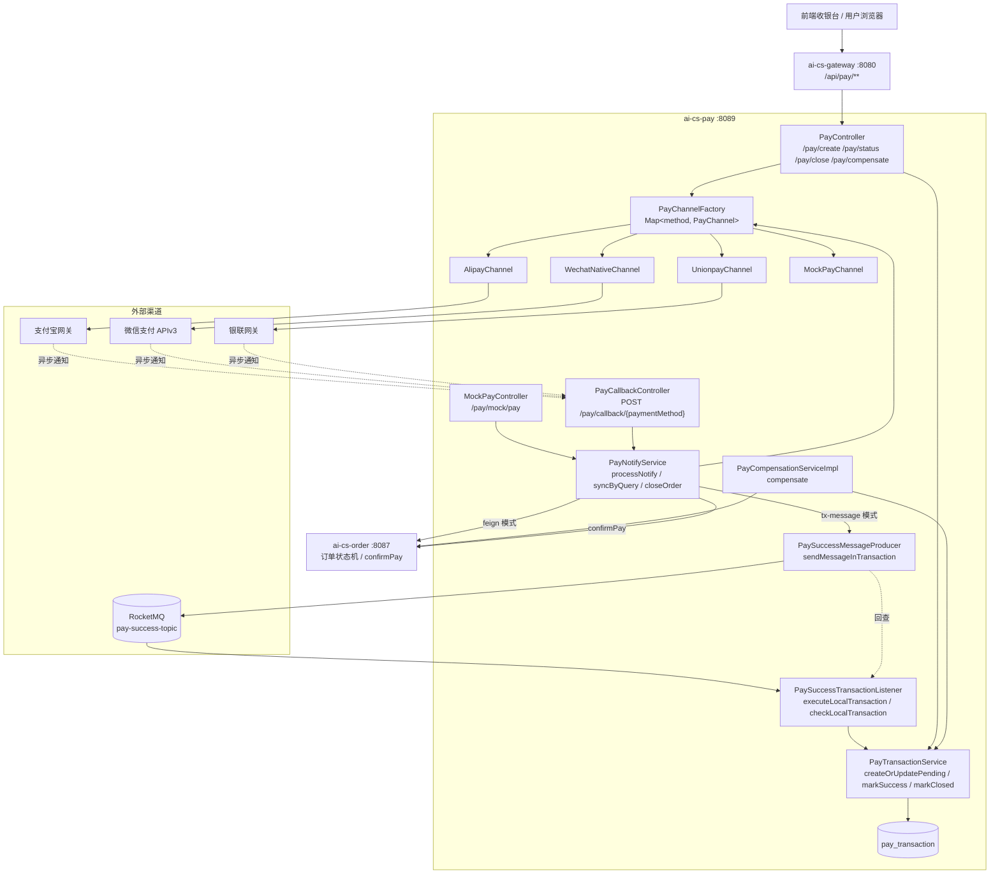
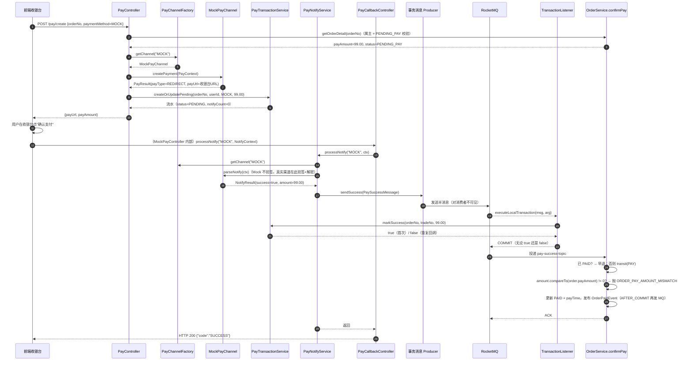

# 支付渠道集成与回调一致性：策略工厂、验签、幂等状态机与兜底对账

> **一句话结论**：支付代码的正确性不来自"收到回调就改状态"，而来自三件互相独立的事——**按渠道对原始报文验签、用流水状态机 + 订单状态机做唯一裁决、用主动查单与对账兜住所有没到的通知**；本项目把这三件事分别落在 `PayChannel.parseNotify`、`PayTransactionServiceImpl.markSuccess` + `OrderServiceImpl.confirmPay`、`PayNotifyService.syncByQuery` + `PayCompensationServiceImpl.compensate` 上。
> **阅读前置**：会读 Spring 的依赖注入与 `@Value` 配置注入；知道 `@Transactional` 的作用范围（见 [事务拦截器与传播行为](../24-源码分析/01-Spring框架/03-事务管理/01-transactional-事务拦截器与传播行为.md)）；了解 RocketMQ 事务消息的"半消息 + 回查"概念；用过 MyBatis-Plus 的 `updateById`。
> **证据基线**：JDK 17 / Spring Framework 7.1.0 / Spring Boot 4.2.0 / Spring Cloud 2026.0.0 / Spring Cloud Alibaba 2025.1.0.0 / RocketMQ 5.1 / alipay-sdk-java 4.40.943.ALL / wechatpay-java 0.2.17 / MySQL 8.0；支付服务端口 8089，订单服务 8087。预计阅读 45 分钟。

---

## 0. 先看现象

支付模块的 bug 有一个共同点：**它不会抛出让你停下来的异常，而是让"钱"和"状态"各自走一条路**。下面三个现象都来自本项目的真实代码路径，报错原文是日志里的一行，不是编造的堆栈。

**现象一：微信支付后台显示"通知成功"，订单却一直是待支付。** `ai-cs-pay` 日志里留下的唯一痕迹是：

```text
2026-11-27T10:12:03.418+08:00  WARN 1 --- [ai-cs-pay] [nio-8089-exec-3] c.a.p.controller.PayCallbackController : 支付回调处理失败: method=WECHAT, err=微信支付渠道未配置商户参数，请在 Nacos 配置 pay.wechat.*（app-id/mch-id/api-v3-key/商户证书）
```

渠道侧认为自己通知成功了，是因为 `PayCallbackController` 把**业务异常吞掉后仍然返回 HTTP 200**（`ai-cs-pay/src/main/java/com/aics/pay/controller/PayCallbackController.java#L38-L44`）。微信 v3 判定"收到通知"的唯一依据就是 HTTP 状态码，于是它不会再重试，这笔钱就悬在半空。

**现象二：同一段代码换到支付宝上，结论完全相反。** 同一个 `orderNo` 的 WARN 每隔几分钟重复打印一次：

```text
2026-11-27T10:20:41.002+08:00  WARN 1 --- [ai-cs-pay] [nio-8089-exec-7] c.a.p.controller.PayCallbackController : 支付回调处理失败: method=ALIPAY, err=支付宝渠道未配置商户参数，请在 Nacos 配置 pay.alipay.app-id/private-key/alipay-public-key
```

原因是支付宝要求响应体是纯文本 `success`，收到 `{"code":"FAIL",...}` 就判定"商户没收到"，于是按自己的节奏反复重推。**同一个应答实现，在微信那里是"成功"，在支付宝那里是"失败"**——这正是本篇要讲清的第一个"成功"定义问题。

**现象三：`notify_count` 这个字段在撒谎。** 渠道后台显示某订单推了 5 次通知，库里查 `pay_transaction` 却看到 `notify_count = 1`：

```sql
select order_no, status, notify_count, pay_time
from pay_transaction where order_no = 'SO20261127001';
```

不需要实测就能从代码推出这个结果：`PayTransactionServiceImpl.markSuccess` 在自增 `notifyCount` 之前就对 `SUCCESS` 状态做了幂等早退（`ai-cs-pay/src/main/java/com/aics/pay/service/impl/PayTransactionServiceImpl.java#L55-L65`），第 2 次及以后的回调根本走不到自增那一行。于是有人据此得出"我们只收到过一次回调"，把订单侧幂等判断删掉——重复发货事故就是这么来的。

**这些现象指向同一件事**：回调链路里每一环都必须自己回答两个问题——"什么才算成功"和"重复来了怎么办"；应答报文格式、验签对象、幂等键、状态机裁决、金额单位、审计字段，任意一环含糊，最终都表现为"钱扣了，货不对"。

---

## 1. 整体地图

先看全局：支付服务内部被切成"渠道适配层（`PayChannel` 家族）+ 编排层（`PayNotifyService`）+ 状态层（`PayTransactionService`）+ 出站通知层（事务消息）"四块，外部三个渠道网关通过异步通知回到同一个 Controller。



> **读图说明**：从左到右是两条独立入口——**下单**（前端 → 网关 → `PayController` → 渠道 → 外部网关）和**回调**（外部渠道 → `PayCallbackController` → 编排 → 状态/消息）。两条线在 `PayChannelFactory` 和 `pay_transaction` 上交汇：下单只写一条 `PENDING` 流水，回调才有资格把它推进到 `SUCCESS`。注意三个虚线点：① 渠道异步通知**不经过订单服务**，直接打支付服务；② `PROD` 到 `TL` 的回查虚线是事务消息的补偿机制，不是业务调用；③ `NS → ORD` 的 `confirmPay` 只在 `aics.pay.tx-notify.enabled=false`（feign 模式）时才存在，默认走 MQ。

| 组件 | 责任 | 谁调用它 |
|------|------|----------|
| `PayController` | 下单/查状态/关单/手动补偿的 HTTP 入口，做属主与订单状态前置校验 | 前端（经网关）、订单服务 |
| `PayCallbackController` | 渠道异步通知唯一入口，负责把 HTTP 请求组装成与渠道无关的 `NotifyContext` | 支付宝/微信/银联服务器 |
| `PayChannelFactory` | 启动时把 `List<PayChannel>` 变成 `Map<method, PayChannel>`，运行期按字符串选渠道 | `PayController`、`PayNotifyService`、`MockPayController` |
| `PayChannel` 实现 | 各渠道的下单参数、验签、查单、关单、退款 | 仅经工厂访问 |
| `PayNotifyService` | 编排：验签结果 → 是否成功 → 走事务消息或同步 Feign；查单兜底的执行者 | Controller、补偿服务 |
| `PayTransactionService` | `pay_transaction` 的状态机与幂等裁决 | 通知监听器、补偿服务、Controller |
| `PaySuccessMessageProducer` + `PaySuccessTransactionListener` | 用 RocketMQ 事务消息保证"流水落库成功 ⇒ 订单必收到" | 编排层 / Broker 回查 |
| `PayCompensationServiceImpl` | 两段式对账：待支付流水查单兜底 + 成功流水与订单状态比对 | `POST /pay/compensate`（手动） |

---

## 2. 关键概念与关键类

先把术语钉死，后面不再解释：

- **验签**：用渠道给的公钥/证书验证回调报文确实来自渠道且未被篡改。它是"这条通知能不能被信任"的唯一依据，与金额、订单号校验是两件事。
- **幂等**：同一操作执行多次与执行一次的**结果**相同。支付场景里"结果相同"包括副作用数量（发几次货、发几条通知）。
- **幂等键**：判定"这是不是同一次操作"的字段。本项目用 `order_no`（`pay_transaction` 上的唯一索引 `uk_order_no`）。
- **半消息**：RocketMQ 事务消息的第一阶段，消息先落到 Broker 但对消费者不可见，等生产者本地事务结果再决定提交还是回滚。
- **主动查单兜底**：回调没到时，反过来调用渠道的"查询订单"接口确认结果。渠道的查单接口是权威数据源。
- **对账**：定期拿渠道账单、本地流水、订单表三方比对，找出"钱到了但状态没到"与"状态到了但钱没到"的差异。
- **内网穿透**：把本机端口通过公网隧道暴露成 HTTPS 域名，是本地开发时让渠道能回调到你电脑的唯一办法。

| 名称 | 位置 | 角色 | 关键方法 / 字段 |
|------|------|------|-----------------|
| `PayChannel` | `ai-cs-pay/src/main/java/com/aics/pay/channel/PayChannel.java#L28-L69` | 渠道策略接口，定义渠道能力的契约 | `getMethod()`、`createPayment(PayContext)`、`queryPayment(String)`、`parseNotify(NotifyContext)`、`closeOrder(String)`、`refund(String, BigDecimal)`；常量 `STATUS_PENDING/STATUS_SUCCESS/STATUS_CLOSED` |
| `PayChannelFactory` | `ai-cs-pay/src/main/java/com/aics/pay/channel/PayChannelFactory.java#L28-L52` | 策略索引，启动期建 `Map<String, PayChannel>` | 构造器 `PayChannelFactory(List<PayChannel>)`、`getChannel(String method)`、`allChannels()` |
| `PayContext` | `ai-cs-pay/src/main/java/com/aics/pay/channel/PayContext.java#L13-L26` | 渠道无关的下单入参 | `orderNo`、`payAmount`（单位：元）、`subject`、`notifyUrl` |
| `NotifyContext` | `ai-cs-pay/src/main/java/com/aics/pay/channel/NotifyContext.java` | 渠道无关的回调入参 | `params`（表单参数）、`headers`（微信 5 个 `Wechatpay-*` 头）、`body`（原始报文字符串） |
| `NotifyResult` | `ai-cs-pay/src/main/java/com/aics/pay/channel/NotifyResult.java` | 渠道无关的回调结果 | `orderNo`、`success`、`amount`、`transactionId` |
| `AlipayChannel` | `ai-cs-pay/src/main/java/com/aics/pay/channel/AlipayChannel.java` | 支付宝当面付（预下单二维码）实现 | `rsaCheckV1` 验签 `#L142`、`setTotalAmount(...toPlainString())` `#L89` |
| `WechatNativeChannel` | `ai-cs-pay/src/main/java/com/aics/pay/channel/WechatNativeChannel.java` | 微信 Native 支付（APIv3）实现 | `NotificationParser.parse` `#L160`、`yuanToFen` `#L223-L228`、`fenToYuan` `#L231-L236` |
| `UnionpayChannel` | `ai-cs-pay/src/main/java/com/aics/pay/channel/UnionpayChannel.java` | 银联全渠道（无 SDK，手写 `RestTemplate`） | 组签名下单 `#L90`、`UnionpaySignature.verify` 验签 `#L159` |
| `UnionpaySignature` | `ai-cs-pay/src/main/java/com/aics/pay/channel/UnionpaySignature.java` | 银联签名工具（排序拼串 + SHA256withRSA + Base64） | `buildContent` `#L37-L44`、`sign`、`verify`、`loadSignCert` |
| `MockPayChannel` | `ai-cs-pay/src/main/java/com/aics/pay/channel/MockPayChannel.java` | 本地模拟渠道，内存态 | `markPaid` `#L94`、`parseNotify`（**不验签**，`#L64-L76`） |
| `PayCallbackController` | `ai-cs-pay/src/main/java/com/aics/pay/controller/PayCallbackController.java#L34-L65` | 回调入口，统一组装 `NotifyContext`、统一应答 | `POST /pay/callback/{paymentMethod}`、`buildNotifyContext` |
| `PayNotifyService` | `ai-cs-pay/src/main/java/com/aics/pay/service/PayNotifyService.java#L32-L87` | 编排层 | `processNotify`、`syncByQuery`、`closeOrder`、`notifyOrderSuccess` |
| `PayTransactionServiceImpl` | `ai-cs-pay/src/main/java/com/aics/pay/service/impl/PayTransactionServiceImpl.java#L31-L114` | 流水状态机 | `createOrUpdatePending`、`markSuccess`、`markClosed`、`markRefunding`、`markRefunded` |
| `PaySchemaInitializer` | `ai-cs-pay/src/main/java/com/aics/pay/config/PaySchemaInitializer.java#L23-L40` | 启动时建 `pay_transaction` 表 | `ApplicationRunner` + `JdbcTemplate.execute(DDL)` |
| `PayCompensationServiceImpl` | `ai-cs-pay/src/main/java/com/aics/pay/service/impl/PayCompensationServiceImpl.java#L34-L73` | 手动对账/补偿 | `compensate()` |
| `OrderServiceImpl.confirmPay` | `ai-cs-order/src/main/java/com/aics/order/service/impl/OrderServiceImpl.java#L116-L160` | 订单侧最终裁决（幂等 + 金额校验 + 状态机） | `@Transactional`、`PAID` 早退 `#L126`、`compareTo` 校验 `#L139` |

关于 `@Transactional` 在 `confirmPay` 上的真实语义（何时提交、异常怎么回滚、为什么 `publishEvent` 之后的事务提交顺序重要），可对照 [Transactional 事务拦截器与传播行为](../24-源码分析/01-Spring框架/03-事务管理/01-transactional-事务拦截器与传播行为.md) 与 [事务失效场景与源码原因](../24-源码分析/01-Spring框架/03-事务管理/02-事务失效场景与源码原因.md) 看。

---

## 3. 原理与证据逐段精读

下面每一小节都按四层展开：**在干什么 → 为什么这么设计 → 换写法会怎样 → 常见坑**。

### 3.1 渠道策略：接口 + 工厂按 method 建索引

**在干什么。** `PayChannel` 是一个只有 6 个方法的接口，外加三个状态字符串常量：

```java
public interface PayChannel {
    String STATUS_PENDING = "PENDING";   // 渠道查单/通知：待支付
    String STATUS_SUCCESS = "SUCCESS";   // 支付成功
    String STATUS_CLOSED  = "CLOSED";    // 已关闭/支付失败
    String getMethod();                                   // MOCK / ALIPAY / WECHAT / UNIONPAY
    PayResult createPayment(PayContext context);
    String queryPayment(String orderNo);
    NotifyResult parseNotify(NotifyContext context);       // 验签失败必须抛出异常
    void closeOrder(String orderNo);
    RefundResult refund(String orderNo, BigDecimal refundAmount);
}
```

（`ai-cs-pay/src/main/java/com/aics/pay/channel/PayChannel.java#L28-L69`）

工厂把 Spring 收集来的 `List<PayChannel>` 折叠成一张表：

```java
public PayChannelFactory(List<PayChannel> channels) {
    this.channelMap = channels.stream()
            .collect(Collectors.toMap(PayChannel::getMethod, Function.identity()));
    log.info("已注册支付渠道: {}", channelMap.keySet());
}

public PayChannel getChannel(String method) {
    PayChannel channel = channelMap.get(method);
    if (channel == null) {
        throw new BusinessException(ResultCode.ORDER_PAYMENT_METHOD_INVALID,
                "不支持的支付方式: " + method);
    }
    return channel;
}
```

（`ai-cs-pay/src/main/java/com/aics/pay/channel/PayChannelFactory.java#L34-L47`）

**为什么这么设计。** 关键在于"新增一个渠道要改几处"。现在只改一处：新写一个 `@Component` 实现 `PayChannel`、`getMethod()` 返回新字符串，工厂的构造器参数会自动多一个元素。调用方（Controller、编排层）完全不知道多了一个渠道。而且因为索引是**启动时**建立的，`log.info("已注册支付渠道: ...")` 会在启动日志里列出所有可用渠道——运维一眼就能看出"这个环境支持哪几种支付"。

**换写法会怎样。** 如果在 `PayNotifyService` 里写 `switch (paymentMethod) { case "ALIPAY" -> ...; }`，每加一个渠道都要改编排层，而且编排层会依赖具体渠道类，`@Value` 配置、`RestTemplate`、证书加载全部泄漏到业务代码里。更糟的是这段 `switch` 会同时出现在下单、回调、查单、关单、退款五个方法里，五处漏改一处就是线上事故。

**常见坑。**
- **两个实现返回同一个 `getMethod()`，应用直接起不来。** `Collectors.toMap` 没有传 mergeFunction，重复 key 会抛 `IllegalStateException: Duplicate key ...`。这是"快速失败"的好处，但异常栈里只写着 lambda，读起来很吓人。排查手法：看异常消息中的 duplicate key 值，两个渠道实现里 `grep` 这个字符串即可定位。
- **`getMethod()` 必须与 `PaymentMethod` 枚举的 `code` 对齐。** 枚举在 `ai-cs-common/src/main/java/com/aics/common/enums/PaymentMethod.java#L13-L17`（`MOCK/WECHAT/ALIPAY/BANK_CARD/UNIONPAY`），但**没有 `BANK_CARD` 对应的渠道实现**——用户选银行卡支付时，`getChannel("BANK_CARD")` 抛 `不支持的支付方式: BANK_CARD`。这类"枚举有、实现没有"的缺口只能靠工厂的显式异常暴露，别指望编译期发现。
- **接口里的 `STATUS_*` 常量是"渠道态"而不是"流水态"。** `pay_transaction.status` 还多出 `REFUNDING/REFUNDED`（见 `markRefunding`/`markRefunded`），别把两套状态混用。

### 3.2 下单参数与签名：金额单位与"拼串顺序"是两个独立的坑

**在干什么。** 三个真实渠道的下单逻辑各不相同，但都在做同一件事：把商户侧参数翻译成渠道要求的结构，并保证"渠道能验证这是我们发的"。

| 渠道 | 金额如何表达 | 签名如何产生 |
|------|--------------|--------------|
| 支付宝 | `model.setTotalAmount(context.getPayAmount().toPlainString())`，单位元、字符串 | SDK 内部用私钥对排序后的业务参数签 `RSA2`（SHA256WithRSA） |
| 微信 APIv3 | `amount.setTotal(yuanToFen(context.getPayAmount()))`，单位**分**、`int` | 请求头签名 + 商户私钥；回调侧由 `NotificationParser` 验签并解密 `resource` |
| 银联 | `txnAmt = yuanToFen(...)`，单位**分**、字符串 | 自研 `UnionpaySignature.buildContent` 拼串后 `SHA256withRSA`，再 Base64 |

元/分换算集中在两个静态方法里，值得逐字读：

```java
public static int yuanToFen(BigDecimal yuan) {
    if (yuan == null) { return 0; }
    return yuan.movePointRight(2).setScale(0, RoundingMode.HALF_UP).intValueExact();
}

public static BigDecimal fenToYuan(Integer fen) {
    if (fen == null) { return BigDecimal.ZERO; }
    return BigDecimal.valueOf(fen).movePointLeft(2);
}
```

（`ai-cs-pay/src/main/java/com/aics/pay/channel/WechatNativeChannel.java#L223-L236`）

**为什么这么设计。** `movePointRight(2)` 只是移位，不引入误差；`setScale(0, HALF_UP)` 明确指定"分"的四舍五入方向；`intValueExact()` 是最后一道闸——金额超过 `2_147_483_647` 分（约 2147 万元）时它会抛 `ArithmeticException`，而不是**静默截断成一个错误的金额**。对钱来说，"崩掉"永远优于"算错"。

**换写法会怎样。** 写成 `(int) (yuan.doubleValue() * 100)`，`1.23` 元可能算出 `122` 分（`1.23 * 100 = 122.99999999999999`），然后你在回调里用分转元比较，金额永远差 1 分。这就是"0.1 + 0.2 不平"的真实来源，见 3.6 的实测。

银联的签名串拼装是另一个"必须确定性"的地方：

```java
private static String buildContent(Map<String, String> params) {
    return params.entrySet().stream()
            .filter(e -> e.getValue() != null && !e.getValue().isEmpty())
            .filter(e -> !"sign".equals(e.getKey()) && !"signMethod".equals(e.getKey()))
            .sorted(Map.Entry.comparingByKey())
            .map(e -> e.getKey() + "=" + e.getValue())
            .collect(Collectors.joining("&"));
}
```

（`ai-cs-pay/src/main/java/com/aics/pay/channel/UnionpaySignature.java#L37-L44`）

**为什么这么设计。** 签名本质是"对一段确定的字节做摘要，双方必须拼出**完全相同**的字节"。`Map` 的迭代顺序不稳定，所以必须 `sorted(comparingByKey())`；空值参与拼串会让两端结果不一致，所以要过滤；`sign` 字段是签名产物本身，让它参与拼串就成了"自己签自己"。这三条不是风格问题，漏一条就是"偶发验签失败"——偶发是因为 `HashMap` 顺序在小数据量下往往稳定，上线数据一多就变了。

**常见坑。**
- **拼串编码不统一。** 一端 UTF-8、一端平台默认 GBK，中文 `subject` 就会导致签名不一致。银联实现里 `ENCODING` 是常量，务必全程传它。
- **`BigDecimal.toString()` 的陷阱。** 支付宝侧用 `toPlainString()` 而不是 `toString()`：`toString()` 在特定 scale 下会输出科学计数法（如 `1E+2`），渠道不认。这不是理论问题，是支付宝文档明确要求金额为"元"的两位小数字符串。
- **金额为 null 静默变 0。** `yuanToFen(null)` 返回 0，`fenToYuan(null)` 返回 `BigDecimal.ZERO`。如果上游把订单金额传丢了，你会向渠道下一笔 0 元订单，而渠道那边真的接受。

### 3.3 回调三件事：验签 → 幂等 → 状态机推进

**在干什么。** 一条异步通知从进来到生效，只做三件事，顺序不能换。

**第一件：验签，且必须"失败即抛"。** 接口 javadoc 把这条写成了硬约束：

```java
/**
 * 解析渠道异步通知：验签（+微信解密）后返回标准化支付结果。
 * 验签失败必须抛出异常，防止伪造通知。
 */
NotifyResult parseNotify(NotifyContext context);
```

（`ai-cs-pay/src/main/java/com/aics/pay/channel/PayChannel.java#L54-L58`）

各渠道落实方式不同但语义一致：支付宝 `AlipaySignature.rsaCheckV1(params, alipayPublicKey, "UTF-8", "RSA2")` 返回 false 时抛 `BusinessException(ResultCode.UNAUTHORIZED, "支付宝回调验签失败")`（`ai-cs-pay/src/main/java/com/aics/pay/channel/AlipayChannel.java#L142-L146`）；银联 `UnionpaySignature.verify` 失败时抛同样语义的异常（`ai-cs-pay/src/main/java/com/aics/pay/channel/UnionpayChannel.java#L159-L163`）；微信把验签交给 `NotificationParser.parse(requestParam, Transaction.class)`，失败直接抛异常（`ai-cs-pay/src/main/java/com/aics/pay/channel/WechatNativeChannel.java#L158-L160`）。而 `MockPayChannel` 在同一个位置写着 `// TODO: 真实渠道在这里验签`（`ai-cs-pay/src/main/java/com/aics/pay/channel/MockPayChannel.java#L64-L76`）——这条注释就是"Mock 只能用于本地/dev"的最好说明。

**第二件：幂等，由流水状态机裁决。**

```java
public boolean markSuccess(String orderNo, String tradeNo, BigDecimal amount) {
    PayTransaction tx = getByOrderNo(orderNo);
    if (tx == null || STATUS_SUCCESS.equals(tx.getStatus())) {
        return false; // 幂等：已成功或不存在
    }
    tx.setStatus(STATUS_SUCCESS);
    if (StringUtils.hasText(tradeNo)) { tx.setTradeNo(tradeNo); }
    if (amount != null)               { tx.setPayAmount(amount); }
    tx.setNotifyCount(tx.getNotifyCount() == null ? 1 : tx.getNotifyCount() + 1);
    tx.setPayTime(LocalDateTime.now());
    payTransactionMapper.updateById(tx);
    log.info("支付流水标记成功: orderNo={}, tradeNo={}", orderNo, tradeNo);
    return true;
}
```

（`ai-cs-pay/src/main/java/com/aics/pay/service/impl/PayTransactionServiceImpl.java#L51-L70`）

注意返回值的含义：`false` 表示"这次什么都没做"。这是**幂等原语**，调用方必须看它——而 `PaySuccessTransactionListener` 恰恰没看（3.7 详述）。

**第三件：状态机推进。** `pay_transaction` 只在合法迁移上变化：`PENDING → SUCCESS`（`markSuccess`）、`PENDING → CLOSED`（`markClosed`，非 `PENDING` 直接返回 `false`，`#L74-L77`）、`SUCCESS → REFUNDING → REFUNDED`。订单侧则交给 `OrderStateTransitionService.transit(status, OrderEvent.PAY)`，非法迁移抛 `BusinessException`，`confirmPay` 捕获后打一行 warn 就返回（`ai-cs-order/src/main/java/com/aics/order/service/impl/OrderServiceImpl.java#L130-L135`）。

**为什么这么设计。** 验签解决"通知是否可信"，幂等解决"重复是否安全"，状态机解决"当前状态允许不允许这次变更"。三者职责不同，不能互相替代：验签通过不代表没被重放；幂等通过不代表状态可迁（例如已退款订单收到"支付成功"回调）；状态机通过也不代表金额对。**把三件事压成一个 `if` 是支付模块最常见的架构性错误。**

**换写法会怎样。** 把验签放到业务层（拿到 `NotifyResult` 之后再校验签名）：意味着解析阶段已经把不可信的 `orderNo`、`amount` 放进了对象，任何在验签之前的日志、缓存、查库都可能被伪造报文驱动。把幂等交给数据库唯一索引：只能挡住"插入两条流水"，挡不住"同一条流水被更新两次并触发两次下游动作"。

**常见坑。**
- **`markSuccess` 不校验金额。** 方法注释写着"必须校验金额一致防篡改"，但方法体里只有 `if (amount != null) { tx.setPayAmount(amount); }`——**流水金额会被回调金额直接覆盖**。真正的金额校验在订单侧 `confirmPay`（`#L137-L143`）。所以"pay 侧流水金额"不是审计真相，订单表才是。这是一个真实的代码与注释不一致点，读源码时要以代码为准。
- **`notify_count` 永远只到 1。** 自增在幂等早退之后，见 §0 现象三。
- **`getByOrderNo` 用 `selectOne` + `eq(order_no)`，并发下"读-改-写"不是原子的。** 两个线程都可能读到 `PENDING`，各自 `updateById`。最终状态依然正确（都写 `SUCCESS`），但 `notifyCount`、`payTime` 可能被后写的覆盖。要靠唯一索引 `uk_order_no`（`ai-cs-pay/src/main/java/com/aics/pay/config/PaySchemaInitializer.java#L37`）保证不出现两条流水，靠状态机保证结果幂等。要真正防并发，应改成条件更新：`update pay_transaction set status='SUCCESS' where order_no=? and status='PENDING'`，用影响行数当返回值。

### 3.4 回调应答契约：什么才算"处理成功"

**在干什么。** `PayCallbackController` 用一段 `try/catch` 统一应答：

```java
try {
    payNotifyService.processNotify(paymentMethod, buildNotifyContext(request));
    return Map.of("code", "SUCCESS", "message", "OK");
} catch (Exception e) {
    log.warn("支付回调处理失败: method={}, err={}", paymentMethod, e.getMessage());
    return Map.of("code", "FAIL", "message", e.getMessage() == null ? "处理失败" : e.getMessage());
}
```

（`ai-cs-pay/src/main/java/com/aics/pay/controller/PayCallbackController.java#L38-L44`）

**为什么这么设计。** 动机可以理解：不让渠道看到一个 Java 堆栈，避免"回调失败"变成渠道侧的重试风暴；同时保证 Controller 永远返回合法 JSON，便于前端和监控统一解析。

**换写法会怎样——这才是本节的重点。** 各渠道对"成功"的定义**不是同一件事**，依据各渠道官方文档：

| 渠道 | 官方要求 | 本项目返回 `200 + {"code":"FAIL"}` 的后果 |
|------|----------|------------------------------------------|
| 微信支付 APIv3 | 处理成功返回 HTTP 200 或 204，否则按策略重试（依据微信支付《支付通知》文档） | **渠道认为成功，永不再推**。业务失败被彻底吞掉 |
| 支付宝 | 响应体必须是纯文本 `success`，否则判定失败并重试（依据支付宝《异步通知说明》） | 渠道认为失败，**持续重推**。重推在同一幂等逻辑下是安全的，等于免费兜底 |
| 银联全渠道 | 商户返回 HTTP 200 视为已接收（依据银联开放平台《后台通知》说明） | 与微信相同，失败被吞 |

于是同一段代码产生了两种完全相反的线上表现（§0 现象一、现象二）。**这解释了为什么"回调失败"这件事在本项目里只能靠主动查单和对账来发现**——渠道并没有义务告诉你。

正确的做法有两条路，选一条并写进注释：
1. **按渠道定制应答**：微信/银联成功返回 200 空体、失败返回 5xx（或非 200），支付宝成功返回纯文本 `success`、失败返回 `failure`。前提是"重推安全"已被幂等 + 状态机保证。
2. **永远 200 + 本地落待补偿**：即当前实现，但必须配套"失败必留痕"——把失败的回调原文写入 `pay_callback_log` 之类待处理表，让 `compensate` 能扫到。目前本项目**没有这张表**，失败只剩下一条 WARN 日志。

**常见坑。**
- **吞异常会让监控指标失真。** 全链路追踪里 `POST /pay/callback/**` 全是 200，错误率永远是 0。
- **`e.getMessage()` 直接回给渠道**，等于把内部信息（类名、SQL 片段、配置键）暴露给外部系统。生产环境应答体应当是固定文案，详情只进日志。
- **`catch (Exception e)` 连 `NullPointerException` 也当成"业务失败"返回 FAIL**。NPE 属于代码缺陷，应该让它冒出来（至少打 error 级别 + 告警），而不是降级成一次普通的验签失败。

### 3.5 原始报文：为什么验签必须吃"原始字节"

**在干什么。** `buildNotifyContext` 把 `HttpServletRequest` 变成渠道无关的 `NotifyContext`：

```java
String body = "";
String contentType = request.getContentType();
if (contentType != null && contentType.toLowerCase().contains("json")) {
    body = new String(request.getInputStream().readAllBytes(), StandardCharsets.UTF_8);
}
return NotifyContext.builder().params(params).headers(headers).body(body).build();
```

（`ai-cs-pay/src/main/java/com/aics/pay/controller/PayCallbackController.java#L59-L64`，`headers` 收集 5 个 `Wechatpay-*` 头见 `#L27-L30`、`#L51-L57`）

**为什么必须用原始流。** 微信 APIv3 的签名串是 `timestamp\nnonce\nbody\n`，`body` 是**字节级原文**。一旦框架先把 JSON 反序列化成对象（`@RequestBody Map<String,Object>` 或某个 DTO），再把它序列化回去，字段顺序、空格、数字格式（`1.20` vs `1.2`）、Unicode 转义都可能变，签名必然对不上。Spring 的 JSON 转换器本质就是"读成对象"：

```java
@Override
public Object read(Type type, @Nullable Class<?> contextClass, HttpInputMessage inputMessage)
        throws IOException, HttpMessageNotReadableException {
    JavaType javaType = getJavaType(type, contextClass);
    return readJavaType(javaType, inputMessage);
}
```

[[源码:AbstractJackson2HttpMessageConverter.java.md#L357-L362]]

也就是说，**只要给回调方法标上 `@RequestBody`，你就永远验签不通过**。本项目没有这么做：`payCallback` 的入参是 `HttpServletRequest`（`#L36-L37`），body 自己读、自己转字符串。这是这条链路上最关键的一个设计决定。

**换写法会怎样。** 用 `@RequestBody` 接 DTO 的写法在"普通接口"上完全正确，在"回调接口"上必然失败；而失败信息只有一句 `微信支付回调验签失败`，极易被误判成"密钥配错了"，然后运维去换证书——换一百次也不会好。关于消息转换器如何选择、如何工作，见 [参数解析与返回值处理](../24-源码分析/01-Spring框架/04-SpringMVC/03-参数解析与返回值处理-argumentresolver与converter.md)。

**常见坑。**
- **`contentType.contains("json")` 的判断把表单渠道的 body 设成空串。** 支付宝/银联是表单提交，走 `params`，恰好不需要 body；但将来若加一个"JSON 格式 + 需要原文"的渠道，这个判断就是隐性依赖。
- **`getParameterMap()` 对 `application/json` 请求什么都不解析**，对表单请求会触发容器解析。两种 content-type 混用一个方法时，要清楚哪个字段有值。
- **`request.getInputStream()` 只能读一次。** 如果前面加了打印 body 的 Filter 或 `ContentCachingRequestWrapper` 之外的自定义包装，回调侧读到的就是空串——这是"日志里 body 完好、验签却失败"的经典原因。

### 3.6 金额一致性：分与元、double 与 BigDecimal、compareTo 与 equals

**在干什么。** 金额在系统里有三种表示：订单表 `pay_amount DECIMAL(10,2)`（元）、渠道要求的分（`int`）、`BigDecimal`（内存）。一致性要求：三者换算无损，且比较时忽略 scale。

**为什么必须用 `BigDecimal` 且必须 `compareTo`。** 先看 double 会坏到什么程度（可复现实测）：

```bash
node -e "console.log(0.1+0.2); console.log((0.1+0.2)===0.3); console.log(0.1+0.2-0.3);"
```

真实输出：

```text
0.30000000000000004
false
5.551115123125783e-17
```

再看 `BigDecimal` 的构造与比较（`jshell -q -` 逐条输入）：

```text
jshell> System.out.println(new java.math.BigDecimal(0.1));
0.1000000000000000055511151231257827021181583404541015625
jshell> System.out.println(new java.math.BigDecimal("0.1"));
0.1
jshell> System.out.println(new java.math.BigDecimal("1.0").equals(new java.math.BigDecimal("1.00")));
false
jshell> System.out.println(new java.math.BigDecimal("1.0").compareTo(new java.math.BigDecimal("1.00")));
0
jshell> System.out.println(new java.math.BigDecimal("1.23").movePointRight(2).setScale(0, java.math.RoundingMode.HALF_UP).intValueExact());
123
```

三条结论：① `new BigDecimal(double)` 会把二进制误差原样搬进"精确"类型，**构造必须用 String 或 `valueOf`**；② `equals` 同时比较值和 scale，`1.0` 与 `1.00` 不相等；③ `compareTo` 只比较数值，这才是金额比较的正确工具。所以订单侧写的是 `amount.compareTo(order.getPayAmount()) != 0`（`OrderServiceImpl.java#L139`），而不是 `equals`。

`OrderPayClient` 解析订单服务的响应也遵循了这条：

```java
vo.setPayAmount(new BigDecimal(String.valueOf(data.get("payAmount"))));
```

（`ai-cs-pay/src/main/java/com/aics/pay/client/OrderPayClient.java#L52`）

`data` 是 `Map<?,?>`，`payAmount` 可能是 `BigDecimal`、`Integer` 或 `Double`；`String.valueOf(...)` 先把它变成十进制文本，再交给 `BigDecimal(String)`。若写成 `new BigDecimal((Double) data.get("payAmount"))`，误差就进来了。

**换写法会怎样。** 用 `double` 累加优惠分摊（券 0.1 + 积分 0.2），得到 `0.30000000000000004`，入 `DECIMAL(10,2)` 变 `0.30`，而渠道按 `0.30` 通知——**看起来一致，实际是四舍五入掩盖了分摊算法的问题**；一旦分摊涉及 3 件商品，误差会累积成 1 分差，`ORDER_PAY_AMOUNT_MISMATCH` 就来了。

**常见坑。**
- **微信取的是 `payer_total`（用户实付），不是 `total`（订单总额）。** `fenToYuan(transaction.getAmount().getPayerTotal())`（`WechatNativeChannel.java#L162-L165`）。用户用了代金券/立减时 `payer_total < total`，与订单金额不等 → 金额校验失败 → 而失败又被 200 应答吞掉 → **订单永远不 PAID**。这是"金额校验太严"与"应答吞错"叠加出的生产事故，两个问题单独看都无害。
- **查单兜底路径传的是 `null` 金额。** `notifyOrderSuccess(orderNo, paymentMethod, null, null)`（`PayNotifyService.java#L51`），订单侧 `if (amount != null && ...)` 直接跳过校验。这条"兜底路径"没有任何金额核对，且 `tradeNo` 也不会落库。
- **`DECIMAL(10,2)` 上限约 9999 万元。** 大额场景要换 `DECIMAL(18,2)`，否则 insert 抛 `Data truncation`。

### 3.7 异步通知的并发与重复：用事务消息保证"流水成功 ⇒ 订单必达"

**在干什么。** 默认配置下（`aics.pay.tx-notify.enabled` 缺省 `true`，`PayNotifyService.java#L29-L30`），回调处理**不直接调订单服务**，而是发一条 RocketMQ 事务消息：

```java
public void sendSuccess(PaySuccessMessage message) {
    // 1. 半消息 + header
    var msg = MessageBuilder.withPayload(message).setHeader("TOPIC", TOPIC).build();
    // 2. 2.3.0 签名：sendMessageInTransaction(destination, message, arg)
    var result = rocketMQTemplate.sendMessageInTransaction(TOPIC, msg, message);
}
```

（`ai-cs-pay/src/main/java/com/aics/pay/mq/PaySuccessMessageProducer.java#L47-L52`，`TOPIC = "pay-success-topic"` 见 `#L35`）

真正的本地事务在监听器里执行：

```java
public RocketMQLocalTransactionState executeLocalTransaction(Message msg, Object arg) {
    // ... 解析 payload
    payTransactionService.markSuccess(payload.getOrderNo(), payload.getTradeNo(), payload.getAmount()); // 忽略返回值
    return RocketMQLocalTransactionState.COMMIT;
}

public RocketMQLocalTransactionState checkLocalTransaction(Message msg) {
    // ... 查流水
    return switch (tx.getStatus()) {
        case "SUCCESS" -> RocketMQLocalTransactionState.COMMIT;
        case "PENDING" -> RocketMQLocalTransactionState.UNKNOWN; // 流水未决，等待下次回查
        default        -> RocketMQLocalTransactionState.ROLLBACK;
    };
}
```

（`ai-cs-pay/src/main/java/com/aics/pay/mq/PaySuccessTransactionListener.java#L40-L45`、`#L56-L65`）

**为什么这么设计。** 回调处理有两个必须原子的动作：**流水标记成功**（本地数据库）和**通知订单**（跨服务）。先写库再发 MQ 的传统写法，会在"写库成功、发 MQ 失败"时丢事件；先发 MQ 再写库，会让订单先于流水生米煮成熟饭。事务消息把两者绑成：半消息落地 → 执行本地事务（`markSuccess`）→ 按结果 COMMIT/ROLLBACK → Broker 对悬而未决的消息回查（`checkLocalTransaction` 把 `SUCCESS` 映射为 COMMIT、`PENDING` 映射为 UNKNOWN 继续回查）。`PayNotifyService` 的 javadoc 也明确写了这个对比（`#L57-L63`）：`feign` 模式（`enabled=false`）"回查期 Feign 失败即丢事件"。

**换写法会怎样。** feign 模式即 `markSuccess` + `orderPayClient.confirmPay` 顺序执行（`PayNotifyService.java#L71-L72`）：`confirmPay` 抛异常时回调返回 FAIL，微信永远不重试（§3.4），流水却已经是 `SUCCESS`——**流水和订单永久分裂**。此时唯一救命的是 `compensate()` 的第二段对账。

**常见坑。**
- **`executeLocalTransaction` 忽略了 `markSuccess` 的返回值，永远 COMMIT。** 意味着重复回调（流水已 `SUCCESS`）也会提交一条新消息。这在**当前**是正确的——订单侧 `confirmPay` 靠 `PAID` 早退（`OrderServiceImpl.java#L126-L129`）和状态机兜住重复。但它是隐性契约：**如果谁把订单侧幂等改掉，一秒钟就会变成重复发货**。真正稳妥的写法是：`markSuccess` 返回 `false`（重复）时，用一个"是否已投递"标记决定 ROLLBACK 或 COMMIT，把意图写进代码而不是注释。
- **`TX_PRODUCER_GROUP` 常量是死常量。** `#L38` 定义了 `"pay-success-tx-producer-group"`，但 `@RocketMQTransactionListener` 从 rocketmq-spring 2.3.0 起已移除 `txProducerGroup` 属性，监听器默认绑定主 `RocketMQTemplate`（`PaySuccessTransactionListener.java#L33-L34` 的注释写明了这点）。因此 Nacos 里配的 `rocketmq.producer.group=pay-producer-group` 才是真实生产组名，别被常量误导。
- **三路并发同时到达同一订单**：渠道重推、事务消息回查、用户点"刷新"触发查单兜底。它们都汇合到 `markSuccess` + `confirmPay`，所以幂等必须落在**最里面的状态机**上，而不是落在某一路上。
- **死信没人管。** 订单侧消费者 `PaySuccessListener` 配了 `maxReconsumeTimes = 8`，耗尽后进 `%DLQ%pay-success-consumer-group`（`ai-cs-order/src/main/java/com/aics/order/listener/PaySuccessListener.java#L27-L31`）。死信队列没有消费者，也没有告警——这就是"流水 SUCCESS、订单 PENDING_PAY"最常见的成因。

### 3.8 主动查询兜底：回调丢失时的唯一正路

**在干什么。** 两条补偿路径，都不依赖渠道再推一次。

**路径一：用户轮询状态时顺手查单。**

```java
if (order != null && STATUS_PENDING_PAY.equals(order.getStatus())) {
    try {
        String method = order.getPaymentMethod() == null
                ? PaymentMethod.MOCK.getCode() : order.getPaymentMethod();
        payNotifyService.syncByQuery(orderNo, method);
        order = orderPayClient.getOrderDetail(orderNo);
    } catch (Exception e) {
        log.warn("查单兜底异常: orderNo={}, err={}", orderNo, e.getMessage());
    }
}
```

（`ai-cs-pay/src/main/java/com/aics/pay/controller/PayController.java#L97-L106`）

`syncByQuery` 把"渠道查单"翻译成"走一遍成功流程"：

```java
public boolean syncByQuery(String orderNo, String paymentMethod) {
    PayChannel channel = payChannelFactory.getChannel(paymentMethod);
    String channelStatus = channel.queryPayment(orderNo);
    if (PayChannel.STATUS_SUCCESS.equals(channelStatus)) {
        log.info("查单兜底命中已支付: orderNo={}, method={}", orderNo, paymentMethod);
        notifyOrderSuccess(orderNo, paymentMethod, null, null);
        return true;
    }
    return false;
}
```

（`ai-cs-pay/src/main/java/com/aics/pay/service/PayNotifyService.java#L46-L55`）

**路径二：手动/外部调度的对账补偿。** `PayCompensationServiceImpl.compensate()` 分两段（`#L34-L73`）：先把所有 `PENDING` 流水逐条 `syncByQuery`（统计 `querySynced`），再把所有 `SUCCESS` 流水逐条查订单，`status != "PAID"` 的进 `paySuccessButOrderNotPaid` 列表。返回的是一张报表，不是自动修复。

**为什么这么设计。** 渠道的"查询订单"接口是**权威数据源**，而异步通知是"尽力而为"的推送。工程上正确的顺序永远是"以查询为准、以通知为快"。本条路径还把"渠道状态字符串"收敛了一次：微信 `TradeStateEnum.SUCCESS → SUCCESS`、`CLOSED/REVOKED/PAYERROR → CLOSED`、其余 → `PENDING`（`WechatNativeChannel.java#L111-L128`）；银联 `origRespCode` 为 `00 → SUCCESS`、`04/05 → CLOSED`（`UnionpayChannel.java#L125-L132`）。**没有这层归一化，`if ("SUCCESS".equals(status))` 在三个渠道上会有三种写法。**

**换写法会怎样。** 不查单、只信回调：任何一次回调丢失（发布重启、网关 5xx、证书轮换、微信 200 判定）都会留下永久不一致的订单。只在补偿里查单、不在用户请求里查：用户看到"待支付"而其实已付，客诉量直接翻倍。

**常见坑。**
- **查单是同步外呼，会把渠道超时压到用户请求上。** 支付宝客户端 `readTimeout` 设的是 60000ms（`AlipayChannel.java#L205-L214` 的 `buildClient`）。渠道慢时，`GET /pay/status/{orderNo}` 可能卡 60 秒——这个接口是前端轮询打的。应当异步化（后台线程/定时任务），请求线程里只读本地状态。
- **`compensate` 没有 `@Scheduled`。** 只有 `POST /pay/compensate`（`PayController.java#L126-L129`）能用，等于"没人点就不会自愈"。
- **对账只看状态不看金额。** `paySuccessButOrderNotPaid` 只比对 `status`，不比对 `paidAmount`，所以"订单 PAID 但金额被改过"这类差异查不出来。
- **`getChannel(method)` 在补偿里也会抛异常**：历史流水里的 `paymentMethod` 若是已下线渠道（比如 `BANK_CARD`），单条 `catch` 后只 warn，不会中断整批——这是好设计，值得保留。

### 3.9 回调地址与内网穿透：`notifyUrl` 的三重误会

**在干什么。** 下单时 `PayController` 往 `PayContext` 里塞了一个回调地址：

```java
PayResult payResult = channel.createPayment(PayContext.builder()
        .orderNo(orderNo)
        .payAmount(order.getPayAmount())
        .subject("订单 " + orderNo)
        .notifyUrl("/api/pay/callback/" + paymentMethod)
        .build());
```

（`ai-cs-pay/src/main/java/com/aics/pay/controller/PayController.java#L70-L75`）

**为什么这里有三重误会。** 逐层拆开：

1. **它是相对路径，渠道不认。** 支付宝/微信/银联都要求公网可达的**绝对 URL**。`"/api/pay/callback/WECHAT"` 无法被外部服务器访问。
2. **它压根没被用到。** 全模块只有 `PayContext` 定义了这个字段、`PayController` 写了它，三个渠道实现**没有一处 `context.getNotifyUrl()`**；它们各自用 `@Value` 注入的字段：支付宝 `request.setNotifyUrl(notifyUrl)`（`AlipayChannel.java#L86`）、微信 `request.setNotifyUrl(notifyUrl)`（`WechatNativeChannel.java#L90`）、银联 `params.put("backUrl", notifyUrl)`（`UnionpayChannel.java#L88`、`#L188`）。
3. **真正生效的配置项在 Nacos 里目前不存在。** 渠道字段的注入键是 `pay.alipay.notify-url`、`pay.wechat.notify-url`、`pay.unionpay.notify-url`，而仓库里的配置导出 `tools/nacos-config/ai-cs-pay.yml` 只有 `pay.sandbox: true`（实测见 §6）。也就是说，真实渠道启动后会在 `ensureConfigured()` 处直接抛配置缺失异常。

**换写法会怎样（正确姿势）。** 回调地址应当**配置化**，且必须与部署形态匹配：
- **直连服务**：`https://pay.example.com/pay/callback/WECHAT`（服务端口 8089 直接暴露）。
- **经网关**：`https://api.example.com/api/pay/callback/WECHAT`，因为网关路由 `ai-cs-pay` 是 `.path("/api/pay/**")` 加 `stripPrefix(1)`（`ai-cs-gateway/src/main/java/com/aics/gateway/config/RouteConfig.java#L134-L137`），会剥掉 `/api` 前缀。
- **本地开发**：用内网穿透把 8089 暴露成 HTTPS 域名（frp / ngrok / cpolar 皆可），配 `https://<隧道域名>/pay/callback/WECHAT`。微信 APIv3 要求 HTTPS，支付宝 http/https 均可（依据各渠道官方回调文档）。

**常见坑。**
- **回调走网关会被 401。** 网关 `AuthFilter` 的白名单是登录/注册/健康检查/Swagger（`ai-cs-gateway/src/main/java/com/aics/gateway/filter/AuthFilter.java#L82-L96`），**没有 `/api/pay/callback/**`**。所以回调地址必须直连支付服务，或者把前缀加入白名单（并配套"渠道签名就是身份"的安全论证）。关于过滤链为什么先于业务、白名单分支如何剥离伪造身份头，见 [Route 路由断言与过滤器链](../24-源码分析/04-SpringCloud/04-网关Gateway/01-route-路由断言与过滤器链.md)。
- **`pay.sandbox: true` 是死配置。** 全模块 Java 源码里没有任何地方读取它（§6 有实测命令与输出），它的存在只是在误导"这里能切沙箱"。
- **隧道域名会变。** ngrok 免费版每次重启换域名，而 Nacos 里的 `notify-url` 还是旧的——表现为"本地怎么都收不到回调"，其实回调打到了上一个域名。

### 3.10 敏感信息与日志脱敏

**在干什么。** 支付模块的敏感信息分三类：**密钥/证书**（`pay.alipay.private-key`、`pay.alipay.alipay-public-key`、`pay.wechat.api-v3-key`、`pay.wechat.merchant-private-key`、银联 PKCS12 证书）、**报文**（回调 params/body 里含买家账号、金额、签名）、**标识**（`tradeNo`、`orderNo`、用户 ID）。

**为什么这么设计。** 密钥只从配置中心注入，代码里给空默认值并提供显式校验：

```java
private void ensureConfigured() {
    if (!StringUtils.hasText(appId) || !StringUtils.hasText(privateKey) || ...) {
        throw new BusinessException(ResultCode.ORDER_PAYMENT_METHOD_INVALID,
                "支付宝渠道未配置商户参数，请在 Nacos 配置 pay.alipay.app-id/private-key/alipay-public-key");
    }
}
```

（`ai-cs-pay/src/main/java/com/aics/pay/channel/AlipayChannel.java#L216-L222`，微信同构 `WechatNativeChannel.java#L212-L219`）

这是"**fail fast 优于 NPE**"的正面样本：配置缺失时给出的是"要配哪几个键"，而不是渠道 SDK 内部某一行空指针。日志侧，回调入口只打方法与 `e.getMessage()`（`PayCallbackController.java#L42`），**不打 `params`、不打 `body`**——这是有意的：回调报文里既有签名也有买家信息。

**换写法会怎样。** 为了排查方便在回调入口 `log.info("收到回调: {}", params)`：签名、`buyer_logon_id`（支付宝买家账号）、`openid`（微信）会全部进日志系统，一旦日志外泄就是资金与个人信息双重事故。反过来，完全不打日志又会像 §0 那样——只剩一句 WARN，无法复盘。

**常见坑。**
- **异常堆栈里带敏感信息。** `log.error("...", e)` 打印的是堆栈，SDK 异常常带完整请求参数。要打就把 `e.getMessage()` 截断后打。
- **`orderNo` 本身是业务标识不是密钥**，可以打但要防"越权猜测"：订单号若可枚举，日志/接口里应做尾号脱敏或改用不可预测的雪花 ID。
- **`tradeNo`（渠道流水号）是对账关键，脱敏要能还原**：脱敏方案必须支持"用订单号回查渠道后台"，否则对账时无法定位。
- **证书文件路径进镜像**：`pay.wechat.merchant-private-key-path` 指向本地路径，容器化时要挂载 Secret，别打进镜像层。

---

## 4. 一次完整执行时序

以 Mock 渠道为例（它走的是与真实渠道**完全相同**的编排链路，只是验签是空的），把"下单 → 支付 → 回调 → 事务消息 → 订单确认"走完。



> **读图说明**：横轴是时间。**第 1–9 步是"下单"，只写一条 `PENDING` 流水，不改变订单状态**；第 10 步之后才是"支付结果生效"。关键在 15–19：`markSuccess` 在**生产者端**的本地事务里执行，`confirmPay` 在**消费者端**执行，两者之间隔着 Broker——这就是为什么"流水 SUCCESS 但订单 PENDING_PAY"是可观测的中间态（消息还在路上、或进了死信）。20–23 步是订单侧的最终裁决，重复投递在这里被 `PAID` 早退吸收。

**哪一步失败会报什么错**（按步号）：

| 步 | 失败原因 | 现象 / 报错 |
|----|----------|-------------|
| 3 | 订单不属于当前用户，或状态不是 `PENDING_PAY` | `BusinessException(ORDER_NOT_FOUND, "订单不存在或不可支付")` |
| 6 | 渠道未配置商户参数 | `BusinessException(ORDER_PAYMENT_METHOD_INVALID, "微信支付渠道未配置商户参数，请在 Nacos 配置 pay.wechat.*…")` |
| 6 | `paymentMethod` 没有对应实现（如 `BANK_CARD`） | `BusinessException(ORDER_PAYMENT_METHOD_INVALID, "不支持的支付方式: BANK_CARD")` |
| 12 | 验签失败 | `BusinessException(UNAUTHORIZED, "支付宝回调验签失败" / "银联回调验签失败")`；微信由 SDK 抛验签异常 |
| 12–14 | 回调为非成功状态（`WAIT_BUYER_PAY` 等） | warn `支付通知为非成功状态，不更新订单: orderNo=..., method=...`，直接 return |
| 16 | 流水不存在（从没下过单） | `markSuccess` 返回 `false`，监听器仍 COMMIT，订单侧 `confirmPay` 打 warn `支付确认订单不存在` |
| 21 | 重复回调 | 订单侧 info `订单已支付，忽略重复确认: orderNo=...` |
| 22 | 金额不一致 | `BusinessException(ORDER_PAY_AMOUNT_MISMATCH)` + error `支付金额与订单不一致: orderNo=..., callbackAmount=..., orderAmount=...` |
| 22 | 状态机不允许（如订单已取消） | warn `订单状态不允许支付确认，忽略: orderNo=..., status=...` |
| 23 | 消费者反复失败 | 重试 8 次后进死信 `%DLQ%pay-success-consumer-group`，订单永久停在 `PENDING_PAY` |

---

## 5. 设计取舍

| 取舍点 | 当前选择 | 换来的好处 | 付出的代价 | 替代方案 |
|--------|----------|------------|------------|----------|
| 回调应答 | 统一 HTTP 200 + `{"code":...}` | 渠道不会看到堆栈；实现极简 | 微信/银联把失败当成功（不再重试）；支付宝语义又相反 | 按渠道定制应答体；或统一 200 + 失败落 `pay_callback_log` 表 |
| 本地事务与通知订单 | RocketMQ 事务消息（默认 `enabled=true`） | "流水成功 ⇒ 订单必达"，无中间丢失 | 链路长、死信需人管、本地调试要起 RocketMQ | 同步 Feign + 定时补偿（`enabled=false`，代码已保留） |
| 幂等落点 | 流水状态早退 + 订单 `PAID` 早退 + 唯一索引 | 三处兜底，重复回调安全 | `notify_count` 失去审计意义；`markSuccess` 的 `false` 被忽略 | 条件更新（`where status='PENDING'`）+ 回调流水表记录每次投递 |
| 金额校验位置 | 只在订单侧 `confirmPay` | 单一真相源，改一处即生效 | 流水表金额可被回调覆盖；查单兜底路径完全不校验 | 流水侧也校验，校验失败拒绝更新并告警 |
| 微信金额字段 | `payer_total`（用户实付） | 与用户实际付款一致 | 用券时与订单金额不等 → 校验失败 → 订单卡死 | 取 `total`（订单总额）做一致性校验 |
| 查单兜底 | 用户轮询接口内同步外呼 | 实现简单，命中即时 | 渠道慢时 60s 长请求压在前端轮询上 | 异步查单 + 结果回调本地缓存 |
| 对账 | 手动 `POST /pay/compensate` | 零基础设施成本 | 没人点就不自愈；无金额差异检测 | 定时任务 + 渠道账单下载比对 |
| `pay_transaction` 建表 | `PaySchemaInitializer` 启动执行 `CREATE TABLE IF NOT EXISTS` | 开箱即用 | 与 Flyway/Liquibase 版本管理冲突；生产不可控 | 迁移脚本统一管理，初始化器仅用于本地 |
| 银联实现 | 手写 `RestTemplate`（不走 `@LoadBalanced`） | 无 SDK 依赖、可控 | 退款未完成（`origQryId` 以订单号占位） | 引入银联 SDK 或补齐 `origQryId` 回读 |

**可扩展点清单**（按投入产出比排序）：

1. **新渠道接入**：实现 `PayChannel` + `@Component`，`getMethod()` 与 `PaymentMethod.code` 对齐，工厂自动索引；再补 Nacos 的 `pay.<渠道>.*` 配置与 `ensureConfigured()` 校验。
2. **回调应答按渠道定制**：在 `PayCallbackController` 里按 `paymentMethod` 返回不同 body/status，把 §3.4 的"成功定义"显式化。
3. **回调流水表 `pay_callback_log`**：每次回调记录原始 body 的哈希、验签结果、处理结果，让"重复次数"真正可数，替代失效的 `notify_count`。
4. **死信消费者**：订阅 `%DLQ%pay-success-consumer-group`，落库 + 告警 + 自动重放。
5. **定时对账**：`@Scheduled` 调用 `compensate()`，并扩展为"流水 vs 订单 vs 渠道账单"三方比对（金额也要比）。
6. **幂等原子化**：`markSuccess` 改为条件更新并返回影响行数，消除"读-改-写"窗口。
7. **金额校验下沉**：pay 侧校验 `NotifyResult.amount` 与流水金额，不一致则拒绝并告警（防伪造/防渠道错账）。
8. **退款闭环**：`UnionpayChannel.refund` 的 `TODO`（`#L190-L208`）需从订单表读取真实 `origQryId`，否则银联退款必失败。
9. **可观测性**：为回调链路加 Micrometer 计数器（`pay.callback{method,result}`），并让失败回调打 error 级别触发告警。
10. **配置治理**：删掉死配置 `pay.sandbox`，补齐 `pay.<渠道>.notify-url`，并让 `PayContext.notifyUrl` 要么被真正使用、要么删除。

---

## 6. 踩坑与调试手法

以下每条都给出**可复现的命令**与真实输出（C 级证据），或**指向具体代码行**的推理（B 级证据）。

### 坑 1：回调地址配成网关地址，渠道拿到 401

**症状**：渠道后台显示"回调失败 401"，支付服务日志里一条记录都没有。**原因**：网关白名单不含回调路径（`AuthFilter.java#L82-L96`）。**调试手法**：

```bash
# 直连服务端口验证业务逻辑是否正常（绕开网关鉴权）
curl -i -X POST http://127.0.0.1:8089/callback/MOCK -H "Content-Type: application/json" -d '{"orderNo":"SO1","result":"SUCCESS"}'

# 经网关验证是否被鉴权拦下（预期 401）
curl -i -X POST http://127.0.0.1:8080/api/pay/callback/MOCK -H "Content-Type: application/json" -d '{"orderNo":"SO1"}'
```

两条命令的差异就能定位问题层：**直连 200、经网关 401 = 白名单问题**，而不是验签问题。

### 坑 2：业务失败但渠道显示"通知成功"，订单永远待支付

**症状**：§0 现象一。**调试手法**：先看应答，再看业务。

```text
2026-11-27T10:12:03.418+08:00  WARN ... PayCallbackController : 支付回调处理失败: method=WECHAT, err=微信支付渠道未配置商户参数...
```

日志里是 WARN 而不是 ERROR，且 HTTP 是 200（`PayCallbackController#L38-L44`）——两条证据合起来就能判定"失败被吞了"。修复方向是 §3.4 的应答契约，而不是去重发回调。

### 坑 3：误判"只收到一次回调"

**症状**：`notify_count = 1`，结论"渠道只推了一次"。**真相**：自增在幂等早退之后（`PayTransactionServiceImpl#L55-L65`），第 2 次起直接 `return false`。**验证手法**：查渠道后台的通知记录（微信"交易通知"、支付宝"通知记录"），或临时在 `processNotify` 入口加一行 `log.info("回调到达: orderNo={}, method={}")`，用到达次数与 `notify_count` 对比。**结论**：`notify_count` 不能作为"回调次数"使用，要另行落回调流水表。

### 坑 4：金额 0.1+0.2 不平

**症状**：`支付金额与订单不一致: orderNo=..., callbackAmount=0.30, orderAmount=0.30000000000000004`。**调试手法**：用 `jshell` 就地验证你的换算链，别在脑子里推。

```text
jshell> System.out.println(new java.math.BigDecimal(0.1));
0.1000000000000000055511151231257827021181583404541015625
jshell> System.out.println(new java.math.BigDecimal("1.0").equals(new java.math.BigDecimal("1.00")));
false
jshell> System.out.println(new java.math.BigDecimal("1.0").compareTo(new java.math.BigDecimal("1.00")));
0
```

以及 Node/Python 里最容易写错的浮点累加：

```bash
node -e "console.log(0.1+0.2); console.log((0.1+0.2)===0.3);"
```

```text
0.30000000000000004
false
```

**定位口诀**：金额出现"末位差 1"，先怀疑 `double`/`float`，再怀疑 `equals`，最后才怀疑业务。

### 坑 5：验签必失败——原始报文被"重新序列化"

**症状**：微信回调永远 `微信支付回调验签失败`，换密钥证书都没用。**根因**：把回调参数用 `@RequestBody` 接成对象（Spring 会走 JSON 反序列化，见 [[源码:AbstractJackson2HttpMessageConverter.java.md#L357-L362]]），再把对象序列化后交给 `NotificationParser`——字段顺序/空格/数字格式已变。**验证手法**：在 `buildNotifyContext` 临时打印 body 的**前 100 个字符与其 SHA-256**，和渠道后台"通知内容"逐字节比对；若哈希不一致，就是 body 被改造过。

### 坑 6：配置键"看起来配了"，实际没人读

**调试手法（本项目实测）**：用 `Select-String` 反查"这个配置键有没有被 Java 代码消费"。

```powershell
Select-String -Path (Get-ChildItem -Recurse ai-cs-pay\src -Filter *.java).FullName -Pattern 'pay\.sandbox'
```

真实输出：

```text
NO MATCH (java 源码无人消费 pay.sandbox)
```

再查配置导出里到底有哪些支付键：

```powershell
Select-String -Path tools\nacos-config\ai-cs-pay.yml -Pattern '^pay:|sandbox|notify-url|alipay|wechat|unionpay'
```

真实输出：

```text
tools\nacos-config\ai-cs-pay.yml:18:pay:
tools\nacos-config\ai-cs-pay.yml:19:  sandbox: true
```

结论：配置里只有一个**没人读**的 `pay.sandbox`，而代码需要的 `pay.alipay.*`、`pay.wechat.*`、`pay.unionpay.*`、`*.notify-url` **一个都没有**——所以真实渠道一旦被调用，必然在 `ensureConfigured()` 抛出"未配置商户参数"。**这个手法适用于任何"YAML 里配了但行为没变"的问题**：先证明键被消费，再怀疑值不对。

### 坑 7：流水 SUCCESS、订单 PENDING_PAY

**症状**：`pay_transaction.status='SUCCESS'`，`orders.status='PENDING_PAY'`。**排查顺序**：① 看订单消费者日志有没有 `支付确认订单不存在` / `订单状态不允许支付确认` / `支付金额与订单不一致`；② 看是不是进了死信 `%DLQ%pay-success-consumer-group`（`PaySuccessListener` 的 `maxReconsumeTimes=8`）；③ 用 `POST /pay/compensate` 跑一遍，返回的 `paySuccessButOrderNotPaid` 就是差异清单。**注意**：`compensate` 只报告不修复，修复仍需人工或定时任务。

### 坑 8：银联退款必失败

**症状**：退款返回失败，日志只有 respMsg。**根因**：`refund` 的 `TODO` 未完成，`origQryId` 用订单号占位（`UnionpayChannel.java#L190-L208`），银联要求传的是**原消费交易的 queryId**。**手法**：确认流水表是否保存了渠道交易号（`pay_transaction.trade_no`），银联的 `queryId` 应在回调时通过 `NotifyResult.transactionId` 落库——但当前 `markSuccess` 只在 `tradeNo` 非空时才写，查单兜底路径传的是 `null`，所以这条数据可能缺失。

### 调试手法补充：怎么"看见"回调链路

- **网关/服务两侧都开 access log**：回调没到服务，先看网关有没有 401，再看隧道路由是否命中。
- **用 `curl -i` 而不是浏览器**：浏览器会把 POST 当 GET，且看不到原始响应体（支付宝只认 body 是不是 `success`）。
- **看 MyBatis-Plus 的 SQL 日志**：`markSuccess` 是否执行、`update` 影响行数是多少，一眼可见；这比在 Service 里加日志更快。

---

## 7. ⚠️ 版本差异

本项目的支付模块横跨"银行 SDK + 框架大版本升级"，下面这些是当前基线（Spring Boot 4.2.0 / Framework 7.1.0）与旧写法的真实差异。

| 旧写法 | 当前基线 | 变化点 | 迁移动作 |
|--------|----------|--------|----------|
| `spring-boot-starter-web` | Boot 4.2 起已 deprecated，推荐 `spring-boot-starter-webmvc` | Web 自动配置被拆成 web / webmvc / json 等更细的 starter | `ai-cs-pay/pom.xml` 目前仍依赖 `spring-boot-starter-web`，需评估迁移；新模块直接用 `starter-webmvc` |
| `javax.servlet.http.HttpServletRequest` | `jakarta.servlet.http.HttpServletRequest`（`PayCallbackController.java#L7`） | Jakarta EE 9+ 包名迁移 | 老代码里的 `javax.*` 全部要换；`request.getInputStream()` 语义不变，但依赖版本要对齐 |
| `com.fasterxml.jackson.databind.ObjectMapper` | Boot 4 默认 Jackson 3（`tools.jackson`），二者不是同一类型 | 包名、默认行为、模块体系都变了 | 项目在 `ai-cs-common/src/main/java/com/aics/common/autoconfigure/Jackson2AutoConfiguration.java#L13-L21` 用 `@ConditionalOnClass` 保留了一个 Jackson 2 的 `ObjectMapper` Bean；`PaySuccessMessageProducer` 仍 `import com.fasterxml.jackson.databind.ObjectMapper`，新代码不要 `new ObjectMapper()` |
| 微信支付 v2（XML + MD5 签名） | APIv3（JSON + SHA256withRSA + AES-GCM 解密，`wechatpay-java 0.2.17`） | 验签对象从"参数拼串"变成"原始报文字节 + 头"，还要解密 `resource` | 回调必须传原始 body（本项目已做）；`Wechatpay-Serial` 头必须透传，否则证书找不到 |
| 支付宝 SDK 早期 `AlipayClient` + XML + `RSA` | `alipay-sdk-java 4.40.943.ALL` + `RSA2`（SHA256），回调 `rsaCheckV1(params, publicKey, "UTF-8", "RSA2")` | 签名算法与参数排序规则不同；`RSA` 已不被推荐 | 验签时 `signType` 必须与下单一致，混用会全部失败 |
| `@RocketMQTransactionListener(txProducerGroup = "...")` | rocketmq-spring 2.3.0 起该属性移除，监听器绑定主 `RocketMQTemplate` | 多模板/多生产组场景需拆多实例配置 | 删掉属性（本项目已删，`PaySuccessTransactionListener.java#L33-L34` 有注释说明）；`TX_PRODUCER_GROUP` 常量已无实际作用 |
| `sendMessageInTransaction(msg, arg)` 旧签名 | `sendMessageInTransaction(destination, message, arg)`（`PaySuccessMessageProducer.java#L51-L52`） | destination 即 topic 变成显式参数 | 升级后编译期就会报错，注意 `arg` 传的是原对象，监听器靠它取 payload |
| `mybatis-plus-boot-starter` | `mybatis-plus-spring-boot4-starter` + `mybatis-plus-jsqlparser`（`ai-cs-pay/pom.xml`） | Boot 4 需要专用 starter，SQL 解析器拆分 | 换坐标；`LambdaQueryWrapper` API 不变 |
| `RestTemplate` 直接 `new` 并手写超时 | Framework 7 推荐 `RestClient`（流式 API、更好的可观测性） | `RestTemplate` 仍在维护但不推荐新用 | 银联渠道的 `new RestTemplate()`（`UnionpayChannel.java#L69`）可平滑替换为 `RestClient`；注意 `RestTemplate` 的默认错误处理是 `DefaultResponseErrorHandler`，4xx/5xx 会抛异常（[[源码:RestTemplate.java.md#L797-L798]]） |
| 银联 `version=5.0.0` 等旧报文版本 | `VERSION = "5.1.0"`（`UnionpayChannel.java#L42`） | 报文版本号参与签名，必须与签名串一致 | 升级只需改常量，但务必与渠道侧核对 |

---

## 8. 面试高频问与答

> 按要求此处只列问题，答法请回到正文对应小节。

1. 支付回调为什么要"先验签、再幂等、再状态机"？三件事能不能合并成一个判断？
2. 微信支付 v3 的验签为什么必须用**原始报文**？用 `@RequestBody` 接 DTO 会怎样？
3. 支付宝和微信对"回调处理成功"的定义有什么区别？本项目统一返回 `200 + JSON` 会造成什么后果？
4. 同一个订单收到 5 次回调，你的系统如何保证只发一次货？幂等键选谁？
5. 为什么 `markSuccess` 里"读状态-改状态-写回"不是原子的？并发下会出现什么问题？怎么改？
6. 为什么金额比较要用 `BigDecimal.compareTo` 而不是 `equals`？`0.1 + 0.2` 的结果说明了什么？
7. 元与分换算时 `intValueExact()` 的作用是什么？去掉它会有什么风险？
8. 微信的 `total` 与 `payer_total` 有什么区别？取错会引发什么线上问题？
9. 事务消息（半消息 + 回查）解决了什么传统"先写库再发 MQ"解决不了的问题？
10. `checkLocalTransaction` 里为什么把 `PENDING` 映射成 `UNKNOWN` 而不是 `ROLLBACK`？
11. 回调丢了怎么办？主动查单兜底的触发时机应该放在哪里？为什么不能只放在用户轮询接口里？
12. 什么是对账？渠道账单、本地流水、订单表三方比对能发现哪几类差异？
13. 本地开发时渠道怎么回调到你电脑？回调地址要配在哪、为什么不能配相对路径？
14. 回调链路里哪些信息必须脱敏？为什么 `notify_count` 这种"审计字段"反而可能骗人？
15. 如果让你重构这套支付模块，最先改的三处是什么？为什么？

---

## 9. 动手练习

1. **写一个新渠道骨架。** 实现 `PayChannel` 的 `MockV2Channel`（`getMethod()` 返回 `"MOCK_V2"`），只实现 `createPayment` 与 `parseNotify`（验签处抛 `UnsupportedOperationException` 并注释"待接入"）。**验收标准**：启动日志的 `已注册支付渠道:` 里出现 `MOCK_V2`；`POST /pay/create` 传 `paymentMethod=MOCK_V2` 能拿到 `payUrl`；传 `paymentMethod=BANK_CARD` 仍抛 `不支持的支付方式: BANK_CARD`。

2. **人为造一次重复回调。** 对同一 `orderNo` 连续 `curl` 两次 `/pay/mock/pay`。**验收标准**：第二次后 `pay_transaction.status` 仍为 `SUCCESS`、`pay_time` 不变；订单日志出现 `订单已支付，忽略重复确认`；并记录 `notify_count` 的实际值，解释为什么是 1。

3. **把回调应答改成渠道各自要求的格式。** 修改 `PayCallbackController`：`WECHAT`/`UNIONPAY` 成功返回 200 空体、失败返回 500；`ALIPAY` 成功返回纯文本 `success`、失败返回 `failure`。**验收标准**：`PayControllersTest` 中针对三种 method 的断言通过；用 `curl -i` 观察三种 method 的响应体与状态码差异。

4. **给金额校验补一条兜底。** 在 `PayNotifyService.processNotify` 里，`result.isSuccess()` 之后、`notifyOrderSuccess` 之前，比对 `result.getAmount()` 与流水 `payAmount`，不一致则打 error 并拒绝推进。**验收标准**：构造 `amount=0.30` 而流水 `99.00` 的通知，日志出现"回调金额与流水不一致"且流水状态保持 `PENDING`；正常金额的通知不受影响。

5. **复现并解释浮点误差。** 用 `jshell` 写一段"券 0.1 + 积分 0.2 → 汇总"的 `double` 累加与 `BigDecimal` 累加对照实验，把两者结果都打到控制台。**验收标准**：能说明 `double` 结果的末位误差来自哪里、为什么 `DECIMAL(10,2)` 入库后"看起来对了"却是掩盖问题；并给出把 `double` 换成 `BigDecimal` 后的正确写法。

6. **写一个定时对账任务。** 新建 `PayReconcileJob`，用 `@Scheduled(cron = "0 0 3 * * ?")` 调用 `payCompensationService.compensate()`，并把返回的 `paySuccessButOrderNotPaid` 非空时打 error 日志。**验收标准**：单元测试里 mock `compensate()` 返回含差异的 Map，断言日志级别为 error；生产配置里可通过 `@ConditionalOnProperty` 关掉。

7. **删掉死配置并补齐真配置。** 从 `tools/nacos-config/ai-cs-pay.yml` 移除 `pay.sandbox`，补上 `pay.wechat.notify-url`、`pay.alipay.notify-url`、`pay.unionpay.notify-url` 三项（值填内网穿透域名）。**验收标准**：用 §6 坑 6 的 `Select-String` 手法能证明这三个键被 `@Value` 消费；`ensureConfigured()` 不再因 notify-url 缺失报错。

---

## 小结

- **支付模块的正确性靠三条独立防线**：验签（可信性）、幂等 + 状态机（重复与顺序）、主动查单 + 对账（丢失）。任何一条被省掉，最终都会以"钱扣了、状态不对"的形式暴露。
- **渠道策略的实现极短**（`PayChannel` 6 个方法 + 工厂 10 行建索引），真正的复杂度在"渠道语义差异"：金额单位、验签对象、成功定义、状态字符串，这四件事在各渠道都不一样，必须在中立层归一化。
- **"回调成功"是渠道各自定的**：微信/银联看 HTTP 状态码，支付宝看 body 是否 `success`。本项目统一 `200 + JSON` 的应答在微信侧吞掉失败、在支付宝侧变成免费重试——同一个实现两种命运。
- **验签必须吃原始字节**：`PayCallbackController` 用 `HttpServletRequest` 而不是 `@RequestBody`，是要绕过 Spring 的 JSON 反序列化（`AbstractJackson2HttpMessageConverter#L357-L362`），这是全链路最容易被"顺手优化"掉的一行。
- **金额三铁律**：用 `BigDecimal`、用 String 构造、用 `compareTo` 比较；分与元换算用 `movePointRight/setScale/intValueExact`，别碰 `double`。
- **幂等要落在最里面的状态机**（`markSuccess` 的 `false` 早退 + 订单侧 `PAID` 早退），而且调用方必须看返回值——`PaySuccessTransactionListener` 目前忽略了它，属于"看似冗余、实为隐性契约"的地方。
- **可观测性是这个模块最大的缺口**：失败回调只剩一条 WARN、`notify_count` 不计数、`compensate` 不自调度、死信无消费者。**下一步动作**：先落地 `pay_callback_log` 表（记录每次回调的到达时间、验签结果、处理结果），再给死信队列加消费者与告警——这两件事能让你在下一次"钱货不一致"时，第一次拥有完整证据链。

---

## 自测题

**1. `PayChannelFactory` 用什么方式建立 method 到渠道实现的映射？如果两个实现返回同一个 `getMethod()` 会发生什么？**

<details><summary>参考答案</summary>
构造器接收 `List<PayChannel>`，用 `Collectors.toMap(PayChannel::getMethod, Function.identity())` 建 `Map<String, PayChannel>`，见 `PayChannelFactory#L34-L38`。`toMap` 未传 mergeFunction，重复 key 会抛 `IllegalStateException: Duplicate key`，应用启动失败——这是"快速失败"，排查时看异常消息里的重复 key 值即可定位两个实现。
</details>

**2. 微信 APIv3 的回调为什么不能用 `@RequestBody` 接参？**

<details><summary>参考答案</summary>
微信签名串包含原始报文字节（`timestamp\nnonce\nbody\n`）。用 `@RequestBody` 会让 Spring 的 JSON 转换器把 body 反序列化再序列化（`AbstractJackson2HttpMessageConverter#L357-L362` 的 `read` → `readJavaType`），字段顺序、空格、数字格式都可能改变，验签必然失败。本项目用 `HttpServletRequest` 手动读 `getInputStream()` 得到原始字节（`PayCallbackController#L59-L64`）。
</details>

**3. 本项目回调失败时返回什么？微信和支付宝分别如何理解这个应答？**

<details><summary>参考答案</summary>
`PayCallbackController#L38-L44` 捕获所有异常后返回 HTTP 200 + `{"code":"FAIL","message":...}`。微信 APIv3 以 HTTP 200/204 判定成功，因此认为通知已送达、不再重试；支付宝要求响应体是纯文本 `success`，收到 JSON 判定失败并持续重推。同一实现产生两种相反后果。
</details>

**4. `markSuccess` 如何实现幂等？`notify_count` 为什么一直是 1？**

<details><summary>参考答案</summary>
`PayTransactionServiceImpl#L55-L57`：流水为空或已是 `SUCCESS` 时直接 `return false`，不更新。自增语句在 `#L65`，位于早退之后，所以第 2 次及以后的回调根本走不到自增，`notify_count` 永远停在 1，不能当作"回调次数"使用。
</details>

**5. 金额校验到底在哪一层做的？流水侧有没有校验？**

<details><summary>参考答案</summary>
真正的校验在订单侧 `OrderServiceImpl.confirmPay#L137-L143`，用 `amount.compareTo(order.getPayAmount()) != 0` 判断并抛 `ORDER_PAY_AMOUNT_MISMATCH`。pay 侧 `markSuccess` 只在 `amount != null` 时直接覆盖 `payAmount`（尽管方法注释写着"必须校验金额一致"），另外 `syncByQuery` 走查单兜底时传的金额是 `null`，连订单侧校验都会被 `amount != null` 条件跳过。
</details>

**6. `yuanToFen` 里 `intValueExact()` 的作用是什么？**

<details><summary>参考答案</summary>
它是溢出闸门：换算后的数值超出 `int` 范围时抛 `ArithmeticException`，而不是静默截断成错误金额（`WechatNativeChannel#L223-L228`）。对支付来说"失败"优于"算错"。同时 `setScale(0, HALF_UP)` 明确了分的四舍五入方向。
</details>

**7. 为什么 `new BigDecimal("1.0").equals(new BigDecimal("1.00"))` 是 false？金额比较应该用什么？**

<details><summary>参考答案</summary>
`BigDecimal.equals` 同时比较数值和 scale（`1.0` 与 `1.00` 的 scale 不同），所以返回 false；`compareTo` 只比较数值，返回 0。项目里 `OrderServiceImpl#L139` 用的是 `compareTo`，这是金额比较的正确做法。
</details>

**8. 微信回调里取 `payer_total` 而不是 `total`，会有什么后果？**

<details><summary>参考答案</summary>
`payer_total` 是用户实付（已扣优惠券/立减），`total` 是订单总额。`WechatNativeChannel#L162-L165` 取 `payer_total`，用户用券时金额小于订单金额，订单侧 `compareTo` 校验失败抛 `ORDER_PAY_AMOUNT_MISMATCH`；又因为回调应答是 200，微信不再重试，订单会卡在 `PENDING_PAY`。
</details>

**9. 事务消息的 `executeLocalTransaction` 里做了什么？为什么它是"本地事务"？**

<details><summary>参考答案</summary>
它从 `arg`/`msg` 解析出 `PaySuccessMessage` 后调用 `payTransactionService.markSuccess(...)` 把流水标记成功，然后返回 `COMMIT`（`PaySuccessTransactionListener#L40-L45`）。它就是生产者端的本地事务：只有它 COMMIT 了，消费者才能收到消息，从而保证"流水落库成功 ⇒ 订单必收到通知"。
</details>

**10. `checkLocalTransaction` 为什么把 `PENDING` 映射成 `UNKNOWN`？**

<details><summary>参考答案</summary>
回查时流水仍是 `PENDING` 说明本地事务结果尚未确定（例如事务还在进行、或提交后数据未可见），此时既不能 COMMIT（可能没落库）也不能 ROLLBACK（可能导致已落库的流水没有消息），所以返回 `UNKNOWN` 让 Broker 稍后再查（`PaySuccessTransactionListener#L63-L66`）。`SUCCESS → COMMIT`、其他状态（如 `CLOSED`）→ `ROLLBACK`。
</details>

**11. 回调丢失后系统靠什么兜底？两条路径分别在哪里触发？**

<details><summary>参考答案</summary>
一是 `PayNotifyService.syncByQuery`：查渠道订单，命中 `SUCCESS` 就重走通知流程，由 `PayController` 的 `GET /pay/status/{orderNo}` 在订单仍为 `PENDING_PAY` 时触发（`#L97-L106`）。二是 `PayCompensationServiceImpl.compensate`：遍历 `PENDING` 流水逐条 `syncByQuery`，并比对 `SUCCESS` 流水与订单状态，只能通过 `POST /pay/compensate` 手动触发（无 `@Scheduled`）。
</details>

**12. 回调地址 `notifyUrl` 在本项目里有什么问题？真正生效的配置在哪？**

<details><summary>参考答案</summary>
`PayController#L74` 写入的是相对路径 `/api/pay/callback/{method}`，渠道无法访问；而且没有任何渠道实现读取 `context.getNotifyUrl()`，它们各自用 `@Value` 注入的 `notifyUrl`（支付宝 `#L86`、微信 `#L90`、银联 `#L88`）。真正生效的是 Nacos 的 `pay.<渠道>.notify-url`，而当前配置导出里这些键都不存在，只有无用的 `pay.sandbox`。
</details>

**13. 支付回调经过网关为什么会 401？怎么排查？**

<details><summary>参考答案</summary>
网关 `AuthFilter` 的白名单（`#L82-L96`）只含登录/注册/健康检查/Swagger 等路径，不含 `/api/pay/callback/**`，因此回调被当成未认证请求拒绝。排查手法：分别 `curl` 直连 8089 与经网关 8080 的同一路径，若直连 200、经网关 401，就是白名单/鉴权问题，与验签无关。
</details>

**14. 为什么说 `pay.sandbox: true` 是死配置？怎么证明？**

<details><summary>参考答案</summary>
全模块 Java 源码没有任何地方读取 `pay.sandbox`；用 `Select-String -Pattern 'pay\.sandbox'` 扫描 `ai-cs-pay/src` 返回无匹配（实测输出 `NO MATCH`）。它唯一的作用是让人误以为"这里可以切沙箱"。同理，`PayContext.notifyUrl` 也是写了没人读的死字段。
</details>

**15. 银联退款为什么现在不可用？`origQryId` 应该从哪来？**

<details><summary>参考答案</summary>
`UnionpayChannel.refund` 上有 `TODO`，`resolveOrigQryId(orderNo)` 直接以订单号占位（`#L190-L208`），而银联退款要求传原消费交易的 `queryId`。正确做法是回调时把 `NotifyResult.transactionId`（银联的 `queryId`）落到 `pay_transaction.trade_no`，退款时读出使用；但当前 `markSuccess` 只在 `tradeNo` 非空时写入，查单兜底路径传 `null`，这条数据可能缺失。
</details>
