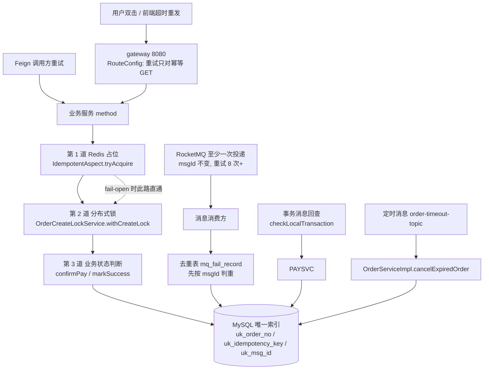
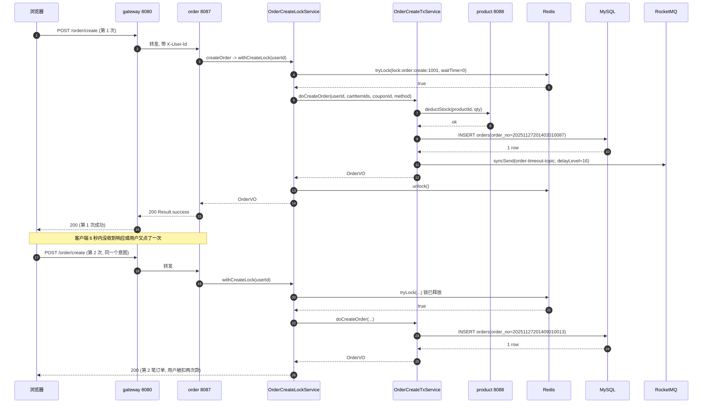

# 14-分布式幂等设计：重试是常态，幂等是正确性前提

> **一句话结论**：分布式系统里"同一个请求被送达两次"不是异常而是常态（用户双击、Feign 重试、MQ 至少一次投递、事务消息回查、定时消息重复触发），因此幂等的落脚点只能是**库里一条带唯一约束的状态**；Redis 占位、分布式锁、`@Idempotent` 注解都只能挡住"重复请求进来"，挡不住"重复已经发生"这个事实。
> **阅读前置**：会写 Spring Boot 的 CRUD 与 `@Transactional`；知道 Redis 的 `SET NX` 语义；手里有本项目 `ai-cs-order` / `ai-cs-pay` / `ai-cs-mq` 的代码。若对 AOP 拦截器链与事务拦截器没有概念，先读 [`03-拦截器链-调用与通知顺序`](../24-源码分析/01-Spring框架/02-AOP与代理/03-拦截器链-调用与通知顺序.md) 与 [`01-transactional-事务拦截器与传播行为`](../24-源码分析/01-Spring框架/03-事务管理/01-transactional-事务拦截器与传播行为.md)。
> **证据基线**：JDK 17.0.19 / Spring Framework 7.1.0 / Spring Boot 4.2.0 / Spring Cloud 2026.0.0（子项目 5.1.0）/ Spring Cloud Alibaba 2025.1.0.0 / RocketMQ 5.1 / Redis 7.x；A 级源码摘录取自 `24-源码分析/assets/source/`（本库共 905 份摘录），B 级为本仓库 `ai-cs-*` 真实代码（行号当次核对），C 级为本机可复现命令输出。预计阅读 40~50 分钟。

---

## 0. 先看现象

幂等问题在线上很少以"重复了"的样子出现，它通常伪装成"数据不对""通知发了两条""用户说点了没反应但其实成功了"。下面三个症状都来自本项目代码里真实存在的路径。

### 现象 1：用户连点两次，生成两笔订单

下单入口 `POST /order/create` 没有任何"请求身份"——既不要幂等 token，也不要求客户端带请求号：

```java
// ai-cs-order/src/main/java/com/aics/order/controller/OrderController.java#L26-L32
@Operation(summary = "提交订单")
@PostMapping("/create")
public Result<OrderVO> createOrder(@RequestHeader("X-User-Id") Long userId,
                                   @Valid @RequestBody OrderCreateDTO dto) {
    OrderVO vo = orderService.createOrder(userId, dto.getCartItemIds(), dto.getCouponId(), dto.getPaymentMethod());
    return Result.success("下单成功", vo);
}
```

它确实"防了重"——但防的是**并发**，不是**重复**。真正的防重手段是一把用户级 Redisson 锁，`waitTime=0`，抢不到就 429：

```java
// ai-cs-order/src/main/java/com/aics/order/lock/OrderCreateLockService.java#L44-L63
public <T> T withCreateLock(Long userId, Supplier<T> action) {
    RLock lock = redissonClient.getLock(KEY_PREFIX + userId);
    boolean acquired = false;
    try {
        acquired = lock.tryLock(0, TimeUnit.SECONDS);
        if (!acquired) {
            log.warn("下单防重锁竞争失败: userId={}", userId);
            throw new BusinessException(ResultCode.TOO_MANY_REQUESTS, "您有订单正在创建中，请勿重复提交");
        }
        return action.get();
    } catch (InterruptedException e) {
        Thread.currentThread().interrupt();
        throw new BusinessException(ResultCode.INTERNAL_ERROR, "下单操作被中断");
    } finally {
        if (acquired && lock.isHeldByCurrentThread()) {
            lock.unlock();
        }
    }
}
```

两笔订单出现的**典型时间线**是这样的（日志可在 order 服务 8087 上直接 grep 到）：

```text
20:14:03.120  下单防重锁竞争失败: userId=1001          <- 第二次点击被挡
20:14:03.118  订单创建成功: orderNo=20251127201403010087, userId=1001, payAmount=199.00
20:14:09.550  订单创建成功: orderNo=20251127201409010012, userId=1001, payAmount=199.00
20:14:09.551  订单创建成功: orderNo=20251127201409010013, userId=1001, payAmount=199.00   <- 浏览器超时重发，锁已释放
```

关键点：`finally` 里 `unlock()` 一执行，锁就没了。用户在 6 秒后刷新/重发（或者前端 fetch 超时自动重试、或者网关重试），此时**没有任何并发**，锁必然能拿到，于是老老实实创建第二笔。`orders` 表的 `uk_order_no` 也拦不住——两次生成的 `order_no` 不一样（`generateOrderNo()` = 时间戳 + 实例序号），唯一键对"两笔不同的订单"完全无话可说。

### 现象 2：支付回调重投，同一笔订单发两条"支付成功"通知

`pay` 服务用事务消息把支付结果投给 `order`，消费组明确写了 `maxReconsumeTimes = 8`，也就是"允许投 8 次以上"。而 `confirmPay` 的幂等判断是**读-判-写**三步，不是原子的：

```java
// ai-cs-order/src/main/java/com/aics/order/service/impl/OrderServiceImpl.java#L117-L129
public void confirmPay(String orderNo, String paymentMethod, BigDecimal amount, String tradeNo) {
    Order order = orderMapper.selectOne(
            new LambdaQueryWrapper<Order>().eq(Order::getOrderNo, orderNo));
    if (order == null) {
        log.warn("支付确认订单不存在: orderNo={}", orderNo);
        return;
    }

    // 状态机是迁移唯一入口：PAID 回调仍幂等，其他非法态忽略。
    if (OrderStatus.PAID.getCode().equals(order.getStatus())) {
        log.info("订单已支付，忽略重复确认: orderNo={}", orderNo);
        return;
    }
```

两条回调**交错执行**时是完全合法的：A 读到 `PENDING_PAY`，B 也读到 `PENDING_PAY`，两者都通过了 L126 的判断，各自 `updateById`（幂等，值一样）并各自 `publishEvent(new OrderPaidEvent(...))`（不幂等，副作用翻倍）。线上表现是用户收到两条"支付成功"推送、库存被回补两次、优惠券核销两条流水。同一结构的副作用如果换成积分、返现、计费这类**累加型**操作，就是"加两次分"——本项目当前没有积分模块，但凡是"读到旧值再写新值"的路径都有同一个窗口。

### 现象 3：幂等拒绝了，客户端却当成成功；幂等锁超时了，第二次请求反而被放行

项目的 `@Idempotent` 组件拒绝重复请求时抛 `IdempotentRejectException`，最终落到统一异常处理器：

```java
// ai-cs-common/src/main/java/com/aics/common/exception/GlobalExceptionHandler.java#L35-L39
@ExceptionHandler(BusinessException.class)
public Result<Void> handleBusinessException(BusinessException e, HttpServletRequest request) {
    log.warn("业务异常 [{}] {}: code={}, msg={}", request.getMethod(), request.getRequestURI(), e.getCode(), e.getMessage());
    return Result.fail(e.getCode(), e.getMessage());
}
```

这里**没有 `@ResponseStatus`**。所以幂等拒绝的响应是 **HTTP 200 + body `{"code":409,"message":"重复请求，请勿重复提交"}`**，不是一个 409 状态码。只要客户端或调用方（含 Feign 默认解码、含前端 axios 只看 `res.status`）按 HTTP 状态判成败，这次"被拒绝"就会被当成"成功"——用户看到"提交成功"其实什么也没做。日志侧只有一行：

```text
业务异常 [POST] /order/create: code=409, msg=重复请求，请勿重复提交
```

另一半是 TTL。`@Idempotent` 的占位 key 是 `SET NX EX ttlSeconds`（默认 300 秒），业务执行超过 TTL 后 key 自然过期，此时**迟到的重试会重新占位成功**，与第一次请求并发执行；更糟的是 Redis 抖一下，切面会 `fail-open` 直接放行：

```java
// ai-cs-common/src/main/java/com/aics/common/idempotent/IdempotentAspect.java#L60-L65
private boolean tryAcquire(String redisKey, Duration ttl, Object target) {
    try {
        Boolean ok = ops.setIfAbsent(redisKey, TOKEN, ttl);
        return Boolean.TRUE.equals(ok);
    } catch (RuntimeException ex) {
        log.warn("幂等组件 Redis 异常，fail-open 放行 key={}", redisKey, ex);
        return true;
    }
}
```

（上面这段为可读性做了抽方法处理，原始文件里它是 `around` 方法内的 L60-L65 内联 try/catch。）

这些现象指向同一件事：**"重复请求"不等于"重复执行"，能否幂等只取决于三件事——幂等键是否唯一标识"同一个意图"、判重与写入是否原子、去重记录是否与业务数据同生共死。** 缺任何一条，防重就只是概率。

---

## 1. 整体地图



| 组件 | 责任 | 谁调用它 |
| --- | --- | --- |
| `IdempotentAspect`（`ai-cs-common`） | 用 Redis `SET NX EX` 做"首次占位"，TTL 内重复直接拒绝 | 任何被 `@Idempotent` 标注的方法（**当前接入点为 0，见 §6**） |
| `IdempotentAutoConfiguration` | 条件装配切面：`@ConditionalOnClass(StringRedisTemplate.class)` + `aics.idempotent.enabled` | Spring Boot 自动配置 |
| `OrderCreateLockService`（order） | 用户级 Redisson 互斥锁，`waitTime=0` 快速失败 | `OrderServiceImpl.createOrder` |
| `OrderCreateTxService`（order） | `@GlobalTransactional` 下单事务边界（Seata AT） | `OrderServiceImpl.createOrder` |
| `OrderServiceImpl.confirmPay` | 支付回调落地：状态判断 + 金额校验 + 发领域事件 | `PaySuccessListener`、pay 服务回调 |
| `PayTransactionServiceImpl`（pay） | 支付流水状态机落库，`markSuccess` 天然幂等返回 `false` | `PaySuccessTransactionListener`、pay 内部 |
| `PaySuccessTransactionListener`（pay） | 事务消息本地事务执行 + **回查**（用落库状态二次判定） | RocketMQ Broker |
| `WorkOrderDlqListener`（mq） | 死信落库前按 `msg_id` 查重（去重表） | RocketMQ 死信主题 |
| `AfterSaleServiceImpl`（order） | 售后申请按 `idempotency_key` 先查后插，撞唯一键兜底 | `CreateAfterSaleTool`（Agent 工具） |
| `orders` / `after_sale_application` / `mq_fail_record` 表 | 唯一约束终审：`uk_order_no`、`uk_idempotency_key`、`uk_msg_id` | MySQL |

> **读图说明**：
> - 图里有三条**互相不通**的入口：HTTP（左）、MQ（右上）、定时/回查（右下）。**幂等键必须在这三条入口上都成立**——只在 HTTP 入口加了 `@Idempotent`，MQ 重投照样重复执行，这是最容易看错的箭头。
> - 从 `L1` 到 `L2` 的虚线标注了 `fail-open`：Redis 异常时 `IdempotentAspect` 直接放行，第二道锁才是真正的并发闸门。若你把 L1 当成"必有的一道墙"，就会得出"加了注解就幂等"的错误结论。
> - `DB` 是唯一一个**同时被四支箭头指向**的节点，它才是权威。L1/L2/L3 全是"降低无效执行"的优化，删掉它们系统仍然正确，只是更慢、更容易打日志；删掉 `DB` 的唯一约束，系统立刻不幂等。
> - `PaySuccessTransactionListener` 与 `PayTransactionServiceImpl` 之间是"同一份状态被读两次"的关系：一次在本地事务里写，一次在回查里读。这张图里没有"回查会与本地事务并发"这条边——它是隐含的，也是 §3.5 那个窗口的来源。
> - `OrderCreateLockService` 与 `OrderServiceImpl` 是"锁在事务外层"的顺序：先拿锁，再进 `@GlobalTransactional`。看反了（以为锁包住了整个事务）就会误以为 Redis 挂掉时会话不会重复下单。

---

## 2. 关键概念与关键类

先把术语钉死，后文不再解释：

- **幂等（idempotent）**：同一操作执行一次和执行 N 次，对外可观察的结果相同。注意"结果相同"不等于"什么都没干"——**返回首次结果**也是幂等。
- **幂等键（idempotency key）**：标识"同一个意图"的字符串。它必须由**业务语义**决定，不能由服务端随机生成。
- **去重表（dedup table）**：把"这个 key 处理过"这个事实落库的表，通常只有一个唯一索引 + 结果引用。
- **原子占位**：`SET key 1 NX EX 300` 或 `INSERT ... 唯一键`，把"判断是否已存在"和"写入我的存在"合成一步。
- **状态机条件更新**：把幂等表达成 `UPDATE ... WHERE status = '旧值'`，影响行数为 0 即"别人已经推进过"。
- **token 预取**：服务端先发一个一次性 token，客户端提交时带上，服务端消费该 token——把"重复"从"重复执行"变成"重复被拒"。
- **fail-open / fail-close**：依赖组件（这里是 Redis）故障时，幂等组件选择"放行"还是"拒绝"。放行=可用性优先，拒绝=正确性优先。

| 名称 | 位置 | 角色 | 关键方法/字段 |
| --- | --- | --- | --- |
| `Idempotent` | `ai-cs-common/src/main/java/com/aics/common/idempotent/Idempotent.java` | 幂等注解，声明 key 的 SpEL 与 TTL | `key()`、`ttlSeconds()` 默认 300、`message()` |
| `IdempotentAspect` | 同目录 `IdempotentAspect.java` | `@Around("@annotation(idempotent)")` 执行器 | `around`、`tryAcquire`（L60-L65）、`tryRelease`（L77-L84）、`resolveKey`（L86-L102） |
| `IdempotentProperties` | 同目录 `IdempotentProperties.java` | 配置：`aics.idempotent.enabled`、`key-prefix` | `enabled=true`、`keyPrefix="aics:idem:"` |
| `IdempotentAutoConfiguration` | 同目录 `IdempotentAutoConfiguration.java` | 自动装配切面 Bean | `idempotentAspect(StringRedisTemplate, IdempotentProperties)` |
| `IdempotentRejectException` | 同目录 `IdempotentRejectException.java` | 重复请求异常，错误码 409 | `super(ResultCode.DUPLICATE_REQUEST, message)` |
| `OrderCreateLockService` | `ai-cs-order/src/main/java/com/aics/order/lock/OrderCreateLockService.java` | 用户级下单互斥锁 | `withCreateLock`、`KEY_PREFIX="lock:order:create:"` |
| `OrderCreateTxService` | `ai-cs-order/src/main/java/com/aics/order/service/impl/OrderCreateTxService.java` | 下单事务边界（Seata AT）+ 延迟消息 | `doCreateOrder`、`generateOrderNo` |
| `OrderServiceImpl` | `ai-cs-order/src/main/java/com/aics/order/service/impl/OrderServiceImpl.java` | 订单状态迁移入口 | `confirmPay`、`cancelExpiredOrder`、`cancelOrder` |
| `OrderStateTransitionService` | `ai-cs-order/src/main/java/com/aics/order/statemachine/OrderStateTransitionService.java` | 状态机唯一入口，非法迁移抛 `BusinessException` | `transit(currentStatus, event)` |
| `PayTransactionServiceImpl` | `ai-cs-pay/src/main/java/com/aics/pay/service/impl/PayTransactionServiceImpl.java` | 支付流水状态机 | `markSuccess`（返回 `false` 表示幂等命中）、`createOrUpdatePending` |
| `PaySuccessTransactionListener` | `ai-cs-pay/src/main/java/com/aics/pay/mq/PaySuccessTransactionListener.java` | 事务消息本地事务 + 回查 | `executeLocalTransaction`、`checkLocalTransaction` |
| `WorkOrderDlqListener` | `ai-cs-mq/src/main/java/com/aics/mq/consumer/WorkOrderDlqListener.java` | 死信落库去重表 | `onMessage(MessageExt)`、按 `msgId` `selectCount` |
| `AfterSaleServiceImpl` | `ai-cs-order/src/main/java/com/aics/order/service/impl/AfterSaleServiceImpl.java` | 按 `idempotency_key` 先查后插 | `createApplication` |
| `LlmTrace` | `ai-cs-message/src/main/java/com/aics/message/entity/LlmTrace.java` | 用业务键当主键的范例 | `@TableId(type = IdType.INPUT) requestId` |
| `PlanExecution`/`agent_step` 表 | `deploy/mysql/after-sales-agent-init.sql` | 组合唯一键范例 | `uk_run_step (run_id, step_no)` |

---

## 3. 原理与证据逐段精读

### 3.1 幂等键怎么设计：业务唯一键、请求号、还是组合

**在干什么。** 项目里同时存在四种键，它们回答的是不同的问题：

| 键 | 项目实例 | 唯一标识什么 | 重复提交时能否识别 |
| --- | --- | --- | --- |
| 业务唯一键 | `after_sale_application.application_no`、`orders.order_no` | 一条记录 | 不能——每次生成新值，天然不重复 |
| 请求号（客户端生成） | `after_sale_application.idempotency_key = runId + ":" + action` | 一次用户意图 | 能，前提是客户端/上游真的复用同一个值 |
| 组合唯一键 | `uk_run_step (run_id, step_no)`、`uk_user_product (user_id, product_id)` | 一组维度的组合 | 能，且能挡住"维度冲突" |
| 平台消息 ID | `mq_fail_record.msg_id`（RocketMQ `msgId`） | 一条消息 | 能，但**只对同一份重投有效**，换生产者重发就失效 |

`AfterSaleServiceImpl` 是"请求号"的标准写法——先查后插，查到了就当场返回首次结果：

```java
// ai-cs-order/src/main/java/com/aics/order/service/impl/AfterSaleServiceImpl.java#L58-L64
AfterSaleApplication existing = afterSaleApplicationMapper.selectOne(
        new LambdaQueryWrapper<AfterSaleApplication>()
                .eq(AfterSaleApplication::getIdempotencyKey, dto.getIdempotencyKey()));
if (existing != null) {
    log.info("幂等命中售后申请，直接返回: idempotencyKey={}, applicationNo={}",
            dto.getIdempotencyKey(), existing.getApplicationNo());
    return toVO(existing);
}
```

而这个 key 是 Agent 工具侧拼出来的，语义非常清楚：

```java
// ai-cs-chat/src/main/java/com/aics/chat/agent/tool/CreateAfterSaleTool.java#L62-L65
dto.setRunId(runId);
dto.setIdempotencyKey(runId + ":" + plan.actionType().getCode());
```

**为什么这么设计。** `runId` 是一次 Agent 执行的 ID，`actionType` 是动作类型。两者拼起来恰好等于"这次对话里这个动作"。模型重试工具调用、Feign 超时重发、用户点两次"确认"，拿到的 `idempotencyKey` 完全一样 → 必然命中。若换成服务端生成 UUID，每次都是新 key，这个机制等于不存在。

**换写法会怎样。** 若用业务唯一键当幂等键（例如拿 `orderNo` 当 key），它每次都是新的，幂等永远不命中——这就是"业务唯一键 ≠ 幂等键"的分水岭，`orders` 表 `uk_order_no` 只能防"订单号被写重"，防不了"下两单"。若只用请求号不通业务（比如 `userId + cartItemIds` 哈希），则"用户想连续下两笔一模一样的单"会被误判成重复——这是另一种错误。

**常见坑。**
- 请求号必须由**上游**生成并透传。前端每次点击重新 `uuid()` 一次，等于没做。本项目 `CreateAfterSaleTool` 用 `runId` 就绕开了这个坑（`runId` 由 Agent 编排层生成、跨重试不变）。
- 组合键的字段顺序要想清楚：`uk_run_step (run_id, step_no)` 表达"这次执行的第 N 步只能有一条"，如果写成 `(step_no, run_id)` 语义相同但索引选择性不同，`run_id` 放左缀更利于按执行查。
- 别把"用户 ID"当成幂等键的一部分却不校验归属：`uk_user_product` 能防同一用户重复加购，但它同时对"同一商品"做了强制约束——加购两次应该合并数量，而不是报唯一键冲突。唯一约束是**语义决定**，选它之前先确认业务真的接受"第二次写失败"。
- 消息的 `msgId` 与业务键**不是二选一**：`mq_fail_record` 同时存 `msg_id`（唯一键）和 `biz_key`（普通索引），前者判"这条消息处理过没"，后者支持"按工单号查历史"。详见 §3.8。

### 3.2 方式一·唯一索引：最后一道，也是最硬的一道

**在干什么。** `orders` 表把 `order_no` 设成唯一键，`after_sale_application` 把 `idempotency_key` 设成唯一键：

```sql
-- deploy/mysql/order-init.sql#L24-L46
CREATE TABLE IF NOT EXISTS `orders` (
    `id` BIGINT NOT NULL AUTO_INCREMENT COMMENT '主键',
    `order_no` VARCHAR(32) NOT NULL COMMENT '订单编号',
    ...
    PRIMARY KEY (`id`),
    UNIQUE KEY `uk_order_no` (`order_no`),
    ...
) ENGINE=InnoDB DEFAULT CHARSET=utf8mb4 COLLATE=utf8mb4_general_ci COMMENT='订单表';
```

```sql
-- deploy/mysql/order-init.sql#L94-L117
CREATE TABLE IF NOT EXISTS after_sale_application (
    `application_no` VARCHAR(32) NOT NULL COMMENT '申请单号（AS+时间戳+序号）',
    `run_id` VARCHAR(64) DEFAULT NULL COMMENT 'Agent执行ID（来源可追溯）',
    `idempotency_key` VARCHAR(64) NOT NULL COMMENT '幂等键（runId+action），重复提交返回首次结果',
    ...
    PRIMARY KEY (`id`),
    UNIQUE KEY `uk_idempotency_key` (`idempotency_key`),
    UNIQUE KEY `uk_application_no` (`application_no`),
    ...
) ENGINE=InnoDB DEFAULT CHARSET=utf8mb4 COLLATE=utf8mb4_general_ci COMMENT='售后申请表';
```

**为什么这么设计。** 唯一索引是唯一一个**数据库层面原子**的判重：两个事务同时 `INSERT` 同一个 key，InnoDB 会让其中一个报 `Duplicate entry` 并回滚，无论应用有几个实例、有没有 Redis、GC 停了多久。它的成本也最低——索引是 B+ 树的一次定位。

**换写法会怎样。** 换成"应用层先 `selectOne` 再 `insert`"，就是经典的先判后写（check-then-act）：两个请求都在 `selectOne` 里看到 null，都认为可以插。本项目 `AfterSaleServiceImpl` 正是这个写法，所以它必须依赖 `uk_idempotency_key` 兜底——**先查是为了返回首次结果（体验），唯一键才是正确性（语义）**。如果 DDL 里漏了这个唯一键，`AfterSaleServiceImpl` 的注释"重复提交返回首次结果"就成了空话，并发下会插两条。

**常见坑。**
- **唯一键会把"幂等"错报成 500。** `uk_order_no` 撞了以后，MyBatis-Plus `insert` 抛 `DuplicateKeyException`，落到 `GlobalExceptionHandler` 的兜底分支变成 `{"code":500,"message":"系统内部错误"}`。正确做法是 catch 唯一键冲突后**查回来返回首次结果**，而不是把异常抛上去。本项目 `AfterSaleServiceImpl` 的 `insert` 失败（`rows <= 0`）直接抛 `AFTER_SALE_CREATE_FAIL`，属于这一类待改进点。
- **唯一键的粒度决定语义。** `orders` 上只有 `uk_order_no`，没有 `uk_user_intent`，所以它对"重复下单"零防御。想防就得引入请求号列 + 唯一键（例如 `uk_user_request (user_id, request_id)`），这是 §9 练习 1 的内容。
- **生成 `order_no` 的算法本身可能撞键。** `generateOrderNo()` 是"时间戳 + `01` + 实例内自增序号 `%10000`"，多实例部署时两个实例可能在同一秒产出相同序号；同一实例一秒内超过 10000 单也会回绕。撞键后表现为偶发 500，而不是重复下单——**症状和幂等失败长得完全不一样，排查时别混**。

### 3.3 方式二·去重表：先写后判 vs 先判后写，以及那条并发窗口

**在干什么。** `mq` 服务给死信消息建了一张专门的去重表 `mq_fail_record`，`msg_id` 唯一：

```sql
-- deploy/mysql/mq-workorder-init.sql#L27-L42
CREATE TABLE IF NOT EXISTS `mq_fail_record` (
    `msg_id` VARCHAR(64) NOT NULL COMMENT 'RocketMQ 消息ID',
    ...
    `biz_key` VARCHAR(64) DEFAULT NULL COMMENT '业务键（如工单号）',
    `status` VARCHAR(20) NOT NULL DEFAULT 'PENDING' COMMENT 'PENDING/REPUSHED',
    ...
    UNIQUE KEY `uk_msg_id` (`msg_id`),
    KEY `idx_biz_key` (`biz_key`)
) ENGINE=InnoDB DEFAULT CHARSET=utf8mb4 COLLATE=utf8mb4_general_ci COMMENT='MQ 消费失败记录';
```

消费者用的是"先判后写"：

```java
// ai-cs-mq/src/main/java/com/aics/mq/consumer/WorkOrderDlqListener.java#L44-L56
@Override
public void onMessage(MessageExt message) {
    WorkOrderMessage payload = parsePayload(message);
    ...
    Long count = mqFailRecordMapper.selectCount(
            new LambdaQueryWrapper<MqFailRecord>()
                    .eq(MqFailRecord::getMsgId, message.getMsgId()));
    if (count != null && count > 0) {
        log.warn("死信消息已落库，跳过: msgId={}", message.getMsgId());
        return;
    }
```

**为什么这么设计。** 去重表的好处是**留痕**：失败消息的 topic、业务键、重试次数、失败原因都成了可查数据，重推脚本能按 `status=PENDING` 捞出来。相比 Redis 占位（key 到期就没了），它永久可审计。而"先判后写"在这里是合理的，因为**兜底有唯一键**——两个消费者同时进入，一个 `insert` 成功，另一个抛 `DuplicateKeyException`，`uk_msg_id` 保证最多一条。

**换写法会怎样。** 如果不写 `selectCount`、直接靠唯一键"试插"，代码更短也更安全（少一次查询、没有窗口）：

```text
try { insert(record); } catch (DuplicateKeyException e) { log.warn("已处理过"); }
```

反过来，如果**只写 `selectCount` 而不建 `uk_msg_id`**，就退化成纯 check-then-act，重投并发时插两条——`ChatMessageConsumer` 就是"连判断都没有"的极端版本，它的类注释老实写着"实现幂等消费需业务方自行保证"。

**两种时序的本质区别**，用 8 个真实线程并发验证（C 级实测，见下）：

- **先判后写**：判定与写入之间有一个时间窗口，窗口内的并发全部"漏"过去。
- **先写后判**（原子占位）：写入动作本身携带"是否已存在"的答案，没有窗口。

```text
A 先查后写（无约束）    : 8 线程并发，"已存在"判定后写入 -> 落库行数 = 8
B 原子占位（SET NX/唯一）: 8 线程并发，占位成功者才写   -> 落库行数 = 1
```

> **怎么读这条输出**：A 走的是"读共享变量 → 忙等 20ms 模拟业务处理 → 写"三步，8 个线程全部在读的那一步看到 0，于是全部写入，得到 8 行——这就是 `selectCount` 之后再 `insert` 的真实命运。B 把"读+写"换成一次 `Atomics.compareExchange(shared, 0, 0, 1)`，等价于 `SET key 1 NX`，只有一个线程拿到 `prev === 0`，其余全部判重成功，落库 1 行。复现命令：`node C:\Users\16680\AppData\Local\Temp\idem-race.mjs`（8 个 worker_threads + Atomics 起跑线，与 Redis/MySQL 的原子语义同构，只是把"库"换成了共享内存）。

**常见坑。**
- 去重表的 `status` 一定要参与设计：`PENDING/REPUSHED` 意味着"这条消息被处理过但还没重推成功"，重推脚本必须按状态过滤，否则会把已重推的消息再推一遍。
- 去重表别和业务表放在不同事务里（§3.7）。`WorkOrderDlqListener` 先插 `mq_fail_record` 再更新 `work_order` 为 FAILED，两步不在同一事务，异常时会出现"记录有、工单没标"。这是可接受的（记录本身就是证据），但要知道它不原子。
- 去重表的保留期是运维问题：`msg_id` 唯一键永远增长，需要定期归档；一旦归档掉了历史记录，很久之后的重投会被当成新消息处理——这就是"幂等窗口"应该写进 SLA 的原因。

### 3.4 方式三·Redis SETNX + 过期：`@Idempotent` 的真实语义

**在干什么。** 这是本项目唯一以"框架组件"形式存在的幂等能力。切面在方法执行前抢一个 key，抢到就放行，抢不到就抛 409；方法抛异常时**主动删 key**（让重试可以重来）：

```java
// ai-cs-common/src/main/java/com/aics/common/idempotent/IdempotentAspect.java#L49-L75
@Around("@annotation(idempotent)")
public Object around(ProceedingJoinPoint joinPoint, Idempotent idempotent) throws Throwable {
    String redisKey = properties.getKeyPrefix() + resolveKey(joinPoint, idempotent);
    Duration ttl = Duration.ofSeconds(idempotent.ttlSeconds());
    if (TransactionSynchronizationManager.isActualTransactionActive()) {
        log.debug("@Idempotent 占位在事务内不会随回滚自动释放: key={}", redisKey);
    }
    if (!tryAcquire(redisKey, ttl, joinPoint.getTarget())) {
        log.warn("幂等拦截重复请求: key={}", redisKey);
        throw new IdempotentRejectException(idempotent.message());
    }
    try {
        return joinPoint.proceed();
    } catch (Throwable t) {
        tryRelease(redisKey);
        throw t;
    }
}
```

（上段中 `tryAcquire` 是把原文件 L60-L65 的内联 try/catch 抽出来的等价写法，便于逐行讲解；`tryRelease` 即原文件 L77-L84。）

**为什么这么设计。** 三个决定都值得说清：

1. **`SET NX EX` 而不是 `SETNX` + `EXPIRE`**。两条命令之间进程挂掉就留下一个永不过期的 key，整个业务永久 409。`setIfAbsent(key, value, ttl)` 在 Spring Data Redis 里对应一条 `SET key val NX EX ttl`，原子。
2. **不让重复请求排队，而是立刻拒绝。** 排队意味着请求方要等 TTL（最长 300 秒）才能知道结果，超时时间根本对不上；快速失败 + 客户端提示"请勿重复提交"是唯一可解释的语义。
3. **异常时删 key**（fail-fast 让重试可用）：业务失败通常意味着"这次没做成"，应该允许调用方重试；如果不删，用户得等 5 分钟才能重试，运维会收到"点了没反应"的工单。

**换写法会怎样。**
- 若把 `tryRelease` 挪到 `finally`（无论成败都删），成功后的重复请求就会重新占位成功——幂等窗口从 300 秒缩到"方法执行时间"，双击仍可能漏。
- 若不删 key（纯 TTL），下游 `PayClient` 超时一次，用户在 300 秒内无法重试支付，体验灾难。
- 若把 TTL 设成 30 秒，长事务（Seata 全局事务、RAG 检索）会超时后 key 自动失效，迟到的重试重新占位 → §0 现象 3。
- 若不设 TTL（`setIfAbsent(key, val)` 无过期），第一次失败后 key 永久存在，业务永久被拒——这类线上事故每年都有。

**常见坑。**
- **key 前缀必须可辨识**：`aics:idem:` + SpEL 结果，`redis-cli --scan --pattern 'aics:idem:*'` 能一眼看出哪些业务在占位，别用裸 key。
- **value 固定为 `"1"` 是有意的**：不代表持有者身份，所以**不能做"删除时校验持有者"**。极端场景（业务执行超过 TTL、key 已过期又被别人抢占）下，旧请求的 `tryRelease` 会删掉新持有者的 key——这就是为什么 Redisson 那条路要 `isHeldByCurrentThread()`（§3.9）。
- **`fail-open` 是刻意的取舍**，注释写在 `Idempotent` 的 javadoc 里。它意味着 Redis 挂掉时幂等完全失效，此时的重复防护只剩 DB 唯一键。**如果你的唯一键没建，fail-open 就等于"没有幂等"**。

### 3.5 方式四·状态机条件更新：让"重复"变成"无操作"

**在干什么。** 项目里最普遍的幂等形态根本不是注解，而是"状态判断 + 状态机迁移"：

```java
// ai-cs-order/src/main/java/com/aics/order/service/impl/OrderServiceImpl.java#L166-L176
@Override
@Transactional(rollbackFor = Exception.class)
public void cancelExpiredOrder(String orderNo) {
    Order order = orderMapper.selectOne(
            new LambdaQueryWrapper<Order>().eq(Order::getOrderNo, orderNo));
    if (order == null || !OrderStatus.PENDING_PAY.getCode().equals(order.getStatus())) {
        return; // 已支付或已取消，忽略
    }
    doCancelOrder(order, OrderEvent.TIMEOUT);
    log.info("订单超时自动取消: orderNo={}", orderNo);
}
```

`pay` 侧的 `markSuccess` 更进一步，把"幂等命中"表达成**返回值**：

```java
// ai-cs-pay/src/main/java/com/aics/pay/service/impl/PayTransactionServiceImpl.java#L53-L70
public boolean markSuccess(String orderNo, String tradeNo, BigDecimal amount) {
    PayTransaction tx = getByOrderNo(orderNo);
    if (tx == null || STATUS_SUCCESS.equals(tx.getStatus())) {
        return false; // 幂等：已成功或不存在
    }
    ...
    tx.setStatus(STATUS_SUCCESS);
    tx.setTradeNo(tradeNo);
    tx.setNotifyCount(tx.getNotifyCount() == null ? 1 : tx.getNotifyCount() + 1);
    return updateById(tx);
}
```

**为什么这么设计。** 定时消息、支付回调、退款确认这些场景里，"重复"天然会到来（延迟消息重投、三方回调重试）。用状态做闸门有两个好处：**不需要额外的存储**（状态本来就在表里），**语义自解释**（`PENDING_PAY` → `PAID` 只能发生一次）。而且它天然是"业务幂等"而不是"请求幂等"——不管重复从哪条链路来，都过同一道闸。

**换写法会怎样。** 把 `if (PAID) return` 删掉，靠 `updateById` 的"写入相同值"来自我安慰——这在**副作用只有 UPDATE** 时确实幂等（同一行被更新为同一值），但本项目 `confirmPay` 在 UPDATE 之后还发了领域事件、清了购物车：

```java
// ai-cs-order/src/main/java/com/aics/order/service/impl/OrderServiceImpl.java#L145-L161
order.setPayTime(LocalDateTime.now());
orderMapper.updateById(order);

eventPublisher.publishEvent(new OrderPaidEvent(orderNo, order.getUserId()));

List<OrderItem> items = orderItemMapper.selectList(
        new LambdaQueryWrapper<OrderItem>().eq(OrderItem::getOrderNo, orderNo));
```

`publishEvent` 里面是"发通知、投 MQ"这类不可撤销动作。所以"重复 UPDATE 安全"是个危险的半真命题：**只要方法里有第二个副作用，状态判断就必须是显式的**。

**常见坑。**
- **读-判-写不是原子的。** `confirmPay` 在 L118 `selectOne` 读到 `PENDING_PAY`，到 L147 `updateById` 之间，另一条回调完全可以读到同样的旧值（§0 现象 2）。真正原子的是 `UPDATE orders SET status='PAID' WHERE order_no=? AND status='PENDING_PAY'`，看 `affectedRows`——本项目用的是"先查状态机算目标态、再整行 `updateById`"，没带 `WHERE status=旧值`，所以只有"串行执行时"才幂等。
- **状态机拒绝要能被区分。** `OrderStateTransitionService.transit` 收到非法迁移会抛 `BusinessException`，`confirmPay` 直接 catch 住并 `return`（当作"忽略"），这意味着**任何**非法迁移都会被静默吞掉，包括真 bug 导致的非法态。排查时若看到"支付回调来了但订单没变"，要去 `transit` 里下断点，而不是怀疑 MQ。
- **`cancelExpiredOrder` 的幂等依赖"订单存在"**。`OrderCreateTxService` 的注释点明了这层巧思：MQ 不是 Seata 资源，全局事务回滚时延迟消息可能已经发出去了，消费侧查不到订单就直接 `return`，于是"多发的消息"天然安全。

### 3.6 方式五·token 预取：把重复挡在"点第二次"之前

**在干什么。** token 预取是"两次 HTTP 请求"的幂等：`GET /order/token` 拿到一次性 token，`POST /order/create` 带上它，服务端用 `DEL token` 的返回值判成败（返回 1 = 第一次，0 = 重放）。本项目**没有实现**这条链路——`OrderController` 的 `createOrder` 只接 `X-User-Id` 与 body，没有 token 头（见 §0 现象 1 的代码）。

**为什么这么设计（它解决的问题）。** 请求号方案要求客户端"自己保证复用同一个号"，前端换个页面、刷新一次、重发一次，号就变了。token 预取把"唯一性"交给服务端签发，并且**一次性消费**——重放时 token 已被删，必然被拒。它还能携带过期时间，天然有"幂等窗口"。

**换写法会怎样。** 用"请求号 + 唯一索引"能达到同样效果，但要求客户端持久化请求号（localStorage/内存）；用 token 则把状态放在服务端。反过来，如果 token 不做**一次性消费**（只校验存在不删除），重放全部通过，等于白做；如果 token 存 Redis 却不设 TTL，未使用的 token 永久堆积。

**常见坑。**
- token 必须与用户绑定并校验归属，否则 A 拿到 B 的 token 能替 B 下单。
- 前端要处理"token 过期"这条分支（返回 410 或专门的错误码让页面重新取 token），否则用户看到的是莫名的 500。
- 组合推荐：`token 预取（挡重复点击） + @Idempotent（挡短时间重放） + 唯一索引（兜住一切）`，本项目当前只有第二个（且未接入）和第三个（部分表）。

### 3.7 幂等与事务的边界：key 的生死和数据的生死不在一个世界

**在干什么。** `IdempotentAspect` 检测到自己跑在事务里，只打一行 debug 日志：

```java
// ai-cs-common/src/main/java/com/aics/common/idempotent/IdempotentAspect.java#L51-L54
if (TransactionSynchronizationManager.isActualTransactionActive()) {
    log.debug("@Idempotent 占位在事务内不会随回滚自动释放: key={}", redisKey);
}
```

这个判断的语义来自 Spring 自己的实现——它就是一个与当前线程绑定的 `ThreadLocal`：

```java
// src: TransactionSynchronizationManager.java.md#L499-L501
public static boolean isActualTransactionActive() {
    return (actualTransactionActive.get() != null);
}
```

**为什么这么设计。** 因为事务的提交/回滚发生在**事务拦截器内部**，而不是在切面返回时：

```java
// src: TransactionAspectSupport.java.md#L333-L339
protected @Nullable Object invokeWithinTransaction(Method method, @Nullable Class<?> targetClass,
        final InvocationCallback invocation) throws Throwable {

    // If the transaction attribute is null, the method is non-transactional.
    TransactionAttributeSource tas = getTransactionAttributeSource();
    final TransactionAttribute txAttr = (tas != null ? tas.getTransactionAttribute(method, targetClass) : null);
    final TransactionManager tm = determineTransactionManager(txAttr, targetClass);
```

同一个方法里，失败走 `completeTransactionAfterThrowing(txInfo, invocation, ex)`（L375），成功走 `commitTransactionAfterReturning(txInfo)`（L408）。而 `@Around` 切面的 `joinPoint.proceed()` 只是**继续走拦截器链**：

```java
// src: ReflectiveMethodInvocation.java.md#L154-L181
public @Nullable Object proceed() throws Throwable {
    // We start with an index of -1 and increment early.
    if (this.currentInterceptorIndex == this.interceptorsAndDynamicMethodMatchers.size() - 1) {
        return invokeJoinpoint();
    }

    Object interceptorOrInterceptionAdvice =
            this.interceptorsAndDynamicMethodMatchers.get(++this.currentInterceptorIndex);
    if (interceptorOrInterceptionAdvice instanceof InterceptorAndDynamicMethodMatcher dm) {
        // Evaluate dynamic method matcher here: static part will already have
        // been evaluated and found to match.
        Class<?> targetClass = (this.targetClass != null ? this.targetClass : this.method.getDeclaringClass());
        if (dm.matcher().matches(this.method, targetClass, this.arguments)) {
            return dm.interceptor().invoke(this);
        }
        else {
            // Dynamic matching failed.
            // Skip this interceptor and invoke the next in the chain.
            return proceed();
        }
    }
    else {
        // It's an interceptor, so we just invoke it: The pointcut will have
        // been evaluated statically before this object was constructed.
        return ((MethodInterceptor) interceptorOrInterceptionAdvice).invoke(this);
    }
}
```

**换写法会怎样。** 这里有个**必须想清楚的问题**：对同一个方法，`@Idempotent` 切面与事务拦截器谁在外层？答案取决于 advisor 的排序（`@Order` / `Ordered`），`ReflectiveMethodInvocation` 里那条 `interceptorsAndDynamicMethodMatchers` 链是按 advisor 顺序排好的。两种排法后果完全不同：

| 顺序 | 事务回滚时 key 会怎样 | 后果 |
| --- | --- | --- |
| 事务在外、幂等在内 | 事务回滚了，但 `around` 的 catch 已经执行过 `tryRelease` | **key 已释放，重试可用**（当前实现的意图） |
| 幂等在外、事务在内 | `proceed()` 抛异常 → `tryRelease` 执行 → 上抛 → 事务拦截器再回滚 | 也能释放，但释放时机在事务回滚**之前**，中间有窗口 |
| 异常被事务拦截器吞掉（编程式回滚 `setRollbackOnly`） | 方法正常返回，`catch` 没进 | **key 保留 300 秒**，用户被误判为重复 |

第三行是最阴的坑：`TransactionAspectSupport` 里"标记回滚但仍返回"的路径不会抛异常，切面看不到失败，`tryRelease` 不执行。

**正确做法**是把 key 的释放挂到事务生命周期上——`TransactionSynchronizationManager.registerSynchronization(...)`，在 `afterCompletion(status)` 里区分 `STATUS_COMMITTED`（保留 key，防止重复提交）/ `STATUS_ROLLED_BACK`（删 key，允许重试）。本项目当前**没有**这一步，只在 L51-L54 打了日志。这也是"去重记录必须与业务同事务落库"的另一面：**用表做去重能自动获得事务语义，用 Redis 做去重必须手工补**。

**常见坑。**
- 事务内的占位 key 在回滚后残留 300 秒（本项目现状）——表现为"业务失败了，但用户 5 分钟内不能重试"，且日志里只有一行 debug，极易被忽略。
- 反过来，如果为了避免残留而在 `finally` 无条件删 key，成功之后的重复请求就会再执行一遍——两个错误方向相反。
- 幂等 key 若在 controller 层（事务外）占位，业务事务回滚后 key 仍在；若在 service 层（事务内）占位，则出现上面的残留问题。**没有免费的午餐，必须显式选。**

### 3.8 消息消费幂等：`msgId`、业务键与"已处理"语义

**在干什么。** 项目里五个消费端，幂等强度差别很大：

| 消费端 | 幂等依据 | 代码位置 | 强度 |
| --- | --- | --- | --- |
| `WorkOrderDlqListener` | `msgId` 查重 + `uk_msg_id` 唯一键 | `ai-cs-mq/src/main/java/com/aics/mq/consumer/WorkOrderDlqListener.java` | 强（有唯一键兜底） |
| `PaySuccessListener` → `confirmPay` | 订单状态（`PAID` 直接 return） | `ai-cs-order/src/main/java/com/aics/order/service/impl/OrderServiceImpl.java` | 中（读-判-写有窗口） |
| `OrderTimeoutListener` → `cancelExpiredOrder` | 订单状态（非 `PENDING_PAY` 直接 return） | 同上 | 中 |
| `ChatMessageConsumer` | **无**，注释明示"需业务方自行保证" | `ai-cs-message/src/main/java/com/aics/message/consumer/ChatMessageConsumer.java` | 无 |
| `ProductCdcConsumer`（search） | ES `document id = product.id`，重放即覆盖 | `ai-cs-search/src/main/java/com/aics/search/cdc/ProductCdcConsumer.java` | 强（upsert 天然幂等） |

事务消息的回查端也把它写得很清楚——**回查必须幂等，且以落库状态为唯一权威**：

```java
// ai-cs-pay/src/main/java/com/aics/pay/mq/PaySuccessTransactionListener.java#L55-L68
@Override
public RocketMQLocalTransactionState checkLocalTransaction(Message msg) {
    PaySuccessMessage payload = (PaySuccessMessage) msg.getPayload();
    PayTransaction tx = payTransactionService.getByOrderNo(payload.getOrderNo());
    if (tx == null) {
        log.warn("回查未找到支付流水，回滚半消息: orderNo={}", payload.getOrderNo());
        return RocketMQLocalTransactionState.ROLLBACK;
    }
    return switch (tx.getStatus()) {
        case "SUCCESS" -> RocketMQLocalTransactionState.COMMIT;
        case "PENDING" -> RocketMQLocalTransactionState.UNKNOWN; // 流水未决，等待下次回查
        default -> RocketMQLocalTransactionState.ROLLBACK; // CLOSED/REFUNDING 等
    };
}
```

**为什么这么设计。** RocketMQ 的语义是"至少一次投递"，不是"恰好一次"。`msgId` 在同一份消息的重投中保持不变，所以它能识别"同一条消息"；但它识别不了"生产者因为业务重试又发了一条内容相同的新消息"（新消息有新 `msgId`）。所以：

- **`msgId` 挡的是 Broker 层的重投**（消费失败重试、集群切换）。
- **业务键挡的是业务层的重复**（同一订单的两次支付成功通知）。
- 两者都要有：`mq_fail_record` 存 `msg_id`（唯一键）**和** `biz_key`（索引）就是这个道理。

**"已处理"该返回什么。** 这是最容易做错的一处：

- 消费端**不要**因为"重复"抛异常。抛异常 = 消费失败 = Broker 再重投 = 无限循环。`ChatMessageConsumer` 里 `catch (Exception e) { throw e; }` 是为了让真实失败被重试，但如果下游是"重复数据插入失败"，就会陷入 8 次重试后进死信。
- 消费端应该**正常返回**（RocketMQ 视为消费成功）+ 打一行 `log.warn("重复消费，跳过")`，让幂等命中变成可观测事件。
- HTTP 端则相反：重复请求应该返回**首次结果**（200 + 同样的 body），而不是 409。409 只在"首次请求还在执行中、结果未知"时才是正确语义。本项目 `@Idempotent` 一律抛 409，对"秒级重放"够用，对"用户半小时后重发"就不友好了。

**常见坑。**
- 用 `msgId` 当唯一键，但表里建的是普通索引 → 去重表本身可以被写重。
- 事务消息回查里做**写操作**（而不是只读状态），回查本身又不幂等 → 回查一次多一条数据。
- `PaySuccessTransactionListener.checkLocalTransaction` 与 `executeLocalTransaction` 完全可能并发：前者读到 `PENDING` 返回 `UNKNOWN`，同时本地事务把它改成 `SUCCESS`。这不会错（最终一致），但意味着**回查里不能有"读-改-写"逻辑**，只能"读状态→做判定"。
- 死信消费者用 `payload.getTicketNo()` 当 `bizKey`，如果 payload 解析失败（`parsePayload` 抛异常），去重表连记录都写不进去，这类消息需要单独的死信兜底。

### 3.9 AOP 实现幂等的四个坑：锁粒度、超时未完成、异常回滚、失败降级

**在干什么。** 把幂等做成 `@Around` 切面，本质是"在方法外面套一个条件"，而切面对"方法内部发生了什么"一无所知。`AspectJAroundAdvice` 说明了 `proceed()` 到底是什么：

```java
// src: AspectJAroundAdvice.java.md#L64-L70
public @Nullable Object invoke(MethodInvocation mi) throws Throwable {
    if (!(mi instanceof ProxyMethodInvocation pmi)) {
        throw new IllegalStateException("MethodInvocation is not a Spring ProxyMethodInvocation: " + mi);
    }
    ProceedingJoinPoint pjp = lazyGetProceedingJoinPoint(pmi);
    return invokeAdviceMethod(pjp, jpm, null, null);
}
```

`pjp` 是 `MethodInvocationProceedingJoinPoint`，`proceed()` 就是回到 `ReflectiveMethodInvocation.proceed()` 继续走链。所以切面能拿到的信息只有：方法签名、参数、返回值、抛出的异常。**没有事务状态（要靠 `TransactionSynchronizationManager` 查）、没有业务语义、没有执行耗时上限。**

**四个坑（按踩到的频率排序）：**

1. **锁粒度选错。** key 用 `userId` → 同一用户所有操作互斥（明明买不同商品却被拒）；key 用 `orderNo` → 只对已存在的订单生效，下单（还没有单号）完全没防住。粒度必须是"意图"，不是"人"也不是"记录"。本项目 `OrderCreateLockService` 用 `lock:order:create:{userId}` 是有意的取舍——下单是低频人工动作，用户级互斥可接受；但它挡的是并发，不是重复（§0 现象 1）。
2. **超时未完成。** TTL 是切面**唯一**的超时控制，而它不等于业务超时。业务跑 400 秒、TTL 300 秒时，第 301 秒到来的重试会占位成功并与第一次并发执行。**TTL 必须大于业务 P99 耗时 + 客户端重试窗口**，并且要有告警（key 提前消失 = 有人在并发执行同一意图）。
3. **异常回滚后 key 是否释放。** 见 §3.7：默认 `catch Throwable → tryRelease` 能覆盖"抛异常"的情形，覆盖不了"标记回滚但正常返回"和"事务提交失败但方法已返回值"的情形。而且 `tryRelease` 自己失败时只 `log.warn`（L77-L84），key 会留到 TTL 到期——此时日志里是"释放 key 失败（等待 TTL 到期自然失效）"，排查幂等误拒时这是第一现场。
4. **失败降级方向。** `fail-open`（本项目选择）意味着 Redis 挂了幂等消失；`fail-close` 意味着 Redis 挂了全站写操作不可用。选哪个取决于"重复的代价 vs 不可用的代价"：下单/支付这类**有唯一索引兜底**的，fail-open 可接受；发短信、发券这类**没有唯一键**且副作用不可逆的，必须 fail-close。这个开关目前是硬编码的，没有配置项（§5 可扩展点第 5 条）。

**换写法会怎样。** 不用 AOP，改用"业务方法里第一行显式占位"，好处是能精确控制释放时机、能读到事务状态、能返回首次结果；坏处是每个方法都要写一遍。项目当前的状态是：框架组件写好了、测试写好了（`IdempotentAspectTest` 6 个用例 + `IdempotentAutoConfigurationTest` 3 个契约用例），但**业务方法里一个都没用上**。

**常见坑。**
- 注解加在 `private` 方法或同类内部调用上 → 代理不生效，幂等静默失效（与 `@Transactional` 失效同因，见 [`02-事务失效场景与源码原因`](../24-源码分析/01-Spring框架/03-事务管理/02-事务失效场景与源码原因.md)）。
- SpEL 里引用了不存在的参数名 → `resolveKey` 抛 `IllegalArgumentException("幂等 key 解析结果为空")`，而这个异常会被当成"业务异常"处理，真正的重复请求反而没被拦。
- 切面里用了 `ops.setIfAbsent(key, TOKEN, ttl)` 却没有引入 `spring-boot-starter-data-redis` → `IdempotentAutoConfiguration` 因为 `@ConditionalOnClass(StringRedisTemplate.class)` 直接不装配，注解静默无效（依赖声明为 `optional` 就是为了不污染不关心 Redis 的模块）。

---

## 4. 一次完整执行时序

这是"用户双击下单"的完整链路，也是本项目当前的真实行为（第二次请求没有被任何幂等机制拦住）：



> **读图说明**：
> - 第 9 步 `unlock()` 是整张图的转折点。它一执行，第 14 步的"同一个意图"就获得了全新的执行机会——**锁保护的是 1~12 步的区间，而"重复"发生在 13 步之后**，两者根本不在同一个时间窗里。
> - 第 12 步与第 18 步都返回 `200`，`code=200`。客户端从响应上**无法区分**"第一次成功"和"第二次也成功了"——这正是为什么必须在服务端用"意图"去重，而不是让客户端判断。
> - 第 7 步与第 17 步 INSERT 的 `order_no` 不同，所以 `uk_order_no` 全程不参与；**唯一索引在这里没有失职，是被设计成了管别的事**。
> - 图里没有 `@Idempotent` 的箭头，因为业务方法里没有标注（实测接入点 0 处）。如果加了，它应该出现在第 3 步与第 8 步之间——**在 `withCreateLock` 之前**，这样连"抢锁"都省了。
> - `M` 只在第 10 步出现一次，但两笔订单会各发一条延迟消息，30 分钟后各触发一次 `cancelExpiredOrder`——重复的消息不会造成重复取消，因为第 3 道闸（状态判断）在这里生效了。

**哪一步失败，报什么错：**

| 失败点 | 现象 | 错误/日志原文 | 客户端看到 |
| --- | --- | --- | --- |
| 第 5 步抢锁失败（真并发） | 第二次被拒 | `下单防重锁竞争失败: userId=1001` | `code=429` `您有订单正在创建中，请勿重复提交`（HTTP 200） |
| 第 6 步商品库存不足 | 全局事务回滚 | `BusinessException(ORDER_STOCK_INSUFFICIENT)` | `code=7001` `库存不足` |
| 第 8 步 `order_no` 撞唯一键 | 偶发 500 | `DuplicateKeyException` → `系统异常 [POST] /order/create` | `code=500` `系统内部错误` |
| 第 9 步之后 RocketMQ 不可用 | 下单成功但收不到超时取消 | `syncSend` 抛 `MessagingException`，事务回滚 | `code=500` |
| 若加了 `@Idempotent` 且命中 | 重复被拒 | `幂等拦截重复请求: key=aics:idem:...` | `code=409` `重复请求，请勿重复提交` |
| 若 Redis 故障（fail-open） | 幂等完全失效 | `幂等组件 Redis 异常，fail-open 放行 key=...` | 正常 200，重复照旧 |
| `tryRelease` 失败 | key 残留到 TTL | `释放 key 失败（等待 TTL 到期自然失效）` | 后续 5 分钟内的重试全部 409 |

---

## 5. 设计取舍

五种落地方式的横向对照（结论可以直接拿去评审）：

| 方式 | 原子性 | 是否留痕 | 跨库可用 | 性能 | 误拒风险 | 适用场景 | 本项目实例 |
| --- | --- | --- | --- | --- | --- | --- | --- |
| 唯一索引 | 强（DB 级） | 是（就是业务数据） | 同库 | 高 | 低（撞键可查回） | 一切"最终写入"的兜底 | `uk_order_no`、`uk_idempotency_key`、`uk_msg_id` |
| 去重表 | 强（配合唯一键） | 是（专门留痕） | 同库 | 中（多一次写） | 低 | 消息消费、外部回调审计 | `mq_fail_record` |
| Redis SETNX+TTL | 强（单命令） | 否（到期即失） | 是 | 极高 | 中（TTL/故障/fail-open） | 短窗口防重放、削峰 | `@Idempotent`（未接入业务） |
| 状态机条件更新 | 取决于是否带 `WHERE 旧状态` | 是 | 同库 | 高 | 低 | 有明确生命周期的实体 | `confirmPay`、`cancelExpiredOrder`、`markSuccess` |
| token 预取 | 强（一次性消费） | 否 | 是 | 高 | 低 | 用户显式提交的表单/下单 | 未实现 |

**可扩展点清单（按实用度排序）：**

1. **把 `@Idempotent` 接到支付回调与下单入口。** 目前 0 接入点，是投入产出比最高的一步：`@Idempotent(key = "'order:create:' + #userId + ':' + #requestId", ttlSeconds = 60)`。
2. **给 `confirmPay` 换成条件更新。** 把"读状态 → 状态机算目标态 → `updateById`"改成 `UPDATE ... WHERE order_no=? AND status='PENDING_PAY'`，用 `affectedRows` 判胜负，从根上关掉 §0 现象 2 的窗口。
3. **`OrderController` 增加请求号入参与唯一键。** `orders` 加 `request_id` 列 + `uk_user_request (user_id, request_id)`，让"同一用户同一请求"在 DB 层不可重复。
4. **`@Idempotent` 的 key 释放挂到事务生命周期。** `registerSynchronization` + `afterCompletion`，区分提交（保留）与回滚（删除），替掉现在的"catch 即删"。
5. **把 `fail-open` 做成配置项。** `aics.idempotent.fail-open=true/false`，让"发券/发短信"这类无兜底场景可以选择正确性优先。
6. **TTL 与业务超时自动对齐。** 用 `@Idempotent(ttlSeconds = ...)` 显式声明，并在切面里断言 `ttl > 业务 P99`（或至少打告警）。
7. **死信去重表通用化。** 把 `mq_fail_record` 的"按 `msgId` 查重 + 唯一键"抽象成通用 `dedup_record(biz_type, biz_key, msg_id)`，供各服务复用。
8. **重复事件的可观测性。** 幂等命中统一打成 `INFO` 指标（`idempotent_hit_total{key_prefix=...}`），否则"用户投诉重复下单"时你无法证明自己拦住了多少。

---

## 6. 踩坑与调试手法

### 6.1 把"锁"当"幂等"用（最贵的误会）

现象：用户投诉下了两单，日志里却明明白白有"下单防重锁"。原因见 §0 现象 1——锁的寿命是方法执行时间，重复的寿命是分钟级。

**调试手法（真命令）**：按用户聚合订单号，看同一意图是否真的写了两条：

```powershell
# 在 order 服务日志里统计"同一用户、相邻秒"的创建记录
Select-String -Path .\logs\ai-cs-order.log -Pattern "订单创建成功: orderNo=(\S+), userId=(\d+)" |
  ForEach-Object { $_.Matches[0].Groups[2].Value } |
  Group-Object | Where-Object Count -gt 1 |
  Sort-Object Count -Descending | Select-Object -First 10
```

若同一 `userId` 短时间内出现多条，再比对时间戳与"下单防重锁竞争失败"的位置：失败日志与两次成功日志**不重叠**，就证明是"锁释放后重试"而不是"锁失效"。

### 6.2 幂等 key 落在事务内，回滚后残留 300 秒

现象：业务报错，用户立刻重试却收到 409。原因见 §3.7——`tryRelease` 只在抛异常时执行，而"标记回滚但正常返回"不抛异常。

**调试手法**：直接看 key 的剩余寿命，确认它是不是"还在"。

```powershell
redis-cli --scan --pattern 'aics:idem:*' | Select-Object -First 20
redis-cli TTL aics:idem:pay:callback:SO20251127001
```

`TTL` 返回值接近 300 说明是刚刚占位、业务已失败——典型的残留。断点位置选在 `IdempotentAspect.around` 的 `tryRelease` 之前，检查 `TransactionSynchronizationManager.isActualTransactionActive()` 与事务状态。

### 6.3 幂等 key 落在事务外，业务成功但重试仍重复执行

现象：加了 `@Idempotent`，双击仍然两笔单。原因：key 里带了每次请求都变的值（比如 `#dto.toString()` 里的时间戳、或者 `UUID`），等价于没做幂等。

**调试手法**：把解析出来的 key 打出来对比。

```java
// 断点或临时日志：IdempotentAspect.resolveKey 返回后
log.info("resolved idempotent key={}", redisKey);
```

两次请求的 key 不一致 → 检查 SpEL 是否引用了易变字段；一致但都被放行 → 检查 Redis 实例是否与 `IdempotentProperties.keyPrefix` 前缀一致（多环境共用一个 Redis 时，前缀不同会互不干扰，这是好事，但也说明"你在测的环境根本没拦"）。

### 6.4 SpEL 参数名丢失，key 解析成 `p0`

现象：`@Idempotent(key = "'order:' + #orderNo")` 报 `IllegalArgumentException: 幂等 key 解析结果为空`，或者 key 变成 `aics:idem:order:p0`。原因：Spring Framework 6.1 起移除了 `LocalVariableTableParameterNameDiscoverer`，`DefaultParameterNameDiscoverer` 只能依赖编译期 `-parameters`。

**调试手法（真命令，已在本机执行）**：用 `javap` 看字节码里有没有 `MethodParameters` 属性。

```powershell
& "D:\DevTools\jdk\jdk17.0.19\bin\javap.exe" -p -v -cp ai-cs-common\target\classes com.aics.common.idempotent.IdempotentAspect |
  Select-String -Pattern "MethodParameters" -Context 0,3
```

```text
    MethodParameters:
        Name                           Flags
        joinPoint
        idempotent
```

> **怎么读**：`MethodParameters` 属性存在且带真实名字（`joinPoint`、`idempotent`），说明 `-parameters` 已生效，SpEL 的 `#orderNo` 能解析；若属性缺失或名字是 `arg0`，就只能用 `#p0`/`#a0`。本项目根 `pom.xml` 里是 `<maven.compiler.parameters>true</maven.compiler.parameters>`（L34），所以正常。

### 6.5 `fail-open` 静默放行，幂等"看起来配了但没用"

现象：压测时并发 100 个相同请求，产生 100 条数据，日志里却只有零星 warn。

**调试手法**：统计 fail-open 次数，并确认唯一键是否真的存在（这是最后一道防线是否还活着的证据）。

```powershell
Select-String -Path .\logs\ai-cs-*.log -Pattern "fail-open 放行" | Measure-Object
mysql -e "SHOW INDEX FROM orders WHERE Key_name='uk_order_no'\G"
```

第一条命令的输出非 0 就说明 Redis 侧已经在放行；第二条如果查不到索引，说明"兜底不存在"，此时 fail-open 等于无幂等。

### 6.6 HTTP 200 + `code=409`，前端把拒绝当成功

现象：接口"成功了"，但数据库没数据。原因见 §0 现象 3：`handleBusinessException` 没有 `@ResponseStatus`，HTTP 状态恒为 200。

**调试手法**：用 `curl -i` 看响应头，同时看 body。

```powershell
curl.exe -i -X POST http://127.0.0.1:8080/order/create -H "X-User-Id: 1001" -H "Content-Type: application/json" -d '{"cartItemIds":[1],"paymentMethod":"WECHAT"}'
```

判断标准：`HTTP/1.1 200` 且 body `"code":409` → 客户端必须判 `body.code`；若你希望语义更硬，就在 `BusinessException` 的处理器上补 `@ResponseStatus(HttpStatus.CONFLICT)`（注意会影响所有业务异常的 HTTP 语义，要一起回归）。

### 6.7 唯一键把幂等失败伪装成 500

现象：偶发 `系统内部错误`，日志里是 `DuplicateKeyException`。原因可能是 `generateOrderNo()` 的多实例同秒碰撞，也可能是 `AfterSaleServiceImpl` 并发插入同一 `idempotency_key`。

**调试手法**：搜唯一键名，确认撞的是哪一个。

```powershell
Select-String -Path .\logs\ai-cs-order.log -Pattern "Duplicate entry" -Context 0,2
```

看到 `for key 'orders.uk_order_no'` 就是单号碰撞（生产算法问题）；看到 `after_sale_application.uk_idempotency_key` 就是幂等键命中（应该 catch 后返回首次结果，而不是 500）。

### 6.8 消息重投把"消费失败"变成"无限重试"

现象：`chat-consumer-group` 反复重试同一条消息，8 次后进死信。原因：`ChatMessageConsumer.onMessage` 把异常原样抛出，而下游 `saveMessage` 的失败原因是"唯一键冲突/数据已存在"——**重复本身被当成了失败**。

**调试手法**：看 `msgId` 与重试次数，确认是不是同一条。

```powershell
Select-String -Path .\logs\ai-cs-message.log -Pattern "消费聊天消息: sessionId=(\S+), role=(\S+)" |
  Group-Object { $_.Matches[0].Groups[1].Value } | Where-Object Count -gt 1
```

同一 `sessionId` 多次出现且伴随 `消费失败`，说明"重投 + 无幂等"在互相放大。修法是"先按业务键判重，命中就正常返回"，见 §3.8。

---

## 7. ⚠️ 版本差异

| 旧写法 | 当前基线 | 变化点 | 迁移动作 |
| --- | --- | --- | --- |
| 靠 `LocalVariableTableParameterNameDiscoverer` 解析 `#orderNo` | Spring Framework 7.1.0（该类 6.1 起已移除） | 参数名只能来自编译期 `-parameters` 或 `#p0` 兜底 | 确认 `maven.compiler.parameters=true`；用 `javap -v` 验证（§6.4） |
| `spring-boot-starter-web` | Boot 4.2.0 起 **deprecated**，改用 `spring-boot-starter-webmvc` | starter 更名，传递依赖基本一致 | 依赖改名；幂等切面依赖的 `spring-boot-starter-aop` 不受影响 |
| Jackson 2 的 `com.fasterxml.jackson.*` | Boot 4 默认 Jackson 3（`tools.jackson`） | 幂等 key 若用 JSON 序列化参数（`#dto` 直接拼进 key），序列化结果可能变化（字段顺序/日期格式） | key 里只用标量字段，别塞整个对象；自定义序列化要按新包名重写 |
| `spring.redis.*` 配置 | Boot 4 的 `spring.data.redis.*` | 前缀迁移，旧键静默失效 | 检查 `application.yml`；`IdempotentProperties` 用的是自定义前缀 `aics.idempotent`，不受影响 |
| `@RocketMQTransactionListener(txProducerGroup = ...)` | rocketmq-spring 新版移除该属性，监听器默认绑定 `RocketMQTemplate` | 事务消息组不再手工声明（本项目 `PaySuccessTransactionListener` 的注释明确记录了这一变化） | 删掉属性；回查逻辑本身（状态判定）不需要改 |
| "幂等就是防重复点击" | 本项目实测：`@Idempotent` 业务接入点 **0** 处，靠状态判断与唯一键兜底 | 旧文档写的"三层幂等"在代码里只有第 2、3 层落地，第 1 层是"已就绪未接入" | 把第 1 层接到支付回调/下单入口；保持"正确性归 DB"的结论不变 |
| "`SETNX` + `EXPIRE` 两步做占位" | Redis 7.x + Spring Data Redis：`setIfAbsent(key, value, Duration)` 单命令原子 | 两步写法在崩溃时留下永不过期 key | 统一用带 TTL 的重载；禁止 `setIfAbsent` 后再 `expire` |
| Seata 侧"读源码确认分支回滚" | Seata 2.7.0 在 Maven Central **无 sources jar**，本仓库 `assets/source` 也没有摘录 | 任何"Seata 源码"贴图都是伪证据 | 只引本项目配置与官方文档；AT 机制细节见 [`01-分布式事务-seata-at模式源码`](../24-源码分析/04-SpringCloud/07-分布式事务与链路追踪/01-分布式事务-seata-at模式源码.md) |

说明：上表的框架行为结论来自本仓库 `24-源码分析/assets/source/` 的实际摘录（`TransactionAspectSupport`、`ReflectiveMethodInvocation`、`AspectJAroundAdvice`、`TransactionSynchronizationManager`）或本仓库 `pom.xml`、项目代码注释，未引用任何未经核对的"记忆版"源码。

---

## 8. 面试高频问与答

1. 你们系统里幂等是怎么做的？为什么说"Redis 挡并发、DB 兜正确性"？
2. 幂等键应该用什么？业务唯一键、客户端请求号、还是两者组合？各自失效的场景是什么？
3. `SETNX` 和 `SET NX EX` 的区别？为什么不能先 `SETNX` 再 `EXPIRE`？
4. 去重表方案里，"先查后写"和"直接插、撞唯一键再捕获"哪个更好？为什么？
5. 唯一索引能保证幂等，那为什么还需要 Redis 那一层？去掉它会怎样？
6. 幂等占位 key 应该在哪一层加——controller、service 事务内、还是事务外？回滚后 key 要不要删？
7. 业务执行时间超过幂等 TTL 会发生什么？你怎么定 TTL？
8. `@Idempotent` 和 `@Transactional` 在同一个方法上，谁先执行？这个顺序对手动回滚、异常吞掉两种情况有什么影响？
9. 重复请求应该返回 409 还是返回首次结果？RocketMQ 消费端遇到重复消息应该抛异常还是正常返回？
10. RocketMQ 的 `msgId` 能当幂等键吗？它和你自己的业务键有什么区别？事务消息回查要注意什么？
11. 你的幂等组件在 Redis 故障时是 fail-open 还是 fail-close？怎么选？
12. 分布式锁和幂等的区别是什么？为什么"加了锁"不等于"幂等"？
13. 如果让你给"用户双击下单"彻底做对，你会改动哪几处代码？

---

## 9. 动手练习

1. **给下单入口加请求号幂等（改 3 个文件）。**
   给 `orders` 增加 `request_id VARCHAR(64)` 与 `UNIQUE KEY uk_user_request (user_id, request_id)`；`OrderCreateDTO` 加字段并在 `OrderController` 透传；`OrderCreateTxService.doCreateOrder` 里先按 `(userId, requestId)` 查，命中就返回已有订单。
   *验收*：并发 20 个相同请求只有 1 笔订单；重复请求返回同一个 `orderNo`；`EXPLAIN` 能走到 `uk_user_request`。

2. **把 `confirmPay` 改成条件更新。**
   用 `UPDATE orders SET status='PAID', pay_time=NOW() WHERE order_no=? AND status='PENDING_PAY'` 替换"读状态 + 状态机 + `updateById`"，用 `affectedRows` 决定是否发 `OrderPaidEvent`。
   *验收*：两条并发回调只产生一次 `OrderPaidEvent`；日志中"忽略重复确认"从"读到 PAID"变成"affectedRows=0"。

3. **把 `@Idempotent` 接到真实业务方法上并压测。**
   选 `PayTransactionServiceImpl.markSuccess` 或新增的支付回调 service，标注 `@Idempotent(key = "'pay:callback:' + #orderNo", ttlSeconds = 300)`。
   *验收*：`redis-cli --scan --pattern 'aics:idem:*'` 能看到 key；并发 10 次只有 1 次进业务；其余 9 次返回 `code=409`；`IdempotentAspectTest` 全绿。

4. **修掉 key 释放的事务边界问题。**
   在 `IdempotentAspect` 里 `registerSynchronization`，`afterCompletion` 时按 `STATUS_ROLLED_BACK` 删 key、`STATUS_COMMITTED` 保留 key。
   *验收*：构造"业务抛异常"与"业务成功"两条路径，前者的 key 立刻消失、后者保留至 TTL；写一个单测断言 `TransactionSynchronization` 被调用。

5. **给 `fail-open` 加配置开关并验证两种行为。**
   在 `IdempotentProperties` 加 `failOpen=true`，切面按配置决定放行还是抛 `IdempotentRejectException`。
   *验收*：停掉 Redis（或用错误端口模拟 `RuntimeException`），`failOpen=false` 时请求被拒且日志有明确告警，`failOpen=true` 时放行并计数。

6. **复现并发窗口并写进单测。**
   参考 §3.3 的 C 级实验：用多线程 + 屏障让两个线程同时进入 `AfterSaleServiceImpl.createApplication`，断言只产生 1 条记录、另一次返回首次结果。
   *验收*：去掉 `uk_idempotency_key` 后测试必然失败（这一步证明测试真的在测幂等，而不是在测串行）。

---

## 小结

- 重复请求有四个稳定来源：用户双击、HTTP/Feign 重试、MQ 至少一次投递、定时/回查重复触发。它们不会因为"加了防重按钮"而消失，所以幂等是**正确性前提**，不是优化项。
- 幂等键必须是"意图"：`runId + action` 这类由上游生成、跨重试不变的组合才是对的；服务端生成的 UUID、单号、`msgId` 都只是"记录/消息"的身份，不是"意图"的身份。
- 判重与写入必须原子，两种实现方式：`SET NX EX`（Redis）或唯一键插入（DB）。先查后写永远有窗口，C 级实测 8 线程并发能稳定写出 8 行。
- 五种落地方式里，唯一索引是唯一同时具备"原子、持久、可审计"的；状态机条件更新是最贴合业务的；Redis 占位最快但最脆；去重表适合留痕；token 预取把重复挡在最外层。工程上通常是**组合**而不是选一个。
- 幂等与事务的边界是最容易做错的地方：Redis 里的 key 与 DB 里的事务不在一个世界，回滚不会自动释放 key，`tryRelease` 又覆盖不了"标记回滚但正常返回"。
- 消息消费幂等要同时用 `msgId`（挡 Broker 重投）和业务键（挡业务重复）；"已处理"应该正常返回，而不是抛异常。
- AOP 做幂等的四个坑：锁粒度（意图 vs 用户）、超时未完成（TTL vs 业务 P99）、异常回滚（key 生死）、失败降级（fail-open vs fail-close）。
- 可操作归纳：**先问"这段代码被重复执行两次会怎样"，再决定用哪种闸门；任何写路径都必须能回答"重复执行时我在哪一行停下"，答不上来的地方就补一条唯一索引。** 本项目现在的答案写在 `confirmPay` 的状态判断、`uk_idempotency_key`、`uk_msg_id` 三处，而 `@Idempotent` 这一层还是空的——那就是下一步。

---

## 自测题

**1. 为什么说"分布式锁"不能替代"幂等"？请用 `OrderCreateLockService` 说明。**
<details><summary>参考答案</summary>
锁保护的是"持锁期间"的并发，`withCreateLock` 在 `finally` 里 `unlock()` 之后，锁就不存在了。用户 6 秒后重发（或前端超时自动重试）时没有任何并发，必然拿到锁，于是 `OrderCreateTxService.doCreateOrder` 再执行一次，插出第二笔 `order_no` 不同的订单。要挡这种"时间上错开的重复"，必须靠幂等键 + 唯一约束。
</details>

**2. `AfterSaleServiceImpl.createApplication` 里的 `selectOne(idempotencyKey)` 是幂等的关键吗？**
<details><summary>参考答案</summary>
不是关键，它只负责"命中时返回首次结果"这个体验语义。真正保证不插两条的是 DDL 里的 `UNIQUE KEY uk_idempotency_key`：两个并发请求都可能 `selectOne` 到 null，只有唯一键能让其中一个 `insert` 失败。若删掉这个唯一键，注释里"重复提交返回首次结果"就变成空话，并发下会插两条。
</details>

**3. `msg_fail_record` 为什么既要 `uk_msg_id` 又要有 `idx_biz_key`？**
<details><summary>参考答案</summary>
`uk_msg_id` 是判重用的：`WorkOrderDlqListener` 先按 `msgId` `selectCount`，唯一键兜住并发窗口，保证一条消息最多落一条记录。`idx_biz_key`（工单号）是给人查的：按业务键回捞某个工单的所有失败消息。前者是正确性约束，后者是可运维性索引，两者不可互相替代。
</details>

**4. `IdempotentAspect` 为什么在 `catch (Throwable)` 里 `tryRelease` 而不是在 `finally` 里？**
<details><summary>参考答案</summary>
因为要在"成功"与"失败"时给出不同语义：失败说明这次没做成，删掉 key 让调用方能立刻重试；成功必须保留 key 到 TTL，否则成功后的重复请求会重新占位成功，幂等窗口退化成"方法执行时长"。如果放 `finally`，双击仍可能漏。
</details>

**5. `@Idempotent` 方法的业务执行超过 `ttlSeconds` 会怎样？**
<details><summary>参考答案</summary>
`SET NX EX` 的 key 到期后自动消失，此时迟到的重试会重新占位成功，与仍在执行的第一次请求并发跑同一业务；若第一次随后失败，`tryRelease` 还会删掉第二次的 key。所以 TTL 必须大于业务 P99 耗时加客户端重试窗口，并且要在监控上关注"key 提前消失"。
</details>

**6. 为什么 `IdempotentAspect` 在事务内只打 debug 日志，而不是直接删 key？**
<details><summary>参考答案</summary>
因为它拿不到事务结果。`TransactionSynchronizationManager.isActualTransactionActive()` 只说明当前线程有活跃事务，而提交/回滚发生在事务拦截器内部（`TransactionAspectSupport.invokeWithinTransaction` 里的 `commitTransactionAfterReturning` / `completeTransactionAfterThrowing`）。要正确处理，得用 `registerSynchronization` 在 `afterCompletion` 里按 `STATUS_COMMITTED` / `STATUS_ROLLED_BACK` 分支。
</details>

**7. `confirmPay` 在有 `if (PAID) return` 的情况下仍可能发两次 `OrderPaidEvent`，为什么？**
<details><summary>参考答案</summary>
因为判断不原子：L118 `selectOne` 读出 `PENDING_PAY`，L126 的判断通过，到 L147 `updateById` 之间，另一条回调同样读到 `PENDING_PAY`、同样通过判断，两次都 `publishEvent`。修法是把这段换成带 `WHERE status='PENDING_PAY'` 的条件更新，用 `affectedRows` 决定是否发事件。
</details>

**8. 幂等拒绝为什么可能被客户端当成成功？**
<details><summary>参考答案</summary>
`GlobalExceptionHandler.handleBusinessException` 没有 `@ResponseStatus`，所以 `IdempotentRejectException`（`ResultCode.DUPLICATE_REQUEST`，409）落到 HTTP 200 + body `{"code":409}`。只看 HTTP 状态的客户端（axios 默认、Feign 默认）会认为请求成功。要么客户端判 `body.code`，要么给处理器补上 `@ResponseStatus(HttpStatus.CONFLICT)`。
</details>

**9. `SETNX` + `EXPIRE` 两步写法的致命问题是什么？**
<details><summary>参考答案</summary>
两条命令不是原子的：`SETNX` 成功后进程崩溃/网络断开，`EXPIRE` 没执行，key 就永久存在，该业务从此永远返回"重复请求"。`IdempotentAspect` 用的是 `ops.setIfAbsent(key, TOKEN, ttl)`，对应一条 `SET key val NX EX ttl`，没有这个窗口。
</details>

**10. 事务消息的 `checkLocalTransaction` 里为什么不能做"读-改-写"？**
<details><summary>参考答案</summary>
回查可能和 `executeLocalTransaction` 并发执行：回查读到 `PENDING` 返回 `UNKNOWN` 的同时，本地事务正在把流水改成 `SUCCESS`。回查只应"读状态做判定"（本项目 `PaySuccessTransactionListener.checkLocalTransaction` 就是 `switch (tx.getStatus())`），一旦在里面写数据，回查次数本身就会变成重复写入的来源。
</details>

**11. 消费端遇到重复消息，应该抛异常还是正常返回？**
<details><summary>参考答案</summary>
正常返回。抛异常会被 RocketMQ 视为消费失败并重投（`PaySuccessListener` 的 `maxReconsumeTimes = 8`），重复再重复，最终进死信主题。正确做法是命中判重后 `log.warn` + 正常返回；`ChatMessageConsumer` 把异常原样 `throw e` 是"为了真实失败可重试"的必要设计，但它同时暴露了"没有业务判重"这个缺口。
</details>

**12. 唯一索引既能保证幂等，为什么还可能让幂等看起来"失效"？**
<details><summary>参考答案</summary>
因为撞键异常没有被翻译成"幂等命中"。`AfterSaleServiceImpl` 的 `insert` 失败只抛 `AFTER_SALE_CREATE_FAIL`，`generateOrderNo()` 撞 `uk_order_no` 则会抛 `DuplicateKeyException` 落到 500 兜底。用户看到的是"创建失败"而不是"已存在，返回首次结果"，语义错位。正确做法是 catch 唯一键冲突后把首次记录查回来返回。
</details>

**13. 为什么 `OrderCreateTxService` 的注释说"MQ 不是 Seata 资源，多发的延迟消息天然幂等安全"？**
<details><summary>参考答案</summary>
全局事务回滚时，已发出的 `order-timeout-topic` 延迟消息无法撤回，30 分钟后仍会触发 `OrderTimeoutListener`。但消费侧 `cancelExpiredOrder` 先 `selectOne`，查不到订单或状态不是 `PENDING_PAY` 就直接 `return`，所以"多出来的消息"不会造成任何副作用——这就是用"状态判断"兜住"消息重复"的典型例子。
</details>

**14. 如果 Redis 挂掉，你的幂等还剩什么？**
<details><summary>参考答案</summary>
只剩 DB 层的约束：`uk_order_no`、`uk_idempotency_key`、`uk_msg_id`，以及各处的状态判断（`confirmPay`、`cancelExpiredOrder`、`markSuccess`）。`IdempotentAspect` 此时会 `fail-open` 全部放行，所以"幂等还在不在"完全取决于唯一键有没有建——这也是 §5 里把"fail-open 做成配置"列为待办的原因。
</details>
