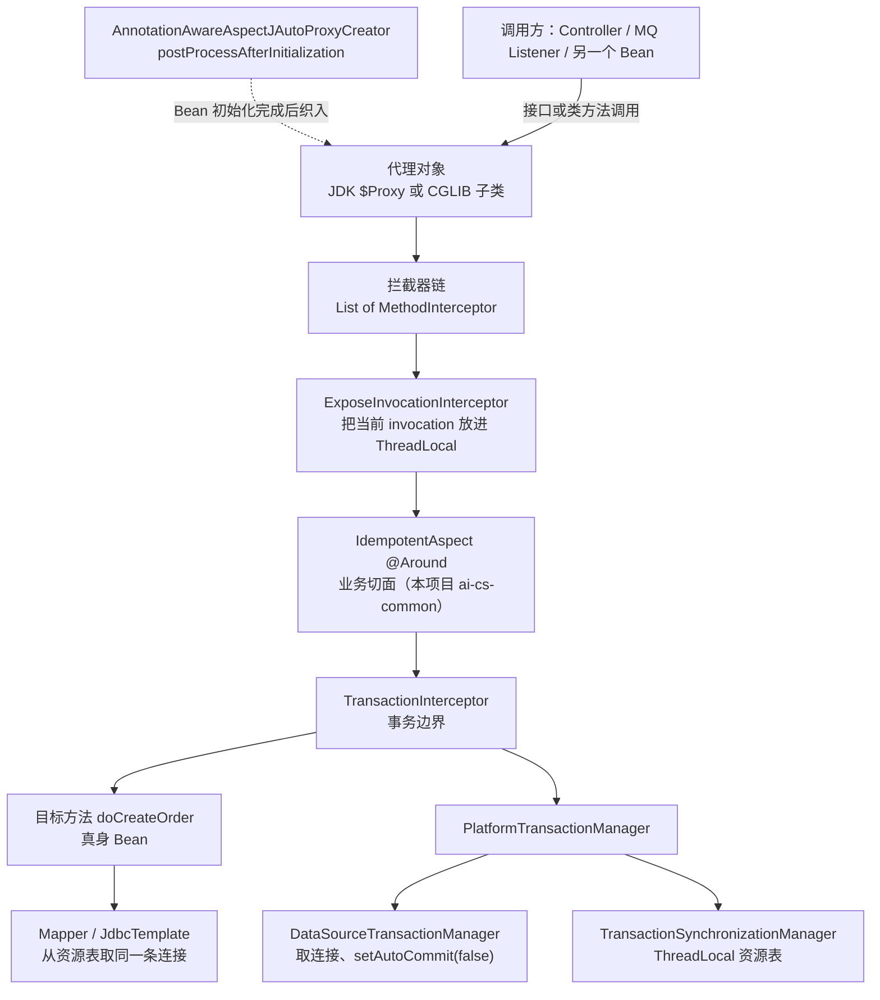
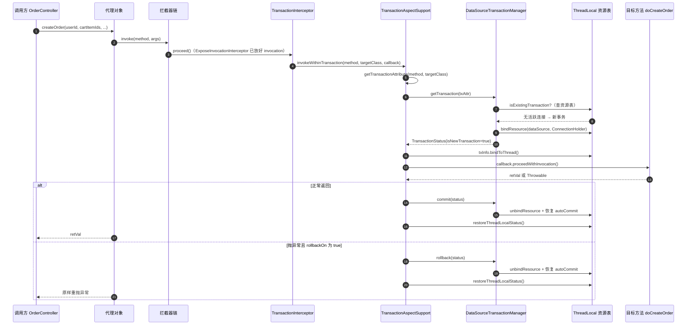

# @Transactional 为什么不生效：从自动代理织入到事务拦截器的完整证据链

> **一句话结论**：`@Transactional` 是一张贴纸，真正干活的是 `AbstractAutoProxyCreator` 在 Bean 初始化完成后套上的那层代理，以及代理里那条拦截器链上的 `TransactionInterceptor`；所以"注解明明加了却不生效"只有两种可能——调用压根没进代理，或者进了代理但异常/传播行为没让拦截器做出你期望的决定。
>
> - **阅读前置**：读过 Spring Bean 生命周期（知道 `postProcessAfterInitialization` 在哪一步）、知道 `@Transactional` 默认只回滚 `RuntimeException`、能分清"一次方法调用"和"一个事务边界"；不要求读过 AOP 源码。
> - **证据基线**：版本 Spring Framework 7.1.0 / Spring Boot 4.2.0 / JDK 17（本地 17.0.19）｜A 级：`spring-aop` + `spring-tx` 共 12 个类逐段精读（`assets/source` 已入库摘录）｜B 级：本项目 6 个文件（7 处真实 `@Transactional`、1 处自定义切面、1 处 ThreadLocal 跨线程说明）｜C 级：2 条 30 秒内可复现命令｜预计阅读：70 分钟。

---

## 0. 先看现象：三个"注解没用"的现场

**现象 1：同一个类里 `this` 调另一个 `@Transactional` 方法，异常抛了，数据却留在库里。**

这是本项目真实踩过的坑，写在 `OrderCreateTxService` 的类注释里：早期实现是 `OrderServiceImpl.createOrder` 直接 `this.doCreateOrder(...)`，于是方法上的 `@GlobalTransactional` 与 `@Transactional` 全成了装饰。它被一个最小 Spring 上下文的集成测试锁死：

```text
org.opentest4j.AssertionFailedError:
doCreateOrder 必须在事务中执行；若为 false，说明 @Transactional 被同类自调用绕过（docs/28 C1）
==> expected: <true> but was: <false>
```

断言原文出自 `ai-cs-order/src/test/java/com/aics/order/service/impl/OrderCreateTxWiringTest.java#L97-L99`，它检查的不是"订单建没建出来"，而是"进 `orderMapper.insert` 那一瞬间，当前线程上到底有没有活跃事务"。这类断言的写法见 §6.9。

**现象 2：业务代码 `try-catch` 把异常吃了，事务照常提交。**

日志里既没有异常栈，也没有回滚，只有拦截器在收尾时打的一句 `Completing transaction for [...]`（`TransactionAspectSupport` 里的 trace 文案）。更隐蔽的一种是：内层方法把异常转成了 `throw new RuntimeException(...)`，但外层 `catch` 后只 `log.error` 没再抛，于是"看起来失败了、库里却是脏数据"。

反过来，如果内层只是把事务标记成 rollback-only 而没真的抛出去，外层提交时会炸：

```text
org.springframework.transaction.UnexpectedRollbackException:
Transaction rolled back because it has been marked as rollback-only
```

这句原文来自 `AbstractPlatformTransactionManager` 的回滚收尾逻辑（`[[源码:AbstractPlatformTransactionManager.java.md#L935-L939]]`），看到它就等于看到"内层想回滚、外层想提交"的冲突。

**现象 3：`@Async` 与 `@Transactional` 顺序写反，异步任务里读不到事务里的数据。**

把 `@Async` 写在 `@Transactional` 外层（或反过来，在事务方法内部起线程），子线程拿到的连接是另一条：主事务还没提交，子线程当然查不到；主事务回滚，子线程写的数据也不会跟着回滚。如果子方法标的是 `MANDATORY`，你还会直接拿到：

```text
org.springframework.transaction.IllegalTransactionStateException:
No existing transaction found for transaction marked with propagation 'mandatory'
```

这类"新线程读不到 ThreadLocal"的机制，本仓库在链路追踪组件上已经用注释讲透了（`ai-cs-chat/src/main/java/com/aics/chat/observability/TraceContextHolder.java#L77-L85`）：`CompletableFuture.supplyAsync` 会在新线程执行任务，读不到调用线程的 `ThreadLocal`——事务的连接绑定用的是同一套机制，所以结论完全通用。

这些现象指向同一件事：**事务不是方法体的一部分，而是代理在方法外面加的一层壳；壳没套上，或者壳里没收到异常信号，注解就等于注释。**

---

## 1. 整体地图：一次"带事务的调用"经过哪些站



**读图说明**：

- 最关键的一条箭头是虚线 `Creator -.-> Proxy`：它表示"代理不是天生的，是 Bean 初始化完成后被后置处理器换掉的"。**看错这条箭头的代价**：你会以为 `@Transactional` 在编译期或类加载期生效，于是去翻业务代码找问题，而真正该看的是"这个 Bean 交给调用方时还是不是原来那个对象"。
- 第二个关键点是从 `Tx --> PTM --> TSM` 再到 `Target --> Mapper` 这条闭环：**事务能生效的前提是"目标方法里拿到的连接"与"管理器开启事务时用的连接"是同一条**，靠的正是 `TransactionSynchronizationManager` 的 ThreadLocal。**看错它**，你会以为事务和线程无关，于是把 `@Transactional` 方法丢进线程池还奇怪为什么不回滚。
- 注意 `Aspect` 排在 `Tx` 之前（`IdempotentAspect` 在事务拦截器外层）：这就是本项目幂等切面能"在事务开始前占位、在事务提交前就已占好"的原因，见 §3.4。

| 组件 | 责任 | 谁调用它 |
| --- | --- | --- |
| `AnnotationAwareAspectJAutoProxyCreator` | 找到所有 Advisor（切面通知 + 切点），给命中的 Bean 造代理，替换容器里的原始实例 | Spring 容器在 `initializeBean` 的"初始化后"阶段回调 |
| `DefaultAopProxyFactory` | 决定这次用 JDK 动态代理还是 CGLIB | `ProxyCreatorSupport#createAopProxy` |
| `JdkDynamicAopProxy` / `CglibAopProxy` | 真正的调用入口：取拦截器链、交给 `ReflectiveMethodInvocation` 依次执行 | JDK 反射 / CGLIB 生成的字节码 |
| 拦截器链 | 若干 `MethodInterceptor` 按 order 排序后串成链，最后一个才落到目标方法 | `AdvisedSupport#getInterceptorsAndDynamicInterceptionAdvice` |
| `TransactionInterceptor` | 事务这件事的"门面"，把调用转给父类 `TransactionAspectSupport` | 拦截器链 |
| `TransactionAspectSupport` | 六步主流程：取属性 → 建/加入事务 → 执行业务 → 异常分类 → 提交/回滚 → 清理 | `TransactionInterceptor#invoke` |
| `AbstractPlatformTransactionManager` | 传播行为的判定、挂起/恢复、savepoint、rollback-only 语义 | `TransactionAspectSupport` |
| `DataSourceTransactionManager` | 真正的物理事务：从连接池取连接、`setAutoCommit(false)`、commit/rollback | 上者模板方法回调 |
| `TransactionSynchronizationManager` | 把"当前线程用哪条连接"存进 ThreadLocal 资源表 | 事务管理器；Mapper 透过它拿连接 |

---

## 2. 关键概念与关键类

先对齐六个术语，后面不再重复解释：

- **代理对象（proxy）**：容器交给调用方的那层壳，和真身是同一个"类型"（实现同一接口或继承同一父类），但不是同一个对象。`@Transactional` 只认壳。
- **织入（weaving）**：把切面逻辑塞进调用路径的动作。Spring AOP 的织入发生在**运行时**，方式是"造一个代理对象"，不是改字节码。
- **拦截器链（interceptor chain）**：一次调用要经过的 `MethodInterceptor` 列表，按 `Ordered` 排序，逐个 `proceed()`。
- **事务属性（`TransactionAttribute`）**：从注解上解析出来的传播行为、隔离级别、超时、是否只读、回滚规则，是"这次调用的事务配置单"。
- **逻辑事务 / 物理事务**：逻辑事务是 `TransactionStatus` 这层抽象（可以只是一个"加入已有事务"的壳）；物理事务是数据库连接上真实开启的那个事务。
- **事务同步（`TransactionSynchronization`）**：挂在事务生命周期上的钩子（`beforeCommit` / `afterCommit` / `afterCompletion`），本项目用它做"提交后再发通知"。

| 名称 | 位置（模块） | 角色 | 关键方法 |
| --- | --- | --- | --- |
| `AbstractAutoProxyCreator` | spring-aop 7.1.0 | 织入的总入口：Bean 初始化后判断要不要造代理 | `postProcessAfterInitialization`、`wrapIfNecessary`、`buildProxy` |
| `DefaultAopProxyFactory` | spring-aop 7.1.0 | 二选一：JDK 还是 CGLIB | `createAopProxy` |
| `ProxyConfig` | spring-aop 7.1.0 | 承载 `proxyTargetClass` / `optimize` 等开关 | `setProxyTargetClass`、`isProxyTargetClass` |
| `JdkDynamicAopProxy` | spring-aop 7.1.0 | 基于接口的代理，自身就是 `InvocationHandler` | `invoke` |
| `CglibAopProxy` | spring-aop 7.1.0 | 基于继承的代理，内部 `DynamicAdvisedInterceptor` 干活 | `getProxy`、`DynamicAdvisedInterceptor#intercept` |
| `TransactionInterceptor` | spring-tx 7.1.0 | 事务切面的 `MethodInterceptor` 实现，只做转调 | `invoke` |
| `TransactionAspectSupport` | spring-tx 7.1.0 | 六步主流程的真正实现 | `invokeWithinTransaction`、`completeTransactionAfterThrowing`、`cleanupTransactionInfo` |
| `DefaultTransactionAttribute` | spring-tx 7.1.0 | 默认回滚规则（只认 `RuntimeException` / `Error`） | `rollbackOn` |
| `AbstractPlatformTransactionManager` | spring-tx 7.1.0 | 传播行为、挂起/恢复、提交/回滚模板 | `getTransaction`、`commit`、`rollback` |
| `DataSourceTransactionManager` | spring-tx 7.1.0 | JDBC 物理事务 | `doBegin`、`doCommit`、`doRollback` |
| `TransactionSynchronizationManager` | spring-tx 7.1.0 | 线程级资源表与同步器注册表 | `bindResource`、`getResource`、`isActualTransactionActive` |
| `OrderCreateTxService` | `ai-cs-order`（本项目） | 事务边界独立 Bean，双层注解真实用例 | `doCreateOrder` |
| `IdempotentAspect` | `ai-cs-common`（本项目） | 自定义 `@Around` 切面，事务外层 | `around` |

---

## 3. 原理与证据逐段精读

### 3.1 织入时机：Bean 初始化完成后的最后一刀

```java (src: AbstractAutoProxyCreator.java.md#L285-L293)
	public Object postProcessAfterInitialization(@Nullable Object bean, String beanName) {
		if (bean != null) {
			Object cacheKey = getCacheKey(bean.getClass(), beanName);
			if (this.earlyBeanReferences.remove(cacheKey) != bean) {
				return wrapIfNecessary(bean, beanName, cacheKey);
			}
		}
		return bean;
	}
```

**在干什么**：这是 `BeanPostProcessor` 的"初始化后"回调。方法返回什么，容器就把什么放进单例池并交给依赖注入的注入方。所以返回原 `bean` 就是"什么都没发生"，返回代理就是"从这一刻起，所有外部调用都走壳"。

**为什么这么设计**：初始化后是"对象已经完全准备好（依赖注入完、`@PostConstruct` 也执行完）"的最后一个时机。此时造代理最安全：目标对象字段齐了，代理里持有的 `TargetSource` 指向的是完整对象；也不会出现"依赖注入把代理注入进去、代理里的目标还没注入完"的尴尬。

**换写法会怎样**：如果改成在 `postProcessBeforeInitialization` 造代理，代理里包的是一个还没注入依赖的半成品，`@PostConstruct` 里的调用也会穿过代理（此时事务拦截器已就位但字段为空），很容易出现 `participating in existing transaction` 之后 `NullPointerException` 的怪象。

**常见坑**：`getCacheKey` 用 `beanName` 参与组装（`[[源码:AbstractAutoProxyCreator.java.md#L305-L312]]`），所以"同一个类注册成多个 Bean"会各造各的代理；而 `@Bean` 方法返回的对象与 `beanName` 不匹配时，缓存键会落到 `Class` 上，可能拿到别人的代理判定结果。

### 3.2 到底造不造代理：三道闸门

```java (src: AbstractAutoProxyCreator.java.md#L330-L345)
			if (Boolean.FALSE.equals(this.advisedBeans.get(cacheKey))) {
				return bean;
			}
			if (isInfrastructureClass(bean.getClass()) || shouldSkip(bean.getClass(), beanName)) {
				this.advisedBeans.put(cacheKey, Boolean.FALSE);
				return bean;
			}

			// Create proxy if we have advice.
			Object[] specificInterceptors = getAdvicesAndAdvisorsForBean(bean.getClass(), beanName, null);
			if (specificInterceptors != DO_NOT_PROXY) {
				this.advisedBeans.put(cacheKey, Boolean.TRUE);
				Object proxy = createProxy(
						bean.getClass(), beanName, specificInterceptors, new SingletonTargetSource(bean));
				this.proxyTypes.put(cacheKey, proxy.getClass());
				return proxy;
			}
```

**在干什么**：三道闸门依次是"以前判定过不用代 → 直接还回去"、"这是基础设施类（`Advice`/`Pointcut`/`Advisor` 本身）或该跳过 → 记一笔不用代"、"去问所有 Advisor：有没有切点命中这个类的方法"。第三道返回 `DO_NOT_PROXY` 就还原对象，否则造代理。

**为什么这么设计**：判定结果用 `advisedBeans` 缓存，避免每个 Bean 都重新跑一遍切点匹配（切点匹配要解析方法签名、注解，很贵）。`isInfrastructureClass` 排除基础设施类是为了防止"给 `TransactionInterceptor` 本身也造一个事务代理"这种自指死循环。

**换写法会怎样**：如果没有 `DO_NOT_PROXY` 这层判空、直接对所有 Bean 造代理，你的容器里每个 `@Component`（包括 `DataSource`、`SqlSessionFactory`）都会套壳；CGLIB 造子类时还会触发大量类加载，启动时间肉眼可见地变长。

**常见坑**：`getAdvicesAndAdvisorsForBean` 只对**能匹配上的方法**生效。类上写了 `@Transactional` 但所有方法都是 `private`，切点匹配不到任何可代理方法，这里就不会造代理——现象是"注解没报错，但也完全没作用"。

### 3.3 造哪种代理：JDK 还是 CGLIB

```java (src: DefaultAopProxyFactory.java.md#L60-L76)
	public AopProxy createAopProxy(AdvisedSupport config) throws AopConfigException {
		if (config.isOptimize() || config.isProxyTargetClass() || !config.hasUserSuppliedInterfaces()) {
			Class<?> targetClass = config.getTargetClass();
			if (targetClass == null) {
				throw new AopConfigException("TargetSource cannot determine target class: " +
						"Either an interface or a target is required for proxy creation.");
			}
			if (targetClass.isInterface() || Proxy.isProxyClass(targetClass) || ClassUtils.isLambdaClass(targetClass)) {
				return new JdkDynamicAopProxy(config);
			}
			return new ObjenesisCglibAopProxy(config);
		}
		else {
			return new JdkDynamicAopProxy(config);
		}
	}
```

**在干什么**：一个二选一的分支。走 CGLIB 的三个条件是——`optimize` 打开、`proxyTargetClass` 打开、或者目标类**没有实现任何用户接口**。进了 CGLIB 分支后，若目标"本身是接口 / 本身已经是 JDK 代理 / 是 lambda 类"，仍然退回 JDK 代理（因为没法给接口造子类）。

**为什么这么设计**：JDK 代理只能代理接口方法——造出来的是"兄弟"（同接口的另一个实现）；CGLIB 生成子类——造出来是"儿子"，能接住类上直接声明的方法。`proxyTargetClass` 就是"我不管有没有接口，一律用儿子"的开关。Spring Boot 的 AOP 自动配置把 `proxyTargetClass` 默认设为 `true`，所以你在 Boot 里拿到的几乎总是 CGLIB 代理。

**换写法会怎样**：把 `proxyTargetClass` 设成 `false`，则"注入了接口"的调用方走 JDK 代理，"注入了实现类"的调用方会直接拿到真身（因为 JDK 代理不是实现类的实例）——同一份代码，两种注入方式行为不一致，这是最难查的一类"我这生效他那不生效"。

**常见坑**：CGLIB 是继承，**`final` 方法不能被重写、`private` 方法不能被重写**，这两类方法上的 `@Transactional` 永远不会生效；反过来 JDK 代理不代理接口里没声明的方法（比如实现类里额外加的 `public` 方法），从实现类引用调过去同样失效。开关本身定义在 `ProxyConfig`（`[[源码:ProxyConfig.java.md#L77-L84]]`），由 `ProxyCreatorSupport#createAopProxy` 交给工厂（`[[源码:ProxyCreatorSupport.java.md#L101-L106]]`）。

### 3.4 调用入口与暴露代理：两条一模一样的实现

```java (src: JdkDynamicAopProxy.java.md#L197-L220)
			target = targetSource.getTarget();
			Class<?> targetClass = (target != null ? target.getClass() : null);

			// Get the interception chain for this method.
			List<Object> chain = this.advised.getInterceptorsAndDynamicInterceptionAdvice(method, targetClass);

			// Check whether we have any advice. If we don't, we can fall back on direct
			// reflective invocation of the target, and avoid creating a MethodInvocation.
			if (chain.isEmpty()) {
				@Nullable Object[] argsToUse = AopProxyUtils.adaptArgumentsIfNecessary(method, args);
				retVal = AopUtils.invokeJoinpointUsingReflection(target, method, argsToUse);
			}
			else {
				// We need to create a method invocation...
				MethodInvocation invocation =
						new ReflectiveMethodInvocation(proxy, target, method, args, targetClass, chain);
				// Proceed to the joinpoint through the interceptor chain.
				retVal = invocation.proceed();
			}
```

**在干什么**：这是 JDK 代理的 `invoke` 主体（`CglibAopProxy` 里的 `DynamicAdvisedInterceptor#intercept` 与之逐行对应，`[[源码:CglibAopProxy.java.md#L722-L740]]`）。三件事：按"方法 + 目标类"取出这条链 → 链空就直接反射调真身 → 链非空就包成 `ReflectiveMethodInvocation` 并 `proceed()`。

**为什么这么设计**：把"取链"和"执行链"分开，取链结果可以按方法缓存；链为空时短路免建对象，是为了让"这个 Bean 虽然有切面、但这个方法没被命中"的调用没有额外开销。

**换写法会怎样**：如果链为空也照建 `MethodInvocation`，热路径上每次调用多一次对象分配；如果干脆不做"链为空就直连"的短路，那些只挂了一个 `ExposeInvocationInterceptor` 的场景也会走完整链路，性能差别在高频接口上能测出来。

**常见坑**：注意 `targetClass` 取的是**真身的运行时类**（`target.getClass()`），不是接口。这正是"类上的注解能被读到、接口上的注解也能被 `AnnotationTransactionAttributeSource` 合并"的原因；但也意味着你写 `AopUtils.getTargetClass(aopProxy)` 才能拿到真身类，`proxy.getClass()` 拿到的是 `$Proxy` 或 `$$SpringCGLIB$$` 子类。

### 3.5 拦截器链的顺序：谁在事务外层

`TransactionInterceptor` 只是链上的一节，它排第几决定了"谁包住谁"。本项目里最外层的业务切面是 `IdempotentAspect`：

```java
@Around("@annotation(idempotent)")
public Object around(ProceedingJoinPoint joinPoint, Idempotent idempotent) throws Throwable {
    if (TransactionSynchronizationManager.isActualTransactionActive()) {
        log.debug("幂等方法存在活跃事务，失败时将主动释放 key: {}", idempotent.key());
    }
    String redisKey = properties.getKeyPrefix() + resolveKey(joinPoint, idempotent);
    boolean acquired;
    try {
        acquired = Boolean.TRUE.equals(ops.setIfAbsent(redisKey, TOKEN, ttl));
    } catch (RuntimeException e) {
        log.warn("幂等组件 Redis 异常，fail-open 放行 key={}", redisKey, e);
        return joinPoint.proceed();
    }
    if (!acquired) {
        throw new IdempotentRejectException(idempotent.message());
    }
    try {
        return joinPoint.proceed();
    } catch (Throwable t) {
        tryRelease(redisKey);
        throw t;
    }
}
```

（上述片段节选自 `ai-cs-common/src/main/java/com/aics/common/idempotent/IdempotentAspect.java#L49-L75`，为便于阅读合并了局部变量声明。）

**在干什么**：`@Around` 在 `joinPoint.proceed()` 之前用 Redis `SET NX EX` 占位，占不到直接抛 `IdempotentRejectException`（HTTP 409）；占到了才继续往里走——而"往里"就是事务拦截器。业务抛异常时先删 key 再原样抛出。

**为什么这么设计**：类注释交代得很清楚——"占位发生在事务提交前，这正是想要的行为：同 key 并发请求在占位期间直接拒绝，而不是等到锁在行上排队"。也就是说**幂等挡在事务外层**是有意为之：让重复请求在进入事务之前就被挡掉，而不是进来占着连接和行锁排队。

**换写法会怎样**：把幂等放到事务里层（比如在事务方法内部再调一个幂等方法），重复请求会先开事务、再被拒——白白消耗一条连接和一个事务，高并发下等于给连接池加压。

**常见坑**：这里 `catch (Throwable t) { tryRelease(...); throw t; }` 的"原样抛出"是关键。如果写成 `catch (Exception e) { tryRelease(); return null; }`，异常就被吞了——`TransactionInterceptor` 收不到异常信号，事务照常提交，你得到的是"接口返回成功、数据其实没写"。至于 `ExposeInvocationInterceptor`：Spring 在检测到存在 AspectJ 切面时，会把它插到链的最前面，作用是把当前 `MethodInvocation` 放进 ThreadLocal，让 `AspectJProxyFactory` 与 `aopContext` 能取到"这次调用"（该类本仓库 `assets/source` 未入库摘录，此处依据 spring-aop 官方 javadoc 的描述）。

### 3.6 六步主流程：`invokeWithinTransaction`

先看清一件事：`TransactionInterceptor` 自己不含任何事务逻辑，它的 `invoke` 只做"取真身类 → 转调父类"（`[[源码:TransactionInterceptor.java.md#L123-L151]]`），所以下面这段父类代码才是"六步"的真正所在。

```java (src: TransactionAspectSupport.java.md#L360-L380)
		PlatformTransactionManager ptm = asPlatformTransactionManager(tm);
		final String joinpointIdentification = methodIdentification(method, targetClass, txAttr);

		if (txAttr == null || !(ptm instanceof CallbackPreferringPlatformTransactionManager cpptm)) {
			// Standard transaction demarcation with getTransaction and commit/rollback calls.
			TransactionInfo txInfo = createTransactionIfNecessary(ptm, txAttr, joinpointIdentification);
			Object retVal;
			try {
				// This is an around advice: Invoke the next interceptor in the chain.
				// This will naturally create a clean stack trace encompassing all interceptors.
				retVal = invocation.proceedWithInvocation();
			}
			catch (Throwable ex) {
				// Target invocation exception
				completeTransactionAfterThrowing(txInfo, invocation, ex);
				throw ex;
			}
			finally {
				cleanupTransactionInfo(txInfo);
			}
```

**在干什么**：这就是常说的"六步"，逐条对上行号：

1. **取事务属性**（`[[源码:TransactionAspectSupport.java.md#L338]]`）：`tas.getTransactionAttribute(method, targetClass)`。取不到（返回 `null`）就走"非事务方法"通道——后面会打 `No need to create transaction for [...]`。
2. **创建或加入事务**（L365 `createTransactionIfNecessary`）：内部调 `PlatformTransactionManager#getTransaction`，拿到 `TransactionStatus`；同时在 `prepareTransactionInfo` 里 `txInfo.bindToThread()`（`[[源码:TransactionAspectSupport.java.md#L648-L675]]`），把这次调用的 `TransactionInfo` 挂到当前线程栈顶。
3. **执行业务**（L371 `invocation.proceedWithInvocation()`）：注意这是"继续走拦截器链"，不是直接反射调目标方法——所以链上排在事务拦截器**后面**的切面仍然在事务内执行。
4. **异常分类**（L375 `completeTransactionAfterThrowing`）：按 `rollbackOn` 决定回滚还是提交，并把异常**原样重抛**（`throw ex`）。
5. **提交**（L408 `commitTransactionAfterReturning`）：正常返回才走到，内部就是 `txInfo.getTransactionManager().commit(...)`（`[[源码:TransactionAspectSupport.java.md#L682-L689]]`）。
6. **清理**（L379 `cleanupTransactionInfo`）：`finally` 里 `txInfo.restoreThreadLocalStatus()`（`[[源码:TransactionAspectSupport.java.md#L744-L748]]`），注释直白写着 "Call this in all cases: exception or normal return!"。

**为什么这么设计**：把提交放在 try 之后、把清理放 finally，是典型的"资源获取与释放必须配对"。而"异常原样重抛"意味着**事务拦截器不改变异常语义**——你在业务里抛什么，调用方还是收到什么，只是中间多了一次回滚动作。

**换写法会怎样**：如果不用 `CallbackPreferringPlatformTransactionManager` 的 `execute` 回调分支（L412 之后那段），就不支持"把事务状态通过回调交给调用方"的用法；Spring 为 `TransactionTemplate` 这类偏好回调的管理器单独留了分支，回调里"正常返回就提交、要回滚就抛异常"的语义与主分支等价，只是写法不同。

**常见坑**：第 4 步的 `rollbackOn` 只是**决定要不要回滚**，不决定"异常是否继续往上抛"；第 6 步清理只在当前线程栈——所以**如果你在事务方法里起了子线程，`cleanupTransactionInfo` 清的是主线程的栈，子线程压根没绑过**。

### 3.7 默认只回滚「运行时异常」：`rollbackOn`

```java (src: DefaultTransactionAttribute.java.md#L180-L182)
	@Override
	public boolean rollbackOn(Throwable ex) {
		return (ex instanceof RuntimeException || ex instanceof Error);
	}
```

**在干什么**：两个 `instanceof`。`RuntimeException` 及其子类、`Error` 及其子类 → 回滚；其他（受检异常，即 `Exception` 但非 `RuntimeException`）→ **不回滚，走提交**。

**为什么这么设计**：javadoc 把理由写在 `[[源码:DefaultTransactionAttribute.java.md#L170-L176]]`——声明式事务把"受检异常"视为**业务上预期内的结果**（"business exception … leading to a commit by default"），调用方必须显式处理它，所以框架不擅自回滚；而 `RuntimeException` 多数是程序缺陷或意外，默认回滚更安全。顺带一提，同一段 javadoc 提醒：`TransactionTemplate` 对"未声明的受检异常"也会回滚，属于 "a corner case" 级别的行为差异。

**换写法会怎样**：所有注解都写 `rollbackFor = Exception.class` 就等于把规则改成"只要抛异常就回滚"，这也是本项目 7 处 `@Transactional` 的统一选择（C 级统计见 §6.4）。反过来，如果全都不写，你就得到"`IOException` 抛出去、订单仍然落库"的经典事故。

**常见坑**：`rollbackFor` 是**精确匹配**的语义陷阱——写 `rollbackFor = IOException.class` 只回滚 `IOException` 及其子类，业务里抛的是 `IllegalStateException` 就照样提交；还有一点容易漏：`completeTransactionAfterThrowing` 在"不回滚"的分支里仍会检查 `TransactionStatus.isRollbackOnly()`（`[[源码:TransactionAspectSupport.java.md#L697-L737]]`），所以内层已标记 rollback-only 时，外层即便遇到受检异常也会回滚。

### 3.8 传播行为：一个 Bean 的两次调用可以共用一条连接

```java (src: AbstractPlatformTransactionManager.java.md#L382-L410)
		if (isExistingTransaction(transaction)) {
			// Existing transaction found -> check propagation behavior to find out how to behave.
			return handleExistingTransaction(def, transaction, debugEnabled);
		}

		// Check definition settings for new transaction.
		if (def.getTimeout() < TransactionDefinition.TIMEOUT_DEFAULT) {
			throw new InvalidTimeoutException("Invalid transaction timeout", def.getTimeout());
		}

		// No existing transaction found -> check propagation behavior to find out how to proceed.
		if (def.getPropagationBehavior() == TransactionDefinition.PROPAGATION_MANDATORY) {
			throw new IllegalTransactionStateException(
					"No existing transaction found for transaction marked with propagation 'mandatory'");
		}
		else if (def.getPropagationBehavior() == TransactionDefinition.PROPAGATION_REQUIRED ||
				def.getPropagationBehavior() == TransactionDefinition.PROPAGATION_REQUIRES_NEW ||
				def.getPropagationBehavior() == TransactionDefinition.PROPAGATION_NESTED) {
			SuspendedResourcesHolder suspendedResources = suspend(null);
```

**在干什么**：先问"当前线程上已经有事务吗"（`isExistingTransaction`，JDBC 场景就是"资源表里有没有活跃连接"）。有 → 交给 `handleExistingTransaction` 按传播行为分流；没有 → `MANDATORY` 直接抛错，`REQUIRED`/`REQUIRES_NEW`/`NESTED` 三种都新开一个物理事务，其余（`SUPPORTS`/`NOT_SUPPORTED`/`NEVER`）走"空事务"，只登记同步器不开真事务。

**为什么这么设计**：判断依据是**线程上有没有活跃事务**，而不是"调用栈上有没有事务方法"。这解释了为什么"只要经过代理、同一个线程"就天然能加入同一个事务，也解释了一旦换线程就什么都不知道了。

**换写法会怎样**：`REQUIRES_NEW` 的分支会先 `suspend(transaction)`（把当前连接从线程上摘下来存到 `SuspendedResourcesHolder`），再开新连接；`NESTED` 分支则优先用 savepoint（`status.createAndHoldSavepoint()`），不换连接。二者在**连接数**与**回滚粒度**上的差异见 §5 的取舍表。

**常见坑**：`NESTED` 需要管理器允许嵌套，否则直接抛 `NestedTransactionNotSupportedException`（`[[源码:AbstractPlatformTransactionManager.java.md#L460-L465]]`，错误文案里明确提示要 `nestedTransactionAllowed=true`）；`REQUIRES_NEW` 会在同一线程内同时占用两条连接，嵌套几层就很容把连接池抽干，报错是 `CannotCreateTransactionException: Could not open JDBC Connection for transaction`（`[[源码:DataSourceTransactionManager.java.md#L312-L320]]`）。

### 3.9 物理事务从哪来：`doBegin` 与连接绑定

```java (src: DataSourceTransactionManager.java.md#L268-L311)
			if (!txObject.hasConnectionHolder() ||
					txObject.getConnectionHolder().isSynchronizedWithTransaction()) {
				Connection newCon = obtainDataSource().getConnection();
				if (logger.isDebugEnabled()) {
					logger.debug("Acquired Connection [" + newCon + "] for JDBC transaction");
				}
				txObject.setConnectionHolder(new ConnectionHolder(newCon), true);
			}

			txObject.getConnectionHolder().setSynchronizedWithTransaction(true);
			con = txObject.getConnectionHolder().getConnection();

			Integer previousIsolationLevel = DataSourceUtils.prepareConnectionForTransaction(con,
					definition.getIsolationLevel(),
					(definition.isReadOnly() && !isDefaultReadOnly()));
			txObject.setPreviousIsolationLevel(previousIsolationLevel);
			txObject.setReadOnly(definition.isReadOnly());

			if (con.getAutoCommit()) {
				txObject.setMustRestoreAutoCommit(true);
				if (logger.isDebugEnabled()) {
					logger.debug("Switching JDBC Connection [" + con + "] to manual commit");
				}
				con.setAutoCommit(false);
			}

			prepareTransactionalConnection(con, definition);
			txObject.getConnectionHolder().setTransactionActive(true);
```

**在干什么**：从连接池拿一条连接（或复用已有的 `ConnectionHolder`），备份并设置隔离级别与只读标记，把 `autoCommit` 关掉（`setAutoCommit(false)` 就是 JDBC 层面"事务开始"的动作），最后 `setTransactionActive(true)`；紧随其后的 L308-L311 才是关键——`TransactionSynchronizationManager.bindResource(obtainDataSource(), txObject.getConnectionHolder())`，把这条连接**绑到当前线程**。

**为什么这么设计**：`autoCommit=false` 之后的提交/回滚必须落在**同一条连接**上。Spring 不能改你的 Mapper 让它把 `Connection` 一路当参数传下去，所以用"数据源作 key、`ConnectionHolder` 作 value"塞进 ThreadLocal：后续任何地方要连接，只要问 `TransactionSynchronizationManager` 要就行。`mustRestoreAutoCommit` 则保证事务结束后把连接恢复原样再还池，不然下一个借到它的请求会莫名处在手动提交模式。

**换写法会怎样**：如果不用 ThreadLocal 而用方法传参，`JdbcTemplate`/MyBatis 的 API 全都得改签名；Spring 选择了"以数据源对象为 key"，代价是**一个线程同一时刻只能有一个该数据源的事务**——这也是 `bindResource` 在重复绑定时直接抛 `IllegalStateException` 的原因（`[[源码:TransactionSynchronizationManager.java.md#L170-L177]]`，错误文案 `Already value [...] for key [...] bound to thread`）。

**常见坑**：连接绑定在**线程**上，所以跨线程、跨线程池必然失效；另外 `getResource` 读的也是当前线程的 `resources`（`[[源码:TransactionSynchronizationManager.java.md#L141-L147]]`），`null` 就意味着"这个线程上没有事务"——这正是本项目回归测试的断言点。

### 3.10 收尾：提交、回滚、清理

```java (src: AbstractPlatformTransactionManager.java.md#L890-L905)
				else if (status.isNewTransaction()) {
					if (status.isDebug()) {
						logger.debug("Initiating transaction rollback");
					}
					this.transactionExecutionListeners.forEach(listener -> listener.beforeRollback(status));
					rollbackListenerInvoked = true;
					doRollback(status);
				}
				else {
					// Participating in larger transaction
					if (status.hasTransaction()) {
						if (status.isLocalRollbackOnly() || isGlobalRollbackOnParticipationFailure()) {
							if (status.isDebug()) {
								logger.debug("Participating transaction failed - marking existing transaction as rollback-only");
							}
							doSetRollbackOnly(status);
						}
```

**在干什么**：回滚时分三种身份。**有 savepoint**（`NESTED`）→ 只回滚到 savepoint；**是新事务**（`REQUIRED` 起的事务 / `REQUIRES_NEW`）→ 真正 `doRollback`；**只是参与者**（加入别人的事务）→ 不能自己回滚，只能 `doSetRollbackOnly` 打上"全局必须回滚"的标记，等外层决定。最后若是"标记了 rollback-only 却有人要求提交"，抛 `UnexpectedRollbackException`（`[[源码:AbstractPlatformTransactionManager.java.md#L935-L939]]`）。

**为什么这么设计**：一个物理事务只有一个"最终结论"。参与者无权单独提交或回滚，否则会出现"内层回滚、外层提交"这种自相矛盾的结果；所以参与者只能投票（rollback-only），由事务发起者计票。

**换写法会怎样**：如果参与者也直接 `doRollback`，内层回滚会把外层的改动一起带走——这恰好是很多人误以为 `REQUIRED` 能做到"内层失败不影响外层"的错觉来源；想要那种效果必须用 `NESTED`（savepoint）或 `REQUIRES_NEW`（新连接）。

**常见坑**：`processRollback` 的 `finally` 里一定有 `cleanupAfterCompletion(status)`，它负责 `unbindResource`、恢复 `autoCommit`、把连接还池（`[[源码:DataSourceTransactionManager.java.md#L381-L403]]`）。手动在业务里 `try { ... } catch { txManager.rollback() }` 再抛，等于让拦截器对已完成的 `TransactionStatus` 再回滚一次，拿到的是 `IllegalTransactionStateException`（"Transaction is already completed - do not call commit or rollback more than once per transaction"，`[[源码:AbstractPlatformTransactionManager.java.md#L734-L758]]`）。

---

## 4. 一次完整执行时序：下单为例



**读图说明**：

- 最该盯住的是第 7~9 步（`getTransaction` → 查资源表 → 绑定资源）：**事务的"开始"不是注解触发的，而是 `getTransaction` 里向 ThreadLocal 写了一条连接**。如果调用没走代理，这三步一个都不会发生——此时你在业务方法里 `TransactionSynchronizationManager.getResource(dataSource)` 会得到 `null`，这就是本项目 `OrderCreateTxWiringTest` 的断言点。
- 第二个关键点是第 15~17 步的分叉：**提交与回滚走的是同一条清理路径**（`unbindResource` + 恢复 `autoCommit` + `restoreThreadLocalStatus`）。看错这点，你会以为"回滚之后线程上还留着旧连接"，进而误判 `REQUIRES_NEW` 的挂起逻辑。
- 第 3 步到第 4 步之间，排在事务拦截器**前面**的切面（比如本项目的 `IdempotentAspect`）已经在执行了；排在它后面的切面则在第 11 步之内。**顺序看错，会得出"幂等在事务内"的错误结论。**

| 失败步骤 | 典型错误 | 说明 |
| --- | --- | --- |
| 第 1 步之前（没进代理） | 无任何异常，`getResource` 为 `null` | 自调用 / `private` / `final` / 手工 `new` 出来的对象 |
| 第 5 步 `getTransactionAttribute` | 返回 `null`，日志 `No need to create transaction for [...]` | 注解没被 `AnnotationTransactionAttributeSource` 解析到（写错包名、注解在接口而实现用了 `@Transactional` 的反向覆盖等） |
| 第 6 步 | `IllegalTransactionStateException: No existing transaction found for transaction marked with propagation 'mandatory'` | `MANDATORY` 却在无事务上下文里被调用 |
| 第 7 步 | `CannotCreateTransactionException: Could not open JDBC Connection for transaction` | 连接池耗尽（常见于 `REQUIRES_NEW` 嵌套） |
| 第 9 步 | `IllegalStateException: Already value [...] for key [...] bound to thread` | 同一线程重复绑定同一数据源（多数据源配置写错） |
| 第 13 步 | 异常正常抛出，但数据没回滚 | `rollbackOn` 判为 false（受检异常且未配 `rollbackFor`） |
| 第 12~15 步之间被 `catch` 吞掉 | 无异常、无回滚，日志只有 `Completing transaction for [...]` | 业务代码吞异常，事务拦截器收不到信号 |
| 第 18 步 `commit` | `UnexpectedRollbackException: Transaction rolled back because it has been marked as rollback-only` | 内层参与者已投"必须回滚"票，外层却要提交 |

---

## 5. 设计取舍

| 决策点 | 当前选择 | 代价 | 替代方案与它的代价 |
| --- | --- | --- | --- |
| 事务实现方式 | 运行时**动态代理**（JDK / CGLIB） | 自调用、`private`/`final` 方法失效；启动多造一批类 | 编译期织入（AspectJ）能覆盖自调用，但引入编译插件、改构建链路，本地调试更绕 |
| 代理类型 | Boot 默认 `proxyTargetClass=true`（CGLIB 子类） | 需要 `final` 类/`final` 方法可行（CGLIB 无法继承它们）；构造器不能被绕过时要额外处理 | 设回 `false` 用 JDK 代理：只代理接口方法，且必须按接口注入 |
| 事务边界声明 | 注解式（`@Transactional`）+ AOP | 边界对读代码的人是"隐形的"，只能靠类注释和测试锁死 | `TransactionTemplate` 显式编程式：边界一目了然，但每处都要写模板 boilerplate；本项目两层混用（切面式为主） |
| 连接归属 | ThreadLocal 资源表 | 线程即边界，跨线程必失效 | 显式传 `Connection`/`TransactionStatus`：可控但与所有上层 API 不兼容 |
| 回滚规则 | 默认只回滚 `RuntimeException`/`Error` | 受检异常要额外写 `rollbackFor` | 一律 `rollbackFor = Exception.class`（本项目 7 处全这么写）：安全但会"吞掉"业务上想提交的受检异常语义 |
| 全局事务 | Seata `@GlobalTransactional` 叠在 `@Transactional` 外层 | 需要 TC 服务、undo_log 表；MQ 不属于 Seata 资源，回滚不覆盖已发消息 | 不用分布式事务，靠补偿 + 幂等：实现简单，但补偿逻辑要自己写 |

**可扩展点清单（按实用度）**：

1. **`TransactionAttributeSource`**：换掉注解解析器，就能把事务属性从别的地方读出来（比如从配置中心、从自定义注解）。`AnnotationTransactionAttributeSource` 是默认实现，`TransactionAttributeSourcePointcut` 负责"这个方法的属性为 null 就不匹配"。
2. **`TransactionSynchronization` / `@TransactionalEventListener`**：在事务生命周期上挂钩子。本项目用它做"订单支付成功后、事务提交后再发通知"，避免"消息先发、事务回滚"。
3. **`PlatformTransactionManager` 自定义（或 `TransactionExecutionListener`）**：前者换物理事务实现（JTA / 多数据源）；后者在 7.1.0 的回滚路径里已经预留了 `beforeRollback` / `afterRollback` 回调（见 §3.10 代码）。
4. **`AopProxyFactory` / `AdvisedSupport`**：替换代理工厂可以换掉整条代理生成策略（比如统一强制 CGLIB），代价是与社区生态的默认行为不一致。
5. **`@Around` 自定义切面**：像 `IdempotentAspect` 一样，把"限流 / 幂等 / 重试"这类横切逻辑挂进链里，用 `Ordered` 或 `@Order` 决定它与事务谁在外层。

---

## 6. 踩坑与调试手法

### 6.1 同类自调用：`this` 永远是真身

**现象**：`@Transactional` 方法抛异常、数据没回滚。**原因**：类内部 `this.xxx()` 拿的是真身引用，不经过代理，拦截器链根本不存在。**本项目实况**：早期 `createOrder` 直接 `this.doCreateOrder(...)`，后来拆成独立 Bean 才修好，拆的理由就写在 `ai-cs-order/src/main/java/com/aics/order/service/impl/OrderCreateTxService.java#L34-L45` 的类注释里——"只有『外部调用方 → 代理 → 目标方法』这条路径才会开启事务"。

修法三选一：

| 修法 | 写法 | 代价 |
| --- | --- | --- |
| 拆独立 Bean（本项目采用） | `OrderServiceImpl` 注入 `OrderCreateTxService` 再调 | 多一个类；但边界清晰、可被集成测试直接验证 |
| 注入自身代理 | `@Lazy @Autowired private OrderServiceImpl self;` 然后 `self.doCreateOrder(...)` | 有循环依赖风险，`@Lazy` 是补丁而非设计 |
| 取当前代理 | `((OrderService) AopContext.currentProxy()).doCreateOrder(...)` | 必须开 `exposeProxy`（`@EnableAspectJAutoProxy(exposeProxy = true)`）；`AopContext` 依赖拦截器链最前面的 `ExposeInvocationInterceptor` 把 invocation 放进 ThreadLocal（机制见 `[[源码:JdkDynamicAopProxy.java.md#L191-L195]]` 与 `[[源码:CglibAopProxy.java.md#L716-L720]]` 的 `isExposeProxy()` 分支）；本项目全库无 `AopContext` 使用，C 级 grep 可证 |

### 6.2 非 `public`、`final`、`private` 方法

**现象**：注解在、代码对、就是不生效。**原因**：CGLIB 靠继承重写，`private`/`final`/`static` 方法无法被重写；JDK 代理只代理接口里声明的方法。**判断口径**：`@Transactional` 只放在 `public` 的非 `final` 实例方法上。**顺带**：`protected` 方法在 Spring 6+ 已不推荐，别赌它生效。

### 6.3 `catch` 吞异常：拦截器收不到信号

```java
// 反面示例：异常被吃掉，事务拦截器认为"一切正常"
try {
    orderCreateTxService.doCreateOrder(userId, cartItemIds, couponId, method);
} catch (Exception e) {
    log.error("下单失败", e);   // 没有 rethrow，事务照常提交
}
```

**现象**：日志有 error，库里数据却是半成品。**原因**：`TransactionAspectSupport` 只有收到 `Throwable` 才会走 `completeTransactionAfterThrowing`；方法正常返回就一路走到 `commitTransactionAfterReturning`。**正确姿势**：要么 `throw e`，要么调用 `TransactionAspectSupport.currentTransactionStatus().setRollbackOnly()` 显式投票。

### 6.4 受检异常没配 `rollbackFor`

默认规则见 §3.7。本项目把这条风险直接消灭在规范层面——C 级统计：

```powershell
Get-ChildItem -Recurse -Include *.java -Path . |
  Where-Object { $_.FullName -notmatch '\\target\\' } |
  Select-String -Pattern '^\s*@Transactional' |
  ForEach-Object { "{0}:{1}: {2}" -f (Split-Path $_.Path -Leaf), $_.LineNumber, $_.Line.Trim() }
```

真实输出（8 行命中，其中第 1 行是前缀误匹配）：

```text
OrderPaidEventListener.java:30: @TransactionalEventListener(phase = TransactionPhase.AFTER_COMMIT)
OrderCreateTxService.java:79: @Transactional(rollbackFor = Exception.class)
OrderServiceImpl.java:98: @Transactional(rollbackFor = Exception.class)
OrderServiceImpl.java:116: @Transactional(rollbackFor = Exception.class)
OrderServiceImpl.java:167: @Transactional(rollbackFor = Exception.class)
OrderServiceImpl.java:179: @Transactional(rollbackFor = Exception.class)
ProductServiceImpl.java:190: @Transactional(rollbackFor = Exception.class)
ProductServiceImpl.java:216: @Transactional(rollbackFor = Exception.class)
```

**怎么读**：真正的 `@Transactional` 是 7 处，**全部显式写了 `rollbackFor = Exception.class`**；第 1 行是 `@TransactionalEventListener` 被正则前缀匹配到了——**统计注解时这种误匹配会让你的结论偏差 12%，做覆盖率统计时要么加 `\(` 收尾，要么人工复核。**

### 6.5 多线程 / `@Async`：ThreadLocal 不过界

**现象**：异步里写的记录主事务回滚后仍在；或者异步里查不到主事务刚插入的行。**原因**：连接绑定在 `TransactionSynchronizationManager` 的 `ThreadLocal`（`[[源码:TransactionSynchronizationManager.java.md#L77-L92]]` 里 `resources` 等字段都是 `ThreadLocal`），新线程的资源表是空的。本仓库在追踪组件上把这条规律写成了显式教学点（`ai-cs-chat/src/main/java/com/aics/chat/observability/TraceContextHolder.java#L77-L85`）："ThreadLocal 天然不能跨线程传递……读不到调用线程的 ThreadLocal"，并给了三种解法（显式传参 / `InheritableThreadLocal` / Reactor 上下文传播）。

**两个顺序写反的现场**：

```java
// 错法 A：@Async 在 @Transactional 外层 → 异步线程里没有事务，内层 @Transactional 各自开新事务
@Async
@Transactional
public void handle() { ... }

// 错法 B：事务方法内部起线程 → 主事务未提交，子线程查不到数据；主事务回滚，子线程写入不回滚
@Transactional
public void create() {
    executor.execute(() -> orderItemMapper.insert(item));
}
```

**正确做法**：先落库提交，再发异步（本项目用 `@TransactionalEventListener(phase = AFTER_COMMIT)`，见 `ai-cs-order/src/main/java/com/aics/order/event/OrderPaidEventListener.java#L30`）；或者用"本地消息表 / 事务消息"把"发消息"纳入同一事务。

### 6.6 传播行为选错

`REQUIRES_NEW` 会在同一线程同时持有两条连接（原事务挂起但连接没还池），嵌套两层就可能打满连接池；`NESTED` 需要管理器允许嵌套，否则 `NestedTransactionNotSupportedException` 直接抛；`NEVER`/`MANDATORY` 是"断言式"传播行为，用错位置等于给自己埋 `IllegalTransactionStateException`。**排查口径**：先把日志级别开到 `org.springframework.transaction=DEBUG`，看 `Creating new transaction` 与 `Participating in existing transaction` 的配对是否与你的设计一致。

### 6.7 叠注解：事务与缓存、事务与事件的先后

`@Transactional` 与 `@CacheEvict` 叠在同一个方法上时（本项目 `ai-cs-product/src/main/java/com/aics/product/service/impl/ProductServiceImpl.java#L189-L191` 的 `deductStock`），两个切面的 order 都是默认的 `Ordered.LOWEST_PRECEDENCE`，**Spring 不承诺谁在外层**：若缓存切面在外，`@CacheEvict` 会在事务提交前就删掉缓存，中间这段窗口并发读会把旧值回填进缓存。**严谨做法**：用 `TransactionSynchronizationManager.registerSynchronization(...)` 在 `afterCommit` 里删缓存，或用 `@TransactionalEventListener`。

### 6.8 物理层面的坑：表引擎与连接池

事务是数据库能力，不是 Spring 能力。MySQL 上 `MyISAM` 表不支持事务，`setAutoCommit(false)` 照样执行、`commit()` 照样返回成功，但数据不会回滚。本项目全部业务表都是 InnoDB（C 级统计：`deploy/mysql/all-init.sql` 中 `ENGINE=InnoDB` 出现 48 次，`init.sql` 29 次，`order-init.sql` 6 次），所以这条在项目里不会踩，但你接手别的库时要先看建表语句。连接池侧的表现是 `CannotCreateTransactionException`，此时该查的是"连接泄漏"而不是事务注解。

### 6.9 三种 30 秒验证手法（真调试）

**手法一：看代理到底套上没有。** 在任意注入点打印：

```java
log.info("class={}, isAopProxy={}, isCglib={}",
        orderService.getClass().getName(),
        AopUtils.isAopProxy(orderService),
        AopUtils.isCglibProxy(orderService));
```

**怎么读**：类名带 `$Proxy` 或 `$$SpringCGLIB$$` 且 `isAopProxy=true` 才算套上了；打出裸类名 `OrderServiceImpl` 就是真身——此时任何 `@Transactional` 都是注释。

**手法二：把断点打在"织入"和"开事务"两处。** 断点 1 在 `AbstractAutoProxyCreator#wrapIfNecessary` 返回 `createProxy(...)` 那一行（`[[源码:AbstractAutoProxyCreator.java.md#L335-L341]]`）：这里能直接看到 `specificInterceptors` 里有没有 `BeanFactoryTransactionAttributeSourceAdvisor`。断点 2 在 `TransactionAspectSupport#invokeWithinTransaction` 的 `createTransactionIfNecessary` 那一行（`[[源码:TransactionAspectSupport.java.md#L365]]`）：命不中就说明调用没进代理，命中而 `txAttr == null` 就说明注解没被解析。

**手法三：用最小 Spring 上下文写"事务是否真的开着"的断言。** 这是本项目采纳的回归手段（`ai-cs-order/src/test/java/com/aics/order/service/impl/OrderCreateTxWiringTest.java#L88-L103`）：

```java
// 在 orderMapper.insert 被调用的瞬间检查当前线程是否绑定了事务
AtomicBoolean transactionActive = new AtomicBoolean(false);
when(orderMapper.insert(any(Order.class))).thenAnswer(invocation -> {
    transactionActive.set(TransactionSynchronizationManager.isActualTransactionActive());
    return 1;
});

orderService.createOrder(1L, List.of(100L), null, "MOCK");

assertThat(transactionActive.get())
        .as("doCreateOrder 必须在事务中执行；若为 false，说明 @Transactional 被同类自调用绕过（docs/28 C1）")
        .isTrue();
```

**为什么这么写**：`Mockito` 单测里 `@InjectMocks` 直接持有实现类，**没有代理**，所以 143 个单测全绿也证明不了注解生效——这句理由原文就写在测试类注释里。加 `@EnableTransactionManagement` + H2 的最小上下文（`#L102-L103`），断言点放在"Mapper 被调用的瞬间"，才真正验证了"代理生效、事务开着"。

---

## 7. ⚠️ 版本差异

| 主题 | 旧写法 / 旧结论 | 当前基线（Framework 7.1.0 / Boot 4.2.0） | 变化点 | 迁移动作 |
| --- | --- | --- | --- | --- |
| 默认代理类型 | 旧文档曾写"Boot 2.x 起默认全用 CGLIB" | 自动代理默认 `proxyTargetClass=true`，因此通常拿到 CGLIB 子类；但"没接口才用 CGLIB"的工厂逻辑仍在（`DefaultAopProxyFactory#createAopProxy`） | 措辞要精确：是"自动配置把开关打开"，不是"框架只会 CGLIB" | 别把 `proxyTargetClass` 理解成必然；注入接口的代码在开关关闭时仍走 JDK 代理 |
| 代理工厂单例 | 老版本每次 `new DefaultAopProxyFactory()` | `DefaultAopProxyFactory.INSTANCE` 单例（`[[源码:DefaultAopProxyFactory.java.md#L54]]`，since 6.0.10） | 无状态化 | 自定义工厂时优先复用 `INSTANCE`，别重复造 |
| CGLIB 依赖 | 需显式引 `cglib` 三方包 | CGLIB 已 repackage 进 `spring-core`，`ObjenesisCglibAopProxy` 处理无默认构造器的类 | 不再需要额外依赖，也不会与三方 CGLIB 冲突 | 移除 pom 里的 `cglib:cglib`，否则可能出现 `ClassNotFoundException` |
| 事务监听扩展点 | 只有 `TransactionSynchronization` | 新增 `TransactionExecutionListener`（`beforeBegin`/`afterBegin`/`beforeRollback`/`afterRollback`，见 §3.10 代码） | 能在"事务开始/回滚"两个更早的时点挂钩 | 审计、慢事务告警优先用监听器，不必再包一层切面 |
| 响应式事务 | 只讲 `PlatformTransactionManager` | `invokeWithinTransaction` 内建 `ReactiveTransactionManager` 分支，非响应式返回类型会抛 `IllegalStateException`（`[[源码:TransactionAspectSupport.java.md#L341-L358]]`） | 同一个注解服务两种编程模型 | 返回 `Mono`/`Flux` 的方法别配 JDBC 事务管理器；WebFlux 链路用 `R2dbcTransactionManager` |
| 受检异常回滚语义 | 常说"Spring 只回滚运行时异常" | 默认仍是只回滚 `RuntimeException`/`Error`；`TransactionTemplate` 对未声明受检异常会回滚（`[[源码:DefaultTransactionAttribute.java.md#L170-L176]]`） | 注解式与模板式行为不一致 | 注解式统一写 `rollbackFor = Exception.class`（本项目 7 处全部如此） |
| starter 名称 | `spring-boot-starter-web` | Boot 4 起 `starter-web` 已 deprecated，改用 `spring-boot-starter-webmvc` | 依赖坐标变化 | 升级时替换 starter，否则会看到弃用警告；AOP 能力由 `spring-boot-starter-aop` 提供，与 Web 无关 |
| 默认 JSON 库 | Jackson 2（`com.fasterxml.jackson`） | Boot 4 默认 Jackson 3（`tools.jackson`） | 与事务无关，但影响 `@Transactional` 方法里 DTO 序列化 | 自定义 `ObjectMapper` 的配置类要改包名 |

> 说明：本表"当前基线"一列中，凡带 `[[源码:...]]` 锚点的行来自 `assets/source` 入库摘录的逐行核对；`proxyTargetClass` 默认值、starter 更名、Jackson 3 三行依据 Spring Boot 官方文档与本项目 `pom.xml` 实际依赖。

---

## 8. 面试高频问与答

1. `@Transactional` 是靠什么机制生效的？为什么 `this.xxx()` 调用会失效？
2. Spring AOP 在什么时候给 Bean 造代理？为什么必须放在初始化之后？
3. JDK 动态代理和 CGLIB 的区别是什么？Spring 依据什么二选一？
4. 为什么 CGLIB 无法增强 `final` 方法和 `private` 方法？
5. 一次带事务的调用，拦截器链是怎么排的？`TransactionInterceptor` 排在哪一层？
6. `TransactionInterceptor` 和 `TransactionAspectSupport` 各负责什么？为什么拆成两个类？
7. 说出 `@Transactional` 的六步执行流程，哪一步最容易出问题？
8. `rollbackFor` 的默认规则是什么？为什么受检异常默认不回滚？
9. `REQUIRED`、`REQUIRES_NEW`、`NESTED` 三者在连接与回滚粒度上的差别？
10. 内层事务回滚、外层提交，你会看到什么异常？根因是什么？
11. 事务为什么不能跨线程？`@Async` 与 `@Transactional` 的顺序该怎么写？
12. `try-catch` 吞掉异常后事务会怎样？有几种"补回滚"的手段？
13. 怎么用一条日志或一个断点判断"事务到底开没开"？
14. `@Transactional` 与 `@CacheEvict` 同时使用时有什么风险？怎么修？

---

## 9. 动手练习

1. **复现自调用失效**：在任意 Service 里写两个方法，`a()` 内部 `this.b()`，`b()` 标 `@Transactional` 并在中间抛 `RuntimeException`。验证：数据没回滚。再加一个 `c()` 从 Controller 直接调 `b()`，验证：回滚了。**验收标准**：能说清两次调用在"有没有代理"上的差异，并能指出 `OrderCreateTxService` 的类注释印证了同一结论。
2. **给项目加一条事务接线测试**：仿照 `OrderCreateTxWiringTest`，为 `ProductServiceImpl#deductStock` 写一个最小上下文测试，断言 `TransactionSynchronizationManager.isActualTransactionActive()` 为 true。**验收标准**：把 `@Transactional` 临时注释掉，测试必须变红；恢复后变绿。
3. **验证 `rollbackFor` 语义**：写一个抛 `IOException` 的 `@Transactional` 方法，先在默认配置下调用（观察提交），再改成 `rollbackFor = Exception.class`（观察回滚）。**验收标准**：两次都能用日志里的 `Initiating transaction rollback` 或 `Completing transaction for` 佐证，并解释 `DefaultTransactionAttribute#rollbackOn` 为什么这样判。
4. **对比三种传播行为**：`REQUIRED` / `REQUIRES_NEW` / `NESTED` 各写一组"外层抛异常"的用例，记录内层数据是否留下。**验收标准**：能画出三种情况下的连接数量（1 条 / 2 条 / 1 条 + savepoint），并说明 `NESTED` 需要 `nestedTransactionAllowed` 的原因。
5. **验证 ThreadLocal 不跨线程**：在事务方法里起一个线程，读 `TransactionSynchronizationManager.getResource(dataSource)`。**验收标准**：子线程读到 `null`；能对照 `TraceContextHolder` 的注释说出三种跨线程传递方案及各自代价。
6. **做一次代理体检**：对项目里 3 个 Service 打印 `getClass()` + `AopUtils.isAopProxy`。**验收标准**：能区分"套了 CGLIB 的 Service"与"没套的纯工具类"，并解释为什么 `@Configuration(proxyBeanMethods = false)` 的类不会被增强。
7. **给幂等切面调顺序**：把 `IdempotentAspect` 的 `@Around` 用 `@Order` 调到事务拦截器里面，重复请求观察连接占用变化。**验收标准**：能解释"幂等在外层"如何减少事务资源浪费，以及为什么这依赖事务拦截器在链上更靠内。

---

## 小结

- `@Transactional` 不执行任何事务动作，它只是让 `AnnotationAwareAspectJAutoProxyCreator` 在 Bean 初始化完成后造一层代理，再由 `TransactionInterceptor` 在调用前后开/提交事务——**注解是贴纸，代理才是执行者**。
- 代理类型由 `DefaultAopProxyFactory` 二选一：有接口且没开 `proxyTargetClass` 走 JDK 代理，否则走 CGLIB 子类；`final`/`private` 方法在 CGLIB 下永远失效。
- 事务真正的"开始"发生在 `DataSourceTransactionManager#doBegin`：拿连接、`setAutoCommit(false)`、把 `ConnectionHolder` 绑到当前线程的 ThreadLocal——**线程即事务边界**。
- 六步主流程写在 `TransactionAspectSupport#invokeWithinTransaction`：取属性 → 建/加入事务 → 执行业务 → 异常分类 → 提交/回滚 → 清理；提交与回滚共用同一条清理路径。
- 默认只回滚 `RuntimeException`/`Error`，所以本项目 7 处 `@Transactional` 全部显式 `rollbackFor = Exception.class`（C 级统计已核对）。
- 传播行为的判断依据是"当前线程有没有活跃事务"，`REQUIRES_NEW` 换连接、`NESTED` 用 savepoint、参与者只能投 rollback-only 票。
- 失效原因高度集中：**没进代理**（自调用、非 `public`、`final`）、**进了但没信号**（吞异常、受检异常）、**信号到不了这个线程**（`@Async`、线程池）。
- 可操作归纳：**先在疑似失效的方法上打一条 `AopUtils.isAopProxy(...)`，再在 `TransactionAspectSupport#invokeWithinTransaction` 首个断点看 `txAttr` 是否为 `null`，最后用 `OrderCreateTxWiringTest` 那种"在 Mapper 调用瞬间断言 `isActualTransactionActive()`"的测试把它钉死。**

---

## 自测题

**1. `@Transactional` 注解本身做了什么？**

<details><summary>参考答案</summary>

几乎什么都不做。它只是被 `AnnotationTransactionAttributeSource` 解析成 `TransactionAttribute`，真正的执行发生在 `AnnotationAwareAspectJAutoProxyCreator` 为 Bean 造出的代理上，由 `TransactionInterceptor#invoke` 转调父类 `TransactionAspectSupport#invokeWithinTransaction`。所以注解写对了但没代理，等于注释。

</details>

**2. 为什么 Bean 后置处理阶段（`postProcessAfterInitialization`）才是织入时机？**

<details><summary>参考答案</summary>

因为这一刻 Bean 的依赖注入、`@PostConstruct` 都已完成，`AbstractAutoProxyCreator` 返回的代理可以直接进单例池并被注入给其他 Bean，代理里持有的 `SingletonTargetSource` 指向的是完整对象。更早造代理会包住半成品，更晚则已经有人拿到了真身引用。

</details>

**3. `DefaultAopProxyFactory#createAopProxy` 在什么条件下选 CGLIB？**

<details><summary>参考答案</summary>

三个条件任一成立即进 CGLIB 分支：`config.isOptimize()`、`config.isProxyTargetClass()`、或 `!config.hasUserSuppliedInterfaces()`（没实现任何用户接口）。进了分支后若目标类是接口、已是 JDK 代理或 lambda 类，仍退回 `JdkDynamicAopProxy`；`targetClass` 为 null 时抛 `AopConfigException`。

</details>

**4. 为什么 `this.b()` 调用会让 `b()` 上的 `@Transactional` 失效？**

<details><summary>参考答案</summary>

因为 `this` 是真身引用，`this.b()` 是一次普通的虚方法调用，不经过代理对象，因此不会进入拦截器链，`TransactionInterceptor` 完全没被触发。本项目早期 `OrderServiceImpl.createOrder` 直接 `this.doCreateOrder(...)` 就是这样失效的，修复办法是拆出独立 Bean `OrderCreateTxService`。

</details>

**5. `TransactionInterceptor` 里为什么看不到事务逻辑？**

<details><summary>参考答案</summary>

它是门面：`invoke` 里只做两件事——用 `AopUtils.getTargetClass` 取真身类，然后 `invokeWithinTransaction(method, targetClass, callback)`；回调的 `proceedWithInvocation` 就是 `invocation.proceed()`。所有事务逻辑都在父类 `TransactionAspectSupport` 里，这样拦截器保持极薄且线程安全。

</details>

**6. `TransactionAspectSupport` 的六步分别是什么？**

<details><summary>参考答案</summary>

① `getTransactionAttribute` 取事务属性；② `createTransactionIfNecessary` → `PlatformTransactionManager#getTransaction` 创建或加入事务并 `txInfo.bindToThread()`；③ `invocation.proceedWithInvocation()` 执行业务；④ `completeTransactionAfterThrowing` 按 `rollbackOn` 分类后把异常原样重抛；⑤ `commitTransactionAfterReturning` 提交；⑥ `finally` 里 `cleanupTransactionInfo` 恢复线程栈。

</details>

**7. 受检异常默认为什么不回滚？怎么改？**

<details><summary>参考答案</summary>

`DefaultTransactionAttribute#rollbackOn` 只判 `RuntimeException` 和 `Error`，javadoc 解释受检异常被视为"业务上预期内的结果"，默认提交。改法是在注解上写 `rollbackFor = Exception.class`（本项目 7 处全这么写），或显式 `TransactionAspectSupport.currentTransactionStatus().setRollbackOnly()`。

</details>

**8. `REQUIRED` 与 `REQUIRES_NEW` 的差别在哪一行代码上？**

<details><summary>参考答案</summary>

在 `AbstractPlatformTransactionManager#handleExistingTransaction`：`REQUIRED` 走到最后的"regular participation in existing transaction"分支，直接复用当前连接；`REQUIRES_NEW` 先 `suspend(transaction)` 把当前 `ConnectionHolder` 从线程上摘下来，再 `startTransaction` 开第二条连接。代价是同一线程同时占两条连接。

</details>

**9. `NESTED` 为什么不会占用两条连接？**

<details><summary>参考答案</summary>

因为它默认走 `useSavepointForNestedTransaction()` 分支：在当前连接上用 `status.createAndHoldSavepoint()` 建 JDBC savepoint，回滚时 `rollbackToHeldSavepoint()` 只回滚到该点。前提是管理器允许嵌套，否则抛 `NestedTransactionNotSupportedException`。

</details>

**10. 看到 `UnexpectedRollbackException: Transaction rolled back because it has been marked as rollback-only` 说明什么？**

<details><summary>参考答案</summary>

说明内层参与者（`REQUIRED` 加入外层事务的方法）已经通过 `doSetRollbackOnly` 投了"必须回滚"的票，而外层仍试图 `commit`，`processRollback` 检测到 `unexpectedRollback` 后抛出。定位方向是内层失败被外层 `catch` 后继续提交，或内层抛了异常但被吞掉。

</details>

**11. `@Async` 和 `@Transactional` 同时出现在一个方法上，顺序有什么讲究？**

<details><summary>参考答案</summary>

两个注解都由切面实现，谁在外层由 order 决定，但更根本的问题是 `@Async` 一定在**新线程**执行，而事务连接绑在调用线程的 ThreadLocal 上，所以异步线程里没有外层事务。正确做法是"先在同一事务里落库，提交后再异步"（本项目用 `@TransactionalEventListener(phase = AFTER_COMMIT)`）。

</details>

**12. 为什么 143 个 Mockito 单测全绿也证明不了事务生效？**

<details><summary>参考答案</summary>

因为 `@InjectMocks` 注入的是实现类的真身，没有 Spring 代理，`@Transactional` 从未被拦截器处理过。要验证接线必须起一个最小 Spring 上下文（`@EnableTransactionManagement` + H2），并在 Mapper 被调用的瞬间断言 `TransactionSynchronizationManager.isActualTransactionActive()`，`OrderCreateTxWiringTest` 就是这么做的。

</details>

**13. 一条日志怎么快速判断事务开没开？**

<details><summary>参考答案</summary>

把 `org.springframework.transaction` 开到 DEBUG/TRACE，读三句关键文案：`Creating new transaction with name [...]`（新开物理事务）、`Participating in existing transaction`（加入已有事务）、`No need to create transaction for [...]: This method is not transactional.`（属性没解析到，注解没生效）。回滚时会出现 `Initiating transaction rollback`。

</details>

**14. `@Transactional` 与 `@CacheEvict` 叠用会有什么隐患？**

<details><summary>参考答案</summary>

两个切面默认 order 都是 `Ordered.LOWEST_PRECEDENCE`，谁在外层不确定。若缓存切面在外，`@CacheEvict` 会在事务提交前删缓存，中间窗口的并发读会把旧值回填，形成长期脏缓存。稳妥做法是在 `afterCommit` 回调里删缓存，或用 `@TransactionalEventListener`。

</details>

---

## 交叉阅读

- AOP 与代理：`../24-源码分析/01-Spring框架/02-AOP与代理/01-aop-原理与自动代理创建.md`、`../24-源码分析/01-Spring框架/02-AOP与代理/02-代理方式-jdk与cglib.md`、`../24-源码分析/01-Spring框架/02-AOP与代理/03-拦截器链-调用与通知顺序.md`、`../24-源码分析/01-Spring框架/02-AOP与代理/04-aop-实战-自定义注解切面与坑位.md`
- 事务管理：`../24-源码分析/01-Spring框架/03-事务管理/01-transactional-事务拦截器与传播行为.md`、`../24-源码分析/01-Spring框架/03-事务管理/02-事务失效场景与源码原因.md`、`../24-源码分析/01-Spring框架/03-事务管理/03-数据源事务管理器与连接绑定.md`
- 项目案例：`docs/28-故障案例库.md` 的 C1（订单创建的事务注解失效，已修复并有集成测试）
- 相关章节：[14-分布式幂等设计](14-分布式幂等设计.md)、[16-IoC容器与Bean生命周期](16-IoC容器与Bean生命周期.md)、[12-订单状态机治理](12-订单状态机治理.md)
