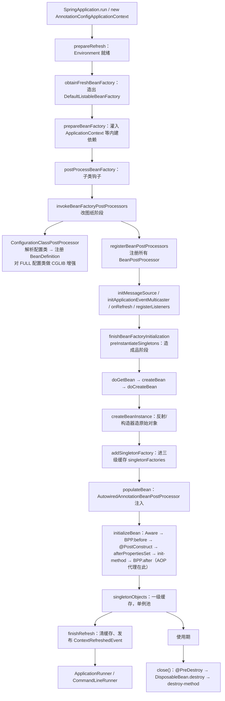
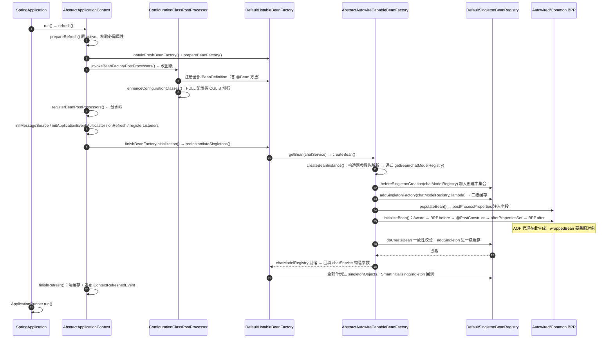

# IoC 容器与 Bean 生命周期：refresh() 十二步、九个回调点与三级缓存

> 一句话结论：`AnnotationConfigApplicationContext`（或 Boot 的 `ServletWebServerApplicationContext`）继承的 `AbstractApplicationContext#refresh()` 用十二步模板方法把"配置类 + 注解"翻译成 `BeanDefinition`（图纸），再交给 `DefaultListableBeanFactory#preInstantiateSingletons()` 逐个走 `AbstractAutowireCapableBeanFactory#doCreateBean()` 造出对象（成品）——期间 `DefaultSingletonBeanRegistry` 的三级缓存负责解开单例字段/Setter 环依赖、`AutowiredAnnotationBeanPostProcessor` 负责注入、`CommonAnnotationBeanPostProcessor`（继承 `InitDestroyAnnotationBeanPostProcessor`）负责 `@PostConstruct`/`@PreDestroy`、`ConfigurationClassPostProcessor` 的 CGLIB 增强负责让 FULL 配置类的 `@Bean` 方法互调仍返回单例，任何一步错位就会表现为"启动报错"或"注入为 null"。
> 阅读前置：能写 `@Component`/`@Autowired`/`@Bean`；读过 [01-SpringBoot核心原理](01-SpringBoot核心原理.md)（那是"怎么用注解"的层）；知道 CGLIB 是"运行时生成子类并覆盖方法"；[15-SpringAOP与声明式事务原理](15-SpringAOP与声明式事务原理.md) 里"代理"的概念（本篇只回答代理在生产线的哪一步被套上）。
> 证据基线：Spring Framework 7.1.0（源码摘录 8 类，`assets/source/`）｜Spring Boot 4.2.0｜JDK 17.0.19 实测（C 级复现含 6.1.6 对照）｜Spring Cloud 2026.0.0｜预计阅读：70 分钟

---

## 0. 先看现象

下面三个症状表面上毫不相干：一个是启动直接失败，一个是启动成功但运行期 NPE，一个是"数据对不上"。它们的根因是同一个。

### 现象一：加一个构造器注入，服务直接起不来

```java
@Component
class OrderQueryService {
    private final OrderCache orderCache;
    OrderQueryService(OrderCache orderCache) { this.orderCache = orderCache; }
}

@Component
class OrderCache {
    private final OrderQueryService queryService;
    OrderCache(OrderQueryService queryService) { this.queryService = queryService; }
}
```

启动日志的最后一段（本机用 Spring Framework **7.1.0** 跑最小复现程序的真实输出，复现步骤见 §6 手法 1 与 §9 练习 1）：

```text
CYCLE thrown=org.springframework.beans.factory.UnsatisfiedDependencyException
CYCLE message=Error creating bean with name 'repro.A': Unsatisfied dependency expressed through
constructor parameter 0: Error creating bean with name 'repro.B': Unsatisfied dependency expressed
through constructor parameter 0: Error creating bean with name 'repro.A': Requested bean is
currently in creation: Is there an unresolvable circular reference or an asynchronous
initialization dependency?
```

**为什么？** 因为构造器注入要求"创建 A 之前，B 必须已经完全就绪"，而 B 又要求 A 先就绪。三级缓存能给出的是"还没填完属性的半成品引用"，半成品不可能塞进构造器（构造器参数必须是一个已经存在的对象），所以容器只能在 `DefaultSingletonBeanRegistry#beforeSingletonCreation` 处发现"这个名字已经在创建中"，抛 `BeanCurrentlyInCreationException` 并被外层包成 `UnsatisfiedDependencyException`。

### 现象二：字段明明标了 `@Autowired`，运行时是 null

本项目真实代码，`ai-cs-chat/src/main/java/com/aics/chat/config/ObservabilityWebConfig.java:37`：

```java
registry.addInterceptor(new TraceInterceptor(observabilityProperties, traceRecorderFactory))
```

拦截器是 **`new` 出来的**，不是容器造的。于是它内部的字段不会经过任何 `BeanPostProcessor`，`@Autowired`/`@Value`/`@PostConstruct` 全部形同废纸——项目里正是为此把它写成 `ObjectFactory<TraceRecorder>`（`ai-cs-chat/src/main/java/com/aics/chat/observability/TraceInterceptor.java:29`），在真正用到时再向容器要：

```java
private final ObjectFactory<TraceRecorder> traceRecorderFactory;
```

**为什么？** 注解不是语言特性，是 `AutowiredAnnotationBeanPostProcessor#postProcessProperties`（注入）和 `CommonAnnotationBeanPostProcessor`（生命周期注解）这些**后置处理器**在"容器造 Bean 的流水线"上逐个回调时才起作用的。绕开流水线的对象，没有任何回调会落到它身上。

### 现象三：`@Configuration` 里的 `@Bean` 方法被调用多次，出来两个实例

同一个最小程序里，两个配置类的差别只有一个括号：

```java
@Configuration static class FullConfig { @Bean Counter counter() { return new Counter(); } }
@Configuration(proxyBeanMethods = false) static class LiteConfig { @Bean Counter counter() { return new Counter(); } }
```

程序做两件事：打印容器里配置类实例的真实类名；比较 `config.counter() == container.getBean(Counter.class)`。真实输出（7.1.0）：

```text
spring-version=7.1.0
FULL configClass=Repro$FullConfig$$SpringCGLIB$$0
FULL counter() == container bean ? true
LITE configClass=Repro$LiteConfig
LITE counter() == container bean ? false
  new Counter identity=1854778591
```

注意 `LITE ... false` 之后又打印了一次 `new Counter`：调用 `lite.counter()` 直接执行了方法体，**新建了第二个对象**，与容器里那个毫无关系。而 FULL 的配置类被替换成了 `$$SpringCGLIB$$0` 子类，方法体被拦截成"先查容器"。

**为什么？** 见 §3.3：`ConfigurationClassPostProcessor` 只对 `@Configuration`（FULL）做 CGLIB 增强，`proxyBeanMethods = false`（LITE）主动放弃增强，代价就是你说的"多实例"。

这三个现象指向同一件事：**Spring 里存在"图纸（`BeanDefinition`）"和"成品（单例池里的实例）"两层，中间是一条固定的十二步启动流水线与九个回调点；任何绕过这条流水线的对象（你 `new` 的、提前造出来的、被 lite 配置类直接调出来的），注解与单例语义就全部失效。**

---

## 1. 整体地图



| 组件 | 责任 | 调用方 |
| --- | --- | --- |
| `AbstractApplicationContext` | 定义十二步模板方法 `refresh()`，管"启动顺序"与失败回滚 | `SpringApplication#run` / 使用者 `new ...Context()` |
| `DefaultListableBeanFactory` | 持有全部 `BeanDefinition`（`beanDefinitionMap`）与单例池，负责 `getBean` 入口与预实例化 | `AbstractApplicationContext` |
| `ConfigurationClassPostProcessor` | `BeanDefinitionRegistryPostProcessor`：解析 `@Configuration`/`@ComponentScan`/`@Import`/`@Bean`，注册图纸；对 FULL 配置类做 CGLIB 增强 | `PostProcessorRegistrationDelegate`（refresh 第 5 步） |
| `AbstractAutowireCapableBeanFactory` | 真正干活：`createBean` → `doCreateBean` → 实例化/注入/初始化/代理 | `DefaultListableBeanFactory#getBean` |
| `DefaultSingletonBeanRegistry` | 三级缓存 + `singletonsCurrentlyInCreation` 创建中标记 | `AbstractAutowireCapableBeanFactory` |
| `AutowiredAnnotationBeanPostProcessor` | `@Autowired`/`@Value` 注入（`populateBean` 阶段） | 所有 Bean 创建时 |
| `CommonAnnotationBeanPostProcessor` | `@PostConstruct`/`@PreDestroy`/`@Resource`，父类 `InitDestroyAnnotationBeanPostProcessor` 干活 | 所有 Bean 创建/销毁时 |
| `ApplicationContextAwareProcessor` | 把 `ApplicationContext`/`Environment` 等一批 Aware 灌进 Bean（在 `prepareBeanFactory` 里注册的内建 BPP） | 所有 Aware Bean |

> **读图说明**：读这张图只抓一条主轴——**上半部分是"改图纸"（`invokeBeanFactoryPostProcessors` 之前，容器里还没有任何业务对象），下半部分是"造成品"（`preInstantiateSingletons` 之后，对象逐个诞生）**，中间 `registerBeanPostProcessors` 是分水岭。沿途 `F1` 说明了"图纸从哪来"（配置类解析），`J1→J4` 是单个 Bean 的产道四段，`K` 是成品仓库。三条竖线回答了三个高频疑问：为什么启动期就要报错（`I` 段是同步的）、为什么注入能发生在构造之后（`J3` 在 `J1` 之后）、为什么 AOP 代理对你 `@Autowired` 的字段一定可见（`J4` 在 `J3` 之后）。

---

## 2. 关键概念与关键类

| 名称 | 位置（模块） | 角色 | 关键方法 |
| --- | --- | --- | --- |
| `BeanDefinition` | spring-beans | **图纸**：类名、作用域、是否懒加载、构造参数、属性值、init/destroy 方法名 | `setBeanClassName`、`setScope`、`setLazyInit`、`isSingleton` |
| `AbstractBeanDefinition` / `RootBeanDefinition` | spring-beans | 图纸的两种实现；`RootBeanDefinition` 是"合并父定义后的最终图纸" | `setBackgroundInit`（7.1 新增）、`isAbstract` |
| `BeanDefinitionRegistry` | spring-beans | 图纸登记处接口，`DefaultListableBeanFactory` 实现它 | `registerBeanDefinition`、`containsBeanDefinition` |
| `BeanFactoryPostProcessor` | spring-beans | **改图纸**的扩展点，作用于 `BeanDefinition` | `postProcessBeanFactory` |
| `BeanDefinitionRegistryPostProcessor` | spring-beans | BFPP 的子接口，可以**新增**图纸 | `postProcessBeanDefinitionRegistry` |
| `ConfigurationClassPostProcessor` | spring-context | 上述两者实现，`@Configuration` 解析 + CGLIB 增强 | `postProcessBeanDefinitionRegistry`、`enhanceConfigurationClasses` |
| `BeanPostProcessor` | spring-beans | **改实例**的扩展点，每个 Bean 创建时被回调 | `postProcessBeforeInitialization`、`postProcessAfterInitialization` |
| `AutowiredAnnotationBeanPostProcessor` | spring-beans | `@Autowired`/`@Value` 注入器 | `postProcessProperties` |
| `CommonAnnotationBeanPostProcessor` | spring-context | `jakarta.annotation` 注解处理器，继承下一个 | `postProcessBeforeInitialization`（继承） |
| `InitDestroyAnnotationBeanPostProcessor` | spring-beans | 真正调 `@PostConstruct`/`@PreDestroy` 的类 | `findLifecycleMetadata`、`invokeInitMethods` |
| `DefaultSingletonBeanRegistry` | spring-beans | **三级缓存** + 创建中集合，解环依赖的核心 | `addSingletonFactory`、`getSingleton(name, allowEarlyReference)`、`beforeSingletonCreation` |
| `AbstractAutowireCapableBeanFactory` | spring-beans | Bean 产道：实例化、注入、初始化、代理 | `createBean`、`doCreateBean`、`populateBean`、`initializeBean` |
| `DefaultListableBeanFactory` | spring-beans | 容器本体：图纸仓库 + `getBean` 入口 + 预实例化 | `preInstantiateSingletons`、`freezeConfiguration` |
| `FactoryBean` / `ObjectFactory` / `ObjectProvider` | spring-beans | 延迟或间接取 Bean 的三种手段（见 §3.11） | `getObject` |

先把四个概念说清，后面不再解释：

- **IoC（控制反转）**：对象的创建权从"业务代码 `new`"搬到"容器"。**DI（依赖注入）** 是 IoC 的一种实现方式：容器看到构造参数/字段/Setter，就替你把依赖填进去。
- **图纸 vs 成品**：`BeanDefinition` 只有元数据（字符串类名、参数列表），本身不能执行业务；容器在 `finishBeanFactoryInitialization` 阶段才按图纸批量造对象。这个"两步走"是整个 Spring 的地基（§3.1 第一层细讲）。
- **单例池（`singletonObjects`）**：一级缓存，`Map<String, Object>`，放**完全初始化好**的单例成品。
- **FULL / LITE 配置类**：`@Configuration` 默认 FULL（会被 CGLIB 增强，`@Bean` 方法互调走容器）；`@Configuration(proxyBeanMethods = false)` 是 LITE（不增强，`@Bean` 方法就是普通方法）。`@Component` 类里标 `@Bean` 也算 LITE。

---

## 3. 原理与证据逐段精读

### 3.1 `refresh()`：一条十二步的模板方法，而且可回滚

```java (src: AbstractApplicationContext.java.md#L582-L625)
	public void refresh() throws BeansException, IllegalStateException {
		this.startupShutdownLock.lock();
		try {
			this.startupShutdownThread = Thread.currentThread();

			StartupStep contextRefresh = this.applicationStartup.start("spring.context.refresh");

			// Prepare this context for refreshing.
			prepareRefresh();

			// Tell the subclass to refresh the internal bean factory.
			ConfigurableListableBeanFactory beanFactory = obtainFreshBeanFactory();

			// Prepare the bean factory for use in this context.
			prepareBeanFactory(beanFactory);

			try {
				// Allows post-processing of the bean factory in context subclasses.
				postProcessBeanFactory(beanFactory);

				StartupStep beanPostProcess = this.applicationStartup.start("spring.context.beans.post-process");
				// Invoke factory processors registered as beans in the context.
				invokeBeanFactoryPostProcessors(beanFactory);
				// Register bean processors that intercept bean creation.
				registerBeanPostProcessors(beanFactory);
				beanPostProcess.end();

				// Initialize message source for this context.
				initMessageSource();

				// Initialize event multicaster for this context.
				initApplicationEventMulticaster();

				// Initialize other special beans in specific context subclasses.
				onRefresh();

				// Check for listener beans and register them.
				registerListeners();

				// Instantiate all remaining (non-lazy-init) singletons.
				finishBeanFactoryInitialization(beanFactory);

				// Last step: publish corresponding event.
				finishRefresh();
			}
```

**在干什么。** 十二步按顺序是：① `prepareRefresh()`（置 `startupDate`、`active=true`、校验必需属性）；② `obtainFreshBeanFactory()`（造出 `DefaultListableBeanFactory`）；③ `prepareBeanFactory()`（灌内建依赖，见 3.2）；④ `postProcessBeanFactory()`（子类钩子，基类空实现 [[源码:AbstractApplicationContext.java.md#L787-L788]]）；⑤ `invokeBeanFactoryPostProcessors()`（**改图纸**，配置类在这里被解析）；⑥ `registerBeanPostProcessors()`（注册所有 BPP）；⑦ `initMessageSource()`；⑧ `initApplicationEventMulticaster()`；⑨ `onRefresh()`（Web 容器的 Tomcat 在这里启动）；⑩ `registerListeners()`；⑪ `finishBeanFactoryInitialization()`（**造成品**，`preInstantiateSingletons`）；⑫ `finishRefresh()`（清缓存 + 发 `ContextRefreshedEvent`）。①~③ 在内层 `try` 之外，④~⑫ 在内层 `try` 里。

**为什么这么设计。** 第一，这是**模板方法模式**：`SpringApplication` 只管调 `refresh()`，Servlet 环境（`ServletWebServerApplicationContext`）与纯注解环境（`AnnotationConfigApplicationContext`）只覆盖 `onRefresh`/`postProcessBeanFactory` 等钩子，顺序永远由基类保证。第二，**顺序本身承载语义**：`invokeBeanFactoryPostProcessors` 必须早于 `registerBeanPostProcessors`（配置类解析会带出新的 BPP 定义，要先有图纸再注册实例）；`finishBeanFactoryInitialization` 必须最后（业务对象依赖前面所有基础设施就位）。第三，**内层 `try` 的作用是可回滚**：抓到 `RuntimeException|Error` 时会 `logger.warn("Exception encountered during context initialization - cancelling refresh attempt: " + ex)`、停 `LifecycleProcessor`、`destroyBeans()`、`cancelRefresh(ex)` 再把异常原样抛出（[[源码:AbstractApplicationContext.java.md#L628-L661]]），所以你看到"启动失败"时，容器其实帮你把已经造出来的半成品清掉了一半——这也是"失败后不能再 `refresh()`"（`cancelRefresh` 会把 `active` 置 false）的原因。

**换写法会怎样。** 如果自己写容器而不用 `refresh()`，典型做法是把"注册图纸"和"造对象"一次做完（`new` 完立刻注入）。代价是：`BeanDefinitionRegistryPostProcessor` 这种"改图纸"的扩展点完全没有落点，`@ConditionalOnMissingBean` 这类"必须先看全图纸"的判断无从成立——本项目 `ai-cs-common/src/main/java/com/aics/common/mq/MessagePublisherAutoConfiguration.java:40-47` 就依赖这个时序：先由自动配置把所有候选图纸登记完，才轮到 `<bean> @ConditionalOnMissingBean(MessagePublisher.class)` 判断"已有就不装"。

**常见坑。** ① 在 `BeanFactoryPostProcessor` 里 `getBean()` 一个业务 Bean——此时它的 `BeanPostProcessor`（含 AOP、`@Autowired`）还没注册完，你拿到的是**没被增强、没被注入**的对象，`ConfigurationClassPostProcessor` 甚至专门为这种情况留了警告（§3.3 第三层）。② 认为 `onRefresh` 是"所有 Bean 都好了"——它只是第 9 步，业务 Bean 一个都还没造（第 11 步才造）。

### 3.2 `prepareBeanFactory`：把"内建依赖"当成 Bean 灌进去，省掉 7 个 Aware 的注入逻辑

**在干什么。** 这一步做了 6 件事（[[源码:AbstractApplicationContext.java.md#L730-L776]]）：设 `BeanClassLoader` 与 `StandardBeanExpressionResolver`（解析 `#{...}`）；注册 `ApplicationContextAwareProcessor`；`ignoreDependencyInterface` 掉 `EnvironmentAware`、`EmbeddedValueResolverAware`、`ResourceLoaderAware`、`ApplicationEventPublisherAware`、`MessageSourceAware`、`ApplicationContextAware`、`ApplicationStartupAware` 七个接口；`registerResolvableDependency` 把 `BeanFactory`/`ResourceLoader`/`ApplicationEventPublisher`/`ApplicationContext` 注册成"可解析依赖"；注册 `ApplicationListenerDetector`；最后把 `environment`、`systemProperties`、`systemEnvironment`、`applicationStartup` 直接 `registerSingleton`。

**为什么这么设计。** 容器自己（`ApplicationContext`、`Environment`）不是业务 Bean，不应该被当成普通单例塞进图纸；但业务代码又想 `@Autowired ApplicationContext`。于是用两条捷径：能"按类型直接答复"的走 `registerResolvableDependency`（不进单例池，`getBeanNamesForType` 也查不到），有具体接口语义的走 `ignoreDependencyInterface` + `ApplicationContextAwareProcessor` 回调（`setApplicationContext` 等）。`ignoreDependencyInterface` 还有个副作用很关键：**它让 `@Autowired` 忽略这些接口**，否则 `@Autowired Environment environment` 会先按接口类型找实现类而报歧义。

**换写法会怎样。** 若不用 `ignoreDependencyInterface`，任何实现了 `EnvironmentAware` 的类都会被"按接口类型自动注入"命中，注入的是另一个乱选的 `Environment` 实现。若不用 `registerResolvableDependency`，`@Autowired ApplicationContext` 就只能靠"把容器自己注册成单例"来实现，而容器本身并不在 `beanDefinitionNames` 里。

**常见坑。** 自己写 `@Autowired ObjectProvider<ApplicationContext>`、`@Autowired List<ApplicationContext>` 这类集合注入时，`ApplicationContext` **不在**单例池里，集合注入拿不到它——这是 `registerResolvableDependency` 只服务单值注入的边界。

### 3.3 `ConfigurationClassPostProcessor`：把 `@Configuration` 变成图纸，并给 FULL 配置类套 CGLIB

```java (src: ConfigurationClassPostProcessor.java.md#L544-L560)
			if (ConfigurationClassUtils.CONFIGURATION_CLASS_FULL.equals(configClassAttr)) {
				if (!(beanDef instanceof AbstractBeanDefinition abd)) {
					throw new BeanDefinitionStoreException("Cannot enhance @Configuration bean definition '" +
							beanName + "' since it is not stored in an AbstractBeanDefinition subclass");
				}
				else if (beanFactory.containsSingleton(beanName)) {
					if (logger.isWarnEnabled()) {
						logger.warn("Cannot enhance @Configuration bean definition '" + beanName +
								"' since its singleton instance has been created too early. The typical cause " +
								"is a non-static @Bean method with a BeanDefinitionRegistryPostProcessor " +
								"return type: Consider declaring such methods as 'static' and/or marking the " +
								"containing configuration class as 'proxyBeanMethods=false'.");
					}
				}
				else {
					configBeanDefs.put(beanName, abd);
				}
			}
```

**在干什么。** 这是 `enhanceConfigurationClasses` 里筛"谁要被增强"的分支：只有 `CONFIGURATION_CLASS_FULL`（即 `@Configuration` 且 `proxyBeanMethods` 未关）进入 `configBeanDefs`；接着（[[源码:ConfigurationClassPostProcessor.java.md#L569-L584]]）`new ConfigurationClassEnhancer()` 对每个类 `enhancer.enhance(configClass, beanClassLoader)`，把返回值 `beanDef.setBeanClass(enhancedClass)` **写回图纸**。增强后的图纸在实例化时产出的是 `Xxx$$SpringCGLIB$$0` 子类，子类拦截 `@Bean` 方法：先按方法名/返回类型去容器取已有单例，取不到才执行方法体并登记。

**为什么这么设计。** 因为 FULL 配置类承诺"`@Bean` 方法就是取 Bean 的入口"。没有 CGLIB 时，`@Bean A a() { return new A(b()); }` 里的 `b()` 是普通 Java 调用，每次都会 `new` 一个新 B（就是 §0 现象三里的 `LITE ... false`）。到 7.1.0 这块已经换了几代实现（`spring-core` 内 repackage 的 CGLIB），但语义没变。注意这个增强发生在**改图纸阶段**（refresh 第 5 步），比任何业务 Bean 诞生都早——所以它必须走 `setBeanClass` 而不是"给实例套代理"。

**换写法会怎样。** ① 把 `proxyBeanMethods` 关掉：省掉 CGLIB 子类与一次字节码生成（启动更快），但所有"配置类里 `@Bean` 方法互相调用"的地方立刻变成"多实例"。② 保留 FULL 却在配置类里用字段注入 + 普通方法调用混合取 Bean，会得到"一部分单例一部分新对象"的诡异状态。

**常见坑。** 这段代码的 `else if` 分支是最值钱的排错提示：**如果配置类在增强之前就被人 `getBean` 出来了**，增强会被跳过，只留一条 `Cannot enhance @Configuration bean definition ... created too early` 的 warn，然后你的 `@Bean` 方法就变成普通方法——症状正是"多实例"。触发写法就是 warning 里点名的那个：**非 `static` 的 `@Bean` 方法返回 `BeanDefinitionRegistryPostProcessor` 类型**（此时容器为了调这个 BFPP 必须提前实例化配置类）。修法两条：把该 `@Bean` 方法改 `static`，或整个配置类换 `proxyBeanMethods = false`。

### 3.4 `BeanFactoryPostProcessor` vs `BeanPostProcessor`：一个改图纸，一个改实例

| 维度 | `BeanFactoryPostProcessor`（BFPP） | `BeanPostProcessor`（BPP） |
| --- | --- | --- |
| 作用对象 | `BeanDefinition`（图纸） | 已实例化的 Bean（成品，或半成品） |
| 生效时机 | refresh 第 5 步，**一次**（`ConfigurableListableBeanFactory` 就绪、业务 Bean 尚未创建） | refresh 第 6 步注册，此后**每个** Bean 创建时回调两次 |
| 能否新增图纸 | 子接口 `BeanDefinitionRegistryPostProcessor` 可以（`@Configuration` 解析靠它） | 不能 |
| 典型实现 | `ConfigurationClassPostProcessor`、`PropertySourcesPlaceholderConfigurer`、`MapperScannerConfigurer` | `AutowiredAnnotationBeanPostProcessor`、`CommonAnnotationBeanPostProcessor`、`ApplicationContextAwareProcessor`、AOP 的 `AnnotationAwareAspectJAutoProxyCreator` |
| 本项目对应 | 自动配置类（`@AutoConfiguration` 本质是一组 BDRPP 的产物，见 `ai-cs-common/src/main/java/com/aics/common/idempotent/IdempotentAutoConfiguration.java:20-27`） | `@RequiredArgsConstructor` 的构造器注入由 `AutowiredAnnotationBeanPostProcessor` 处理 |

**在干什么（分水岭）。** `registerBeanPostProcessors`（第 6 步，委托 `PostProcessorRegistrationDelegate`）之后，容器里每一个 BPP 都已经成实例；从此任何 `getBean` 都会在 `initializeBean` 里被它们包裹。所以"改图纸"的窗口是第 5 步，"改实例"的窗口是第 6 步之后的每一次创建。

**为什么这么设计。** 如果允许 BFPP 在造对象时还能改图纸，那么"图纸冻结"（`freezeConfiguration()`，[[源码:DefaultListableBeanFactory.java.md#L995]]）就没有意义，`preInstantiateSingletons` 也可能边造边变。两段式让"元数据完整"和"实例可干预"各归各位。

**换写法会怎样。** 想让"某个 Bean 在注入前后做点事"，只能写 BPP；想让"某些 Bean 根本不注册"，必须写 BDRPP。硬用 BPP 去补图纸（在 `postProcessAfterInitialization` 里 `registerBeanDefinition`）会撞上 `isConfigurationFrozen()` 的警告与不确定的生效时机。

**常见坑。** `@ConditionalOnMissingBean` 只对**自动配置**里的图纸可靠（自动配置排在被扫描的 `@Component` 之后），你在自己的 `@Configuration` 里用它判断"我自己的 `@Bean` 是否已存在"，很容易因为注册顺序而判断为"不存在"→ 装了两份。本项目所有 `@ConditionalOnMissingBean` 都出现在 `ai-cs-common/.../autoconfigure` 与 `.../mq`、`.../idempotent` 这类自动配置里，就是守这个规矩。

### 3.5 `preInstantiateSingletons`：把所有非懒加载单例一次性造完（7.1 起不再纯串行）

```java (src: DefaultListableBeanFactory.java.md#L1099-L1136)
	public void preInstantiateSingletons() throws BeansException {
		if (logger.isTraceEnabled()) {
			logger.trace("Pre-instantiating singletons in " + this);
		}

		// Iterate over a copy to allow for init methods which in turn register new bean definitions.
		// While this may not be part of the regular factory bootstrap, it does otherwise work fine.
		List<String> beanNames = new ArrayList<>(this.beanDefinitionNames);

		// Trigger initialization of all non-lazy singleton beans...
		this.preInstantiationThread.set(PreInstantiation.MAIN);
		if (this.mainThreadPrefix == null) {
			this.mainThreadPrefix = getThreadNamePrefix();
		}
		try {
			List<CompletableFuture<?>> futures = new ArrayList<>();
			for (String beanName : beanNames) {
				RootBeanDefinition mbd = getMergedLocalBeanDefinition(beanName);
				if (!mbd.isAbstract() && mbd.isSingleton()) {
					CompletableFuture<?> future = preInstantiateSingleton(beanName, mbd);
					if (future != null) {
						futures.add(future);
					}
				}
			}
			if (!futures.isEmpty()) {
				try {
					CompletableFuture.allOf(futures.toArray(new CompletableFuture<?>[0])).join();
				}
				catch (CompletionException ex) {
					ReflectionUtils.rethrowRuntimeException(ex.getCause());
				}
			}
		}
		finally {
			this.mainThreadPrefix = null;
			this.preInstantiationThread.remove();
		}
```

**在干什么。** 复制一份 `beanDefinitionNames`（注释说明是为了让"init 方法里注册新定义"不炸 `ConcurrentModificationException`）；对每个非 `abstract` 且单例的图纸调 `preInstantiateSingleton(beanName, mbd)`；如果返回了 `CompletableFuture`（说明该 Bean 被标记为后台初始化），收集起来最后 `allOf(...).join()` 并在 `CompletionException` 时用 `ReflectionUtils.rethrowRuntimeException(ex.getCause())` 还原真实异常。紧接着（[[源码:DefaultListableBeanFactory.java.md#L1138-L1146]]）还有第二个循环，回调所有 `SmartInitializingSingleton#afterSingletonsInstantiated`。

**为什么这么设计。** 三个历史原因叠在一起：①**fail-fast**——你宁愿启动时挂，也不要在第一笔线上请求时挂，所以默认"非懒加载单例全部在启动期造完"；② 顺序稳定性——`beanDefinitionNames` 是有序的（注册顺序），保证可复现的创建顺序；③ 7.1 起引入**后台初始化**（`AbstractBeanDefinition#setBackgroundInit`，配合 `prepareSingletonBootstrap()`/`setBootstrapExecutor`），把"可以慢但不能阻塞主线程"的 Bean 挪到 bootstrap 线程池并行造，主线程仍负责先解析依赖。

**换写法会怎样。** 全部 `spring.main.lazy-initialization=true`（Boot 属性）：启动飞快，代价是首次调用时集中变慢、且启动期校验（含 `@PostConstruct` 里的 fail-fast 检查）全部推迟。本项目 `ai-cs-chat/src/main/java/com/aics/chat/modelrouter/ChatModelRegistry.java:34-37` 的 `@PostConstruct void init()` 里 fail-fast 抛 `IllegalStateException("failed to initialize model registry", e)`（同文件 `:87`）——这个"启动即失败"的保护，在懒加载模式下会变成"第一次对话时失败"。

**常见坑。** ① 以为"Bean 创建顺序 = 你在代码里写的顺序"：实际按图纸注册顺序 + 依赖递归，且 7.1 的后台初始化进一步打散了不同 Bean 之间的时间关系；② 在 `@PostConstruct` 里依赖"另一个 Bean 已经启动完成"——`afterSingletonsInstantiated`（`SmartInitializingSingleton`）才是"全部单例造完"的正确时机；`ApplicationRunner` 更晚（§3.12）。

### 3.6 `createBean` / `doCreateBean`：提前暴露 + 注入 + 初始化，顺带发现"早期引用被包过"

```java (src: AbstractAutowireCapableBeanFactory.java.md#L585-L601)
		// Eagerly cache singletons to be able to resolve circular references
		// even when triggered by lifecycle interfaces like BeanFactoryAware.
		boolean earlySingletonExposure = (mbd.isSingleton() && this.allowCircularReferences &&
				isSingletonCurrentlyInCreation(beanName));
		if (earlySingletonExposure) {
			if (logger.isTraceEnabled()) {
				logger.trace("Eagerly caching bean '" + beanName +
						"' to allow for resolving potential circular references");
			}
			addSingletonFactory(beanName, () -> getEarlyBeanReference(beanName, mbd, bean));
		}

		// Initialize the bean instance.
		Object exposedObject = bean;
		try {
			populateBean(beanName, mbd, instanceWrapper);
			exposedObject = initializeBean(beanName, exposedObject, mbd);
		}
		catch (Throwable ex) {
			if (ex instanceof BeanCreationException bce && beanName.equals(bce.getBeanName())) {
				throw bce;
			}
			throw new BeanCreationException(mbd.getResourceDescription(), beanName, ex.getMessage(), ex);
		}
```

```java (src: AbstractAutowireCapableBeanFactory.java.md#L610-L631)
		if (earlySingletonExposure) {
			Object earlySingletonReference = getSingleton(beanName, false);
			if (earlySingletonReference != null) {
				if (exposedObject == bean) {
					exposedObject = earlySingletonReference;
				}
				else if (!this.allowRawInjectionDespiteWrapping && hasDependentBean(beanName)) {
					String[] dependentBeans = getDependentBeans(beanName);
					Set<String> actualDependentBeans = CollectionUtils.newLinkedHashSet(dependentBeans.length);
					for (String dependentBean : dependentBeans) {
						if (!removeSingletonIfCreatedForTypeCheckOnly(dependentBean)) {
							actualDependentBeans.add(dependentBean);
						}
					}
					if (!actualDependentBeans.isEmpty()) {
						throw new BeanCurrentlyInCreationException(beanName,
								"Bean with name '" + beanName + "' has been injected into other beans [" +
								StringUtils.collectionToCommaDelimitedString(actualDependentBeans) +
								"] in its raw version as part of a circular reference, but has eventually been " +
								"wrapped. This means that said other beans do not use the final version of the " +
								"bean. This is often the result of over-eager type matching - consider using " +
								"'getBeanNamesForType' with the 'allowEagerInit' flag turned off, for example.");
					}
				}
			}
		}
```

**在干什么。** `doCreateBean` 的顺序是：`createBeanInstance`（反射/工厂方法造原始对象，**此时字段尚为 null**）→ `applyMergedBeanDefinitionPostProcessors`（收集注入元数据）→ 判断 `earlySingletonExposure` 并 `addSingletonFactory`（把"怎么生成早期引用"作为一个 lambda 放进三级缓存）→ `populateBean`（注入）→ `initializeBean`（初始化 + 代理）→ 一致性校验 → `registerDisposableBeanIfNecessary`（登记销毁回调）。上层 `createBean`（[[源码:AbstractAutowireCapableBeanFactory.java.md#L486-L538]]）还会先用 `resolveBeforeInstantiation` 给 `InstantiationAwareBeanPostProcessor` 一次"直接造出代理、跳过常规流程"的机会，返回非 null 就短路返回。

**为什么这么设计。** 三个设计点在注释里写着：① 提前暴露（`earlySingletonExposure`）**只为单例且已经处于创建中**——即"确实有人回头要过它"时才暴露，而不是无脑暴露所有单例；② 暴露的是 `ObjectFactory` 而不是对象（`() -> getEarlyBeanReference(...)`），把"要不要提前生成 AOP 代理"这个昂贵决定推迟到真有人来取的那一刻；③ 最后那段校验是**正确性兜底**：如果提前暴露出去的是原始对象（raw），而这个 Bean 最终又被 BPP 换成了别的对象（比如 AOP 代理），那么拿到 raw 的那些 Bean 就持有"错误版本"，容器选择**抛异常而不是静默**。

**换写法会怎样。** 设 `allowCircularReferences=false`（可用 `AbstractAutowireCapableBeanFactory#setAllowCircularReferences`，Boot 里对应 `spring.main.allow-circular-references=false`）：所有环当场报错，行为可预测、代价是"很多历史代码直接起不来"。设 `allowRawInjectionDespiteWrapping=true`（`spring.main.allow-circular-references` 场景下的放宽开关）：异常没了，但你可能拿到未代理的对象——`@Transactional` 静默失效。

**常见坑。** 见到 `has been injected into other beans [...] in its raw version ... but has eventually been wrapped`，说明**这个 Bean 参与了环、且在环被解开之后又被 BPP 包了一层代理**。这不是"配错了"，是结构性问题：把环拆掉（改注入方式/`@Lazy`/`ObjectProvider`）或让代理提前（`@Lazy` 代理在 `getEarlyBeanReference` 就生成）才治本。

### 3.7 三级缓存：为什么是三层，不是两层

```java (src: DefaultSingletonBeanRegistry.java.md#L183-L188)
	protected void addSingletonFactory(String beanName, ObjectFactory<?> singletonFactory) {
		Assert.notNull(singletonFactory, "Singleton factory must not be null");
		this.singletonFactories.put(beanName, singletonFactory);
		this.earlySingletonObjects.remove(beanName);
		this.registeredSingletons.add(beanName);
	}
```

```java (src: DefaultSingletonBeanRegistry.java.md#L208-L231)
	protected @Nullable Object getSingleton(String beanName, boolean allowEarlyReference) {
		// Quick check for existing instance without full singleton lock.
		Object singletonObject = this.singletonObjects.get(beanName);
		if (singletonObject == null && isSingletonCurrentlyInCreation(beanName)) {
			singletonObject = this.earlySingletonObjects.get(beanName);
			if (singletonObject == null && allowEarlyReference) {
				if (!this.singletonLock.tryLock()) {
					// Avoid early singleton inference outside of original creation thread.
					return null;
				}
				try {
					// Consistent creation of early reference within full singleton lock.
					singletonObject = this.singletonObjects.get(beanName);
					if (singletonObject == null) {
						singletonObject = this.earlySingletonObjects.get(beanName);
						if (singletonObject == null) {
							ObjectFactory<?> singletonFactory = this.singletonFactories.get(beanName);
							if (singletonFactory != null) {
								singletonObject = singletonFactory.getObject();
								// Singleton could have been added or removed in the meantime.
								if (this.singletonFactories.remove(beanName) != null) {
									this.earlySingletonObjects.put(beanName, singletonObject);
								}
								else {
```

**在干什么。** 三级缓存分别是：`singletonObjects`（一级，成品）、`earlySingletonObjects`（二级，早期引用，可能是 raw 也可能是提前生成的代理）、`singletonFactories`（三级，`ObjectFactory` lambda）。取的过程严格按"一级 → 二级 → 三级"递进，且**只有 `isSingletonCurrentlyInCreation(beanName)` 为真（即它正在被造）时才碰二三级**；进三级必须 `singletonLock.tryLock()` 成功（注释：避免在非创建线程里做早期引用推断），锁内再复查一次，最后调 `singletonFactory.getObject()` 并把条目从三级搬到二级。

**为什么这么设计。** 一律用一级缓存不够（半成品还没进一级），只加二级（直接放对象）也能解字段注入的环——但那样**每个单例都得在实例化后立刻决定要不要生成 AOP 代理**，等于为了极少数环依赖牺牲全部 Bean。三级缓存的 `ObjectFactory` 把"生成早期引用"变成一个按需回调：没有环依赖的 Bean，三级缓存条目永远没人来取，代理只在 `initializeBean` 的 BPP `postProcessAfterInitialization` 阶段生成一次（正常语义）；有环依赖时，`getEarlyBeanReference` 会提前生成代理并放进二级。这就是"**二级缓存能解环，但三级缓存才能在不牺牲 AOP 语义的前提下解环**"。

**换写法会怎样。** 关掉提前引用（`allowCircularReferences=false`）→ 环即错；改用 Setter/字段注入 + `@Lazy` → 环被"延迟"而不是被"解决"，实际依赖在首次调用时才解析（本项目 `ai-cs-chat/src/main/java/com/aics/chat/config/VectorStoreConfig.java:60` 就是这么绕的）。

**常见坑。** ① 以为三级缓存是"三份拷贝"——它们是**同一个对象在不同阶段的三个入口**，二级与一级不会同时持有同一个名字（写入一级时会清理二三级，见 [[源码:DefaultSingletonBeanRegistry.java.md#L160-L172]]）；② 以为它救得了构造器环（救不了，§3.10）；③ 在异步线程里 `getBean` 一个正在被别的线程创建的 Bean，`tryLock` 失败会直接返回 null 走正常创建路径，不是"缓存丢了"。7.1 起还有 `isCurrentThreadAllowedToHoldSingletonLock()` 与宽松创建（`singletonsInLenientCreation`）机制处理跨线程建 Bean 的场景。

### 3.8 `initializeBean`：九个回调点，AOP 代理就藏在最后一个

```java (src: AbstractAutowireCapableBeanFactory.java.md#L1810-L1835)
	protected Object initializeBean(String beanName, Object bean, @Nullable RootBeanDefinition mbd) {
		// Skip initialization of a NullBean
		if (bean.getClass() == NullBean.class) {
			return bean;
		}

		invokeAwareMethods(beanName, bean);

		Object wrappedBean = bean;
		if (mbd == null || !mbd.isSynthetic()) {
			wrappedBean = applyBeanPostProcessorsBeforeInitialization(wrappedBean, beanName);
		}

		try {
			invokeInitMethods(beanName, wrappedBean, mbd);
		}
		catch (Throwable ex) {
			throw new BeanCreationException(
					(mbd != null ? mbd.getResourceDescription() : null), beanName, ex.getMessage(), ex);
		}
		if (mbd == null || !mbd.isSynthetic()) {
			wrappedBean = applyBeanPostProcessorsAfterInitialization(wrappedBean, beanName);
		}

		return wrappedBean;
	}
```

**在干什么。** 四段：`invokeAwareMethods`（只认三个接口：`BeanNameAware`/`BeanClassLoaderAware`/`BeanFactoryAware`，见 [[源码:AbstractAutowireCapableBeanFactory.java.md#L1837-L1852]]）→ 所有 BPP 的 `postProcessBeforeInitialization` → `invokeInitMethods`（先 `InitializingBean#afterPropertiesSet`，再自定义 init-method，见 [[源码:AbstractAutowireCapableBeanFactory.java.md#L1867-L1890]]）→ 所有 BPP 的 `postProcessAfterInitialization`。`synthetic` 的 Bean（容器内部构造的）会跳过两段 BPP。

九个回调点连起来是这样的（顺序即执行顺序）：

| # | 回调点 | 谁触发 | 本项目 / 典型用途 |
| --- | --- | --- | --- |
| 1 | `BeanNameAware`/`BeanClassLoaderAware`/`BeanFactoryAware` | `invokeAwareMethods`（3.8 代码第 6 行） | 需要拿到自己的 bean 名或裸 `BeanFactory` |
| 2 | `ApplicationContextAware`/`EnvironmentAware`/`ResourceLoaderAware` 等 | `ApplicationContextAwareProcessor#postProcessBeforeInitialization`（步骤 3 的第一棒） | 拿 `ApplicationContext`、`Environment` |
| 3 | `BeanPostProcessor#postProcessBeforeInitialization`（全部） | `applyBeanPostProcessorsBeforeInitialization` | `@PostConstruct` 就发生在这一棒里 |
| 4 | `@PostConstruct` | `CommonAnnotationBeanPostProcessor` → 父类 `InitDestroyAnnotationBeanPostProcessor#postProcessBeforeInitialization`（[[源码:InitDestroyAnnotationBeanPostProcessor.java.md#L214-L226]]） | `ai-cs-chat/src/main/java/com/aics/chat/modelrouter/ChatModelRegistry.java:34-35` 建三张模型映射表并 fail-fast |
| 5 | `InitializingBean#afterPropertiesSet` | `invokeInitMethods` | 框架类常用；业务类少用 |
| 6 | 自定义 init-method（`@Bean(initMethod=...)` / `initMethodName`） | `invokeCustomInitMethod` | 三方库对象（如 `RestClient` 配好后 self-check） |
| 7 | `BeanPostProcessor#postProcessAfterInitialization`（全部） | `applyBeanPostProcessorsAfterInitialization` | **AOP 代理在这里生成**（`AnnotationAwareAspectJAutoProxyCreator` 返回代理对象覆盖原对象） |
| 8 | `SmartInitializingSingleton#afterSingletonsInstantiated` | `preInstantiateSingletons` 的第二个循环 | "等所有单例就绪再预热缓存" |
| 9 | `@PreDestroy` → `DisposableBean#destroy` → destroy-method | `CommonAnnotationBeanPostProcessor#postProcessBeforeDestruction`（[[源码:InitDestroyAnnotationBeanPostProcessor.java.md#L234]]） | `ai-cs-chat/src/main/java/com/aics/chat/rag/graph/Neo4jGraphStore.java:125-128` 关闭 driver |

**为什么这么设计。** 第 4 在 5/6 之前：`@PostConstruct` 的语义是"依赖注入完成后、Bean 对外可用前"，`afterPropertiesSet` 是接口版同一时机的备份；第 7 在最后：**代理必须最后套**，否则后面的回调拿到的都是代理，`@PostConstruct` 会被代理调用（可能绕过事务语义），字段注入也会落到代理上而不是目标对象。

**换写法会怎样。** 如果你在 `@PostConstruct` 里调用本类的 `@Transactional` 方法——那就是"代理还没套上就打自己"，事务不生效（`this.xxx()` 也绕过代理，双重失效）。这不是玄学，是第 4 早于第 7 的直接后果。正确写法是把初始化逻辑抽到另一个 Bean，或在 `afterSingletonsInstantiated`/`ApplicationRunner` 里做。

**常见坑。** ① `@PostConstruct` 里抛异常 → 被包成 `BeanCreationException: Invocation of init method failed`（`InvocationTargetException` 分支），栈顶看不到你的原始异常类名，要往下翻 `Caused by`；② 用了 `@PostConstruct` 却不生效：`CommonAnnotationBeanPostProcessor` 只认 **`jakarta.annotation.PostConstruct`**（[[源码:CommonAnnotationBeanPostProcessor.java.md#L194]]），写成老版本的 `javax.annotation.PostConstruct` 会静默不生效；③ `@Bean` 方法里的 `initMethod` 与类上 `@PostConstruct` 同时存在时执行顺序是 `@PostConstruct` → `afterPropertiesSet` → `initMethod`。

### 3.9 `populateBean` 与 `@Autowired`：注入发生在构造之后、初始化之前

**在干什么。** `populateBean` 遍历 `InstantiationAwareBeanPostProcessor`，其中 `AutowiredAnnotationBeanPostProcessor#postProcessProperties`（[[源码:AutowiredAnnotationBeanPostProcessor.java.md#L489-L502]]）先 `findAutowiringMetadata`（解析构造器/字段/方法上的 `@Autowired`、`@Value`），再 `metadata.inject(bean, beanName, pvs)` 逐个反射写入；任何一步失败都包成 `BeanCreationException("Injection of autowired dependencies failed")`。

**为什么这么设计。** 注入时机卡在"对象已存在、初始化未开始"，这样 `@PostConstruct` 里能安全使用全部依赖；同时它走 `BeanPostProcessor` 而不是写死在 `doCreateBean` 里，使得"注入方式"本身可插拔——`@Resource` 走另一个 BPP（`CommonAnnotationBeanPostProcessor`），`@Value` 走 `AutowiredAnnotationBeanPostProcessor` 的 `value` 分支。

**换写法会怎样。** 三种注入方式在**时序**上并不同：
- **构造器注入**：注入发生在 `createBeanInstance` 内，依赖必须在造本对象之前就绪 → **环依赖无解**（§3.10）。
- **Setter / 字段注入**：发生在 `populateBean`，对象已存在 → **环依赖可解**（三级缓存）。
- **`@Bean` 方法参数注入**：由容器在调 `@Bean` 方法前解析参数，等价于构造器注入时序。

**常见坑。** ① 构造器注入 + 两个类互相依赖，编译能过、启动必挂，且异常信息绕（`UnsatisfiedDependencyException` 套 `BeanCurrentlyInCreationException`）；② 字段注入掩盖了"这个类依赖太多"，`@RequiredArgsConstructor` 的构造器注入能让循环依赖在编译/启动期更早暴露——本项目统一用 `@RequiredArgsConstructor`（如 `ai-cs-chat/src/main/java/com/aics/chat/config/ObservabilityWebConfig.java:25`）；③ `@Autowired` 标在 `static` 字段上不生效。

### 3.10 循环依赖的四种形态：什么时候能解，什么时候必然失败

| 形态 | 能否解 | 机理 / 报错 |
| --- | --- | --- |
| 单例 + 字段/Setter 环 | 能 | 三级缓存 + `addSingletonFactory` 提前暴露（§3.7） |
| 单例 + 构造器环 | **不能** | `DefaultSingletonBeanRegistry#beforeSingletonCreation` 发现名字已在 `singletonsCurrentlyInCreation` 里，抛 `BeanCurrentlyInCreationException`（[[源码:DefaultSingletonBeanRegistry.java.md#L539-L543]]） |
| `prototype` 环 | **不能** | prototype 不缓存，每次 `getBean` 都新造，递归无止境；依赖"创建中"标记检测（依据 Spring 官方文档与 `AbstractFactory#beforePrototypeCreation` 的重复检测实现） |
| 环 + 后期被包装 | **不能（且信息最像"谜语"）** | `doCreateBean` 校验发现注入方持有 raw 版本、本对象最终被 wrap，抛 `BeanCurrentlyInCreationException`（§3.6 第二段代码） |

**在干什么。** 第二行就是 §0 现象一的源码级解释：`beforeSingletonCreation` 用 `Set.add` 的返回值做"重入检测"，第二次进来加不进去就抛异常，异常里带的是**当前 Bean 名**（不是被依赖者），所以消息看起来"指向错误的对象"。

**为什么这么设计。** 单例环能用"提前暴露引用"绕开，本质是**允许一个对象在字段未填完时就被别人持有**；构造器环绕不开，因为构造器参数必须在调用前就存在，那时对象还不存在，没有任何东西可以提前暴露。

**换写法会怎样。** 三种常用解法：① 改成 Setter/字段注入（最快、最脏）；② 把共享逻辑抽成第三个 Bean（最治本）；③ `@Lazy` 注入点（得到一个代理，真正调用时才解析）。本项目 `VectorStoreConfig.java:60` 用了 `@Lazy`，但紧接着 `:61` 的注释点出了边界——"**@Lazy 无法可靠覆盖接口注入的初始化；显式代理仅在首次 VectorStore 方法调用时解析目标 Bean**"，所以它最终用 `ProxyFactory` + `LazyInitTargetSource` 手工做了显式代理（`:62-71`）。这是很好的反面教材：`@Lazy` 是"延迟解析"，不是"消除依赖"。

**常见坑。** 用 `@Lazy` 掩盖环依赖后，`@PostConstruct`、`@Transactional`、健康检查里一旦触碰被代理的目标，才会真正初始化那个 Bean——失败点从"启动"漂移到"第一次请求"，排障成本陡增。

### 3.11 单例池、`FactoryBean`、`ObjectFactory`、`ObjectProvider`四者的区别

- **单例池**（`singletonObjects`）：容器内部存成品的 `Map`，不对外暴露语义。
- **`FactoryBean<T>`**：一种"我是造别人的工厂"的 Bean。`getBean("x")` 返回 `getObject()` 的产物；`getBean("&x")` 返回工厂本身。它有自己的两级缓存 `factoryBeanObjectCache`（按 `beanName` 缓存 `getObject()` 结果，**与单例池不同池**），所以 `isSingleton()` 的 `FactoryBean` 也只保证"同一容器内 `getObject()` 结果稳定"。MyBatis 的 `SqlSessionFactoryBean`、Spring 的 `ProxyFactoryBean` 都是它。
- **`ObjectFactory<T>`**：只有一个 `getObject()` 的极简延迟取用接口，注入它不会立刻解析目标。
- **`ObjectProvider<T>`**：`ObjectFactory` 的功能超集（多 `getIfAvailable`/`getIfUnique`/`stream`），Spring 4.3+ 推荐。

**为什么这么设计。** `FactoryBean` 解决"造对象本身需要一堆装配步骤"（第三方库对象）；`ObjectFactory`/`ObjectProvider` 解决"依赖太早出现会引发环或初始化顺序问题"。本项目 `ai-cs-chat/src/main/java/com/aics/chat/config/ObservabilityWebConfig.java:31` 用 `ObjectFactory<TraceRecorder>` 正是后者：配置类只需要"能拿到 recorder 的能力"，不需要在配置阶段就把 `TraceRecorder` 造出来。

**换写法会怎样。** 把 `ObjectFactory` 换成直接注入：要么启动时报环，要么 `ObservabilityWebConfig` 变成依赖链最前端，把可观测组件的初始化提前到 Web 层配置之前。

**常见坑。** ① `getBean("&x")` 拿到工厂、`getBean("x")` 拿到产物，写反了会得到 `ClassCastException`；② `FactoryBean` 的 `getObject()` 若返回 `null`，容器会用 `NullBean` 占位（`initializeBean` 开头就判 `NullBean` 直接返回）；③ `ObjectProvider#getObject()` 仍可能抛 `NoSuchBeanDefinitionException`，`getIfAvailable()` 才是"没有就 null"。

### 3.12 `finishRefresh` 与 `ApplicationRunner`：谁在"全部就绪"之后跑

**在干什么。** 第 12 步 `finishRefresh()`（[[源码:AbstractApplicationContext.java.md#L1003-L1018]]）：`resetCommonCaches()`（清 `ReflectionUtils`/`AnnotationUtils`/`ResolvableType`/`CachedIntrospectionResults` 的缓存，防止启动期反射元数据撑爆元空间）、`clearResourceCaches()`、`initLifecycleProcessor()`、`getLifecycleProcessor().onRefresh()`、最后 `publishEvent(new ContextRefreshedEvent(this))`。

**为什么这么设计。** 缓存清理是内存优化（启动期反射量最大）；`ContextRefreshedEvent` 是"容器可用"的官方信号，Boot 的 `ApplicationRunner`/`CommandLineRunner` 在这之后才被调用。

**换写法会怎样。** 把"建表/预热/校验"放在 `@PostConstruct`（第 3.8 节第 4 位）里，只能保证"本 Bean 的依赖就绪"，不能保证"全容器就绪"；放到 `ApplicationRunner`（如 `ai-cs-pay/src/main/java/com/aics/pay/config/PaySchemaInitializer.java:16-21`，`implements ApplicationRunner` + `JdbcTemplate` 建 `pay_transaction` 表）则能保证所有 Bean 与 Web 容器都好了。

**常见坑。** `ContextRefreshedEvent` 可能被触发多次（子容器/`refresh()` 重入），监听器要幂等；`ApplicationRunner` 抛异常会让 `SpringApplication.run` 失败退出，而 `@PostConstruct` 抛异常会让 `refresh()` 回滚——两者对"服务是否起来了"的影响不同。

---

## 4. 一次完整执行时序

以本项目 `ai-cs-chat`（8083）启动为例，看一个 `@Service`（依赖 `ChatModelRegistry`）从图纸到可用的全过程：



> **读图说明**：注意第 9~11 步的**递归**：造 `chatService` 时构造器参数先触发 `getBean(chatModelRegistry)`，后者完整走完 12~19 步才返回——这就是"Bean 创建顺序按依赖深度优先、而不是按下标顺序"的原因。第 14 步进三级缓存、第 20 步才进一级缓存，中间这段时间别人来取会拿到"早期引用"（第 3.7 节）。第 18 步的 `Note` 是全文最重要的一行：**代理在注入之后生成**，所以注入方看到的一定是最终代理版。最后两步说明"启动完成"与"业务可服务"之间还差一个 `ContextRefreshedEvent` 与 `Runner`。

| 失败发生在哪一步 | 你会看到的异常（真实形态） |
| --- | --- |
| 3（`prepareBeanFactory` 前，环境/属性） | `IllegalArgumentException: Could not resolve placeholder 'xxx'` |
| 5（配置类解析） | `BeanDefinitionStoreException`（类不存在/循环 `@Import`）、`Cannot enhance @Configuration bean definition ... created too early`（warn） |
| 6（BPP 注册） | 少见；`BeanInstantiationException`（BPP 自身依赖了业务 Bean） |
| 10~11（预实例化） | 绝大多数启动错误：`UnsatisfiedDependencyException`、`BeanCurrentlyInCreationException`、`BeanCreationException: Invocation of init method failed` |
| 11 中的 `createBeanInstance` | `BeanInstantiationException: Failed to instantiate [...] No default constructor found` |
| 11 中的 `populateBean` | `BeanCreationException: Injection of autowired dependencies failed`（内层 `NoSuchBeanDefinitionException`/`NoUniqueBeanDefinitionException`） |
| 11 中的 `initializeBean` 第 4 位 | `BeanCreationException: Invocation of init method failed`（`@PostConstruct` 抛的业务异常） |
| 11 中的初始化后校验 | `BeanCurrentlyInCreationException: ... in its raw version ... has eventually been wrapped` |
| 12（`finishRefresh`） | `ApplicationListener` 抛异常 → 包成 `ApplicationContextException`，容器回滚 |

---

## 5. 设计取舍

| 取舍点 | Spring 的选择 | 代价 | 本项目的表现 |
| --- | --- | --- | --- |
| 图纸与成品分离 | 两阶段（BFPP 改图纸 → BPP 改实例） | 心智成本高、启动慢 | 自动配置全部靠"先登记再判断"，如 `ai-cs-common/src/main/java/com/aics/common/idempotent/IdempotentAutoConfiguration.java:20-27` |
| 预实例化（fail-fast） | 非懒加载单例启动期全造 | 启动慢、一个坏 Bean 全盘失败 | `ChatModelRegistry` 的 `@PostConstruct` 故意 fail-fast（`:87`） |
| 三级缓存解环 | 提前暴露 + `ObjectFactory` | 允许"半成品"短暂可见 | 全仓 `@Lazy` 仅 3 处（`VectorStoreConfig.java:60/74`），说明团队倾向"改结构"而非"打补丁" |
| FULL vs LITE 配置 | 默认 FULL（CGLIB 增强） | 多一次字节码生成、启动期额外开销 | 自动配置内嵌类统一 `proxyBeanMethods = false`（`MessagePublisherAutoConfiguration.java:40`） |
| 注入方式 | 构造器/Setter/字段都支持 | 三种时序不同、坑不同 | 业务类统一 `@RequiredArgsConstructor` 构造器注入 |
| `@Bean` 方法参数 vs 字段注入 | 参数注入（时序等价构造器） | 配置类依赖链变长 | `ObservabilityWebConfig` 用 `ObjectFactory` 破链（`:31`） |
| 单例 vs prototype | 默认单例 | 有状态 Bean 会串数据 | 本项目无 prototype Bean（`@Scope` 仅在 CGLIB 注解元数据里出现） |
| 生命周期注解 | 统一收口到两个 BPP | 依赖 `jakarta.annotation` 包名 | 见 §7 第 6 行 |

**可扩展点清单**（按生效时机从早到晚）：

1. `ApplicationContextInitializer`——`refresh()` 之前，Boot 启动最早钩子。
2. `BeanDefinitionRegistryPostProcessor`——第 5 步前半，可新增图纸（MyBatis Mapper、`@Configuration` 解析）。
3. `BeanFactoryPostProcessor`——第 5 步后半，可改图纸属性（占位符替换）。
4. `BeanPostProcessor` / `InstantiationAwareBeanPostProcessor` / `SmartInstantiationAwareBeanPostProcessor`——第 6 步之后每次创建；AOP、注入、校验都在这。
5. `MergedBeanDefinitionPostProcessor`——`doCreateBean` 内、注入前，可缓存的注入元数据。
6. `SmartInitializingSingleton`——全部单例就绪之后。
7. `ApplicationListener<ContextRefreshedEvent>` / `ApplicationRunner`——容器可用之后。
8. `DestructionAwareBeanPostProcessor` / `DisposableBean`——`close()` 时。
9. `FactoryBean` / 自定义 `Scope` / `BeanFactoryAware`——特殊取用语义。

---

## 6. 踩坑与调试手法

### 坑 1：`@Autowired` 字段为 null
对象不是容器造的（`new` 出来的、`clone` 的、反序列化的）。判定方法：在该类构造器里打印 `this.getClass().getName()`，如果没出现 `$$` 代理后缀且伴随 `new` 调用点，就是它。修法：把它交回容器，或像 `TraceInterceptor` 那样注入 `ObjectFactory`/`ObjectProvider` 延迟取（项目真实写法见 `ai-cs-chat/src/main/java/com/aics/chat/observability/TraceInterceptor.java:29`）。

### 坑 2：`@Configuration` 里 `@Bean` 方法互调出现多实例
症状是"配置里有 2 个数据源/2 个线程池"，日志里 `@PostConstruct` 跑了两遍。判定方法：打印配置类实例类名，出现 `$$SpringCGLIB$$0` 说明增强了，没有则没增强。两个成因：① 类上写了 `proxyBeanMethods = false`；② 配置类被提前 `getBean` 过（反射/`ApplicationContext#getBean` 在 BFPP 里），此时只有一条 warn（§3.3 代码）。

### 坑 3：启动报 `BeanCurrentlyInCreationException`
先看异常消息里点名的是哪个 Bean，再判断形态：`Requested bean is currently in creation` = 构造器/prototype 环；`in its raw version ... has eventually been wrapped` = 环 + 后置包装。前者改注入方式或抽第三个 Bean，后者查"谁在 `postProcessAfterInitialization` 换了对象"。

### 坑 4：`@PostConstruct` 里调本类 `@Transactional`/`@Async` 方法无效
第 4 位回调早于第 7 位代理生成（§3.8），此时 `this` 是裸对象。修法：初始化逻辑抽到独立 Bean，或挪到 `ApplicationRunner`。

### 坑 5：`@PostConstruct` 完全不执行（连异常都没有）
99% 是 `import javax.annotation.PostConstruct`。容器只认 `jakarta.annotation`（[[源码:CommonAnnotationBeanPostProcessor.java.md#L194]]）。Boot 2 → Boot 3 迁移时最容易漏。

### 坑 6：条件装配装了两份或一份都没装
`@ConditionalOnMissingBean` 依赖"图纸登记顺序"，只对自动配置可靠（§3.4 常见坑）。调试手段见手法 3。

### 手法 1（真调试手法）：用 30 秒离线最小复现把问题从项目里"抽出来"
Spring 的启动异常层层包装，直接在项目里读栈顶常常读不出所以然。做法是写一个单文件程序，只留 Spring 依赖，用源码启动模式（JDK 11+ 支持 `java Foo.java`）跑：

```powershell
$m2 = "$env:USERPROFILE\.m2\repository"
$ver = "7.1.0"
$jars = @("spring-core","spring-beans","spring-context","spring-expression","spring-aop") |
    ForEach-Object { "$m2\org\springframework\$_\$ver\$_-$ver.jar" }
$cpj = ($jars + "$m2\org\springframework\spring-jcl\6.1.6\spring-jcl-6.1.6.jar") -join ';'
java -cp $cpj Repro.java
```

真实输出（7.1.0，节选）：

```text
spring-version=7.1.0
FULL configClass=Repro$FullConfig$$SpringCGLIB$$0
LITE counter() == container bean ? false
CYCLE thrown=org.springframework.beans.factory.UnsatisfiedDependencyException
```

怎么读：三行分别验证"版本是否真是 7.1.0""FULL 是否被 CGLIB 增强""构造器环抛什么"。把 `$ver` 换成 `6.1.6` 再跑一次，就能把"框架行为变化"和"我的代码写错"彻底分开——§7 里那条异常文案差异就是这么发现的。注意 stderr 可能出现 `Log4j API could not find a logging provider.`，那是缺少日志实现，stdout 仍然完整可用。

### 手法 2（真调试手法）：断点挂在四个位置，而不是散弹式加日志
按顺序打：`AbstractApplicationContext#refresh`（确认走到第几步）→ `DefaultListableBeanFactory#preInstantiateSingletons`（看图纸都有谁）→ `AbstractAutowireCapableBeanFactory#doCreateBean`（条件断点 `beanName.equals("chatModelRegistry")`，看 `earlySingletonExposure` 真假）→ `DefaultSingletonBeanRegistry#getSingleton(String, boolean)`（看一级/二级/三级谁命中）。三分钟能定位"是没注册、注册了没造、造了没注入、还是注入了被换掉"。

对日志党，打开 TRACE 也能看到同样的证据链：

```yaml
logging:
  level:
    org.springframework.beans.factory.support.DefaultSingletonBeanRegistry: TRACE
    org.springframework.beans.factory.support.AbstractAutowireCapableBeanFactory: TRACE
```

会看到 `Creating shared instance of singleton bean '...'`（进产道）与 `Eagerly caching bean '...' to allow for resolving potential circular references`（进三级缓存，[[源码:AbstractAutowireCapableBeanFactory.java.md#L591-L592]]）。

### 手法 3（真调试手法）：用 `javap` 对比两个版本的 API 差异
怀疑"升级导致行为变了"时，不要猜。直接对比公开成员：

```powershell
$m2 = "$env:USERPROFILE\.m2\repository\org\springframework\spring-beans"
javap -protected -classpath "$m2\6.1.6\spring-beans-6.1.6.jar" org.springframework.beans.factory.support.DefaultSingletonBeanRegistry | Sort-Object | Set-Content old.txt
javap -protected -classpath "$m2\7.1.0\spring-beans-7.1.0.jar" org.springframework.beans.factory.support.DefaultSingletonBeanRegistry | Sort-Object | Set-Content new.txt
Compare-Object (Get-Content old.txt) (Get-Content new.txt)
```

真实差异（节选，`=>` 表示只在 7.1.0 有）：

```text
=> protected java.lang.Boolean isCurrentThreadAllowedToHoldSingletonLock();
=> public void addSingletonCallback(java.lang.String, java.util.function.Consumer<java.lang.Object>);
```

怎么读：出现"新方法"就意味着新机制（这里是跨线程建 Bean 的锁放宽 + 单例完成回调），§7 的版本差异表可以直接拿这个结果当证据，而不是抄博客。

---

## 7. ⚠️ 版本差异

| 旧写法 / 旧行为 | 当前基线（Boot 4.2 / Framework 7.1） | 变化点 | 迁移动作 |
| --- | --- | --- | --- |
| 环依赖异常文案 `...: Is there an unresolvable circular reference?`（6.1.6、Boot 3.x 实测） | `...: Is there an unresolvable circular reference or an asynchronous initialization dependency?`（7.1.0 实测） | 7.1 把"异步初始化"也纳入同一检测 | 排障时不要用旧文案精确 grep 日志；按异常**类名**筛 |
| 单例预实例化整体单线程顺序执行（6.x） | `preInstantiateSingleton` 返回 `CompletableFuture`，`AbstractBeanDefinition#setBackgroundInit` + `setBootstrapExecutor` 支持后台初始化（7.1 实测 `javap` 新增） | 引入并行建 Bean | 不要写"Bean A 一定先于 Bean B 初始化"的隐式假设；需要顺序就用依赖或 `@DependsOn` |
| 早期引用必须在创建线程内推断（6.1 只有 `tryLock` 快速失败） | 新增 `isCurrentThreadAllowedToHoldSingletonLock()`、宽松创建（`singletonsInLenientCreation`）与 `STRICT_LOCKING_PROPERTY_NAME` | 跨线程建 Bean 从"可能拿 null 走重复创建"变成"有序等待/放宽" | 老代码里"异步初始化导致重复 Bean"的症状可能消失，别把修复归功于自己改的代码 |
| 单例完成无回调扩展点（6.1 无） | `DefaultSingletonBeanRegistry#addSingletonCallback(String, Consumer<Object>)`（7.1 实测新增） | 可注册"单例就绪"钩子 | 需要"某 Bean 一就绪就刷新缓存"时用官方回调，别自己写 BPP 轮询 |
| 配置类/组件默认 bean 名按"短类名首字母小写"的老印象 | 全限定名生成器已是默认之一：`FullyQualifiedAnnotationBeanNameGenerator.INSTANCE`（[[源码:ConfigurationClassPostProcessor.java.md#L157-L166]]） | 同名类冲突时行为与老教程不同 | 需要稳定名字就显式 `@Component("xxx")`/`@Bean("xxx")`，别依赖类名推导 |
| `import javax.annotation.PostConstruct`（Boot 2） | 必须是 `jakarta.annotation.PostConstruct`（[[源码:CommonAnnotationBeanPostProcessor.java.md#L194]]） | 包名迁移，老注解**静默失效** | 全局替换 import，并加一条"启动后打印某 Bean 的 `@PostConstruct` 已执行"的自检日志 |
| `spring-boot-starter-web`（Boot 2/3 标准写法） | Boot 4 起 deprecated，官方改为 `spring-boot-starter-webmvc` | starter 更名/拆分 | 逐个模块换依赖：目前仅 `ai-cs-gateway/pom.xml:50` 已用 `spring-boot-starter-webmvc`，业务模块仍是 `spring-boot-starter-web`（如 `ai-cs-chat/pom.xml:22`），属于待迁移项 |
| 默认 Jackson 2（`com.fasterxml.jackson`） | Boot 4 默认 Jackson 3（`tools.jackson`），`JsonMapper` 与 `ObjectMapper` 不是同一类型 | 包名与主类型都变 | 需要 Jackson 2 语义时显式声明：`ai-cs-common/src/main/java/com/aics/common/autoconfigure/Jackson2AutoConfiguration.java:13-21` 用 `@ConditionalOnClass(ObjectMapper.class)` + `@ConditionalOnMissingBean` 保留 Jackson 2 的 `ObjectMapper` |
| 自动配置类写 `@Configuration` + `proxyBeanMethods = true`（老模板） | `@AutoConfiguration` + 内嵌 `@Configuration(proxyBeanMethods = false)` 是当前推荐 | 减少 CGLIB 增强开销 | 新写自动配置按 `ai-cs-common/src/main/java/com/aics/common/mq/MessagePublisherAutoConfiguration.java:31-44` 的结构照抄 |

---

## 8. 面试高频问与答

1. `BeanDefinition` 和 Bean 是什么关系？Spring 为什么要分"图纸"和"成品"两步？
2. `refresh()` 十二步里，哪几步在"改图纸"，哪几步在"造成品"？分水岭是哪一步？
3. `BeanFactoryPostProcessor` 和 `BeanPostProcessor` 的区别？各自的典型实现分别是哪个类？
4. 一个 Bean 从创建到销毁，完整回调顺序是什么？`@PostConstruct` 排第几、谁调的？
5. AOP 代理在生命周期的哪一步生成？为什么 `@PostConstruct` 里调本类 `@Transactional` 方法没有事务？
6. 三级缓存分别是哪三个 `Map`？只留两级为什么也能解环、但会牺牲什么？
7. 为什么构造器注入的循环依赖无法解决，而 Setter/字段注入可以？
8. `@Lazy` 能解决循环依赖吗？它和 `ObjectProvider`、`ObjectFactory`、`FactoryBean` 有什么区别？
9. `@Configuration(proxyBeanMethods = false)` 有什么后果？什么情况下必须用 `true`？
10. `getBean("x")` 和 `getBean("&x")` 的区别？`FactoryBean` 的缓存和单例池是同一个池吗？
11. 单例 Bean 就是线程安全的吗？`@Scope("prototype")` 的 Bean 销毁回调谁来调？
12. `BeanCurrentlyInCreationException` 一般在什么场景抛出？消息里 "raw version ... has eventually been wrapped" 具体指什么？
13. 启动期报错和懒加载后首次调用报错，对线上意味着什么？如何用 `SmartInitializingSingleton`、`ApplicationRunner` 做"全容器就绪"逻辑？

---

## 9. 动手练习

**练习 1：把"多实例"和"构造器环"一口气复现出来**
按 §6 手法 1 的命令跑 `Repro.java`（程序见附录片段），先用 `7.1.0` 跑，再把 `$ver` 换成 `6.1.6` 跑。
验收标准：① 能贴出 `FULL counter() == container bean ? true` 与 `LITE ... false` 两行；② 能解释 `LITE` 后面为什么多一次 `new Counter`；③ 能指出两个版本异常文案的差异只有末尾一处。

**练习 2：写一个 BeanPostProcessor，把每个 Bean 的创建顺序打出来**
实现 `BeanPostProcessor#postProcessAfterInitialization`，`logger.info("created {} -> {}", beanName, bean.getClass().getName())`，注册成 `@Component`。
验收标准：① 日志条数等于容器里非懒加载单例数（可用 `/actuator/beans` 或 `getBeanDefinitionNames().length` 对照）；② 能指出 `ChatModelRegistry` 与依赖它的 Service 谁先打印；③ 能解释为什么 `postProcessAfterInitialization` 里打印的类名带 `$$SpringCGLIB$$` 或 `$Proxy`。

**练习 3：把环依赖的三种解法各写一遍**
同一组 `A↔B`：①字段注入；②构造器注入 + `@Lazy`；③抽第三个 `C` 承担共享逻辑。
验收标准：① ①启动成功；②启动成功但首次调用前不打印 B 的构造日志（证明延迟生效）；③构造器注入不加 `@Lazy` 时**必须**启动失败，且异常链里能找到 `BeanCurrentlyInCreationException`。

**练习 4：验证 CGLIB 增强对 `@Bean` 的拦截语义**
写 `@Configuration` 类，`@Bean A a()` 内部调用 `b()`；另写 `@Configuration(proxyBeanMethods = false)` 同样代码。分别在两个 `main` 里比较 `context.getBean(B.class) == config.b()`。
验收标准：① FULL 版本为 `true`、LITE 版本为 `false`；② 打印配置类实例类名，FULL 带 `$$SpringCGLIB$$`、LITE 不带；③ 能说出"移除 `proxyBeanMethods` 的代价是什么"。

**练习 5：用 `javap` 复现 §7 的第 2、3 条差异**
按 §6 手法 3 对比 `DefaultSingletonBeanRegistry` 与 `Unknown`：再对 `org.springframework.beans.factory.support.AbstractBeanDefinition` 做一次。
验收标准：① 能列出"只在 7.1.0 存在"的方法；② 能指出 `setBackgroundInit(boolean)` 对应哪个新字段；③ 结论里写明"这些差异来自我本机 `javap` 输出，不是博客"。

**练习 6：把"全容器就绪"逻辑放到正确的时机**
把一段"启动时预热缓存"的逻辑分别放进 ① `@PostConstruct`；② `SmartInitializingSingleton#afterSingletonsInstantiated`；③ `ApplicationRunner#run`。
验收标准：① 三种写法的日志先后顺序可复现，并能解释原因（对应 §3.8 第 4/8 位与 §3.12）；② 在 ① 里故意依赖一个后创建的 Bean，观察它实际为 `null` 或触发额外初始化；③ 结论段落点名 `CommonAnnotationBeanPostProcessor`、`preInstantiateSingletons`、`ContextRefreshedEvent` 各自的位置。

---

## 小结

- `AbstractApplicationContext#refresh()` 是十二步模板方法，④~⑫ 包在内层 `try` 里，失败会 `destroyBeans()` + `cancelRefresh()` 再抛出，所以"启动失败后容器已废"。
- 分水岭是 `registerBeanPostProcessors`（第 6 步）：之前是"改图纸"（`BeanFactoryPostProcessor`，作用于 `BeanDefinition`），之后是"改实例"（`BeanPostProcessor`，每个 Bean 回调两次）。
- 图纸来自 `ConfigurationClassPostProcessor`：它注册 `@Bean` 定义，并对 FULL 配置类 `beanDef.setBeanClass(enhancedClass)` 做 CGLIB 增强；被提前实例化过就只剩一条 warn，`@Bean` 互调随即变成多实例。
- 单个 Bean 的产道是 `createBean → doCreateBean → createBeanInstance → addSingletonFactory → populateBean → initializeBean`，注入在初始化之前、代理在初始化之末。
- 九个回调点的顺序决定了三件日常事故：`@PostConstruct` 里调本类 `@Transactional` 无效、`@PostConstruct` 抛异常被包成 `Invocation of init method failed`、`jakarta.annotation` 写错就静默不执行。
- 三级缓存 = `singletonObjects` / `earlySingletonObjects` / `singletonFactories`，`ObjectFactory` 那一层的作用是"把要不要提前生成代理推迟到真有人来取"，这是它能同时兼容 AOP 的原因。
- 构造器环、prototype 环、以及"环 + 后期被包装"三种情况都必然失败，前两者请改结构，后者请查谁在 `postProcessAfterInitialization` 换掉了对象。
- 下次启动报错，先做一件事：在 `AbstractApplicationContext#refresh` 下断点，看停在第几步，再对照 §4 的"失败步 → 异常"表定位——不要从栈顶的 `UnsatisfiedDependencyException` 开始猜。

---

## 自测题

**1. 为什么说 `BeanDefinition` 是"图纸"而不是 Bean？**
<details><summary>参考答案</summary>因为 `BeanDefinition` 只存元数据（类名字符串、作用域、构造参数、init 方法名），不能被调用；真正的实例由 `AbstractAutowireCapableBeanFactory#doCreateBean` 按图纸造出来后才进 `singletonObjects`。这个两阶段设计让 `BeanFactoryPostProcessor`（如 `ConfigurationClassPostProcessor`）能在"尚无任何业务实例"时修改或新增图纸。</details>

**2. `refresh()` 里哪一步开始"造成品"？调用链是什么？**
<details><summary>参考答案</summary>第 11 步 `finishBeanFactoryInitialization`，其末行调用 `DefaultListableBeanFactory#preInstantiateSingletons()`，再经 `getBean` → `AbstractAutowireCapableBeanFactory#createBean` → `doCreateBean` 造出每个非懒加载单例。第 12 步 `finishRefresh` 只做缓存清理与 `ContextRefreshedEvent` 发布，不再造普通业务 Bean。</details>

**3. `BeanFactoryPostProcessor` 和 `BeanPostProcessor` 最本质的区别？**
<details><summary>参考答案</summary>作用对象与时机不同：BFPP 作用于 `BeanDefinition`，在 refresh 第 5 步执行一次；BPP 注册于第 6 步，之后每个 Bean 创建时被 `initializeBean` 回调两次。只有 BFPP 的子接口 `BeanDefinitionRegistryPostProcessor` 能新增图纸，`ConfigurationClassPostProcessor` 就是靠 `postProcessBeanDefinitionRegistry` 把 `@Bean` 变成定义。</details>

**4. `@PostConstruct` 是由谁、在什么位置调用的？**
<details><summary>参考答案</summary>由 `CommonAnnotationBeanPostProcessor`（继承 `InitDestroyAnnotationBeanPostProcessor`）在 `postProcessBeforeInitialization` 里调用 `findLifecycleMetadata` + `invokeInitMethods`。位置在 `initializeBean` 的第二棒，晚于 Aware 注入、早于 `afterPropertiesSet`、init-method 与代理生成。</details>

**5. 为什么 `@PostConstruct` 里调用本类的 `@Transactional` 方法事务不生效？**
<details><summary>参考答案</summary>因为事务代理由 `AnnotationAwareAspectJAutoProxyCreator` 在 `postProcessAfterInitialization`（`initializeBean` 最后一棒）生成，而 `@PostConstruct` 更早执行，此时 `this` 是裸对象；此外 `this.xxx()` 也绕过了代理。正确做法是把逻辑放到独立 Bean 或 `ApplicationRunner`。</details>

**6. 三级缓存分别存什么？为什么必须有第三级？**
<details><summary>参考答案</summary>`singletonObjects` 存成品，`earlySingletonObjects` 存早期引用，`singletonFactories` 存 `ObjectFactory` lambda。第三级的意义是把"是否提前生成 AOP 代理"推迟到真有人来取早期引用时（`getEarlyBeanReference`），从而让没有环依赖的 Bean 只在 `postProcessAfterInitialization` 生成一次代理。</details>

**7. 构造器注入的循环依赖为什么无解？异常在哪抛？**
<details><summary>参考答案</summary>构造器参数必须在调用构造器前就存在，而三级缓存能提供的是"已实例化但未填充属性"的半成品，无法作为构造器实参。容器在第二次进入同名 Bean 时于 `DefaultSingletonBeanRegistry#beforeSingletonCreation` 检测到 `singletonsCurrentlyInCreation.add` 失败，抛 `BeanCurrentlyInCreationException`，再被外层包成 `UnsatisfiedDependencyException`。</details>

**8. `@Configuration(proxyBeanMethods = false)` 有什么后果？**
<details><summary>参考答案</summary>配置类不再被 `ConfigurationClassPostProcessor#enhanceConfigurationClasses` 做 CGLIB 增强，`@Bean` 方法变成普通方法，配置类里互相调用会真的新建对象（`counter() == getBean(Counter.class)` 变成 `false`）。需要"配置类内部互调仍返回同一单例"时必须保持 FULL。</details>

**9. `doCreateBean` 里 `earlySingletonExposure` 为真需要哪三个条件？**
<details><summary>参考答案</summary>`mbd.isSingleton()`（是单例）、`this.allowCircularReferences`（容器允许环引用）、`isSingletonCurrentlyInCreation(beanName)`（该名字已在创建中集合里，说明确实有人回头要过它）。三者同时成立才 `addSingletonFactory` 进三级缓存，避免无谓暴露所有单例。</details>

**10. 看到 `in its raw version as part of a circular reference, but has eventually been wrapped` 该怎么查？**
<details><summary>参考答案</summary>这是 `doCreateBean` 末尾一致性校验抛的 `BeanCurrentlyInCreationException`：注入方拿到了提前暴露的原始对象，而本对象最终在 `initializeBean` 被 BPP 包装成了代理。排查方向是"哪个 `postProcessAfterInitialization` 返回了新对象"（通常是 AOP 或自定义 BPP），以及对环做结构改造而不是继续用 `@Lazy` 掩盖。</details>

**11. `getBean("x")` 与 `getBean("&x")` 有什么区别？**
<details><summary>参考答案</summary>当 `x` 是 `FactoryBean` 时，`getBean("x")` 返回 `getObject()` 的产物，`getBean("&x")` 返回工厂本身。`FactoryBean` 的产物缓存在 `factoryBeanObjectCache`（按 beanName 索引），与单例池 `singletonObjects` 不是同一个池。</details>

**12. 单例 Bean 一定线程安全吗？**
<details><summary>参考答案</summary>不一定。容器只保证"同一个 beanName 只有一个实例"，字段仍是共享可变状态。本项目 `ChatModelRegistry` 用 `volatile` + `@PostConstruct` 建只读映射并用 `synchronized rebuild()`（`ai-cs-chat/src/main/java/com/aics/chat/modelrouter/ChatModelRegistry.java:44`）+ `Map.copyOf`（`:83`）换整表，就是"共享状态用不可变快照 + 单点写"的典型处理。</details>

**13. 想把"启动时建表"放在最合适的时机，选哪里，为什么？**
<details><summary>参考答案</summary>选 `ApplicationRunner`（`ai-cs-pay/src/main/java/com/aics/pay/config/PaySchemaInitializer.java:16-21`）。它在 `finishRefresh()` 发布 `ContextRefreshedEvent` 之后被 Boot 调用，能保证所有 Bean 与 Web 容器已就绪；`@PostConstruct` 只保证本 Bean 依赖就绪，`SmartInitializingSingleton#afterSingletonsInstantiated` 早于 `ContextRefreshedEvent` 但晚于全部单例。</details>
