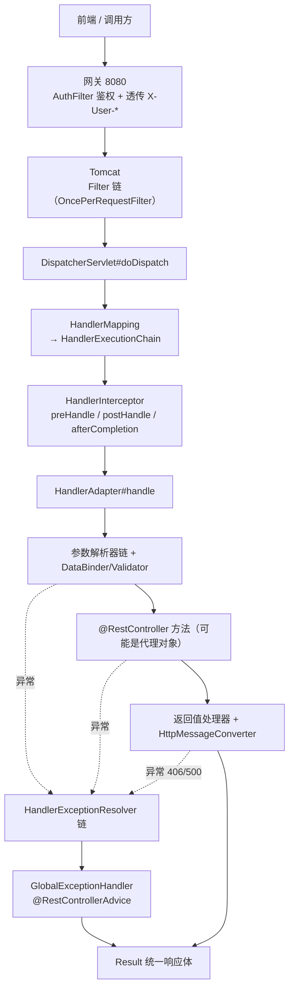
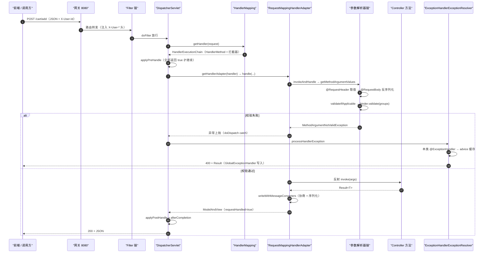

# Spring MVC 请求全链路与参数校验：一个 HTTP 请求的九个事故点

> 一句话结论：一个请求从网关进来变成 Controller 手里的 Java 对象，只走一条主干（`DispatcherServlet#doDispatch` 的九步），但这条主干上每一站都是"策略接口 + 有序列表 + 第一个匹配者胜出"；**默认值决定了你最后看到的是 400、415、500，还是一条被静默放行的脏数据**。
> 阅读前置：会写 `@RestController`/`@PostMapping`/`@Valid`；知道 Spring 容器与自动配置（读过[《SpringBoot核心原理》](./01-SpringBoot核心原理.md)的"自动配置"一节更好，本篇 §3.9 要用到 `AutoConfiguration.imports`）。不需要读过 Spring MVC 源码——本篇所有源码结论都带行号锚点，深入推导见文末姊妹篇。
> 证据基线：JDK 17.0.19 / Spring Framework 7.1.0 / Spring Boot 4.2.0 / Spring Cloud 2026.0.0 / Jakarta Validation（`jakarta.validation`）/ Jackson 2 与 Jackson 3 并存；A 级源码摘录出自 `24-源码分析/assets/source/`，B 级为本仓库 `ai-cs-*` 代码，C 级为本机实跑命令。预计阅读 40 分钟。

## 0. 先看现象

线上关于"参数"的事故，几乎都能归到下面三类现场。它们看起来互不相干，但都发生在同一条链上。

**现场一：`@Valid` 写了，脏数据还是进来了。**

`ai-cs-chat/src/main/java/com/aics/chat/controller/RagEvalController.java#L46` 这个方法：

```java
public Result<RagEvalReport> run(@RequestBody RagEvalRequest request) {
```

参数上没有 `@Valid`。请求体全空也照样进方法体，直到业务层 `request.getGoldenSetPath()` 抛 `NullPointerException`，最后由兜底分支转成：

```text
{"code":500,"message":"系统内部错误","data":null,"timestamp":17...}
日志：系统异常 [POST] /chat/eval/run   （log.error 打全栈，见 GlobalExceptionHandler#handleException）
```

注意它不是"校验没通过"，而是**校验从来没被触发**——这两件事在日志里长得完全不同。

**现场二：本该 400，结果 500。**

直连服务端口（绕过网关，比如本地联调 `http://localhost:8087/cart/add`）不带 `X-User-Id` 头：

```text
POST /cart/add  Content-Type: application/json
{"productId":1001,"quantity":1}

→ HTTP/1.1 500
{"code":500,"message":"系统内部错误"}
日志：系统异常 [POST] /cart/add
     org.springframework.web.bind.MissingRequestHeaderException:
     Required request header 'X-User-Id' for method parameter type Long is not present
```

`CartController#addToCart` 的 `@RequestHeader("X-User-Id")` 没写 `required = false`（`ai-cs-order/src/main/java/com/aics/order/controller/CartController.java#L46-L48`），而 `GlobalExceptionHandler`（`ai-cs-common/src/main/java/com/aics/common/exception/GlobalExceptionHandler.java`）里**没有** `MissingRequestHeaderException` 分支；异常按"继承距离最近"落到 `@ExceptionHandler(Exception.class)`（L149-L154），于是 500。同样命运的还有 415 的 `HttpMediaTypeNotSupportedException`：

```text
Content-Type 'text/plain;charset=UTF-8' is not supported
```

（这句是 Spring 默认文案，`HttpMediaTypeNotSupportedException` 的构造信息，本篇 assets 未摘录该类，仅用于日志定位。）

**现场三：前端拿到了 400，却拿不到"哪个字段错了"。**

```text
POST /cart/add  X-User-Id: 1  {"productId":1001}

→ HTTP/1.1 400
{"code":400,"message":"数量不能为空","data":null,"timestamp":...}
日志：参数校验异常 [POST] /cart/add: 数量不能为空
```

`message` 里只有文案，没有 `field`。因为 `GlobalExceptionHandler#handleMethodArgumentNotValidException` 只映射了 `FieldError::getDefaultMessage`（`ai-cs-common/src/main/java/com/aics/common/exception/GlobalExceptionHandler.java#L47-L49`），`getField()` 被有意丢掉；多个字段出错时它们被 `"; "` 拼成一串。前端想做"输入框下面红字提示"只能靠文案反查。

还有更隐蔽的一半：**业务异常的 HTTP 状态码是 200**。`handleBusinessException`（同文件 L35-L39）没有 `@ResponseStatus`：

```java
@ExceptionHandler(BusinessException.class)
public Result<Void> handleBusinessException(BusinessException e, HttpServletRequest request) {
    log.warn("业务异常 [{}] {}: code={}, msg={}", request.getMethod(), request.getRequestURI(), e.getCode(), e.getMessage());
    return Result.fail(e.getCode(), e.getMessage());
}
```

于是前端 axios 的 `validateStatus: status < 400` 认为请求成功，`catch` 分支永远不进；Feign 调用方（如 `ai-cs-chat/src/main/java/com/aics/chat/feign/OrderFeignClient.java`）也只能靠 `Result#isSuccess()` 反复判空——`ai-cs-chat/src/main/java/com/aics/chat/service/OrderQueryService.java#L48`、`#L78` 那一串 `result != null && result.isSuccess()` 就是这套约定的代价。

这些现象指向同一件事：**HTTP 请求要变成方法参数，中间要过六道"有默认值的手续"（选路、适配、取参、类型转换、校验、写响应），每一道的默认值都可能把你想要的 4xx 变成 500，或者把"该拦下的请求"放行到业务代码里。**

## 1. 整体地图

一句话：**`DispatcherServlet` 是唯一的总调度，它不认识你的 `@RestController`，只认识三个策略接口——`HandlerMapping`（交给谁）、`HandlerAdapter`（怎么调）、`HandlerExceptionResolver`（出错怎么办）。**



> **读图说明**：实线是"正常路径"，虚线是"任何一站抛异常"的合流点。注意三件事：① 网关与 Filter 在 `DispatcherServlet` **之前**，所以它们抛的异常根本进不了 `@RestControllerAdvice`；② 拦截器挂在 `HandlerExecutionChain` 上，只在 `HandlerMapping` 命中后才有机会执行——**404 的请求不会触发拦截器**；③ 参数解析器和消息转换器都是"链"，链上第一个说"我能处理"的赢，这决定了后面所有异常的归属。

各组件在本仓库里的实际站位：

| 组件 | 责任 | 关键类（框架侧） | 谁调用它 | 本仓库证据 |
| --- | --- | --- | --- | --- |
| 网关过滤器 | 鉴权、注入 `X-User-Id`/`X-User-Roles` | Spring Cloud Gateway `GlobalFilter` | Netty | 端口 8080（`ai-cs-gateway`） |
| Servlet 过滤器 | 把可信头翻译成 `SecurityContext` | `OncePerRequestFilter` | Tomcat `FilterChain` | `ai-cs-user/src/main/java/com/aics/user/security/HeaderAuthenticationFilter.java#L31-L56` |
| 前端控制器 | 九步总调度 | `DispatcherServlet` | 容器（`ServletRegistrationBean`） | `DispatcherServletAutoConfiguration` |
| 选路 | URL + 方法 + 头 + 参数条件 → `HandlerMethod` | `RequestMappingHandlerMapping` | `DispatcherServlet#getHandler` | A 级见 §3.2 |
| 适配 | 决定怎么把参数变出来、怎么调 | `RequestMappingHandlerAdapter` | `DispatcherServlet#getHandlerAdapter` | A 级见 §3.3 |
| 取参 | 每个参数一个解析器 | `HandlerMethodArgumentResolverComposite` | `InvocableHandlerMethod` | A 级见 §3.4 |
| 校验 | `DataBinder` + Jakarta Validator | `WebDataBinder`/`@InitBinder` | 解析器内部（`validateIfApplicable`） | A 级见 §3.5 |
| 写响应 | 返回值 → JSON | `RequestResponseBodyMethodProcessor` + `HttpMessageConverter` | `ServletInvocableHandlerMethod#invokeAndHandle` | A 级见 §3.8 |
| 异常出口 | 异常 → 统一响应 | `ExceptionHandlerExceptionResolver` | `DispatcherServlet#processHandlerException` | A 级见 §3.9 |
| 全局兜底 | 业务/参数/系统异常翻译 | `@RestControllerAdvice` | 上面的 Resolver | `GlobalExceptionHandler`（B 级，见 §3.9） |

## 2. 关键概念与关键类

先给结论：**这条链上只有 12 个类值得背下来，其余都是它们的子类或策略实现。**

| 名称 | 位置（基线 7.1.0） | 角色 | 关键方法 |
| --- | --- | --- | --- |
| `DispatcherServlet` | `spring-webmvc` | 前端控制器；九步主干 | `doDispatch`、`getHandler`、`getHandlerAdapter`、`processHandlerException`、`noHandlerFound` |
| `HandlerMapping` / `AbstractHandlerMethodMapping` | `spring-webmvc` | URL → `HandlerExecutionChain`（内含 `HandlerMethod` + 拦截器数组） | `getHandler`、`getHandlerInternal`、`lookupHandlerMethod` |
| `RequestMappingHandlerMapping` | `spring-webmvc` | 把 `@RequestMapping` 合成 `RequestMappingInfo` | `getMappingForMethod`、`createRequestMappingInfo` |
| `RequestMappingInfoHandlerMapping` | `spring-webmvc` | 命中后把路径变量塞进 request 属性 | `handleMatch`、`extractMatchDetails` |
| `HandlerAdapter` / `RequestMappingHandlerAdapter` | `spring-webmvc` | "怎么调这个方法"：装解析器、造 `ModelAndViewContainer`、反射调用 | `supportsInternal`、`handleInternal`、`invokeHandlerMethod`、`getDataBinderFactory` |
| `HandlerMethodArgumentResolverComposite` | `spring-webmvc` | 参数解析器链（有序、带缓存） | `supportsParameter`、`resolveArgument`、`getArgumentResolver` |
| `RequestResponseBodyMethodProcessor` | `spring-webmvc` | 同时是 `@RequestBody` 的解析器和 `@ResponseBody` 的返回值处理器 | `supportsParameter`、`resolveArgument`、`handleReturnValue` |
| `AbstractNamedValueMethodArgumentResolver` | `spring-webmvc` | `@RequestParam`/`@PathVariable`/`@RequestHeader` 的公共骨架 | `resolveArgument`、`convertIfNecessary`、`handleMissingValue` |
| `RequestParamMethodArgumentResolver` | `spring-webmvc` | `@RequestParam`（也兜底简单类型无注解参数） | `supportsParameter`、`resolveName`、`handleMissingValueInternal` |
| `PathVariableMethodArgumentResolver` | `spring-webmvc` | `@PathVariable`（从 `URI_TEMPLATE_VARIABLES_ATTRIBUTE` 取） | `resolveName` |
| `WebDataBinder` / `@InitBinder` | `spring-context`（`spring-web` 提供 `WebDataBinder`） | 类型转换 + 校验 + `BindingResult` | `convertIfNecessary`、`validate`、`getBindingResult` |
| `ExceptionHandlerExceptionResolver` | `spring-webmvc` | `@ExceptionHandler` 的调度器（本类优先，再 advice 缓存） | `getExceptionHandlerMethod`、`doResolveHandlerMethodException` |

两张"配套概念"必须分清，它们的名字太像：

| 注解 | 来源包 | 作用点 | 是否支持分组 |
| --- | --- | --- | --- |
| `@Valid` | `jakarta.validation.Valid`（标准） | 参数上，让解析器触发 Bean Validation | 不支持（没有 `groups` 属性） |
| `@Validated` | `org.springframework.validation.annotation.Validated`（Spring 自建） | 类上（触发方法参数校验）/ 参数上（可带 `groups`） | 支持 `value()` 指定分组 |

## 3. 原理与证据逐段精读

### 3.1 `doDispatch` 的九步：一个方法里的三套 try

**在干什么。** 把"一个请求"拆成九个动作，其中任何一步抛异常都会被同一个 catch 收拢，最后交给 `processDispatchResult` 决定是渲染还是走异常解析。

```java (src: DispatcherServlet.java.md#L946-L980)
			try {
				processedRequest = checkMultipart(request);
				multipartRequestParsed = (processedRequest != request);

				// Determine handler for the current request.
				mappedHandler = getHandler(processedRequest);
				if (mappedHandler == null) {
					noHandlerFound(processedRequest, response);
					return;
				}

				if (!mappedHandler.applyPreHandle(processedRequest, response)) {
					return;
				}

				// Determine handler adapter and invoke the handler.
				HandlerAdapter ha = getHandlerAdapter(mappedHandler.getHandler());
				mv = ha.handle(processedRequest, response, mappedHandler.getHandler());

				if (asyncManager.isConcurrentHandlingStarted()) {
					return;
				}

				applyDefaultViewName(processedRequest, mv);
				mappedHandler.applyPostHandle(processedRequest, response, mv);
			}
			catch (Exception ex) {
				dispatchException = ex;
			}
			catch (Throwable err) {
				// As of 4.3, we're processing Errors thrown from handler methods as well,
				// making them available for @ExceptionHandler methods and other scenarios.
				dispatchException = new ServletException("Handler dispatch failed: " + err, err);
			}
			processDispatchResult(processedRequest, response, mappedHandler, mv, dispatchException);
```

逐句白话：① `checkMultipart` 先判断是不是文件上传，是就把 request 包成 `MultipartHttpServletRequest`（**这一步在你进 Controller 之前就可能抛 `MultipartException`**）；② `getHandler` 选路，空就 `noHandlerFound` 并**直接 return**（不进异常解析链的前半段，但 `noHandlerFound` 自己会抛 `NoHandlerFoundException`，详见 §3.2）；③ `applyPreHandle` 只要有一个拦截器返回 `false` 就 `return`——**响应体由拦截器自己写**；④ `getHandlerAdapter` 找适配器；⑤ `ha.handle(...)` 一句吞掉"参数解析 + 校验 + 反射调用 + 返回值处理"这四件事；⑥ 异步请求（`SseEmitter`、`Callable`）在这里提前 return；⑦ `applyPostHandle` 只在同步成功路径执行；⑧ 异常被存进 `dispatchException` 而不是直接抛；⑨ `processDispatchResult` 是唯一出口。

**为什么这么设计。** 因为第 ⑤ 步是黑盒，异常必须"延迟处理"：只有把异常从 `ha.handle` 里捞出来、变成局部变量 `dispatchException`，才能保证 `processDispatchResult` **一定会被执行**——它负责调 `HandlerExceptionResolver`（把异常变成响应），也负责 `triggerAfterCompletion`（让拦截器收尾、清理 ThreadLocal）。如果把 `ha.handle` 的异常直接往上抛，`afterCompletion` 就要在外层再写一遍，且 `postHandle` 与异常路径的语义会纠缠。

**换写法会怎样。** 想象你手写一个 Servlet 分发器，每个 Controller 方法外面 `try/catch` 然后自己 `response.getWriter().write(json)`：控制器一多，"谁的异常谁处理"就变成 40 个重复的 catch 块，且无法统一加日志/trace/脱敏。Spring 把它抽成 `HandlerExceptionResolver` 策略，才有了你项目里一个 `@RestControllerAdvice` 覆盖 11 个服务的可能。

**常见坑。** ① `catch (Throwable err)` 会把 `Error`（如 `StackOverflowError`）也包装成 `ServletException` 并交给 `@ExceptionHandler`——你的兜底分支 `@ExceptionHandler(Exception.class)` 接不住它，最终 500 且日志里有两层包装（`Handler dispatch failed:`）；② `applyPreHandle` 返回 `false` 时**不会**走 `processDispatchResult`，所以那一次请求的 `postHandle` 不执行、`afterCompletion` 也不执行（Spring 只对"preHandle 返回 true 的拦截器"回调 `afterCompletion`）——本项目 `TraceInterceptor#preHandle` 永远 `return true`（`ai-cs-chat/src/main/java/com/aics/chat/observability/TraceInterceptor.java#L58`），所以 `afterCompletion` 一定会跑，落库不会丢；③ 第 ⑥ 步的提前 return 意味着 SSE 请求**不会**再走 `postHandle`，`TraceInterceptor` 的收尾依赖 `afterCompletion`（L62-L85）而不是 `postHandle`，这是本项目刻意选的位置。

### 3.2 选路：`getHandler` 遍历 + `lookupHandlerMethod` 的两级查找

**在干什么。** `DispatcherServlet` 持有 `List<HandlerMapping>`，挨个问"你能处理吗"，第一个返回非 `null` 的赢。

```java (src: DispatcherServlet.java.md#L1154-L1164)
	protected @Nullable HandlerExecutionChain getHandler(HttpServletRequest request) throws Exception {
		if (this.handlerMappings != null) {
			for (HandlerMapping mapping : this.handlerMappings) {
				HandlerExecutionChain handler = mapping.getHandler(request);
				if (handler != null) {
					return handler;
				}
			}
		}
		return null;
	}
```

默认有哪些 `HandlerMapping`、顺序是什么，写在 `DispatcherServlet.properties` 里：

```text (src: DispatcherServlet.properties.md#L7-L19)
org.springframework.web.servlet.HandlerMapping=org.springframework.web.servlet.handler.BeanNameUrlHandlerMapping,\
	org.springframework.web.servlet.mvc.method.annotation.RequestMappingHandlerMapping,\
	org.springframework.web.servlet.function.support.RouterFunctionMapping

org.springframework.web.servlet.HandlerAdapter=org.springframework.web.servlet.mvc.HttpRequestHandlerAdapter,\
	org.springframework.web.servlet.mvc.SimpleControllerHandlerAdapter,\
	org.springframework.web.servlet.mvc.method.annotation.RequestMappingHandlerAdapter,\
	org.springframework.web.servlet.function.support.HandlerFunctionAdapter

org.springframework.web.servlet.HandlerExceptionResolver=org.springframework.web.servlet.mvc.method.annotation.ExceptionHandlerExceptionResolver,\
	org.springframework.web.servlet.mvc.annotation.ResponseStatusExceptionResolver,\
	org.springframework.web.servlet.mvc.support.DefaultHandlerExceptionResolver
```

进入 `RequestMappingHandlerMapping` 之后，真正的查找在父类。对外暴露的 `getHandler` 在 `AbstractHandlerMapping` 里，负责把 `HandlerMethod` 包成带拦截器的 `HandlerExecutionChain`；`getHandlerInternal` 只负责"找方法"：

```java (src: AbstractHandlerMethodMapping.java.md#L371-L382)
	@Override
	protected @Nullable HandlerMethod getHandlerInternal(HttpServletRequest request) throws Exception {
		String lookupPath = initLookupPath(request);
		this.mappingRegistry.acquireReadLock();
		try {
			HandlerMethod handlerMethod = lookupHandlerMethod(lookupPath, request);
			return (handlerMethod != null ? handlerMethod.createWithResolvedBean() : null);
		}
		finally {
			this.mappingRegistry.releaseReadLock();
		}
	}
```

`lookupHandlerMethod`（同文件 L393-L421）是两级查找：先查 `mappingRegistry.getMappingsByDirectPath(lookupPath)`（无路径变量的"直连路径"用 HashMap 直接命中），查不到才遍历全部注册项做 `addMatchingMappings`；多个命中时用 `MatchComparator` 排序取第一个，若前两名的比较结果相等就抛"歧义"异常。

命中之后，路径变量在 `handleMatch` 阶段被写进 request 属性——这是 `@PathVariable` 唯一的取数来源：

```java (src: RequestMappingInfoHandlerMapping.java.md#L133-L145)
	@Override
	protected void handleMatch(RequestMappingInfo info, String lookupPath, HttpServletRequest request) {
		super.handleMatch(info, lookupPath, request);

		info.getVersionCondition().handleMatch(request);

		RequestCondition<?> condition = info.getActivePatternsCondition();
		if (condition instanceof PathPatternsRequestCondition pprc) {
			extractMatchDetails(pprc, lookupPath, request);
		}
		else {
			extractMatchDetails((PatternsRequestCondition) condition, lookupPath, request);
		}
```

**为什么这么设计。** 一个 `List` + "第一个非空胜出"的结构，让"注解式 Controller、`BeanNameUrlHandlerMapping` 老式写法、函数式路由 `RouterFunction`"三种编程模型可以共存于同一容器；`RequestMappingInfo` 又把 URL、方法、`params`、`headers`、`consumes`、`produces`、版本号全部编码成可比较的条件对象，才能做"精确匹配优先"。

**换写法会怎样。** 如果改成 `Map<String, HandlerMethod>` 直接查表，看起来更快，但你立刻失去 `@GetMapping`/`@PostMapping` 区分能力、失去 `/{id}` 模板匹配、也失去 `consumes`/`produces` 参与选路的能力——而这些正是 §3.8 内容协商的前提。

**常见坑。** ① 两个 Controller 写了同一个 `@RequestMapping("/chat/send")`（典型是复制粘贴），启动不报错，第一个请求进来才在 `lookupHandlerMethod` 里抛歧义异常——**这类问题启动阶段看不出来，只能靠 §6 的启动自检**；② `@RequestMapping` 写在类上不带 `@ResponseBody` 也不是 `@RestController` 时，返回值会被当成视图名（走 `InternalResourceViewResolver`），表现为 404 而不是 JSON——`DispatcherServlet.properties` 里那个 `ViewResolver` 默认值就是这个陷阱；③ `getDefaultHandler()` 若被配置过，404 会被"兜底处理器"吃掉，日志里连 `No mapping for` 都看不到。

### 3.3 适配：`getHandlerAdapter` 与 `invokeHandlerMethod` 的 30 行装配

**在干什么。** 选路给出的是 `HandlerMethod`（哪张表、哪个方法），适配器负责"把这次调用跑完"。`RequestMappingHandlerAdapter#invokeHandlerMethod` 是全局最忙的 30 行：

```java (src: RequestMappingHandlerAdapter.java.md#L907-L923)
		WebDataBinderFactory binderFactory = getDataBinderFactory(handlerMethod);
		ModelFactory modelFactory = getModelFactory(handlerMethod, binderFactory);

		ServletInvocableHandlerMethod invocableMethod = createInvocableHandlerMethod(handlerMethod);
		if (this.argumentResolvers != null) {
			invocableMethod.setHandlerMethodArgumentResolvers(this.argumentResolvers);
		}
		if (this.returnValueHandlers != null) {
			invocableMethod.setHandlerMethodReturnValueHandlers(this.returnValueHandlers);
		}
		invocableMethod.setDataBinderFactory(binderFactory);
		invocableMethod.setParameterNameDiscoverer(this.parameterNameDiscoverer);
		invocableMethod.setMethodValidator(this.methodValidator);

		ModelAndViewContainer mavContainer = new ModelAndViewContainer();
		mavContainer.addAllAttributes(RequestContextUtils.getInputFlashMap(request));
		modelFactory.initModel(webRequest, mavContainer, invocableMethod);
```

紧接其后是异步结果恢复（L925-L936）与最后一句 `invocableMethod.invokeAndHandle(webRequest, mavContainer)`（L938），此处略去不贴。

顺序很关键：**先造 `WebDataBinderFactory`（因为它携带 `@InitBinder` 方法），再造 `ServletInvocableHandlerMethod`，再挂解析器/返回值处理器，最后 `invokeAndHandle`**。`binderFactory` 的构造在同一个类里：

```java (src: RequestMappingHandlerAdapter.java.md#L991-L1013)
	private WebDataBinderFactory getDataBinderFactory(HandlerMethod handlerMethod) throws Exception {
		Class<?> handlerType = handlerMethod.getBeanType();
		Set<Method> methods = this.initBinderCache.get(handlerType);
		if (methods == null) {
			methods = MethodIntrospector.selectMethods(handlerType, INIT_BINDER_METHODS);
			this.initBinderCache.put(handlerType, methods);
		}
		List<InvocableHandlerMethod> initBinderMethods = new ArrayList<>();
		// Global methods first
		this.initBinderAdviceCache.forEach((controllerAdviceBean, methodSet) -> {
			if (controllerAdviceBean.isApplicableToBeanType(handlerType)) {
				Object bean = controllerAdviceBean.resolveBean();
				for (Method method : methodSet) {
					initBinderMethods.add(createInitBinderMethod(bean, method));
				}
			}
		});
		for (Method method : methods) {
			Object bean = handlerMethod.getBean();
			initBinderMethods.add(createInitBinderMethod(bean, method));
		}
		DefaultDataBinderFactory factory = createDataBinderFactory(initBinderMethods);
		factory.setMethodValidationApplicable(this.methodValidator != null && handlerMethod.shouldValidateArguments());
```

**为什么这么设计。** `@InitBinder` 方法要"全局在前、本类在后"依次执行（注释原话 `// Global methods first`），因为后执行的 `registerCustomEditor`/`addValidators` 会覆盖先执行的——这就是"全局 `@InitBinder` 注册的转换器能被 Controller 覆盖"的实现方式。`initBinderCache` 按 `handlerType` 缓存 `Set<Method>`，避免每次请求都做反射扫描。

**换写法会怎样。** 如果把校验做成 AOP 切面（`@Around` 里自己调 `validator.validate`），你能复用的只有"方法已进入"之后的时机，而 `@RequestBody` 的对象此时可能压根没被反序列化出来；而且 `BindingResult` 必须和"解析这个参数的解析器"绑定，切面里拿不到。所以 Spring 把校验放在**参数解析器内部**（§3.5），这是有意为之。

**常见坑。** ① 在 `@InitBinder` 里调 `binder.setValidator(null)` 或 `setAllowedFields(...)` 会**同时**影响 `@Valid` 的行为，导致"校验莫名不生效"；② `initBinderAdviceCache` 只收带 `@InitBinder` 的 `@ControllerAdvice`，普通 `@Component` 里的 `@InitBinder` 不会被采集；③ 三个 `setXxx` 顺序问题：`invocableMethod.setMethodValidator` 只在 `this.methodValidator != null` 时才有意义（L919、L1013），而 `methodValidator` 由 `@Validated` 类级注解触发方法级校验时才会装配——**这解释了为什么 `@Validated` 放类上能校验 `@RequestParam` 上的 `@NotBlank`，放参数上却不行**（详见 §3.5 与 §7）。

### 3.4 参数解析器链：`for` 循环 + 每个参数一次 `supportsParameter`

**在干什么。** 方法有几个参数就循环几次，每次先问链上"谁能处理"，再让那个人把值变出来。

```java (src: InvocableHandlerMethod.java.md#L220-L237)
			if (!this.resolvers.supportsParameter(parameter)) {
				throw new IllegalStateException(formatArgumentError(parameter, "No suitable resolver"));
			}
			try {
				args[i] = this.resolvers.resolveArgument(parameter, mavContainer, request, this.dataBinderFactory);
			}
			catch (Exception ex) {
				// Leave stack trace for later, exception may actually be resolved and handled...
				if (logger.isDebugEnabled()) {
					String exMsg = ex.getMessage();
					if (exMsg != null && !exMsg.contains(parameter.getExecutable().toGenericString())) {
						logger.debug(formatArgumentError(parameter, exMsg));
					}
				}
				throw ex;
			}
		}
		return args;
```

上面这段在一个 `for (int i = 0; i < parameters.length; i++)` 循环体内（循环头在 L209-L219，先试 `providedArgs`、再跳过 `HandlerMethod` 类型的可选参数），所以"每个参数至少问一次链、可能抛一次异常"。

"链"本身是个组合器，它对每个参数只问一次，就把答案缓存下来：

```java (src: HandlerMethodArgumentResolverComposite.java.md#L113-L123)
	@Override
	public @Nullable Object resolveArgument(MethodParameter parameter, @Nullable ModelAndViewContainer mavContainer,
			NativeWebRequest webRequest, @Nullable WebDataBinderFactory binderFactory) throws Exception {

		HandlerMethodArgumentResolver resolver = getArgumentResolver(parameter);
		if (resolver == null) {
			throw new IllegalArgumentException("Unsupported parameter type [" +
					parameter.getParameterType().getName() + "]. supportsParameter should be called first.");
		}
		return resolver.resolveArgument(parameter, mavContainer, webRequest, binderFactory);
	}
```

"能不能处理"的判定是同一个私有方法 `getArgumentResolver(parameter)`（`supportsParameter` 见 [[源码:HandlerMethodArgumentResolverComposite.java.md#L103-L105]]），所以"先 `supportsParameter` 再 `resolveArgument`"两次调用命中的必是同一个解析器。

**为什么这么设计。** 参数种类是开放集合（`@RequestParam`/`@PathVariable`/`@RequestBody`/`@RequestHeader`/`MultipartFile`/`Principal`/`SessionStatus`……），用链 + 缓存能把"每个参数一次 O(n) 匹配"摊薄成"每种参数形式一次"。`supportsParameter` 的判定几乎都是**看注解**（例如 `RequestResponseBodyMethodProcessor#supportsParameter` 就是 `parameter.hasParameterAnnotation(RequestBody.class)`），所以"注解写错/漏写"直接表现为"落到别的解析器"或"没有解析器"。

**换写法会怎样。** 如果用一个巨型 `switch` 按类型分派，你会遇到"`String` 参数到底是 `@RequestParam` 还是 `@PathVariable` 还是 body"的歧义——这正是 `RequestParamMethodArgumentResolver#supportsParameter`（L127-L152）要判断"有没有 `@RequestParam`、是不是 `MultipartFile`、是不是简单类型（`BeanUtils.isSimpleProperty`）"三层逻辑的原因。

**常见坑。** ① 自定义参数解析器（`implements HandlerMethodArgumentResolver`）必须用 `WebMvcConfigurer#addArgumentResolvers` 注册，**默认是加在链的末尾**，如果它想接管的类型已被内置解析器认领，你永远等不到调用（老办法是 `@Order`/`RequestMappingHandlerAdapter#setArgumentResolvers` 全量替换，风险更大）；② 一个参数都不匹配时报的是 `IllegalStateException: No suitable resolver for argument ...`——这是**500**，不是 400，属于"代码写错了"而不是"客户端错了"；③ 这个循环里 `catch` 只打 debug 日志再原样抛出（L226-L234），所以排查解析失败时 `DEBUG` 级别非常值钱（§6 会给具体日志文案）。

### 3.5 `@Valid` 为什么没生效：`validateIfApplicable` 的三个前提

**在干什么。** `@RequestBody` 的反序列化完成后，解析器顺手做三件事：造 `WebDataBinder`、问"这个参数上有校验注解吗"、有错就抛 `MethodArgumentNotValidException`（除非方法签名后面还跟着一个 `BindingResult`/`Errors`）。

```java (src: RequestResponseBodyMethodProcessor.java.md#L150-L173)
	@Override
	public @Nullable Object resolveArgument(MethodParameter parameter, @Nullable ModelAndViewContainer mavContainer,
			NativeWebRequest webRequest, @Nullable WebDataBinderFactory binderFactory) throws Exception {

		parameter = parameter.nestedIfOptional();
		Object arg = readWithMessageConverters(webRequest, parameter, parameter.getNestedGenericParameterType());

		if (binderFactory != null) {
			String name = Conventions.getVariableNameForParameter(parameter);
			ResolvableType type = ResolvableType.forMethodParameter(parameter);
			WebDataBinder binder = binderFactory.createBinder(webRequest, arg, name, type);
			if (arg != null) {
				validateIfApplicable(binder, parameter);
				if (binder.getBindingResult().hasErrors() && isBindExceptionRequired(binder, parameter)) {
					throw new MethodArgumentNotValidException(parameter, binder.getBindingResult());
				}
			}
			if (mavContainer != null) {
				mavContainer.addAttribute(BindingResult.MODEL_KEY_PREFIX + name, binder.getBindingResult());
			}
		}

		return adaptArgumentIfNecessary(arg, parameter);
	}
```

`validateIfApplicable` 是父类方法，它的判定逻辑是"参数上的注解，只要能解析出校验 hints，就校验"：

```java (src: AbstractMessageConverterMethodArgumentResolver.java.md#L285-L294)
	protected void validateIfApplicable(WebDataBinder binder, MethodParameter parameter) {
		Annotation[] annotations = parameter.getParameterAnnotations();
		for (Annotation ann : annotations) {
			Object[] validationHints = ValidationAnnotationUtils.determineValidationHints(ann);
			if (validationHints != null) {
				binder.validate(validationHints);
				break;
			}
		}
	}
```

这一段的行为要点（逐条对照源码）：遍历参数上所有注解，对每个注调用 `ValidationAnnotationUtils.determineValidationHints(ann)`；返回非 `null` 就 `binder.validate(validationHints)` 然后 **break**。也就是说：`@Valid` 命中、`@Validated` 命中（其 `value()` 会变成 `groups` hints）、名字以 `Valid` 开头的自定义注解也命中；**而注解不在参数上、只在 DTO 类字段上（那是约束注解，不是校验触发注解），一律不命中**。

`isBindExceptionRequired`（同文件 L303-L306 起）负责"要不要抛"：看**下一个参数**是不是 `Errors` 类型，是就不抛、把 `BindingResult` 留给方法自己处理。

**为什么这么设计。** 校验只有放在"对象刚被造出来"这一刻才有意义；而 `BindingResult` 作为方法参数，是 Spring MVC 给"想自己处理错误"的人留的后门（典型场景：表单回填）。默认抛异常，是因为绝大多数接口只想快速失败。

**换写法会怎样。** 如果你在 Service 层用 `@Validated` + 手动 `validator.validate(dto)`，错误类型会变成 `ConstraintViolationException`（`jakarta.validation` 的），和你项目里 `GlobalExceptionHandler#handleConstraintViolationException`（`ai-cs-common/src/main/java/com/aics/common/exception/GlobalExceptionHandler.java#L70-L78`）那条分支对应——**两种做法产生两种异常类型、两套处理分支**，混用就会出现"有的接口 400 带字段文案，有的接口 500"。

**常见坑（本仓库真实站位）。**
- **只漏一个注解就全废**：`ai-cs-chat/src/main/java/com/aics/chat/controller/RagEvalController.java#L46` 的 `run(@RequestBody RagEvalRequest request)` 没有 `@Valid`；正确写法见 `ai-cs-order/src/main/java/com/aics/order/controller/CartController.java#L46-L48`（`@RequestHeader("X-User-Id") Long userId` + `@Valid @RequestBody CartAddDTO dto`）。
- **约束注解写在 DTO 上没用？不，那才是对的**：`ai-cs-order/src/main/java/com/aics/order/dto/CartAddDTO.java#L20-L28` 的 `@NotNull`/`@Min(1)`/`@Max(99)` 是约束；触发它的是 Controller 参数上的 `@Valid`。这两半缺一不可。
- **分组**：`@Validated` 是 Spring 的注解，支持 `groups`。`ai-cs-user/src/main/java/com/aics/user/controller/UserController.java#L31` 写的是 `@Validated(UserValidationGroups.Create.class) @RequestBody User user`，对应 `ai-cs-user/src/main/java/com/aics/user/entity/User.java#L26-L44` 里带 `groups=` 的约束。**如果约束没有声明 `groups`（默认 `Default` 组），而你传了 `Create.class`，它不会被校验**——这是"分组开了反而全不校验"的经典现场。
- **两种 @Validated 用法别混**：类上的 `@Validated` 打开的是"方法参数约束校验"（作用于 `@RequestParam`/`@RequestHeader` 上的 `@NotBlank` 等，异常是 `ConstraintViolationException`），`ai-cs-chat/src/main/java/com/aics/chat/controller/ChatController.java#L53` 就是这个用法；参数上的 `@Validated`/`@Valid` 打开的是"请求体 Object Graph 校验"（异常是 `MethodArgumentNotValidException`）。项目里 `ai-cs-chat/src/main/java/com/aics/chat/controller/ChatFeedbackController.java#L51`（`@Valid @RequestBody UserFeedbackDTO dto`）是后者，这个类的注释也把分工写清楚了。

### 3.6 `@RequestParam` / `@PathVariable`：取不到值时的三种反应

**在干什么。** 两个注解共用父类骨架 `AbstractNamedValueMethodArgumentResolver#resolveArgument`：先按名字取值 → 值缺失则看默认值 → 必填就报缺失 → 最后统一做类型转换。

```java (src: AbstractNamedValueMethodArgumentResolver.java.md#L117-L134)
		Object arg = resolveName(resolvedName.toString(), nestedParameter, webRequest);
		if (arg == null) {
			if (namedValueInfo.defaultValue != null) {
				arg = resolveEmbeddedValuesAndExpressions(namedValueInfo.defaultValue);
			}
			else if (namedValueInfo.required && !nestedParameter.isOptional()) {
				handleMissingValue(resolvedName.toString(), nestedParameter, webRequest);
			}
			if (!hasDefaultValue) {
				arg = handleNullValue(resolvedName.toString(), arg, nestedParameter.getNestedParameterType());
			}
		}
		else if ("".equals(arg) && namedValueInfo.defaultValue != null) {
			arg = resolveEmbeddedValuesAndExpressions(namedValueInfo.defaultValue);
		}

		if (binderFactory != null && (arg != null || !hasDefaultValue)) {
			arg = convertIfNecessary(parameter, webRequest, binderFactory, namedValueInfo, arg);
```

类型转换不是自己写的，是借 `WebDataBinder`：

```java (src: AbstractNamedValueMethodArgumentResolver.java.md#L286-L296)
		try {
			arg = binder.convertIfNecessary(arg, parameterType, parameter);
		}
		catch (ConversionNotSupportedException ex) {
			throw new MethodArgumentConversionNotSupportedException(arg, ex.getRequiredType(),
					namedValueInfo.name, parameter, ex.getCause());
		}
		catch (TypeMismatchException ex) {
			throw new MethodArgumentTypeMismatchException(arg, ex.getRequiredType(),
					namedValueInfo.name, parameter, ex.getCause());
		}
```

（该方法开头 L278-L285 先 `binderFactory.createBinder(webRequest, null, namedValueInfo.name)` 取 `WebDataBinder`，并对 Kotlin inline class 做一次类型下探。）

关键分支在 L287-L296：`binder.convertIfNecessary(...)` 抛 `ConversionNotSupportedException` → 包成 `MethodArgumentConversionNotSupportedException`（500 级别，代码问题）；抛 `TypeMismatchException` → 包成 `MethodArgumentTypeMismatchException`（**客户端输入错误**）。

不同注解"取不到值"的反应完全不同：

| 注解 | 取数位置 | 缺失时 | 本项目对应处理 |
| --- | --- | --- | --- |
| `@RequestParam` | `request.getParameterValues(name)` | 抛 `MissingServletRequestParameterException` | `GlobalExceptionHandler` L109-L114 → 400「缺少请求参数: xxx」 |
| `@PathVariable` | request 属性 `URI_TEMPLATE_VARIABLES_ATTRIBUTE` | 抛 `MissingPathVariableException` | **无分支** → 落 `Exception.class` → 500 |
| `@RequestHeader` | 请求头 | 抛 `MissingRequestHeaderException` | **无分支** → 落 `Exception.class` → 500 |
| 以上三者值存在但类型不对 | —— | 抛 `MethodArgumentTypeMismatchException` | L84-L91 → 400「参数类型错误: xxx」 |

`@RequestParam` 的缺失分支在子类里被改写成了更具体的异常：

```java (src: RequestParamMethodArgumentResolver.java.md#L205-L221)
	protected void handleMissingValueInternal(
			String name, MethodParameter parameter, NativeWebRequest request, boolean missingAfterConversion)
			throws Exception {

		HttpServletRequest servletRequest = request.getNativeRequest(HttpServletRequest.class);
		if (MultipartResolutionDelegate.isMultipartArgument(parameter)) {
			if (servletRequest == null || !MultipartResolutionDelegate.isMultipartRequest(servletRequest)) {
				throw new MultipartException("Current request is not a multipart request");
			}
			else {
				throw new MissingServletRequestPartException(name);
			}
		}
		else {
			throw new MissingServletRequestParameterException(name, parameter, missingAfterConversion);
		}
	}
```

`@PathVariable` 则从请求属性里取（值由 §3.2 的 `handleMatch` 写入），取不到时抛自己的异常：

```java (src: PathVariableMethodArgumentResolver.java.md#L93-L97)
	protected @Nullable Object resolveName(String name, MethodParameter parameter, NativeWebRequest request) throws Exception {
		Map<String, String> uriTemplateVars = (Map<String, String>) request.getAttribute(
				HandlerMapping.URI_TEMPLATE_VARIABLES_ATTRIBUTE, RequestAttributes.SCOPE_REQUEST);
		return (uriTemplateVars != null ? uriTemplateVars.get(name) : null);
	}
```

（同一个类 L100-L102 覆盖了 `handleMissingValue`，抛 `MissingPathVariableException`。）

**为什么这么设计。** 三个注解语义不同，缺失的"错误归因"也不同：`@RequestParam` 缺失是客户端没传（400）；`@PathVariable` 缺失通常是**代码与模板不一致**（比如 `@GetMapping("/{id}")` 改成 `@GetMapping("/x")` 但方法签名没改）——那是服务端 bug；`@RequestHeader` 缺失既可能是客户端漏传、也可能是网关没透传（本项目直连端口时必现）。框架给出三个异常类，就是让你能分开处理。

**换写法会怎样。** 如果统一成一个 `IllegalArgumentException`，你在 `@RestControllerAdvice` 里就只能给同一个响应，区分不了"该让前端补参数"还是"该报警修代码"。

**常见坑。** ① `required` 默认是 `true`——`@RequestHeader("X-User-Id") Long userId` 在直连端口时直接 500（§0 现场二）；本项目 chat 模块统一写 `@RequestHeader(value = "X-User-Id", required = false)`（`ai-cs-chat/src/main/java/com/aics/chat/controller/ChatController.java#L82`）就是为了"观测/降级不阻断业务"；② `@PathVariable("cartItemId") Long cartItemId` 收到 `abc` 时是 400（`MethodArgumentTypeMismatchException`），但如果你的路径变量名与模板不一致（`@PathVariable("id")` 对应 `{cartItemId}`），得到的是 500；③ `defaultValue` 只对 `@RequestParam`/`@RequestHeader` 有意义，`@RequestParam(required=false)` + 基本类型 `int` 仍然会因为 null 装箱失败报错，正确写法是用包装类型或给默认值。

### 3.7 `@RequestBody` 的读体过程：`Content-Type` 决定一切

**在干什么。** 反序列化前先看 `Content-Type`，再从转换器列表里找第一个 `canRead` 的赢家。

```java (src: AbstractMessageConverterMethodArgumentResolver.java.md#L162-L169)
		catch (InvalidMediaTypeException ex) {
			throw new HttpMediaTypeNotSupportedException(
					ex.getMessage(), getSupportedMediaTypes(targetClass != null ? targetClass : Object.class));
		}
		if (contentType == null) {
			noContentType = true;
			contentType = MediaType.APPLICATION_OCTET_STREAM;
		}
```

转换器的试错循环在紧接着的 L178-L196（`for (HttpMessageConverter<?> converter : this.messageConverters)`，依次用 `GenericHttpMessageConverter` / `SmartHttpMessageConverter` / 普通 `HttpMessageConverter` 的 `canRead` 判定），第一个命中者赢并 `break`。

这段的四层含义：

1. **没有 `Content-Type`（L166-L169）→ 当成 `application/octet-stream`**，`noContentType = true`。所以"空 body 的 POST"不会立刻 415，而是走"空体 + required"的 400 分支。
2. **`Content-Type` 非法（L162-L165）→ 415**（`HttpMediaTypeNotSupportedException`）。
3. **按序试转换器（L178-L196）**：`GenericHttpMessageConverter`（能读泛型）→ `SmartHttpMessageConverter`（能读 `ResolvableType`）→ 普通 `HttpMessageConverter`（只能按 `Class` 读）。三者都问"你能不能把 `Content-Type` 读成目标类型"。
4. **一个都没命中 → 415**：body 仍是 `NO_VALUE` 且方法属于 `SUPPORTED_METHODS`（`Set.of(POST, PUT, PATCH, QUERY)`，同文件 L77）时抛 `HttpMediaTypeNotSupportedException`。

而"空体但 `required = true`"的 400 在子类里：

```java (src: RequestResponseBodyMethodProcessor.java.md#L181-L191)
		if (arg == null && checkRequired(parameter)) {
			throw new HttpMessageNotReadableException("Required request body is missing: " +
					parameter.getExecutable().toGenericString(), inputMessage);
		}
		return arg;
	}

	protected boolean checkRequired(MethodParameter parameter) {
		RequestBody requestBody = parameter.getParameterAnnotation(RequestBody.class);
		return (requestBody != null && requestBody.required() && !parameter.isOptional());
	}
```

**为什么这么设计。** 因为 `HttpMessageConverter` 是 `spring-web` 层的通用设施（`RestClient`、`RestTemplate`、Feign 都用它），MVC 只是借用。内容协商靠"能力接口 + 顺序"而不是中心化注册表，任何第三方库（Protobuf、XML、自定义二进制）只要提供一个转换器就能插进来。

**换写法会怎样。** 如果按 `Content-Type` 直接查表（`Map<MediaType, Converter>`），`application/json;charset=UTF-8`、`application/*+json`、`text/json` 这些变体就要无穷枚举；"能力接口"方案让每个转换器自己声明兼容范围。

**常见坑。** ① 前端用 `axios.post(url, JSON.stringify(dto))` 不带 `Content-Type`，被 `application/octet-stream` 兜住 → 转换器全不认 → 415（在项目里再被兜底成 500，见 §0）；② `@RequestBody Map<String, Object> body`（`ai-cs-order/src/main/java/com/aics/order/controller/CartController.java#L67-L76` 的 `selectCartItems`）**没有类型约束、也没法加 `@Valid`**——所有字段校验都得手写在业务层；③ JSON 语法错误抛 `HttpMessageNotReadableException`（L221-L223 那条 `I/O error while reading input message`），本项目有分支（L97-L103）→ 400；但**字段类型不匹配**（`"quantity": "abc"`）在 Jackson 3 里同样是 `HttpMessageNotReadableException`，文案却是 `JSON parse error`，别按文案做分支。

### 3.8 返回值处理与内容协商：`setRequestHandled(true)` 之后发生了什么

**在干什么。** 方法返回后，`ServletInvocableHandlerMethod#invokeAndHandle` 先处理 `@ResponseStatus`，再把返回值交给返回值处理器：

```java (src: ServletInvocableHandlerMethod.java.md#L114-L126)
	public void invokeAndHandle(ServletWebRequest webRequest, ModelAndViewContainer mavContainer,
			@Nullable Object... providedArgs) throws Exception {

		Object returnValue = invokeForRequest(webRequest, mavContainer, providedArgs);
		setResponseStatus(webRequest);

		if (returnValue == null) {
			if (isRequestNotModified(webRequest) || getResponseStatus() != null || mavContainer.isRequestHandled()) {
				disableContentCachingIfNecessary(webRequest);
				mavContainer.setRequestHandled(true);
				return;
			}
		}
```

后面 L127-L136 处理 `@ResponseStatus(reason = ...)` 分支，然后 `mavContainer.setRequestHandled(false)` 并把返回值交给 `this.returnValueHandlers.handleReturnValue(...)`。

`@RestController` 的方法命中 `RequestResponseBodyMethodProcessor`（它同时是返回值处理器），第一行就把"响应已写"标记打上：

```java (src: RequestResponseBodyMethodProcessor.java.md#L193-L200)
	@Override
	public void handleReturnValue(@Nullable Object returnValue, MethodParameter returnType,
			ModelAndViewContainer mavContainer, NativeWebRequest webRequest)
			throws IOException, HttpMediaTypeNotAcceptableException, HttpMessageNotWritableException {

		mavContainer.setRequestHandled(true);
		ServletServerHttpRequest inputMessage = createInputMessage(webRequest);
		ServletServerHttpResponse outputMessage = createOutputMessage(webRequest);
```

`mavContainer.setRequestHandled(true)` 的含义是"别再去渲染视图了"，所以 `DispatcherServlet#processDispatchResult` 拿到的是空 `ModelAndView` 并且不再做视图解析。写响应体本身在 `writeWithMessageConverters`：

```java (src: AbstractMessageConverterMethodProcessor.java.md#L366-L398)
		MediaType selectedMediaType = null;
		MediaType contentType = outputMessage.getHeaders().getContentType();
		boolean isContentTypePreset = contentType != null && contentType.isConcrete();
		if (isContentTypePreset) {
			if (logger.isDebugEnabled()) {
				logger.debug("Found 'Content-Type:" + contentType + "' in response");
			}
			selectedMediaType = contentType;
		}
		else {
			HttpServletRequest request = inputMessage.getServletRequest();
			List<MediaType> acceptableTypes;
			try {
				acceptableTypes = getAcceptableMediaTypes(request);
			}
			catch (HttpMediaTypeNotAcceptableException ex) {
				int series = outputMessage.getServletResponse().getStatus() / 100;
				if (body == null || series == 4 || series == 5) {
					if (logger.isDebugEnabled()) {
						logger.debug("Ignoring error response content (if any). " + ex);
					}
					return;
				}
				throw ex;
			}

			List<MediaType> producibleTypes = getProducibleMediaTypes(request, valueType, targetType);
			if (body != null && producibleTypes.isEmpty()) {
				throw new HttpMessageNotWritableException(
						"No converter found for return value of type: " + valueType);
			}

			List<MediaType> compatibleMediaTypes = determineCompatibleMediaTypes(acceptableTypes, producibleTypes);
```

白话：① 如果响应头已经有具体 `Content-Type`（例如 `@PostMapping(produces=...)` 或代码里手动设过），直接用它；② 否则读 `Accept` 头拿客户端想要的类型，再看"我这个返回值能写成哪些类型"（`getProducibleMediaTypes`，`produces` 就是在这里参与计算的）；③ 交集为空且**有 body** → 406（`HttpMediaTypeNotAcceptableException`）；④ 交集为空但**是错误响应**（4xx/5xx）→ 静默跳过写体，只用状态码（L383-L388）。

**为什么这么设计。** 内容协商是 HTTP 的一部分，服务端要同时满足"浏览器要 HTML、前端要 JSON、脚本要纯文本"；`produces` 让每个接口声明自己的"可生产能力"，与 `Accept` 求交，是唯一能同时支持"同一 URL 多种表示"的做法。而 4xx/5xx 时跳过写体，是为了避免"错误响应因为类型不匹配又抛一个异常"的雪崩。

**换写法会怎样。** 直接在 Controller 里 `response.getWriter().write(objectMapper.writeValueAsString(result))`：你省掉了协商，但失去了 `produces` 选路能力、失去了 `ResponseBodyAdvice`（统一包装/脱敏的唯一可靠钩子）、也让 SSE/文件下载/Protobuf 这些特殊返回值无处安放。

**常见坑。** ① SSE 必须显式声明 `produces = MediaType.TEXT_EVENT_STREAM_VALUE`，本项目三处都写了（`ai-cs-chat/src/main/java/com/aics/chat/controller/ChatController.java#L167`、`#L248`、`ai-cs-chat/src/main/java/com/aics/chat/agent/AgentController.java#L130`）——漏写的话浏览器会按 `application/json` 处理，表现为"流不流、一次性吐完"；② 前端 `Accept: text/html`（某些代理默认值）打 JSON 接口 → 406 → 本项目无分支 → 500；③ `@RestControllerAdvice` 的 `@ExceptionHandler` 方法如果标了 `produces="application/json"`，而客户端 `Accept` 不含它，异常处理器本身就会匹配失败（§3.9 的 `resolveExceptionMapping(exception, mediaType)` 会拿 `Accept` 逐个试）。

### 3.9 异常出口：`processHandlerException` 与 advice 的匹配优先级

**在干什么。** `doDispatch` 把异常交给 `processDispatchResult`，后者再交给 `processHandlerException`，它遍历三个 `HandlerExceptionResolver`，**第一个返回非 `null` 的赢**，且会先把响应缓冲区清空：

- 遍历前移除 `HandlerMapping.PRODUCIBLE_MEDIA_TYPES_ATTRIBUTE`，避免上一次协商结果污染异常响应（`DispatcherServlet.java.md#L1211`）；
- 清 `Content-Type`/`Content-Disposition` 并 `response.resetBuffer()`；若响应已 commit 则吞掉 `IllegalStateException`（L1214-L1218）；
- 遍历 `handlerExceptionResolvers`，第一个非 `null` 就 break（L1225-L1232）。

三个 Resolver 的顺序在 `DispatcherServlet.properties#L17-L19`：`ExceptionHandlerExceptionResolver`（跑 `@ExceptionHandler`）→ `ResponseStatusExceptionResolver`（跑 `@ResponseStatus` 注解异常）→ `DefaultHandlerExceptionResolver`（把框架异常映射成状态码，但不写你的 `Result` 体）。

`ExceptionHandlerExceptionResolver` 内部的选择顺序是本篇最容易答错的地方：

```java (src: ExceptionHandlerExceptionResolver.java.md#L680-L694)
		for (Map.Entry<ControllerAdviceBean, ExceptionHandlerMethodResolver> entry : this.exceptionHandlerAdviceCache.entrySet()) {
			ControllerAdviceBean advice = entry.getKey();
			if (advice.isApplicableToBeanType(handlerType)) {
				ExceptionHandlerMethodResolver resolver = entry.getValue();
				for (MediaType mediaType : acceptedMediaTypes) {
					ExceptionHandlerMappingInfo mappingInfo = resolver.resolveExceptionMapping(exception, mediaType);
					if (mappingInfo != null) {
						if (!mappingInfo.getProducibleTypes().isEmpty()) {
							webRequest.setAttribute(HandlerMapping.PRODUCIBLE_MEDIA_TYPES_ATTRIBUTE, mappingInfo.getProducibleTypes(), RequestAttributes.SCOPE_REQUEST);
						}
						return new ServletInvocableHandlerMethod(advice.resolveBean(), mappingInfo.getHandlerMethod(), this.applicationContext);
					}
				}
			}
		}
```

上面是第 ④ 步（遍历全局 advice）。第 ② 步"本类优先"在 L657-L672：`exceptionHandlerCache.computeIfAbsent(handlerType, ExceptionHandlerMethodResolver::new)` 拿本类的 resolver，命中就 `return`；第 ③ 步在 L675-L677（`Proxy.isProxyClass` 时换成 `AopUtils.getTargetClass`）。

逐段读：① 先用 content negotiation 拿"客户端能接受什么类型"（L645-L653，失败只 debug 并退化成 `MediaType.ALL`）；② **先在 Controller 本类里找** `@ExceptionHandler`（`exceptionHandlerCache`，L657-L672），命中就返回——**本类永远优先于全局**；③ 接口代理时换成 target class 再判断 advice 是否适用（L675-L677）；④ 再遍历 `exceptionHandlerAdviceCache`（L680-L694），每个 advice 先问 `isApplicableToBeanType`，再按 `acceptedMediaTypes` **逐个**试 `resolveExceptionMapping(exception, mediaType)`——所以 `@ExceptionHandler(produces=...)` 与 `Accept` 都参与匹配；⑤ 都没命中，7.x 还可能返回 `ProblemDetail` 处理器（L696，默认关闭）。

advice 之间的先后由 `ControllerAdviceBean.findAnnotatedBeans` 决定：

```java (src: ControllerAdviceBean.java.md#L253-L265)
		List<ControllerAdviceBean> adviceBeans = new ArrayList<>();
		for (String name : BeanFactoryUtils.beanNamesForTypeIncludingAncestors(beanFactory, Object.class)) {
			if (!ScopedProxyUtils.isScopedTarget(name)) {
				ControllerAdvice controllerAdvice = beanFactory.findAnnotationOnBean(name, ControllerAdvice.class);
				if (controllerAdvice != null) {
					// Use the @ControllerAdvice annotation found by findAnnotationOnBean()
					// in order to avoid a subsequent lookup of the same annotation.
					adviceBeans.add(new ControllerAdviceBean(name, beanFactory, controllerAdvice));
				}
			}
		}
		OrderComparator.sort(adviceBeans);
		return adviceBeans;
```

它的要点：从容器里捞出所有带 `@ControllerAdvice`/`@RestControllerAdvice` 的 bean，用 `OrderComparator.sort(adviceBeans)` 排序（L264）——**`@Order`/`Ordered` 小者优先**；未标 `@Order` 的按 bean 名比较。同一个异常能被多个 advice 命中时，排序在前且"异常类型最近"的那个赢（`ExceptionHandlerMethodResolver#resolveMethodByThrowable` 内部用 `ExceptionDepthComparator`）。

本项目的唯一 advice 是 `GlobalExceptionHandler`，它靠自动配置进容器，不靠包扫描：

```java
@AutoConfiguration
@ConditionalOnWebApplication(type = ConditionalOnWebApplication.Type.SERVLET)
public class CommonWebAutoConfiguration {

    @Bean
    @ConditionalOnMissingBean(GlobalExceptionHandler.class)
    public GlobalExceptionHandler globalExceptionHandler() {
        return new GlobalExceptionHandler();
    }
}
```

（`ai-cs-common/src/main/java/com/aics/common/autoconfigure/CommonWebAutoConfiguration.java#L12-L21`；注册入口是 `ai-cs-common/src/main/resources/META-INF/spring/org.springframework.boot.autoconfigure.AutoConfiguration.imports`。因为 order/product/pay 等服务的启动类写的是 `@SpringBootApplication(scanBasePackages = {"com.aics.order"})` 这类"只扫自己包"，`com.aics.common` 不会被组件扫描到——没有这段自动配置，那些服务就完全没有统一异常处理。）

**为什么这么设计。** "本类优先、全局兜底"符合最小惊讶原则：谁定义的异常离谁近，谁先有权处理；`@Order` 则给了"多个全局 advice 时谁先"的显式手段。

**换写法会怎样。** 如果把异常处理写成 `Filter` 里的 try-catch，你只能拿到 `HttpServletRequest`，拿不到 `HandlerMethod`（也就拿不到方法上的注解、参数名、`@ResponseStatus`），而且拿不到 `BindingResult`——`MethodArgumentNotValidException` 的字段级信息就全丢了。这就是为什么"统一异常处理必须挂在 `HandlerExceptionResolver` 这一层"。

**常见坑。** ① **Filter 层异常进不了 advice**：`HeaderAuthenticationFilter`（`ai-cs-user/src/main/java/com/aics/user/security/HeaderAuthenticationFilter.java#L31-L56`）里抛的任何异常都在 `DispatcherServlet` 之前，只能靠 `@ControllerAdvice` 之外的机制（`ErrorController`）兜；② 同类型异常在"本类 `@ExceptionHandler`"与"全局 advice"里各写一份，**本类赢**，删掉本类那份立刻行为变化；③ `@ExceptionHandler(Exception.class)` 是个"黑洞"——它会吃掉所有你没单独处理的框架异常（415/406/`MissingRequestHeaderException`…），把 4xx 语义变成 500；④ 处理器方法返回值同样走消息转换器，所以 `@ExceptionHandler` 方法签名的 `produces`/参数类型（`HttpServletRequest`、`Exception`、`BindingResult`）都要对得上。

### 3.10 Filter、Interceptor、AOP：三层切面的执行顺序

**在干什么。** 同一个请求会依次穿过三层"广义切面"：

| 层次 | 归属 | 执行位置 | 能拿到什么 | 本项目实例 |
| --- | --- | --- | --- | --- |
| Filter | Servlet 规范 | `DispatcherServlet` **之前** | `HttpServletRequest/Response`、`FilterChain` | `ai-cs-user/src/main/java/com/aics/user/security/HeaderAuthenticationFilter.java#L25-L56` |
| Interceptor | Spring MVC | 选路**之后**、方法调用**前后** | 命中的 `HandlerMethod`、路径匹配结果 | `ai-cs-chat/src/main/java/com/aics/chat/observability/TraceInterceptor.java#L32-L85`，注册于 `ai-cs-chat/src/main/java/com/aics/chat/config/ObservabilityWebConfig.java#L37-L38`（`.addPathPatterns("/chat/**", "/agent/**")`） |
| AOP 切面 | Spring AOP（代理） | 方法**调用内部**（已进入代理） | 方法参数、返回值、注解 | 幂等切面 `ai-cs-common` 的 `IdempotentAutoConfiguration` 装配 |

顺序上：Filter 的 `doFilter` 前置代码 → Interceptor 的 `preHandle` → **AOP 前置通知** → 方法体 → AOP 后置通知 → Interceptor 的 `postHandle` → Interceptor 的 `afterCompletion` → Filter 的后置代码。注意 AOP 在 `preHandle` **之后**：因为 `ha.handle` 才会触发代理调用。

**为什么这么设计。** 三层各自解决不同问题：Filter 要能在"还没有 Spring MVC 上下文"时工作（鉴权、CORS、请求包装、编码）；Interceptor 需要"知道命中了哪个方法"（trace 场景命名、权限注解解析、限流 key）；AOP 需要"方法入参/返回值"（事务、幂等、缓存）。

**换写法会怎样。** 把 trace 写成 Filter：你得在 Filter 里手写 `request.getRequestURI().startsWith("/chat/")` 的路径判断（`ObservabilityWebConfig` 的类注释 L15-L22 明确解释了为什么选拦截器）；把鉴权写成 Interceptor：`X-User-Id → SecurityContext` 的时机太晚，`@PreAuthorize` 依赖的方法级安全上下文要求"进 Controller 前就已就绪"，所以必须是 Filter。

**常见坑。** ① `OncePerRequestFilter` 在异步/线程池场景会跨线程复用——`HeaderAuthenticationFilter` 在 `finally` 里 `SecurityContextHolder.clearContext()`（L52-L55）就是为了防身份串线，删掉它会出现"用户 A 看到用户 B 的数据"；② `TraceInterceptor` 的 `preHandle` 里读 `X-User-Id` 失败只降级为 `null`、**不阻断请求**（L36-L44），这条"观测不能成为业务故障点"的取舍要能讲出来；③ 拦截器只对"选路成功"的请求生效：404 时 `applyPreHandle` 根本没机会跑，所以"为什么 trace 表里没有这条 404"不是 bug。

## 4. 一次完整执行时序

一句话：**九个动作，六个可能失败，其中四个的失败在默认配置下会被翻译成 400，另两个会被翻译成 500。**



> **读图说明**：横轴就是 `doDispatch` 的九步，`alt` 块是唯一的分岔——**异常不会从 `A` 一路抛到最外层**，而是被 `doDispatch` 的 `catch` 存成 `dispatchException` 再交给 `processHandlerException`，所以"异常响应"与"正常响应"走的是同一条收尾路径（`processDispatchResult`）。注意第 12 步的校验发生在**方法调用之前**：一旦校验失败，`H` 永远不会被执行，这就是"校验能挡住脏数据"的机制保证。

每一步失败时的具体报错（按本仓库现状）：

| 步骤 | 失败条件 | 抛出的异常 | 本仓库最终 HTTP | 日志/响应体特征 |
| --- | --- | --- | --- | --- |
| 1 `checkMultipart` | 上传超限/非 multipart | `MultipartException` / `MaxUploadSizeExceededException` | 500 | `系统异常` + 全栈（无专门分支） |
| 2 `getHandler` | URL 无映射 | `NoHandlerFoundException` | 404 | `资源不存在 [GET] /xxx`，`Result` code=404 |
| 3 `applyPreHandle` | 拦截器返回 false | 无异常 | 由拦截器决定 | 本项目 `TraceInterceptor` 永远 true |
| 4 `getHandlerAdapter` | 无适配器 | `ServletException` | 500 | 本仓库不会发生（`@RequestMapping` 方法必有适配器） |
| 5 参数解析 | 缺 `@RequestParam` | `MissingServletRequestParameterException` | 400 | `缺少请求参数: sessionId` |
| 5 参数解析 | 缺 `@RequestHeader`/`@PathVariable` | `MissingRequestHeaderException`/`MissingPathVariableException` | **500** | `系统内部错误`（黑洞分支） |
| 5 参数解析 | 类型不匹配 | `MethodArgumentTypeMismatchException` | 400 | `参数类型错误: cartItemId` |
| 5 参数解析 | 空 body + `required` | `HttpMessageNotReadableException` | 400 | `请求体格式错误或字段类型无效` |
| 5 参数解析 | `Content-Type` 不支持 | `HttpMediaTypeNotSupportedException` | **500** | `系统内部错误`（黑洞分支） |
| 5 参数解析 | `@Valid` 失败 | `MethodArgumentNotValidException` | 400 | `数量不能为空` |
| 6 方法执行 | 业务异常 | `BusinessException` | **200** | `{"code":1xxx,...}`（无 `@ResponseStatus`） |
| 7 返回值处理 | `Accept` 与 `produces` 无交集 | `HttpMediaTypeNotAcceptableException` | **500** | `系统内部错误`（黑洞分支） |
| 8 `postHandle` | 拦截器抛异常 | 任意 | 500 | 覆盖已写响应，`resetBuffer` 生效 |

## 5. 设计取舍

一句话：**Spring MVC 的每个"可扩展点"都是用一个默认值换来的灵活度；你的线上事故，多半是某个默认值恰好不适合你的客户端。**

| 设计决策 | 收益 | 代价 | 本仓库现状 |
| --- | --- | --- | --- |
| 一切皆 Strategy（`HandlerMapping`/`HandlerAdapter`/`HandlerExceptionResolver`） | 三种编程模型共存、可整体替换 | 顺序即优先级，出错时"谁先响应"不直观 | 全部用默认值（`DispatcherServlet.properties` 未被覆盖） |
| 参数解析用"链 + 首个匹配" | 新增参数类型无需改框架 | 注解写错会静默落到别的解析器 | `@RequestBody` 59 处、带校验 28 处（C 级实测） |
| 校验放在参数解析器内部 | 校验错误天然携带 `BindingResult` | Feign/内部调用不走这条链 → 校验真空 | chat 模块的 Feign 客户端全部只写 `@RequestBody`、无校验 |
| 校验默认抛异常（`isBindExceptionRequired`） | 快速失败、代码简洁 | 想自己处理必须加 `Errors` 参数 | 本项目无一处使用 `BindingResult` 参数 |
| 统一异常用 `@RestControllerAdvice` | 一处覆盖所有 Controller | 覆盖不到 Filter/网关层；`Exception.class` 黑洞 | 唯一 advice，10 个具体分支 + 1 个兜底 |
| `@Valid`（标准）与 `@Validated`（Spring）分工 | 标准注解 + 分组能力 | 两个名字、两种异常类型（`MethodArgumentNotValidException` vs `ConstraintViolationException`） | 两种都在用（`CartController` vs `UserController`） |
| 返回值直接写响应（`setRequestHandled(true)`） | 无视图解析开销 | 失去"视图渲染"统一入口 | 全部 `@RestController` |
| 内容协商在写响应时才发生 | 一个接口多种表示 | 406 出现在写响应阶段，早期无法发现 | 3 处 SSE 显式 `produces`，其余靠 `Accept` 默认 |
| 业务异常返回 HTTP 200、错误码在 body | 前端统一解析、网关不看 body 也能放行 | HTTP 语义失真、Feign/Sentinel 判不出失败 | `handleBusinessException` 无 `@ResponseStatus`（有意为之，但代价要清楚） |

可扩展点清单（想改行为时该动哪一颗螺丝）：

1. `WebMvcConfigurer#addInterceptors` —— 加拦截器（本项目：`ObservabilityWebConfig`）。
2. `WebMvcConfigurer#addArgumentResolvers` —— 自定义参数解析器（注意追加在链末尾）。
3. `WebMvcConfigurer#addFormatters` / `@InitBinder#registerCustomEditor` —— 类型转换（全局 vs 本类，本类可覆盖全局）。
4. `@ControllerAdvice#initBinder` —— 全局 `WebDataBinder` 定制（`getDataBinderFactory` 里"Global methods first"）。
5. `RequestBodyAdvice` / `ResponseBodyAdvice` —— 读写 body 前后的横切（解密、脱敏、统一包装）。
6. 自定义 `HttpMessageConverter`（注册到 `WebMvcConfigurer#extendMessageConverters`）—— 新格式支持。
7. `@RestControllerAdvice(basePackages=..., annotations=..., assignableTypes=...)` + `@Order` —— 精细控制 advice 生效范围与顺序。
8. `HandlerExceptionResolver` 自定义实现 —— 需要拿到"非 `@ExceptionHandler`"位置的异常（如 Filter 之后的包装）。
9. `ErrorResponse`/`ProblemDetail`（7.x）+ `setRenderUnhandledExceptionsAsProblemDetails(true)` —— 标准错误格式（本项目未启用）。
10. `@Validated` 分组（`UserValidationGroups`）—— 同一 DTO 不同场景约束（本项目：注册/更新两组）。

## 6. 踩坑与调试手法

**坑 1：`@Valid` 漏写、或写错位置。** 三种经典写法错误：写在 DTO 类上（那是约束注解的地盘）、写在方法上、写在 `@RequestBody` 后面（`@RequestBody @Valid` 顺序其实无所谓，但**漏写**最常见）。C 级实测能直接量出这个风险面：

```powershell
cd D:\Projects\Persion\ai-customer-service
$files = Get-ChildItem -Recurse -Include *.java -File | Where-Object { $_.FullName -notmatch "\\target\\" }
($files | Select-String -Pattern "@RequestBody").Count
($files | Select-String -Pattern "@Valid\s*\(?[^)]*\)?\s*@RequestBody|@Validated[^)]*\)?\s*@RequestBody").Count
```

本机真实输出：`59` 与 `28`。差的 31 处大部分是 Feign 客户端（`ai-cs-chat/src/main/java/com/aics/chat/feign/OrderFeignClient.java` 这类），**Feign 侧不跑 MVC 参数解析，所以那边的 `@Valid` 写了也不会生效**——跨服务调用天然存在校验真空，接收方必须自己校验。

**坑 2：`@Validated` 分组"开了反而全不校验"。** 约束没写 `groups`（属于 `Default` 组），调用方却传 `Create.class`，则该约束不参与校验。排查手法：把 `@Validated(UserValidationGroups.Create.class)` 临时改成 `@Valid`，如果这时校验生效了，就证明是分组不匹配（对照 `ai-cs-user/src/main/java/com/aics/user/entity/User.java#L26-L44` 的 `groups=` 声明）。

**坑 3：把 `required` 默认值当成"可选"。** `@RequestHeader("X-User-Id")` 默认必填；直连服务端口（不经网关）时必现 500。修复动作有两步：要么参数改 `required = false` 并在业务层兜底（chat 模块的做法），要么在 `GlobalExceptionHandler` 补 `MissingRequestHeaderException` 分支（本项目缺）。

**坑 4：415/406 被兜底成 500，日志里只有一句"系统异常"。** 根因是 `@ExceptionHandler(Exception.class)` 是最"近"的匹配。定位手法：在 `handleException` 里已经把全栈打出来了（`log.error("系统异常 [{}] {}", method, uri, e)`，L152），去日志里看异常类名——**看到 `HttpMediaTypeNotSupportedException` 就该想到"客户端 `Content-Type` 不对"，而不是"服务端炸了"**。

**坑 5：SSE 接口漏写 `produces`。** 全仓库只有 3 处 `produces =`，都是 SSE（C 级实测 grep 结果），这是最小正确写法；漏了就会出现"前端等流，浏览器把整段当 JSON 缓存"或者 406。

**调试手法 1：打开 MVC 的 DEBUG 日志看协商与解析决策。** 这三句日志是框架自己打的，命中即定位：

```yaml
logging:
  level:
    org.springframework.web: DEBUG
```

- `Using 'application/json', given [application/json] and supported [application/json]`（`AbstractMessageConverterMethodProcessor.java.md#L428-L430`）→ 协商结果；
- `Found 'Content-Type:...' in response`（同文件 L370-L372）→ 说明有地方预设了响应类型（`produces` 或手动 `setContentType`）；
- `No match for [...], supported: [...]`（同文件 L406-L408）→ 406 的直接证据。

注意本项目目前**没有**任何服务配置 `org.springframework.web` 的日志级别，只有 `ai-cs-order/src/test/resources/application-test.yml#L50-L52` 配了 `com.aics.order: debug`——生产排障前先临时加，别指望默认日志。

**调试手法 2：用 `javap` 确认"你读的源码版本 = 你跑的 jar"。** 读到网上文章说某个方法存在/不存在时，直接查 jar：

```powershell
$jar = "$env:USERPROFILE\.m2\repository\org\springframework\spring-webmvc\7.1.0\spring-webmvc-7.1.0.jar"
& javap -classpath $jar org.springframework.web.servlet.DispatcherServlet | Select-String "doDispatch|getHandler|processHandlerException"
```

本机真实输出（节选）：

```text
  protected void doDispatch(jakarta.servlet.http.HttpServletRequest, jakarta.servlet.http.HttpServletResponse) throws java.lang.Exception;
  protected org.springframework.web.servlet.HandlerExecutionChain getHandler(jakarta.servlet.http.HttpServletRequest) throws java.lang.Exception;
  protected org.springframework.web.servlet.ModelAndView processHandlerException(jakarta.servlet.http.HttpServletRequest, jakarta.servlet.http.HttpServletResponse, java.lang.Object, java.lang.Exception) throws java.lang.Exception;
```

怎么读：`getHandler` 的返回类型是 `HandlerExecutionChain`（不是 `HandlerMethod`），这就能反驳"`getHandler` 返回你写的 Controller 方法"这类面试错答。

**调试手法 3：`curl -i` 直连端口，把"网关 4xx"和"服务 4xx"分开。** 网关 8080 与服务端口（order 8087 / product 8088 / pay 8089 / notify 8086 / message 8085 / chat 8083 / knowledge 8082 / user 8081 / search 8084 / mq 8090）行为不同：网关有全局 CORS 与鉴权过滤器，会把"缺头"拦在自己那层；直连端口才会暴露本服务的 `@RequestHeader` 缺失问题。

**坑 6：Jackson 2 与 Jackson 3 并存的"注解不生效"。** Boot 4 默认 JsonMapper 来自 Jackson 3（`tools.jackson`），而本仓库仍有 6 处 `com.fasterxml.jackson.annotation.*`（C 级实测，集中在 chat 模块的 rerank/context 类），`ai-cs-common/src/main/java/com/aics/common/autoconfigure/Jackson2AutoConfiguration.java#L13-L22` 只是额外提供了一个 Jackson 2 的 `ObjectMapper` bean 给旧代码用。**结论：自定义序列化注解（`@JsonFormat`、`@JsonIgnore`、`@JsonProperty`）到底哪条链生效，取决于该链用的 ObjectMapper 是哪一个**；具体到 Boot 4 自动配置注册的转换器实现类，本篇 assets 未摘录（`MappingJackson2HttpMessageConverter` 是 Jackson 2 版本），故此处只给风险结论、不贴类名——需要精确结论时按 §7 的验证动作自查。

## 7. ⚠️ 版本差异

一句话：**本篇最容易踩的版本坑不是框架 API，而是你抄的教程停留在 Spring Boot 2.x（`javax.*`、`spring-boot-starter-web`、"404 一定进静态资源"）。**

| 旧写法（教程/旧稿常见） | 当前基线 | 变化点 | 迁移动作 |
| --- | --- | --- | --- |
| `spring-boot-starter-web` | Boot 4 起标注 deprecated，推荐 `spring-boot-starter-webmvc` | starter 拆分（Web MVC 与 WebFlux/客户端能力解耦） | 新模块用 `starter-webmvc`；本仓库 11 个 `pom.xml` 仍写 `starter-web`，只有 `ai-cs-gateway/pom.xml` 用 `starter-webmvc`（C 级实测） |
| `javax.validation.*` / `javax.servlet.*` | `jakarta.validation.*` / `jakarta.servlet.*` | Jakarta EE 命名空间迁移 | import 全改；`ai-cs-common/src/main/java/com/aics/common/exception/GlobalExceptionHandler.java#L5-L6` 是 `jakarta.*` 的正确样本 |
| "必须配 `spring.mvc.throw-exception-if-no-handler-found=true` 才能拿到 `NoHandlerFoundException`" | 该属性默认已为 true（Boot 3.2 起） | 默认值翻转 | 不用配；本项目各服务 `application.yml` 均无该键（B 级 grep 实测），`NoHandlerFoundException` 分支仍能生效 |
| "404 会被静态资源 handler 吃掉" | `spring.web.resources.add-mappings` 为 true 时静态资源确实兜底，但**路径不匹配静态资源**时仍抛 `NoHandlerFoundException` | 判定顺序变化 | 排查 404 时先看 `DispatcherServlet` 是否打印 `No mapping for`（`DispatcherServlet.java.md#L1172-L1178`） |
| Jackson 2（`com.fasterxml.jackson`） | Boot 4 默认 Jackson 3（`tools.jackson`） | 两套 `ObjectMapper` 不是同一类型 | 旧代码用 `Jackson2AutoConfiguration` 提供的 Jackson 2 `ObjectMapper`；新代码优先 Jackson 3 |
| 异常处理只靠 `BasicErrorController` | `@RestControllerAdvice` + 7.x `ProblemDetail`（`ExceptionHandlerExceptionResolver.java.md#L301`、`#L696`） | 7.x 新增"未处理异常渲染为 RFC 9457"能力，**默认关闭** | 想用就 `setRenderUnhandledExceptionsAsProblemDetails(true)`；本项目未启用（B 级 grep 无引用） |
| 旧稿称"`MethodArgumentTypeMismatchException` 没有 handler → 500" | 现状：`GlobalExceptionHandler` L84-L91 已处理 → 400 | 旧稿写作时该分支还不存在 | 以当前代码为准，见到"参数类型错误: xxx"就是它 |
| 旧稿称 `HttpMediaTypeNotSupportedException` 无 handler | 现状：**仍然无 handler** → 落 `Exception.class` → 500 | 未修 | 建议补 415 分支（练习 §9 第 3 题） |
| `@Valid` / `@Validated` 语义 | 不变：`@Valid`=jakarta 标准、`@Validated`=Spring 且支持 `groups` | —— | 需要分组时必须用 `@Validated` |

## 8. 面试高频问与答

1. `DispatcherServlet#doDispatch` 九步分别是什么？哪一步抛的异常进不了 `@RestControllerAdvice`？
2. `HandlerMapping` 与 `HandlerAdapter` 为什么要拆成两个接口？只有一个不行吗？
3. `getHandler` 返回的是 `HandlerMethod` 还是 `HandlerExecutionChain`？拦截器数组从哪来？
4. `@RequestMapping` 的选路条件有哪些？两个方法条件完全相同时会发生什么，什么时候暴露？
5. `@RequestBody` 的解析器是哪个类？它为什么同时也是 `@ResponseBody` 的返回值处理器？
6. 参数解析器链是怎么决定"谁处理这个参数"的？`supportsParameter` 判定失败会报什么错、是 400 还是 500？
7. `@Valid` 没生效的三种可能原因？`validateIfApplicable` 的判定条件到底是什么？
8. `@Valid` 和 `@Validated` 的区别？为什么分组只能用 `@Validated`？为什么类上的 `@Validated` 能校验 `@RequestParam`？
9. `MethodArgumentNotValidException`、`BindException`、`ConstraintViolationException` 分别在什么场景抛出？
10. `BindingResult` 作为方法参数会让异常"消失"，机制是什么？
11. `@RequestParam` 缺失、`@PathVariable` 缺失、`@RequestHeader` 缺失分别抛什么异常？为什么框架要分三个类？
12. 415 和 406 分别在哪一步、由什么条件触发？为什么错误响应（4xx/5xx）时 406 会被静默跳过？
13. `Accept` 与 `produces` 如何参与内容协商？`produces` 会不会影响选路？
14. `@RestControllerAdvice` 的匹配优先级：本类 `@ExceptionHandler` 与全局 advice 谁先？多个 advice 之间怎么排？
15. Filter、Interceptor、AOP 的执行顺序？各自能拿到什么、拿不到什么？
16. 为什么业务异常返回 HTTP 200 是"可用但危险"的设计？对 Feign、Sentinel、前端 axios 各有什么影响？
17. `OncePerRequestFilter` 里为什么必须 `clearContext()`/清 ThreadLocal？不清会出什么线上事故？

## 9. 动手练习

1. **补一个 415 分支并验证。** 在 `GlobalExceptionHandler` 增加 `@ExceptionHandler(HttpMediaTypeNotSupportedException.class)`，返回 415 + `Result`；用 `curl -i -X POST http://localhost:8087/cart/add -H "Content-Type: text/plain" -d 'x'` 验证。**验收标准**：状态码从 500 变 415，响应体 `code=415`（或自定义业务码），日志不再出现 `系统异常`。

2. **给 `MissingRequestHeaderException` 补 400。** 让直连 order 服务不带 `X-User-Id` 时返回 400 而不是 500。**验收标准**：`curl -i -X POST http://localhost:8087/cart/add -H "Content-Type: application/json" -d '{"productId":1001,"quantity":1}'` 返回 400，`message` 含参数名 `X-User-Id`。

3. **字段级错误信息。** 把 `handleMethodArgumentNotValidException` 的响应改成携带 `field → message` 的列表（可在 `data` 里放 `List<{field,message}>`，或新增 `Map`）。**验收标准**：一次提交两个非法字段，响应里能拿到 `quantity`、`productId` 两个字段名，而不是一串 `"; "` 拼接文本；`Result` 结构保持兼容（`code/message/data/timestamp`）。

4. **复现"@Valid 漏写"。** 临时删除 `ai-cs-order/src/main/java/com/aics/order/controller/CartController.java#L46-L48` 里的 `@Valid`，提交 `{"productId":null,"quantity":0}`。**验收标准**：记录两次响应差异（有/无 `@Valid`），并解释为什么有 `@Valid` 时是 `MethodArgumentNotValidException`（400）而无 `@Valid` 时可能一路进到 Service 层产生业务异常或 NPE。

5. **分组校验的最小实验。** 给 `ai-cs-user/src/main/java/com/aics/user/entity/User.java` 的某个约束去掉 `groups`，再调用 `POST /user/register`（对照 `ai-cs-user/src/main/java/com/aics/user/controller/UserController.java#L31`）。**验收标准**：能说清"去掉 groups 后该校验属于 `Default` 组、用 `@Validated(Create.class)` 时不再触发"，并给出修复（补 `groups` 或改用 `@Valid`）。

6. **内容协商实验。** 对 `GET /cart/list` 分别发 `Accept: application/json`、`Accept: text/html`、`Accept: */*`。**验收标准**：前两者之一返回 406（或经兜底变 500），`*/*` 返回 JSON；能指出 406 由 `AbstractMessageConverterMethodProcessor` 的哪个分支抛出（L405-L411）。

7. **让 `@ExceptionHandler` 与 `produces` 打架。** 给某个 `@ExceptionHandler` 加 `produces = MediaType.APPLICATION_JSON_VALUE`，用 `Accept: text/html` 触发它。**验收标准**：观察到处理器不再被选中（`resolveExceptionMapping(exception, mediaType)` 逐类型匹配失败），并解释 `ExceptionHandlerExceptionResolver` 为何先 `resolveMediaTypes`。

8. **写出你自己的 debug 开关。** 给 `ai-cs-order/src/main/resources/application.yml` 临时加 `logging.level.org.springframework.web: DEBUG`，抓请求日志里的 `Using '...'` 与 `Found 'Content-Type'` 两行。**验收标准**：能把这两行与"协商结果"、"响应类型来源"对应起来，并在完成后移除配置（避免生产噪音）。

## 小结

- 一个请求的骨架只有一条：`DispatcherServlet#doDispatch` 九步；其余类都是这条骨架上的策略（`HandlerMapping`/`HandlerAdapter`/`HandlerExceptionResolver`）。
- 选路是"`List` 遍历 + 第一个非空胜出"，命中后 `handleMatch` 把路径变量写进 `URI_TEMPLATE_VARIABLES_ATTRIBUTE`——这是 `@PathVariable` 的唯一来源。
- `RequestMappingHandlerAdapter#invokeHandlerMethod` 三十行装配了 `WebDataBinderFactory`（含 `@InitBinder`）、解析器链、返回值处理器，最后一句 `invokeAndHandle` 才真正调用你的方法。
- 参数解析是"链 + 首个匹配 + 缓存"：注解写错不是报错，而是静默落到别的解析器（或者落到 `No suitable resolver` 的 500）。
- 校验挂在参数解析器内部（`validateIfApplicable`），所以**漏 `@Valid` 等于没校验**，`@Validated` 的分组只在被显式指定时生效；`@Valid` 是 jakarta 标准，`@Validated` 是 Spring 的且支持 `groups`。
- 异常一律由 `processHandlerException` 交给三个 Resolver，`ExceptionHandlerExceptionResolver` 内部顺序是"本类 `@ExceptionHandler` → `@Order` 排序后的 advice 缓存"，`Exception.class` 兜底分支会把 415/406/缺头吃成 500。
- 本仓库的现状是"多数 4xx 正确、三类框架异常落 500、业务异常返回 HTTP 200"；`GlobalExceptionHandler` 靠 `CommonWebAutoConfiguration` 自动配置进容器，而不是包扫描。
- 下一步动作：给你的服务补 `HttpMediaTypeNotSupportedException`（415）、`MissingRequestHeaderException`/`MissingPathVariableException`（400）三个分支，并把 `handleMethodArgumentNotValidException` 改成携带字段名——这三处改动能消掉本篇 §0 里的全部三类现场。

## 自测题

**1. `doDispatch` 里 `ha.handle(...)` 抛出的异常，最终由谁处理？为什么不是直接抛给容器？**

<details><summary>参考答案</summary>

`doDispatch` 用 `catch (Exception ex) { dispatchException = ex; }` 把它存成局部变量，再交给 `processDispatchResult` → `processHandlerException` 遍历 `HandlerExceptionResolver`（`ExceptionHandlerExceptionResolver` 等在 `DispatcherServlet.properties` 里定义顺序）。这样设计是为了保证 `triggerAfterCompletion` 一定被调用，让拦截器能收尾、清理 ThreadLocal。

</details>

**2. `getHandler` 返回什么？为什么 `@PathVariable` 能取到值？**

<details><summary>参考答案</summary>

返回 `HandlerExecutionChain`（内含 `HandlerMethod` 与拦截器数组），见 `AbstractHandlerMethodMapping#getHandler` 的实现。路径变量在 `RequestMappingInfoHandlerMapping#handleMatch` 阶段由 `extractMatchDetails` 写入 request 属性 `URI_TEMPLATE_VARIABLES_ATTRIBUTE`，`PathVariableMethodArgumentResolver#resolveName` 再从该属性读取。

</details>

**3. `@RequestBody` 由哪个解析器处理？它凭什么也是 `@ResponseBody` 的处理器？**

<details><summary>参考答案</summary>

`RequestResponseBodyMethodProcessor`。它的 `supportsParameter` 判断 `parameter.hasParameterAnnotation(RequestBody.class)`，`supportsReturnType` 判断方法或类上是否有 `@ResponseBody`（`@RestController` 已包含），所以同一个类同时实现 `HandlerMethodArgumentResolver` 与 `HandlerMethodReturnValueHandler`。

</details>

**4. `@Valid` 写了却没校验，可能是哪三种原因？**

<details><summary>参考答案</summary>

① 注解没写在参数上（写在 DTO 类或方法上），`validateIfApplicable` 遍历的是**参数上的注解**，不命中就不校验；② 用了 `@Validated(UserValidationGroups.Xxx.class)` 但约束没声明对应 `groups`；③ 参数不是 `@RequestBody`/`@ModelAttribute` 这类由带 `binderFactory` 的解析器处理（例如 `@RequestParam` 对象），走不到 `validateIfApplicable`。另外 Feign 客户端里的 `@Valid` 完全无效。

</details>

**5. `@Valid` 与 `@Validated` 的本质区别？**

<details><summary>参考答案</summary>

`@Valid` 是 `jakarta.validation.Valid`，标准注解、无 `groups` 属性；`@Validated` 是 `org.springframework.validation.annotation.Validated`，Spring 自建、`value()` 可指定分组。类上的 `@Validated` 打开的是方法参数校验（`@RequestParam` 上的 `@NotBlank`，抛 `ConstraintViolationException`），参数上的 `@Valid`/`@Validated` 触发请求体 Object Graph 校验（抛 `MethodArgumentNotValidException`）。

</details>

**6. `BindingResult` 作为方法参数会让校验异常消失，机制在哪？**

<details><summary>参考答案</summary>

在 `RequestResponseBodyMethodProcessor#resolveArgument`：`binder.getBindingResult().hasErrors() && isBindExceptionRequired(binder, parameter)` 才抛 `MethodArgumentNotValidException`；而 `isBindExceptionRequired` 检查**下一个参数**是否为 `Errors` 类型，是则返回 false，错误对象通过 `mavContainer.addAttribute(BindingResult.MODEL_KEY_PREFIX + name, ...)` 传给方法。

</details>

**7. `@RequestParam` 缺失与 `@RequestHeader` 缺失，异常类和 HTTP 结果为什么不同？**

<details><summary>参考答案</summary>

`RequestParamMethodArgumentResolver#handleMissingValueInternal` 抛 `MissingServletRequestParameterException`，本项目 `GlobalExceptionHandler` L109-L114 有分支 → 400；`@RequestHeader` 抛 `MissingRequestHeaderException`，本项目没有对应分支，按 `ExceptionDepthComparator` 最近的匹配是 `@ExceptionHandler(Exception.class)` → 500。

</details>

**8. 415 与 406 分别在哪一步触发？**

<details><summary>参考答案</summary>

415 在参数解析阶段：`AbstractMessageConverterMethodArgumentResolver#readWithMessageConverters` 里 `Content-Type` 解析失败或没有任何转换器 `canRead` 时抛 `HttpMediaTypeNotSupportedException`（body 仍为 `NO_VALUE` 且方法属于 `SUPPORTED_METHODS`）。406 在写响应阶段：`AbstractMessageConverterMethodProcessor#writeWithMessageConverters` 里 `Accept` 与实际可生产能力无交集且有 body 时抛 `HttpMediaTypeNotAcceptableException`。

</details>

**9. 为什么 4xx/5xx 响应遇到 406 会被"静默跳过"？**

<details><summary>参考答案</summary>

`writeWithMessageConverters` 捕获 406 后判断响应状态码系列：`if (body == null || series == 4 || series == 5) { return; }`，即错误响应只保留状态码、不再写体，避免"错误响应因类型不匹配又抛异常"的连锁失败。

</details>

**10. `@RestControllerAdvice` 与 Controller 本类的 `@ExceptionHandler` 谁优先？多个 advice 怎么排？**

<details><summary>参考答案</summary>

本类优先：`ExceptionHandlerExceptionResolver#getExceptionHandlerMethod` 先用 `handlerMethod.getBeanType()` 查 `exceptionHandlerCache`，命中即返回；之后才遍历 `exceptionHandlerAdviceCache`，每个 advice 先过 `isApplicableToBeanType`。advice 顺序由 `ControllerAdviceBean#findAnnotatedBeans` 里的 `OrderComparator.sort` 决定（`@Order` 小者优先，未标注按 bean 名）。

</details>

**11. Filter、Interceptor、AOP 的执行顺序与能力边界？**

<details><summary>参考答案</summary>

Filter（`doFilter`）在 `DispatcherServlet` 之前，能拿到 request/response 但拿不到 `HandlerMethod`；Interceptor 在选路之后（`preHandle`/`postHandle`/`afterCompletion`），能拿到 `HandlerMethod` 与路径匹配；AOP 在代理调用内部（`ha.handle` 触发），能拿到方法参数与返回值。顺序是 Filter → preHandle → AOP → 方法体 → AOP → postHandle → afterCompletion → Filter 后置。

</details>

**12. 为什么本项目业务异常返回 HTTP 200？代价是什么？**

<details><summary>参考答案</summary>

因为 `GlobalExceptionHandler#handleBusinessException` 没有 `@ResponseStatus`，只返回 `Result.fail(code, message)`。代价是：axios 的 `catch`/`validateStatus` 判不出失败、Feign 与 Sentinel 的异常统计失效（HTTP 层面全是 200）、调用方必须逐个 `Result#isSuccess()` 判断（如 `ai-cs-chat/src/main/java/com/aics/chat/service/OrderQueryService.java#L48`）。

</details>

**13. 参数解析器链对同一个参数会问几次 `supportsParameter`？为什么？**

<details><summary>参考答案</summary>

一次。`HandlerMethodArgumentResolverComposite#resolveArgument` 每次调用 `getArgumentResolver(parameter)`，该方法内部有缓存（`MethodParameter` 的注解缓存），先匹配到就记住；`InvocableHandlerMethod#getMethodArgumentValues` 用 `supportsParameter` 判空、再 `resolveArgument`，靠这层缓存避免重复遍历。

</details>

**14. 为什么 `@RequestParam` 的类型转换异常是 400、而"没有解析器"是 500？**

<details><summary>参考答案</summary>

类型转换走 `AbstractNamedValueMethodArgumentResolver#convertIfNecessary`，`binder.convertIfNecessary` 抛的 `TypeMismatchException` 被包成 `MethodArgumentTypeMismatchException`（客户端输入错误，有 400 分支）；而没有解析器意味着 `InvocableHandlerMethod` 抛 `IllegalStateException("No suitable resolver")`，属于代码缺陷，只能落到 500。

</details>

**15. `produces` 会不会影响选路？**

<details><summary>参考答案</summary>

会。`RequestMappingInfo` 把 `produces` 编码为条件，`lookupHandlerMethod` 匹配时参与比较；同时在写响应时 `getProducibleMediaTypes` 会读取请求属性 `HandlerMapping.PRODUCIBLE_MEDIA_TYPES_ATTRIBUTE` 参与内容协商，所以 `produces` 同时影响"选哪个方法"和"写什么类型"。

</details>
