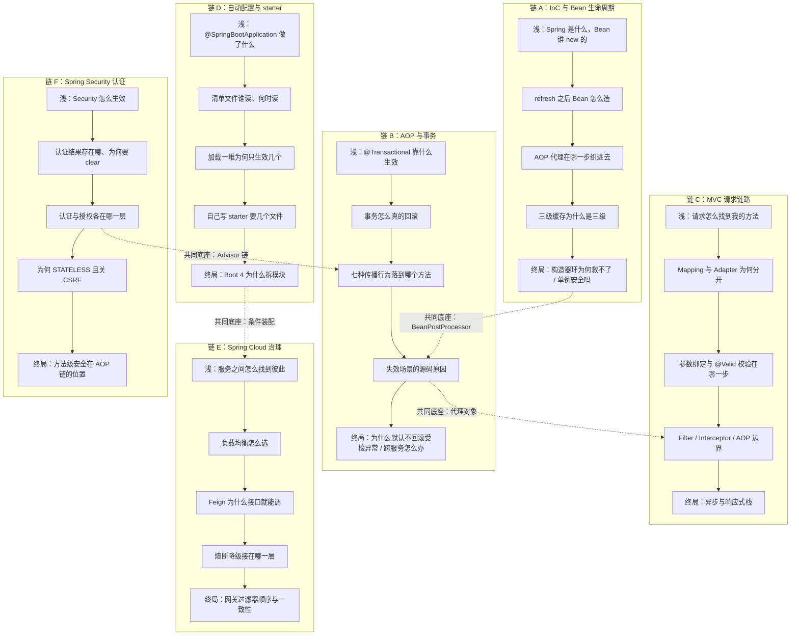
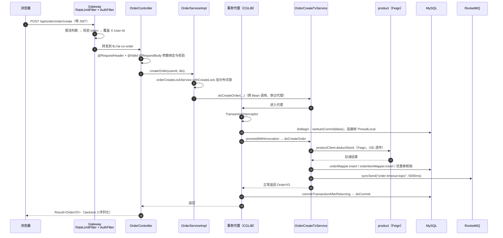

# 18-Spring 面试专练与追问链：把前 17 篇压成六条「越问越深」的梯子

> **一句话结论**：面试不考结论、考"这个结论是哪个类的哪个方法做出来的"；本篇把前 17 篇压成六条追问链（IoC/Bean 生命周期、AOP 与事务、MVC 请求链路、自动配置与 starter、Spring Cloud 治理、Spring Security 认证），每条都从"能背的浅问题"走到"只有真读过源码才答得出的深问题"。
> **阅读前置**：至少读完本模块 [16-IoC容器与Bean生命周期](./16-IoC容器与Bean生命周期.md)、[15-SpringAOP与声明式事务原理](./15-SpringAOP与声明式事务原理.md)、[17-SpringMVC请求全链路与参数校验](./17-SpringMVC请求全链路与参数校验.md)，并打开过 [24-源码分析](../24-源码分析/01-Spring框架/03-事务管理/01-transactional-事务拦截器与传播行为.md) 里对应的一篇正文；只想背答案的话本篇用处不大。
> **证据基线**：JDK 17.0.19 / Spring Framework 7.1.0 / Spring Boot 4.2.0 / Spring Cloud 2026.0.0（Gateway 5.1.0）/ Spring Security 7.2.0；A 级证据全部取自 `24-源码分析/assets/source/` 的既有摘录，B 级取自本项目真实代码（行号已核对）。预计阅读 60~80 分钟（含自测）。

## 0. 先看现象

面试现场不需要"知道什么"，需要"被问穿时还能往下接三层"。下面三个场景是我在真实面试/被面试中反复见到的断面，症状比任何知识清单都更能说明问题出在哪。

### 场景一：八股对答如流，追问两层就断线

```text
面试官：@Transactional 是怎么生效的？
你  ：通过 AOP 动态代理，在方法前后开启和提交事务。
面试官：那这个代理对象是谁创建的？在 Bean 生命周期的哪一步？
你  ：……（沉默 3 秒）应该是创建 Bean 的时候吧。
面试官：那它和三级缓存里的 getEarlyBeanReference 有关系吗？
你  ：……三级缓存不是解决循环依赖的吗？
```

第一句完全正确，第二句开始就只剩猜测。注意这不是"知识缺口"——你知道 AOP、知道三级缓存，缺的是**证据**：你没看过 `AbstractAutoProxyCreator#postProcessAfterInitialization` 里那句 `earlyBeanReferences.remove(cacheKey) != bean` 的判断，所以你不知道"提前创建过的代理"和"最终放进容器的代理"必须在同一个地方对账。

### 场景二：说不清 Spring 与 Spring Boot 到底什么关系

```text
面试官：Spring 和 Spring Boot 有什么区别？
你  ：Boot 是 Spring 的脚手架，简化配置，自动装配。
面试官：自动装配具体是谁、在什么时候、读了哪个文件？
你  ：读 spring.factories 吧？
面试官：那是 Boot 2.x 的答案。3.0 之后换成什么？为什么 Boot 4 把 autoconfigure 拆成十几个模块？
你  ：……
```

这个场景有一个非常硬的"报错原文"可以作为入口：当自动配置清单文件缺失或写错位置时，`AutoConfigurationImportSelector#getCandidateConfigurations` 会直接抛断言语 **"No auto configuration classes found in META-INF/spring/..."**（见 [[源码:AutoConfigurationImportSelector.java.md#L188-L198]]）。也就是说：**能背出这句报错的人，自动配置那一条链基本不会崩**；只背"spring.factories"的人，连报错都读不懂。

### 场景三：能说出事务失效的四种场景，但讲不出源码原因

本项目 2026-10 真实踩到过：`OrderServiceImpl#createOrder` 曾在 lambda 里用 `this.doCreateOrder(...)` 调用带 `@Transactional` 的方法，注解**完全没有生效**——库存已经被下游扣掉，订单却没写进库，事后靠人工对账。修复方式是把事务方法拆到独立 Bean `ai-cs-order/src/main/java/com/aics/order/service/impl/OrderCreateTxService.java#L78-L80`（`@GlobalTransactional` + `@Transactional` 叠在一起），并补 `OrderCreateTxWiringTest` 在测试里断言"调用必须穿过代理"。类注释 `ai-cs-order/src/main/java/com/aics/order/service/impl/OrderCreateTxService.java#L34-L45` 就是当时的复盘结论。

面试官在这个话题上最狠的一问不是"有哪些失效场景"，而是：

```text
面试官：为什么 self-invocation 连拦截器都进不去？
合格答：因为 this 指向的是原始对象，不是容器里的代理对象；
        拦截逻辑在 JdkDynamicAopProxy#invoke / CGLIB 生成的方法里，
        没走代理就根本没有那层调用栈。
```

### 这些现象指向同一件事

三个场景的断点位置不同，根因是同一个：**你把 Spring 学成了"结论集"，而不是"调用栈"**。面试官的每一层追问，本质都在问同一句话——"这一步是哪个类的哪个方法做的，你怎么知道？"

所以本篇所有答案都按同一个四层模板组织，缺一层就算没答完：

| 层 | 内容 | 缺了会怎样 |
|---|---|---|
| ① 定性 | 一句话说准是什么 | 显得背过但没懂 |
| ② 机制 | 点到类名/方法名/关键分支 | 追问一层就崩 |
| ③ 落本项目 | 具体文件 + 行号 + 我们怎么用 | 像教科书，不像工程师 |
| ④ 边界与代价 | 什么情况会失效、代价是什么 | 显得没有实战判断 |

## 1. 整体地图

六条链，每条 4~6 层，越往下越接近源码。**图的读法是：左边一句话能答，右下角必须读过源码。**



> **读图说明**：先看六个 subgraph 的**竖向**内容，那是一条链的追问方向（上浅下深）；再看四条虚线，它们是"链与链之间真正共享的机制"——A 链的 `BeanPostProcessor` 就是 B 链代理的来源，B 链的代理就是 C 链拦截器/AOP 边界争议的答案，D 链的条件装配是 E 链 starter 化的前提，F 链的方法级安全则是一条普通 Advisor。**最容易看错的箭头是 A5→B4**：很多人以为"循环依赖"和"事务失效"是两个话题，其实它们都落在 `getEarlyBeanReference` / 代理对象身份这一个点上；考试如果被问"事务为什么失效"，能从"代理对象是怎么来的"开始答，层次就完全不同。

| 链 | 起始浅问题（人人都能答） | 终局深问题（分水岭） | 配套正文 |
|---|---|---|---|
| A IoC 与 Bean 生命周期 | Spring 是什么？Bean 谁 new 的？ | 三级缓存里存的到底是对象还是工厂？构造器环为何救不了？ | [16-IoC容器与Bean生命周期](./16-IoC容器与Bean生命周期.md)、[refresh 全流程](../24-源码分析/01-Spring框架/01-IoC容器与Bean生命周期/01-refresh-容器启动全流程.md)、[循环依赖与三级缓存](../24-源码分析/01-Spring框架/01-IoC容器与Bean生命周期/03-循环依赖与三级缓存.md) |
| B AOP 与事务 | `@Transactional` 靠什么生效？ | 为什么默认不回滚受检异常？代理对象如何被"提前"创建？ | [15-SpringAOP与声明式事务原理](./15-SpringAOP与声明式事务原理.md)、[事务拦截器与传播行为](../24-源码分析/01-Spring框架/03-事务管理/01-transactional-事务拦截器与传播行为.md)、[事务失效场景与源码原因](../24-源码分析/01-Spring框架/03-事务管理/02-事务失效场景与源码原因.md) |
| C MVC 请求链路 | 请求怎么找到我的方法？ | `HandlerAdapter` 存在的意义？异步为何二次 dispatch？ | [17-SpringMVC请求全链路与参数校验](./17-SpringMVC请求全链路与参数校验.md)、[DispatcherServlet 一次请求的完整旅程](../24-源码分析/01-Spring框架/04-SpringMVC/01-dispatcherservlet-一次请求的完整旅程.md) |
| D 自动配置与 starter | `@SpringBootApplication` 做了什么？ | 清单文件怎么读、`@ConditionalOnMissingBean` 何时失效？ | [10-自定义Starter与自动装配](./10-自定义Starter与自动装配.md)、[自动配置全链路](../24-源码分析/02-SpringBoot/02-自动配置/01-enableautoconfiguration-自动配置全链路.md) |
| E Cloud 治理 | 服务之间怎么找到彼此？ | 过滤器顺序、Feign 代理与降级边界 | [02-SpringCloud微服务架构](./02-SpringCloud微服务架构.md)、[03-Nacos注册与配置中心](./03-Nacos注册与配置中心.md)、[04-SpringCloudGateway网关](./04-SpringCloudGateway网关.md) |
| F Security 认证 | Security 怎么生效？ | 方法级安全在 Advisor 链里的位置与 401/403 的顺序 | [FilterChainProxy 过滤器链原理](../24-源码分析/05-SpringSecurity/01-过滤器链与认证/01-filterchainproxy-过滤器链原理.md)、[AuthorizationManager 授权决策](../24-源码分析/05-SpringSecurity/02-授权与方法级安全/01-authorization-授权决策与authorizationmanager.md) |

## 2. 关键概念与关键类

面试里"一句话准确定义"比长篇大论得分高。下表每个定义都刻意压到一句，且带一个能立刻接着答的方法名。

| 名称 | 位置（类/文件） | 一句话准确定义 | 关键方法 |
|---|---|---|---|
| `BeanDefinition` | `org.springframework.beans.factory.config` | Bean 的"图纸"：类名、作用域、构造参数、属性值、是否懒加载、初始化/销毁方法名；容器真正持有的是图纸不是对象 | `BeanDefinitionRegistry#registerBeanDefinition` |
| `BeanFactory` / `ApplicationContext` | `org.springframework.beans` / `org.springframework.context` | 前者是"按名取 Bean 的最小接口"，后者是 BeanFactory + 事件 + 资源 + 环境 + 生命周期广播的组合体 | `ApplicationContext#refresh` |
| `BeanPostProcessor` | `org.springframework.beans.factory.config` | 对所有 Bean 生效的"全局增强点"，有两个回调，`before` 在初始化方法前、`after` 在后；AOP 代理就是在 `after` 里替换掉原对象 | `postProcessBeforeInitialization` / `postProcessAfterInitialization` |
| `BeanFactoryPostProcessor` | 同上 | 对"图纸"生效的增强点，能改 `BeanDefinition`；`ConfigurationClassPostProcessor` 是其中最重要的一个 | `postProcessBeanFactory` |
| 三级缓存 | `DefaultSingletonBeanRegistry` | 不是三个缓存，而是三个等级：`singletonObjects`（成品）、`earlySingletonObjects`（提前定好的早期引用）、`singletonFactories`（能产出早期引用的工厂） | `getSingleton(beanName, allowEarlyReference)` |
| 传播行为（Propagation） | `org.springframework.transaction.annotation` | 当前方法调用时"已有事务怎么办"的七条规则；默认 `REQUIRED` = 有就加入、没有就新建 | `AbstractPlatformTransactionManager#handleExistingTransaction` |
| `TransactionSynchronizationManager` | `org.springframework.transaction.support` | 事务的线程状态保管员：连接、只读标记、同步回调、当前事务名都挂在它的 ThreadLocal 上 | `bindResource` / `isSynchronizationActive` |
| `HandlerMapping` | `org.springframework.web.servlet` | "URL + 请求条件 → 处理器"的映射表，返回 `HandlerExecutionChain`（处理器 + 拦截器） | `getHandler` |
| `HandlerAdapter` | 同上 | 让 DispatcherServlet 会调用任意形态的处理器的中间层；`RequestMappting` 的方法最终包成 `HandlerMethod`，由 `AbstractHandlerMethodAdapter` 支撑 | `supports` / `handle` |
| `ArgumentResolver` | `org.springframework.web.method.support` | 把 HTTP 报文变成方法参数（`@RequestBody`、`@RequestHeader`、`@PathVariable` 各一个解析器） | `resolveArgument` |
| `@Valid` 校验 | `DataBinder` 体系 | 在参数绑定后触发 `Validator`，失败抛 `MethodArgumentNotValidException`，交给 `@RestControllerAdvice` 兜底 | `DataBinder#validate` |
| `AutoConfiguration.imports` | `META-INF/spring/org.springframework.boot.autoconfigure.AutoConfiguration.imports` | Boot 2.7+/3+ 的自动配置清单，一行一个全限定类名；取代 `spring.factories` 的 `EnableAutoConfiguration` 键 | `ImportCandidates#load` |
| `@Conditional*` | `org.springframework.boot.autoconfigure.condition` | 自动配置的"开关"：按类是否存在、Bean 是否已存在、配置项是否匹配、web 类型等决定装配与否 | `OnClassCondition` / `OnBeanCondition` |
| `Gateway` 的 `GlobalFilter` | `org.springframework.cloud.gateway.filter` | 真正横跨所有路由的过滤器，靠 `Ordered` 排序；**它不是 Servlet Filter**，跑在 WebFlux 的 `FilteringWebHandler` 里 | `filter(ServerWebExchange, GatewayFilterChain)` |
| `ReactiveLoadBalancerClientFilter` | `spring-cloud-gateway-server-webflux` | 把 `lb://服务名` 换成真实 `http://ip:port` 的那个过滤器 | `filter` |
| `FilterChainProxy` | `org.springframework.security.web` | `springSecurityFilterChain` 的真实类型，持有多条 `SecurityFilterChain`，按路径匹配选一条执行 | `doFilter` / `doFilterInternal` |
| `SecurityContextHolder` | `org.springframework.security.core.context` | 认证结果的保管员，默认 `ThreadLocal` 策略；线程复用不清空就会"串号" | `getContext` / `setContext` / `clearContext` |
| `AuthorizationManager` | `org.springframework.security.authorization` | 把"该不该放行"抽象成只有一个 `authorize` 方法的组件，URL 级与方法级共用 | `authorize` |
| `Advisor` / `Advice` | `org.springframework.aop` | Advisor = 切点 + 通知；`@Transactional`、`@Cacheable`、`@PreAuthorize` 各自是一个 Advisor，串成一条 `MethodInterceptor` 链 | `ReflectiveMethodInvocation#proceed` |
| 代理对象身份 | `AbstractAutoProxyCreator` | 循环依赖里"提前创建的代理"和"最终放进容器的代理"必须是同一个，靠 `earlyBeanReferences` 对账 | `getEarlyBeanReference` / `postProcessAfterInitialization` |

> 使用方式：面试前只背这张表的第 3 列（一句话定义）。如果某一行的"关键方法"你念不出来，说明这条链你还没到第 3 层，回到 §3 对应小节。

## 3. 原理与证据逐段精读

每条链都按同一个节奏：**面试官问什么 → 合格答案要点（点到类名/方法名）→ 加分点 → 常见失分答案 → 证据锚点**。合格答案要点是"必须说出来"的骨架，加分点是"说出来面试官会点头"的细节，失分答案是"说了就掉档"的原话。

### 3.1 链 A：IoC 与 Bean 生命周期

#### 第 1 层 · "Spring 是什么？Bean 是谁 new 的？"

- **面试官问**：Spring 容器到底帮你做了什么？`@Service` 那个对象是谁创建、什么时候创建的？
- **合格答案要点**：① 容器的本质是"一张注册表 + 一套造对象流程"——单例成品放在 `DefaultSingletonBeanRegistry#getSingleton` 查的 `singletonObjects` 里；② `@Service` 只是被组件扫描登记成 `BeanDefinition`（图纸），并没有 new；③ 真正触发"造对象"的是 `AbstractApplicationContext#refresh()` 里的 `finishBeanFactoryInitialization` 那一步（[[源码:AbstractApplicationContext.java.md#L622]]），它把非懒加载单例全部提前实例化；④ 整个 `refresh()` 是模板方法，共十余步，`finishRefresh` 在最后发 `ContextRefreshedEvent`。
- **加分点**：主动区分 `BeanFactory`（懒、只有取 Bean 的能力）与 `ApplicationContext`（组合 BeanFactory + 事件 + 资源 + 环境 + 类型转换），并指出 Spring Boot 只是在外层用 `SpringApplication#run` 把"造容器 → refresh → 跑 Runner"包了一层。
- **常见失分答案**："Spring 就是一个大工厂，帮我们管理对象"——没有类、没有阶段、没有"什么时候"，一追就空。
- **证据**：[[源码:AbstractApplicationContext.java.md#L582]]、[[源码:AbstractApplicationContext.java.md#L622]]

#### 第 2 层 · "`refresh()` 之后，一个 Bean 具体怎么被造出来？"

- **面试官问**：从图纸到对象，中间经历哪几个阶段？`@PostConstruct` 落在第几段？
- **合格答案要点**：① 入口是 `AbstractAutowireCapableBeanFactory#createBean`（L486），实际活在 `doCreateBean`（L554）；② 三段：`createBeanInstance`（推断构造器并实例化）→ `populateBean`（依赖注入）→ `initializeBean`（初始化回调）；③ `initializeBean`（[[源码:AbstractAutowireCapableBeanFactory.java.md#L1810-L1835]]）内部严格四段顺序：`invokeAwareMethods`（L1816）→ `applyBeanPostProcessorsBeforeInitialization`（L1820）→ `invokeInitMethods`（L1824）→ `applyBeanPostProcessorsAfterInitialization`（L1831）；④ `@PostConstruct` 是被 `CommonAnnotationBeanPostProcessor` 在 **before** 那一段里反射调用的（`InitializingBean#afterPropertiesSet` 和 `@Bean(initMethod)` 才在 `invokeInitMethods`）。
- **加分点**：能说清"为什么 `@PostConstruct` 里拿不到 AOP 代理后的 `this` 语义"——before 阶段代理还没生成；也能说 `@Async`/`@Transactional` 生效的时机在 after 之后。
- **常见失分答案**：把 `@PostConstruct` 说成"在 BeanPostProcessor after 之后执行"，导致后面对"代理时机"的判断全错。
- **证据**：[[源码:AbstractAutowireCapableBeanFactory.java.md#L554]]、[[源码:AbstractAutowireCapableBeanFactory.java.md#L1810-L1835]]

#### 第 3 层 · "AOP 代理是在哪一步织进去的？"

- **面试官问**：你说的"动态代理"是哪个类创建的？换成代理之后，容器里原来的 bean 去哪了？
- **合格答案要点**：① 织入点就是 `initializeBean` 的最后一段 `applyBeanPostProcessorsAfterInitialization`；② 真正的创建者是 `AbstractAutoProxyCreator#postProcessAfterInitialization`（[[源码:AbstractAutoProxyCreator.java.md#L285-L293]]），它调 `wrapIfNecessary`（L321-L345）：L334 `getAdvicesAndAdvisorsForBean` 找 Advisor，L337 `createProxy` 造代理；③ `createProxy` 里把原对象包成 `SingletonTargetSource`——所以**代理是替换容器里的引用，不是包装后被引用**；④ CGLIB 分支里 `Enhancer` 的设置（[[源码:CglibAopProxy.java.md#L193-L203]]：`setSuperclass`/`setInterfaces`/`setNamingPolicy`）解释了你调试时看到的 `Xxx$$SpringCGLIB$$0` 类名。
- **加分点**：`final` 类或不可见类生成失败时，Spring 抛的 `CodeGenerationException` 消息里自带提示 "Common causes of this problem include using a final class or a non-visible class"（[[源码:CglibAopProxy.java.md#L232-L235]]）——能背这句，说明你见过真实报错。
- **常见失分答案**："Spring 用 AspectJ 在编译期织入"（默认不是，只有 `@Aspect` + LTW/CTW 才是），或"代理包在原 bean 外面，容器里还是原对象"。
- **证据**：[[源码:AbstractAutoProxyCreator.java.md#L285-L293]]、[[源码:CglibAopProxy.java.md#L193-L203]]

#### 第 4 层 · "循环依赖为什么需要三级缓存？两级不行吗？"

- **面试官问**：A 依赖 B、B 依赖 A，Spring 怎么活下来的？为什么不是两级缓存就够？
- **合格答案要点**：① 查找顺序写在 `DefaultSingletonBeanRegistry#getSingleton(beanName, true)`（[[源码:DefaultSingletonBeanRegistry.java.md#L208-L232]]）：先 `singletonObjects`（L210）→ 再查"是否正在创建"（L211）→ 再 `earlySingletonObjects`（L212）→ 最后从 `singletonFactories` 取工厂并调 `getObject()`（L224-L226），拿到后升级进 `earlySingletonObjects`（L228-L229）；② 工厂是在被依赖方**实例化之后、注入之前**注册的（`doCreateBean` 里的 `addSingletonFactory`，[[源码:AbstractAutowireCapableBeanFactory.java.md#L594]]）；③ 这个工厂产出的是 `getEarlyBeanReference`（[[源码:AbstractAutowireCapableBeanFactory.java.md#L964-L972]]），它会遍历 `SmartInstantiationAwareBeanPostProcessor`，于是 `AbstractAutoProxyCreator#getEarlyBeanReference`（[[源码:AbstractAutoProxyCreator.java.md#L237-L241]]）会**提前把代理造出来**并存进 `earlyBeanReferences`。
- **加分点**：一句话点透——"三级缓存存的是**决定权**（要不要提前给你一个 AOP 代理），二级缓存存的是**已经决定好的半成品**，一级缓存是成品"；再补 `postProcessAfterInitialization` 里 `earlyBeanReferences.remove(cacheKey) != bean`（[[源码:AbstractAutoProxyCreator.java.md#L285-L293]]）的用途：如果提前代理过，最终就不再代理一次，避免容器里出现两个不同的代理对象。
- **常见失分答案**："三级缓存是为了性能/避免重复创建"（不充分）、"为了线程安全"（错，锁是另外的 `tryLock`，见 L214-L217 拿不到锁直接返回 null）。
- **证据**：[[源码:DefaultSingletonBeanRegistry.java.md#L208-L232]]、[[源码:AbstractAutoProxyCreator.java.md#L237-L241]]

#### 第 5 层 · "那构造器循环依赖为什么救不了？"

- **面试官问**：同样是循环依赖，setter 注入能救，构造器注入就抛异常，差别在哪一行代码？
- **合格答案要点**：① `addSingletonFactory` 是在 `createBeanInstance` **之后**才执行的（`doCreateBean` 的语句顺序，[[源码:AbstractAutowireCapableBeanFactory.java.md#L554]]）；② 构造器注入的环上，A 在"要构造"时就得先拿到 B，B 构造时又要 A，此刻 A 的工厂还没注册，`getSingleton` 三级全空 → 抛 `BeanCurrentlyInCreationException`；③ 这也是 Spring 2.6 之后"循环依赖默认允许但可关闭"的原因——`setAllowCircularReferences(false)` 能把"能救的 setter 环"也直接判死，逼你重构。
- **加分点**：给出解法阶梯：构造器参数改 `@Lazy` → 改 `ObjectProvider` → 抽第三个 Bean 打破环（本项目 `OrderServiceImpl` 与 `OrderCreateTxService` 的拆分就是"抽 Bean 打破自调用"，本质同源）。
- **常见失分答案**："Spring 2.6 之后彻底禁止循环依赖"（实际上单例 setter 环默认仍然是允许的，只是官方不推荐）。
- **证据**：[[源码:AbstractAutowireCapableBeanFactory.java.md#L554]]、[[源码:DefaultSingletonBeanRegistry.java.md#L183-L188]]

#### 第 6 层（终局）· "单例 Bean 线程安全吗？"

- **面试官问**：容器保证只有一个实例，那还需要考虑并发吗？
- **合格答案要点**：① 容器只保证"单例"，不保证"状态安全"——单例池 `singletonObjects` 只是缓存；② 无状态 Bean（只有 final 依赖、无成员可变字段）天然安全；③ `@Controller`/`@Service` 里放成员变量做请求级状态必然出问题（Tomcat 线程池复用）；④ `prototype` 只解决"每次给新对象"，不解决共享资源（数据库、Redis）的竞争。
- **加分点**：直接落到本项目——`ai-cs-order/src/main/java/com/aics/order/service/impl/OrderServiceImpl.java#L39-L48` 十个依赖全部 `final`、无任何可变字段，所以它是单例也安全；真正的并发控制被显式外置到 `orderCreateLockService.withCreateLock(...)`（`ai-cs-order/src/main/java/com/aics/order/service/impl/OrderServiceImpl.java#L57-L60`）。
- **常见失分答案**："单例一定不安全"或"单例一定安全"，两种都是背结论。
- **证据**：[[源码:DefaultSingletonBeanRegistry.java.md#L196]]、B 级 `ai-cs-order/src/main/java/com/aics/order/service/impl/OrderServiceImpl.java#L39-L48`

### 3.2 链 B：AOP 与事务

#### 第 1 层 · "`@Transactional` 底层靠什么生效？"

- **面试官问**：一个注解凭什么能控制数据库提交？
- **合格答案要点**：① 它本身什么都不做，只是被 `SpringTransactionAnnotationParser` 解析成 `TransactionAttribute`；② 真正干活的是 `TransactionInterceptor`：`invoke`（[[源码:TransactionInterceptor.java.md#L123]]）→ `invokeWithinTransaction`（L130）→ 实现落在 `TransactionAspectSupport#invokeWithinTransaction`（[[源码:TransactionAspectSupport.java.md#L333-L410]]）；③ 该方法内部顺序：L337-339 取 `TransactionAttributeSource`/`PlatformTransactionManager`，L363 `createTransactionIfNecessary` 开事务，L365-380 `try` 里 `proceedWithInvocation()`，异常走 `completeTransactionAfterThrowing`，正常走 L408 `commitTransactionAfterReturning`，`finally` 里 `cleanupTransactionInfo`；④ 串联它的是 `BeanFactoryTransactionAttributeSourceAdvisor` 这个 Advisor。
- **加分点**：指出这是"最标准的一条 AOP 链"——`@Cacheable`（`CacheInterceptor`）、`@PreAuthorize`（`AuthorizationManagerBeforeMethodInterceptor`）都是同构的，能一句话归纳"Spring 的声明式能力 = 注解解析成属性 + Advisor + Interceptor 链"。
- **常见失分答案**："`@Transactional` 是数据库的事务"（它连 `Connection` 都没碰，只是申请/提交事务）。
- **证据**：[[源码:TransactionInterceptor.java.md#L123]]、[[源码:TransactionAspectSupport.java.md#L333-L410]]

#### 第 2 层 · "事务到底是怎么'回滚'的？"

- **面试官问**：回滚这个动作，最后落到哪个类的哪个方法？
- **合格答案要点**：① 事务状态机在 `AbstractPlatformTransactionManager`：`getTransaction`（[[源码:AbstractPlatformTransactionManager.java.md#L373]]）→ 已有事务走 `handleExistingTransaction`（L426）/ 新事务走 `startTransaction`（L524）；② 具体资源操作在 `DataSourceTransactionManager`：`doBegin`（[[源码:DataSourceTransactionManager.java.md#L263]]）里 `setAutoCommit(false)` 并把 `Connection` 绑到线程；提交 `doCommit`（L336）、回滚 `doRollback`（L351）；③ "同一个线程用同一个连接"靠 `TransactionSynchronizationManager#bindResource`（[[源码:TransactionSynchronizationManager.java.md#L170]]）的 ThreadLocal；④ 提交/回滚前后会触发同步回调 `TransactionSynchronization`（`beforeCommit/afterCompletion`）。
- **加分点**：由 ③ 直接推出两个高频结论——**事务不跨线程**（异步里拿不到同一个连接）、**`@Transactional` 方法里开线程池等于裸奔**；再补 `isSynchronizationActive`（L307）就是 `@TransactionalEventListener` 判断"有没有活事务"的依据。
- **常见失分答案**："回滚靠 MySQL 的 undo log / 靠锁"——MySQL 确实有 undo，但你答的是"Spring 事务回滚的代码路径"。
- **证据**：[[源码:DataSourceTransactionManager.java.md#L263]]、[[源码:TransactionSynchronizationManager.java.md#L170]]

#### 第 3 层 · "七种传播行为，用一句话说清各自在干什么"

- **面试官问**：`REQUIRED` 和 `REQUIRES_NEW` 差在哪？`NESTED` 又是什么？
- **合格答案要点**：① 七种：`REQUIRED`（默认，有则加入、无则新建）、`REQUIRES_NEW`（挂起旧的，新建独立事务）、`NESTED`（同一物理事务 + savepoint）、`SUPPORTS`（有就加入，没有就裸跑）、`NOT_SUPPORTED`（挂起事务、裸跑）、`MANDATORY`（必须已有，否则抛异常）、`NEVER`（必须没有，否则抛异常）；② 分支就在 `handleExistingTransaction`（[[源码:AbstractPlatformTransactionManager.java.md#L426]]）；③ 每次进入都会经 `prepareTransactionInfo`（[[源码:TransactionAspectSupport.java.md#L648-L675]]）包一层 `TransactionInfo`，记录"进来前的旧事务状态"，退出时恢复（这是传播行为能"挂起-恢复"的关键）。
- **加分点**：说清 `REQUIRES_NEW` 的真实代价——内外两条连接同时占用，高并发下连接池瞬间翻倍打满；`NESTED` 不是独立事务，外层回滚内层 savepoint 也白做（它靠 `SavepointManager`）。
- **常见失分答案**：把 `NESTED` 当"独立子事务"、把 `REQUIRED` 当"每次新建"。
- **证据**：[[源码:AbstractPlatformTransactionManager.java.md#L426]]、[[源码:TransactionAspectSupport.java.md#L648-L675]]

#### 第 4 层 · "`@Transactional` 什么时候不生效？源码原因是什么？"

- **面试官问**：别只报菜名，说说为什么。
- **合格答案要点**：① **self-invocation**：同类方法互调用的是 `this`，不是代理，`JdkDynamicAopProxy#invoke`（[[源码:JdkDynamicAopProxy.java.md#L163]]）根本不会被调，自然没有拦截器；② **方法不是 public**：属性源只认 public 方法（`AbstractFallbackTransactionAttributeSource`），CGLIB 也不会生成私有方法覆盖；③ **异常类型不匹配**：`completeTransactionAfterThrowing`（[[源码:TransactionAspectSupport.java.md#L697-L720]]）里 L705 的 `rollbackOn(ex)` 判定不过就照样提交；④ **对象不归容器管**（自己 `new`）或**不是同一个代理**；⑤ **跨线程**：`bindResource` 的 ThreadLocal 在新线程里是空的。
- **加分点**：把本项目真实缺陷讲成故事——`ai-cs-order/src/main/java/com/aics/order/service/impl/OrderServiceImpl.java#L57-60` 用 `orderCreateLockService.withCreateLock(userId, () -> orderCreateTxService.doCreateOrder(...))`，**跨 Bean 调用**才穿过代理；修复前是 lambda 里 `this.doCreateOrder(...)`，注解静默失效，`OrderCreateTxService` 类注释 `#L34-L45` 记录了这件事，`OrderCreateTxWiringTest` 用测试锁死"必须经过代理"。
- **常见失分答案**："注解要写在接口上"（Spring 官方推荐写**实现类**的 public 方法上；写接口在 CGLIB 场景下会因继承细节出问题）。
- **证据**：[[源码:TransactionAspectSupport.java.md#L697-L720]]、[[源码:JdkDynamicAopProxy.java.md#L163]]、B 级 `ai-cs-order/src/main/java/com/aics/order/service/impl/OrderCreateTxService.java#L78-L80`

#### 第 5 层 · "为什么默认不回滚受检异常？"

- **面试官问**：`throw new IOException()` 为什么事务提交了？
- **合格答案要点**：① 默认规则在 `DefaultTransactionAttribute#rollbackOn`：只有 `RuntimeException` 和 `Error` 回滚；② 历史原因是 EJB 的约定——受检异常被视作"业务可恢复、调用方必须处理"，框架不替你决定回滚；Spring 沿用；③ 所以工程上统一写 `rollbackFor = Exception.class`：本项目 `ai-cs-order/src/main/java/com/aics/order/service/impl/OrderCreateTxService.java#L78-L79`、`ai-cs-order/src/main/java/com/aics/order/service/impl/OrderServiceImpl.java#L98`、`ai-cs-product/src/main/java/com/aics/product/service/impl/ProductServiceImpl.java#L190-L191` 全部显式声明。
- **加分点**：说清 `rollbackFor` 只决定"是否回滚"，不决定"是否继续上抛"；异常仍会抛出，`noRollbackFor` 才是"抛了也不回滚"；再补一条真实边界——`@Transactional` 内部 try-catch 吞掉异常等于手动取消回滚。
- **常见失分答案**："受检异常一定不回滚"（配了 `rollbackFor` 就会回滚）。
- **证据**：B 级 `ai-cs-order/src/main/java/com/aics/order/service/impl/OrderCreateTxService.java#L78-L80`、[[源码:TransactionAspectSupport.java.md#L697-L720]]

#### 第 6 层（终局）· "跨服务怎么保证？Seata 和本地消息怎么选？"

- **面试官问**：`@Transactional` 只管一个库，下单要扣库存（product）、写订单（order）、发消息，怎么办？
- **合格答案要点**：① 先问业务是否真的需要强一致——多数电商场景是"最终一致"；② 强一致方案是 Seata AT（`@GlobalTransactional`）：一阶段本地提交 + `undo_log`，二阶段全局提交或按 undo_log 反向补偿（依据 Seata 官方文档与 [06-Seata分布式事务AT模式](./06-Seata分布式事务AT模式.md)，Seata 无 sources jar，本项目不贴其源码）；③ 最终一致方案是事务消息 / 本地消息表 + `@TransactionalEventListener(phase = AFTER_COMMIT)`：本项目 `ai-cs-order/src/main/java/com/aics/order/service/impl/OrderCreateTxService.java#L144-L146` 在事务内 `syncSend("order-timeout-topic", ..., 5000, 16)`（超时 5s、延迟 16 级），`ai-cs-order/src/main/java/com/aics/order/event/OrderPaidEventListener.java#L30-L31` 用 `AFTER_COMMIT` 保证"事务没提交就不投递"（该注解默认 phase 见 [[源码:TransactionalEventListener.java.md#L78]]）。
- **加分点**：说清 AT 的边界（全局锁、脏读风险、`undo_log` 清理、性能开销）以及"本项目为什么两套都留着"：订单创建走 Seata，支付成功通知走事件 + MQ。XID 传播细节见 [07-服务调用统一与SeataXID传播](./07-服务调用统一与SeataXID传播.md)。
- **常见失分答案**："`@GlobalTransactional` 会把本地事务升级成两阶段提交"（AT 不是 2PC，一阶段就提交了）。
- **证据**：[[源码:TransactionalEventListener.java.md#L78]]、B 级 `ai-cs-order/src/main/java/com/aics/order/event/OrderPaidEventListener.java#L30-L31`

### 3.3 链 C：MVC 请求链路

#### 第 1 层 · "一个 HTTP 请求进来，Spring MVC 怎么找到你的方法？"

- **面试官问**：`POST /order/create` 到 `createOrder()`，中间过了谁？
- **合格答案要点**：① 入口是 `DispatcherServlet#doDispatch`（[[源码:DispatcherServlet.java.md#L935-L1000]]），顺序是：L947 `checkMultipart` → L951 `getHandler`（拿到 `HandlerExecutionChain`，含处理器与拦截器）→ L957 `applyPreHandle` → L962 `getHandlerAdapter` → L963 `ha.handle(...)` → L970 `applyPostHandle` → L980 `processDispatchResult`；② 找不到处理器时走 L952-954 的 `noHandlerFound`；③ 异常在 L972-979 被转成 `dispatchException`；④ `afterCompletion` 在 L983/986 触发。
- **加分点**：能说出"`getHandler` 是遍历所有 `HandlerMapping` 并取第一个非 null"，`RequestMappingHandlerMapping` 靠 `RequestMappingInfo` 匹配；本项目开启了 `NoHandlerFoundException` 的处理（`ai-cs-common/src/main/java/com/aics/common/exception/GlobalExceptionHandler.java#L129-L131`），说明走的是"抛异常"而不是 404 静态页。
- **常见失分答案**："Tomcat 直接把请求交给 Controller"——跳过 DispatcherServlet 这层就没得聊了。
- **证据**：[[源码:DispatcherServlet.java.md#L935-L1000]]

#### 第 2 层 · "`HandlerMapping` 和 `HandlerAdapter` 为什么要分开？"

- **面试官问**：找到方法了，直接反射调用不就行了？
- **合格答案要点**：① `HandlerMapping` 只负责"找"，返回的是 `HandlerMethod`（方法 + Bean + 参数元数据）；② `HandlerAdapter` 负责"会不会调"：`AbstractHandlerMethodAdapter#supports`（[[源码:AbstractHandlerMethodAdapter.java.md#L68]]）判断是不是 `HandlerMethod`，`handle`（L83）负责调；③ 这样 DispatcherServlet 不需要知道处理器有几种形态（注解方法、`HttpRequestHandler`、`Controller` 接口、函数式端点），加一种形态只是多一个 Adapter；④ 参数解析与返回值处理都在 Adapter 内部（`ServletInvocableHandlerMethod` → `InvocableHandlerMethod`）。
- **加分点**：一句话总结"这是**适配器模式**在框架里最值钱的一处应用：把变化的维度（处理器形态）收敛到一个类里"，并指出这是很好的"框架设计题"答案素材。
- **常见失分答案**："为了性能"（与性能无关，纯粹是解耦）。
- **证据**：[[源码:AbstractHandlerMethodAdapter.java.md#L68]]、[[源码:AbstractHandlerMethodAdapter.java.md#L83]]

#### 第 3 层 · "参数怎么绑？`@Valid` 校验在哪一步？"

- **面试官问**：`@RequestHeader("X-User-Id") Long userId` 和 `@Valid @RequestBody OrderCreateDTO dto` 分别是谁在处理？校验失败谁负责转成 JSON？
- **合格答案要点**：① 让 HTTP 变参数的是一串 `HandlerMethodArgumentResolver`：`RequestResponseBodyMethodProcessor` 处理 `@RequestBody`（内部用 `HttpMessageConverter`，Boot 4 默认 Jackson 3），`RequestHeaderMethodArgumentResolver` 处理 `@RequestHeader`；② `@Valid` 在参数解析后由 `DataBinder#validate` 触发，失败抛 `MethodArgumentNotValidException`；③ 兜底是 `@RestControllerAdvice`：本项目 `ai-cs-common/src/main/java/com/aics/common/exception/GlobalExceptionHandler.java#L44-L46` 处理 `MethodArgumentNotValidException`、L57-59 处理 `BindException`、L97 处理 `HttpMessageNotReadableException`（JSON 语法错）、L84 处理类型不匹配。
- **加分点**：能说出"`@Valid` 只做一次；嵌套对象要 `@Valid` 级联；分组校验用 `@Validated(Group.class)`"，并指出本项目 Controller 的入参写法 `ai-cs-order/src/main/java/com/aics/order/controller/OrderController.java#L27-L29`——`@RequestHeader("X-User-Id")` 是网关注入的，`@Valid @RequestBody` 是业务校验，两者职责不重叠。
- **常见失分答案**："在 Controller 里写 if 判断 userId 为空"（等于把框架能力退回手工）。
- **证据**：B 级 `ai-cs-order/src/main/java/com/aics/order/controller/OrderController.java#L27-L29`、`ai-cs-common/src/main/java/com/aics/common/exception/GlobalExceptionHandler.java#L44-L46`

#### 第 4 层 · "Filter、Interceptor、AOP 三者的边界在哪？"

- **面试官问**：都能"在方法前后插逻辑"，凭什么选这个不选那个？
- **合格答案要点**：① Filter 属 Servlet 规范，在 `DispatcherServlet` 之外，拿不到 `HandlerMethod`，也拿不到 Spring 的 `@Autowired`（除非用 `DelegatingFilterProxy`）；② Interceptor 在 `doDispatch` 之内：`preHandle`（L957）、`postHandle`（L970）、`afterCompletion`（L983/986），能拿到 `HandlerMethod`，但拿不到方法参数值；③ AOP 在 Bean 方法级，能拿参数、能改返回值，但不知道 HTTP 上下文；④ 选择顺序：跨域/编码/鉴权（需在 MVC 前）→ Filter；路由级日志/权限注解（需 HandlerMethod）→ Interceptor；业务横切（事务/缓存/幂等）→ AOP。
- **加分点**：`afterCompletion` 一定执行（异常路径也走），`postHandle` 只有正常返回才执行——这条细节能立刻分辨"背过"和"读过"；本项目 `ai-cs-common/src/main/java/com/aics/common/idempotent/IdempotentAspect.java#L49` 用 `@Around("@annotation(idempotent)")` 就是典型的 AOP 层选择。
- **常见失分答案**："三者差不多，随便用"。
- **证据**：[[源码:DispatcherServlet.java.md#L935-L1000]]、B 级 `ai-cs-common/src/main/java/com/aics/common/idempotent/IdempotentAspect.java#L49`

#### 第 5 层 · "异步请求为什么在 `doDispatch` 里多一次判断？"

- **面试官问**：`doDispatch` L965 那句 `asyncManager.isConcurrentHandlingStarted()` 干什么用的？
- **合格答案要点**：① Handler 返回 `Callable`/`DeferredResult`/`SseEmitter`/`WebAsyncTask` 时，请求进入异步模式，L965 判断后**立即 return**，释放 Tomcat 线程；② 结果就绪后容器再 dispatch 一次（第二次进 `doDispatch`，直接从结果走 `processDispatchResult`）；③ 所以 `postHandle` 在异步场景下执行时机与同步不同，`afterCompletion` 由 `WebAsyncManager` 在异步完成时回调。
- **加分点**：说清"异步 ≠ 更快，只是把等待从 Tomcat 线程挪走"；本项目实时通知走的是 STOMP over WebSocket（见 [11-STOMP实时通知与用户目的地](./11-STOMP实时通知与用户目的地.md)），不是 SSE，避免长连接占用 Servlet 线程。
- **常见失分答案**："Spring 会用一个线程阻塞地等异步结果"。
- **证据**：[[源码:DispatcherServlet.java.md#L935-L1000]]

#### 第 6 层（终局）· "网关里为什么没有 DispatcherServlet？"

- **面试官问**：Spring Cloud Gateway 里的 Filter 和你在 MVC 里写的 Filter 是一回事吗？
- **合格答案要点**：① Gateway 是 WebFlux 栈，跑在 Netty 上，没有 `DispatcherServlet`，请求由 `RoutePredicateHandlerMapping` + `FilteringWebHandler` 处理；② `GlobalFilter` 是"横跨所有路由"的过滤器，靠 `Ordered` 排序，返回值是 `Mono<Void>`；③ 本项目 `ai-cs-gateway/src/main/java/com/aics/gateway/filter/AuthFilter.java#L42-L43` 声明 `implements GlobalFilter, Ordered`，`filter(...)` 在 L106，`getOrder()` 在 L172；④ 路由级过滤器（`GatewayFilter`）与全局过滤器（`GlobalFilter`）合并成一条链执行。
- **加分点**：对比"阻塞式 Servlet 栈（一个请求一个线程）vs 响应式 Netty 栈（事件循环）"，并说出代价——响应式里**不能有阻塞调用**，一旦 `Thread.sleep` 或同步 JDBC 就会把事件循环卡死。
- **常见失分答案**："Gateway 的 Filter 就是 Servlet Filter"，或者"网关里也能用 `@Controller` 写业务"（能用但不推荐）。
- **证据**：B 级 `ai-cs-gateway/src/main/java/com/aics/gateway/filter/AuthFilter.java#L42-L43`、[[源码:ReactiveLoadBalancerClientFilter.java.md#L88]]

### 3.4 链 D：自动配置与 starter

#### 第 1 层 · "`@SpringBootApplication` 到底做了什么？"

- **面试官问**：一个注解凭什么启动整个应用？
- **合格答案要点**：① 它是三个注解的组合：`@SpringBootConfiguration`（本质 `@Configuration`）、`@ComponentScan`（默认扫启动类所在包及子包）、`@EnableAutoConfiguration`；② `@EnableAutoConfiguration` 的关键是 `@Import(AutoConfigurationImportSelector.class)`；③ 启动流程是 `SpringApplication#run`：推断 web 类型 → 创建对应 `ApplicationContext`（本项目是 Servlet 栈，`AnnotationConfigServletWebServerApplicationContext`）→ 调 `refresh()`；④ `@EnableAutoConfiguration` 还隐含 `@AutoConfigurationPackage`，把启动类所在包登记到 `AutoConfigurationPackages`（这就是为什么 JPA/MyBatis 能"自动"知道你实体在哪）。
- **加分点**：说清"自动配置不是魔法，是一个 `@Import` + 一个清单文件 + 一堆条件注解"。
- **常见失分答案**："`@SpringBootApplication` 会自动扫描 classpath 下所有类"（是扫清单里列的类，不是扫全部）。
- **证据**：[[源码:AbstractApplicationContext.java.md#L582]]、[[源码:AbstractApplicationContext.java.md#L622]]

#### 第 2 层 · "自动配置清单是谁读的、什么时候读的？"

- **面试官问**：说具体点，哪个类、哪个方法、哪个文件？
- **合格答案要点**：① `AutoConfigurationImportSelector#selectImports`（[[源码:AutoConfigurationImportSelector.java.md#L107]]）→ `getAutoConfigurationEntry`（L130-L143）；② 候选类由 `getCandidateConfigurations`（[[源码:AutoConfigurationImportSelector.java.md#L188-L198]]）产出，内部是 `ImportCandidates.load`（L190）读取 `META-INF/spring/org.springframework.boot.autoconfigure.AutoConfiguration.imports`；③ 读不到就抛断言，文案 "No auto configuration classes found in META-INF/spring/..."（L193-196）；④ `getImportGroup`（L146）声明它的分组是 `AutoConfigurationGroup`，所以在 `@Import` 阶段由配置类解析器统一处理。
- **加分点**：明确说"这是 Boot 2.7 引入、3.0 起唯一支持的机制，**取代了 `spring.factories` 里的 `EnableAutoConfiguration` 键**"，并指出 `@AutoConfiguration` 注解替代了 `@Configuration`（多了 `proxyBeanMethods=false` 的语义约束）。
- **常见失分答案**："读 `spring.factories`"——这是最经典的过期答案（见 §7）。
- **证据**：[[源码:AutoConfigurationImportSelector.java.md#L188-L198]]、[[源码:AutoConfigurationImportSelector.java.md#L130-L143]]

#### 第 3 层 · "加载了那么多，为什么最后只生效几个？"

- **面试官问**：`spring-boot-autoconfigure` 里几百个候选，凭什么它知道该装谁？
- **合格答案要点**：① 先做粗筛：`getAutoConfigurationEntry` 里 L136 去重、L137 取 `exclude`、L140 用 `AutoConfigurationImportFilter`（典型是 `OnClassCondition`，按 classpath 快速排除）、L141 发 `AutoConfigurationImportEvent`；② 再逐个用 `@Conditional*` 精判：`@ConditionalOnClass`、`@ConditionalOnBean`、`@ConditionalOnMissingBean`、`@ConditionalOnProperty`、`@ConditionalOnWebApplication`；③ 失败原因可用 `--debug` 打印 `CONDITIONS EVALUATION REPORT` 逐条看。
- **加分点**：直接举本项目例子——`ai-cs-common/src/main/java/com/aics/common/mq/MessagePublisherAutoConfiguration.java#L40-L47` 一个内部类上叠了 `@ConditionalOnClass(RocketMQTemplate.class)` + `@ConditionalOnBean(RocketMQTemplate.class)` + `@ConditionalOnProperty(prefix="aics.mq", name="type", havingValue="rocketmq", matchIfMissing=true)`，并且 `@Bean` 上有 `@ConditionalOnMissingBean(MessagePublisher.class)` 允许业务覆盖；Kafka 分支在 L56-63，靠 `havingValue="kafka"` 二选一。
- **常见失分答案**："按字母顺序加载，后面的覆盖前面的"（自动配置之间靠 `@AutoConfigureBefore/After` 与排序器，不是覆盖关系）。
- **证据**：B 级 `ai-cs-common/src/main/java/com/aics/common/mq/MessagePublisherAutoConfiguration.java#L40-L47`

#### 第 4 层 · "自己写一个 starter 要几个文件？"

- **面试官问**：我们项目里那个 common 模块算 starter 吗？
- **合格答案要点**：① 两个必需件：自动配置类（`@AutoConfiguration` + 条件注解）与清单文件 `META-INF/spring/org.springframework.boot.autoconfigure.AutoConfiguration.imports`（一行一个全限定名）；② 可选件：`spring-boot-configuration-processor` 生成配置元数据，让 IDE 有补全；③ 一个"依赖聚合"的空 jar 作为 starter 入口（只有 pom）——本项目 `ai-cs-common` 承担了"公共依赖 + 自动配置"两个角色。
- **加分点**：本项目清单文件里正好 6 条：`CommonWebAutoConfiguration`、`MinioAutoConfiguration`、`EmbeddingAutoConfig`、`IdempotentAutoConfiguration`、`MessagePublisherAutoConfiguration`、`Jackson2AutoConfiguration`（文件 `ai-cs-common/src/main/resources/META-INF/spring/org.springframework.boot.autoconfigure.AutoConfiguration.imports`）——能在面试里报出"我们 common 模块注册了 6 个自动配置类"，比背概念有说服力得多。
- **常见失分答案**："要写 `spring.factories`"（过期）；"不需要清单文件，加 `@Configuration` 就行"（那样业务方必须显式 `@Import` 或扫到包）。
- **证据**：B 级 `ai-cs-common/src/main/resources/META-INF/spring/org.springframework.boot.autoconfigure.AutoConfiguration.imports`

#### 第 5 层 · "`@ConditionalOnMissingBean` 什么时候失效？"

- **面试官问**：我在业务里自己定义了一个 `MessagePublisher`，为什么自动配置还是覆盖了我？
- **合格答案要点**：① 它判断的是"当前容器里**已注册的 BeanDefinition**"，所以**谁先注册谁赢**；② Spring 保证用户配置类先于自动配置处理（自动配置是延迟导入 + 排序器 `AutoConfigurationSorter`），所以正常情况下用户赢；③ 但同一自动配置内部两个 `@Bean` 相互依赖顺序，就必须靠 `@AutoConfigureAfter/Before` 显式排序；④ 用 `ObjectProvider` + 延迟判断也不行——条件在解析期就判完了。
- **加分点**：给出排查手法：`--debug` 或在测试里用 `ApplicationContextRunner` 断言"只存在一个 `MessagePublisher`"；本项目 `MessagePublisherAutoConfiguration` 的两个分支互斥（`havingValue` + `matchIfMissing`），正是为了避免"两个都装"。
- **常见失分答案**："`@ConditionalOnMissingBean` 会按类型实时判断"，把它当成运行期动态开关。
- **证据**：B 级 `ai-cs-common/src/main/java/com/aics/common/mq/MessagePublisherAutoConfiguration.java#L56-L63`

#### 第 6 层（终局）· "Boot 4 为什么把 autoconfigure 拆了？"

- **面试官问**：`spring-boot-autoconfigure` 一个 jar 不是挺好？拆成十几个模块图什么？
- **合格答案要点**：① 模块化：按技术栈拆成 `spring-boot-webmvc`、`spring-boot-jackson`、`spring-boot-security` 等，谁的自动配置跟谁走；② 好处：依赖更小、GraalVM native 裁剪更容易、类路径上不出现无关技术的条件判断；③ 直接后果：`spring-boot-starter-web` 在 Boot 4 被标记 deprecated，正解是 `spring-boot-starter-webmvc`；默认 JSON 实现从 Jackson 2 变成 Jackson 3（包名 `tools.jackson`）；④ 面试口径要点：**说"starter-web 仍能用但已 deprecated"比说"被删除"准确**。
- **加分点**：给出本项目的真实迁移债（C 级实测，见 §6 故事六）：`Select-String -Path "ai-cs-*\pom.xml" -Pattern 'spring-boot-starter-web(mvc)?<'` 统计到 `spring-boot-starter-web` 出现 11 次、`spring-boot-starter-webmvc` 只有 2 次——"能编译过，但这是我们明确记在账上的迁移债"。
- **常见失分答案**："Boot 4 把自动配置去掉了"（只是拆模块并换了加载机制）。
- **证据**：[[源码:AutoConfigurationImportSelector.java.md#L188-L198]]、C 级实测命令与输出见 §6

### 3.5 链 E：Spring Cloud 治理

#### 第 1 层 · "微服务之间怎么找到彼此？"

- **面试官问**：order 调 product，它怎么知道 product 的 IP 和端口？
- **合格答案要点**：① 注册：每个服务启动时把 `ip:port`、健康状态写进 Nacos；② 发现：调用侧通过 `DiscoveryClient`/`NacosServiceDiscovery#getInstances`（[[源码:NacosServiceDiscovery.java.md#L56]]）拿到实例列表，`getServices`（L68）列服务名；③ 调用：`@LoadBalanced` 的 `RestClient`/`WebClient` 或 Feign，用**服务名**而不是 IP；④ 网关侧写 `lb://ai-cs-order` 这样的路由目标。
- **加分点**：说清"服务名 → 实例列表 → 负载均衡选一个 → 拼出真实 URL"这四步分别发生在哪一层（发现层 / `LoadBalancerClient` / 过滤器），并指出 Nacos 还有配置中心能力（`spring.config.import=nacos:`，见 [03-Nacos注册与配置中心](./03-Nacos注册与配置中心.md)）。
- **常见失分答案**："写在配置文件里写死 IP"（这是被淘汰的做法，面试官问的正是这个反例）。
- **证据**：[[源码:NacosServiceDiscovery.java.md#L56]]、B 级 `ai-cs-gateway/src/main/java/com/aics/gateway/filter/AuthFilter.java#L106`

#### 第 2 层 · "负载均衡到底在哪选实例？"

- **面试官问**：`lb://ai-cs-product` 这个协议头是谁换掉的？
- **合格答案要点**：① 网关侧由 `ReactiveLoadBalancerClientFilter`（`filter` 在 [[源码:ReactiveLoadBalancerClientFilter.java.md#L88]]，类声明 L63 `implements GlobalFilter, Ordered`）完成：拿到 `LoadBalancerClientFactory` 的 `ReactorLoadBalancer`，`choose` 一个实例后把 `lb://` 换成 `http://ip:port`；② 服务间 Feign 调用则由 `FeignBlockingLoadBalancerClient`/`LoadBalancerClient` 完成同样的事；③ 默认策略是轮询（`RoundRobinLoadBalancer`），可换随机/权重。
- **加分点**：说出代价——纯轮询不考虑实例负载与慢节点，生产上要么配权重（Nacos 元数据）要么接 Sentinel 自适应；本项目在网关层另加了 `ai-cs-gateway/src/main/java/com/aics/gateway/filter/RateLimitFilter.java#L36-L38` 做入口限流。
- **常见失分答案**："用 Nginx 做负载均衡"（容器化 + 服务发现场景下 Nginx 拿不到实例列表）。
- **证据**：[[源码:ReactiveLoadBalancerClientFilter.java.md#L88]]、[[源码:ReactiveLoadBalancerClientFilter.java.md#L63]]

#### 第 3 层 · "Feign 为什么写个接口就能调用？"

- **面试官问**：接口没有实现类，方法怎么就跑起来了？
- **合格答案要点**：① 启动时 `@EnableFeignClients` 触发的 `FeignClientsRegistrar` 把每个 `@FeignClient` 注册成 `FeignClientFactoryBean`；② `getObject()` 返回 **JDK 动态代理**；③ 代理把方法调用翻译成 `RequestTemplate`（`Contract` 解析注解）→ `Encoder` 编码 → `Client` 发 HTTP → `Decoder` 反序列化；④ 服务名在发送前被负载均衡替换成真实地址。
- **加分点**：讲 `contextId` 的用处——同一个 `name` 有多个接口时，用 `contextId` 区分 bean 名与配置前缀，否则启动直接报 `BeanDefinitionOverrideException`；本项目 `ai-cs-order/src/main/java/com/aics/order/client/PayClient.java#L17-L19` 就是 `name="ai-cs-pay", contextId="payClient", path="/pay"` 的写法，L26 `@PostMapping("/close")`。
- **常见失分答案**："Feign 用反射直接调远端方法"（其实是"生成 HTTP 请求"）。
- **证据**：B 级 `ai-cs-order/src/main/java/com/aics/order/client/PayClient.java#L17-L19`

#### 第 4 层 · "熔断降级接在哪一层？"

- **面试官问**：下游支付服务挂了，你的降级是怎么被触发的？
- **合格答案要点**：① Feign 侧：`fallbackFactory` 在断路器包装下生效（拿得到 `Throwable`，`fallback` 拿不到），触发条件是 `Client` 抛异常或超时；② Sentinel 侧：靠资源埋点（`SphU.entry`）与规则判断，`@SentinelResource` 的 `blockHandler/fallback` 分工不同——**限流异常走 blockHandler，业务异常走 fallback**（依据 Sentinel 官方文档；Sentinel 无 sources jar，本项目不贴其源码）；③ 两者的语义差别是面试常考的坑：降级不等于重试，重试必须有幂等做前提。
- **加分点**：说清"降级返回值要能表达'暂时不可用'，不能 `return null` 让上层 NPE"，并给出现场证据：本项目 `ai-cs-order/src/main/java/com/aics/order/client/PayClient.java#L17-L19` 指定了 `fallbackFactory`，配合 [08-Feign熔断与降级语义](./08-Feign熔断与降级语义.md) 的语义约定。
- **常见失分答案**："Sentinel 就是 Hystrix 的替代品，用法一样"（模型不同：Hystrix 是线程池/信号量隔离，Sentinel 是流量统计 + 规则）。
- **证据**：B 级 `ai-cs-order/src/main/java/com/aics/order/client/PayClient.java#L17-L19`

#### 第 5 层 · "网关的过滤器谁先谁后？说错了会出什么事故？"

- **面试官问**：你自定义的鉴权过滤器和自带的限流过滤器，谁先跑？
- **合格答案要点**：① `GlobalFilter` 靠 `Ordered#getOrder` 排序，值小的先执行；② 网关自带过滤器各有 order（`RouteToRequestUrlFilter`、`ReactiveLoadBalancerClientFilter`、`NettyRoutingFilter` 等在链路中位置固定）；③ 本项目 `ai-cs-gateway/src/main/java/com/aics/gateway/filter/AuthFilter.java#L172` 与 `ai-cs-gateway/src/main/java/com/aics/gateway/filter/RateLimitFilter.java#L106` 各自定义了 order，鉴权与限流的相对位置决定了"被限流的请求是否已经付了 JWT 解析的代价"。
- **加分点**：讲事故——`AuthFilter` 必须在转发前**先移除客户端伪造的** `X-User-Id`/`X-User-Name` 再写入服务端解析出的真实值（`ai-cs-gateway/src/main/java/com/aics/gateway/filter/AuthFilter.java#L153` 的注释就是这条教训），否则任何人 `curl -H "X-User-Id: 1"` 就能越权；这是"过滤器顺序 + 头覆盖"的真实事故类型。
- **常见失分答案**："`@Order` 随便写个 1 就行"。
- **证据**：B 级 `ai-cs-gateway/src/main/java/com/aics/gateway/filter/AuthFilter.java#L153`

#### 第 6 层（终局）· "跨服务一致性怎么选？Seata / 事务消息 / 事件？"

- **面试官问**：我们有三条链路都在讲"一致性"，你凭什么选某一条？
- **合格答案要点**：① 先分类：需要"全局原子"（钱、库存）→ Seata AT，代价是全局锁与性能；② 需要"最终一致 + 高吞吐"→ RocketMQ 事务消息或本地消息表（本项目 `syncSend("order-timeout-topic", ...)`，见 `ai-cs-order/src/main/java/com/aics/order/service/impl/OrderCreateTxService.java#L144-L146`）；③ 只需要"事务成功后通知内部系统"→ `@TransactionalEventListener(AFTER_COMMIT)`（`ai-cs-order/src/main/java/com/aics/order/event/OrderPaidEventListener.java#L30-L31`）；④ 选型的关键判断不是"哪个强"，而是"业务能不能接受中间态"。
- **加分点**：说出 AT 的真实约束（`undo_log` 表、全局锁竞争、脏读可配、只支持部分数据源），并诚实地说"我们订单创建用 Seata、支付回调用消息、内部通知用事件"。详见 [06-Seata分布式事务AT模式](./06-Seata分布式事务AT模式.md)、[07-服务调用统一与SeataXID传播](./07-服务调用统一与SeataXID传播.md)、[09-SpringCache与事务领域事件](./09-SpringCache与事务领域事件.md)。
- **常见失分答案**："全都用 Seata 最稳"。
- **证据**：[[源码:TransactionalEventListener.java.md#L78]]、B 级 `ai-cs-order/src/main/java/com/aics/order/service/impl/OrderCreateTxService.java#L144-L146`

### 3.6 链 F：Spring Security 认证

#### 第 1 层 · "Security 是怎么生效的？"

- **面试官问**：我加了个依赖、写了个配置类，为什么所有请求都被拦了？
- **合格答案要点**：① `WebSecurityConfiguration#springSecurityFilterChain`（[[源码:WebSecurityConfiguration.java.md#L114]]）产出的 bean 名字就叫 `springSecurityFilterChain`，类型是 `FilterChainProxy`；② 它由 `DelegatingFilterProxy` 挂到 Servlet 容器（`SecurityFilterAutoConfiguration` 决定 filter 的 order）；③ 请求进来先到 `FilterChainProxy#doFilter`（[[源码:FilterChainProxy.java.md#L186-L211]]）：L188 用 `FILTER_APPLIED` 属性防重复进入、L195 `doFilterInternal` 按路径匹配挑一条 `SecurityFilterChain` 执行、L207-209 `finally` 里 `clearContext` + 移除属性；④ 多条链匹配规则来自各 `SecurityFilterChain` 的 `securityMatcher`。
- **加分点**：本项目 `ai-cs-user/src/main/java/com/aics/user/security/UserSecurityConfig.java#L29-L30` 只定义了一条 `SecurityFilterChain`——因为它只做"头认证 + 路径白名单"，Spring Security 7 全面转向 `Lambda` DSL 后 `WebSecurityConfigurerAdapter` 已经不存在了（见 §7）。
- **常见失分答案**："Security 靠拦截器（Interceptor）实现的"。
- **证据**：[[源码:FilterChainProxy.java.md#L186-L211]]、[[源码:WebSecurityConfiguration.java.md#L114]]

#### 第 2 层 · "认证结果存在哪？为什么最后一定要 clear？"

- **面试官问**：`SecurityContextHolder.getContext().getAuthentication()` 凭什么能拿到当前用户？
- **合格答案要点**：① `SecurityContextHolder`（[[源码:SecurityContextHolder.java.md#L124]] `getContext` / L154 `setContext` / L116 `clearContext`）默认用 `ThreadLocal` 策略保存 `SecurityContext`；② 所以它是"线程内可见、跨请求复用风险"——Tomcat 线程池会重用线程，不清就会串号；③ 本项目 `ai-cs-user/src/main/java/com/aics/user/security/HeaderAuthenticationFilter.java#L45-L48` 构造 `UsernamePasswordAuthenticationToken` 并塞进 context，L52-54 在 `finally` 里 `SecurityContextHolder.clearContext()`；④ 框架自带的 `SecurityContextHolderFilter`/`SecurityContextPersistenceFilter` 也会在链尾清理。
- **加分点**：说清 `MODE_INHERITABLETHREADLOCAL` 会把 context 传给子线程（异步任务里能看到父线程身份，也是泄漏源）；再补一句"我们统计线上串号问题时，日志里 userId 与请求头对不上，就是漏了 finally 清理"。
- **常见失分答案**："存在 session 里"（本项目是 STATELESS，压根没有 session）。
- **证据**：[[源码:SecurityContextHolder.java.md#L124]]、B 级 `ai-cs-user/src/main/java/com/aics/user/security/HeaderAuthenticationFilter.java#L45-L48`

#### 第 3 层 · "认证和授权分别在哪一层？"

- **面试官问**：401 和 403 是谁抛的？
- **合格答案要点**：① 认证链：`AuthenticationManager` → `AuthenticationProvider`（如 `DaoAuthenticationProvider`）→ `UserDetailsService`，产物是 `Authentication`；② URL 级授权：`AuthorizationFilter#doFilter`（[[源码:AuthorizationFilter.java.md#L77]]）+ `RequestMatcherDelegatingAuthorizationManager` 决策，失败由 `AuthenticationEntryPoint` 返 401 / `AccessDeniedHandler` 返 403；③ 方法级授权：`@EnableMethodSecurity` 注册 `AuthorizationManagerBeforeMethodInterceptor`，`invoke`（[[源码:AuthorizationManagerBeforeMethodInterceptor.java.md#L196-L197]]）→ `attemptAuthorization`（L248）→ `AuthorizationManager#authorize`；④ 本项目 `ai-cs-user/src/main/java/com/aics/user/security/UserSecurityConfig.java#L22` 开了 `@EnableMethodSecurity`，L36-37 用 `permitAll` + `anyRequest().authenticated()` 划分边界。
- **加分点**：说清"`@PreAuthorize` 的 SpEL 由 `PreAuthorizeAuthorizationManager` 解析，根对象是 `MethodSecurityExpressionRoot`"，因此能写 `#id == authentication.principal` 这种参数级判断。
- **常见失分答案**："401 是认证失败、403 是权限不足"——这句对，但追问"谁抛的"就答不上；这里必须能点到 `ExceptionTranslationFilter` / `AccessDeniedHandler`。
- **证据**：[[源码:AuthorizationManagerBeforeMethodInterceptor.java.md#L196-L197]]、[[源码:AuthorizationFilter.java.md#L77]]

#### 第 4 层 · "为什么 STATELESS 还要关 CSRF？"

- **面试官问**：关掉 CSRF 不是在削弱安全性吗？
- **合格答案要点**：① CSRF 攻击的前提是"浏览器会自动带上凭证（cookie）"，攻击者借你的 cookie 发请求；② STATELESS + 头传 token 时浏览器不会自动带头，CSRF 攻击面基本消失；③ 所以本项目 `ai-cs-user/src/main/java/com/aics/user/security/UserSecurityConfig.java#L32-L33` 同时 `.csrf(csrf -> csrf.disable())` 与 `SessionCreationPolicy.STATELESS`——两件事互为前提；④ 只要你改回 cookie 认证，必须立刻把 CSRF 打开。
- **加分点**：说清另一个真实收益——无 session 才能水平扩容、不用管会话粘滞；网关侧每请求校验 JWT（本项目 `AuthFilter`）也是这个思路的延续。
- **常见失分答案**："CSRF 没用所以关掉"——这句话在 cookie 认证场景下就是漏洞。
- **证据**：B 级 `ai-cs-user/src/main/java/com/aics/user/security/UserSecurityConfig.java#L32-L33`

#### 第 5 层 · "为什么把自定义 Filter 加在 `UsernamePasswordAuthenticationFilter` 之前？"

- **面试官问**：`addFilterBefore` 的位置写错了会怎样？
- **合格答案要点**：① 过滤器链是**顺序执行**的，后面的授权过滤器只看"此刻 context 里有没有 Authentication"；② 如果自定义认证过滤器放在 `AuthorizationFilter` 之后，授权阶段看到的是匿名用户 → 直接 401/403，你的认证白做；③ 放在 `UsernamePasswordAuthenticationFilter` 之前是最稳妥的位置——它是表单登录的锚点，且一定早于授权；④ 本项目 `ai-cs-user/src/main/java/com/aics/user/security/UserSecurityConfig.java#L43` 就是 `.addFilterBefore(headerAuthenticationFilter, UsernamePasswordAuthenticationFilter.class)`。
- **加分点**：能报出"Security 的过滤器顺序是固定的注册表，`addFilterBefore/After` 只是插到已知锚点旁边；不知道锚点就去查 `FilterOrderRegistration`"。
- **常见失分答案**："位置无所谓，反正都会执行"。
- **证据**：B 级 `ai-cs-user/src/main/java/com/aics/user/security/UserSecurityConfig.java#L43`

#### 第 6 层（终局）· "方法级安全在 AOP 链里排第几？会影响事务吗？"

- **面试官问**：同一个方法上既有 `@Transactional` 又有 `@PreAuthorize`，谁先执行？
- **合格答案要点**：① 方法级安全本质是一条 Advisor（`AuthorizationManagerBeforeMethodInterceptor`），与 `TransactionInterceptor`、`CacheInterceptor` 同处一条 `MethodInterceptor` 链，由 `AuthorizationInterceptorsOrder` 与各自 `Ordered` 排序；② 链的推进是 `ReflectiveMethodInvocation#proceed`（[[源码:ReflectiveMethodInvocation.java.md#L155]]），每一层调 `proceed()` 才进入下一层；③ 顺序不同后果不同：鉴权在前 → 未授权时不会开事务（更好）；事务在前 → 白开一个事务再拒掉（浪费连接）；④ 本项目 `ai-cs-user/src/main/java/com/aics/user/security/UserSecurityConfig.java#L22` 开了方法级安全，写业务方法时要有这个意识。
- **加分点**：说清"想在事务里做鉴权"和"想先鉴权再开事务"是两种设计要求，框架默认给的是后者；要改就调 order 或把鉴权移到 Controller 层。
- **常见失分答案**："注解是同时生效的，没有先后"。
- **证据**：[[源码:ReflectiveMethodInvocation.java.md#L155]]、[[源码:AuthorizationManagerBeforeMethodInterceptor.java.md#L248]]

## 4. 一次完整执行时序

把六条链串起来看：一个下单请求从网关进来、穿过事务代理、调下游、发消息、最后提交。**每个标号都是一个可以被追问的点。**



> **读图说明**：看三条竖线最有价值——**G 那一段**是"过滤器顺序 + 头覆盖"，**P 那一段**是"代理是否存在"（这是事务能不能生效的唯一生死线，`S->>T` 那个箭头如果被写成 `S->>S` 就是本项目曾经的故障），**T->>MQ 那一段**是"消息在事务内发"（发送失败会连事务一起回滚）。最容易被看错的是第 8-9 步：很多人以为事务是在 `doCreateOrder` 方法体第一行才开的，其实是**进入代理时就开了**，所以方法体内第一句就能用同一个连接。

| 序号 | 这一步失败会报什么 | 谁负责兜住 |
|---|---|---|
| 2 | 超限 → HTTP 429（`RateLimitFilter` 直接写回），JWT 无效 → HTTP 401 | 网关 `AuthFilter` |
| 4 | 参数校验失败 → 400 + `MethodArgumentNotValidException` 由 `GlobalExceptionHandler` 转 `Result` | `ai-cs-common/src/main/java/com/aics/common/exception/GlobalExceptionHandler.java#L44-L46` |
| 5-6 | 拿锁失败 → 业务异常（幂等/重复下单提示） | `OrderServiceImpl` L57-60 |
| 7 | 若 `S->>S` 直调 → **不报错**，事务静默失效，数据半写（最危险） | `OrderCreateTxWiringTest` 锁死 |
| 10 | 下游 500 / 超时 → Feign 抛异常 → `fallbackFactory` 兜底 → 事务回滚 | `PayClient`/`ProductClient` 的 fallback |
| 11-12 | 唯一键冲突 → `DuplicateKeyException`（未捕获则回滚） | 事务 |
| 13 | `syncSend` 超时 5s → 抛异常 → **整个事务回滚**（消息在事务内） | `OrderCreateTxService` L144-146 |
| 15 | 提交阶段失败 → `UnexpectedRollbackException` / `TransactionSystemException` | `AbstractPlatformTransactionManager#processCommit`（L766） |
| 16 | 序列化失败（Jackson 3 包名/字段） → 500 但事务已提交（序列化在事务之后） | `GlobalExceptionHandler` L149-151 |

## 5. 设计取舍

面试官最爱问的不是"怎么用"，而是"凭什么这么设计"。下表每一行都是一个能展开三分钟的题。

| 面试官爱问的"为什么" | 官方答案的关键一句 | 换成另一种设计会怎样 | 证据 |
|---|---|---|---|
| 为什么三级缓存不是两级？ | 因为要缓存的不是对象，而是"**是否/如何提前暴露一个 AOP 代理**"这个决定；二级缓存只能存已定型的对象，无法把"生成代理"推迟到真正需要时 | 若只有两级，就必须在实例化后立刻生成代理 → 所有 Bean 都被提前代理（`@Async`/`@Transactional` 判断全部前移），且无法保证"提前代理"与"最终代理"是同一个对象 | [[源码:AbstractAutoProxyCreator.java.md#L237-L241]]、[[源码:DefaultSingletonBeanRegistry.java.md#L208-L232]] |
| 为什么默认不回滚受检异常？ | EJB 遗留约定：受检异常被视为"可恢复、调用方必须处理"，框架不替你决定回滚，避免"库层擅自回滚" | 若默认全回滚，则"想捕获异常继续"的场景要用 `noRollbackFor` 到处标注；两种设计的成本只是把默认值换了个方向 | [[源码:TransactionAspectSupport.java.md#L697-L720]]、B 级 `ai-cs-order/src/main/java/com/aics/order/service/impl/OrderCreateTxService.java#L78-L79` |
| 为什么 Feign 用接口而不是模板类？ | 接口 + 动态代理能让调用像本地方法（声明式），同时把"协议细节"（编码、负载均衡、重试、熔断）全部收敛到代理里，业务零侵入 | 模板类（如 `RestTemplate`）需要手写 URL、手写错误处理，优点是显式、易调试；两者在今天共存（Feign vs `RestClient`） | B 级 `ai-cs-order/src/main/java/com/aics/order/client/PayClient.java#L17-L19` |
| 为什么 Boot 4 拆 autoconfigure？ | 模块化：自动配置随技术栈分包，依赖更小、native 裁剪更准、条件判断更快 | 不拆则单个 jar 内含全部技术的条件类，类路径一有无关依赖就触发额外判断，native 镜像也难裁 | C 级实测见 §6 故事六 |
| 为什么 `HandlerAdapter` 要单独存在？ | 把"变化的维度（处理器形态）"收敛到一个接口，新增形态不改 DispatcherServlet（开闭原则） | 若写死反射调用，函数式端点、`HttpRequestHandler` 都得特判，`doDispatch` 会变成巨型 if-else | [[源码:AbstractHandlerMethodAdapter.java.md#L68]] |
| 为什么 Security 用过滤器链而不是 MVC 拦截器？ | 安全必须在**进入 MVC 之前**生效（静态资源、错误页、非 MVC 端点都要保护），且要能替换整个容器级的过滤行为 | 用拦截器保护则 `DispatcherServlet` 之前的路径全部裸奔，且无法保护 `/error` | [[源码:FilterChainProxy.java.md#L186-L211]] |
| 为什么 Gateway 选 WebFlux 而不是 Servlet？ | 网关是 IO 密集、连接数极高、逻辑很薄，响应式模型用少量事件循环线程撑住海量连接 | Servlet 栈每连接一线程，网关层会成为瓶颈；代价是过滤器里禁止阻塞调用，调试更难 | [[源码:ReactiveLoadBalancerClientFilter.java.md#L88]] |
| 为什么 L3 缓存要用工厂（`ObjectFactory`）而不是直接放对象？ | 因为它要延迟"是否创建代理"这个昂贵且有副作用的决定，且必须保证只创建一次（`earlySingletonObjects` 负责定型） | 直接放对象则初始化前就得决定代理，等于对所有循环依赖 Bean 强制提前代理 | [[源码:AbstractAutowireCapableBeanFactory.java.md#L964-L972]]、[[源码:AbstractAutoProxyCreator.java.md#L285-L293]] |

可扩展点清单（面试里"如果要你扩展，你从哪下手"的标准答案）：

- 自定义 `BeanPostProcessor`：能改初始化前后行为（注意它自身不要在 `@PostConstruct` 里依赖别的 Bean）。
- 自定义 `Advisor` + 注解：把"幂等、审计、限流"这类横切做成注解（本项目 `IdempotentAspect` 就是这条路）。
- 自定义 `HandlerMethodArgumentResolver`：把重复的"取当前用户/取租户"从每个 Controller 里抽走。
- 自定义 `GlobalFilter`：网关侧做租户头注入、灰度路由、统一响应包装。
- 自建 starter：把 common 里的自动配置拆成独立 starter（`ai-cs-common` 现在同时是"公共依赖"和"自动配置"，是已知的重构点）。
- 自定义 `AutoConfigurationImportFilter`：按 classpath 或环境变量快速剪掉整组自动配置。

## 6. 踩坑与调试手法

面试官问"你遇到过什么坑"，考的不是坑本身，而是**你有没有留下可复现的证据**。下面的每个故事都给命令、断点或日志关键字。

### 故事一：库存扣了、订单没写——`@Transactional` 静默失效

- **现象**：下单接口偶发"下游扣了库存，本地订单表没记录"，日志无异常。
- **根因**：`createOrder` 里用 lambda `() -> this.doCreateOrder(...)` 调同类事务方法，`this` 不是代理，`TransactionInterceptor` 从未进来。
- **定位手法（真调试）**：① 在 `TransactionInterceptor#invoke`（[[源码:TransactionInterceptor.java.md#L123]]）打条件断点，发现下单链路根本不进；② 用 `AopUtils.isAopProxy(orderService)` / `AopUtils.isAopProxy(this)` 在方法内取值，得到 `false`；③ 打开 TRACE：`logging.level.org.springframework.transaction=TRACE`，日志里连 `Creating new transaction` 都没有，而正常事务方法会打印 `Getting transaction for [...OrderCreateTxService.doCreateOrder]`。
- **修复与锁死**：拆独立 Bean `ai-cs-order/src/main/java/com/aics/order/service/impl/OrderCreateTxService.java#L78-L80`，调用方改成 `ai-cs-order/src/main/java/com/aics/order/service/impl/OrderServiceImpl.java#L57-60`；`OrderCreateTxWiringTest` 断言"调用必须经过代理"。
- **面试怎么说**：先说"日志里没有 `Creating new transaction`"这个证据，再说代理身份，最后说拆 Bean 与测试护栏。

### 故事二：循环依赖里注入到了"另一个代理"

- **现象**：两个互相依赖的 Bean 中，一处 `@Async`/`@Transactional` 生效、另一处不生效，`equals` 判断为 false。
- **根因**：早期引用与最终 Bean 不是同一个对象（提前代理与后置代理没对上账）。
- **定位手法（真调试）**：① 在 `AbstractAutoProxyCreator#getEarlyBeanReference`（[[源码:AbstractAutoProxyCreator.java.md#L237-L241]]）与 `postProcessAfterInitialization`（L285-L293）两处断点，看同一 `beanName` 是否命中两次；② 打印 `System.identityHashCode` 对比；③ 断点 `DefaultSingletonBeanRegistry#getSingleton(beanName, true)`（[[源码:DefaultSingletonBeanRegistry.java.md#L208-L232]]），观察 `earlySingletonObjects` 与 `singletonObjects` 里是不是两个对象。
- **面试怎么说**：能说出 `earlyBeanReferences.remove(cacheKey) != bean` 这个判断的作用，就已经赢过 90% 的候选人。

### 故事三：`@ConditionalOnMissingBean` 没拦住，启动报两个 `MessagePublisher`

- **现象**：业务方自己定义 `MessagePublisher` 后启动失败，提示 bean 冲突/注入了错误的实现。
- **定位手法**：启动加 `--debug`，看 `CONDITIONS EVALUATION REPORT` 里 `MessagePublisherAutoConfiguration` 是 `matched` 还是 `did not match`；或写一个 `ApplicationContextRunner` 测试断言"容器里只有一个 `MessagePublisher`"。
- **修复**：确认业务配置类在自动配置**之前**被处理；本项目 `ai-cs-common/src/main/java/com/aics/common/mq/MessagePublisherAutoConfiguration.java#L40-L47` 用 `@ConditionalOnProperty(prefix="aics.mq", name="type", ...)` 让两个分支互斥，而不是靠 `@ConditionalOnMissingBean` 兜底。
- **面试怎么说**：强调"条件是解析期判断的，靠的是 BeanDefinition 注册顺序"。

### 故事四：网关 `X-User-Id` 被伪造，越权查别人订单

- **现象**：`curl -H "X-User-Id: 1" http://localhost:8080/api/order/order/list` 查到了别人的订单。
- **根因**：鉴权过滤器把解析出的 userId 写进头，但**没有先删掉客户端传来的同名头**，下游读到的可能是伪造值（取决于覆盖顺序）。
- **定位手法**：直接用 curl 复现（30 秒内可完成，无需起全链路）；对照 `ai-cs-gateway/src/main/java/com/aics/gateway/filter/AuthFilter.java#L153` 的注释"先移除客户端伪造的 X-User-Id/X-User-Name"。
- **修复**：转发前 `headers.remove(...)` 再 `set(...)`；补一条网关单测断言"带伪造头进来，下游看到的是真实 userId"。
- **面试怎么说**：这是"过滤器顺序 + 请求头污染"的教科书案例，比背"网关能鉴权"值钱。

### 故事五：用户串号——`SecurityContextHolder` 没清

- **现象**：偶发"我登录 A 账号，接口返回 B 的数据"，重启后消失，压力一上来就复现。
- **根因**：Tomcat 线程复用 + 自定义过滤器未在 `finally` 清理 context。
- **定位手法**：① 日志里同时打印 `Thread.currentThread().getName()` 与 `SecurityContextHolder.getContext().getAuthentication()`，观察同一线程相邻两次请求的身份；② 断点 `SecurityContextHolder#clearContext`（[[源码:SecurityContextHolder.java.md#L116]]）确认是否被调用。
- **修复**：`ai-cs-user/src/main/java/com/aics/user/security/HeaderAuthenticationFilter.java#L52-L54` 的 `finally { SecurityContextHolder.clearContext(); }`。
- **面试怎么说**：一句话点透"ThreadLocal 不清理等于内存泄漏 + 身份串号"。

### 故事六：Boot 4 迁移——`starter-web` deprecated 与 Jackson 3 包名

- **现象**：编译出现 deprecation 警告；升级后 JSON 序列化报找不到 `com.fasterxml.jackson.databind.ObjectMapper`（Boot 4 默认 Jackson 3，包名 `tools.jackson`）。
- **C 级复现（本项目可直接跑，秒级出结果）**：

```powershell
Select-String -Path "ai-cs-*\pom.xml" -Pattern 'spring-boot-starter-web(mvc)?<'
```

  真实输出（摘关键行）：`pom.xml: <artifactId>spring-boot-starter-web</artifactId>` 共 11 处，`<artifactId>spring-boot-starter-webmvc</artifactId>` 仅 2 处；即 `starter-web` 11 次 / `starter-webmvc` 2 次。**怎么读**：11 处仍是 deprecated 写法（能编译、能跑），2 处是已迁移的样本——这就是明确的迁移债清单，面试里可以直接说"我们记了 11 处待迁"。
- **另一条 C 级交叉验证**（本地 m2 里两代共存，说明"旧答案不是空穴来风"）：

```powershell
Get-ChildItem "$env:USERPROFILE\.m2\repository\org\springframework\spring-tx" -Directory | Select-Object -ExpandProperty Name
```

  真实输出两行：`6.1.6`、`7.1.0`；同样 `spring-boot` 目录下是 `3.2.5`、`4.2.0`。**怎么读**：本地同时存在 Boot 3 与 Boot 4 时代的产物，所以网上大量"3.x 答案"仍能搜到——面试口径必须自己对齐到 4.2.0/7.1.0（见 §7）。
- **修复动作**：pom 换 `spring-boot-starter-webmvc`；JSON 相关 import 改 `tools.jackson`；统一走 `ai-cs-common/src/main/java/com/aics/common/autoconfigure/Jackson2AutoConfiguration.java` 这层封装，避免每个模块各自引。
- **面试怎么说**：不要背"Boot 4 改了包名"，而是说"我们仓库里还剩 11 处 `starter-web`，Jackson 3 的适配收敛在 common 的一个自动配置类里"。

## 7. ⚠️ 版本差异

面试最容易翻车的地方不是不懂，而是**答的是三年前的版本**。下表左边是网上流传最广的旧答案，右边是当前基线的正确口径。

| 旧写法（常见过期答案） | 当前基线（7.1.0 / 4.2.0 / 2026.0.0 / Security 7.2.0） | 变化点 | 迁移动作 |
|---|---|---|---|
| 自动配置靠 `META-INF/spring.factories` 的 `EnableAutoConfiguration` 键 | 靠 `META-INF/spring/org.springframework.boot.autoconfigure.AutoConfiguration.imports`，由 `ImportCandidates#load` 读取（[[源码:AutoConfigurationImportSelector.java.md#L188-L198]]） | 2.7 引入、3.0 起为唯一入口，Boot 4 已不再从 `spring.factories` 找自动配置 | 自动配置类加 `@AutoConfiguration`；把清单搬进 `imports` 文件（本项目 `ai-cs-common` 已是新写法，6 条） |
| `@Configuration` 写自动配置类 | `@AutoConfiguration`（隐含 `proxyBeanMethods=false`，且必须在 imports 里被列出） | 语义更严格，防止自动配置类内部的 `@Bean` 方法互相调用带来的代理开销 | 换注解；内部 `@Bean` 之间不要直接互调 |
| `spring-boot-starter-web` | `spring-boot-starter-webmvc`（`starter-web` 已 deprecated，但仍可编译运行） | Boot 4 模块化拆分 | 逐模块替换；本项目现状 11 : 2（见 §6 故事六） |
| Jackson 2：`com.fasterxml.jackson.*` | Jackson 3：`tools.jackson.*`，Boot 4 默认 | 大版本升级，`ObjectMapper` 包名/部分 API 变化 | 业务代码禁止直接依赖 Jackson 包名，收敛到 common 的 `Jackson2AutoConfiguration` 封装 |
| `@MockBean` / `@SpyBean` | `@MockitoBean` / `@MockitoSpyBean` | 前者在 Boot 3.4 deprecated、Boot 4 移除 | 测试基类统一替换；`@MockBean` 写了会编译失败 |
| `WebSecurityConfigurerAdapter` + `@EnableGlobalMethodSecurity` | `SecurityFilterChain` bean + `@EnableMethodSecurity`（本项目 `UserSecurityConfig` L22/L29-30） | Security 6/7 全面 Lambda DSL + 组件化授权（`AuthorizationManager`） | 删掉继承，改成 `@Bean SecurityFilterChain`；`authorizeRequests()` 改 `authorizeHttpRequests()` |
| `javax.servlet.*` | `jakarta.servlet.*` | Boot 3 起 jakarta 命名空间 | 全局替换 import；注意第三方老 jar 不兼容 |
| `RestTemplate` 作为首选客户端 | `RestClient`（同步）/ `WebClient`（响应式），`RestTemplate` 仅维护 | Spring 6.1 引入 `RestClient` | 新代码用 `RestClient`；Feign 仍适用于声明式场景 |
| `bootstrap.yml` + `spring-cloud-starter-bootstrap` 拉配置中心 | `spring.config.import=nacos:...`（Config Data 机制） | Config Data 取代 bootstrap 上下文 | 删 bootstrap 依赖；配置改 `spring.config.import` |
| 断路器用 Hystrix | Resilience4j / Sentinel 1.8.10（本项目网关侧自研 `RateLimitFilter` + Feign `fallbackFactory`） | Hystrix 已停止维护 | 迁移到 Sentinel 规则或 Resilience4j 装饰器 |
| 分布式事务 Seata 1.4 时代的 `@GlobalTransactional` 用法 | Seata 2.7.0（AT 模式模型未变，配置项与注册方式有调整） | 版本升级、配置键变化 | 以官方文档为准，本项目只保证"注解 + XID 传播"这条链（Seata 无 sources jar，不引其源码） |

**面试口径三句话**：① 说版本号，不要说"新版本"；② 说"我们现在用的写法是什么"，不要说"应该用什么"；③ 遇到不确定的，说"这块我是按 4.2.0 的官方文档理解，具体到 4.3 可能有调整"——比硬编一个错答案安全得多。

## 8. 面试高频问与答

30 问速查，按六条链分组，**只列问题**——每题都要能不看稿答出 §3 对应层的四段。

**链 A：IoC 与 Bean 生命周期（5 问）**

1. Spring 容器里 `singletonObjects` 和 `BeanDefinition` 分别存什么？
2. `BeanFactory` 和 `ApplicationContext` 的区别，为什么说后者是前者的超集？
3. 一个 Bean 从 `createBean` 到可用的完整顺序，`@PostConstruct` 在第几段？
4. AOP 代理是在 Bean 生命周期的哪一步生成的？生成后原来的 bean 去哪了？
5. 三级缓存的三个 Map 各存什么？为什么不能只留两级？

**链 B：AOP 与事务（6 问）**

6. `@Transactional` 的拦截器是哪个类？它在哪个方法里提交和回滚？
7. 七种传播行为分别对应 `handleExistingTransaction` 的哪些分支？
8. `REQUIRES_NEW` 和 `NESTED` 的本质区别，各自的代价是什么？
9. 同类方法互调为什么事务失效？除了 `@Lazy` 还有什么解法？
10. 为什么 `throw new IOException()` 事务没有回滚？你们项目怎么统一处理？
11. `@Transactional` 和 `@CacheEvict` 写在同一个方法上，谁先执行？

**链 C：MVC 请求链路（5 问）**

12. `DispatcherServlet#doDispatch` 的完整步骤，`applyPreHandle` 在第几步？
13. `HandlerMapping` 和 `HandlerAdapter` 分开设计的好处？
14. `@RequestBody` 是谁解析的？`@Valid` 失败后异常怎么变成 JSON？
15. Filter、Interceptor、AOP 三者的执行位置与能力边界？
16. 异步请求为什么会在 `doDispatch` 里提前 return？`afterCompletion` 何时执行？

**链 D：自动配置与 starter（5 问）**

17. `@SpringBootApplication` 由哪三个注解组成，各自作用？
18. 自动配置清单是哪个类、哪个方法、哪个文件读的？读不到报什么错？
19. 候选类几百个，为什么只生效几个？条件注解的判断顺序是怎样的？
20. 写一个 starter 需要哪些文件？`@ConditionalOnMissingBean` 为什么有时不生效？
21. Boot 4 为什么把 autoconfigure 拆模块？`starter-web` 还能用吗？

**链 E：Spring Cloud 治理（5 问）**

22. 服务名是怎么变成 `ip:port` 的？`lb://` 前缀是谁换掉的？
23. Feign 接口没有实现类，方法调用为什么会发 HTTP 请求？
24. `fallback` 和 `fallbackFactory` 的区别？降级返回值该怎么设计？
25. 网关里 `GlobalFilter` 的 order 说错了会导致什么事故？
26. Seata AT、RocketMQ 事务消息、`@TransactionalEventListener` 分别适合什么场景？

**链 F：Spring Security 认证（4 问）**

27. `springSecurityFilterChain` 的真实类型是什么？它怎么被挂到 Servlet 容器上？
28. `SecurityContextHolder` 为什么一定要在 `finally` 里 clear？
29. 401 和 403 分别是哪一层抛的？方法级授权由哪个拦截器完成？
30. 为什么 STATELESS 可以关 CSRF？什么情况下必须打开？

**答题纪律**：每问先给结论（1 句），再给机制（点到类/方法），再落到本项目（文件行号），最后补一句边界或代价。超过 90 秒还没进到"机制"层，说明这题你只有一层。

## 9. 动手练习

五条演练，全部是"限时 + 可验收"，做完这五条，六条链才算真正长在身上。

1. **限时口述：三分钟讲完一条链**
   抽签选一条链（A~F），限时 3 分钟不看稿，从浅问题讲到终局问题。录音回放，标记每次卡壳的位置。
   **验收标准**：3 分钟内至少点到 8 个具体类/方法名，且终局问题的答案能追到一条 A 级源码锚点。

2. **画图：手绘 refresh() 与三级缓存**
   在白纸上画出 `refresh()` 的关键步骤，并在 `doCreateBean` 旁画出三个缓存的读写顺序（谁先查、谁后升级），标出 `getEarlyBeanReference` 的位置。
   **验收标准**：图上能说清"工厂注册发生在实例化之后、注入之前"；能在旁注写出 `singletonFactories → earlySingletonObjects → singletonObjects` 的迁移方向。

3. **最小复现：让 `@Transactional` 失效再修好**
   在 `ai-cs-order` 里写一个测试类（不启动服务、只用 `@SpringBootTest` 或 `AspectJProxyFactory`），复现 self-invocation 失效；再改成跨 Bean 调用验证成功。
   **验收标准**：两个测试一红一绿；日志里能对比出"有无 `TransactionInterceptor` 痕迹"；能解释为什么第二种写法穿过了代理。

4. **读源码并写注释：`doDispatch` 逐行**
   打开 [[源码:DispatcherServlet.java.md#L935-L1000]]，把 12 个关键行号抄下来，每行写一句"这步失败会怎样"。
   **验收标准**：12 行注释齐全，其中至少 3 行能对应到本项目 `OrderController` 的真实行为（如参数校验失败 → `GlobalExceptionHandler` L44-46）。

5. **条件装配实验：把自动配置关掉再打开**
   用 `ApplicationContextRunner` 写两个测试：`withPropertyValues("aics.mq.type=kafka")` 与 `aics.mq.type=rocketmq`，断言容器里 `MessagePublisher` 的具体类型。
   **验收标准**：两个测试都通过；能口头解释 `ai-cs-common/src/main/java/com/aics/common/mq/MessagePublisherAutoConfiguration.java#L40-L47` 上三个条件注解各自的作用；能说出 `matchIfMissing=true` 改变了什么。

## 小结

- 面试的分水岭不在"知道多少"，而在"每个结论能不能往下追三层"；本篇的 30 层追问，本质是同一个问题问了 30 遍：**这一步是哪个类的哪个方法做的？**
- 六条链共享四个底座：`BeanPostProcessor`（代理从哪来）、代理对象身份（事务/缓存/幂等/方法级安全都靠它）、条件装配（starter 与 Cloud 的前提）、Advisor 链（所有声明式能力的实现形态）。
- 三级缓存最容易背错：它存的不是对象而是"能不能提前给你一个代理"的决定；`earlyBeanReferences` 的对账判断（[[源码:AbstractAutoProxyCreator.java.md#L285-L293]]）就是这条链的终局。
- 事务这条链的生死线只有一条：**调用是否穿过代理**；本项目用它自己踩过的坑（`OrderCreateTxService` + `OrderCreateTxWiringTest`）替换掉了"背四个失效场景"。
- 自动配置的正确口径是 `imports` 文件 + `@AutoConfiguration` + 条件注解，`spring.factories` 是会立刻掉档的过期答案。
- 版本对齐是廉价的加分项：说得出 `starter-web` 已 deprecated、Jackson 3 用 `tools.jackson`、`@MockBean` 已改 `@MockitoBean`，比多背两个模式有用。
- 答题永远四段：定性 → 机制（类/方法）→ 落到本项目（文件行号）→ 边界与代价。缺第 3 段你像学生，缺第 4 段你像背稿。
- **可操作归纳**：今晚只做一件事——挑你最虚的那条链，把 §3 对应小节的四层答案默写一遍，然后对着 [17-SpringMVC请求全链路与参数校验](./17-SpringMVC请求全链路与参数校验.md) 或 [15-SpringAOP与声明式事务原理](./15-SpringAOP与声明式事务原理.md) 校正一遍；第二天换一条链，六天走完，比通读十篇文章有效。

## 自测题

1. `AbstractApplicationContext#refresh()` 里，哪一步真正触发了单例 Bean 的实例化？如果这一步被跳过会发生什么？

<details><summary>参考答案</summary>

是 `finishBeanFactoryInitialization`（调用点在 [[源码:AbstractApplicationContext.java.md#L622]]，定义在 L943），它对 `BeanFactory` 调用 `preInstantiateSingletons()`。跳过它则所有非懒加载单例都不会被创建，等到第一次 `getBean` 才创建（等于退化成懒加载），`@PostConstruct`、AOP 代理时机、`SmartInitializingSingleton` 回调全部推迟或丢失。

</details>

2. `initializeBean` 内部的四段顺序是什么？`@PostConstruct` 与 AOP 代理分别落在哪一段？

<details><summary>参考答案</summary>

顺序是 `invokeAwareMethods` → `applyBeanPostProcessorsBeforeInitialization` → `invokeInitMethods` → `applyBeanPostProcessorsAfterInitialization`（[[源码:AbstractAutowireCapableBeanFactory.java.md#L1810-L1835]]）。`@PostConstruct` 由 `CommonAnnotationBeanPostProcessor` 在 **before** 段反射调用；AOP 代理由 `AbstractAutoProxyCreator#postProcessAfterInitialization` 在 **after** 段生成并替换原对象。

</details>

3. 为什么循环依赖需要三级缓存而不是两级？请说到具体字段和方法。

<details><summary>参考答案</summary>

因为需要在"对象实例化了但还没注入"的窗口里，延迟决定"要不要提前暴露一个 AOP 代理"。`DefaultSingletonBeanRegistry` 用 `singletonFactories` 存工厂（`addSingletonFactory` L183-L188），`getSingleton(beanName, true)` 在 L208-L232 依次查 `singletonObjects` → `earlySingletonObjects` → 工厂的 `getObject()`，拿到后升级进 `earlySingletonObjects`。若只有两级，就必须在实例化后立刻定死对象形态，无法把代理生成推迟到 `getEarlyBeanReference`。

</details>

4. `@Transactional` 的完整拦截路径是哪几个方法？异常发生时它在哪一行决定是否回滚？

<details><summary>参考答案</summary>

`TransactionInterceptor#invoke`（[[源码:TransactionInterceptor.java.md#L123]]）→ `invokeWithinTransaction`（L130）→ 实现 `TransactionAspectSupport#invokeWithinTransaction`（[[源码:TransactionAspectSupport.java.md#L333-L410]]）：L363 `createTransactionIfNecessary` 开事务、`proceedWithInvocation()` 调业务、L408 `commitTransactionAfterReturning` 提交。异常时进 `completeTransactionAfterThrowing`（L697-L720），L705 的 `rollbackOn(ex)` 决定是否回滚。

</details>

5. 同类方法互调为什么事务失效？本项目是怎么修好并防止回归的？

<details><summary>参考答案</summary>

因为 `this` 指向原始对象而非容器里的代理，`JdkDynamicAopProxy#invoke`（[[源码:JdkDynamicAopProxy.java.md#L163]]）不会被调用，`TransactionInterceptor` 根本不在这条调用栈上。本项目把事务方法拆到独立 Bean `ai-cs-order/src/main/java/com/aics/order/service/impl/OrderCreateTxService.java#L78-L80`，由 `OrderServiceImpl` 通过注入的 Bean 调用（L57-60），并用 `OrderCreateTxWiringTest` 断言"必须穿过代理"防止回归。

</details>

6. `REQUIRES_NEW` 与 `NESTED` 的区别是什么？各自在哪个方法里分支？

<details><summary>参考答案</summary>

`REQUIRES_NEW` 挂起外层事务、新建独立物理事务（独立连接、独立提交/回滚）；`NESTED` 用 savepoint 在**同一物理事务**内做嵌套，外层回滚时内层一起失效。两者都在 `AbstractPlatformTransactionManager#handleExistingTransaction`（[[源码:AbstractPlatformTransactionManager.java.md#L426]]）里分支；每次进入还会经 `TransactionAspectSupport#prepareTransactionInfo`（L648-L675）记录旧状态以便恢复。

</details>

7. `DataSourceTransactionManager` 是怎么把"事务"落到一个数据库连接上的？

<details><summary>参考答案</summary>

`doBegin`（[[源码:DataSourceTransactionManager.java.md#L263]]）从 `DataSource` 取连接、`setAutoCommit(false)`，并通过 `TransactionSynchronizationManager#bindResource`（[[源码:TransactionSynchronizationManager.java.md#L170]]）把 `ConnectionHolder` 绑到当前线程的 ThreadLocal；`doCommit`（L336）/`doRollback`（L351）操同一个连接。所以事务不跨线程——异步任务里拿不到同一个连接。

</details>

8. `DispatcherServlet#doDispatch` 的十二行关键步骤，哪一步负责参数校验失败的兜底？

<details><summary>参考答案</summary>

`checkMultipart` → `getHandler` → `applyPreHandle` → `getHandlerAdapter` → `ha.handle` → `applyPostHandle` → `processDispatchResult`，异常在 L972-979 被转成 `dispatchException`（[[源码:DispatcherServlet.java.md#L935-L1000]]）。参数校验失败抛的 `MethodArgumentNotValidException` 由 `@RestControllerAdvice` 兜底：`ai-cs-common/src/main/java/com/aics/common/exception/GlobalExceptionHandler.java#L44-L46` 把它转成统一 `Result`。

</details>

9. 自动配置清单文件是哪个类哪一行读的？读不到会报什么？

<details><summary>参考答案</summary>

`AutoConfigurationImportSelector#getCandidateConfigurations`（[[源码:AutoConfigurationImportSelector.java.md#L188-L198]]）里 L190 调 `ImportCandidates.load` 读取 `META-INF/spring/org.springframework.boot.autoconfigure.AutoConfiguration.imports`；读不到则抛断言，文案含 "No auto configuration classes found in META-INF/spring/..."（L193-196）。入口是 `selectImports`（L107）→ `getAutoConfigurationEntry`（L130-L143）。

</details>

10. 你所在项目里有多少个自动配置类？挑一个说清它的条件注解组合。

<details><summary>参考答案</summary>

清单文件 `ai-cs-common/src/main/resources/META-INF/spring/org.springframework.boot.autoconfigure.AutoConfiguration.imports` 共 6 条。典型例子是 `ai-cs-common/src/main/java/com/aics/common/mq/MessagePublisherAutoConfiguration.java#L40-L47`：内部类 `RocketMqPublisherConfiguration` 上同时有 `@ConditionalOnClass(RocketMQTemplate.class)`、`@ConditionalOnBean(RocketMQTemplate.class)`、`@ConditionalOnProperty(prefix="aics.mq", name="type", havingValue="rocketmq", matchIfMissing=true)`，`@Bean` 上还有 `@ConditionalOnMissingBean(MessagePublisher.class)` 允许业务覆盖；Kafka 分支在 L56-63 以 `havingValue="kafka"` 二选一。

</details>

11. `springSecurityFilterChain` 是什么类型？`SecurityContextHolder` 为什么必须清理？

<details><summary>参考答案</summary>

由 `WebSecurityConfiguration#springSecurityFilterChain`（[[源码:WebSecurityConfiguration.java.md#L114]]）产出的 bean，类型是 `FilterChainProxy`，请求进来由 `doFilter`（[[源码:FilterChainProxy.java.md#L186-L211]]）按路径挑一条 `SecurityFilterChain`。`SecurityContextHolder` 默认 `ThreadLocal` 策略（`getContext` L124 / `clearContext` L116），Tomcat 复用线程，不清理就会身份串号兼内存泄漏；本项目 `ai-cs-user/src/main/java/com/aics/user/security/HeaderAuthenticationFilter.java#L52-L54` 在 `finally` 里清理。

</details>

12. 同一方法上同时有 `@Transactional` 与 `@PreAuthorize`，谁先执行？为什么值得关心？

<details><summary>参考答案</summary>

两者都是 Advisor，串在同一条 `MethodInterceptor` 链上，由 `AuthorizationInterceptorsOrder` 与各自 `Ordered` 排序，链的推进靠 `ReflectiveMethodInvocation#proceed`（[[源码:ReflectiveMethodInvocation.java.md#L155]]）；方法级安全拦截器是 `AuthorizationManagerBeforeMethodInterceptor`，`invoke` 在 L196-L197、决策在 `attemptAuthorization`（L248）。顺序值得关心是因为"先鉴权再开事务"能避免未授权请求白占一个数据库连接。

</details>
