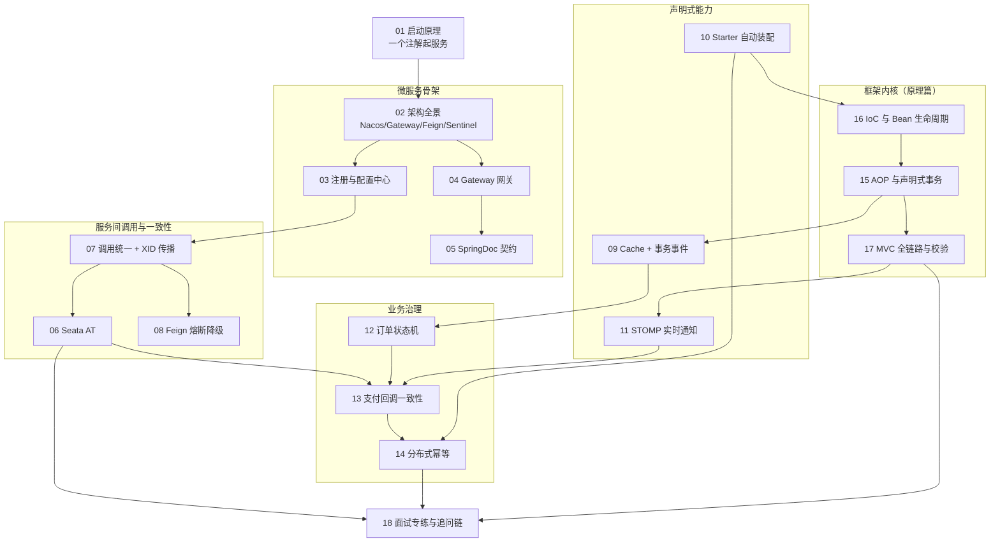

# Spring 与微服务（02 模块）

> **一句话结论**：本模块不是 Spring 教程，而是一张**索引**——18 篇正文各自把一个 Spring 机制"在本项目里被用上、被配错、被排障"的完整路径讲透，读完你应该能从一条报错直接跳到"哪个组件、哪个时机、哪一篇"。
> **阅读前置**：会写 Spring Boot CRUD（`@RestController` + `@Autowired` 级别），能读懂 `java` / `yaml` / `pom.xml`。框架原理不要求——15~17 篇就是补这块的。
> **证据基线**：JDK 17 / Spring Framework 7.1.0 / Spring Boot 4.2.0 / Spring Cloud 2026.0.0（子项目 5.1.0）/ Spring Cloud Alibaba 2025.1.0.0；项目事实以本仓当前目录与各模块 `application.yml` 为准。通读约 2 小时，按路线精读 8~18 小时。

---

## 1. 这个模块补的是什么缺口

### 1.1 三个真实症状（每个都能在本仓复现）

**症状 1：服务调不通，日志只有一行 WARN**

```text
WARN ... c.s.c.l.LoadBalancer - No servers available for service: ai-cs-product
```

这句话不是网络问题，也不是端口问题，而是负载均衡器拿到了一份**空实例列表**。`RoundRobinLoadBalancer.getInstanceResponse` 在 `instances.isEmpty()` 时打这条 WARN 并返回 `EmptyResponse` [[源码:RoundRobinLoadBalancer.java.md#L99-L105]]。也就是说：要么 `ai-cs-product` 没注册上去（去 `03-Nacos注册与配置中心.md`），要么调用方的 `/actuator/health` 看似正常但服务名写错（去 `02-SpringCloud微服务架构.md` 看调用骨架，去 `08-Feign熔断与降级语义.md` 看降级为什么把它变成"Stock fallback"）。

**症状 2：Feign 调用"卡一分钟然后失败"，超时配置明明改了**

```text
feign.RetryableException: Read timed out executing PUT http://ai-cs-product/product/1/stock/deduct
```

Spring Cloud OpenFeign 默认读超时是 60 秒、且**默认不重试**——所以第一反应往往是"我改了 `feign.client.config.default.read-timeout` 怎么没生效"，而真实原因是改在了错的层级（`spring.cloud.openfeign.*` 与 `feign.client.*` 是两套前缀），或者被 `@FeignClient` 上的独立 `contextId` 覆盖。这一整条链在 `08-Feign熔断与降级语义.md` 的 §3.6 逐段拆过。

**症状 3：本地改的配置"没生效"**

本地 `application.yml` 里改了模型名，`export OPENAI_MODEL=xxx`，重启仍是旧值。原因不是缓存，而是 `spring.config.import` 导入的 Nacos 文档**优先级高于声明 import 的那个文件本身**（本项目每个服务的 `application.yml` 都写了 `optional:nacos:aics-shared.yml` + `optional:nacos:ai-cs-<服务>.yml`）。机制在 `03-Nacos注册与配置中心.md`，本地文件与导入文件的优先级顺序在 `01-SpringBoot核心原理.md`。

这三个现象指向同一件事：**Spring 的行为由"哪个组件、在哪个时机、用哪个属性源"决定，而这三点都不在业务代码里**。本模块就是这张"组件 × 时机 × 出处"的索引。

### 1.2 能力缺口对照

| 你以为会了 | 实际会缺的 | 在哪补 |
| --- | --- | --- |
| 会写 `@Transactional` | 不知道代理在哪一步包上去、什么情况下包不上（同类调用、private、异常被吞） | [15-SpringAOP与声明式事务原理](15-SpringAOP与声明式事务原理.md) |
| 会写 `application.yml` | 不知道属性源顺序、`spring.config.import` 的优先级、`@ConfigurationProperties` 何时绑 | [01-SpringBoot核心原理](01-SpringBoot核心原理.md)、[03-Nacos注册与配置中心](03-Nacos注册与配置中心.md) |
| 会写 `@FeignClient` 接口 | 不知道超时/重试/熔断/降级分别在哪一层生效、异常先被谁捕获 | [08-Feign熔断与降级语义](08-Feign熔断与降级语义.md)、[07-服务调用统一与SeataXID传播](07-服务调用统一与SeataXID传播.md) |
| 会 `@Cacheable` | 不知道同类内部调用不走代理、TTL 要按 `cacheName` 分层 | [09-SpringCache与事务领域事件](09-SpringCache与事务领域事件.md) |
| 会引 `common` 模块 | 不知道 `AutoConfiguration.imports` 与条件注解如何决定 Bean 在不在 | [10-自定义Starter与自动装配](10-自定义Starter与自动装配.md)、[16-IoC容器与Bean生命周期](16-IoC容器与Bean生命周期.md) |
| 会写 WebSocket 端点 | 不知道 CONNECT 帧鉴权、`Principal` 与 user destination 的绑定关系 | [11-STOMP实时通知与用户目的地](11-STOMP实时通知与用户目的地.md) |

### 1.3 读者画像

| 你是 | 建议入口 | 目标 |
| --- | --- | --- |
| 1~3 年，正在准备跳槽面试 | [16](16-IoC容器与Bean生命周期.md) → [15](15-SpringAOP与声明式事务原理.md) → [17](17-SpringMVC请求全链路与参数校验.md) → [18](18-Spring面试专练与追问链.md) | 能接住"那你说说为什么"的第二轮追问 |
| 正在往这个仓库加功能 | [01](01-SpringBoot核心原理.md) → [02](02-SpringCloud微服务架构.md) → [03](03-Nacos注册与配置中心.md) → [04](04-SpringCloudGateway网关.md) | 能独立加一条网关路由 + 一个新服务，不碰别人代码 |
| 线上值班，只有报错和日志 | [8. 常见问题直达表](#8-常见问题直达表症状去哪篇)，再按表跳篇 | 10 分钟内把报错映射到某一篇的某一节 |

### 1.4 读完能验证的行为（可自测，不靠感觉）

1. 给出任意一条 `No servers available for service: xxx`，能列出三种根因并说出先查哪个（Nacos 实例列表 → 服务名拼写 → LB 过滤器）。
2. 能画出一次请求从 `:8080` 进入网关到业务 Service 的完整九站，并指出鉴权发生在第几站。
3. 能解释"同类的 A 方法调用本类的 `@Transactional` B 方法为什么不开事务"，并给出三种修法。
4. 能在 `ai-cs-common` 里新增一个 `@AutoConfiguration` 类并让它生效（只用 `AutoConfiguration.imports`，不改任何业务模块的扫描包）。
5. 能说清 `@Idempotent` 的三层幂等分别拦哪一类重复请求，以及 Redis 不可用时的行为。
6. 能对着 `18-Spring面试专练与追问链.md` 的四条追问链，每条都接住第二轮。

---

## 2. 模块地图：18 篇的依赖形状



> **读图说明**：左侧 `01 → 02 → 03/04` 是"骨架线"，回答"请求怎么进来、服务怎么互相找到"；`07` 是所有远程调用的公共出口，所以 `06`(XID 传播) 与 `08`(熔断降级) 都从它分叉，**看错这条箭头会得出"Seata 和 Feign 无关"的错误结论**。中间的 `09/10/11` 是三种"不用写业务代码就能生效"的声明式能力，它们的共同底座是 `15`（代理）和 `16`（容器）——所以内核组画在下方却是**前置**。右下 `12 → 13` 是业务治理主线（状态机管流转，支付管钱怎么安全进来），`14` 同时依赖 `10`（组件怎么装）与 `13`（用在哪里）。`18` 是所有线的收敛点，不引入新知识。

### 推荐顺序与理由

| 顺序 | 走法 | 为什么这个顺序 |
| --- | --- | --- |
| ① 骨架 | 01 → 02 → 03 → 04 | 先有"服务能被找到、请求有唯一入口"，后面所有调用类问题才有坐标系 |
| ② 调用 | 07 → 08 → 06 | 先学"远程调用统一出口"（07），才看得懂 XID 从哪加进去（06）和超时降级挂在哪（08） |
| ③ 声明式 | 15 → 16 → 09 → 10 → 11 | 先知道代理怎么织入（15）、容器里有什么（16），再看两个真实声明式能力（09 缓存/事件、10 装配），最后是实时通道（11） |
| ④ 业务治理 | 12 → 13 → 14 | 状态流转 → 钱进来 → 重复请求挡住，正好是三条独立防线 |
| ⑤ 验收 | 18 | 不学新知识，只检验前面能不能讲清 |

> 想先补"契约/文档"的，`05` 可以插在 04 之后任意位置——它只依赖网关聚合配置，不依赖别篇。

---

## 3. 每篇在解决什么问题

| 篇 | 解决什么问题（不是"讲什么"） | 证据类型 | 难度 |
| --- | --- | --- | --- |
| [01-SpringBoot核心原理](01-SpringBoot核心原理.md) | 一个 `@SpringBootApplication` 为什么能起服务；配置从哪几层读、谁盖谁 | A（框架锚点）+ B（本仓 yml） | ★ |
| [02-SpringCloud微服务架构](02-SpringCloud微服务架构.md) | 单体为什么拆成十几个服务；Nacos/Gateway/Feign/Sentinel 各管哪一段 | A（版本矩阵 POM 摘录）+ B | ★★ |
| [03-Nacos注册与配置中心](03-Nacos注册与配置中心.md) | 实例怎么注册上去、怎么被拉到；`spring.config.import` 与动态刷新为什么"远端盖本地" | A（Nacos 客户端类）+ B | ★★ |
| [04-SpringCloudGateway网关](04-SpringCloudGateway网关.md) | 8080 唯一入口：路由断言、过滤器链顺序、鉴权与限流该放第几层 | A（Route/GlobalFilter）+ B（`AuthFilter`） | ★★★ |
| [05-SpringDoc接口文档](05-SpringDoc接口文档.md) | 注解怎么变成 OpenAPI、Swagger UI 怎么经网关聚合、文档和代码怎么不失同步 | B 为主（注解 + 网关聚合配置）；框架侧以官方文档为准 | ★ |
| [06-Seata分布式事务AT模式](06-Seata分布式事务AT模式.md) | 跨服务写的原子性：全局事务、`undo_log` 前后镜像、TC/TM/RM 各在哪 | B（本项目落地）；Seata 无 sources 摘录，禁止贴"像源码"的代码 | ★★★★ |
| [07-服务调用统一与SeataXID传播](07-服务调用统一与SeataXID传播.md) | 远程调用为什么必须收口到一个出口；`TX_XID` 怎么跨服务带过去 | B（拦截器/客户端代码） | ★★★ |
| [08-Feign熔断与降级语义](08-Feign熔断与降级语义.md) | 超时/重试/熔断/降级各自在哪一层生效，为什么"降级方法抛异常"会加速熔断 | A（`FeignCircuitBreakerTargeter` 等）+ B（`application.yml`） | ★★★ |
| [09-SpringCache与事务领域事件](09-SpringCache与事务领域事件.md) | 缓存策略怎么从业务代码剥离、TTL 怎么按 `cacheName` 分层；事件为什么必须等提交 | B（`@Cacheable` 配置 + 监听器代码） | ★★★ |
| [10-自定义Starter与自动装配](10-自定义Starter与自动装配.md) | `ai-cs-common` 怎么从"每个服务扫 `com.aics.common`"变成标准 Starter | A（`ImportCandidates`/条件注解）+ B（6 条 `imports`） | ★★★ |
| [11-STOMP实时通知与用户目的地](11-STOMP实时通知与用户目的地.md) | 怎么"推给某个用户"而不是广播；CONNECT 帧里没有 Principal 会怎样 | B（`WebSocketConfig` + CONNECT 鉴权） | ★★★ |
| [12-订单状态机治理](12-订单状态机治理.md) | 状态流转集中治理，为什么 `order.status` 是唯一事实来源、不用内存 persister | B（状态机配置 + 迁移矩阵） | ★★★★ |
| [13-支付渠道集成与回调一致性](13-支付渠道集成与回调一致性.md) | 四个渠道怎么用策略+工厂收口，回调重复/乱序怎么防（状态检查+唯一索引+事务消息） | B（`ai-cs-pay` 落地） | ★★★★ |
| [14-分布式幂等设计](14-分布式幂等设计.md) | `@Idempotent`（AOP + Redis SET NX）怎么写出来、怎么测、三层幂等各拦什么 | B（框架组件 + 单测） | ★★★★ |
| [15-SpringAOP与声明式事务原理](15-SpringAOP与声明式事务原理.md) | 代理在哪一步织入；`@Transactional` 失效的七种真实原因怎么逐个排查 | A（`TransactionInterceptor`/`CglibAopProxy`）+ B | ★★★★ |
| [16-IoC容器与Bean生命周期](16-IoC容器与Bean生命周期.md) | `refresh()` 六阶段、Bean 八步、三级缓存、条件装配四件套决定"Bean 在不在" | A（`AbstractApplicationContext` 等）+ B（common 配置） | ★★★★ |
| [17-SpringMVC请求全链路与参数校验](17-SpringMVC请求全链路与参数校验.md) | 一次请求的九站；四种取数注解怎么选；`@Valid` 失败为什么没进你的 catch | A（`DispatcherServlet` 等）+ B（`GlobalExceptionHandler`） | ★★★ |
| [18-Spring面试专练与追问链](18-Spring面试专练与追问链.md) | 把 01~17 组织成"四层答题模板 + 追问链"，而不是背结论 | 无代码（问答/追问） | ★★★ |

---

## 4. 三条学习路线

| 路线 | 顺序 | 耗时 | 产出物（可拿出来给人看的东西） |
| --- | --- | --- | --- |
| **面试速通** | 16 → 15 → 17 → 10 → 18 | 8~10 h | 手绘两张图（`refresh()` 六阶段 / 代理织入点）；18 的四条追问链各能接住第二轮；能当场写 JDK↔CGLIB 选择条件 |
| **项目落地** | 01 → 03 → 04 → 07 → 08 → 09 → 10 → 11 → 14 | 16~20 h | 一条自己加的网关路由（含白名单与限流）；一个 `ai-cs-common` 自动配置类 + `ApplicationContextRunner` 测试；一处真实的 `@Idempotent` 接入 |
| **线上排障** | 02 → 03 → 04 → 08 → 07 → 12 → 13 | 6~8 h | 一张"症状 → 篇 → 节"的自用速查卡（可直接从 [第 8 节](#8-常见问题直达表症状去哪篇) 抄）；三条排障命令（`/actuator/health`、Nacos 实例列表、Feign 超时日志关键字） |

> 一致性专项（不在三条路线内，但做支付/订单必读）：`06 → 12 → 13 → 14`，约 12~16 h。这四篇的共同结论是"跨服务写没有银弹，只有全局事务 + 状态机 + 幂等三层叠加"。

---

## 5. 依赖关系：前置与后续

### 5.1 前置（来自 01-Java基础，读之前至少过一遍）

| 前置篇 | 为什么必须 | 用到它的篇 |
| --- | --- | --- |
| [01-Java基础/06-反射动态代理与SPI](../01-Java基础/06-反射动态代理与SPI.md) | 代理对象的生成、注解的运行时读取是 AOP 的语言层基础 | 15、17 |
| [01-Java基础/04-并发编程进阶](../01-Java基础/04-并发编程进阶.md) | 单例 Bean 的线程安全、消息监听线程模型 | 16、11 |
| [01-Java基础/02-Maven多模块管理](../01-Java基础/02-Maven多模块管理.md) | Starter 要单独出 jar，`mvn -pl ai-cs-xxx -am` 的依赖解析 | 10 |
| [01-Java基础/01-Java17核心特性](../01-Java基础/01-Java17核心特性.md) | record 绑定、构造器绑定、编译参数 `-parameters` 对参数名的影响 | 16、17 |
| [01-Java基础/08-语言级细节与序列化](../01-Java基础/08-语言级细节与序列化.md) | Boot 4 默认 Jackson 3（`tools.jackson` 包名），序列化相关结论要在这里对 | 05、17 |

### 5.2 后续（读完本模块去哪）

| 后续篇 | 接着学什么 | 与本模块的接口 |
| --- | --- | --- |
| [03-数据库与ORM/02-MyBatisPlus实战](../03-数据库与ORM/02-MyBatisPlus实战.md) | 数据访问落地 | 15/17 的下游：事务与参数校验最终写到数据库 |
| [03-数据库与ORM/06-事务进阶-MVCC实现与三大日志](../03-数据库与ORM/06-事务进阶-MVCC实现与三大日志.md) | MySQL 事务原理 | 15 只讲 Spring 侧传播与代理，DB 侧不重复 |
| [03-数据库与ORM/10-数据库面试专练](../03-数据库与ORM/10-数据库面试专练.md) | 数据库面试口径 | 与 18 组合成"中间件 + 框架"两段式答题 |
| [09-安全与设计模式/03-SpringSecurity微服务两层安全模型](../09-安全与设计模式/03-SpringSecurity微服务两层安全模型.md) | 网关粗粒度 + 服务细粒度 | 04 讲网关过滤器位置，这篇讲 `SecurityFilterChain` 怎么搭 |
| [09-安全与设计模式/04-设计模式在微服务中的实战](../09-安全与设计模式/04-设计模式在微服务中的实战.md) | 策略/工厂/模板方法 | 13 的四渠道就是策略+工厂实例 |
| [21-架构与分布式/03-分布式一致性理论](../21-架构与分布式/03-分布式一致性理论.md) | CAP/BASE、2PC/TCC/Saga | 06 的 AT 模式是 2PC 的一种工程化变体 |
| [21-架构与分布式/02-DDD领域驱动设计](../21-架构与分布式/02-DDD领域驱动设计.md) | 领域事件、聚合边界 | 09 的 `@TransactionalEventListener` 是进程内领域事件的实现 |
| [21-架构与分布式/05-CQRS与事件溯源](../21-架构与分布式/05-CQRS与事件溯源.md) | 事件驱动架构 | 09/11 的事件与推送只做"进程内 + 单服务"，跨服务要到这篇 |

### 5.3 本模块明确不讲（避免重复）

Spring AI / RAG / 向量库 → [05-AI集成/01-SpringAI框架集成/01-SpringAI入门](../05-AI集成/01-SpringAI框架集成/01-SpringAI入门.md)；线程池调优与背压 → [12-性能工程/07-线程池调优与背压](../12-性能工程/07-线程池调优与背压.md)；`@Scheduled` vs XXL-Job 选型 → [07-运维部署/05-XXL-Job分布式调度](../07-运维部署/05-XXL-Job分布式调度.md)；微服务治理的整体计划 → [00-学习路线总览/03-微服务治理补全开发计划](../00-学习路线总览/03-微服务治理补全开发计划.md)。

---

## 6. 检查点清单

分五阶段，每条都可验证。"能说出"= 不看文档讲 60 秒；"能画出"= 白纸画出关键 5 个节点；"能复现"= 在本地能造出该现象。

### 阶段 A：容器与代理（读 15、16）

- [ ] 能说出 `refresh()` 的六个阶段，并指出普通 Bean 实例化发生在哪一步
- [ ] 能说出 Bean 生命周期八步里 `BeanPostProcessor` 出现两次分别做什么
- [ ] 能画出 JDK 动态代理与 CGLIB 的选择条件（有接口 / 无接口 / `proxyTargetClass`）
- [ ] 能复现"同类内部调用导致 `@Transactional` 失效"，并给出三种修法（自注入、拆 Bean、`TransactionTemplate`）

### 阶段 B：Web 与入口（读 01、04、17）

- [ ] 能画出一次请求从网关到 Controller 的九站，标出鉴权与参数解析各在第几站
- [ ] 能说出 `AuthFilter` 的白名单从哪里来、改白名单要动哪个文件
- [ ] 能复现：`@Valid` 校验失败时异常最终被谁处理、返回体长什么样（对照 `GlobalExceptionHandler`）
- [ ] 能说出 `spring.config.import` 导入的文档与声明它的文件谁优先

### 阶段 C：服务间调用（读 03、07、08）

- [ ] 能说出 `No servers available for service: xxx` 的三种根因及排查顺序
- [ ] 能画出 `TX_XID` 从 order 到 product 的传播路径，指出是哪个拦截器写进去的
- [ ] 能复现 Feign 读超时（默认 60 s），并把超时改到 3 s 观察日志关键字变化
- [ ] 能说出为什么"降级方法里再抛异常"会让熔断更快打开

### 阶段 D：数据一致性（读 06、12、13、14）

- [ ] 能解释 `undo_log` 的前镜像/后镜像在一次回滚里各用在哪
- [ ] 能说出订单状态机的"唯一事实来源"是什么，为什么不用内存 persister
- [ ] 能说出支付回调的三层防重（状态检查 / 唯一索引 / 事务消息）各拦住哪种重复
- [ ] 能复现幂等拦截的两种返回：首次放行、重复请求被拒（并说出 Redis 不可用时的行为）

### 阶段 E：装配与实时（读 09、10、11）

- [ ] 能新增一个 `@AutoConfiguration` 类，只靠 `AutoConfiguration.imports` 生效
- [ ] 能用 `ApplicationContextRunner` 断言"条件满足时 Bean 在、不满足时 Bean 不在"
- [ ] 能复现"CONNECT 帧没带 token → 订阅 `/user/queue/notify` 收不到消息"
- [ ] 能说出 `@Cacheable` 在本项目里分了哪几个 `cacheName`、各自 TTL 从哪读

---

## 7. 与 24-源码分析 的分工

一句话分工：**本模块讲"怎么用、怎么配错、怎么排障"，24 讲"框架内部怎么实现"**。同一个主题两边各读一篇，才算闭环。

| 主题 | 本模块（用法/坑） | 24-源码分析（实现/行号） |
| --- | --- | --- |
| 启动与自动配置 | [01](01-SpringBoot核心原理.md)、[10](10-自定义Starter与自动装配.md) | [02-SpringBoot/01-启动原理/01-springapplication-run-启动全流程](../24-源码分析/02-SpringBoot/01-启动原理/01-springapplication-run-启动全流程.md)、[02-自动配置/01-enableautoconfiguration-自动配置全链路](../24-源码分析/02-SpringBoot/02-自动配置/01-enableautoconfiguration-自动配置全链路.md)、[02-自定义starter与条件注解](../24-源码分析/02-SpringBoot/02-自动配置/02-自定义starter与条件注解.md) |
| 配置与属性绑定 | [03](03-Nacos注册与配置中心.md) | [04-配置与属性绑定/01-configurationproperties-属性绑定原理](../24-源码分析/02-SpringBoot/04-配置与属性绑定/01-configurationproperties-属性绑定原理.md)、[02-环境抽象与配置加载-configdata与profile](../24-源码分析/02-SpringBoot/04-配置与属性绑定/02-环境抽象与配置加载-configdata与profile.md) |
| IoC 与生命周期 | [16](16-IoC容器与Bean生命周期.md) | [01-Spring框架/01-IoC容器与Bean生命周期/01-refresh-容器启动全流程](../24-源码分析/01-Spring框架/01-IoC容器与Bean生命周期/01-refresh-容器启动全流程.md)、[02-bean-创建全流程-getbean与createbean](../24-源码分析/01-Spring框架/01-IoC容器与Bean生命周期/02-bean-创建全流程-getbean与createbean.md)、[03-循环依赖与三级缓存](../24-源码分析/01-Spring框架/01-IoC容器与Bean生命周期/03-循环依赖与三级缓存.md) |
| AOP 与代理 | [15](15-SpringAOP与声明式事务原理.md)、[14](14-分布式幂等设计.md) | [02-AOP与代理/01-aop-原理与自动代理创建](../24-源码分析/01-Spring框架/02-AOP与代理/01-aop-原理与自动代理创建.md)、[02-代理方式-jdk与cglib](../24-源码分析/01-Spring框架/02-AOP与代理/02-代理方式-jdk与cglib.md)、[04-aop-实战-自定义注解切面与坑位](../24-源码分析/01-Spring框架/02-AOP与代理/04-aop-实战-自定义注解切面与坑位.md) |
| 事务与领域事件 | [15](15-SpringAOP与声明式事务原理.md)、[09](09-SpringCache与事务领域事件.md) | [03-事务管理/01-transactional-事务拦截器与传播行为](../24-源码分析/01-Spring框架/03-事务管理/01-transactional-事务拦截器与传播行为.md)、[02-事务失效场景与源码原因](../24-源码分析/01-Spring框架/03-事务管理/02-事务失效场景与源码原因.md) |
| MVC 与参数校验 | [17](17-SpringMVC请求全链路与参数校验.md) | [04-SpringMVC/01-dispatcherservlet-一次请求的完整旅程](../24-源码分析/01-Spring框架/04-SpringMVC/01-dispatcherservlet-一次请求的完整旅程.md)、[03-参数解析与返回值处理-argumentresolver与converter](../24-源码分析/01-Spring框架/04-SpringMVC/03-参数解析与返回值处理-argumentresolver与converter.md) |
| 注册中心 | [02](02-SpringCloud微服务架构.md)、[03](03-Nacos注册与配置中心.md) | [04-SpringCloud/02-注册中心Nacos/01-nacos-服务注册与发现源码](../24-源码分析/04-SpringCloud/02-注册中心Nacos/01-nacos-服务注册与发现源码.md)、[02-服务发现与拉取-服务实例列表如何更新](../24-源码分析/04-SpringCloud/02-注册中心Nacos/02-服务发现与拉取-服务实例列表如何更新.md) |
| 网关 | [04](04-SpringCloudGateway网关.md) | [04-网关Gateway/01-route-路由断言与过滤器链](../24-源码分析/04-SpringCloud/04-网关Gateway/01-route-路由断言与过滤器链.md)、[02-predicate与filter-常用断言与限流](../24-源码分析/04-SpringCloud/04-网关Gateway/02-predicate与filter-常用断言与限流.md) |
| 负载均衡 / Feign | [07](07-服务调用统一与SeataXID传播.md)、[08](08-Feign熔断与降级语义.md) | [03-负载均衡与调用/01-loadbalancer-负载均衡与轮询策略源码](../24-源码分析/04-SpringCloud/03-负载均衡与调用/01-loadbalancer-负载均衡与轮询策略源码.md)、[02-openfeign-动态代理与请求拼接](../24-源码分析/04-SpringCloud/03-负载均衡与调用/02-openfeign-动态代理与请求拼接.md) |
| 熔断限流 | [08](08-Feign熔断与降级语义.md)、[04](04-SpringCloudGateway网关.md) | [06-熔断限流与容错/01-circuitbreaker-抽象与resilience4j](../24-源码分析/04-SpringCloud/06-熔断限流与容错/01-circuitbreaker-抽象与resilience4j.md)、[02-sentinel-限流降级原理](../24-源码分析/04-SpringCloud/06-熔断限流与容错/02-sentinel-限流降级原理.md) |
| 分布式事务 | [06](06-Seata分布式事务AT模式.md) | [07-分布式事务与链路追踪/01-分布式事务-seata-at模式源码](../24-源码分析/04-SpringCloud/07-分布式事务与链路追踪/01-分布式事务-seata-at模式源码.md) |
| 方法级安全 | [04](04-SpringCloudGateway网关.md)、[18](18-Spring面试专练与追问链.md) | [05-SpringSecurity/02-授权与方法级安全/02-methodsecurity-prepostauthorize-与-代理](../24-源码分析/05-SpringSecurity/02-授权与方法级安全/02-methodsecurity-prepostauthorize-与-代理.md) |
| 接口契约 | [05](05-SpringDoc接口文档.md) | 24 暂无 SpringDoc 专篇；最接近的是 [02-SpringBoot/03-内嵌容器与Web开发/02-webmvc自动配置与dispatcherservlet注册](../24-源码分析/02-SpringBoot/03-内嵌容器与Web开发/02-webmvc自动配置与dispatcherservlet注册.md)（文档聚合依赖的 MVC 自动配置） |
| 实时通知 | [11](11-STOMP实时通知与用户目的地.md) | 24 暂无 WebSocket/STOMP 专篇，本模块独立覆盖（消息基础设施侧看 [21-架构与分布式/05-CQRS与事件溯源](../21-架构与分布式/05-CQRS与事件溯源.md)） |
| 状态机 | [12](12-订单状态机治理.md) | 24 暂无 Spring StateMachine 专篇；状态机的"为什么不用内存 persister"在本模块 12 篇结论 |
| 支付回调 | [13](13-支付渠道集成与回调一致性.md) | 24 无对应篇；事务消息部分与 [07-分布式事务与链路追踪/01](../24-源码分析/04-SpringCloud/07-分布式事务与链路追踪/01-分布式事务-seata-at模式源码.md) 的本地事务/全局事务边界对照读 |
| 面试验收 | [18](18-Spring面试专练与追问链.md) | [00-导读与学习路线/README](../24-源码分析/00-导读与学习路线/README.md)（读源码的方法与顺序）、[07-源码方法论与附录/02-源码阅读方法论/01-四步读码法-从断点到调用栈](../24-源码分析/07-源码方法论与附录/02-源码阅读方法论/01-四步读码法-从断点到调用栈.md) |

> 说明：24 的规模与选篇标准（只收能拿到 sources 的框架）决定了它没有 WebSocket/STOMP、StateMachine、支付渠道这类"协议/第三方 SDK"主题——这三块在本模块以 B 级证据（本项目源码 + 配置）为准，不能反过来假设 24 会给出源码。

---

## 8. 常见问题直达表（症状 → 去哪篇）

| 症状 / 报错关键字 | 去哪篇 | 先看哪一节 / 关键字 |
| --- | --- | --- |
| `No servers available for service: xxx` | [02](02-SpringCloud微服务架构.md)、[03](03-Nacos注册与配置中心.md)、[08](08-Feign熔断与降级语义.md) | 实例列表为空的三层排查；`NacosWatch`；降级为何掩盖了它 |
| `feign.RetryableException: Read timed out` / `Connection refused` | [08](08-Feign熔断与降级语义.md)、[07](07-服务调用统一与SeataXID传播.md) | 超时前缀与 `contextId` 覆盖；统一出口里的拦截器顺序 |
| 网关 401/403，登录接口也被拦 | [04](04-SpringCloudGateway网关.md) | `AuthFilter` 白名单加载时机与 `@PostConstruct` |
| 网关 429 / 限流不生效 | [04](04-SpringCloudGateway网关.md) | `RequestRateLimiter` 与本地 `aics.gateway.rate-limit.*` 的开关关系 |
| 本地改了配置，重启仍是旧值 | [01](01-SpringBoot核心原理.md)、[03](03-Nacos注册与配置中心.md) | 属性源顺序；`spring.config.import` 优先级 |
| 动态刷新后 `@ConfigurationProperties` 没变 | [03](03-Nacos注册与配置中心.md) | `@RefreshScope` 与 rebind 的区别 |
| `@Transactional` 不生效 / 事务没回滚 | [15](15-SpringAOP与声明式事务原理.md) | 失效七查；异常被 catch；传播行为 |
| `@Cacheable` 不生效 / 缓存不更新 | [09](09-SpringCache与事务领域事件.md)、[15](15-SpringAOP与声明式事务原理.md) | 同类调用不走代理；TTL 按 `cacheName` 分层 |
| 事务提交了但事件没发 / 事件发了但业务失败 | [09](09-SpringCache与事务领域事件.md) | `@TransactionalEventListener` 的四个 phase |
| 自动配置类的 Bean 找不到 / 重复注册 | [10](10-自定义Starter与自动装配.md)、[16](16-IoC容器与Bean生命周期.md) | `AutoConfiguration.imports`；`@ConditionalOnMissingBean` |
| 循环依赖启动失败（`BeanCurrentlyInCreationException`） | [16](16-IoC容器与Bean生命周期.md) | 三级缓存；构造器注入为何解不了 |
| `@Valid` 失败返回的不是我定义的错误结构 | [17](17-SpringMVC请求全链路与参数校验.md) | 异常被 `HandlerExceptionResolver` 先接走 |
| Swagger UI 404 / 文档缺接口 | [05](05-SpringDoc接口文档.md) | 网关聚合前缀；`springdoc` 路径 |
| 状态机抛非法状态 / 订单状态被改乱 | [12](12-订单状态机治理.md) | `order.status` 唯一事实来源；Guard |
| 支付回调重复入账 / 金额对不上 | [13](13-支付渠道集成与回调一致性.md)、[14](14-分布式幂等设计.md) | 三层防重；唯一索引；`@Idempotent` |
| WebSocket 连上但收不到消息 | [11](11-STOMP实时通知与用户目的地.md) | CONNECT 鉴权 → `Principal` → user destination |
| 全局事务不回滚 / 参与方没加入 | [06](06-Seata分布式事务AT模式.md)、[07](07-服务调用统一与SeataXID传播.md) | `TX_XID` 是否带到下游；`undo_log` 是否存在 |

---

## 9. 附录：本模块事实基线（写文档前先核这里）

### 9.1 服务与端口（实测，非旧稿）

```powershell
Get-ChildItem -Directory -Filter 'ai-cs-*' | ForEach-Object {
  $yml = Join-Path $_.FullName 'src\main\resources\application.yml'
  if (Test-Path $yml) {
    $port = (Select-String -Path $yml -Pattern '^\s*port:\s*(\d+)' |
      ForEach-Object { $_.Matches[0].Groups[1].Value }) -join ','
    $name = (Select-String -Path $yml -Pattern '^\s*name:\s*(\S+)' |
      Select-Object -First 1).Matches[0].Groups[1].Value
    "$($d.Name): name=$name port=$port"
  } else { "$($d.Name): NO application.yml" }
}
```

真实输出（节选，2026-11 当前 `main`）：

```text
ai-cs-chat: name=ai-cs-chat port=8083
ai-cs-common: NO application.yml
ai-cs-frontend: NO application.yml
ai-cs-frontend-react: NO application.yml
ai-cs-gateway: name=ai-cs-gateway port=8080
ai-cs-knowledge: name=ai-cs-knowledge port=8082
ai-cs-message: name=ai-cs-message port=8085
ai-cs-mq: name=ai-cs-mq port=8090
ai-cs-notify: name=ai-cs-notify port=8086
ai-cs-order: name=ai-cs-order port=8087,9999
ai-cs-pay: name=ai-cs-pay port=8089
ai-cs-product: name=ai-cs-product port=8088
ai-cs-py-chat: NO application.yml
ai-cs-py-recommend: NO application.yml
ai-cs-search: name=ai-cs-search port=8084
ai-cs-user: name=ai-cs-user port=8081
```

怎么读：`NO application.yml` 的五个模块（common、两个前端、两个 Python 服务）不是 Spring Boot 服务，`server.port` 不适用；`ai-cs-order` 出现两个端口，是因为脚本抓到了 `aics.xxl-job.executor.port: 9999`（XXL-Job 执行器端口，默认配置里 XXL-Job 是关闭的），**它不是 Web 端口**——判断一个服务对外端口只看 `server.port`。

| 服务 | 端口 | 角色 |
| --- | --- | --- |
| ai-cs-gateway | 8080 | 唯一入口：路由、鉴权、限流、CORS |
| ai-cs-user | 8081 | 注册/登录/用户管理 |
| ai-cs-knowledge | 8082 | 文档管理与向量化 |
| ai-cs-chat | 8083 | AI 对话（Spring AI、RAG、Function Calling） |
| ai-cs-search | 8084 | Elasticsearch 全文检索 |
| ai-cs-message | 8085 | 消息生产/消费 |
| ai-cs-notify | 8086 | STOMP 实时推送 |
| ai-cs-order | 8087 | 购物车/订单/状态机/全局事务发起方 |
| ai-cs-product | 8088 | 商品与库存 |
| ai-cs-pay | 8089 | 支付渠道与回调 |
| ai-cs-mq | 8090 | MQ 独立模块（当前最大端口） |

### 9.2 版本（根 `pom.xml` 属性，逐行核过）

| 组件 | 本仓属性值 | 说明 |
| --- | --- | --- |
| JDK | `<java.version>17</java.version>` | 编译目标 17 |
| Spring Boot | `4.2.0` | Boot 4 起 `spring-boot-starter-web` 已 deprecated，新代码用 `spring-boot-starter-webmvc` |
| Spring Cloud | `2026.0.0` | 子项目版本线 5.1.0 |
| Spring Cloud Alibaba | `2025.1.0.0` | Nacos 3.x / Sentinel 1.8.x |
| Spring AI | `2.1.0` | 2.1 起有 `SessionService` / Session Memory |
| Spring StateMachine | `4.0.0` | 12 篇用它 |
| MyBatis-Plus | `3.5.13` | 03 模块的地基 |
| Seata | 属性 `seata.version=1.7.1` | ⚠️ 与文档基线写的 2.7.0 不一致；涉及 Seata 版本结论时以 `mvn -pl ai-cs-order dependency:tree` 的实际解析结果为准，不要照抄任一数字 |

### 9.3 旧稿纠正（我记住的那条可能已经过时）

| 旧稿（2026-08 版本）写的 | 现在的实际情况 | 影响 |
| --- | --- | --- |
| Spring Cloud `2023.0.1`、Spring Cloud Alibaba `2023.0.1.0` | 根 `pom.xml` 已是 `2026.0.0` / `2025.1.0.0` | 任何"某注解在某版本才有"的结论都要按新基线重判 |
| 模块清单只列到 `product` | 现有 `pay` / `mq` / `frontend-react` / `py-chat` / `py-recommend` 五个新模块 | 13 篇（支付）就落在 `ai-cs-pay`，旧清单里根本没有它 |
| `ai-cs-common` 有 5 个自动配置 | `AutoConfiguration.imports` 现在是 6 条，多了 `Jackson2AutoConfiguration`（Boot 4 默认 Jackson 3，需要兼容 Jackson 2 的地方靠它） | 10/16 篇的锚点要按 6 条算 |
| "本模块共 14 篇" | 现在 18 篇正文 + 本 README | 本文所有"篇"的编号以目录为准 |
| 未提"自动配置怎么被读进来" | `AutoConfiguration.imports` 由 `ImportCandidates#load` 按注解全名拼出文件位置再加载 [[源码:ImportCandidates.java.md#L69-L72]] | 10/16 篇讲"为什么生效"时可以从这个方法起讲 |
| 旧稿漏掉的 Gateway 限流双实现 | 现为 `RequestRateLimiter`（Redis + Lua，分布式）+ 本地 `aics.gateway.rate-limit.*`（`sliding-window` / `token-bucket`，Redis 挂了的兜底） | 04 篇的限流结论必须区分这两套 |

> 核法（B 级）：`ai-cs-common/src/main/resources/META-INF/spring/org.springframework.boot.autoconfigure.AutoConfiguration.imports` 当前 6 行，依次是 `CommonWebAutoConfiguration`、`MinioAutoConfiguration`、`EmbeddingAutoConfig`、`IdempotentAutoConfiguration`、`MessagePublisherAutoConfiguration`、`Jackson2AutoConfiguration`。其中最小的一例是 `ai-cs-common/src/main/java/com/aics/common/autoconfigure/CommonWebAutoConfiguration.java#L12-L20`：`@AutoConfiguration` 回答"何时装配"、`@ConditionalOnWebApplication(type = SERVLET)` 回答"什么应用类型才装配"、`@ConditionalOnMissingBean(GlobalExceptionHandler.class)` 回答"业务方自己声明了就让位"——三个条件缺一个，行为就完全不同。

---

## 10. 维护约定

- 新增一篇：按下表判断归组，然后**必须**同时改本 README 的三处（第 2 节地图、第 3 节摘要表、第 7 节分工表），否则读者会在两张表之间对不上号。
- 归组规则：容器/代理/事务/MVC 原理 → 框架内核组（15~17 之后续编号）；跨服务调用与一致性 → 06~08；声明式能力（缓存/事件/装配/推送）→ 09~11；业务治理（状态/支付/幂等）→ 12~14。
- 正文写作规范见 [_templates/写作规范.md](../_templates/写作规范.md)，缺口来源见 [00-学习路线总览/05-技术缺口分析与补全计划](../00-学习路线总览/05-技术缺口分析与补全计划.md)。
- 自检：`cd learning-docs && node tools/check-doc.mjs 02-Spring微服务`，errors 必须为 0。
- 更新日志：2026-08 首批 01~12 落地记录 → 2026-09 补 13/14 与 15~18 → 2026-11 本 README 重写（对齐 Spring Boot 4.2.0 / Spring Cloud 2026.0.0 基线，纠正模块清单、端口与版本）。
