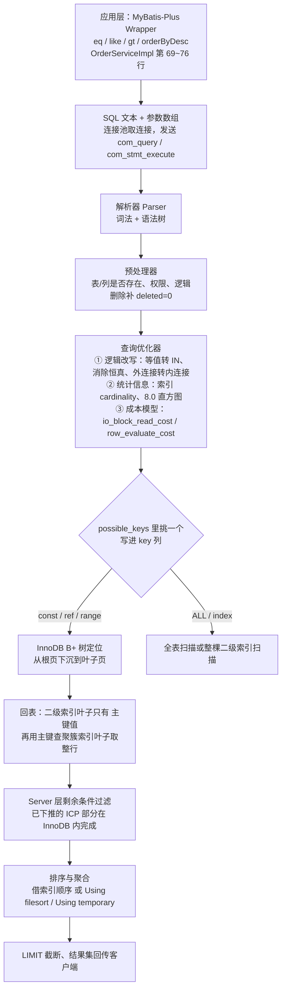

# MySQL 核心知识：为什么这条 SQL 慢——索引结构与执行计划的决定链

> **一句话结论**：一条 SQL 慢，绝大多数时候不是"没建索引"，而是你写的谓词、InnoDB 的索引物理结构、优化器手里的统计信息三者对不上；优化器在它"以为"便宜的计划里挑了一个，而你以为它会用上你建的那条索引。
> **阅读前置**：会写 Java、用过 MyBatis-Plus 的 `LambdaQueryWrapper`，知道 B+ 树是"一种矮胖的多叉树"即可；不要求读过 MySQL 源码——本篇也确实没有源码可引，见下。
> **证据基线**：MySQL 8.0（InnoDB、页 16KB、utf8mb4）× MyBatis 3.6.0 × mybatis-spring 3.0.5 × MyBatis-Plus 3.0.5 × JDK 17。证据分三级：**A 级** = `learning-docs/24-源码分析/assets/source/` 里已入库的源码摘录，**本篇 A 级为 0**——MySQL / InnoDB 源码未入库，凡是机制层结论都标注"依据 MySQL 8.0 官方手册"；**B 级** = 本项目真实 DDL 与代码（给行号，逐条核对过）；**C 级** = 本篇实跑命令与原样输出（本机无 MySQL，凡涉及数据库执行的部分都明标"未本机实测"）。预计阅读 45~60 分钟。

---

## 0. 先看现象

三个症状，三种"第一眼都像索引问题、实际根因各不相同"的情况。

**症状一：索引建了，`EXPLAIN` 里 `key` 列还是 `NULL`。**
`orders` 表按状态查订单，索引也建了（`deploy/mysql/order-init.sql#L44`）：

```sql
KEY `idx_status` (`status`)
```

状态列长这样（`deploy/mysql/order-init.sql#L35`）：`status VARCHAR(20) NOT NULL DEFAULT 'PENDING_PAY'`——全表 100 万行，状态取值不超过 8 种。于是 `WHERE status = 'PENDING_PAY'` 要筛出的是**十几万行**，走索引就得回表十几万次，优化器算完成本后直接把索引扔掉改全表扫。第二类同一症状更隐蔽：`WHERE order_no = 10086`（`order_no` 是 `VARCHAR(32)`，`deploy/mysql/order-init.sql#L26`，传进去的是数字），列被隐式转成 `DOUBLE` 再比，索引整条失效——索引在，就是不用。

**症状二（报错原文）：按仓库里的建表脚本建完库，这条查询直接报错。**

```text
ERROR 1054 (42S22): Unknown column 'session_key' in 'where clause'
```

报错的 SQL 就在项目里（`ai-cs-message/src/main/java/com/aics/message/mapper/ChatMessageMapper.java#L35-L36`）：

```java
@Select("SELECT * FROM chat_message WHERE session_key = #{sessionKey} " +
        "ORDER BY create_time ASC LIMIT #{limit}")
```

而 `chat_message` 的 DDL 里既没有 `session_key` 列，也没有它的索引（`deploy/mysql/init.sql#L305-L318`，索引只有 `PRIMARY KEY (id)`、`idx_session_id`、`idx_sender (sender_type, sender_id)`、`idx_create_time`）。实体类却老老实实映射了 `@TableField("session_key")`（`ai-cs-message/src/main/java/com/aics/message/entity/ChatMessage.java#L35-L36`）。**"这条 SQL 慢/报错"有时候根本不是执行计划问题，而是代码认知的表结构和库里真实的表结构不是同一张表。**

**症状三（报错原文）：跨库 join 一条字符串列，直接抛 1267。**

```text
ERROR 1267 (HY000): Illegal mix of collations (utf8mb4_general_ci,IMPLICIT) and (utf8mb4_unicode_ci,IMPLICIT) for operation '='
```

本项目订单库所有表是 `utf8mb4_general_ci`（`deploy/mysql/order-init.sql#L46`），商品库是 `utf8mb4_unicode_ci`（`deploy/mysql/product-init.sql#L41`），服务端默认又是第三个（`deploy/mysql/mysql.cnf` 的 `collation-server=utf8mb4_unicode_ci`）。两个业务表用字符串列做等值关联时，比较规则谁都不能隐式服从谁，MySQL 只能报错——不是慢，是直接不给你跑。

> 这三个症状（外加下一篇要讲的深分页）指向同一件事：**决定一条 SQL 快慢的不是"有没有索引"，而是谓词形状 × 索引物理结构 × 统计信息三者的乘积；三者任一错位，优化器都会给出一个慢计划（或干脆不给计划），而 `EXPLAIN` 是唯一能把这个"决定"显示给你的窗口。**

---

## 1. 整体地图

一条 `orderMapper.selectList(wrapper)` 从 Java 到磁盘，中间要过七个环节，每个环节都能"合法地"把性能毁掉。



> **读图说明**：
> 1. 左上的 `A` 就是本项目所有查询的起点——`ai-cs-product`、`ai-cs-order` 等模块的 Service 层全部用 `LambdaQueryWrapper` 拼 SQL，没有一条手写 Mapper XML（仓库里 `*Mapper.xml` 数量为 0）。所以"SQL 写得对不对"这一层，实际上是"Wrapper 拼得对不对"。
> 2. `D` 这一步容易被忽略：MyBatis-Plus 的 `@TableLogic` 会给每条 SQL 追加 `deleted = 0`（`ai-cs-product/src/main/java/com/aics/product/entity/Product.java#L45-L46`），你看到的 `WHERE name = ?` 在库里实际是 `WHERE name = ? AND deleted = 0`——索引没建对就会变成"索引用上了但回表过滤掉一半"。
> 3. `E` 是全文的主角：**优化器不是在算"哪个索引更好"，而是在算"哪条路线的成本单位更小"**；它手里的唯一依据是统计信息，统计信息不准，再对的索引也会被扔。
> 4. `G → I` 是"回表"：二级索引叶子节点只存 `(索引列, 主键)`，要拿整行必须再走一次聚簇索引。命中行数 × 随机 IO 就是回表的代价，也是"区分度低的索引不如不用"的根本原因。
> 5. `K` 的 `Using filesort` 不是"用了文件"，而是"排序没法借索引顺序，得自己排一遍"，小结果集在内存 `sort_buffer_size` 里排，超了就落磁盘临时文件——这条最容易在分页查询上炸。

| 组件 / 层 | 责任 | 谁调用它 |
|---|---|---|
| 应用层：Service + Wrapper | 把 `eq/like/gt/orderByDesc` 编译成 SQL 文本与参数 | Controller、AI 工具调用（`OrderServiceImpl#L69-L76`） |
| 分页插件 `PaginationInnerInterceptor` | 改写 SQL：先发 `SELECT COUNT(*)`，再拼 `LIMIT offset, size` | `ai-cs-product/src/main/java/com/aics/product/config/MybatisPlusConfig.java#L20-L23`、`ai-cs-order/src/main/java/com/aics/order/config/OrderConfig.java#L25-L27` |
| 解析器 + 预处理器 | 语法树、表列存在性、权限、字符集/比较规则解析 | MySQL Server 连接线程 |
| 查询优化器 | 逻辑改写、选索引、定 join 顺序、算成本 | 每条 SELECT 一次 |
| 统计信息（InnoDB 侧） | 提供 `cardinality`、页数、8.0 直方图给优化器 | 优化器按需读；`ANALYZE TABLE` 可刷新 |
| 执行器（Server 层） | 把计划翻成"取一行"的循环，做剩余 WHERE 过滤、filesort、临时表 | 优化器输出的执行计划 |
| InnoDB 索引层（B+ 树 + Buffer Pool） | 页定位、回表、索引条件下推（ICP）、加锁 | 执行器 |
| 慢查询日志 | 记录超过 `long_query_time`（本项目 2 秒，`mysql.cnf`）的语句 | mysqld 自身 |

---

## 2. 关键概念与关键类

"关键类"这一列在本篇要打个折：MySQL 的 C++ 类（`JOIN`、`Item_func`、`handler`）都在未入库的源码里，所以下表给的是**你能在真实环境里观察到的对象**——`information_schema` 里的表、`SHOW` 命令的输出、以及本项目真实的 DDL 位置。

| 名称 | 位置（哪一层 / 本项目哪张真实表） | 角色 | 关键方法 / 命令 |
|---|---|---|---|
| 页（page） | InnoDB 存储引擎，默认 16KB | 磁盘与内存之间最小的 IO 单位；一次页读 = 一次随机 IO | `innodb_page_size` |
| 扇出（fanout） | 非叶子页能放多少条"键 + 子页指针" | 决定树有多矮：扇出越大，层高越小 | 由 `key 长度 + 6 字节页指针 + 记录头` 算出来（见 §3.1） |
| 聚簇索引（clustered index） | 表本身；`orders` 的 `PRIMARY KEY (id)`（`deploy/mysql/order-init.sql#L41`） | 叶子页存**整行**；一张表只有一棵 | `selectById` 走它，1~4 次 IO |
| 二级索引（secondary index） | `orders` 的 `uk_order_no` / `idx_user_id` / `idx_status` / `idx_expire_time`（`deploy/mysql/order-init.sql#L42-L45`） | 叶子页存 `(索引列, 主键)`；查整行必须回表 | `ref` / `range` 访问 |
| 回表 | 二级索引 → 聚簇索引的第二次查找 | 命中行数 × 随机 IO 的成本来源 | `handler_read_*` 计数器可观察 |
| 覆盖索引（covering index） | 查询列全部落在某条二级索引里 | 免回表，`Extra` 显示 `Using index` | `SELECT id, name ... WHERE name = ?` 可用 `idx_name` 覆盖 |
| 最左前缀（leftmost prefix） | 联合索引 `(a,b,c)` 的匹配规则 | 只有从头连续的列能做"定位"，断在哪列后面就不能再定位 | `key_len` 列可反推用了几列 |
| 索引条件下推（ICP） | MySQL 5.6+，InnoDB 引擎层 | 把索引上能判的条件推到引擎层过滤，减少回表次数 | `Extra: Using index condition` |
| filesort | Server 层排序 | 索引顺序不满足 `ORDER BY` 时的兜底排序 | `Extra: Using filesort`；`sort_buffer_size` |
| 临时表 | Server 层 | `GROUP BY` / `DISTINCT` / `UNION` 无索引可用时 | `Extra: Using temporary` |
| 优化器成本模型 | `mysql.server_cost` / `mysql.engine_cost` 两张表 | 给每条候选计划打分：`io_block_read_cost` 默认 1.0/块，`row_evaluate_cost` 默认 0.1/行 | `SELECT * FROM mysql.server_cost;` |
| 统计信息 / cardinality | `SHOW INDEX FROM t` 的 `Cardinality` 列、`mysql.innodb_index_stats` | 优化器估算"一个值平均对应多少行"的唯一依据 | `ANALYZE TABLE t;` 重采样 |
| 直方图（histogram） | MySQL 8.0.3+，`information_schema.COLUMN_STATISTICS` | 给**没建索引**的列也提供分布信息 | `ANALYZE TABLE t UPDATE HISTOGRAM ON col WITH 32 BUCKETS;` |
| NLJ（Nested-Loop Join） | Server 层 join 执行 | 被驱动表 join 列有索引时的默认算法 | `EXPLAIN` 里被驱动表 `type=ref/eq_ref` |
| BNL（Block Nested-Loop） | MySQL 5.6~8.0.19 | 被驱动表无索引时，把驱动表结果放 join buffer 分块比对 | `Extra: Using join buffer (Block Nested Loop)` |
| hash join | MySQL 8.0.18+，8.0.20 起等值连接默认 | 无索引等值 join 的替代算法，不再给驱动表结果分块扫 | `Extra: Using join buffer (hash join)` |
| 索引 dive | 优化器内部估算 | 真正去 B+ 树里数几页来估行数，比统计信息准但更贵 | `eq_range_index_dive_limit`（默认 200） |

---

## 3. 原理与证据逐段精读

> 本节所有"机制"层结论的依据是 **MySQL 8.0 官方手册**（`§8.2 Optimizing SQL Statements`、`§8.8 Understanding the Query Execution Plan`、`§15.6.2.1 Clustered and Secondary Indexes`、`§8.2.1.16 LIMIT Query Optimization`）；InnoDB 源码未入库，本篇不引任何源码锚点。

### 3.1 页、扇出、层高：为什么点查只要 3 次 IO

**在干什么。** InnoDB 把表组织成一棵 B+ 树，树的最小单位是 16KB 的页。非叶子页里一条记录只有"索引键 + 6 字节子页指针"，叶子页里才是数据。所以**一棵三层高的树能装多少行，完全由两个数字决定：扇出（每页能放多少条指针）和叶子容量（每页能放多少行）**。这不是玄学，是可以直接算的：我用 node 把 InnoDB 页结构（16KB 页、扣掉 FIL 头/页头/infimum-supremum/目录槽约 200B 开销）写成算术模型跑了一遍：

```text
页可用字节 = 16184
非叶子扇出 = 809 条/页
二级索引叶子容量 = 735 条/页
聚簇索引叶子容量(行宽200B) = 78 行/页
聚簇索引 rows=       1000 -> 叶子页=      13 层高=2 点查IO≈2
聚簇索引 rows=     100000 -> 叶子页=    1283 层高=3 点查IO≈3
聚簇索引 rows=    1000000 -> 叶子页=   12821 层高=3 点查IO≈3
聚簇索引 rows=   10000000 -> 叶子页=  128206 层高=3 点查IO≈3
聚簇索引 rows=  100000000 -> 叶子页= 1282052 层高=4 点查IO≈4
```

再换主键类型和行宽跑一次，三层树的天花板立刻变化：

```text
BIGINT 主键 + 200B 行                 扇出= 809 叶子容量= 78行/页 三层树可装≈5.10e+7 行
BIGINT 主键 + 800B 行                 扇出= 809 叶子容量= 20行/页 三层树可装≈1.31e+7 行
BIGINT 主键 + 2000B 行                扇出= 809 叶子容量=  8行/页 三层树可装≈5.24e+6 行
CHAR(36) UUID 主键 + 200B 行          扇出= 337 叶子容量= 78行/页 三层树可装≈8.86e+6 行
VARCHAR(64) 业务号主键 + 200B 行         扇出= 212 叶子容量= 78行/页 三层树可装≈3.51e+6 行
```

**怎么读这两个输出。** 第一个输出看"层高"，它就是点查需要的 IO 次数：100 万行和 1000 万行都是 3 次，1 亿行才 4 次——因为扇出 809 是**指数级**放大，`809 × 809 × 78 ≈ 5100 万行`装在三层里。第二个输出看"同一份数据、换个主键或加个 TEXT 大字段，三层树能装的行数掉 10 倍"：`CHAR(36)` 的 UUID 主键把非叶子记录从 14B 撑到 48B，扇出从 809 掉到 337，三层容量从 5100 万掉到 886 万。**这就是"为什么用自增 BIGINT 而不是 UUID 当主键"的全部原因**——不是审美，是 IO 次数。

**为什么这么设计。** 磁盘一次随机 IO 的代价远高于一次内存比较（差 5~6 个数量级），所以索引结构的目标不是"比较次数最少"（那是红黑树/二叉树的优化目标），而是"**从根到叶经过的页数最少**"。多叉 + 高扇出 + 叶子层用双向链表串起来（让范围查询变成一次定位 + 顺序扫）这三件事合起来，才让 B+ 树同时赢下点查和范围查。

**换写法会怎样。**
- 主键换成 `CHAR(36)` UUID：扇出 809 → 337，三层容量 5100 万 → 886 万；且 UUID 随机插入会让聚簇索引叶子页频繁分裂，页填充率掉到 50%~70%（官方手册 `§15.6.2.1` 明确建议用自增/AUTO_INCREMENT 单调值）。本项目所有表都是 `id BIGINT AUTO_INCREMENT`，是符合这个结论的。
- 表里塞 `TEXT`/`JSON` 大字段：行宽 200B → 2000B，叶子容量 78 → 8 行/页，三层容量掉到 524 万。若大字段只是"偶尔要读"，正确做法是拆附表或让大字段走溢出页（`DYNAMIC` 行格式），而不是让它把主键树撑胖。
- 用二级索引查全表：二级索引叶子 735 条/页比聚簇索引 78 行/页密 9 倍，所以**只算索引列的聚合/计数，扫的页数比扫表少一个数量级**——这是 `COUNT(*)` 会挑"最小的二级索引"来扫的原因（见 §3.9）。

**常见坑。** 把"三层树"当成"三次磁盘 IO"是**最坏情况**：Buffer Pool（本项目 `innodb-buffer-pool-size=256M`，`deploy/mysql/mysql.cnf`）命中时层级读全在内存，此时慢的不是点查而是**回表次数**和**扫的页数**。反过来，Buffer Pool 只有 256MB 而表有几十 GB 时，层高多一层就是多一次真实磁盘 IO——所以"加内存"和"加索引"经常是同一件事的两面。

### 3.2 聚簇索引与二级索引：一行数据只存一份

**在干什么。** InnoDB 的"表"就是聚簇索引：数据按主键顺序存在 B+ 树叶子页里。所有其他索引都是二级索引，叶子页里存的是 `(索引列, 主键值)`。以 `orders` 为例（`deploy/mysql/order-init.sql#L41-L45`）：

```sql
PRIMARY KEY (`id`),
UNIQUE KEY `uk_order_no` (`order_no`),
KEY `idx_user_id` (`user_id`),
KEY `idx_status` (`status`),
KEY `idx_expire_time` (`expire_time`)
```

| 索引 | 叶子页存什么 | 一条 `WHERE ...` 的路线 |
|---|---|---|
| `PRIMARY KEY (id)` | 整行 17 列 | 主键查：直接定位，1 次到此为止 |
| `uk_order_no (order_no)` | `order_no` + `id` | 先定位到 `id`，再回聚簇索引取整行 |
| `idx_user_id (user_id)` | `user_id` + `id` | 同上；一个用户几百单 ⇒ 几百次回表 |
| `idx_status (status)` | `status` + `id` | 一次命中十几万行 ⇒ 十几万次回表，**不如全表扫** |
| `idx_expire_time` | `expire_time` + `id` | 用于"扫描超时未支付订单"这类范围任务 |

**为什么这么设计。** 只存一份数据，避免了"二级索引里也放整行"带来的双写放大（一次 UPDATE 要改 N 棵树的整行副本）。代价就是回表，而回表是可以用覆盖索引、或者干脆用主键查来规避的。**注意：唯一索引的叶子也存主键**——`uk_order_no` 不是"知道 `order_no` 就知道整行"，它仍然要回表（这一点和"MyISAM 的唯一索引直接指向行"不同）。

**换写法会怎样。**
- 主键用业务号（如 `order_no`）：所有二级索引叶子会存 32 字节的字符串而不是 8 字节 bigint，扇出下降 + 每次回表要比较长字符串。**正确做法就是本项目这样：代理主键 `id` + `uk_order_no` 唯一索引承载业务唯一性。**
- 二级索引列选 `VARCHAR(200)` 且实际很长：叶子里塞满长字符串，735 条/页会掉到几十条/页；MySQL 8.0 允许前缀索引 `KEY idx_name (name(32))`，代价是前缀索引**不能用于覆盖索引，也不能用于排序**。

**常见坑。** "我把 `status` 建了索引，为什么 `EXPLAIN` 里 `key` 是 `NULL`？"——因为优化器发现它区分度太低（见 §3.7 的成本算术），选它要回表十万行。索引不是"建了就有用"，而是"**回表次数少于全表扫的页数时才划算**"。

### 3.3 回表与覆盖索引：`Using index` 是这节唯一的关键词

**在干什么。** 二级索引命中后，如果需要索引里没有的列，就拿着主键去聚簇索引再查一次——这就是回表。覆盖索引（covering index）指"查询要的列全在这条二级索引的叶子里"，此时完全不需要回表，`EXPLAIN` 的 `Extra` 显示 `Using index`。

项目里两个查询恰好构成一组对照：

```java
// ai-cs-product/src/main/java/com/aics/product/service/impl/ProductServiceImpl.java#L47-L48：只需要"有多少行"
Long count = productMapper.selectCount(
        new LambdaQueryWrapper<Product>().eq(Product::getName, dto.getName()));
```

```java
// ai-cs-product/src/main/java/com/aics/product/service/impl/ProductServiceImpl.java#L83-L106：要整行，还要模糊匹配 + 排序
Page<Product> pageParam = new Page<>(page, size);
LambdaQueryWrapper<Product> wrapper = new LambdaQueryWrapper<>();
if (StringUtils.hasText(keyword)) {
    wrapper.like(Product::getName, keyword);          // 左侧带 %
}
wrapper.orderByDesc(Product::getCreateTime);
IPage<Product> productPage = productMapper.selectPage(pageParam, wrapper);
```

`product` 的索引是 `idx_name (name)`、`idx_status`、`idx_category_id`、`idx_create_time`（`deploy/mysql/product-init.sql#L37-L40`）。第一条 `selectCount` 只需要 `COUNT(*)`，`idx_name` 完全覆盖（`Extra: Using index`）；第二条 `like '%kw%'` 左模糊本身就废掉 `idx_name` 的定位能力，即使能定位，`SELECT *` 也要回表，覆盖不了。

**为什么这么设计。** 回表是随机 IO，索引定位是顺序/局部性 IO。让"高频且列少"的查询走覆盖索引，等于用"多建一条联合索引的空间"换"每次查询少 N 次随机 IO"。《高性能 MySQL》里"三星索引"的说法就是这个：`WHERE` 星（能定位）、`ORDER BY` 星（免排序）、`SELECT` 星（免回表）。

**换写法会怎样。**
- `SELECT id, name FROM product WHERE name = ?` → `idx_name` 叶子含 `(name, id)`，**天然覆盖**，`Using index`。
- `SELECT id, name, price FROM product WHERE name = ?` → 需要回表（`price` 不在索引里）；若高频，建 `KEY idx_name_price (name, price)` 即可覆盖。
- `SELECT * ... WHERE name = ?` → 覆盖不了，除非把整行塞进索引（绝不建议）。
- 把 `like '%kw%'` 换成 `like 'kw%'` → `idx_name` 重新可用（最左前缀成立），从"全表扫 + filesort"变成"范围扫 + 免排序（若排序键也在索引里）"。

**常见坑。** `Using index` 和 `Using index condition` 差一个词，含义完全不同：前者是覆盖（不回表），后者是 ICP（**仍要回表**，只是把过滤提前）。看 `Extra` 必须逐词读，见 §3.6。

### 3.4 最左前缀与索引失效：四个真实原因，用项目里的查询逐条对账

**在干什么。** 联合索引 `(a, b, c)` 在 B+ 树里是按 `a` 有序、`a` 相同按 `b` 有序、`a b` 相同按 `c` 有序排的。所以只有"从最左列开始的连续等值",才能让优化器把前缀压成一个"区间"去定位。**"失效"的本质不是 MySQL 变笨，而是"你给的条件在索引里不是连续有序的，没法变成一个区间"。**

项目里的四个真实案例：

| 查询（真实代码位置） | 谓词 | 能不能走索引 | 真实原因 |
|---|---|---|---|
| `PromotionServiceImpl.java#L62-L66` | `user_id = ? AND status = ? AND expire_time > ?` | `idx_user_id` 或 `idx_status` 走 `ref`，其余回表过滤 | `coupon` 只有两个单列索引（`deploy/mysql/order-init.sql#L76-L77`），没有联合索引；`expire_time > ?` 是范围，回表前无法在索引里过滤 |
| `PromotionServiceImpl.java#L90-L94` | `enabled = 1 AND start_time <= ? AND end_time >= ?` | 用到 `idx_enabled_time` 的**前两列** | 索引是 `(enabled, start_time, end_time)`（`order-init.sql#L91`）；`start_time` 是范围，**范围列之后 `end_time` 不能再用于定位**，只能靠 ICP 在引擎层过滤 |
| `KnowledgeServiceImpl.java#L96-L98` | `title LIKE '%kw%' OR tags LIKE '%kw%'` | 走不了任何索引 | 左模糊两端 `%` 无法定位；`OR` 要求**每个分支都能独立走索引**才有 `index_merge`，而 `tags` 连索引都没有（`deploy/mysql/init.sql#L239-L259`）；更讽刺的是 `kb_document` 明明有 ngram 全文索引 `FULLTEXT KEY ft_title_content`（`init.sql#L258`），却没被用上 |
| `OrderServiceImpl.java#L71-L74` | `user_id = ? ORDER BY create_time DESC` | `idx_user_id` 走 `ref`，但排序要 filesort | 索引是 `(user_id)`，排序列 `create_time` 不在索引里，命中行在索引顺序里是"按主键无序"的 |

逐条讲清四个"失效原因"：

1. **列上套了函数/运算**。`WHERE YEAR(create_time) = 2024` 或 `WHERE id + 1 = 5`，索引里存的是 `create_time` 的值本身，不是 `YEAR(create_time)`，没法定位。改写成范围：`WHERE create_time >= '2024-01-01' AND create_time < '2025-01-01'`。这是旧稿里就写过、仍然是最高频的一条。
2. **隐式类型转换**，且要分清"谁被转"。规则是：比较时**字符串会向数字看齐**。所以 `order_no`（VARCHAR）`= 10086`（数字）⇒ 列被转成 `DOUBLE` ⇒ **索引失效**；反过来 `id`（BIGINT）`= '10086'`（字符串）⇒ 常量被转成数字 ⇒ **索引照用**。很多资料把这两件事讲反了。同理 `WHERE user_id = ''` 这类空串比较会带来隐式转换与大面积匹配。
3. **范围条件之后的列失效**。`(a, b, c)` 上 `a = ? AND b > ? AND c = ?`：`c` 无法参与"区间定位"，但 InnoDB 仍可在索引上判断 `c`（ICP），避免回表——所以它不是"完全没用"，而是"少了一半作用"。
4. **`OR` / `!=` / `NOT IN` / `IS NOT NULL` / 左模糊**。`OR` 只要有一个分支无索引就退化成全表扫；`!=`/`NOT IN` 是"补集"，索引擅长的是"范围"，补集往往等于"大部分行"，优化器直接选 `ALL`。

**为什么这么设计。** 索引是一棵按键值有序的树，"有序"是它唯一的武器。任何破坏有序性的写法（函数、类型转换、前缀通配、集合补集）都等于要求 MySQL 把整棵树读一遍再判——那它当然选便宜的全表扫。

**换写法会怎样（同一语义、不同计划）。**

| 慢写法 | 快写法 | 计划变化 |
|---|---|---|
| `WHERE YEAR(create_time) = 2024` | `WHERE create_time >= '2024-01-01' AND create_time < '2025-01-01'` | `ALL` → `range` |
| `WHERE order_no = 10086` | `WHERE order_no = '10086'` | `ALL` → `const`（`uk_order_no`） |
| `WHERE name LIKE '%耳机%'` | `WHERE name LIKE '耳机%'` | `ALL + filesort` → `range` |
| `WHERE title LIKE ... OR tags LIKE ...` | 用 `FULLTEXT` 的 `MATCH(title, content) AGAINST('耳机' IN BOOLEAN MODE)` | `ALL` → `fulltext` |
| `... WHERE user_id = ? ORDER BY create_time DESC` | 建 `KEY idx_user_time (user_id, create_time)` | `filesort` → `Backward index scan`（8.0 真降序索引） |

**常见坑。** 以为"加了联合索引 `(user_id, create_time)` 就一定免排序"——只有当 `ORDER BY` 的列**紧跟在等值列之后、且方向一致**时才免排序。`WHERE user_id > ? ORDER BY create_time`（范围而不是等值）就不行，因为范围扫出来的 `user_id` 有多个值，`create_time` 在每个 `user_id` 内部有序、全局无序。

### 3.5 索引条件下推（ICP）：为什么 5.6 之后回表次数少了一个数量级

**在干什么。** ICP（Index Condition Pushdown）指：把 `WHERE` 里"只涉及索引列"的条件**下推到 InnoDB 引擎层**，在索引页上就判掉，不合格的行根本不回表。MySQL 5.6 之前，引擎层只负责"按索引条件定位 + 回表"，所有其余条件都交给 Server 层在拿到整行后再判。

用 `coupon` 的真实查询说明（`ai-cs-order/src/main/java/com/aics/order/service/impl/PromotionServiceImpl.java#L62-L66`）：

```java
List<Coupon> coupons = couponMapper.selectList(
        new LambdaQueryWrapper<Coupon>()
                .eq(Coupon::getUserId, userId)
                .eq(Coupon::getStatus, CouponStatus.UNUSED.getCode())
                .gt(Coupon::getExpireTime, LocalDateTime.now()));
```

假设某用户有 300 张券、其中 20 张未过期：

| 场景 | 引擎层做什么 | 回表次数 | `Extra` |
|---|---|---|---|
| 无 ICP（5.5） | `idx_user_id` 定位 300 行 → **全部回表** → Server 层过滤 `status`/`expire_time` | 300 次 | `Using where` |
| 有 ICP（5.6+） | `idx_user_id` 定位 300 行 → 在**索引/整行**上判 `expire_time`（`expire_time` 不在联合索引里时 ICP 作用有限） | 视索引而定 | `Using index condition` |

注意一个关键前提：**ICP 只对"索引里有的列"生效**。本项目 `coupon` 只有单列索引 `idx_user_id`、`idx_status`，`expire_time` 不在任何索引里，所以这里 ICP 帮不上 `expire_time`；把索引改成 `KEY idx_user_status_expire (user_id, status, expire_time)` 之后，`status = ?` 参与定位、`expire_time > ?` 参与 ICP，回表次数才真正降到 20 次左右。

**为什么这么设计。** 回表是随机 IO，索引页过滤是顺序读同一页内的数据——把计算搬到离数据最近的地方，是数据库里回报率最高的一类优化（同思路还有 MRR：把回表主键排序后再批量读）。

**换写法会怎样。** 把上面那条查询的 `status` 从"等值"改成"不等于"，或把 `expire_time > now()` 放前面，ICP 效果都不变（ICP 判的是"能否在索引上判定"，与条件顺序无关）；但把 `expire_time` 换成函数 `DATE(expire_time) = CURDATE()`，ICP 也失效，因为索引里没有 `DATE(expire_time)`。

**常见坑。** 看到 `Using index condition` 就以为"没回表"——错，ICP 只是减少回表次数；`Using index` 才是免回表。另外 `Extra` 里同时出现 `Using index condition; Using where` 是正常的：前者是引擎层判掉的、后者是 Server 层还要判的。

### 3.6 EXPLAIN 逐列怎么读：12 列里只有 5 列决定生死

**在干什么。** `EXPLAIN` 把优化器的决定拍照给你：选了什么访问方式（`type`）、考虑过哪些索引（`possible_keys`）、最终用了哪条（`key`）、用了索引的多少字节（`key_len`）、预计扫多少行（`rows`）、这些行里多少比例能过关（`filtered`）、额外动作是什么（`Extra`）。MySQL 8.0 官方输出的完整列是 **12 列**：`id`、`select_type`、`table`、`partitions`、`type`、`possible_keys`、`key`、`key_len`、`ref`、`rows`、`filtered`、`Extra`（常被口语化成"十列"，日常真正看的是后 6 列）。

| 列 | 怎么读 | 判断信号 |
|---|---|---|
| `id` | 查询块编号，越大越先执行 | 子查询/union 的层级关系；同一 `id` 里 `table` 顺序就是 join 顺序 |
| `select_type` | `SIMPLE` / `PRIMARY` / `SUBQUERY` / `DERIVED` / `UNION` | 出现 `DERIVED` 说明有派生表（可能物化成临时表） |
| `table` | 表名或 `<derived2>` | `<derivedN>` 越大越容易触发临时表 |
| `partitions` | 命中的分区 | 本项目未分区（见 [08-大表治理-冷热分离与数据归档](08-大表治理-冷热分离与数据归档.md)） |
| **`type`** | 访问方式，从好到坏：`system > const > eq_ref > ref > fulltext > ref_or_null > index_merge > unique_subquery > index_subquery > range > index > ALL` | `index` 是"扫整棵索引"不是"用索引"；`ALL` 全表扫；`range` 一般可接受；`ref`/`const` 是目标 |
| `possible_keys` | 理论上能用上的索引 | 为 `NULL` 说明**没有任何索引可用**（谓词形状问题，不是优化器问题） |
| **`key`** | 实际选中的索引 | 为 `NULL` 是最终答案；与 `possible_keys` 不一致说明**优化器算了成本后放弃了** |
| `key_len` | 用到索引的字节数，可反推"用了几列" | `BIGINT NOT NULL` = 8；`BIGINT NULL` = 9；`VARCHAR(32) NOT NULL utf8mb4` = 32×4+2 = 130；联合索引 `key_len` 越大用得列越多 |
| `ref` | 用哪一列/常量去查索引 | `const` 表示常量等值；`func` 表示用了函数/表达式（可疑） |
| **`rows`** | 预计扫描行数（估算值，不是精确值） | 与 `filtered` 相乘才是"真正往上传的行数"；与实际差 10 倍以上说明统计信息过期（见 §3.7） |
| `filtered` | 扫描行中通过条件的百分比 | `100` 表示索引已完成全部过滤；`10` 表示还要回表后大量丢弃 |
| **`Extra`** | 附加动作，最有信息量的一列 | 见下表 |

`Extra` 里必须认识的信号：

| Extra 文本 | 含义 | 该做什么 |
|---|---|---|
| `Using index` | 覆盖索引，免回表 | 好事，保持 |
| `Using where` | Server 层还要再过滤 | 结合 `filtered` 看丢弃率；高丢弃率说明索引不匹配谓词 |
| `Using index condition` | ICP 生效，**仍回表** | 好事，但可再优化成覆盖索引 |
| `Using filesort` | 排序没借上索引顺序 | 建 `(等值列, 排序列)` 联合索引；或减小结果集 |
| `Using temporary` | 建了内部临时表（`GROUP BY`/`DISTINCT`/`UNION`） | 让分组列走索引；注意 `tmp_table_size` |
| `Using join buffer (hash join)` | 8.0.18+ 无索引等值 join 走 hash join | 给被驱动表 join 列建索引 |
| `Using join buffer (Block Nested Loop)` | 5.6~8.0.19 的 BNL | 同上，且注意 `join_buffer_size` |
| `Using MRR` | 多范围读，回表主键已排序 | 好事（随机 IO 变顺序） |
| `Backward index scan` | 8.0 真降序索引反向扫 | 联合索引方向对上了 |
| `Range checked for each record (index map: ...)` | 每行都要重新选索引 | join 条件缺索引的强信号 |
| `Impossible WHERE` | 条件恒假 | 优化器连表都不打开 |
| `Using join buffer (Batched Key Access)` | BKA（需 `batched_key_access=on`） | 默认关闭 |

**为什么这么设计。** 优化器只做一件事：在候选计划里挑成本最小的。它不告诉你"为什么没选 `idx_name`"，只告诉你"最后选了谁"。所以看 `EXPLAIN` 的正确姿势是**对账**：`possible_keys` 有、`key` 是 `NULL` ⇒ 成本问题（§3.7）；`possible_keys` 是 `NULL` ⇒ 谓词问题（§3.4）。

**换写法会怎样。** 同一张表同一条 SQL，加一个 `FORCE INDEX (idx_name)` 就能"反证"上面那个判断：如果 `FORCE INDEX` 之后更快，说明优化器估错了（统计信息问题）；如果更慢，说明优化器是对的（你的索引确实不划算）。这是**五分钟内能做完的二分实验**，比猜快得多。

**常见坑。** ①`rows` 是估算值，`EXPLAIN` 不执行 SQL，所以它永远不准——要准确值用 `EXPLAIN ANALYZE`（8.0.18+）。②`type=index` 看着有索引，实际是"遍历整棵索引"，通常和 `ALL` 一样糟。③`filtered` 只在有 `WHERE` 被下推时才有意义，`100` 不代表"没过滤"，可能代表"不用过滤"。

### 3.7 优化器成本估算与统计信息：为什么它明明有索引却选全表扫

**在干什么。** 优化器给每条候选路线算一个"成本值"（无单位，可比较），成本来自两张配置表（依据官方手册 `§8.9.5 The Optimizer Cost Model`）：

```sql
-- 8.0 默认值：一次块读 1.0，一行求值 0.1
SELECT * FROM mysql.engine_cost;   -- io_block_read_cost = 1.0, memory_block_read_cost = 0.25
SELECT * FROM mysql.server_cost;   -- row_evaluate_cost = 0.1, key_compare_cost = 0.05, ...
```

用这个模型把 §0 的症状一算就清楚了：`orders` 100 万行、行宽约 200B，按 §3.1 的模型是 **12821 个叶子页**（外加非叶子页，几十页量级）。

| 路线 | 成本估算 | 结论 |
|---|---|---|
| 全表扫 | 约 13000 页 × 1.0 + 100 万行 × 0.1（求值）≈ 11.3 万 | 一万三千次页读摊在顺序 IO 上，很便宜 |
| 走 `idx_status`（命中 20%） | 索引页几十 + 20 万次回表 × 1.0 ≈ 20 万以上 | 回表是随机 IO，比顺序扫整表贵 |
| 走 `uk_order_no`（命中 1 行） | 索引 3 页 + 1 次回表 ≈ 4 | 碾压式最优，`type=const` |

**这就是"区分度低"的量化解释**：索引的性价比 ≈ `全表页数 ÷ 命中行数`。区分度（Cardinality / 总行数）越低，命中行数越大，回表成本越快超过全表扫。所以 `status`、`deleted`、`enabled`、`type` 这类列**单独建索引基本没用**，它们只该作为联合索引里的"过滤列"出现在等值位置上。

优化器从哪里拿"命中行数"？统计信息：

| 统计信息来源 | 内容 | 怎么看 |
|---|---|---|
| `SHOW INDEX FROM orders` 的 `Cardinality` | 该列"不同值的个数"估计 | 区分度 = `Cardinality / 表行数`；`status` 上这个值会是 6~8 |
| `mysql.innodb_index_stats` | 持久化统计（8.0 默认 `innodb_stats_persistent=ON`） | `SELECT * FROM mysql.innodb_index_stats WHERE table_name='orders';` |
| 采样页数 | `innodb_stats_persistent_sample_pages` 默认 **20 页** | 20 页样本估 100 万行，误差可以很大——这是"优化器估错"的物理根源 |
| 直方图（8.0.3+） | 列值分布，含**没索引的列** | `ANALYZE TABLE product UPDATE HISTOGRAM ON status WITH 32 BUCKETS;` |
| 索引 dive | 对 `IN` 列表真正去树里数页 | `eq_range_index_dive_limit` 默认 **200**：`IN` 里超过 200 个值就退回统计信息估算 |

**为什么这么设计。** 精确统计要扫全表，代价太大，所以 InnoDB 用"随机采样 20 页"换速度。这带来一个必然结果：**统计信息是概率性的，优化器会估错**。工程上的应对不是"相信优化器"或"不相信优化器"，而是"知道它在什么情况下会估错"：数据分布严重倾斜（如 99% 订单都是 `PAID`）、大事务刚灌完数据未 `ANALYZE`、`IN` 列表很长、or 条件多分支。

**换写法会怎样。**
- 想让优化器重新采样：`ANALYZE TABLE orders;`（会短暂加元数据锁，大表建议低峰跑）。
- 想验证"是不是估错了"：`EXPLAIN ANALYZE` 对比 `rows` 与 `actual rows`，差 10 倍以上就是估错。
- 想让优化器别乱选：`FORCE INDEX` 只用于**验证**，不要留在生产代码里（数据分布一变就翻车）；长期手段是改索引或加直方图。

**常见坑。** ①`ANALYZE TABLE` 之后执行计划"变了又变"——因为采样本身有随机性，20 页的样本量本来就抖。②把 `innodb_stats_persistent_sample_pages` 调很大来"让优化器变聪明"，代价是每次统计刷新都变慢、且 DDL 期间更抖。③以为 `Cardinality` 是精确值——它是估计值，`SHOW INDEX` 里的数字在两次 `ANALYZE` 之间不会变。

### 3.8 连接算法：NLJ / BNL / hash join，以及 collation 不一致为什么直接报错

**在干什么。** 多表 join 时，MySQL 以"驱动表（外层）逐行 → 被驱动表（内层）查找"为基本模型：

| 算法 | 触发条件 | `Extra` 显示 | 代价特征 |
|---|---|---|---|
| NLJ（Nested-Loop Join） | 被驱动表 join 列**有索引** | 被驱动表 `type=ref/eq_ref` | 驱动表 N 行 × 每次索引查找，最优 |
| BNL（Block Nested-Loop） | 被驱动表 join 列**无索引**（5.6~8.0.19） | `Using join buffer (Block Nested Loop)` | 驱动表结果按 `join_buffer_size` 分块，每块对整张被驱动表扫一遍 |
| hash join | 等值 join 且无索引（**8.0.18+**，8.0.20 起等值连接优先） | `Using join buffer (hash join)` | 驱动表建哈希表，被驱动表扫一遍即可 |
| BKA（Batched Key Access） | 显式开启 `batched_key_access` | `Using join buffer (Batched Key Access)` | MRR 批量回表，默认关闭 |

**为什么这么设计。** NLJ 的成本是 `N × log(被驱动表)`，BNL 是 `N × 被驱动表页数 ÷ buffer 块数`——被驱动表每多扫一遍，就是"驱动表行数 ÷ 块数"倍的放大。hash join 用内存换掉这些重复扫描，是 8.0 里 join 变快的主因。

**换写法会怎样（本项目可落地的判断）。** `order_item` 上已经有 `idx_order_id (order_id)`（`deploy/mysql/order-init.sql#L59`），所以"订单 → 订单项"是标准 NLJ；而 `kb_document_tag` 有 `uk_document_tag (document_id, tag_id)` 和 `idx_tag_id`（`deploy/mysql/init.sql#L277-L278`），"标签 → 文档"方向也能走 `idx_tag_id`。**只要 join 列两边都有索引，就永远轮不到 BNL/hash join**——所以看到 `Using join buffer` 的第一反应应该是"给被驱动表的 join 列补索引"，而不是"调大 `join_buffer_size`"。

**字符集与排序规则不一致的两种后果**（这是本项目真实存在的隐患）：

- **两个列比较、collation 不同 ⇒ 直接报错 1267**（见 §0 症状三）。`order_db` 的表全是 `utf8mb4_general_ci`（`deploy/mysql/order-init.sql#L21`、`#L46`），`product_db` 是 `utf8mb4_unicode_ci`（`deploy/mysql/product-init.sql#L41`），服务端默认又是 `utf8mb4_unicode_ci`（`deploy/mysql/mysql.cnf`）。同一个业务里三种比较规则共存，一旦跨库 join 字符串列就炸。
- **列与常量比较、字符集不同 ⇒ 可能让索引失效**。因为 MySQL 会把**列**转成常量那一侧的字符集（当常量字符集是列的超集或不可转换时），列上套了隐式转换就等于套了函数，索引失效。这属于"隐式转换"的一个子类（§3.4 第 2 条），只是转换发生在字符集层面而不是数字层面。

**常见坑。** ①以为"collation 不同只是排序结果不同"——实际是两类硬后果：报错或索引失效。②`utf8mb4_general_ci` 与 `utf8mb4_unicode_ci` 都能存 emoji，但**比较规则不同**（`general_ci` 更简单，`unicode_ci` 按 Unicode 排序规则）；8.0 还有第三种默认 `utf8mb4_0900_ai_ci`。项目里三种混用，等于"同一份数据在不同库里有不同的等值语义"——这是比性能更严重的正确性问题，规范见 [07-建表规范与字段类型选型](07-建表规范与字段类型选型.md)。③`lower_case_table_names=1`（`mysql.cnf`）在 Linux 容器里被打开，会让表名大小写不敏感，但 `SELECT` 里列名大小写在部分场景仍敏感——不要靠它来"兼容"。

### 3.9 深分页与 COUNT：两条最容易被当成"索引问题"的性能坑

**在干什么。** 分页插件把 `Page<>(page, size)` 改写成两条 SQL：一条 `SELECT COUNT(*)` 求总数，一条带 `LIMIT offset, size` 取数据（`ai-cs-product/src/main/java/com/aics/product/config/MybatisPlusConfig.java#L20-L23` 注册了 `PaginationInnerInterceptor`）。问题出在 `offset` 很大时：`LIMIT 100000, 20` 在实现上是"**按顺序取出前 100020 行，丢掉前 100000 行**"，被丢掉的行也真真切切读过、判过、回表过。我用 node 把这件事量化了一遍：

```text
LIMIT 100000,20: 需要定位并丢弃 100000 行, 实读 100020 行, 是取 20 行的 5001 倍
游标分页 WHERE id > 100000 LIMIT 20: 只读 20 行, 倍数 = 1
```

**怎么读这个输出。** 同样的"取第 5001 页的 20 条"，offset 分页的读放大是 5001 倍；游标分页（`WHERE id > 上一页最后一条的 id ORDER BY id LIMIT 20`）恒定 1 倍。**这就是"分页越翻越慢"的全部数学**，和索引建没建齐没关系——即使走的是覆盖索引，要扫的 10 万行一行都不能少。

**为什么这么设计。** `LIMIT offset, n` 的语义要求"跳过前 offset 行"，而 B+ 树没法"直接跳到第 10 万行"（除非 offset 列就是索引键，且能算出来）。官方手册 `§8.2.1.16 LIMIT Query Optimization` 对深分页给的建议就是"延迟关联"：先在覆盖索引上取主键，再回表取这 20 行的整行。

**换写法会怎样。**

| 写法 | 代价 | 适用 |
|---|---|---|
| `LIMIT 100000, 20` | 读 100020 行 | 后台导出、页码可跳转的 UI（数据量小） |
| `WHERE id > ? ORDER BY id LIMIT 20`（游标/keyset 分页） | 读 20 行 | 信息流、消息列表、"下一页"式 UI |
| `SELECT * FROM t JOIN (SELECT id FROM t WHERE ... ORDER BY ... LIMIT 100000,20) x USING(id)`（延迟关联） | 覆盖索引扫 10 万 → 回表 20 | 必须支持跳页、又必须快 |
| 把总数缓存/放弃精确总数（`Page.setSearchCount(false)`） | 省掉一条 `COUNT(*)` | 列表页"共 N 条"可以近似或省略 |

关于 `COUNT(*)` 与 `COUNT(1)`：在 InnoDB 里**两者计划完全一样**——`COUNT(*)` 也会挑"最小的那棵二级索引"整棵扫（§3.1 的"二级索引叶子 735 条/页 vs 聚簇 78 行/页"就是原因），不存在"`count(1)` 更快"这回事。真正的差别在 `COUNT(列)`：它要判 `NULL`，语义不同（不统计 NULL），而不是更快或更慢。

**常见坑。** ①把 `Page.setSearchCount(false)` 用在了需要精确总数的运营报表上，导致前端分页器算出错误的页数。②游标分页在"按 `create_time` 排序"时要用 `(create_time, id)` 复合游标，否则同一时间的多条会漏/重（这不是性能问题，是正确性问题）。③`LIMIT` 与 `ORDER BY` 组合却不走索引时，MySQL 要先 `filesort` 全部结果再截断——**先排序后截断**，这时候 `sort_buffer_size` 打满会落磁盘临时文件，慢得毫无线性可循。

---

## 4. 一次完整执行时序

以 §0 症状二的真实查询为例（`ProductServiceImpl#L83-L106` 拼出来的 SQL），箭头编号对应"哪一步能把这件事搞砸"。

```mermaid
sequenceDiagram
    autonumber
    participant S as Service/Wrapper
    participant M as MyBatis-Plus 分页插件
    participant P as MySQL 解析+优化
    participant I as InnoDB B+树
    participant B as Buffer Pool/磁盘
    S->>M: "selectPage(new Page<>(5001,20), wrapper)"
    M->>P: "SELECT COUNT(*) FROM product WHERE name LIKE '%kw%' AND deleted=0"
    P-->>M: "总数（走 idx_status? 或全表扫，看基数）"
    M->>P: "SELECT * FROM product WHERE name LIKE '%kw%' AND deleted=0 ORDER BY create_time DESC LIMIT 100000,20"
    P->>P: "解析→预处理→用 cardinality/直方图算成本"
    P-->>P: "选计划：type=ALL, key=NULL, Extra=Using where; Using filesort"
    P->>I: "从聚簇索引最小主键开始顺序扫"
    I->>B: "读叶子页（78 行/页 @200B 行宽）"
    B-->>I: "命中缓冲区 或 1 次磁盘 IO"
    I-->>P: "逐行交给 Server 层判 name LIKE"
    P->>P: "filesort：命中行进 sort_buffer，超限落磁盘临时文件"
    P-->>M: "丢掉前 100000 行，返回 20 行"
    M-->>S: "Page.records(20) + total"
```

> **读图说明**：
> 1. 第 2、4 步是**两条 SQL**：分页插件先算总数再取数据。列表页慢，经常是这两条里慢的那条拖的，`EXPLAIN` 要分别看。
> 2. 第 7 步是全文的核心结论：`key=NULL` + `type=ALL` 说明优化器**根本没有索引可选**（`like '%kw%'` 的两端通配决定了 `idx_name` 用不上），不是它选错了。
> 3. 第 8~10 步是"读放大"的来源：`LIMIT 100000,20` 要求真的读出 100020 行，回表 10 万次。这是 §3.9 那个 5001 倍的物理实现。
> 4. 第 12 步的 `filesort` 和 `LIMIT` 有顺序依赖：**先排完序才知道丢掉哪些行**，所以 `ORDER BY` 不匹配索引时，`LIMIT` 一点都省不了。
> 5. 第 13 步的 `total` 会被前端分页器当成页码依据，所以 `setSearchCount(false)` 不能随手用。

哪一步失败报什么错：

| 失败的步骤 | 报错原文 | 根因 |
|---|---|---|
| 第 1 步：Wrapper 字段名映射错了表 | `ERROR 1054 (42S22): Unknown column 'xxx' in 'where clause'` | 实体 `@TableField` 与 DDL 不一致（§0 症状二） |
| 同一个 join 两侧 collation 不同 | `ERROR 1267 (HY000): Illegal mix of collations (utf8mb4_general_ci,IMPLICIT) and (utf8mb4_unicode_ci,IMPLICIT) for operation '='` | 建表字符集/排序规则不统一（§3.8） |
| `LIMIT` 的行数参数被拼成字符串 | `ERROR 1064 (42000): You have an error in your SQL syntax ... near ''50''` | 用 `${}` 而不是 `#{}` 拼 SQL（MyBatis 注入风险，见 [02-MyBatisPlus实战](02-MyBatisPlus实战.md)） |
| 排序/分组太大 | `ERROR 1038 (HY001): Out of sort memory, consider increasing server sort buffer size` | `sort_buffer_size` 太小且 `ORDER BY` 无法走索引 |
| 临时表落盘超限 | `ERROR 1114 (HY000): The table 'xxx' is full` | `tmp_table_size`/`internal_tmp_disk_storage_engine` 限制 |
| 锁等待 | `ERROR 1205 (HY000): Lock wait timeout exceeded; try restarting transaction` | 长事务持锁，`innodb_lock_wait_timeout=30`（`mysql.cnf`），见 [05-MySQL锁机制与主从复制读写分离](05-MySQL锁机制与主从复制读写分离.md) |

---

## 5. 设计取舍

MySQL 的索引体系是一连串"换"出来的结果，每一行都能在项目里找到对应决策：

| 决策点 | 方案 A | 方案 B | 本项目怎么选 / 代价 |
|---|---|---|---|
| 主键 | 自增 BIGINT（扇出 809） | UUID/业务号（扇出 337 及以下） | 全表 `id BIGINT AUTO_INCREMENT`（如 `order-init.sql#L41`）；代价是需要额外的 `uk_order_no` 承载业务唯一性 |
| 数据存哪 | 聚簇索引（整行在叶子） | 堆表 + 行指针（MyISAM 式） | InnoDB 只有聚簇索引；换来"主键查一次到位"，付出"二级索引必须回表" |
| 索引数量 | 多建（查询都快） | 少建（写入快、空间小） | 每张表 3~5 条（`orders` 4 条、`product` 4 条）；代价是每次 INSERT/UPDATE 维护 5 棵树 |
| 联合索引列序 | 等值列在前、范围列在后、排序列最后 | 按"区分度从高到低"排 | 按"等值→范围→排序"排（`idx_enabled_time (enabled, start_time, end_time)` 就是这个思路）；代价是 `end_time` 只能 ICP |
| 计数 | 精确 `COUNT(*)`（每次扫索引） | 估算/缓存 | 分页插件默认精确计数；高 QPS 列表页应关掉或缓存 |
| 分页 | offset 分页（可跳页） | keyset 游标分页（快） | 项目现在用 offset（`Page<>(page,size)`）；代价是深页 5001 倍读放大 |
| 模糊搜索 | `LIKE '%kw%'`（简单） | 全文索引 / ES | 现在用 `LIKE`（`ProductServiceImpl#L88`、`KnowledgeServiceImpl#L96-L98`）；`kb_document` 已建 ngram 全文索引却没走，代价是全表扫 |
| 字符集/排序规则 | 各库自定（迁移省事） | 全局统一（一致性好） | 现状三种混用（`general_ci`/`unicode_ci`/服务端默认）；代价是 1267 报错风险 |
| 逻辑删除 | 物理删除（索引干净） | `deleted` 标记（可恢复） | 用 `@TableLogic`（`Product.java#L45-L46`、`KnowledgeDocument.java#L65-L66`）；代价是每条 SQL 都多一个 `deleted=0`，唯一索引不再唯一 |

**可扩展点清单**（按投入产出排序，都能在现有代码上增量做）：

1. **给"等值 + 排序"的查询补联合索引**：`listOrders` 的 `(user_id, create_time)` 能把 `filesort` 变成 `Backward index scan`；`coupon` 的 `(user_id, status, expire_time)` 能让 ICP 真正生效。
2. **把 `LIKE '%kw%'` 的搜索迁到已有能力上**：`kb_document` 的 ngram 全文索引（`init.sql#L258`）或 ES（`ai-cs-search` 模块）。
3. **`Page.setSearchCount(false)` + 缓存总数**，用于高 QPS 的列表页。
4. **统一 collation**：跨库 join 的字符串列显式 `COLLATE utf8mb4_unicode_ci`，或把订单库表统一改成 `unicode_ci`。
5. **打开慢查询治理闭环**：`mysql.cnf` 已经有 `slow-query-log=1`、`long-query-time=2`，缺的是定期 `pt-query-digest` + 回归（见 §6）。
6. **给高频易变的过滤列加直方图**（如 `product.status`、`orders.status`），让优化器对倾斜分布有感知。
7. **唯一索引 + 逻辑删除的冲突处理**：把 `uk_name(name)` 改成 `uk_name_deleted(name, deleted)`，或改为"删除时把 name 追加时间戳"。

---

## 6. 踩坑与调试手法

**坑 1：加了索引，`key` 还是 `NULL`——先分清是"谓词问题"还是"成本问题"。**
`possible_keys` 为 `NULL` ⇒ 谓词形状让索引不可用（函数、左模糊、隐式转换、`OR`）；`possible_keys` 有值但 `key` 为 `NULL` ⇒ 优化器算完成本放弃了（区分度低、回表太贵）。两者的修法完全不同，别一上来就 `FORCE INDEX`。

**坑 2：隐式类型转换的"谁被转"搞反。**
`VARCHAR` 列 `= 数字` ⇒ 列被转 ⇒ 索引失效；`BIGINT` 列 `= '字符串'` ⇒ 常量被转 ⇒ 索引照用。本项目 `order_no` 是 `VARCHAR(32)`（`order-init.sql#L26`），任何把订单号当数字传的入口（前端 JSON 里写成 `10086` 而不是 `"10086"`）都会踩这个坑。

**坑 3：逻辑删除让"唯一索引"不再是唯一索引。**
`product` 有 `KEY idx_name (name)`（`product-init.sql#L39`）和 `@TableLogic deleted`（`Product.java#L45-L46`）。`createProduct` 用 `selectCount(eq(name))` 做重名校验（`ProductServiceImpl#L47-L51`）——由于 `@TableLogic` 会追加 `deleted=0`，被逻辑删除的同名商品**不会**被拦住，而物理层面 `idx_name` 又不是唯一索引，于是"同名商品可以存在多条（其中若干已删除）"。要真唯一，用 `UNIQUE KEY uk_name_deleted (name, deleted)`（注意：`deleted` 只能是 0/1 时，同名的多条已删除记录仍会冲突，需要改成"删除时置 id"）。

**坑 4：DDL 与代码漂移——最贵的"索引问题"其实不是索引问题。**
`ChatMessageMapper` 查 `session_key`（`ChatMessageMapper.java#L35-L36`），`deploy/mysql/init.sql#L305-L318` 里没这一列。同类风险还有 `product.image_description`：`Product.java#L32` 有这个字段，`product-init.sql` 里没有，靠 `deploy/mysql/vlm-multimodal-init.sql#L16` 用动态 SQL 补列。**上线前把"实体字段集合"和"DDL 列集合"做一次自动 diff**，比任何索引优化都值钱。

**坑 5：三种 collation 混用。**
见 §3.8。判据很简单：`SELECT TABLE_SCHEMA, TABLE_NAME, TABLE_COLLATION FROM information_schema.TABLES WHERE TABLE_SCHEMA IN ('product_db','user_db','chat_db','ai_customer_service');`——本项目跑出来会同时看到 `utf8mb4_general_ci` 和 `utf8mb4_unicode_ci`。

**坑 6：`ORDER BY` 与 `LIMIT` 的顺序反过来理解。**
"加了 `LIMIT 20` 应该很快"是错的：`ORDER BY` 不匹配索引时，MySQL 必须先排完全部候选行才截断。小表看不出来，大表直接超时。

**调试手法 1：`EXPLAIN ANALYZE` 对账，判断"估错"还是"选错"。**
（MySQL 8.0.18+；**本机无 MySQL，未本机实测**，下面是判读方法而不是实测输出。）

```sql
-- 该跑这条
EXPLAIN ANALYZE
SELECT * FROM orders WHERE user_id = 12345 ORDER BY create_time DESC LIMIT 20;
```

输出是 TREE 格式，每行形如：

```text
-> Limit: 20 row(s)  (cost=1234 rows=20) (actual time=0.05..8.20 rows=20 loops=1)
    -> Sort: create_time DESC, limit input to 20 row(s) per chunk  (cost=1234 rows=5000) (actual time=7.90..7.90 rows=20 loops=1)
        -> Index lookup on orders using idx_user_id (user_id=12345)  (cost=150 rows=5000) (actual time=0.03..6.10 rows=4820 loops=1)
```

**怎么读**：把 `cost=... rows=` 与 `(actual ... rows=)` 逐行对齐。① 估算 `rows=5000` 而实际 `rows=4820` ⇒ 统计信息没问题，问题在算法选择（`Sort` 就是 `filesort`，说明排序没借上索引）；② 估算 `rows=10` 而实际 `rows=80000` ⇒ 统计信息过期/倾斜，先 `ANALYZE TABLE`；③ 看 `actual time` 在哪个节点跳升，跳升的那一层就是你该优化的那一层（这里从 0.03ms 跳到 7.90ms 的就是 `Sort`）。注意 `loops` 列：join 内层被驱动表 `loops` = 驱动表行数，`actual time` 要乘 `loops` 才是总时间。

**调试手法 2：用 `Cardinality` 算区分度，决定"这条索引该不该留"。**
（**未本机实测**，但命令只读系统表，任何 MySQL 8.0 都能跑。）

```sql
SHOW INDEX FROM orders;
SELECT table_rows FROM information_schema.TABLES WHERE table_name = 'orders';
```

**怎么读**：`Cardinality / table_rows` 就是区分度。`idx_status` 会是 0.000008 量级（6~8 个不同值 ÷ 100 万行）⇒ 单列索引毫无价值，删掉或合并进联合索引；`uk_order_no` 是 1.0（唯一）⇒ 一条 `const` 查到底。区分度低于 0.01 的列，只有作为**联合索引的后续列**才有意义（借助最左前缀做过滤/ICP）。

**调试手法 3：`FORCE INDEX` / `IGNORE INDEX` 做对照实验，五分钟定性。**
（**未本机实测**，同一条 SQL 加 hint 前后各跑一次，对比 `EXPLAIN` 的 `type/rows` 与实际耗时。）`FORCE INDEX` 后更快 ⇒ 优化器估错；更慢 ⇒ 优化器是对的，问题在索引设计本身。这类实验只用于定位，不要提交到代码里——数据分布一变，hint 就变成负债。

**调试手法 4：慢查询日志 + 聚合，别靠"用户反馈慢"。**
`deploy/mysql/mysql.cnf` 已经配好 `slow-query-log=1`、`slow-query-log-file=/var/log/mysql/slow.log`、`long-query-time=2`。排查顺序：`tail` 日志拿到 Top 慢 SQL → `EXPLAIN` 看计划 → 对照 §3.6 的列判读 → `EXPLAIN ANALYZE` 定位到具体节点 → 改索引/改 SQL → 回归验证。聚合工具用 `pt-query-digest` 或 `mysqldumpslow -s t`。

**调试手法 5：看"回表次数"而不是"耗时"。**
`SHOW SESSION STATUS LIKE 'Handler_read%'`（**未本机实测**）：`Handler_read_next` 是索引/表顺序读次数、`Handler_read_rnd_next` 是全表顺序扫、`Handler_read_key` 是索引定位、`Handler_read_rnd` 接近"按行号随机读"（回表）。执行前后取差值，能直观看到"这条 SQL 回表了几百次还是几万次"——比耗时稳定得多（耗时受缓存影响）。

---

## 7. ⚠️ 版本差异

| 旧写法（旧稿/旧版本） | 当前基线 | 变化点 | 迁移动作 |
|---|---|---|---|
| 旧稿写 `orders.status TINYINT` + `deleted` 列 + `idx_user_status (user_id, status)` | `status VARCHAR(20) NOT NULL DEFAULT 'PENDING_PAY'`、**没有** `deleted`、索引拆成 `idx_user_id` / `idx_status` / `idx_expire_time`（`deploy/mysql/order-init.sql#L35`、`#L43-L45`） | 状态改成字符串枚举值（`ai-cs-order` 的 `OrderStatus.getCode()` 比对字符串，`OrderServiceImpl#L126`） | 老库迁移要 `ALTER TABLE ... MODIFY status VARCHAR(20)` 并回填枚举值；旧稿里"`idx_user_status` 能覆盖状态过滤"的结论在这里**不成立** |
| 旧稿库名 `aics_user` / `aics_order` | `user_db`（`deploy/mysql/init.sql#L7`）、`product_db`（`product-init.sql#L6`）、`chat_db`（`init.sql#L283`）、知识库 `knowledge_db`（`init.sql#L220`）、订单脚本头部写 `ai_customer_service`（`order-init.sql#L3`） | 仓库把"库名"和"服务名"拆开了，`order-init.sql` 本身不建库 | 连库配置、Canal/binlog 过滤、备份脚本里的库名统一核对 |
| 旧稿"`deploy/mysql/init.sql` 一个脚本挂载进容器" | `deploy/mysql/` 下 20 个脚本（`init.sql`、`order-init.sql`、`product-init.sql`、`after-sales-agent-init.sql`、`mq-workorder-init.sql`…）+ 一个 `all-init.sql` 汇总 | 按服务/功能拆分，`all-init.sql` 串起来 | 初始化顺序要按 `all-init.sql` 来；单独跑 `order-init.sql` 前需先有库 |
| MySQL 5.7：无索引等值 join 走 BNL | MySQL 8.0.18+ 引入 hash join，8.0.20 起等值连接优先 hash join | `Extra` 从 `Using join buffer (Block Nested Loop)` 变成 `(hash join)`；`join_buffer_size` 不再是主要旋钮 | 老资料里"调大 `join_buffer_size` 优化 join"的结论要打折 |
| 5.7 只有列式 `EXPLAIN` | 8.0.18+ 有 `EXPLAIN ANALYZE`（TREE 格式，含 actual time/rows/loops）；`EXPLAIN FORMAT=JSON/TREE` 也能看成本明细 | 从"看估算"进化到"看估算 vs 实际" | 排查流程改成 `EXPLAIN` 定性 → `EXPLAIN ANALYZE` 定量 |
| 5.7 统计信息只有索引基数 | 8.0.3+ 支持列直方图（`information_schema.COLUMN_STATISTICS`）、8.0 支持不可见索引 | 无索引列也能被优化器"看见"；索引可先设 `INVISIBLE` 灰度上线 | 大表加索引前先 `ALTER TABLE ... ADD INDEX ... INVISIBLE`，观察后再 `VISIBLE` |
| 5.7 语法允许 `DESC` 索引但**忽略** | 8.0 真正支持降序索引；8.0.13+ 还有 skip scan（`Using index for skip scan`） | `ORDER BY a ASC, b DESC` 这类混合方向在 8.0 才能免排序 | 建索引时方向要写对 |
| 默认字符集 `latin1` | 8.0 默认 `utf8mb4` + `utf8mb4_0900_ai_ci`；本项目显式指定 `general_ci`/`unicode_ci` | 与 8.0 默认 collation 不是同一个 | 新表若继承默认 `0900_ai_ci`，会和存量表的 `general_ci` 冲突（§3.8 的 1267） |
| MyBatis-Plus 2.x `Page` 页码从 0 开始 | 本项目 3.0.5，`new Page<>(page, size)` 页码从 **1** 开始（`ProductServiceImpl#L84`、`KnowledgeServiceImpl#L92`） | 分页偏移 = `(current-1) * size` | API 入参要校验 `page >= 1`，否则会拼出负 offset |
| 旧稿的慢 SQL 只提"`YEAR(create_time)` 和深分页" | 现在还要看：隐式转换（§3.4）、ICP 与联合索引列序（§3.5）、collation（§3.8）、DDL 漂移（§0） | 慢的成因从"两类"扩到"至少六类" | 排查清单按 §6 的六坑 + 五手法走 |

---

## 8. 面试高频问与答

1. 为什么 MySQL 用 B+ 树而不是 B 树、红黑树、哈希表做索引？
2. 一棵三层 B+ 树能存多少行？这个数字由哪些因素决定？换成 UUID 主键会怎样？
3. 聚簇索引和二级索引的叶子节点分别存什么？为什么 InnoDB 的二级索引必须回表？
4. 什么是覆盖索引？`Using index` 和 `Using index condition` 有什么区别？
5. 最左前缀原则的物理原因是什么？`(a,b,c)` 上 `a=? AND c=?` 能用几列？
6. 索引失效的真实原因有哪些？`VARCHAR` 列和数字比较、`BIGINT` 列和字符串比较，哪个会让索引失效？
7. 为什么范围条件之后的列"不能用于定位但仍有用"？这个"仍有用"指的是什么机制？
8. `EXPLAIN` 的 `type` 列你关注哪几个值？`type=index` 和 `type=ALL` 哪个更糟？
9. `rows` 和 `filtered` 怎么配合估算"真正参与后续 join 的行数"？`rows` 为什么永远不准？
10. 优化器的成本模型由哪些常量构成？为什么区分度低的索引会被放弃？举一个量化例子。
11. `ANALYZE TABLE`、`innodb_stats_persistent_sample_pages`、直方图三者的关系和适用场景？
12. NLJ、BNL、hash join 分别在什么条件下被选中？看到 `Using join buffer` 你先做什么？
13. 深分页为什么越翻越慢？延迟关联和游标分页各自解决什么问题、代价是什么？
14. `COUNT(*)`、`COUNT(1)`、`COUNT(列)` 在 InnoDB 里的执行差异是什么？
15. 两个表的字符串列 collation 不一致时会发生什么？两个后果分别是什么？
16. 有了 `EXPLAIN ANALYZE` 之后，怎么判断是"统计信息估错"还是"优化器选错"？

---

## 9. 动手练习

1. **给 `listOrders` 做免排序改造。** 现在 `OrderServiceImpl#L71-L74` 是 `WHERE user_id=? ORDER BY create_time DESC`，`orders` 只有单列 `idx_user_id`。（验收：写出 `ALTER TABLE orders ADD KEY idx_user_time (user_id, create_time);`；在 `EXPLAIN` 里看到 `idx_user_time` 且 `Extra` 不再包含 `Using filesort`；若出现 `Backward index scan` 说明方向也对了。）
2. **量化"区分度低"的判断。** 对 `orders.status` 和 `orders.order_no` 各跑一次 `SHOW INDEX FROM orders;` + `SELECT table_rows FROM information_schema.TABLES WHERE table_name='orders';`，算出两者的 `Cardinality / table_rows`。（验收：写出两个比值；说明为什么 `idx_status` 在 `WHERE status=?` 里经常被优化器放弃，而 `uk_order_no` 不会。）
3. **造一条"加索引也慢"的 SQL 并证明根因是隐式转换。** 用 `WHERE order_no = 10086` 与 `WHERE order_no = '10086'` 两条对照（**本机无 MySQL 时，写清两条 `EXPLAIN` 各自该出现的 `type`/`key`/`ref` 值，并说明依据哪个手册结论**）。（验收：两条 `type` 分别是 `ALL` 与 `const`，并能指出 `ref` 列的区别。）
4. **把 `%kw%` 换成能用索引的写法。** 针对 `ProductServiceImpl#L88` 的 `like(Product::getName, keyword)`，写出两种改造：① 改成前缀匹配 ② 改成 `kb_document` 那种 ngram 全文索引思路。（验收：① 的 `EXPLAIN` 从 `ALL` 变 `range`；② 能写出 `MATCH(name) AGAINST(? IN BOOLEAN MODE)` 并说明 ngram 最小词长 `ngram_token_size` 默认 2 的影响。）
5. **用 `EXPLAIN ANALYZE` 做一次"估错判定"。** 任选一条项目里的分页查询，制造一次"统计信息过期"的场景（灌数据后不 `ANALYZE`），对比估算 `rows` 与 `actual rows`。（验收：给出偏差倍数、指出偏差出现在哪个节点、并说明 `ANALYZE TABLE` 之后偏差是否收敛。）
6. **审计全库 collation。** 跑 `SELECT TABLE_SCHEMA, TABLE_NAME, TABLE_COLLATION FROM information_schema.TABLES WHERE TABLE_SCHEMA IN ('product_db','user_db','chat_db','ai_customer_service') ORDER BY 1,2;`。（验收：列出出现过的 collation 种类，指出哪两个库跨库 join 字符串列会报 1267，并写出统一化 SQL。）
7. **给 `coupon` 补一条能让 ICP 真正生效的索引。** 对照 `PromotionServiceImpl#L62-L66` 的三个条件与 `order-init.sql#L76-L77` 的单列索引。（验收：写出 `KEY idx_user_status_expire (user_id, status, expire_time)`；说明为什么 `status` 必须放在 `expire_time` 前面；说明 `Extra` 应从 `Using where` 变成 `Using index condition`。）
8. **深分页量化。** 用本篇 §3.9 的算术口径，算出 `LIMIT 500000,20` 相对 `WHERE id > ? LIMIT 20` 的读放大倍数，并解释为什么"加了覆盖索引也救不了"。（验收：倍数 = 25,001；解释要点是"offset 的行必须被读出并丢弃，覆盖索引只省回表，不省行扫描"。）

---

## 小结

- **慢的公式**：慢 = 谓词形状 × 索引物理结构 × 统计信息。三者任一处错位，优化器都会给出慢计划，而 `EXPLAIN` 是唯一能看见这个决定的窗口。
- **B+ 树的一切结论都能算出来**：页 16KB、扇出 ≈ 809（BIGINT 键）、叶子 78 行/页（200B 行宽）⇒ 三层约 5100 万行、点查 3~4 次 IO；换 UUID 主键三层容量掉到 886 万。
- **InnoDB 的代价结构是"回表"**：二级索引叶子只有主键，命中 N 行就要 N 次随机回表；所以"区分度低"的索引（`status`、`deleted`）单独建等于没建。
- **"索引失效"只有四个物理原因**：破坏有序性（函数/运算）、隐式类型转换（且是**列**被转的那一侧）、范围之后不能再定位（但仍可 ICP）、集合补集（`OR` 分支无索引、`!=`、左模糊）。
- **看 `EXPLAIN` 先做二分**：`possible_keys` 为空 ⇒ 谓词问题；有值但 `key` 为空 ⇒ 成本问题（统计信息/回表太贵）。两类修法完全不同。
- **深分页是数学问题不是索引问题**：`LIMIT 100000,20` 必读 100020 行（5001 倍读放大），只有游标分页或延迟关联能改这个数量级。
- **DDL 与代码漂移比索引问题更贵**：`session_key`（`ChatMessageMapper.java#L35-L36` vs `init.sql#L305-L318`）和三种 collation 混用，都是"索引优化"救不了的故障。
- **下一篇**：[02-MyBatisPlus实战](02-MyBatisPlus实战.md) 讲这些 SQL 是怎么被 Wrapper 拼出来的；执行计划更深的调优（Optimizer Trace、索引合并、分区裁剪）见 [../12-性能工程/05-SQL调优与执行计划.md](../12-性能工程/05-SQL调优与执行计划.md)；一条 SQL 在 MyBatis 内部怎么走到 JDBC，见 [../24-源码分析/03-MyBatis/02-SqlSession与执行器/02-executor-执行器与一级缓存.md](../24-源码分析/03-MyBatis/02-SqlSession与执行器/02-executor-执行器与一级缓存.md)。

---

## 自测题

**1. 为什么 InnoDB 选择 B+ 树而不是哈希表做索引？**

<details><summary>参考答案</summary>
哈希表只支持等值查找，不支持范围扫描和排序，而 SQL 的谓词大量是范围（`> < BETWEEN`）和排序（`ORDER BY`）。B+ 树叶子层用链表串起所有键值，范围查询变成"一次定位 + 顺序扫"，且树高只有 3~4 层，点查 IO 次数可控。InnoDB 内部确实另有一套自适应哈希索引（AHI）用于热点等值查询，但那是在 B+ 树之上的加速，不是替代。
</details>

**2. 一棵三层 B+ 树能装多少行？换成 `CHAR(36)` 的 UUID 主键会怎样？**

<details><summary>参考答案</summary>
按 16KB 页、扣 200B 开销、BIGINT 键（非叶子记录 8+6=14B，加 6B 摊销）算，扇出约 809；行宽 200B 时叶子约 78 行/页，三层容量 ≈ 809×809×78 ≈ 5100 万行。换成 `CHAR(36)` 主键后非叶子记录涨到约 48B，扇出降到 337，三层容量降到约 886 万行——同一份数据多一层树，就多一次随机 IO。
</details>

**3. 二级索引的叶子节点存什么？为什么必须回表？**

<details><summary>参考答案</summary>
存 `(索引列值, 主键值)`。因为 InnoDB 的数据只存在聚簇索引（主键 B+ 树）的叶子页里，二级索引不含整行。要拿到 `SELECT *` 需要的其他列，必须用主键再去聚簇索引查一次，这次查找就是回表；唯一索引也不例外，它只是保证索引列不重复，叶子里仍然只有主键。
</details>

**4. `Using index` 与 `Using index condition` 的区别？**

<details><summary>参考答案</summary>
`Using index` 是覆盖索引：查询需要的所有列都在二级索引里，**不回表**。`Using index condition` 是索引条件下推（ICP）：把只涉及索引列的条件推到 InnoDB 引擎层先过滤，**减少但不会消除回表**。两者常同时出现（`Using index condition; Using where`），含义是"引擎层判掉一部分，Server 层还要再判一部分"。
</details>

**5. 联合索引 `(a,b,c)` 上，`WHERE b=? AND c=?` 能用索引吗？`a=? AND c=?` 呢？**

<details><summary>参考答案</summary>
`WHERE b=? AND c=?` 完全不能用（缺少最左列 `a`，索引按 `a` 有序，无法定位）。`a=? AND c=?` 能用但只用得上 `a` 一列做定位，`c` 无法参与定位（中间断了 `b`），只能靠回表后过滤——注意 `c` 也不一定能走 ICP，因为 ICP 要求"该列在索引里且能被判定"，`c` 在索引里，通常可以 ICP。`key_len` 能反推实际用了几列。
</details>

**6. `WHERE order_no = 10086`（`order_no` 是 VARCHAR）和 `WHERE id = '10086'`（`id` 是 BIGINT），哪个会让索引失效？**

<details><summary>参考答案</summary>
前者失效。比较时字符串向数字看齐：`VARCHAR` 列与数字比较会把**列**转成 `DOUBLE`，等于在列上套了函数，索引不可用；`BIGINT` 列与字符串比较是把**常量**转成数字，列没被改动，索引照用（`type=const`）。很多资料把这条讲反，判断口诀是"看谁被转换，被转换的那一侧不能是索引列"。
</details>

**7. 为什么范围条件之后的列"不能定位但仍有用"？**

<details><summary>参考答案</summary>
B+ 树在一个范围内是按前缀有序的：`(a,b,c)` 上 `a=? AND b>?` 能定位到一个 `(a, b)` 区间，但区间内 `c` 的分布不是全局有序的，无法再收缩区间，所以 `c` 不能用于定位。但 `c` 的列值就在索引记录里，InnoDB 可以在索引页上直接判断 `c=?`（ICP），不合格的行不回表，所以"仍有用"，体现为 `Extra: Using index condition` 和回表次数下降。
</details>

**8. `EXPLAIN` 的 `type` 值里，`index` 和 `ALL` 哪个更糟？**

<details><summary>参考答案</summary>
通常 `index` 看起来"用了索引"但等价于全扫（遍历整棵二级索引的所有叶子页），只比 `ALL` 好在索引页更密、可能覆盖查询；如果查询列不在索引里，`type=index` 还要逐行回表，实际可能比 `ALL` 更糟。所以看到 `index` 要当成"全扫"来审，而不是"索引命中"。
</details>

**9. `rows` 与 `filtered` 怎么配合？为什么 `rows` 不准？**

<details><summary>参考答案</summary>
`rows` 是"预计要扫描的行数"，`filtered` 是"扫描行中通过条件的百分比"，两者相乘 ≈ 传给下一层/参与 join 的行数。`rows` 不准是因为它来自统计信息估算：InnoDB 默认只采样 20 页（`innodb_stats_persistent_sample_pages`）推算全表，且 `EXPLAIN` 不执行 SQL，无法知道真实基数；要准确值用 `EXPLAIN ANALYZE` 看 `actual rows`。
</details>

**10. 为什么区分度低的索引会被优化器放弃？用成本模型说明。**

<details><summary>参考答案</summary>
优化器按成本打分：块读约 1.0/页、行求值约 0.1/行。走索引的代价 ≈ 索引页 + 命中行数次回表（随机 IO，也按块读算）；全表扫的代价 ≈ 叶子页数 × 1.0 + 行数 × 0.1（顺序 IO）。区分度低意味着命中行数大，回表成本迅速超过"扫完整张表的页数"，于是 `idx_status` 这类索引被判负。100 万行、1.3 万个叶子页的表上，命中 20%（20 万次回表）明显贵于扫 1.3 万页。
</details>

**11. 深分页为什么慢？延迟关联和游标分页分别解决什么？**

<details><summary>参考答案</summary>
`LIMIT offset, n` 必须先按顺序读出 offset+n 行再丢弃前 offset 行，offset 越大读放大越大（`LIMIT 100000,20` 是 5001 倍）。延迟关联先在覆盖索引上取出这 20 行的主键再回表，省的是"回表"而不是"扫行"；游标分页（`WHERE id > 上一页最后一条`）直接把读行数降到 n，代价是只能"下一页"、不能跳页，且游标要包含排序列（如 `(create_time, id)`）才能保证不漏不重。
</details>

**12. `COUNT(*)` 和 `COUNT(1)` 谁快？`COUNT(列)` 有什么区别？**

<details><summary>参考答案</summary>
`COUNT(*)` 与 `COUNT(1)` 在 InnoDB 里执行计划相同，都会挑一棵"最小的二级索引"整棵扫（二级索引叶子比聚簇索引密一个数量级），不存在谁更快。`COUNT(列)` 语义不同：它要判断该列是否为 `NULL`，`NULL` 不计入，所以结果可能更小；如果该列本身有索引，代价与 `COUNT(*)` 相近。
</details>

**13. 两个表的字符串列 collation 不一致，会发生什么？**

<details><summary>参考答案</summary>
两种后果：① 两个**列**之间比较且 collation 不同、又都是 `IMPLICIT` 强制级，MySQL 无法决定用哪个规则，直接报 `ERROR 1267 Illegal mix of collations ... for operation '='`，SQL 跑不了；② 列与**常量**比较且字符集不同时，MySQL 可能把列转成常量的字符集/规则，等于在列上加隐式转换，导致索引用不上。所以规范是"join 两侧字符串列的 charset + collation 必须完全一致"，本项目 `utf8mb4_general_ci`（订单库）与 `utf8mb4_unicode_ci`（商品/知识库）混用就是隐患。
</details>

**14. 看到 `Extra: Using join buffer (hash join)` 你先做什么？**

<details><summary>参考答案</summary>
先给被驱动表的 join 列建索引——出现 join buffer 说明内层表对应列没有可用索引（8.0.18+ 等值连接会走 hash join 替代 BNL）。有索引时会退回 NLJ（`type=ref/eq_ref`），代价从"扫内层表一/多次"降到"驱动行数 × 索引查找"。`join_buffer_size` 只在确实无法建索引（如非等值 join）时才值得调。
</details>

**15. `ANALYZE TABLE`、采样页参数、直方图三者的关系？**

<details><summary>参考答案</summary>
三者都是"让优化器看见数据分布"的手段。`ANALYZE TABLE` 触发重新采样，刷新 `Cardinality` 与索引统计；`innodb_stats_persistent_sample_pages`（默认 20）控制采样多少页，调大更准但更慢、更抖；直方图（8.0.3+，`ANALYZE TABLE ... UPDATE HISTOGRAM ON col WITH N BUCKETS`）给**没有索引的列**也提供分布，用于严重倾斜的过滤列。排查顺序是先 `ANALYZE`（最快），不够再考虑直方图，别一上来就狂加采样页数。
</details>

**16. 怎么判断是"统计信息估错"还是"优化器选错"？**

<details><summary>参考答案</summary>
用 `EXPLAIN ANALYZE`（8.0.18+）把每层的 `rows=估算` 与 `actual ... rows=实际` 对齐：估算与实际差 10 倍以上 ⇒ 统计信息问题（先 `ANALYZE TABLE`，再考虑直方图）；估算与实际接近但计划仍差 ⇒ 选错，说明成本模型里"回表/排序"的估计与真实 IO 特征不符，应该改索引设计或用 `FORCE INDEX` 做反证实验（只用于验证，不留在代码里）。
</details>
