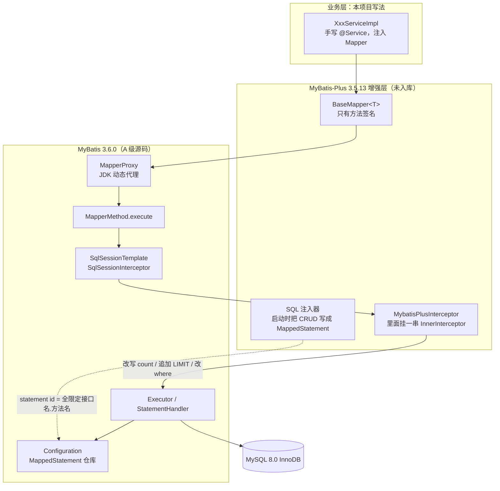
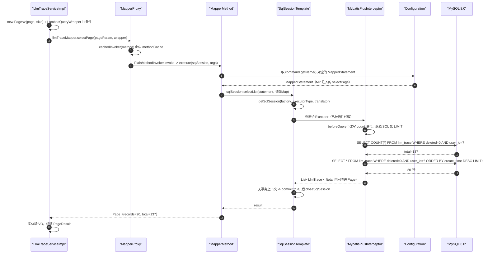

# MyBatis-Plus 实战：它替你写的 SQL，出错时都不报错

> **一句话结论**：MyBatis-Plus 不是另一个 ORM，它是 MyBatis 上的一层"运行期写 SQL"的插件——本仓 26 个 Mapper 全部继承 `BaseMapper`、**0 个 XML**，所以你的 SQL 全是被生成的，而生成什么由注解、全局配置、实体字段可空性三样决定，这三样都不参与编译检查，写错只会安静地少做一点事。
> **阅读前置**：读过 [01-mybatis-整体架构与四大对象](../24-源码分析/03-MyBatis/00-总览/01-mybatis-整体架构与四大对象.md)，知道"Mapper 接口没有实现类也能注入"是 JDK 动态代理；能用 `@TableName`/`@TableId` 写一个实体。
> **证据基线**：MyBatis 3.6.0（A 级摘录，`learning-docs/24-源码分析/assets/source/`）；MyBatis-Plus **3.5.13**（`pom.xml:47`，MP 源码未入库，插件类语义依据官方文档 + 本仓配置/代码）；MySQL 8.0 InnoDB utf8mb4。预计阅读 55~70 分钟。

---

## 0. 先看现象

### 现象 1：把用户"删掉"以后，同名用户再也注册不进来

运营删了一个测试账号 `alice`，第二天 `alice` 重新注册，接口返回：

```text
org.springframework.dao.DuplicateKeyException:
### Error updating database.  Cause: java.sql.SQLIntegrityConstraintViolationException:
### Duplicate entry 'alice' for key 'sys_user_0.uk_username'
```

代码里明明写的是"逻辑删除"——`User` 实体上有 `@TableLogic`、表上有 `deleted TINYINT NOT NULL DEFAULT 0`，`deleteById` 走的是 `UPDATE ... SET deleted=1`，行确实"不见了"。可 `uk_username` 这条唯一索引从来不看 `deleted`：**它只认 `username` 这一个值，被删掉的行仍然占着 `alice` 这个名字**。

这句话的证据是现成的，本仓 DDL 就长这样（`deploy/mysql/init.sql#L49-L67`）：

```sql
CREATE TABLE IF NOT EXISTS user_db_0.sys_user_0 (
    id              BIGINT          NOT NULL COMMENT '主键ID（分片键）',
    username        VARCHAR(64)     NOT NULL COMMENT '用户名',
    ...
    deleted         TINYINT         NOT NULL DEFAULT 0 COMMENT '逻辑删除：0-未删除 1-已删除',
    PRIMARY KEY (id),
    UNIQUE KEY uk_username (username),
    KEY idx_phone (phone)
) ENGINE=InnoDB DEFAULT CHARSET=utf8mb4 COLLATE=utf8mb4_unicode_ci;
```

> 说明：上面的 `Duplicate entry` 文本是 MySQL 8.0 错误码 1062 的报错格式（《MySQL 8.0 Reference Manual》附录 B.3.4.2），本机没有起 MySQL，**未本机复现**；但"唯一索引不含被逻辑删除的列"这个触发条件是 `deploy/mysql/init.sql` 里的真实结构，不是假想。`sys_role`（`deploy/mysql/init.sql#L11-L22`）同样是 `deleted` + `UNIQUE KEY uk_role_code` 的组合。

而且注册流程正好把这条冲突路径走全了（`ai-cs-user/src/main/java/com/aics/user/service/impl/UserServiceImpl.java#L47-L65`）：

```java
public Result<Void> register(User user) {
    log.info("用户注册: username={}", user.getUsername());
    // 检查用户名是否已存在：selectCount 由 @TableLogic 自动带上 deleted = 0，查不到墓碑
    Long count = userMapper.selectCount(
            new LambdaQueryWrapper<User>().eq(User::getUsername, user.getUsername()));
    if (count > 0) {
        throw new BusinessException(ResultCode.USER_ALREADY_EXISTS);
    }
    user.setPassword(BCrypt.hashpw(user.getPassword()));
    user.setStatus(1);
    user.setRole("user");
    userMapper.insert(user);   // ← 唯一索引 uk_username 不认 deleted，撞上墓碑就抛 1062
    return Result.success();
}
```

**"查重通过、插入失败"不是巧合，是两套判据不一致**：查重看的是 `(username, deleted=0)`，唯一索引看的是 `username`。

### 现象 2：分页接口 `records` 有 100 条，`total` 却是 0

```text
GET /api/message/llm-traces?page=1&size=20
{"records":[ ... 100 条 ... ],"total":0,"current":1,"size":20}
```

没有异常、没有慢 SQL 告警，只是"翻页翻不完、总数永远 0"。上面这段响应是**构造示例**（本机没有起服务，任务也不允许起），不是线上日志原文——复现方法见 6.2。它是 `selectPage` 被调用、但**分页插件没注册**时的标准表现：MP 的 `selectPage` 自己不会拼 `LIMIT`，也不自己发 `count`，它把这两件事全委托给 `MybatisPlusInterceptor` 里的 `PaginationInnerInterceptor`；插件不在，SQL 原样执行，`Page` 对象里的 `total` 就保持默认 0。

本仓现状是这个坑的天然温床——按模块数注册情况：

| 模块 | 分页插件 | 自动填充 handler | 结论 |
|---|---|---|---|
| ai-cs-knowledge / ai-cs-message / ai-cs-order / ai-cs-product | 有 | 有 | 调用 `selectPage` 安全 |
| ai-cs-pay / ai-cs-user | **无** | 有 | 现在没调 `selectPage`（全仓 `selectPage(` 只有 3 处调用，全在上一行那 4 个模块里），一旦在这里写分页就是现象 2 |
| ai-cs-mq | **无** | **无** | 时间字段只能靠数据库默认值（见 3.6） |

前 4 个模块的插件 bean 各写了一份，例如 `ai-cs-message/src/main/java/com/aics/message/config/MybatisPlusConfig.java#L27-L63`：

```java
@Configuration
public class MybatisPlusConfig {

    @Bean
    public MybatisPlusInterceptor mybatisPlusInterceptor() {
        MybatisPlusInterceptor interceptor = new MybatisPlusInterceptor();
        interceptor.addInnerInterceptor(new PaginationInnerInterceptor(DbType.MYSQL));
        return interceptor;
    }
}
```

### 现象 3：`updateById` 改动"丢"了，而且没人报错

两种都常见，都不报错：

1. 想把商品描述清空：`product.setDescription(null); productMapper.updateById(product);` ——数据库里还是旧描述。因为 MP 默认的字段策略是"**null 不入 SET**"，`null` 被当成"没改动"直接跳过。
2. `updateById` 返回 0（一行都没改），调用方不看返回值，日志只打"更新成功"。

第 1 种在本仓有反证：`ai-cs-product/src/main/java/com/aics/product/service/impl/ProductServiceImpl.java#L126-L151` 每个字段都是 `if (dto.getX() != null) { product.setX(...) }` 才赋值——项目自己在绕开这个默认策略。第 2 种看 `ai-cs-mq/src/main/java/com/aics/mq/service/WorkOrderService.java#L100-L104`：`mqFailRecordMapper.updateById(update);` 的返回值没有被接收。

还有个更隐蔽的第 3 种：这个默认策略被人**当成白名单用**了（`ai-cs-user/src/main/java/com/aics/user/service/impl/UserServiceImpl.java#L127-L141`）：

```java
public Result<Void> updateUser(User user) {
    // 通用资料更新不能批量绑定账号安全字段；角色/状态管理须由独立授权接口负责。
    user.setUsername(null);
    user.setPassword(null);
    user.setStatus(null);
    user.setRole(null);
    user.setDeleted(null);
    user.setCreateTime(null);
    user.setUpdateTime(null);
    userMapper.updateById(user);   // null 不入 SET，于是这 7 个字段天然被"跳过"
    return Result.success();
}
```

这段代码的正确性完全建立在"null 不更新"这条隐式规则上。哪天有人为了"能清空字段"把全局 `update-strategy` 改成 `ALWAYS`，编译、启动、测试都发现不了，但用户接口会突然能改自己的 `role` 和 `status`。

> 这些现象指向同一件事：**MyBatis-Plus 把 SQL 挪到了运行期生成**，而"生成成什么样"由注解（`@TableLogic`/`@TableField`/`@Version`）、全局配置（字段策略、逻辑删除值、`id-type`）、以及实体字段是不是 `null` 共同决定——这三样都不参与编译检查，所以写错不会抛异常，只会"少做一点"或者"撞在数据库约束上"，让你以为是数据库的问题。

---

## 1. 整体地图



> **读图说明**：
> ① 左边两层是"你以为的调用"（`service.updateById(user)`），右边两层是"实际发生的事"，中间那条虚线是全篇的关键：`BaseMapper` 的方法体不存在，它对应的 SQL 是 MP 在**启动时**按 `statement id = 接口全限定名 + 方法名` 写进 `Configuration` 的，运行期只是按这个名字去仓库里取。
> ② `MapperProxy → MapperMethod → SqlSessionTemplate` 这三跳是 MyBatis 原生链路（A 级），MP 一行都没改；MP 的介入点只有两个：**启动时注册语句**（虚线）和**执行时改写 SQL**（`MybatisPlusInterceptor` 这一跳）。
> ③ 插件位置很关键：`InnerInterceptor` 包在 `Executor` 外面，所以它看到的是**已经成型的 SQL 文本 + 参数**，这也是为什么它能做分页改写，却**不能**替你修好一条逻辑上错了的 SQL。
> ④ `MapperProxy` 之上没有 Spring 代理，所以「事务注解生效、而 MP 语句在事务里跑」这件事，靠的是 `SqlSessionTemplate` 与 `DataSourceTransactionManager` 的绑定（下一节 3.1 会看到它怎么判断"当前有没有事务"）。

| 组件 | 责任 | 调用方（谁触发它） |
|---|---|---|
| `BaseMapper<T>` | 声明通用 CRUD 的方法签名（`insert/deleteById/updateById/selectById/selectList/selectPage` 等） | 业务 `XxxServiceImpl` |
| MP SQL 注入器 | 启动时把方法签名翻译成 `MappedStatement` 注册进 `Configuration`；已存在则跳过 | `MybatisSqlSessionFactoryBean` 构建期 |
| `MapperProxy` | JDK 动态代理，把接口调用转成 `MapperMethod` 调用（A 级 `MapperProxy.java.md#L58-L68`） | Spring 注入的 Mapper 接口实例 |
| `MapperMethod` | 按 `SqlCommandType` 分派到 `sqlSession.insert/update/delete/selectOne/selectList`（A 级） | `MapperProxy` |
| `SqlSessionTemplate` | 拿到（或新建）`SqlSession`、非事务场景自动 commit、异常翻译（A 级 `SqlSessionTemplate.java.md#L327-L357`） | `MapperMethod` |
| `MybatisPlusInterceptor` | 一条 `InnerInterceptor` 责任链，分页/乐观锁/防全表/多租户都挂在这里 | Spring 容器（Boot 自动配置收集为 `Interceptor[]`） |
| `MetaObjectHandler` | 插入/更新前后填 `createTime`/`updateTime` 等字段 | MP 的填充逻辑（不是 MyBatis 插件） |
| `TableInfo`（MP 运行期元数据） | 缓存"实体字段 ↔ 表列 ↔ 是否主键/逻辑删除/填充"的映射，`LambdaQueryWrapper` 的列名就靠它 | 各 InnerInterceptor、Wrapper |

---

## 2. 关键概念与关键类

| 名称 | 位置 | 角色 | 关键方法/字段 |
|---|---|---|---|
| `BaseMapper<T>` | MP 未入库 | 通用 CRUD 的接口契约，方法体由注入器生成 | `insert`、`deleteById`、`updateById`、`selectById`、`selectList`、`selectPage`、`exists` |
| `MapperProxy` | `MapperProxy.java.md#L58-L68` | 接口 → 调用的翻译器（JDK 动态代理） | `invoke`、`cachedInvoker` |
| `MapperProxyFactory` | `MapperProxyFactory.java.md#L28-L53` | 生产代理对象，并缓存 `Method → MapperMethodInvoker` | `newInstance`、`methodCache` |
| `MapperMethod` | `MapperMethod.java.md#L57-L104` | 真正按 SQL 类型分派、把返回值转成接口声明类型 | `execute`、`rowCountResult` |
| `SqlSessionTemplate` | `SqlSessionTemplate.java.md#L327-L357` | 线程安全的 `SqlSession` 门面：取连接、提交、异常翻译 | `SqlSessionInterceptor.invoke` |
| `MybatisPlusInterceptor` | MP 未入库 | 插件容器，`addInnerInterceptor` 决定能力开关 | `addInnerInterceptor`、`beforeQuery`/`beforeUpdate` |
| `PaginationInnerInterceptor` | MP 未入库；本仓注册于 4 个模块 | 生成 `count` 语句 + 追加 `LIMIT` | `setMaxLimit`、`setOptimizeCountSql`、`setOverflow` |
| `LambdaQueryWrapper<T>` | MP 未入库；本仓 22 个文件在用 | 用方法引用取列名，编译期可查 | `eq/like/orderByDesc/last/apply` |
| `QueryWrapper<T>` | MP 未入库；本仓 0 处使用 | 用字符串写列名，运行期才报错 | `eq("user_id", v)` |
| `TableInfo` / `TableFieldInfo` | MP 未入库 | 实体元数据缓存（列名、逻辑删除、填充、版本号） | `getProperty`、`getColumn`、`isLogicDelete` |
| `MetaObjectHandler` | MP 未入库；本仓 6 个模块各一个 bean | 插入/更新自动填充回调 | `insertFill`、`updateFill`、`strictInsertFill` |
| `@TableLogic` | MP 未入库；本仓 4 个实体在用 | 把 `delete` 改写成 `UPDATE deleted=1`，把查询补上 `deleted=0` | `value`/`delval` 两个属性 |
| `@Version` | MP 未入库；本仓 **0 处** | 乐观锁版本号字段，需配 `OptimisticLockerInnerInterceptor` | — |
| `IService` / `ServiceImpl` | MP 未入库；本仓 **0 处** | MP 自带 Service 层（`saveOrUpdate`、`page` 等） | — |
| `@MapperScan` | 本仓 7 个启动类 | 决定哪些包里的接口被扫描成 Mapper | `basePackages` |

---

## 3. 原理与证据逐段精读

### 3.1 BaseMapper 的方法不是反射出来的，是启动时"写"进配置的

**这段在做什么。** 你写 `interface UserMapper extends BaseMapper<User> {}`，一个方法体都没有，但 `userMapper.updateById(user)` 能跑。链路有三段，前两段在 A 级源码里可以逐行看：

第一段，Proxy 只做两件事——过滤 `Object` 自带方法（`equals/hashCode/toString`），其余全部丢给 `cachedInvoker`：

[[源码:MapperProxy.java.md#L58-L68]]

```java
(src: MapperProxy.java.md#L58-L68)
  @Override
  public Object invoke(Object proxy, Method method, Object[] args) throws Throwable {
    try {
      if (Object.class.equals(method.getDeclaringClass())) {
        return method.invoke(this, args);
      }
      return cachedInvoker(method).invoke(proxy, method, args, sqlSession);
    } catch (Throwable t) {
      throw ExceptionUtil.unwrapThrowable(t);
    }
  }
```

第二段，每个方法第一次被调用时创建 `MapperMethod` 并缓存（`methodCache` 与 `MapperProxyFactory` 共享，所以同一个 Mapper 的所有代理实例只有一份解析结果）：

[[源码:MapperProxy.java.md#L70-L86]]

```java
(src: MapperProxy.java.md#L70-L86)
  private MapperMethodInvoker cachedInvoker(Method method) throws Throwable {
    try {
      return methodCache.computeIfAbsent(method, m -> {
        if (!m.isDefault()) {
          return new PlainMethodInvoker(new MapperMethod(mapperInterface, method, sqlSession.getConfiguration()));
        }
        try {
          return new DefaultMethodInvoker(getMethodHandleJava9(method));
        } catch (NoSuchMethodException | IllegalAccessException | InvocationTargetException e) {
          throw new RuntimeException(e);
        }
      });
    } catch (RuntimeException re) {
      Throwable cause = re.getCause();
      throw cause == null ? re : cause;
    }
  }
```

注意构造 `MapperMethod` 时传了 `sqlSession.getConfiguration()`——它在**构造期**就把"这个接口方法对应 Configuration 里哪条语句"解析好了（`SqlCommand`），后面每次调用不再查。缓存共享的代码在 [[源码:MapperProxyFactory.java.md#L28-L53]]：`newInstance` 用 `Proxy.newProxyInstance(mapperInterface.getClassLoader(), new Class[] { mapperInterface }, mapperProxy)` 造代理，`methodCache` 是字段级别的 `ConcurrentHashMap`。

**为什么这么设计。** 因为 Mapper 接口是"编译期只有一个签名、运行期才有 SQL"的契约。让接口直接对应一条 `MappedStatement`，好处是：接口、XML、注解三种写法在 MyBatis 眼里是同一件事（都往 `Configuration` 里塞语句），你换写法不用换调用方式；而动态代理让"没有实现类"成为可能，Spring 注入的其实是个代理对象。

第三段是 MP 的活儿（**MP 未入库**，依据官方文档"注入器"章节）：MP 在 `SqlSessionFactory` 构建时，用 `TableInfoHelper` 解析实体拿到表名/列名，再由每个方法对应的 `AbstractMethod` 子类（`Insert`、`UpdateById`、`SelectPage`……）拼出一段 `SqlSource`，注册成 `statement id = com.aics.user.mapper.UserMapper.updateById`。注册前它会先查 `Configuration.hasStatement(id)`：**已经有了就跳过**。你调 `updateById` 时 `MapperMethod` 拿到的 `command.getName()` 就是这个 id，所以"自定义优先"是注入器让位的结果，不是某种覆盖机制（细节见 3.9）。

**换写法会怎样。** 换成 XML 手写这条 `updateById`，结果不是"XML 生效 MP 失效"，而是"MP 发现 id 已存在于是不注入"。区别在于：XML 那条语句你可能忘了写 `update_time`、忘了 `deleted = 0` 条件，而这些 MP 原本会替你加。**只有一处 SQL 定义来源时最容易 debug，两处来源时最难**。

**常见坑。**
- 以为 `BaseMapper` 有实现类、打断点进不去就以为没执行——断点应打在 `MapperProxy#invoke` 或 `MapperMethod#execute`。
- 给 Mapper 接口写了 `default` 方法又用 `@Select` 注解在 default 方法上——`cachedInvoker` 里 `m.isDefault()` 分支走的是 `DefaultMethodInvoker`（MethodHandle），注解 SQL 不生效。
- 在 `default` 方法里调 `this.selectById(...)` 是合法的（走代理再进 `invoke`），但调 `BaseMapper.super.selectById(...)` 会 NPE：接口默认方法里没有真实实现可调。

### 3.2 IService / ServiceImpl：MP 提供了，但本项目一个都没用

**这段在做什么。** MP 除了 `BaseMapper`，还提供一套 Service 层封装：`IService<T>` 接口 + `ServiceImpl<M extends BaseMapper<T>, T>` 抽象类，里面有 `save`、`saveOrUpdate`、`list`、`page`、`lambdaQuery()`、`lambdaUpdate()` 等便捷方法，`getBaseMapper()` 暴露底层 Mapper。教程里的标准写法是：

```java
@Service
public class UserServiceImpl extends ServiceImpl<UserMapper, User> implements IUserService { }
```

**本仓的选择是手写。** 一条命令就能确认（C 级，真跑过）：

```powershell
$java = Get-ChildItem -Recurse -Include *.java -Path ai-cs-*\src\main\java
"javaFiles=$($java.Count)"
"BaseMapper=$((($java | Select-String 'extends BaseMapper' -List)).Count)"
"IService_or_ServiceImpl=$((($java | Select-String 'extends IService|extends ServiceImpl' -List)).Count)"
"mapperXmlFiles=$((Get-ChildItem -Recurse -Include *Mapper.xml | Measure-Object).Count)"
```

真实输出（本机 pwsh 7，2026-11 勘）：

```text
javaFiles=521
BaseMapper=26
IService_or_ServiceImpl=0
mapperXmlFiles=0
```

怎么读这三行：`BaseMapper=26` 说明 ORM 入口只有一条路（继承 `BaseMapper`）；`IService_or_ServiceImpl=0` 说明**上面那种 `extends ServiceImpl` 的写法在本仓一处都不存在**，你看到的 `*ServiceImpl` 全部是 `@Service` + `implements XxxService` 的手写类（例如 `ai-cs-order/src/main/java/com/aics/order/service/impl/CartServiceImpl.java#L25-L32`）；`mapperXmlFiles=0` 说明没有任何 XML 可以 review——这条对你排查线上 SQL 的方式影响很大（见第 6 节）。

**为什么这么设计。** `ServiceImpl` 省的是"转发样板代码"，代价是三件事：① `saveOrUpdate` 内部是"先 `selectById` 再 `insert`/`updateById`"，两步之间没有锁，并发下会插重（除非有唯一键兜底）；② 它把 Mapper 直接暴露给业务层（`getBaseMapper()`），分层边界形同虚设；③ 事务注解标在哪个方法上变得不直观（`ServiceImpl` 上有 `@Transactional` 的重载方法，容易误判传播行为）。本项目 0 处使用，等于用"多写一行 `private final XxxMapper`"换回了显式的依赖与事务边界。

**换写法会怎样。** 如果哪天要引入 `ServiceImpl`，最小改动是让现有 `XxxServiceImpl` 改成 `extends ServiceImpl<XxxMapper, Xxx> implements XxxService` 并删掉 `private final XxxMapper` 字段。收益是 `page()`/`lambdaQuery()` 少写几行；风险点是构造注入的 Mapper 变成继承来的 `baseMapper`，所有 `@Mock` 单测的注入点都要改，而且 `saveOrUpdate` 的竞态语义要重新论证。

**常见坑。**
- `ServiceImpl` 的 `saveOrUpdate` 会静默退化成"插入"——对象有 id 但库里没有那行时，`updateById` 返回 0 且它不报错。
- `page(page, wrapper)` 与 `mapper.selectPage` 都是拿插件；但 `list()` 返回 `List<T>` 而不受 `Page` 限制，别以为分页参数会自动生效。
- 混用两种风格（一半 `ServiceImpl`、一半手写）会让"事务边界在哪一层"变成面试时答不上来的问题。

### 3.3 条件构造器：Lambda 与字符串的差别不在颜值，在"什么时候报错"

**这段在做什么。** 条件构造器就是"用 Java 表达式描述 where"。两种写法：

```java
// 写法一：LambdaQueryWrapper（本仓全部采用）
LambdaQueryWrapper<LlmTrace> w = new LambdaQueryWrapper<>();
w.eq(userId != null, LlmTrace::getUserId, userId).orderByDesc(LlmTrace::getCreateTime);

// 写法二：QueryWrapper（本仓 0 处使用）
QueryWrapper<LlmTrace> q = new QueryWrapper<>();
q.eq("userId", userId).orderByDesc("createTime");   // ← 列名写错不报错，直到执行 SQL
```

`LambdaQueryWrapper` 拿到 `LlmTrace::getUserId` 后，通过 `SerializedLambda` 读出方法名 `getUserId`，剥掉 `get` 得到属性 `userId`，再查 `TableInfo` 缓存换成真正的列 `user_id`。所以**列名不是你说的，是 MP 从实体注解里算出来的**。`QueryWrapper` 则把你给的字符串原样塞进 SQL：`eq("userId", x)` 生成 `WHERE userId = ?`，MySQL 回一句 `Unknown column 'userId' in 'where clause'`（MySQL 8.0 错误 1054）。

本仓真实用例，`ai-cs-message/src/main/java/com/aics/message/service/impl/LlmTraceServiceImpl.java#L90-L106`：

```java
@Override
public PageResult<LlmTraceVO> pageTraces(Long userId, String scenario, int page, int size) {
    Page<LlmTrace> pageParam = new Page<>(page, size);
    LambdaQueryWrapper<LlmTrace> wrapper = new LambdaQueryWrapper<>();
    // 条件式重载：condition 为 false 时该条件不参与拼装，省掉 if/else
    wrapper.eq(userId != null, LlmTrace::getUserId, userId)
            .eq(scenario != null, LlmTrace::getScenario, scenario)
            .orderByDesc(LlmTrace::getCreateTime);
    Page<LlmTrace> result = llmTraceMapper.selectPage(pageParam, wrapper);
    List<LlmTraceVO> records = result.getRecords().stream().map(LlmTraceServiceImpl::toVO).toList();
    return new PageResult<>(records, result.getTotal(), result.getCurrent(), result.getSize());
}
```

**为什么这么设计。** 因为"列名"是唯一一份既要写对又要跟实体重命名保持同步的信息。用方法引用，重命名字段时 IDE 的重构会一起改，改错了编译不过；用字符串，重命名后编译通过、测试也可能通过（测试数据少、列不存在就抛 SQL 错，反而更晚暴露）。条件式重载 `eq(boolean condition, ...)` 是第二个设计点：它把"这个条件要不要加"写进条件本身，避免每加一个筛选参数就多一层 `if`。

**换写法会怎样。** 复杂查询（多表、子查询、`exists`）Lambda 玩不转，项目里就要退化到 `@Select`（见 3.9 的真实样本），或者用 `wrapper.apply("exists (select 1 from ...)")`——后者一拼字符串，安全性与可移植性同时下降。

**常见坑。**
- `QueryWrapper.eq("user_id", v)` 是**参数化**的，不会 SQL 注入；`.apply("id = " + id)`、`.last("... " + s)`、`.orderByAsc(sortField)` 才是拼接，能注入（见 3.9）。
- `LambdaQueryWrapper` 的 `or()` 是"左结合"的：`w.eq(a).eq(b).or().eq(c)` 生成 `a AND b OR c`，业务要的常是 `a AND (b OR c)`，必须显式 `.and(x -> x.eq(b).or().eq(c))`。
- 布尔属性 `selected` 的 getter 是 `getSelected()`（Lombok 对 `Boolean` 生成 `getXxx`），但若字段是基本类型 `boolean`，getter 是 `isSelected()`，映射出的属性名仍是 `selected`——写错成 `Selected` 会在运行期抛"找不到属性"。
- 用 `wrapper.select(LlmTrace::getRequestId)` 限定列之后，实体里其它字段全是 `null`，别拿去 `updateById`（会把它们当"没改"或"要更新"两种相反语义再踩一次坑）。

### 3.4 分页插件：`PaginationInnerInterceptor` 改的是两段 SQL，不是一段

**这段在做什么。** 调用 `selectPage(page, wrapper)` 时，插件在 `beforeQuery` 里做两件事：① 把原 SQL 变成 `count` 语句先发一次，把结果塞进 `page.setTotal(...)`；② 给原 SQL 追加 `LIMIT offset, size`（MySQL 方言）。所以一次 `selectPage` = **两次往返**，除非 `page.setSearchCount(false)`。

插件怎么被装上去的？`MybatisPlusInterceptor` 本身是一个 MyBatis `Interceptor`，Spring 容器里所有 `Interceptor` 类型 bean 会被 Boot 自动配置收集成数组，再交给 `SqlSessionFactoryBean#setPlugins`（A 级证据）：

[[源码:MybatisAutoConfiguration.java.md#L136-L153]]

```java
(src: MybatisAutoConfiguration.java.md#L136-L153)
  @Bean
  @ConditionalOnMissingBean
  public SqlSessionFactory sqlSessionFactory(DataSource dataSource) throws Exception {
    SqlSessionFactoryBean factory = new SqlSessionFactoryBean();
    factory.setDataSource(dataSource);
    if (properties.getConfiguration() == null || properties.getConfiguration().getVfsImpl() == null) {
      factory.setVfs(SpringBootVFS.class);
    }
    if (StringUtils.hasText(this.properties.getConfigLocation())) {
      factory.setConfigLocation(this.resourceLoader.getResource(this.properties.getConfigLocation()));
    }
    applyConfiguration(factory);
    if (this.properties.getConfigurationProperties() != null) {
      factory.setConfigurationProperties(this.properties.getConfigurationProperties());
    }
    if (!ObjectUtils.isEmpty(this.interceptors)) {
      factory.setPlugins(this.interceptors);
    }
```

这段解释了一个反复被问的现象：**你 `@Bean` 了 `MybatisPlusInterceptor`，却"没生效"**。可能的原因只有三类——bean 没被扫描到（不在启动类的组件扫描范围内，`ai-cs-mq` 就是这种）、被 `@ConditionalOnMissingBean` 的另一个 `SqlSessionFactory` 抢先（自定义了 factory bean）、或者 `DbType` 没给（某些方言下插件直接放弃改写）。

**为什么这么设计。** 把分页做成"SQL 改写"而不是框架内建，是为了让 `selectPage` 和你手写的 `@Select` 共用同一套机制——只要参数里带 `IPage` 就会被拦。count 与 list 分两次发，是为了总行数与当页数据的一致性代价做折中（同一事务内读还是可能不同步，用 `optimizeCountSql=false` 也解决不了并发插入）。

**换写法会怎样。** 手写 `LIMIT`（例如 `ai-cs-mq/src/main/java/com/aics/mq/service/WorkOrderService.java#L63-L75` 用 `.last("LIMIT " + LIST_LIMIT)`）能省掉 count 那次往返，代价是拿不到总数、且 `offset` 要自己算——适合"只取前 N 条"的场景（本仓就是这种：死信记录只要前 100 条）。

**常见坑。**
- **没注册插件** → 现象 2（全表返回、`total=0`）。
- **count 与实际条数不一致**：`optimizeCountSql` 默认 `true`，会剥 `order by`、会把 `select a,b from t` 改成 `select count(*) from t`；一旦 SQL 里有 `group by`、`distinct`、一对多 `join`（行数被放大），它会退化成 `select count(*) from (原 SQL) total` 或者干脆算错。判据：`total` 比你手工 `select count(*)` 的结果大 → 找 `join`。
- **`size` 没上限**：`new Page<>(1, 100000)` 会真的发 `LIMIT 100000`。`new PaginationInnerInterceptor(DbType.MYSQL)` 之后可以 `setMaxLimit(500L)`，超限自动截断（官方文档语义，MP 未入库）。
- **页码溢出**：`page > 总页数` 时默认返回空列表；想要"回到第一页"要 `setOverflow(true)`。
- **两次查询的 where 不一致**：`Page` 对象是**可变的**，插件在 `beforeQuery` 里改它；如果你在同一个 `Page` 上并发复用（比如放进成员变量），会出现 `records` 与 `total` 串号。

### 3.5 逻辑删除：`@TableLogic` 只改两处 SQL，改不动唯一索引

**这段在做什么。** 实体字段加 `@TableLogic`，MP 就把三件事包了：查询自动追加 `deleted = 0`；`deleteById`/`delete(wrapper)` 改写成 `UPDATE ... SET deleted = 1`；`updateById` 的 where 里也带上 `deleted = 0`。本仓四个实体采用这一套，例如 `ai-cs-user/src/main/java/com/aics/user/entity/User.java#L67-L77`（`ChatSession`、`Product`、`KnowledgeDocument` 同构）：

```java
/** 创建时间 */
@TableField(fill = FieldFill.INSERT)
private LocalDateTime createTime;

/** 更新时间 */
@TableField(fill = FieldFill.INSERT_UPDATE)
private LocalDateTime updateTime;

/** 逻辑删除：0-未删除 1-已删除 */
@TableLogic
private Integer deleted;
```

一次真实删除的语义在 `ai-cs-message/src/main/java/com/aics/message/service/impl/MessageServiceImpl.java#L150-L163` 里写得很直白——会话逻辑删、消息物理删：

```java
@Override
public void deleteSession(Long sessionId) {
    log.info("删除会话: sessionId={}", sessionId);
    // 1. 删除会话下所有消息（物理删除）
    LambdaQueryWrapper<ChatMessage> msgWrapper = new LambdaQueryWrapper<>();
    msgWrapper.eq(ChatMessage::getSessionId, sessionId)
            .or()
            .eq(ChatMessage::getSessionKey, String.valueOf(sessionId));
    int deletedMsg = chatMessageMapper.delete(msgWrapper);
    // 2. 逻辑删除会话
    int deletedSession = chatSessionMapper.deleteById(sessionId);
    log.info("会话删除完成: sessionId={}, deletedMsg={}, deletedSession={}",
            sessionId, deletedMsg, deletedSession);
}
```

同一个方法里两种删除并存：第 1 步的 `ChatMessage` 没有 `@TableLogic`，`delete(wrapper)` 发的是真 `DELETE`；第 2 步的 `ChatSession` 有 `@TableLogic`，`deleteById` 被 MP 改写成 `UPDATE chat_session SET deleted=1 WHERE id=? AND deleted=0`——**方法名一样、语义不一样，从调用点看不出来**，只能靠实体的注解判断。

**为什么这么设计。** 逻辑删除保住了"历史可追溯"和"外键不被打破"，代价是三条：表会一直长（见 [08-大表治理](08-大表治理-冷热分离与数据归档.md)）、每一次查询都多一个 `deleted = 0` 条件（对索引友好与否取决于组合索引顺序）、以及**唯一索引会变成"历史墓碑"**。

**唯一索引的死结，以及三种正解。** 现象 1 就是它：`uk_username(username)` 不含 `deleted`，被删的行永远占着这个名字。三个可行解，按侵入性从小到大：

| 方案 | DDL | 代价 |
|---|---|---|
| 唯一键带上"墓碑值" | 加一列 `deleted_id BIGINT NOT NULL DEFAULT 0`，删时 `SET deleted_id = id, deleted = 1`；`UNIQUE KEY uk_username (username, deleted_id)` | 未删行 `deleted_id` 恒为 0，仍然唯一；已删行因 `id` 各不相同而互不冲突。代价是多一列 + 所有查询条件要跟着改 |
| 主表唯一 + 归档表 | 删除 = 搬到 `xxx_archive` + 物理删主表行 | 要写搬迁逻辑，跨表事务 |
| 删除时改写业务键 | `UPDATE ... SET username = CONCAT(username, '_del_', id), deleted = 1` | 字段长度要留余量，且不可逆 |

**本仓的现实选择是"不做删除、只改状态"**：`sys_user` 有 `status`（0 禁用 / 1 启用）与 `deleted` 两列并存——禁用不改 `deleted`，注册查重时用 `selectCount(username=?)` 直接算（MP 自动带 `deleted=0`），这就绕开了墓碑占名的冲突，但**它依赖"查重逻辑一定有 deleted=0"**，一旦有人用 `@Select` 手写查重语句（3.9 的 ChatMessageMapper 那种写法），墓碑就又回来了。

**换写法会怎样。** 干脆物理删除：唯一索引不再挡路，但外键/审计/恢复全部失去；对"删了就不该再出现"的数据（会话消息）本项目就是这么干的——`chat_message` 表根本没有 `deleted` 列，删除即消失。

**常见坑。**
- 写了 `@TableLogic` 但**全局配置里又配了 `logic-delete-field: deleted`**：两者叠加时字段级注解优先，没问题；但如果全局配了一个实体里不存在的字段名，MP 会在启动时静默忽略（不报错），你以为是全局生效。
- 逻辑删除值默认是 `1`/`0`，DDL 里若写成 `'Y'/'N'` 或 `deleted_at` 时间戳，必须用 `@TableLogic(value = "0", delval = "now()")` 显式指定。
- `selectCount` 也带 `deleted=0`，所以"唯一性校验"永远查不到墓碑——**校验通过、插入失败** 是这套组合最经典的现场。
- 用 `@TableLogic` 的字段做业务判断（比如 `deleted == 1` 表示"停用"）是语义污染：MP 会把它当删除处理，`updateById` 直接把这行"删掉"。

### 3.6 自动填充：`MetaObjectHandler` 生效需要三个前提同时成立

**这段在做什么。** `MetaObjectHandler` 是实体字段的"默认值提供者"：insert 前填 `createTime`/`updateTime`，update 前填 `updateTime`。本仓 6 个模块各写了一份，逻辑都一样（`ai-cs-message/src/main/java/com/aics/message/config/MybatisPlusConfig.java#L48-L63`）：

```java
@Bean
public MetaObjectHandler metaObjectHandler() {
    return new MetaObjectHandler() {
        @Override
        public void insertFill(MetaObject metaObject) {
            this.strictInsertFill(metaObject, "createTime", LocalDateTime.class, LocalDateTime.now());
            this.strictInsertFill(metaObject, "updateTime", LocalDateTime.class, LocalDateTime.now());
        }

        @Override
        public void updateFill(MetaObject metaObject) {
            this.strictUpdateFill(metaObject, "updateTime", LocalDateTime.class, LocalDateTime.now());
        }
    };
}
```

这个 `MetaObject` 是什么？A 级可以看清它是"实体对象 + 属性解析器"的包装，`setValue` 走 `PropertyTokenizer` 找到 setter：

[[源码:MetaObject.java.md#L115-L130]]

```java
(src: MetaObject.java.md#L115-L130)
  public boolean hasSetter(String name) {
    return objectWrapper.hasSetter(name);
  }

  public boolean hasGetter(String name) {
    return objectWrapper.hasGetter(name);
  }

  public Object getValue(String name) {
    PropertyTokenizer prop = new PropertyTokenizer(name);
    return objectWrapper.get(prop);
  }

  public void setValue(String name, Object value) {
    objectWrapper.set(new PropertyTokenizer(name), value);
  }
```

所以 `strictInsertFill(metaObject, "createTime", ...)` 里的 `"createTime"` 是**Java 属性名**，不是列名。写成 `"create_time"` 会静默不填（`PropertyTokenizer` 找不到 setter，`strictInsertFill` 的判断直接跳过）。

**为什么这么设计。** 把时间戳统一交给应用层而不是数据库 `DEFAULT CURRENT_TIMESTAMP`，好处是：同一事务里多处插入时间一致、能写入业务时区、批量插入时不会因为数据库时钟漂移产生乱序。代价是"必须有代码参与"——纯 SQL 迁移、`INSERT ... SELECT`、手写 `@Insert` 都绕过它。

**换写法会怎样。** 让数据库兜底：`create_time DATETIME NOT NULL DEFAULT CURRENT_TIMESTAMP` + `update_time ... ON UPDATE CURRENT_TIMESTAMP`。本仓 `ai-cs-mq` 就是这个选择，而且是在代码注释里显式声明的——`ai-cs-mq/src/main/java/com/aics/mq/entity/WorkOrder.java#L11-L45`：

```java
/**
 * 工单实体（RocketMQ 消息闭环演示）。
 * <p>
 * 状态流转：NEW（创建后待消费）→ DONE（消费成功）；
 * 消费重试耗尽进死信后由死信消费者标记为 FAILED，前端重推成功后回到 DONE。
 * 时间字段由数据库默认值维护（本模块组件扫描不含 common 的 MetaObjectHandler）。</p>
 */
@Data
@TableName("work_order")
public class WorkOrder implements Serializable {
    @TableId(type = IdType.AUTO)
    private Long id;
    /** 创建时间 */
    private LocalDateTime createTime;
```

配套 DDL 里确实有默认值兜底（`deploy/mysql/mq-workorder-init.sql#L14-L24`）：`create_time DATETIME NOT NULL DEFAULT CURRENT_TIMESTAMP`、`update_time ... ON UPDATE CURRENT_TIMESTAMP`。这条路径能跑，但有一个隐性前提：**MP 不会把 `null` 写进 INSERT**（字段策略 NOT_NULL），否则 `create_time` 会显式传 `NULL` 撞 `NOT NULL` 约束。哪天有人给这个模块也加了 `@TableField(fill = FieldFill.INSERT)` 却忘了注册 handler，行为会从"库填"变成"谁都不填"。

**常见坑（三个前提，缺一不可）。**
1. 字段必须标 `@TableField(fill = FieldFill.INSERT)` / `INSERT_UPDATE`——只注册 handler 不标注解，`strictXxxFill` 会因 `hasSetter` 之外的判断跳过。
2. `MetaObjectHandler` bean 必须在**同一个 ApplicationContext** 里（`ai-cs-mq` 没有，所以它的实体不能依赖填充）。
3. 属性名要写对（见上）；`strictInsertFill` 只在字段当前为 `null` 时才填——你 `new` 实体时手抖设了个 `LocalDateTime.now()`，填充就被跳过。
4. `updateFill` 只在 `updateById` / `update(entity, wrapper)` 时触发，**`update(null, wrapper)` 这种纯 Wrapper 更新不会填**（没有实体可填），要自己在 `.set()` 里写。
5. 用 `@TableField(fill = INSERT_UPDATE)` 但表里 `update_time` 允许为空 → 别指望"没更新时不动它"，`updateFill` 每次都覆盖。

### 3.7 乐观锁 `@Version`：它的真实 SQL 长什么样，以及它怎么静默失效

**这段在做什么。** 乐观锁的本质是把"读-改-写"变成带前置条件的 UPDATE：

```text
UPDATE product SET stock = ?, version = version + 1 WHERE id = ? AND version = ?
```

返回 0 行 = 有人在我读之后改过，本次更新失败，业务层该重试或报冲突。MP 提供 `@Version` + `OptimisticLockerInnerInterceptor` 把上面这段自动拼出来。

**本仓没有启用**（全仓 0 处 `@Version`、0 处 `OptimisticLockerInnerInterceptor`，C 级命令可复核）。现在的更新路径是"先查再改"，例如 `ai-cs-product/src/main/java/com/aics/product/service/impl/ProductServiceImpl.java#L118-L156`：

```java
@CacheEvict(cacheNames = ProductCacheConfig.PRODUCT_DETAIL, key = "#id")
public ProductVO updateProduct(Long id, ProductUpdateDTO dto) {
    Product product = productMapper.selectById(id);
    if (product == null) {
        throw new BusinessException(ResultCode.PRODUCT_NOT_FOUND, "商品不存在");
    }
    if (StringUtils.hasText(dto.getName())) {
        product.setName(dto.getName());
    }
    if (dto.getStock() != null) {
        product.setStock(dto.getStock());
        stringRedisTemplate.opsForValue().set("stock:" + id, String.valueOf(dto.getStock()));
    }
    // ... 其余字段同样 if (dto.getX() != null) 才 set
    productMapper.updateById(product);
    productVectorService.indexProduct(product);
    return toVO(product, getCategoryName(product.getCategoryId()));
}
```

**为什么本项目可以不用乐观锁。** 因为它把并发写风险转到了别处：库存扣减走 Redis（`availableStock`/`currentStock` 都是先读 Redis，见 `CartServiceImpl`），下单走 Seata 分布式事务，真正对商品行的并发写只有运营后台的低频编辑。这是一次**有意识的取舍**：乐观锁给的是"检测冲突"，Redis + 分布式锁给的是"避免冲突"；前者代码简单但用户会看到失败，后者实现复杂但用户无感。

**换写法会怎样（如果哪天要加）。** 三步，缺一步就静默失效：

```java
// 1. 实体加版本字段
@Version
private Integer version;

// 2. 插件链里加（本项目现有 MybatisPlusConfig 只加了分页）
interceptor.addInnerInterceptor(new OptimisticLockerInnerInterceptor());

// 3. 调用必须"先查再改"：version 值要被带进 where
Product p = productMapper.selectById(id);  // 拿到 version=3
p.setStock(100);
int rows = productMapper.updateById(p);    // WHERE id=? AND version=3，SET version=4
if (rows == 0) { throw new BusinessException(ResultCode.CONFLICT, "商品已被他人修改，请刷新重试"); }
```

**常见坑。**
- **只加 `@Version` 不加插件**：生成的 SQL 里只有 `SET version = ?`（把实体里的值原样写回），完全没有 `AND version = ?`——变成"每次更新都把 version 覆盖成同一个老值"，锁等于不存在，而且**不报错**。
- **version 为 `null`**：`SET version = null + 1` 结果是 `NULL`，之后 `AND version = NULL` 恒假，**永远更新 0 行**。所以字段要么 `NOT NULL DEFAULT 0`，要么插入时初始化。
- **`update(entity, wrapper)` 批量更新不带版本号**，插件对批量更新不生效（官方文档语义）。
- 与 `@TableLogic` 同时存在时，where 里会同时有 `deleted = 0 AND version = ?`，两个条件任一不满足都返回 0 行，**报错信息无法区分是"被删了"还是"被改了"**——这是排障时最容易误判的一处。
- 乐观锁防不住"同一秒内 N 个请求都读到了 version=3"，它只保证"只有一个能成功"。重试必须在业务层写，别指望插件重试。

### 3.8 防全表更新删除：一条没有 `where` 的 UPDATE 就能洗掉整张表

**这段在做什么。** MP 的 `update(entity, wrapper)`、`delete(wrapper)` 在 `wrapper` 为 `null` 时会生成**没有 where 条件**的语句：

```text
UPDATE product SET status = 0        -- 整张表下架
DELETE FROM chat_message             -- 整张表清空
```

`BlockAttackInnerInterceptor` 就是拦这个的：它在 `beforeUpdate`/`beforeDelete` 里检查最终 SQL 是否带 where，没有就抛异常（**MP 未入库**，依据官方文档"防全表更新与删除插件"章节；准确异常类型请在启用后看首个失败的调用栈，别背类名）。本仓**未启用**它，也正因为如此，所有删除/更新都靠"代码里必须有条件"这条纪律，而纪律不写在规则里就会失效。

**为什么这么设计。** 把这种拦截做成"可选插件"而不是默认开启，是因为批量更新是合法需求（数据修复、状态批量重置）。默认关 + 可按 mapper 方法粒度放行（`ignore` 配置）是"安全换灵活"的经典取舍。

**换写法会怎样。** 用数据库侧的约束兜底：MySQL 可以开 `sql_safe_updates`（会话级），要求 UPDATE/DELETE 必须走索引且带 where；本仓没开（`deploy/mysql/mysql.cnf` 里没有该设置），所以只能靠代码 review 和插件。

**常见坑。**
- `update(entity, null)` 是**合法调用**，编译器不拦、MP 不拦（未装插件时），线上就是全表更新。
- `wrapper` 所有条件都是 `eq(condition, ...)` 且 `condition` 全为 `false` 时，等价于没有条件——这比传 `null` 更隐蔽，`BlockAttackInnerInterceptor` 也只在 SQL 层看"有没有 where"，生成 `WHERE 1=1` 这类恒真条件同样能骗过人工 review。
- `deleteById(null)` / `updateById(entity)` 主键为 `null` 时会生成 `WHERE id = NULL`（0 行，安全），但 `delete(new QueryWrapper<>())` 不是。
- 装了插件后**所有**无条件更新都会失败，包括你写的修复脚本——上线前先在本机小表上验一遍（练习 5）。

### 3.9 多租户插件、字符串拼接注入、以及"XML/注解/BaseMapper"三者的优先级

**多租户 `TenantLineInnerInterceptor`（本仓未启用）。** 它给所有 select/update/delete 自动追加 `tenant_id = ?`，insert 自动补 `tenant_id`。它的价值是把"忘记写租户条件"从业务 bug 变成不可能；代价是三处必须想清楚：① 哪些表不该加（`TenantLineHandler#ignoreTable`，比如字典表、Nacos 配置表）；② 它和分页插件的**顺序**（官方建议把 `PaginationInnerInterceptor` 放最后，因为它要在改写后的 SQL 上算 count）；③ SQL 里已有 `tenant_id` 条件时会出现重复条件（不报错，只是执行计划变差）。本仓的多租户隔离走的是"分库分表 + 应用层带 userId"（见 [03-ShardingSphere 分库分表](03-ShardingSphere用户表分库分表实战.md)），不是行级租户。

**SQL 注入风险：Wrapper 里那三个"拼字符串"的口子。** `eq/gt/like` 全是参数化（`?` 占位），安全；危险的是 `.last()`、`.apply()`、`.having()`、`.orderByAsc(String)`——它们把字符串**直接拼进 SQL 文本**。本仓唯一一处字符串拼接是常量，`ai-cs-mq/src/main/java/com/aics/mq/service/WorkOrderService.java#L63-L75`：

```java
private static final int LIST_LIMIT = 100;

public List<WorkOrder> listWorkOrders() {
    return workOrderMapper.selectList(new LambdaQueryWrapper<WorkOrder>()
            .orderByDesc(WorkOrder::getId)
            .last("LIMIT " + LIST_LIMIT));
}
```

`LIST_LIMIT` 是 `private static final int`，编译期常量，没有注入面。但如果它变成 `@RequestParam int size`，`.last("LIMIT " + size)` 就从"常量拼接"变成"用户输入直入 SQL"：`size=1; DROP TABLE` 这类输入在 MySQL 驱动默认不开多语句时执行不了，但**能注入出任意 where 条件**（`last` 里的内容不经过参数绑定）。规范写法是 `Page`（有插件）+ `maxLimit`，或者用 `apply("limit {0}", n)` 的占位形式。

**三种 SQL 来源的优先级（真实样本）。** 本仓 26 个 Mapper 里只有 1 个带注解 SQL，`ai-cs-message/src/main/java/com/aics/message/mapper/ChatMessageMapper.java#L35-L38`：

```java
@Mapper
public interface ChatMessageMapper extends BaseMapper<ChatMessage> {

    @Select("SELECT * FROM chat_message WHERE session_key = #{sessionKey} " +
            "ORDER BY create_time ASC LIMIT #{limit}")
    List<ChatMessage> selectBySessionKey(@Param("sessionKey") String sessionKey,
                                         @Param("limit") int limit);
}
```

这段说明三件事：① 注解 SQL 由 MyBatis 原生 `MapperAnnotationBuilder` 解析（A 级：`MapperAnnotationBuilder.java.md`），MP 不参与；② `#{...}` 是参数绑定（安全），`${...}` 才是拼接（危险，本项目没有用）；③ 这条语句**不会**自动带 `deleted = 0` 或租户条件——本项目 `chat_message` 表没有 `deleted` 列，所以安全，但把同一个写法套到 `chat_session` 上就会查出已删会话。

优先级规则：**谁的语句先被加载，谁就赢**。MyBatis 加载 XML/注解时若发现同名 statement 会抛 `Mapped Statements collection already contains value for ...`；而 MP 的注入发生在之后，它先查 `Configuration.hasStatement(id)`，有就跳过（MP 未入库，依据官方文档"注入规则"+ 本仓 0 XML 的现状）。所以顺序是：**XML / 注解 SQL > MP 注入的 BaseMapper 方法**，两者同时存在时不会报错，只会"MP 那条静默让位"——这正是"我明明用了 MP 却没带 `deleted=0`"的根因。

**常见坑。**
- 用 `@Select` 写分页：`Page` 参数能生效（插件按参数类型拦），但 `@Select` 里自己写的 `LIMIT` 与插件追加的 `LIMIT` 会撞车。
- 混用 `<script>` 标签的动态 SQL 与 `Wrapper`：`Wrapper` 的条件在 `@Select` 里需要用 `${ew.customSqlSegment}` 才能拼进去（本项目未使用，写错会生成 `WHERE` 后跟空串）。
- Mapper 方法名与 `BaseMapper` 同名（例如自己写 `selectById`）会直接与 MP 注入的 id 冲突，靠"先加载"决定行为——这是最隐蔽的一种。

---

## 4. 一次完整执行时序

以 `LlmTraceServiceImpl#pageTraces`（3.3 那段真实代码）为例，走完一次 `selectPage`：



> **读图说明**：
> ① 第 3、4 跳（`MapperProxy` → `MapperMethod`）只在**第一次**调用时创建对象，之后全是缓存命中——所以你在 `MapperMethod` 构造器上打的断点，第二个请求不会再进。
> ② 第 8、9 跳是 MP 唯一真正介入的位置：`beforeQuery` 里先算 count 再改原 SQL。**两次往返**在这里体现，`total` 就是第 10 步的返回值。
> ③ 第 11 跳的 `WHERE deleted=0` 不是你写的，是 `@TableLogic` 加上的；`user_id=?` 是你写的 `eq` 转换来的（`userId` → `user_id` 由 `TableInfo` 完成）。
> ④ 第 14 跳 `commit(true)` 的细节在 A 级源码里很清楚（`SqlSessionTemplate.java.md#L327-L339`）：只有在**没有** Spring 事务上下文时才强制提交，`isSqlSessionTransactional(...)` 就是判断这个。所以"单条 MP 调用自动提交、多条要 `@Transactional`"这条经验有源码依据。
> ⑤ 第 15 跳 `closeSqlSession` 在 `finally` 里（`SqlSessionTemplate.java.md#L353-L357`），异常路径也会执行。

**哪一步失败，报什么错：**

| 失败位置 | 典型异常 | 怎么认 |
|---|---|---|
| 2/3 跳：Mapper 接口没被扫描 | `UnsatisfiedDependencyException: ... required a bean of type 'com.aics.xxx.mapper.XxxMapper' that could not be found` | 检查启动类 `@MapperScan` 的包名（本仓 7 个模块都显式写了） |
| 5 跳：statement 不存在 | `BindingException: Invalid bound statement (not found): com.aics.xxx.mapper.XxxMapper.xxx` | 方法名拼错、或 `BaseMapper` 里没有这个方法、或 XML 的 namespace 写错 |
| 5 跳：接口方法返回类型不支持 | `BindingException: Mapper method '...' has an unsupported return type: ...`（A 级 `MapperMethod.java.md#L106-L121`） | 想把 `update` 的结果声明成 `User` 之类，只能 `int/void/Long/Boolean` |
| 查询返回 `null` 但接口声明基本类型 | `BindingException: Mapper method '...' attempted to return null from a method with a primitive return type (int).`（A 级 `MapperMethod.java.md#L99-L102`） | `selectOne` 查不到 + 方法签名 `int` |
| 9 跳：插件没装 | **不报错**，全表返回、`total=0` | 现象 2 |
| 10/12 跳：SQL 语法/列名错 | `BadSqlGrammarException ... Unknown column 'userId' in 'where clause'` | `QueryWrapper` 字符串列名 |
| 11 跳：唯一键冲突 | `DuplicateKeyException ... Duplicate entry 'x' for key 'uk_xxx'` | 逻辑删除墓碑（3.5） |
| 14 跳：事务回滚/连接泄漏 | 日志 `Closing non transactional SqlSession [...]` 频繁出现、或连接池打满 | 忘标 `@Transactional` 但一个方法里多次写 |

---

## 5. 设计取舍

| 决策点 | 本仓选择 | 放弃了什么 | 换来的什么 |
|---|---|---|---|
| SQL 写在哪 | 全部 `BaseMapper` + `Wrapper`，0 XML | XML 的可 review 性、复杂 SQL 的表达力 | 改字段不用改 SQL；列名由 `TableInfo` 统一管 |
| Service 分层 | 手写 `@Service implements XxxService`，0 `ServiceImpl` | 少写样板代码的便利 | 事务边界与依赖显式；不踩 `saveOrUpdate` 竞态 |
| 删除语义 | 4 张表逻辑删（`@TableLogic`），其余物理删 | 磁盘与索引体积 | 可追溯、外键不断；消息类数据直接消失符合业务 |
| 并发写冲突 | Redis 扣减 + Seata，0 `@Version` | 无锁化的简单实现 | 冲突在 Redis 层被消解，DB 不做重试逻辑 |
| 全表更新防护 | 未装 `BlockAttackInnerInterceptor` | 一道自动护栏 | 批量修复脚本不受限；靠 review 纪律 |
| 租户隔离 | ShardingSphere 分库分表，不用行级租户插件 | 单库多租户的灵活性 | 隔离在路由层完成，SQL 不用改写 |
| 分页 | `PaginationInnerInterceptor(DbType.MYSQL)`，4 模块 | 一次 count 往返 | 通用分页 API；`IPage` 回填 |
| 自动填充 | 6 模块 `MetaObjectHandler`，mq 交给数据库默认值 | 统一性 | 每个模块的取舍写在注释里（`WorkOrder` 的 javadoc） |

**可扩展点清单（按"改动面从小到大"）：**

- `InnerInterceptor` 链：分页、乐观锁、防全表、多租户、自定义 SQL 审计（`beforeQuery` 里统计慢 SQL）都只是往 `addInnerInterceptor` 里塞对象；顺序有讲究（官方建议分页放最后）。
- `MetaObjectHandler`：除了时间，还能填 `tenantId`、`operatorId`（从 `SecurityContextHolder` 取），代价是实体字段必须标 `fill`。
- `FieldStrategy` / `@TableField(updateStrategy = FieldStrategy.ALWAYS)`：解决"想把字段更新成 null"这个 §0 现象 3 的直接手段（全局改策略风险大，字段级最稳）。
- `IdType`：本仓 14 处 `AUTO`、2 处 `ASSIGN_ID`、2 处 `INPUT`（chat 链路的 UUID 主键）。改成 `ASSIGN_ID` 就切到雪花算法，与 [04-分布式ID规范](04-分布式ID规范.md) 是同一件事。
- 自定义 SQL 注入器：继承 `DefaultSqlInjector` 加一个 `AbstractMethod` 子类，就能给自己接口批量加上"物理删除"或"批量 upsert"之类的方法（本仓未使用，教程级知识点）。
- `TypeHandler`：JSON 字段（`spansJson`、`payload`）要么手写 `JacksonTypeHandler`，要么在实体上加 `@TableField(typeHandler = ...)`；本仓是当字符串存，序列化由业务层负责。
- Mapper 上的 `@Select` / `<script>`：复杂查询的逃生口，代价是失去自动逻辑删除与租户改写（3.9 的真实样本）。

---

## 6. 踩坑与调试手法

### 6.1 逻辑删除 + 唯一索引 = 校验通过、插入失败（现象 1）

排查顺序固定：① 看 DDL 的唯一键是不是只含业务列（`deploy/mysql/init.sql#L49-L67`）；② `select id, username, deleted from sys_user_0 where username='alice'` 看是不是有一条 `deleted=1` 的墓碑；③ 决定用 3.5 表格里的哪种方案。**不要先去怀疑 MP**——MP 没有错，它只是没有能力改你的索引定义。

### 6.2 分页返回全表 / `total=0`（现象 2）

① 确认本模块有没有 `MybatisPlusInterceptor` bean（本仓 pay/user/mq 没有）；② 确认 `@Configuration` 类在启动类扫描范围内；③ 临时用 6.3 的手法看真实 SQL 里有没有 `LIMIT`。有 `LIMIT` 没 `count` → 是 `setSearchCount(false)` 或 count 被优化掉了；两个都没有 → 插件没装上。

### 6.3 【调试手法】把生成出来的 SQL 打出来，而不是猜

两层开关，从轻到重：

```yaml
# 轻量：只打某个包的 Mapper 日志（本仓主工程没有 mybatis-plus: 段，加这几行即可，改动面最小）
logging:
  level:
    com.aics.message.mapper: debug

# 重量：把 MyBatis 全部 SQL、参数、结果打在 stdout（仅排障期用，日志量极大）
mybatis-plus:
  configuration:
    log-impl: org.apache.ibatis.logging.stdout.StdOutImpl
```

判读要点：`==>  Preparing:` 那行是**最终** SQL（已含插件改写），`==> Parameters:` 是绑定值（`null` 会显式打出来，能看到"某个字段确实是 null 所以才没进 SET"），`<==      Total:` 是结果行数。**你在 Wrapper 里写的东西和这一行对不上，就说明是插件或 `@TableLogic` 插的手**。

### 6.4 【调试手法】不启服务，直接把 Wrapper 拼出来的 SQL 片段打出来

`AbstractWrapper` 自带两个只读方法：`getSqlSegment()`（带 `#{ew.paramNameValuePairs.MPGENVAL1}` 占位与 `WHERE` 关键字）和 `getTargetSql()`（把占位替换成 `?` 的可读版本）。写一个 `main` 方法即可离线验证条件拼得对不对：

```java
LambdaQueryWrapper<LlmTrace> w = new LambdaQueryWrapper<>();
w.eq(userId != null, LlmTrace::getUserId, userId)
 .eq(scenario != null, LlmTrace::getScenario, scenario)
 .orderByDesc(LlmTrace::getCreateTime);
System.out.println(w.getSqlSegment());   // user_id = #{...} AND scenario = #{...} ORDER BY create_time DESC
System.out.println(w.getTargetSql());    // user_id = ? AND scenario = ? ORDER BY create_time DESC
```

这一步能在**不连数据库**的前提下抓出三类错：`or()` 没加括号、条件式重载的 `condition` 传反、多了一个 `ORDER BY`。本机**未实测**这段输出（仓内没有可独立跑 `main` 的 runner，跑它需要 `mvn` 依赖树，任务禁止全量构建）：方法名与返回值语义依据 MyBatis-Plus 官方 API 文档 `AbstractWrapper#getSqlSegment` / `#getTargetSql`，你复制到任意一个带 `mybatis-plus-jsqlparser` 依赖的测试里就能自己验证。

### 6.5 改了字段却没落库（现象 3 的反向）

按顺序排：① `null` 被字段策略跳过（默认 NOT_NULL）→ 要置空必须 `@TableField(updateStrategy = FieldStrategy.ALWAYS)` 或 `UpdateWrapper.set("description", null)`；② 实体是从 `selectPage + select(部分列)` 来的，缺失字段被当成"没改"；③ `@TableLogic` 让 `updateById` 的 where 多带 `deleted = 0`，行已被删则返回 0 行（不看返回值就发现不了）；④ `MetaObjectHandler` 的 `strictUpdateFill` 把 `updateTime` 覆盖成了你排查时的当前时间——别把它当成"数据被改过"的证据。

### 6.6 【调试手法】一条命令数清"最容易踩 updateById 坑"的地方面

```powershell
Get-ChildItem -Recurse -Include *.java -Path ai-cs-*\src\main\java |
  Select-String '\.updateById\(' |
  Group-Object { Split-Path -Leaf ($_.Path -split '\\src\\main\\java\\')[0] } |
  Sort-Object Count -Descending |
  ForEach-Object { "$($_.Name) = $($_.Count)" }
```

真实结果（本机跑过）：`ai-cs-order = 8`、`ai-cs-pay = 5`、`ai-cs-message = 4`、`ai-cs-mq = 4`、`ai-cs-user = 1`、`ai-cs-product = 1`、`ai-cs-knowledge = 1`，合计 **24 处**。

> 这一版命令是我改过的：第一版用 `Group-Object { $_.Path.Split('\')[0] }` 只输出一行 `D: = 24`，因为 `Path` 是绝对路径，第 0 段是盘符。**分组键写错不会报错，只会给你一张"看起来对"的表**——这正是本篇的主题在 PowerShell 里重演一遍。**怎么读这张表**：`updateById` 的语义是"非 null 字段才更新 + where 带 deleted=0 + 返回行数可能为 0"，风险与调用点数量成正比。审计优先级就按这张表来——`ai-cs-order` 8 处、`ai-cs-pay` 5 处是第一批。顺带确认：全仓 `@Version` = 0、`mapperXmlFiles` = 0、`IService_or_ServiceImpl` = 0，所以"乐观锁 / XML 里的 SQL / MP Service 层"这三个话题在本仓都只能以"官方语义 + 未启用"的方式讲。

### 6.7 自动填充没生效

四个检查点按命中率排序：字段有没有 `@TableField(fill = ...)`（`ai-cs-mq` 全模块没有，靠 DDL 默认值）、本模块有没有 `MetaObjectHandler` bean、属性名拼写（`createTime` 不是 `create_time`）、是不是走了 `update(null, wrapper)`（无实体可填）。验证方式：插入后回查 `create_time`，或在 handler 里打一行日志——**如果日志不打印，问题在"没注册"；打印了但库没值，问题在"字段没标 fill"**。

### 6.8 唯一键冲突但不该冲突

先分清是**插入撞墓碑**（3.5）还是**并发插入**（两次请求同时 `selectOne` 都返回 null 然后各插一条）。后者的典型现场是 `CartServiceImpl#addToCart` 那种"先查后插"，本项目靠 `uk_user_product`（`deploy/mysql/all-init.sql#L583`）兜底，撞了抛 `DuplicateKeyException`——这时候正确做法是捕获后改成"累加"再重试一次，而不是把唯一键删掉。

---

## 7. ⚠️ 版本差异

| 主题 | 旧写法（教程/旧稿常见） | 当前基线（本仓实测） | 变化点 | 迁移动作 |
|---|---|---|---|---|
| MP 版本 | 3.5.6（本文件旧稿写的） | **3.5.13**（`pom.xml:47`） | 任务书给的事实基线写的是 3.0.5，与仓库 pom 不符；**以 pom 为准** | 别照抄旧稿版本号；升版看官方 `CHANGELOG` 有无分页/JSqlParser 相关变化 |
| starter 坐标 | `mybatis-plus-boot-starter` | `mybatis-plus-spring-boot4-starter` + `mybatis-plus-jsqlparser`（`pom.xml#L130-L140`，7 个模块各引一次） | Boot 4 的自动配置注册方式变了，且 3.5.9 起 JSqlParser 相关能力拆成独立依赖 | 换坐标时必须同时引 `mybatis-plus-jsqlparser`，否则分页/防攻击/租户插件运行期报 NoClassDefFound |
| 分页实现 | `PaginationInterceptor` 单独 `@Bean` | `MybatisPlusInterceptor#addInnerInterceptor(new PaginationInnerInterceptor(DbType.MYSQL))` | 老的 `PaginationInterceptor` 已移除；现在的写法是"一个容器 + 多个 InnerInterceptor" | 老代码里的 `PaginationInterceptor` bean 删掉，改为 inner 链；注意放在链尾 |
| 逻辑删除配置 | yml 里 `logic-delete-field: deleted` + `logic-delete-value/not-delete-value` | 字段级 `@TableLogic`（4 个实体），未配 yml | 字段级优先且更局部；本仓主工程**根本没有 `mybatis-plus:` 配置段** | 想清空值/时间戳语义时用 `@TableLogic(value, delval)` 而非全局配置 |
| `id-type` | yml 全局 `id-type: auto` | 逐表显式：14 处 `AUTO`、2 处 `ASSIGN_ID`、2 处 `INPUT` | 全局配置会把 `INPUT` 的表也变成自增，直接插不进去 | 保持注解级声明；只有测试配置 `ai-cs-order/src/test/resources/application-test.yml` 里还留着 `id-type: assign_id` |
| Service 层 | `extends ServiceImpl<M, T>` | 本仓 **0 处**，全部手写 `@Service` | 教程默认写法 ≠ 本项目写法 | 读本仓代码时别把 `ServiceImpl` 当既有事实；要看真实分层去 `ai-cs-order/src/main/java/com/aics/order/service/impl/` |
| SQL 来源 | Mapper XML + `mapper-locations` | **0 个 XML**，只有 1 个注解 SQL（`ChatMessageMapper#L35-L38`） | `mapper-locations` 已经是"为空也不影响"的配置 | 排查 SQL 只能靠日志（6.3）；不要再去找 `resources/mapper/` 目录 |
| MyBatis 本体 | 旧稿未提版本 | 3.6.0（A 级摘录 `origin: org.mybatis:mybatis:3.6.0`） | 3.6.0 的 `MapperProxy` 已用 `MethodHandle` 处理 default 方法（A 级 `#L88-L110`） | 记结论即可：`default` 方法里不能调 `BaseMapper.super.xxx()` |

---

## 8. 面试高频问与答

1. MyBatis-Plus 和 MyBatis 是什么关系？它对 MyBatis 做了哪两件事？
2. `BaseMapper` 一个方法体都没有，`userMapper.updateById(user)` 是怎么跑起来的？动态代理在哪一步？
3. `MapperProxy` 的 `methodCache` 为什么要缓存？缓存的 key 和 value 分别是什么？
4. `MapperMethod#execute` 为什么要按 `SqlCommandType` 分派？返回 `int` 和返回 `Boolean` 时行数怎么转？
5. `LambdaQueryWrapper` 是怎么从 `User::getUserId` 得到列名 `user_id` 的？它比 `QueryWrapper` 强在哪？
6. 分页插件是怎么把一条 `select` 变成"count + limit"两段的？`optimizeCountSql` 在什么情况下会算错总数？
7. `@TableLogic` 改写了哪几条 SQL？为什么"逻辑删除 + 唯一索引"会冲突，有几种解法？
8. `MetaObjectHandler` 生效的三个前提是什么？为什么 `ai-cs-mq` 的时间字段不用它？
9. `@Version` 的真实 SQL 是什么？只加注解不加插件会怎样？version 为 null 会怎样？
10. `update(entity, null)` 会发生什么？`BlockAttackInnerInterceptor` 拦的是什么？
11. XML、注解 SQL、MP 注入的 `BaseMapper` 方法，三者同名时谁生效？为什么不会报错？
12. 你在一个方法里调了两次 `updateById`，中间抛异常，第一次的更新会回滚吗？依据是什么？

---

## 9. 动手练习

**练习 1（必做，验证 3.1）**：给 `ai-cs-user` 的 `UserMapper` 写一个 `default` 方法 `findByIdOrDefault`，内部调 `selectById`，再写一个用 `BaseMapper.super.selectById(...)` 的对照版本。
验收标准：前者正常返回、后者抛异常；你能在 `MapperProxy#invoke` 断点里看到前者的二次进入（走 `DefaultMethodInvoker` 那条分支）。写出两段调用栈差异的说明（各 2 行）。

**练习 2（验证 3.3）**：把 `LlmTraceServiceImpl#pageTraces` 的 `LambdaQueryWrapper` 临时改成 `QueryWrapper` 并用 `eq("userId", userId)` 字符串列名，本地起不了库就直接用 6.4 的 `getTargetSql()` 打印。
验收标准：打印出的 SQL 里出现 `userId = ?`（错误列名）而不是 `user_id = ?`；你能说出"这个错在编译期不会被发现"的原因（1 句）。

**练习 3（验证 3.4）**：在 `ai-cs-message` 里把 `PaginationInnerInterceptor` 从 `mybatisPlusInterceptor()` 中注释掉，再调一次 `pageTraces`。
验收标准：用 6.3 的日志开关抓到"没有 `LIMIT`、没有 count 查询"的 SQL，且返回值 `total=0`、`records` 是全部匹配行；恢复后两条 SQL 各出现一次。**不许改别人模块**，只在本模块配置里临时改、验完复原。

**练习 4（验证 3.5）**：只读分析题。对着 `deploy/mysql/init.sql#L49-L67` 与 `ai-cs-user/src/main/java/com/aics/user/entity/User.java#L67-L77`，写出"用户注销 → 同名再注册"的完整语句序列（3 条 SQL），并给出 3.5 表格中三种解法的 DDL 片段各 2 行。
验收标准：语句序列里第 2 条是 `UPDATE ... SET deleted=1`（不是 DELETE），第 3 条是 INSERT 且唯一键冲突位置写对；三种解法各能说出一个副作用。

**练习 5（验证 3.7 / 3.8，动手但不上线）**：在 `ai-cs-message` 的 `MetaObjectHandler` 旁边加 `OptimisticLockerInnerInterceptor`，给 `ChatSession` 临时加 `@Version private Integer version;`（**只在本地分支做，不提交**），跑一次 `updateById`。
验收标准：日志里 UPDATE 语句同时出现 `version = ?` 与 `AND version = ?`；把实体的 version 置为 null 再跑一次，观察返回 0 行并解释原因（1 句）。做完还原所有改动，`git status` 必须干净。

**练习 6（验证 3.9）**：把 `ChatMessageMapper#selectBySessionKey` 的注解 SQL 抄一份到 `ChatSessionMapper`（查 `chat_session`），只改表名不改条件。
验收标准：你能指出这条 SQL 会查出 `deleted=1` 的会话（因为注解 SQL 绕过了 `@TableLogic`），并写出修正方案（手动加 `AND deleted = 0` 或改用 Wrapper）。**验证完删掉这个方法**。

---

## 小结

- MyBatis-Plus 只做两件事：**启动时把 `BaseMapper` 方法写成 `MappedStatement`**、**执行时用 `InnerInterceptor` 链改写 SQL**；其余全是 MyBatis 原生（`MapperProxy → MapperMethod → SqlSessionTemplate → Executor`）。
- 因此"MP 生成的 SQL"天生不可 review：本仓 26 个 Mapper、0 个 XML、1 条注解 SQL，你的 SQL 只能靠日志看（6.3）或靠 `getTargetSql()` 验（6.4）。
- 四种静默失效最值得记住：分页插件未注册（全表返回、`total=0`）、字段策略吞掉 `null`（改了不落库）、`@Version` 没配插件（锁不存在）、`MetaObjectHandler` 缺一个前提（时间不填）。
- 逻辑删除与唯一索引是**结构性冲突**，不是 bug：要么让索引知道删除状态，要么改写业务键，要么物理删除 + 归档；本仓混用了三种（用户表靠 `status`、消息表物理删、其余逻辑删）。
- 本仓是"手写 Service + 全 Wrapper + 无乐观锁"的组合，并发安全靠 Redis 与 Seata 兜底——这是一次明确取舍，不是遗漏。
- 想给某张表加防护（乐观锁 / 防全表 / 租户），改动点永远只有两个：`MybatisPlusConfig#mybatisPlusInterceptor` 里 `addInnerInterceptor`，以及实体注解；顺序与前提见 3.7~3.9。
- **可操作的一条**：接手任何 MP 项目，先跑 6.6 那条命令（数 `updateById` 调用面）+ 数一下有几个模块注册了 `MybatisPlusInterceptor`，两分钟内就能定位"哪里最可能安静地写错 SQL"。

---

## 自测题

**1. `BaseMapper` 的方法为什么不需要实现类？**
<details><summary>参考答案</summary>接口方法在启动时被 MP 的 SQL 注入器解析成 `MappedStatement` 注册进 `Configuration`，statement id 是"接口全限定名 + 方法名"。运行期 Spring 注入的是 JDK 动态代理（`MapperProxy`），它把调用转成 `MapperMethod#execute`，再按 id 去 Configuration 取语句执行。</details>

**2. `MapperProxy.methodCache` 缓存的是什么？为什么不缓存结果？**
<details><summary>参考答案</summary>缓存 `Method → MapperMethodInvoker`，即"方法元数据与解析结果"，由 `MapperProxyFactory` 持有，同一 Mapper 的所有代理实例共享。它缓存的是解析成本而不是数据——缓存查询结果会立刻引入脏读，而且 MyBatis 的缓存职责在一级/二级缓存，不在代理层。</details>

**3. `LambdaQueryWrapper` 怎么把 `User::getUserId` 变成 `user_id`？**
<details><summary>参考答案</summary>通过 `SerializedLambda` 反射读出方法名 `getUserId`，剥前缀得到属性名 `userId`，再查 `TableInfo` 缓存（由 `@TableName`/`@TableField`/驼峰规则解析而来）映射成列名 `user_id`。所以列名是算出来的，字段重命名会跟着变，写错编译不过。</details>

**4. `QueryWrapper.eq("userId", v)` 会 SQL 注入吗？**
<details><summary>参考答案</summary>不会，`eq` 走参数绑定生成 `userId = ?`。它的问题不是安全而是**列名错**——MySQL 会报 `Unknown column 'userId'`。真正有注入风险的是把字符串直接拼进 SQL 文本的 `.last()`/`.apply()`/`.having()`/`.orderByAsc(String)`。</details>

**5. 一次 `selectPage` 发了几条 SQL？`total` 比实际行数大说明什么？**
<details><summary>参考答案</summary>默认两条：一条 count（`select count(*) ...` 或被 `optimizeCountSql` 改写），一条带 `LIMIT offset, size` 的数据查询；`page.setSearchCount(false)` 可省掉 count，代价是拿不到总数。`total` 偏大通常是 SQL 里有一对多 `join`（行被放大）或有 `distinct`/`group by` 导致 count 无法等价改写——先手工 `select count(*)` 对比，再临时 `setOptimizeCountSql(false)` 让它退化成子查询验证。</details>

**6. `@TableLogic` 会改写哪几条 SQL？**
<details><summary>参考答案</summary>三条：所有 select 追加 `deleted = 0`；`delete*` 改写成 `UPDATE ... SET deleted = 1`；`updateById`/`update` 的 where 里追加 `deleted = 0`。手写的 `@Select`/XML 不在其中。</details>

**7. 为什么"逻辑删除 + 唯一索引"必然冲突？怎么解？**
<details><summary>参考答案</summary>唯一索引只看业务列，被逻辑删除的行仍然占着那个值，所以"查重通过、插入失败"。解法三类：让索引感知删除状态（`UNIQUE KEY uk_username (username, deleted_id)`，删时 `deleted_id = id`）、删除时改写业务键（加后缀）、物理删除 + 归档表。</details>

**8. `MetaObjectHandler` 不生效，你会按什么顺序排查？**
<details><summary>参考答案</summary>先看实体字段有没有 `@TableField(fill = ...)`；再看本模块有没有 `MetaObjectHandler` bean 且被扫描到；再看属性名拼写（`createTime` 而非 `create_time`）；最后看是不是 `update(null, wrapper)` 这种没有实体的更新。handler 里打日志能一刀切开"没注册"和"字段没标"。</details>

**9. 只加 `@Version` 不加 `OptimisticLockerInnerInterceptor` 会怎样？**
<details><summary>参考答案</summary>SQL 里只有 `SET version = ?`（把读到的旧值写回），没有 `AND version = ?` 的条件，乐观锁完全不存在，且不报错。加插件后 where 才带版本号，返回 0 行即冲突。</details>

**10. `version` 字段为 `null` 时乐观锁会发生什么？**
<details><summary>参考答案</summary>`SET version = null + 1` 得到 `NULL`，之后 `AND version = NULL` 恒假，导致**永远更新 0 行**。所以字段要 `NOT NULL DEFAULT 0` 或在插入时初始化。</details>

**11. XML 里有 `selectById`，`BaseMapper` 也有同名方法，谁生效？**
<details><summary>参考答案</summary>XML（或注解）那条生效。MyBatis 先加载 XML/注解，MP 注入前查 `Configuration.hasStatement(id)`，已存在就跳过注入。副作用是 XML 那条不会自动带 `deleted = 0`，看起来"MP 失效了"。</details>

**12. `update(entity, null)` 生成什么 SQL？怎么防？**
<details><summary>参考答案</summary>生成没有 where 条件的 `UPDATE t SET ...`，全表更新。防护是装 `BlockAttackInnerInterceptor`（拦截无 where 的 update/delete），或者靠 `sql_safe_updates` 与 review 纪律，别指望编译器。</details>
