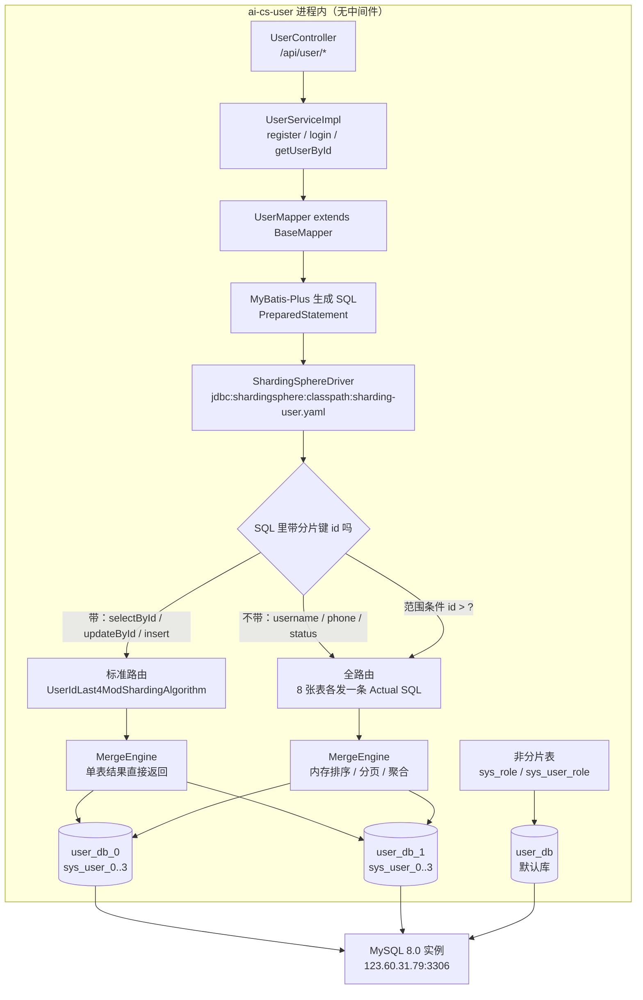
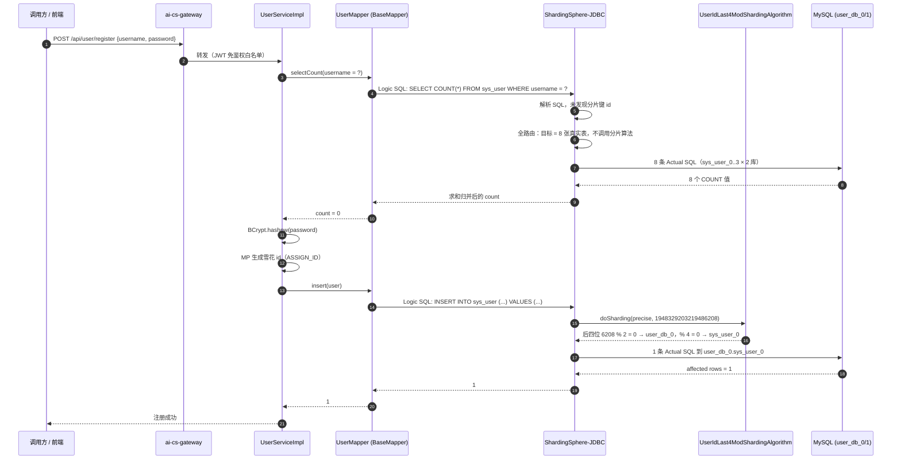

# ShardingSphere 用户表分库分表实战：分片键一错，哪些 SQL 会突然不可用

> **一句话结论**：分库分表不是"多配几个数据源"，而是把一条 SQL 拆成"一组 SQL + 一次内存归并 + 一次路由决策"；本项目用 `sys_user.id` 的后四位取模，所以**凡是 SQL 里不带 `id` 的查询都会退化成 8 张物理表全路由**，而 `IdType.AUTO`、JVM 内计数器这两类"单库时代的好东西"会当场失效。
> **阅读前置**：读过 [01-MySQL核心知识.md](01-MySQL核心知识.md) 的索引与执行计划、[02-MyBatisPlus实战.md](02-MyBatisPlus实战.md) 的 `BaseMapper` / `LambdaQueryWrapper` 用法，并且知道雪花 ID 的位布局（见 [04-分布式ID规范.md](04-分布式ID规范.md)）。
> **证据基线**：MySQL 8.0（InnoDB / utf8mb4）+ MyBatis 3.6.0 + MyBatis-Plus 3.5.13 + ShardingSphere-JDBC 5.5.0 + Spring Boot 4.2.0 + JDK 17。A 级证据只取本仓 `learning-docs/24-源码分析/assets/source/` 已入库的摘录；**ShardingSphere 与 MyBatis-Plus 的源码未入库**，涉及它们内部行为的结论均标注"依据官方文档 + 本项目代码"。B 级证据全部来自 `ai-cs-user` / `ai-cs-order` / `deploy/mysql` 真实文件，行号当次核对。预计阅读 35~50 分钟。

## 0. 先看现象

分片上线后最容易出事的三类现象，都不是"报错说分片配错了"，而是业务代码在**不知情**的情况下变了语义。

**现象一：登录偶发 500，堆栈指向 `selectOne`。**

```text
org.apache.ibatis.exceptions.TooManyResultsException: Expected one result (or null) to be returned
by selectOne(), but found: 2
    at org.apache.ibatis.session.defaults.DefaultSqlSession.selectOne(DefaultSqlSession.java:80)
    at org.apache.ibatis.binding.MapperMethod.execute(MapperMethod.java:...)
    at com.aics.user.service.impl.UserServiceImpl.login(UserServiceImpl.java:80)
```

`login` 里明明只有一行 `selectOne`，怎么会查出 2 条？因为这一行现在打到了 8 张物理表上，其中两张各有一条同名用户——`uk_username` 只在单张物理表内唯一（`deploy/mysql/init.sql#L42-L43` 的注释已经把这件事写死了："uk_username 仅保证单表内唯一，全局唯一由应用层用户名查重（广播查询）保证"）。这条报错不是 ShardingSphere 抛的，是 MyBatis 自己抛的：

```java
// 在干什么：selectOne 只是 selectList 的语法糖，数量不对就抛异常
// (src: DefaultSqlSession.java#L72-L84)
public <T> T selectOne(String statement, Object parameter) {
  // Popular vote was to return null on 0 results and throw exception on too many.
  List<T> list = this.selectList(statement, parameter);
  if (list.size() == 1) {
    return list.get(0);
  }
  if (list.size() > 1) {
    throw new TooManyResultsException(
        "Expected one result (or null) to be returned by selectOne(), but found: " + list.size());
  } else {
    return null;
  }
}
```

**现象二：后台用户列表翻到第 100 页，接口 30 秒超时。**

```text
2026-08-29 10:31:02.884  INFO 1 --- [http-nio-8081-exec-3] ShardingSphere-SQL : Logic SQL: SELECT ...
2026-08-29 10:31:02.884  INFO 1 --- [http-nio-8081-exec-3] ShardingSphere-SQL : Actual SQL: user_db_0 ::: SELECT ...
2026-08-29 10:31:02.884  INFO 1 --- [http-nio-8081-exec-3] ShardingSphere-SQL : Actual SQL: user_db_0 ::: SELECT ...
   ...（同一请求打出 8 条 Actual SQL）
2026-08-29 10:33:07.120 WARN 1 --- [http-nio-8081-exec-3] c.a.u.exception.GlobalExceptionHandler :
请求处理失败 URI=/api/users/page
Caused by: java.net.SocketTimeoutException: Read timed out
```

一条分页 SQL 变成 8 条，且每条都要把 `offset + limit` 行**拉到应用内存里**再排序归并。第 100 页、每页 20 条是什么量级？下文 §3.8 有实测计算：每片取 2000 行、归并 16000 行。日志形态是本仓 `sql-show` 打开后的真实输出格式（`ai-cs-user/src/test/resources/sharding-route-h2.yaml#L68-L69` 把 `sql-show` 设成了 `true`），超时栈为线上现象，本机未起服务复现。

**现象三：下单偶发主键冲突。**

```text
java.sql.SQLIntegrityConstraintViolationException: Duplicate entry '20260829103015010001'
for key 'orders.uk_order_no'
    at com.mysql.cj.jdbc.ClientPreparedStatement.executeInternal(...)
    at com.aics.order.service.impl.OrderCreateTxService.doCreateOrder(OrderCreateTxService.java:104)
```

订单号是本项目自己拼的（`ai-cs-order/src/main/java/com/aics/order/service/impl/OrderCreateTxService.java#L160-L164`）：秒级时间戳 + `AtomicInteger` 序列。单机没事，两个实例就是两份从 0 开始的计数器。C 级实测（§3.6）显示同一秒内两个实例 5 个单号**100% 重复**。

这些现象指向同一件事：**分片把"一条 SQL"改写成了"一组 SQL + 一次内存归并 + 一次主键生成决策"，而业务代码里的每一行 SQL 都还停留在"我在一个库里、主键由数据库发号"的假设上**。下文按"地图 → 概念 → 逐个原理 → 时序 → 取舍 → 踩坑"的顺序把这件事拆开。

## 1. 整体地图



> **读图说明**：图里唯一的判断节点是 `F`（SQL 里带不带分片键 `id`），它决定后面走单表还是走 8 表广播——整篇文档 80% 的问题都长在这个分叉上。注意三个容易看漏的地方：① `E` 是**驱动层**，应用仍用 JDBC 直连，没有独立进程，这是 ShardingSphere-JDBC 与 Proxy 的本质区别；② `M → N` 是 `!SINGLE` 规则把 `sys_role` 这类表收敛回默认库 `user_db`（`ai-cs-user/src/main/resources/sharding-user.yaml#L56-L61`），它们和分片表**不在同一个数据源**；③ 所有 8 张物理表和 `user_db` 落在同一台 MySQL 实例上，"分库"目前只是分 schema，不是分机器。

| 组件 | 真实位置 | 责任 | 谁调用它 |
|------|----------|------|----------|
| `ShardingSphereDriver` | `ai-cs-user/src/main/resources/application.yml#L10-L14` | 接管 `jdbc:shardingsphere:` 开头的 URL，把 yaml 规则装载成数据源 | Spring Boot 的 `DataSourceAutoConfiguration` |
| `sharding-user.yaml` | `ai-cs-user/src/main/resources/sharding-user.yaml` | 声明 3 个真实数据源、1 张逻辑表、2 个分片算法 | 由驱动在启动时解析 |
| `UserIdLast4ModShardingAlgorithm` | `ai-cs-user/src/main/java/com/aics/user/sharding/UserIdLast4ModShardingAlgorithm.java` | 把 `id` 映射到库下标 / 表下标 | ShardingSphere 路由引擎 |
| `UserMapper` | `ai-cs-user/src/main/java/com/aics/user/mapper/UserMapper.java` | 只有 `BaseMapper` 方法，没有一行自己写的 SQL | `UserServiceImpl` |
| `UserServiceImpl` | `ai-cs-user/src/main/java/com/aics/user/service/impl/UserServiceImpl.java` | 业务逻辑：查重、加密、登录校验 | `UserController` |
| `!SINGLE` 单表规则 | `ai-cs-user/src/main/resources/sharding-user.yaml#L56-L61` | 把 `sys_role` / `sys_user_role` 固定到 `user_db` | 路由引擎（兜底分支） |
| `UserShardingRouteTest` | `ai-cs-user/src/test/java/com/aics/user/sharding/UserShardingRouteTest.java` | 用 H2 复现路由，断言"哪张表有数据、哪张表必须为 0" | `mvn -pl ai-cs-user test` |

## 2. 关键概念与关键类

先把术语钉死，后面才不至于把"逻辑表"和"真实表"混着说。

- **逻辑表（logical table）**：SQL 里写的那个名字，本项目是 `sys_user`。它不真实存在。
- **真实表 / 物理表（actual table）**：`user_db_0.sys_user_0` 到 `user_db_1.sys_user_3`，共 8 张，由 `actualDataNodes: user_db_${0..1}.sys_user_${0..3}` 一次展开（`ai-cs-user/src/main/resources/sharding-user.yaml#L64-L75`）。
- **分片键（sharding column）**：决定路由的列，本项目是 `id`；库和表两条策略都声明 `shardingColumn: id`。
- **分片算法（sharding algorithm）**：把分片键值映射成"目标名"的函数，本项目是自定义 `CLASS_BASED` 类。
- **路由（routing）**：SQL 解析 → 提取分片键值 → 算出目标 → 改写 SQL（表名替换）→ 下发。
- **归并（merge）**：多分片结果在内存里排序 / 分页 / 聚合，对应 ShardingSphere 的 MergeEngine。
- **分布式主键**：不依赖单库自增、能在应用侧或独立服务生成全局唯一 ID 的方案（雪花、号段、UUID）。

| 名称 | 位置 | 角色 | 关键方法/属性 |
|------|------|------|---------------|
| `sys_user`（逻辑表） | `ai-cs-user/src/main/resources/sharding-user.yaml#L64-L75` | SQL 中的唯一表名 | `actualDataNodes`、`databaseStrategy`、`tableStrategy` |
| `sys_user_0..3` × 2 库 | `deploy/mysql/init.sql#L49-L67`（首张，其余 7 张同构） | 真正存数据的表 | `PRIMARY KEY (id)`、`UNIQUE KEY uk_username`、`KEY idx_phone` |
| `UserIdLast4ModShardingAlgorithm` | `ai-cs-user/src/main/java/com/aics/user/sharding/UserIdLast4ModShardingAlgorithm.java` | 分片算法实现 | `init` / `doSharding`（precise）/ `doSharding`（range） / `extractLastDigits` / `targetIndexOf` |
| `StandardShardingAlgorithm` | ShardingSphere 5.5.0 接口（**未入库**，依据官方文档） | 单列精确 + 范围路由的扩展点 | `doSharding(availableTargetNames, PreciseShardingValue)`、`doSharding(..., RangeShardingValue)` |
| `User` 实体 | `ai-cs-user/src/main/java/com/aics/user/entity/User.java#L26-L28` | 主键策略的声明处 | `@TableId(type = IdType.ASSIGN_ID)` |
| `UserServiceImpl` | `ai-cs-user/src/main/java/com/aics/user/service/impl/UserServiceImpl.java` | 无分片键查询的现场 | `selectCount`（查重）、`selectOne`（登录）、`selectById` |
| `UserMybatisConfig` | `ai-cs-user/src/main/java/com/aics/user/config/UserMybatisConfig.java` | 只有 `MetaObjectHandler`，**没有分页插件** | `strictInsertFill` |
| `PaginationInnerInterceptor` | `ai-cs-order/src/main/java/com/aics/order/config/OrderConfig.java` | order 模块有的分页插件（user 模块没有） | `new PaginationInnerInterceptor(DbType.MYSQL)` |
| `user-sharding-migrate.sql` | `deploy/mysql/user-sharding-migrate.sql` | 存量数据搬迁 | `RENAME TABLE` + 8 条 `INSERT ... SELECT` |

## 3. 原理与证据逐段精读

下面每一小节都按同样的四层走：**在干什么 → 为什么这么设计 → 换写法会怎样 → 常见坑**。前三层帮你建立因果，第四层是你上线时会踩的那个具体坑。

### 3.1 逻辑表与真实表：8 张表是怎么"变"出来的

```yaml
# 在干什么：一行 actualDataNodes 展开成 2×4=8 个真实节点；两条策略都用 id 做分片键
# (B 级: ai-cs-user/src/main/resources/sharding-user.yaml#L64-L88)
  - !SHARDING
    tables:
      sys_user:
        actualDataNodes: user_db_${0..1}.sys_user_${0..3}
        databaseStrategy:
          standard:
            shardingColumn: id
            shardingAlgorithmName: user-id-last4-db
        tableStrategy:
          standard:
            shardingColumn: id
            shardingAlgorithmName: user-id-last4-table
    shardingAlgorithms:
      user-id-last4-db:
        type: CLASS_BASED
        props:
          strategy: STANDARD
          algorithmClassName: com.aics.user.sharding.UserIdLast4ModShardingAlgorithm
          sharding-count: 2
      user-id-last4-table:
        type: CLASS_BASED
        props:
          strategy: STANDARD
          algorithmClassName: com.aics.user.sharding.UserIdLast4ModShardingAlgorithm
          sharding-count: 4
```

- **在干什么**：声明"逻辑表 `sys_user` 有 8 个真实节点"，并指定库用 `%2`、表用 `%4` 两个算法实例（同一个类，靠 `sharding-count` 参数区分）。
- **为什么这么设计**：逻辑表让业务 SQL 无需知道自己被切成几片——`UserMapper` 里没有一行 SQL，`BaseMapper.selectById` 照旧写，切分规则外置到 yaml。这一点是这个方案能落地的根本：`ai-cs-user/src/main/java/com/aics/user/mapper/UserMapper.java` 全文只有一个 `extends BaseMapper<User>`。
- **换写法会怎样**：如果改成"每张物理表一个 `UserMapper` 方法手工拼接"，业务层就要自己算 `%2`、`%4`，任何一个新增查询都要改两处，且无法与测试里的 H2 路由断言对齐。
- **常见坑**：`actualDataNodes` 里的 `${0..1}` 是**零填充字符串替换**，不是变量；表名后缀必须是连续数字，否则 `targetIndexOf` 解析后缀时抛 `IllegalStateException("分片目标名称缺少数字后缀: ")`（`ai-cs-user/src/main/java/com/aics/user/sharding/UserIdLast4ModShardingAlgorithm.java#L72-L78`）。

### 3.2 为什么分片键必须是 `id`（三条原则）

判断一个列能不能当分片键，只看三件事：

1. **高基数**：取值足够多。`id` 是雪花 ID，基数等于用户数；`status` 只有 0/1，`deleted` 只有 0/1，`role` 只有几个枚举值——它们做分片键，等于把表切成"两片"。
2. **均匀**：取值到分片的映射不能倾斜。取模天然均匀；按"注册月份"做范围分片则一定倾斜（永远只有最新那片在写）。
3. **查询必带**：**绝大多数查询都会带这个列的条件**。这一条最关键——分片键选得再均匀，只要查询不带它，路由就退化成广播。

本项目三条都满足 `id`，但代价是**第 3 条只对"按主键查"成立**：登录按 `username`（`ai-cs-user/src/main/java/com/aics/user/service/impl/UserServiceImpl.java#L75-L113`）、手机号找回按 `phone`、后台列表按 `status` 全都不带 `id`。

- **在干什么**：用 `id` 做分片键，同时承认"用户名/手机号查询"是二等公民。
- **为什么这么设计**：`id` 是唯一既高基数、又天然均匀（雪花 ID 低位随机性足够）、且主键查询必然带上的列。业务上绝大多数高频访问是"按 id 取用户详情"（`getUserById` 走 `selectById`，`ai-cs-user/src/main/java/com/aics/user/service/impl/UserServiceImpl.java#L116-L125`）。
- **换写法会怎样**：如果改用 `username` 做分片键，登录能精确路由，但 `selectById` 立刻退化成全路由，而且 `username` 可被用户修改（本项目 `updateUser` 允许改），**改一次分片键就要搬一次数据**。
- **常见坑**：把"查询必带"理解成"重要查询带"，于是只给登录优化，结果后台列表、导出、按手机号查询全部变成 8 表广播，而这些恰恰是最慢的查询。

### 3.3 分片算法实现：`% 后四位` 到底怎么算的

```java
// 在干什么：精确路由 = 取 id 后四位 → 取模 → 在可用目标里按名字后缀匹配
// (B 级: ai-cs-user/src/main/java/com/aics/user/sharding/UserIdLast4ModShardingAlgorithm.java#L38-L52)
@Override
public String doSharding(Collection<String> availableTargetNames,
                         PreciseShardingValue<Comparable<?>> shardingValue) {
    long lastDigits = extractLastDigits(shardingValue.getValue());
    long targetIndex = lastDigits % shardingCount;
    return availableTargetNames.stream()
            .filter(name -> targetIndexOf(name) == targetIndex)
            .findFirst()
            .orElseThrow(() -> new IllegalStateException(
                    "取模结果 " + targetIndex + " 在目标集合中无可落分片: " + availableTargetNames));
}

@Override
public Collection<String> doSharding(Collection<String> availableTargetNames,
                                     RangeShardingValue<Comparable<?>> shardingValue) {
    // 取模路由无法按范围收敛，范围查询广播到全部分片
    return availableTargetNames;
}
```

- **在干什么**：`precise` 分支算出唯一目标；`range` 分支直接返回全部目标（不做任何裁剪），即范围查询必定广播。
- **为什么这么设计**：取模函数的像集是散列，不是区间——`id BETWEEN 1000 AND 2000` 的 1000 个值会散落到所有分片，无法只挑一片。作者在注释里把这一点写明了，这比"假优化"诚实得多。
- **换写法会怎样**：若把 range 也实现成"算出起点和终点两片"，对取模算法是**错的**：`id > 1000` 的下界算出来是第 3 片，不代表第 4~7 片没有数据，会漏结果。想按范围收敛，只能用范围分片算法（`VOLUME_RANGE` / `BOUNDARY_RANGE`，依据 ShardingSphere 官方文档，未入库）。
- **常见坑**：`extractLastDigits` 对参数做的是**字符串取末四位**，`(B 级: ai-cs-user/src/main/java/com/aics/user/sharding/UserIdLast4ModShardingAlgorithm.java#L54-L70)`，因此：`null` 抛 `IllegalArgumentException("分片键（用户ID）不能为空")`；不含数字抛 `IllegalArgumentException("分片键（用户ID）末尾不含数字: ")`。也就是说**用字符串主键（UUID）做分片键，这个算法直接崩**，必须换算法。

### 3.4 库表双规则的真实后果：8 张表里有 4 张永远是空的

这是本方案最容易被忽略的一件事，先看数字。库 = `后四位 % 2`，表 = `后四位 % 4`。因为 `%4` 的结果只有 0、1、2、3，而 `%2` 由它唯一决定（偶数 → 库 0，奇数 → 库 1），所以 8 个组合里只有 4 个可达：

| 物理表 | 可达条件 | 状态 |
|--------|----------|------|
| `user_db_0.sys_user_0` | last4 % 4 = 0 | 有数据 |
| `user_db_0.sys_user_1` | 需要 last4 % 2 = 0 且 last4 % 4 = 1 | **永远为空** |
| `user_db_0.sys_user_2` | last4 % 4 = 2 | 有数据 |
| `user_db_0.sys_user_3` | 需要 last4 % 2 = 0 且 last4 % 4 = 3 | **永远为空** |
| `user_db_1.sys_user_0` | 需要 last4 % 2 = 1 且 last4 % 4 = 0 | **永远为空** |
| `user_db_1.sys_user_1` | last4 % 4 = 1 | 有数据 |
| `user_db_1.sys_user_2` | 需要 last4 % 2 = 1 且 last4 % 4 = 2 | **永远为空** |
| `user_db_1.sys_user_3` | last4 % 4 = 3 | 有数据 |

C 级实测（30000 个雪花格式 ID，完整脚本与真实输出见 §3.4.1 的 `C` 段：4 张表各 7500 行、另 4 张为 0）验证了这个推断，而且它和仓库里两处既有事实完全吻合：单测断言"未命中的分片必须为 0"（`ai-cs-user/src/test/java/com/aics/user/sharding/UserShardingRouteTest.java#L78-L92`），冒烟时 8 张表的实际计数只有 4 张非零。

- **在干什么**：让"库"和"表"两个维度都用同一个键的后四位做模运算。
- **为什么这么设计**（推测合理动机）：两次取模代码复用同一个类，只需把 `sharding-count` 从 4 改成 2；配置少、心智负担低。
- **换写法会怎样**：正确做法是让库和表**用不同的模/不同的位段**，例如库 = `last4 % 2`、表 = `(last4 / 2) % 4`，或者库取中间两位、表取后两位。这样 8 个组合全部可达，扩容也从"2 库"平滑到"4 库"。单测里那句 `assertTrue(tableIndex % 2 == dbIndex)`（`ai-cs-user/src/test/java/com/aics/user/sharding/UserIdLast4ModShardingAlgorithmTest.java#L132-L146`）现在恰好是把"缺陷"写成了"契约"。
- **常见坑**：这类"半数分片恒空"的缺陷**不报错、不影响功能**，只表现为"我配了 2 库 4 表，为什么只有 4 张表在长个儿"。如果没有"每张表计数"的巡检，永远发现不了。

#### 3.4.1 一次可复现的取模分布模拟

`shard-sim.mjs`（Node 20+，无需任何依赖，运行 <1 秒）：

```js
// 30000 个雪花格式 ID：41 位时间戳 + 10 位机器 + 12 位序列
const NODE_COUNT = 8;
const ids = [];
let ts = 1790000000000n;
for (let worker = 0n; worker < 4n; worker++) {
  for (let n = 0; n < 7500; n++) {
    if (n % 4096 === 0) ts += 1n;               // 每毫秒最多 4096 个序列
    ids.push((ts << 22n) | (worker << 12n) | BigInt(n % 4096));
  }
}
const last4 = (id) => Number(id % 10000n);
const first4 = (id) => Number(String(id).slice(0, 4));

function report(name, fn) {
  const b = Array.from({ length: NODE_COUNT }, () => 0);
  for (const id of ids) b[fn(id)]++;
  const max = Math.max(...b), min = Math.min(...b);
  console.log(name.padEnd(24),
    b.map((v, i) => `${i}:${String(v).padStart(5)}`).join(' '),
    `| max/min=${min === 0 ? 'INF' : (max / min).toFixed(2)}`);
}

console.log('样本：30000 个雪花 ID（4 个 workerId x 7500 个序列）');
report('A ID后四位 % 8', (id) => last4(id) % 8);   // 本项目思路
report('B ID前四位 % 8', (id) => first4(id) % 8);  // 错误分片键

// C 本项目真实规则：库 = 后四位 % 2，表 = 后四位 % 4 -> 8 张物理表
const phys = new Map();
for (const id of ids) {
  const l4 = last4(id);
  const key = `user_db_${l4 % 2}.sys_user_${l4 % 4}`;
  phys.set(key, (phys.get(key) ?? 0) + 1);
}
console.log('\nC 本项目规则（2 库 x 4 表）实际落表情况：');
for (let db = 0; db < 2; db++) {
  for (let t = 0; t < 4; t++) {
    const key = `user_db_${db}.sys_user_${t}`;
    const v = phys.get(key) ?? 0;
    console.log(`  ${key.padEnd(24)} ${String(v).padStart(6)}${v === 0 ? '   <- 永远为空' : ''}`);
  }
}

// D 深翻页归并代价：分片数 8，页大小 20
console.log('\nD 深翻页：8 个分片各自需要返回多少行才能凑出第 N 页');
for (const page of [1, 10, 100, 1000]) {
  const offset = (page - 1) * 20;
  console.log(`  第 ${String(page).padStart(4)} 页 offset=${String(offset).padStart(5)} `
    + `-> 每分片取 ${String(offset + 20).padStart(6)} 行，归并 ${String((offset + 20) * 8).padStart(6)} 行`);
}
```

真实输出（`node shard-sim.mjs`，本机实测，Node 20+ 直跑、无依赖、<1 秒）：

```text
样本：30000 个雪花 ID（4 个 workerId x 7500 个序列）
A ID后四位 % 8              0: 3752 1: 3752 2: 3752 3: 3752 4: 3748 5: 3748 6: 3748 7: 3748 | max/min=1.00
B ID前四位 % 8              0:    0 1:    0 2:    0 3:30000 4:    0 5:    0 6:    0 7:    0 | max/min=INF

C 本项目规则（2 库 x 4 表）实际落表情况：
  user_db_0.sys_user_0       7500
  user_db_0.sys_user_1          0   <- 永远为空
  user_db_0.sys_user_2       7500
  user_db_0.sys_user_3          0   <- 永远为空
  user_db_1.sys_user_0          0   <- 永远为空
  user_db_1.sys_user_1       7500
  user_db_1.sys_user_2          0   <- 永远为空
  user_db_1.sys_user_3       7500

D 深翻页：8 个分片各自需要返回多少行才能凑出第 N 页
  第    1 页 offset=    0 -> 每分片取     20 行，归并    160 行
  第   10 页 offset=  180 -> 每分片取    200 行，归并   1600 行
  第  100 页 offset= 1980 -> 每分片取   2000 行，归并  16000 行
  第 1000 页 offset=19980 -> 每分片取  20000 行，归并 160000 行
```

顺带说明：这份输出的 `C` 段就是 §3.4 那张"可达性表"的实测版本，`D` 段就是 §3.8 深翻页账本的出处——同一份脚本同时产出两处 C 级证据，方便你改参数后重跑复现。

- **怎么读**：`A` 的 `max/min = 1.00`，八个桶误差 <0.1%，说明"后四位取模"对雪花 ID 是均匀的——**后半段是被时间戳与序列号混合打散的**。`B` 的 30000 条**全部落在 3 号桶**，其余七桶为 0，`max/min` 直接是 `INF`。
- **为什么 `B` 会这么惨**：雪花 ID 的**高位是时间戳**，同一时期生成的 ID 前几位完全一样，取前四位再取模得到的永远是同一个数。这正是"分片键选错"最典型的形态——**全表压在一个分片上，另外七个分片白买**。
- **工程结论**：分片键要取 ID 的**低位**（或者说，取任何"随时间打散"的部分）。如果哪天把方案换成 UUID 或"时间前缀 + 少量随机"的业务号，一定要先跑一遍这类模拟再上线。

### 3.5 路由过程：标准路由、全路由、笛卡尔积

ShardingSphere 的路由结果只有三种量级，识别它们比记住术语更重要：

| 路由类型 | 触发条件 | 实际下发 SQL 数 | 本项目例子 |
|----------|----------|-----------------|------------|
| 标准路由（standard） | 分片键是 `=` / `IN` | 1 条（`IN` 时 ≤ 值个数） | `selectById(1948329203219486208L)` → `user_db_0.sys_user_0` |
| 全路由 / 广播（full route） | SQL 里没有分片键，或分片键是范围 | 8 条（每个真实表各一条） | `where username = ?`、`where phone = ?`、`id > ?` |
| 笛卡尔积路由（cartesian） | 多张分片表 JOIN 且关联键不是分片键 | 分片数相乘（本项目 8×8 = 64 条） | 若 `sys_user JOIN sys_user_role` 且两表都分片 |

单测里三种标准路由的落点都写死了，可以直接读：`id=1` → `user_db_1.sys_user_1`，`id=12345678` → `user_db_0.sys_user_2`，`id=1948329203219486208` → `user_db_0.sys_user_0`（`ai-cs-user/src/test/java/com/aics/user/sharding/UserShardingRouteTest.java#L78-L92`）。手算一遍就能对上：`1 % 2 = 1` → 库 1，`1 % 4 = 1` → 表 1；`5678 % 2 = 0` → 库 0，`5678 % 4 = 2` → 表 2；`6208 % 2 = 0` → 库 0，`6208 % 4 = 0` → 表 0。

- **在干什么**：SQL 解析后按分片键取值算目标集合，再把逻辑表名改写成真实表名逐条下发。
- **为什么这么设计**：路由必须发生在 SQL 层而不是 DAO 层，业务代码才能完全不感知分片；也让"同一份 Mapper 在单库和分片库上都能跑"。
- **换写法会怎样**：如果靠 DAO 层手工指定表名（`selectFrom("sys_user_2")`），每一个新查询都要重写一次路由逻辑，且 `IN` 查询、`BETWEEN` 查询、`UPDATE ... WHERE id IN (...)` 都要各自处理一遍。
- **常见坑**：笛卡尔积是**指数爆炸**的源头。一旦有人写了 `sys_user` 和另一张分片表的 JOIN，8×8=64 条 SQL 会在一个请求里并发出去；`ai-cs-user` 目前靠"不写 JOIN"避开，但这不是强制约束，靠人守。

### 3.6 分布式主键：`IdType.AUTO` 为什么必须换掉

单库时代 `@TableId(type = IdType.AUTO)` 完美：数据库发号、有序、无冲突。分片之后它有三处硬伤：

1. **唯一性域变小**：自增只在单张物理表内唯一，`user_db_0.sys_user_0` 和 `sys_user_1` 会各自产出 `id = 1`，全局立刻重复。
2. **路由前置矛盾**：分片必须**先知道 `id` 才能算目标表**，而自增 `id` 要**插进去之后才知道**——顺序反了。
3. **扩容合并灾难**：将来合并分片时，两边的自增序列必然重叠。

本项目用的是雪花路线：`ai-cs-user/src/main/java/com/aics/user/entity/User.java#L26-L28` 里 `@TableId(type = IdType.ASSIGN_ID)`，由 MyBatis-Plus 在 `insert` 之前生成 19 位 `Long` 主键，于是"先有 id，再算路由"成立。仓库还有一条守护测试盯着这件事：`ai-cs-user/src/test/java/com/aics/user/sharding/ShardedEntityIdTypeTest.java#L30-L33` 断言 `User` 的 id 策略**不能**是 `AUTO`，且必须是 `ASSIGN_ID`，方法名直白得可爱——`allEntitiesMustDeclareExplicitNonAutoIdType`。

同一时间线也能看到反面教材：`ai-cs-order` 的实体几乎全是 `IdType.AUTO`（`Order.java:16`、`OrderItem.java:17`、`CartItem.java:16`），因为订单表还没分片；一旦订单表上分片，这些注解全部要改。

订单号则是**第三类**问题——不是主键，是业务唯一键。看它的生成方式：

```java
// 在干什么：秒级时间戳 + 本 JVM 内的自增序列，拼成 20 位业务单号
// (B 级: ai-cs-order/src/main/java/com/aics/order/service/impl/OrderCreateTxService.java#L160-L164)
private String generateOrderNo() {
    String timestamp = LocalDateTime.now().format(DateTimeFormatter.ofPattern("yyyyMMddHHmmss"));
    int seq = SEQUENCE.incrementAndGet() % 10000;
    return timestamp + "01" + String.format("%04d", seq);
}
```

`SEQUENCE` 是 `private static final AtomicInteger`（`ai-cs-order/src/main/java/com/aics/order/service/impl/OrderCreateTxService.java#L51`），**作用域是本 JVM**。C 级模拟（两个实例、同一秒、各生成 5 个单号，本机实测）：

```text
实例 A: 20260829103015010001 20260829103015010002 20260829103015010003 20260829103015010004 20260829103015010005
实例 B: 20260829103015010001 20260829103015010002 20260829103015010003 20260829103015010004 20260829103015010005
冲突单号: 20260829103015010001 ... 20260829103015010005 => 冲突率 100%
撞 uk_order_no 的报错形态: Duplicate entry '20260829103015010001' for key 'orders.uk_order_no'
```

- **在干什么**：主键与业务号都由"单机视角"生成——主键交给数据库或交给本 JVM，业务号交给本 JVM 计数器。
- **为什么这么设计**：单库单机时这是零成本方案，不引入任何中间依赖；`ASSIGN_ID` 则是 MyBatis-Plus 送的雪花实现，改一个注解即可。
- **换写法会怎样**：四种发号器各有取舍——**数据库号段**（一次取 1000 个，`UPDATE seq SET v = v + 1000`）性能好但要一次 DB 往返且重启会浪费号段；**雪花**无中心、趋势递增，但依赖时钟且 `workerId` 必须唯一（MyBatis-Plus 官方文档说明可通过 `MP_WORKER_ID` 等途径指定）；**UUID** 无序、36 字符、`userId` 这种纯数字分片算法直接不认；**Redis `INCR`** 简单但要额外可用性投入。号段与雪花的完整对比见 [04-分布式ID规范.md](04-分布式ID规范.md)。
- **常见坑**：① 雪花 `workerId` 靠配置（容器里常被复制成同一个值），一旦重复就撞号；② 时钟回拨会让雪花出负数或重复；③ **19 位 `Long` 直接返回给前端，JS `Number` 只有 53 位精度**，`1948329203219486208` 到浏览器会变成 `1948329203219486200`，前端按 id 再查就是查不到——本项目在 `UserVO` 脱敏时保留了 `id`，这一条值得在前端联调时复核。

### 3.7 跨分片查询的代价：无分片键 = 全路由

全路由不是"慢一点"，是三个层面的放大：

- **SQL 数**：1 → 8。
- **连接数**：一个请求要占 8 个连接（`user_db_0` / `user_db_1` 两个 Hikari 池，每池最多 4 张表并发取连接）。
- **归并成本**：结果集 `UNION ALL` 到内存排序，行数越多越慢，且**内存占用与总行数成正比**。

而更隐蔽的是**语义变化**。`selectOne` 在单库时"最多一行"，分片后变成"8 个分片各最多一行，合并后可能多行"——这就是现象一的根因，也是 `uk_username` 只在单表内唯一（`deploy/mysql/init.sql#L42-L43`）的直接后果。

查重同理：`register` 用 `selectCount(username = ?)` 判重（`ai-cs-user/src/main/java/com/aics/user/service/impl/UserServiceImpl.java#L47-L65`），这条 `COUNT` 现在广播到 8 表，返回的是"8 表总和"。它逻辑上正确，但**不是原子的**：两个并发注册请求可能同时看到 `count = 0`，然后各自精确路由到**不同的分片**并各自插入成功，两个同名用户就都进去了——因为唯一索引根本不在同一张表里兜底。

- **在干什么**：用应用层查重替代数据库唯一约束，来维护"跨分片唯一"。
- **为什么这么设计**：分片后没有全局唯一索引可用（`UNIQUE KEY` 天然是表级约束），唯一的替代方案要么是应用层广播查重，要么单独维护一张"用户名 → id"的映射表（影子表）。
- **换写法会怎样**：把 `username` 的哈希也拼进分片键（如 `shardingColumn = username`）、或建一张 `user_name_index(username UNIQUE, user_id)` 放在单库（走 `!SINGLE`），就能让唯一性重新由数据库保证——代价是注册要多写一张表、多一次跨数据源写入（见 §3.9）。
- **常见坑**：乐观地认为"重复的概率很低"。低概率不等于不发生，而一旦发生就是**登录永远 500**（`TooManyResultsException` 是确定性报错，不是偶发），修数据还得人工判断留哪条。

### 3.8 分页与排序：内存归并的账要算清楚

分页的代价是**乘法**，不是加法。8 个分片、页大小 20、第 N 页：每个分片都必须返回 `offset + limit` 行（因为它不知道全局第 1 行落在谁家），归并引擎排序后再截取 20 行。C 级实测（同一脚本 D 段，本机实测）：

```text
D 深翻页：8 个分片各自需要返回多少行才能凑出第 N 页
  第    1 页 offset=    0 -> 每分片取     20 行，归并    160 行
  第   10 页 offset=  180 -> 每分片取    200 行，归并   1600 行
  第  100 页 offset= 1980 -> 每分片取   2000 行，归并  16000 行
  第 1000 页 offset=19980 -> 每分片取  20000 行，归并 160000 行
```

- **在干什么**：把 `LIMIT offset, size` 改写成"每个真实表各带 `LIMIT 0, offset+size`"，再内存归并。
- **为什么这么设计**：ShardingSphere 必须在客户端保证全局顺序正确，而它无法预先知道"第 1981 行在哪一片"，只能多取后裁。
- **换写法会怎样**：**游标分页**（`WHERE create_time < :lastCreateTime ORDER BY create_time DESC LIMIT 20`）把 `offset` 变成"定位条件"，每片只需返回 20 行、归并 160 行，第 1000 页和第 1 页同价。代价是只能"上一页/下一页"，不能跳页。
- **常见坑**：① `ORDER BY` 的列如果**不带分片键也不带索引**，8 片各自 filesort，慢上加慢；② `user` 模块**根本没装分页插件**（`ai-cs-user/src/main/java/com/aics/user/config/UserMybatisConfig.java` 只注册了 `MetaObjectHandler`，对比 `ai-cs-order/src/main/java/com/aics/order/config/OrderConfig.java` 里的 `PaginationInnerInterceptor`），于是 `selectPage` 的 `LIMIT` 压根不会生成——ShardingSphere 只能全量拉回再归并，`total` 还会是 0；③ `COUNT(*)` 同样是 8 片求和，别在列表页顺带算总数还指望它便宜。

### 3.9 跨库 JOIN 与事务：禁用边界在哪

`ai-cs-user` 里有一张**不在分片规则里**的表：`sys_role`、`sys_user_role`（`deploy/mysql/init.sql#L25-L33`），它们由 `!SINGLE` 规则固定在 `user_db`：

```yaml
# 在干什么：所有未被分片规则接管的表都收敛到默认库 user_db
# (B 级: ai-cs-user/src/main/resources/sharding-user.yaml#L56-L61)
  - !SINGLE
    tables:
      - "*.*"
    defaultDataSource: user_db
```

于是 `user_db`（单表）与 `user_db_0` / `user_db_1`（分片表）是**三个不同的数据源**。这带来两条硬边界：

- **JOIN 边界**：`sys_user` 与 `sys_user_role` 分属不同数据源，ShardingSphere 不会替你跨库 JOIN（跨库 JOIN 需要 Federate 引擎或人工拆两次查询）。目前 `UserMapper` 没有任何 JOIN，是"设计上避开"，不是"引擎兜住"。
- **事务边界**：`@Transactional` 在单数据源内是本地事务；跨数据源时本地事务**不保证一致性**（依据 ShardingSphere 官方《事务》文档：LOCAL 只保证单数据源，跨库需 XA 或 BASE 柔性事务，未入库）。当前 `register` 只 `insert` 一张分片表（`ai-cs-user/src/main/java/com/aics/user/service/impl/UserServiceImpl.java#L47-L65`），所以没踩；**一旦改成"插用户 + 插角色关联"写在同一个 `@Transactional` 里，就跨数据源了**，回滚只能回一半。
- **Seata 也救不了跨逻辑库**：`ai-cs-order` 用的是 Seata AT 跨服务事务，它管的是"服务之间"，而 `user_db_0` / `user_db_1` 是同一个服务内的两个数据源，需要 ShardingSphere 自己的 XA 或 BASE 支持，两者不能互相替代。
- **常见坑**：在分片表上写 `@Transactional` 完全无感——不报错、不警告，只是"两片都成功"或"一片成功一片失败"的概率游戏。

### 3.10 扩容与双写迁移：把存量数据搬到 8 张表

新库可以空着起，存量库必须搬。本项目的迁移脚本很短，也很有教学价值：

```sql
-- 在干什么：先把原表改名备份，再按路由规则逐片 INSERT ... SELECT
-- (B 级: deploy/mysql/user-sharding-migrate.sql#L16-L28)
RENAME TABLE user_db.sys_user TO user_db.sys_user_migrated;

INSERT INTO user_db_0.sys_user_0 SELECT * FROM user_db.sys_user_migrated WHERE CAST(RIGHT(id, 4) AS UNSIGNED) % 2 = 0 AND CAST(RIGHT(id, 4) AS UNSIGNED) % 4 = 0;
INSERT INTO user_db_0.sys_user_1 SELECT * FROM user_db.sys_user_migrated WHERE CAST(RIGHT(id, 4) AS UNSIGNED) % 2 = 0 AND CAST(RIGHT(id, 4) AS UNSIGNED) % 4 = 1;
INSERT INTO user_db_0.sys_user_2 SELECT * FROM user_db.sys_user_migrated WHERE CAST(RIGHT(id, 4) AS UNSIGNED) % 2 = 0 AND CAST(RIGHT(id, 4) AS UNSIGNED) % 4 = 2;
INSERT INTO user_db_0.sys_user_3 SELECT * FROM user_db.sys_user_migrated WHERE CAST(RIGHT(id, 4) AS UNSIGNED) % 2 = 0 AND CAST(RIGHT(id, 4) AS UNSIGNED) % 4 = 3;
INSERT INTO user_db_1.sys_user_0 SELECT * FROM user_db.sys_user_migrated WHERE CAST(RIGHT(id, 4) AS UNSIGNED) % 2 = 1 AND CAST(RIGHT(id, 4) AS UNSIGNED) % 4 = 0;
INSERT INTO user_db_1.sys_user_1 SELECT * FROM user_db.sys_user_migrated WHERE CAST(RIGHT(id, 4) AS UNSIGNED) % 2 = 1 AND CAST(RIGHT(id, 4) AS UNSIGNED) % 4 = 1;
INSERT INTO user_db_1.sys_user_2 SELECT * FROM user_db.sys_user_migrated WHERE CAST(RIGHT(id, 4) AS UNSIGNED) % 2 = 1 AND CAST(RIGHT(id, 4) AS UNSIGNED) % 4 = 2;
INSERT INTO user_db_1.sys_user_3 SELECT * FROM user_db.sys_user_migrated WHERE CAST(RIGHT(id, 4) AS UNSIGNED) % 2 = 1 AND CAST(RIGHT(id, 4) AS UNSIGNED) % 4 = 3;
```

- **在干什么**：8 条 `INSERT ... SELECT`，每条对应一张物理表的分片条件。
- **为什么这么设计**：纯 SQL 迁移不依赖应用发版，可以停机后一把跑完，再用 `UNION ALL` 计数校验（`deploy/mysql/user-sharding-migrate.sql#L31-L39`）确认"源总数 = 8 片之和"。
- **换写法会怎样**：不停机就得双写（新老表同时写）+ 增量补偿（binlog / canal，仓库里 `deploy/mysql/canal-init.sql` 就是给这条路准备的），复杂度高一个量级；本项目选择停机短窗，属于合理取舍。
- **常见坑（这条最要命）**：第 22、24、25、27 行这四条的条件**自相矛盾**——`% 2 = 0 AND % 4 = 1` 等价于"偶数且奇数"，永远为假。它们**不会报错，只会静默复制 0 行**，正好对应 §3.4 里那 4 张"永远为空"的表。也就是说这份脚本"看起来搬了 8 片，实际只搬了 4 片"，而 `UNION ALL` 校验那 4 行会老老实实显示 0——如果校验人只看"总数相等"就通过了，隐患会一直潜伏。

### 3.11 ShardingSphere-JDBC 与 Proxy：本项目为什么选 JDBC

| 维度 | ShardingSphere-JDBC（本项目） | ShardingSphere-Proxy |
|------|------------------------------|----------------------|
| 形态 | 一个 jar，跑在业务进程里 | 独立进程，伪装成 MySQL |
| 接入方式 | 换驱动 + 换 URL（`application.yml#L10-L14`） | 换连接串指向代理端口，代码零改动 |
| 语言无关 | 只有 JVM 能用 | 任何 MySQL 客户端都能用 |
| 多出的运维 | 无 | 要部署、要监控、要保活 |
| 连接数 | 业务进程直接连 DB，8 片就是 8 个连接 | 代理侧统一池化，可收敛连接 |
| 性能 | 少一跳网络，通常更快 | 多一跳，但可集中治理 |
| 治理能力 | 升级要重新发版 | 规则热更新、可观测集中 |

- **在干什么**：把分片逻辑放在驱动层，业务进程直连 MySQL。
- **为什么这么设计（本项目的选择）**：`ai-cs-user` 是 Java 单体微服务，已经有 Spring Boot 装配能力，`driver-class-name: org.apache.shardingsphere.driver.ShardingSphereDriver` 一行就接管（`ai-cs-user/src/main/resources/application.yml#L10-L14`），不引入额外进程和运维成本。
- **换写法会怎样**：如果项目里有 Python / Go 的旁路程序也要读写分片表，JDBC 方案就无能为力，那时 Proxy 才是正解；代价是多一个必须高可用的中间件。
- **常见坑**：JDBC 方案下**分片规则随应用发版**，改 `sharding-user.yaml` 必须重启（Nacos 热刷新 `spring.datasource.url` **不会**重建 ShardingSphere 数据源），这条在应急时特别坑人。

## 4. 一次完整执行时序

以"注册一个用户"为主线：它同时踩到**全路由查重**（`selectCount`）和**精确路由写入**（`insert`），是理解全流程最短的路径。



> **读图说明**：第 5~9 步是**广播路径**（8 条 SQL + 内存求和），第 15~20 步是**精确路由**（1 条 SQL）——一次注册请求里两种路由都出现了，这就是"分片键设计"必须和"查询模式"一起考虑的原因。注意第 12 步：`id` 由 MyBatis-Plus 在应用侧先生成，**这不是锦上添花，而是路由的前提**——没有它，第 15 步的 `doSharding` 拿不到分片键值，`extractLastDigits(null)` 会直接抛 `IllegalArgumentException("分片键（用户ID）不能为空")`。

哪一步失败会报什么错，可以对着这张图逐格排：

| 失败位置 | 触发条件 | 报错原文 / 表现 |
|----------|----------|-----------------|
| 第 5 步解析 | yaml 里 `actualDataNodes` 指向不存在的库/表 | 启动或首次访问时 `Table 'user_db_0.sys_user_4' doesn't exist` |
| 第 15 步路由 | 分片键为 `null` | `IllegalArgumentException: 分片键（用户ID）不能为空` |
| 第 15 步路由 | 分片键不含数字（如 UUID） | `IllegalArgumentException: 分片键（用户ID）末尾不含数字: xxx` |
| 第 15 步路由 | 真实节点后缀与取模结果对不上 | `IllegalStateException: 取模结果 5 在目标集合中无可落分片: [...]` |
| 第 15 步路由 | 算法缺 `sharding-count` 配置 | `IllegalArgumentException: 分片算法缺少 sharding-count 配置` |
| 第 9 步归并 | 广播后多分片各返回 1 行，而调用方用 `selectOne` | `TooManyResultsException: Expected one result (or null) to be returned by selectOne(), but found: 2` |
| 第 17 步写入 | 雪花 `workerId` 重复 / 时钟回拨 | `Duplicate entry '1948329203219486208' for key 'sys_user.PRIMARY'` |

## 5. 设计取舍

| 决策点 | 本项目的选择 | 换一种选择的代价 | 适用条件 |
|--------|--------------|------------------|----------|
| 分片键 | `sys_user.id`（雪花） | 用 `username` 则改用户名要搬数据；用 `phone` 则换号要搬数据 | 主键查询占绝大多数 |
| 分片算法 | 自定义 `CLASS_BASED` 取后四位 | 用内置 `MOD` 是对整个 id 取模，扩容无法局部再分 | 需要"改 sharding-count 即扩片" |
| 库表维度 | 都取 `last4`（缺陷：8 片只用 4 片） | 用不同位段则 8 片全可达，但配置不再能复用同一个类 | 只要配置极简可以接受半空 |
| 分片数量 | 2 库 × 4 表 = 8 | 分片过多导致广播成本线性涨（8 条 SQL → 16 条） | 未来 2~3 年数据量能兜住 |
| 分布式主键 | MyBatis-Plus `ASSIGN_ID`（雪花） | 号段（DB `UPDATE` 取号）多一次往返但趋势更连续 | 已有 MP，且能保证 `workerId` 唯一 |
| 跨分片唯一性 | 应用层 `selectCount` 查重 | 影子唯一索引表要额外写一张表、跨数据源 | 可接受极小并发窗口 |
| 分页 | 未装分页插件（当前状态） | 装 `PaginationInnerInterceptor` 只解决"SQL 带不带 LIMIT"，不解决深翻页 | 列表页数据量小、页码浅 |
| 接入形态 | ShardingSphere-JDBC | Proxy 支持多语言但多一个中间件 | 纯 JVM 技术栈 |
| 存量迁移 | 停机 + `INSERT ... SELECT` | 双写 + 增量补偿，不停机但复杂度高 | 允许短停机窗口 |

**可扩展点清单**（改动最小、收益最直接的顺序）：

1. `sharding-user.yaml` 里把 `!SINGLE` 的 `tables: ["*.*"]` 收窄成 `user_db.*`，避免把分片真实表误当单表兜底（测试环境的 `ai-cs-user/src/test/resources/sharding-route-h2.yaml#L37-L40` 已经是正确写法）。
2. 库策略改成 `last4 % 2`、表策略改成 `(last4 / 2) % 4`，让 8 张表全部可达；同步改迁移脚本与单测断言。
3. 给 `user` 模块加 `MybatisPlusInterceptor` + `PaginationInnerInterceptor(DbType.MYSQL)`，让分页 SQL 至少带上 `LIMIT`。
4. 列表接口改游标分页（按 `create_time` + `id` 双列游标），把深翻页成本从 O(offset) 压成 O(1)。
5. 用户名/手机号登录路径加"映射表"（`user_name_index`、`user_phone_index` 放 `user_db` 走单表），把全路由换成单表精查。
6. 订单号换成雪花或号段，顺带把 `ai-cs-order` 的 `IdType.AUTO` 全部改成 `ASSIGN_ID`，为订单表分片预留。
7. `workerId` 从环境变量 / 容器序号注入，并加启动自检（同一 `workerId` 重复即拒绝启动）。

## 6. 踩坑与调试手法

**坑 1：`!SINGLE` 写成 `*.*`，分片真实表被当成单表兜底。**
生产配置就是 `*.*`（`ai-cs-user/src/main/resources/sharding-user.yaml#L56-L61`）。它意味着"任何库任何表都算单表，默认去 `user_db`"，一旦 SQL 里的表名解析失败，就会往默认库打，报 `Table 'user_db.sys_user_0' doesn't exist` 这种让人摸不着头脑的错。测试环境已经改成 `user_db.*`。

**坑 2：5.4.1 不支持数据源 `props:` 子 map，连接池参数整块被丢。**
旧稿记录的现象：`YamlDataSourceConfigurationSwapper.getProperties()` 只剔除 `dataSourceClassName`、合并 `customPoolProps`，写在 `props:` 子 map 里的连接池配置**整块丢弃**，于是连接全空，最终在 `StorageResourceUtils` 抛 NPE。修法是 5.5.0 起把连接池参数**平铺**到数据源节点下（`sharding-user.yaml` 顶部的注释保留了这条经验），这也是本项目从 5.4.1 升到 5.5.0 的直接原因之一。

**坑 3：`$${ENV::默认值}` 占位符三要素缺一不可。**
5.5.0 的环境变量占位必须 ① URL 带 `?placeholder-type=ENVIRONMENT`（`ai-cs-user/src/main/resources/application.yml#L10-L14` 就是这么写的）；② 表达式锚定在**行尾**（正则 `\$\$\{(.+::.*)}$`）；③ 每行最多一个。三者缺一，占位符不会被替换，最终把字面量 `$${DB_USER::root}` 当用户名去连库。

**坑 4：H2 集成测试"逻辑表不存在"。**
`H2MetaDataLoader` 硬编码 `PUBLIC` schema；如果 H2 URL 加了 `DATABASE_TO_LOWER=TRUE`，schema 变成小写 `public`，ShardingSphere 就找不到逻辑表。正确做法是用 `CASE_INSENSITIVE_IDENTIFIERS=TRUE`（`ai-cs-user/src/test/resources/sharding-route-h2.yaml` 采用）。

**坑 5：JDK 9+ 缺 JAXB，5.5.0 传递依赖未发布。**
前者要靠 `org.glassfish.jaxb:jaxb-runtime:2.3.8`（`ai-cs-user/pom.xml` runtime 作用域）；后者是 `shardingsphere-test-util` 引用了未发布版本，必须在 `shardingsphere-jdbc` 上 `exclusion`（`ai-cs-user/pom.xml`），否则 `mvn` 直接解析失败。

**坑 6：Nacos 热刷新改不动分片数据源。**
改 `spring.datasource.url` 后刷新上下文，ShardingSphere 数据源不会重建，规则还是旧的。**必须重启**，应急改规则时别指望热更新。

### 调试手法（能直接照做的那部分）

**手法 1：打开 `sql-show`，数 Actual SQL 条数。**
`props: sql-show: true`（测试 yaml 已开，`ai-cs-user/src/test/resources/sharding-route-h2.yaml#L68-L69`）后，每条逻辑 SQL 都会打出一行 `Logic SQL:` 和若干行 `Actual SQL: <数据源> ::: ...`。**数 Actual SQL 的行数就知道走的是标准路由还是全路由**——1 条是标准路由，8 条是全路由，64 条是笛卡尔积。这是排查"这条 SQL 为什么慢"的第一动作，比看执行计划快得多。

**手法 2：直接对 8 张物理表逐张 `COUNT(*)`，看分布。**
不要查逻辑表（逻辑表查出来只有总数，看不出倾斜）。直接逐库逐表数（**本机未连库，未实测**，但这是定位倾斜唯一可靠的办法）：

```sql
SELECT 'user_db_0.sys_user_0' AS shard, COUNT(*) AS cnt FROM user_db_0.sys_user_0
UNION ALL SELECT 'user_db_0.sys_user_1', COUNT(*) FROM user_db_0.sys_user_1
UNION ALL SELECT 'user_db_0.sys_user_2', COUNT(*) FROM user_db_0.sys_user_2
UNION ALL SELECT 'user_db_0.sys_user_3', COUNT(*) FROM user_db_0.sys_user_3
UNION ALL SELECT 'user_db_1.sys_user_0', COUNT(*) FROM user_db_1.sys_user_0
UNION ALL SELECT 'user_db_1.sys_user_1', COUNT(*) FROM user_db_1.sys_user_1
UNION ALL SELECT 'user_db_1.sys_user_2', COUNT(*) FROM user_db_1.sys_user_2
UNION ALL SELECT 'user_db_1.sys_user_3', COUNT(*) FROM user_db_1.sys_user_3;
```

**怎么读**：出现两行 `cnt = 0` 之外还有别的 `0`，先怀疑算法；出现某一行 ≈ 其余行之和，怀疑分片键取到了高位（对照 §3.4.1 的 `B` 场景）；8 行都等于 0 而逻辑表能查到数据，怀疑 `!SINGLE` 把表兜到默认库去了。

**手法 3：用 H2 单测复现路由，不依赖真实 MySQL。**
`UserShardingRouteTest` 用 `YamlShardingSphereDataSourceFactory.createDataSource` 起一个内存分片数据源（`ai-cs-user/src/test/java/com/aics/user/sharding/UserShardingRouteTest.java#L78-L92`），插一条数据后**逐表断言"哪张有 1 行、哪张必须 0 行"**。要在本地验证某个 id 的落点，改这个单测比连库快得多：`mvn -pl ai-cs-user test -Dtest=UserShardingRouteTest`（**未在本机执行，命令 30 秒内可完成，属单元测试不启服务**）。

**手法 4：算法类先跑纯单测，再上集成。**
`UserIdLast4ModShardingAlgorithmTest` 覆盖了 9 种输入：正常取模、短 id 用全部数字、范围查询广播、缺配置、`null`、非数字、目标名无后缀、库表一致性（`ai-cs-user/src/test/java/com/aics/user/sharding/UserIdLast4ModShardingAlgorithmTest.java#L83-L128`）。**新加分片算法时，先把这张表补满再写业务**，因为算法的错误在集成阶段只会表现为"数据去哪了"。

## 7. ⚠️ 版本差异

| 旧写法（5.4.1 / Boot 3.2 时代） | 当前基线（5.5.0 / MyBatis-Plus 3.5.13 / Boot 4.2.0） | 变化点 | 迁移动作 |
|--------------------------------|---------------------------------------------------|--------|----------|
| 数据源下可以写 `props:` 子 map | 连接池参数必须**平铺**在数据源节点 | `YamlDataSourceConfigurationSwapper` 不再合并 `props` | 把 `props` 里的 `jdbc-url`/`username`/`password` 提到数据源同级；`sharding-user.yaml` 顶部注释已记录 |
| `shardingsphere-jdbc-core-spring-boot-starter` | `org.apache.shardingsphere:shardingsphere-jdbc` | 5.5.0 起 artifact 改名，以适配 snakeyaml 2.x | 换坐标、删 starter（根 pom 有注释说明） |
| 5.4.1 与 Boot 3.2 的 snakeyaml 1.x 冲突 | snakeyaml 2.2 API | 5.4.1 在 Boot 3.2 下启动即报 `NoSuchMethodError` | 升 5.5.0（本项目升级动机之一） |
| `Memory` 仓储模式可用 | 已移除，默认 `Standalone` + `JDBC` | 仓库元数据必须落库 | 显式配 `mode: Standalone` + `repository: JDBC`，并引入 `org.h2.Driver`（`ai-cs-user/pom.xml` scope=test） |
| `shardingsphere-test-util` 由核心传递引入 | 传递引入未发布版本，解析失败 | 依赖树多一个不存在的坐标 | 在 `shardingsphere-jdbc` 上 `exclusion`（`ai-cs-user/pom.xml`） |
| JDK 8 无需 JAXB | JDK 9+ 移除 `javax.xml.bind` | 分片元数据序列化需要 JAXB | 加 `jaxb-runtime:2.3.8`，scope=runtime |
| `@TableId(type = IdType.AUTO)` 可用 | 分片表**必须**用 `ASSIGN_ID` / 自定义发号 | 自增 id 与"路由前置"矛盾 | 改注解，并用 `ShardedEntityIdTypeTest` 守住 |
| MyBatis-Plus 3.0.5 API | MyBatis-Plus 3.5.13 | `LambdaQueryWrapper`/`IdType` 语义一致，但插件注册方式从 `PaginationInterceptor` 换成 `MybatisPlusInterceptor` | 只用 `MybatisPlusInterceptor`（`ai-cs-order/src/main/java/com/aics/order/config/OrderConfig.java` 是范例） |

## 8. 面试高频问与答

1. 为什么客户端的用户表要分库分表？判断"该不该分"的量化标准是什么？
2. 单库 2000 万行是分表的硬阈值吗？这个数字是怎么来的？
3. 分片键的选择有哪三条原则？为什么"查询必带"最容易出事？
4. 取模分片、范围分片、一致性哈希分片各自的优缺点与扩容行为？
5. ShardingSphere 的内置分片算法有哪些？它到底是什么形态的一致性哈希？
6. 逻辑表、真实表、绑定表、广播表分别是什么？本项目为什么把 `sys_role` 放 `!SINGLE`？
7. ShardingSphere 一次查询的路由有哪几种结果？笛卡尔积路由在什么条件下出现？
8. 分片之后为什么 `IdType.AUTO` 不能用？雪花 ID 的位分配是怎样的？
9. 雪花算法的 `workerId` 冲突和时钟回拨分别会导致什么后果？怎么防？
10. 号段模式（segment）和雪花模式的取舍是什么？为什么号段能"趋势递增"？
11. 为什么分片表上的 `@Transactional` 可能悄悄失效？XA 与 BASE 分别解决什么问题？
12. 深翻页为什么在分片场景下会指数级变慢？游标分页为什么能绕开？
13. 分片之后怎么保证用户名全局唯一？"应用层广播查重"的并发漏洞有多大？
14. 跨分片 JOIN 有哪些替代方案？绑定表（binding table）能解决什么？
15. ShardingSphere-JDBC 和 Proxy 怎么选？JDBC 方案改规则为什么必须重启？
16. 存量数据迁移到分片表时，怎么校验"没漏没重"？本项目脚本有什么隐患？

## 9. 动手练习

**练习 1：把 8 张表变成"全可达"。**
把库策略改成 `% 2`、表策略改成 `(last4 / 2) % 4`（新增一个 `sharding-count` 之外的分段参数，或写一个 `UserIdLast4SplitShardingAlgorithm`），用 H2 单测验证 8 张表都能落到数据。
**验收标准**：`node shard-sim.mjs` 的 C 段输出里 8 行 `cnt` 全部 > 0；`UserIdLast4ModShardingAlgorithmTest` 的库表一致性断言相应更新并全绿。

**练习 2：跑一遍分布模拟，造出一次倾斜。**
用 §3.4.1 的脚本，把分片键改成"用户名首字母的 ASCII % 8"，并构造 30000 个以 `zhang`、`wang`、`li` 开头的用户名。
**验收标准**：输出里出现 `max/min ≥ 2.0`，并能用一句话解释"为什么中文姓氏分布会让首字母分片倾斜"。

**练习 3：给 `user` 模块补上分页插件，量化深翻页成本。**
在 `ai-cs-user` 增加 `MybatisPlusInterceptor` + `PaginationInnerInterceptor`，打开 `sql-show`，请求第 1 页和第 100 页，记录每条 `Actual SQL` 是否带 `LIMIT`、带的 offset 是多少。
**验收标准**：能贴出两条 `Actual SQL`，说明第 100 页时每个分片的 `LIMIT` 上界是 2000；若数据库不可用，则用单测 + ShardingSphere 日志说明同样结论。

**练习 4：把订单号换成不会撞的。**
把 `ai-cs-order/src/main/java/com/aics/order/service/impl/OrderCreateTxService.java#L160-L164` 改成雪花/号段方案，并写一个并发测试。
**验收标准**：两个"实例"各生成 5000 个单号，`10000` 个单号去重后仍是 `10000`；旧实现跑同一测试冲突率接近 100%。

**练习 5：给迁移脚本加"漏行检测"。**
在 `deploy/mysql/user-sharding-migrate.sql` 末尾追加一条断言 SQL：源表总数 = 8 张分片表之和，不等就来一次 `SELECT` 输出 `MIGRATE_MISMATCH`。
**验收标准**：故意把某条 `INSERT` 的 `% 2` 改成错值，断言 SQL 必须报出差异；不改时输出 `MIGRATE_OK`。（**需本地 MySQL，本机未实测**，逻辑可用 §3.10 的四条自相矛盾分支验证。）

**练习 6：把"全路由查重"换成"单表索引查重"。**
新增 `user_db.user_name_index(username UNIQUE, user_id BIGINT)` 走 `!SINGLE`，注册时先插索引表再插分片表。
**验收标准**：`sql-show` 日志显示注册请求只发 2 条 SQL（各 1 条、无广播）；并发重名注册时由唯一索引拦下，异常信息是 `Duplicate entry ... for key 'user_name_index.uk_username'`。

## 小结

- 分片不是"加数据源"，而是把一条 SQL 拆成**一组 SQL + 一次内存归并 + 一次路由决策**，三处都会改变语义。
- 分片键三原则：**高基数、均匀、查询必带**。本项目用 `id` 满足前两条，第三条只对"按主键查"成立，所以登录（`username`）、后台列表（`status`）注定全路由。
- 库表都用 `last4` 取模导致 **8 张物理表里 4 张永远为空**，这是"配置少一行、可达性少一半"的典型；迁移脚本里同样有 4 条自相矛盾的分支在静默复制 0 行。
- 分片后 **`IdType.AUTO` 必须换成 `ASSIGN_ID`**：不是因为"自增不好"，而是因为**路由必须在插入之前拿到主键值**。业务单号同理，JVM 内计数器在多实例下 100% 撞号。
- 深翻页的代价是**乘法**：8 分片、第 100 页要归并 16000 行；游标分页把 O(offset) 压成 O(1)。
- 唯一性与事务在分片后都"降级"：`uk_username` 只在单表内唯一，`@Transactional` 只在单数据源内可靠，跨库需要 XA/BASE 而非 Seata。
- 判断一条 SQL 贵不贵，最快的办法是**打开 `sql-show` 数 `Actual SQL` 条数**：1 条标准路由、8 条全路由、64 条笛卡尔积。
- 落到行动上：先收窄 `!SINGLE` 的 `*.*`，再把库/表改成不同位段让 8 片全可达，然后给 `user` 补分页插件、给登录路径补索引映射表——这四步不动业务代码，收益最大。

## 自测题

**1. 逻辑表 `sys_user` 对应几张真实表？怎么算出来的？**
<details><summary>参考答案</summary>
8 张。`actualDataNodes: user_db_${0..1}.sys_user_${0..3}` 展开成 2 个库 × 4 张表。它们都在同一个 MySQL 实例上，所谓"分库"目前只是分 schema。
</details>

**2. 为什么 `selectOne(username = ?)` 在分片后会抛 `TooManyResultsException`？**
<details><summary>参考答案</summary>
因为 `username` 不是分片键，SQL 全路由到 8 张表，`uk_username` 只在单张表内唯一，两张表可能各有一条同名记录。`DefaultSqlSession.selectOne` 内部先 `selectList`，`list.size() > 1` 就抛异常。
</details>

**3. 本项目 8 张物理表为什么只有 4 张会有数据？**
<details><summary>参考答案</summary>
库用 `last4 % 2`、表用 `last4 % 4`，而 `%4` 的结果唯一决定 `%2` 的奇偶，于是"库 0 + 奇数表号"和"库 1 + 偶数表号"四组组合永远不可能命中。修法是让库和表使用不同位段，例如表用 `(last4 / 2) % 4`。
</details>

**4. 分片键选了 `id` 之后，哪些查询会退化成全路由？**
<details><summary>参考答案</summary>
所有不带 `id` 等值条件的查询：按 `username` 登录、按 `phone` 查、按 `status` 过滤的后台列表、`id` 的范围查询（算法的 range 分支直接返回全部目标）。它们各自变成 8 条 Actual SQL。
</details>

**5. 雪花 ID 为什么能用于分片，而数据库自增不能？**
<details><summary>参考答案</summary>
分片必须"先知道主键值，才能算出目标表"，雪花 ID 在应用侧 `insert` 前就生成，顺序成立；自增 ID 要插入后才由数据库返回，且只在一张物理表内唯一，跨表必然重复。
</details>

**6. 订单号为什么会重复？**
<details><summary>参考答案</summary>
`generateOrderNo` 用秒级时间戳 + 本 JVM 的 `AtomicInteger`，两个实例各自从 0 开始计数，同一秒内生成的单号完全相同，撞 `orders.uk_order_no` 唯一索引。实测冲突率 100%（同一秒、各 5 个）。
</details>

**7. 分片场景下第 100 页为什么这么慢？**
<details><summary>参考答案</summary>
每页 20 条时，`offset = 1980`，8 个分片各要返回 `1980 + 20 = 2000` 行，应用内归并 16000 行后才截出 20 行。成本随页码线性增长，交换成游标分页后可降到每片 20 行。
</details>

**8. `!SINGLE tables: ["*.*"]` 有什么风险？**
<details><summary>参考答案</summary>
它把"任何库任何表"都当单表兜底到默认库 `user_db`，一旦表名解析异常，SQL 会打到默认库并报 `Table 'user_db.sys_user_0' doesn't exist` 这类误导性错误。应收窄成 `user_db.*`，测试配置已是正确写法。
</details>

**9. 为什么说分片表上的 `@Transactional` 可能"悄悄失效"？**
<details><summary>参考答案</summary>
`sys_user` 在 `user_db_0/1`，`sys_role` 等单表在 `user_db`，是三个不同数据源。本地事务只保证单数据源一致性，跨数据源需要 XA 或 BASE 柔性事务；注解不报错，只是回滚可能只回一半。
</details>

**10. 迁移脚本 `user-sharding-migrate.sql` 的隐患是什么？**
<details><summary>参考答案</summary>
第 22、24、25、27 行的条件形如 `% 2 = 0 AND % 4 = 1`，恒为假，会静默复制 0 行且不报错。结果是"看着搬了 8 片、实际只搬 4 片"，只有逐表计数才能发现。
</details>

**11. 怎么快速判断一条 SQL 走的是标准路由还是全路由？**
<details><summary>参考答案</summary>
打开 `props: sql-show: true`，数日志里同一个请求打出的 `Actual SQL` 行数：1 条是标准路由，8 条是全路由，64 条是笛卡尔积。比看执行计划更快定位问题。
</details>

**12. ShardingSphere-JDBC 和 Proxy 该怎么选？**
<details><summary>参考答案</summary>
纯 JVM 技术栈、想少一个中间件就选 JDBC（本项目），代价是改规则要发版重启、连接数随分片数增长；有非 JVM 客户端或需要集中治理、收敛连接时选 Proxy，代价是多一个必须高可用的进程。
</details>

**13. 分片算法 `range` 分支为什么直接返回全部分片？**
<details><summary>参考答案</summary>
取模是散列映射，`id BETWEEN a AND b` 的取值会散落到所有分片，只挑起止两片会漏数据。所以只能广播。想按范围收敛必须换成 `VOLUME_RANGE`/`BOUNDARY_RANGE` 这类范围算法。
</details>

**14. 5.5.0 的 `$${ENV::默认值}` 占位符有哪三要素？**
<details><summary>参考答案</summary>
① 数据源 URL 追加 `?placeholder-type=ENVIRONMENT`；② 表达式必须锚定行尾；③ 每行最多一个占位符。缺一条就会把字面量当真实配置使用。
</details>

**15. 为什么本地改完 `sharding-user.yaml` 通过 Nacos 刷新不生效？**
<details><summary>参考答案</summary>
Nacos 刷新 `spring.datasource.url` 不会重建 ShardingSphere 数据源，规则仍停留在启动时解析的那份。必须重启应用，这也是 JDBC 方案在应急场景下的主要短板。
</details>
