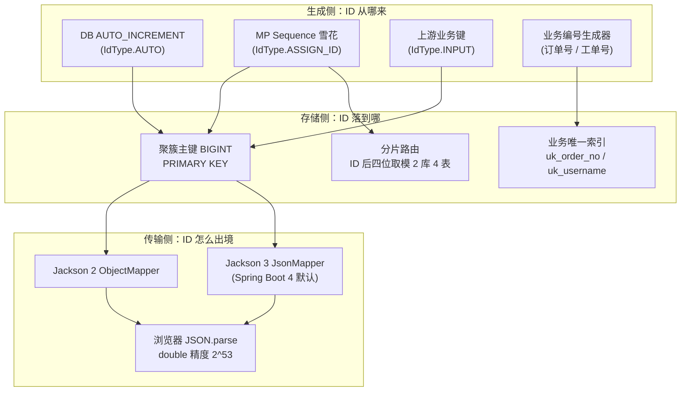
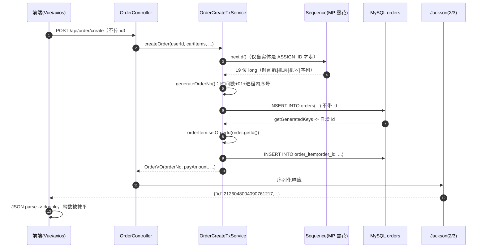

# 分布式 ID 规范：ID 是系统的骨架，选错的代价在索引和前端才结算

> **一句话结论**：主键 ID 不是"随手一个唯一数字"，它同时被三拨人消费——**存储侧**（B+ 树按它组织数据、二级索引靠它回表）、**路由侧**（分片算法按它算落库位置）、**传输侧**（序列化成 JSON 后前端能不能认全）；自增、UUID、雪花、号段、Redis INCR 这五种方案只是在这三条约束上各让一步，选错的账最终记在"主键冲突""页分裂""尾数变 0000"上。
> **阅读前置**：写过 `@TableId` 或 `AUTO_INCREMENT`；知道 InnoDB 主键索引是聚簇索引、二级索引叶子存主键；能看懂 `Long` / `BIGINT` / JSON number 的长度差别。不需要读过 MyBatis-Plus 源码——本篇会把关键字节码摊开。
> **证据基线**：MySQL 8.0（InnoDB / utf8mb4）、MyBatis 3.6.0、mybatis-spring 3.0.5、MyBatis-Plus **3.5.13**（仓库 `pom.xml#L47` 实测，非写作规范表里的 3.0.5，见 §7）、Spring Boot 4.2.0、JDK 17。证据分三级——**A 级** = `learning-docs/24-源码分析/assets/source/` 已入库的真实源码摘录（该目录下文件实际命名为 `Xxx.java.md`，故锚点写作 `Xxx.java.md#L起-L止`）；**B 级** = 本项目真实业务代码与 SQL（已逐行核对行号）；**C 级** = 本篇实跑命令 + 原样输出（`java 17.0.19` / `node v24.16.0`）。预计阅读 30 分钟。

## 0. 先看现象

### 现象一：订单详情页上，两个不同订单的 ID 一模一样

后端返回的是 19 位 `Long`，浏览器里 `JSON.parse` 之后变成了"尾数全是 0"的样子，列表里相邻两条订单甚至渲染出同一个 key，Vue 报 `Duplicate keys detected`。本篇实跑（C 级，脚本见 §3.10）——同一毫秒内生成的 4096 个雪花 ID 丢给 `JSON.parse`：

```text
Number.MAX_SAFE_INTEGER        = 9007199254740991  (16 位)
后端雪花 ID (Long, 19 位)       = 2126048004090761216
同毫秒 4096 个 ID 过 JSON.parse 后的不同值个数 = 17
  seq=1 原始=2126048004090761217 前端=2126048004090761216 相等=false
  seq=2 原始=2126048004090761218 前端=2126048004090761216 相等=false
  seq=3 原始=2126048004090761219 前端=2126048004090761216 相等=false
前端把 seq=1 和 seq=2 判为同一个 ID = true (2126048004090761200)
```

注意最后一行：**后端认为不同的两个 ID，前端认为是同一个**。这不是"显示不好看"，是数据契约被截断——按这个 ID 去查详情、去删除、去做前端缓存 key，全部指向错行。

### 现象二：扩容到第二个实例后，下单偶发唯一键冲突

订单号是这么拼的（B 级，`ai-cs-order/src/main/java/com/aics/order/service/impl/OrderCreateTxService.java#L160-L164`）：`yyyyMMddHHmmss` + 固定 `"01"` + 4 位序号，而 4 位序号来自一个 **JVM 进程内** 的 `AtomicInteger`（同文件 `#L51`）。单实例绝对自洽，起第二个实例后就长这样（报错文本为 MySQL 8.0 官方错误格式，本机无 MySQL 未复现，成因是两进程各自从 1 开始计数）：

```text
java.sql.SQLIntegrityConstraintViolationException: Duplicate entry
'E20261127103015010001' for key 'orders.uk_order_no'
```

`uk_order_no` 这个唯一索引（`deploy/mysql/order-init.sql#L42`）会把它变成 500，而不是脏数据——这算幸运，代价只落在一个用户的失败请求上。

### 现象三：ID 可枚举，被同行按序号爬走全部订单

`GET /api/order/1001`、`1002`、`1003`…… 自增主键把"业务量"和"写入顺序"直接暴露在 URL 上。攻击者不需要任何漏洞，就能把 `1001..N` 全遍历一遍，顺便算出你今天卖了多少单；更糟的是越权——如果详情接口只校验"登录"不校验"归属"，改个数字就能看别人的订单。

### 现象四：机器时间一跳，注册接口开始返回 500

MyBatis-Plus 的雪花实现遇到时钟回拨会抛这一句（异常消息串取自真实字节码常量池，见 §3.5 / §6）：

```text
java.lang.RuntimeException: Clock moved backwards.  Refusing to generate id for 12 milliseconds
```

**这些现象指向同一件事：ID 的"唯一"要在三个不同的地方同时成立——生成时全局唯一、落库时按它路由与聚簇、传输时形状不变。** 任一环节让一步，事故就会以完全不同的面貌出现在你最想不到的那一层：生成侧让一步（自增）→ 分片冲突；存储侧让一步（UUID 无序）→ 页分裂与索引膨胀；传输侧让一步（number 截断）→ 前端认错 ID。

## 1. 整体地图



> **读图说明**：三条横向分带就是本篇的三个决策点，箭头只表示"ID 流经"，不表示依赖强弱。
> - 只看 `A1 -> B1` 就以为"自增够用"，会漏掉 `A2 -> B3` 这条边：**分片一旦引入，自增就没有资格再当主键**（§3.2）。
> - `A4 -> B2` 是一条独立支线：订单号/工单号不是主键，它是"给人看、给对账用"的第二把钥匙，和主键走的是两个索引（§3.9）。
> - `B1 -> C1/C2` 分了两个框是关键：Spring Boot 4 同时存在两套 Jackson，只配一套等于没配（§3.10、§7）。
> - `C3` 是终局：截断发生在**浏览器**，任何服务端日志里都看不到精度丢失——这也是它最难排查的原因。

| 组件 | 责任 | 调用方 | 证据 |
| --- | --- | --- | --- |
| `IdType.AUTO` + `Jdbc3KeyGenerator` | INSERT 后从 JDBC `getGeneratedKeys()` 回填主键 | MyBatis / MyBatis-Plus 的 insert | A 级 `MappedStatement.java.md#L93-L94`、`BatchExecutor.java.md#L144-L146` |
| `Sequence`（MP 内置雪花） | 生成 19 位 `long`，时间戳+机器+序列 | `ASSIGN_ID` 时的 `DefaultIdentifierGenerator` | C 级 `javap` 字节码（§3.4） |
| `IdentifierGenerator` 接口 | 换掉内置雪花的唯一扩展点 | `GlobalConfig` 持有 | C 级 `javap`（§5 扩展点） |
| `UserIdLast4ModShardingAlgorithm` | 按 ID 后四位决定库/表 | ShardingSphere 5.5.0 | B 级 `ai-cs-user/src/main/java/com/aics/user/sharding/UserIdLast4ModShardingAlgorithm.java#L38-L46` |
| `generateOrderNo()` | 拼业务订单号（与主键无关） | 下单事务 | B 级 `ai-cs-order/src/main/java/com/aics/order/service/impl/OrderCreateTxService.java#L160-L164` |
| `Jackson2AutoConfiguration` | 给 Jackson 2 兜一个 `ObjectMapper` | 仍用 `com.fasterxml` 的业务代码 | B 级 `ai-cs-common/src/main/java/com/aics/common/autoconfigure/Jackson2AutoConfiguration.java#L16-L22` |
| `ShardedEntityIdTypeTest` | 反射扫描实体，禁止分片表回退 AUTO | CI（`mvn test`） | B 级 `ai-cs-user/src/test/java/com/aics/user/sharding/ShardedEntityIdTypeTest.java#L36-L52` |

## 2. 关键概念与关键类

先把术语一次性说清，后面不再解释：

- **雪花 ID（Snowflake）**：把一个 64 位 long 按"时间戳 / 机器号 / 毫秒内序列号"切开，保证多机并发生成不撞号，且整体单调递增。
- **workerId / datacenterId**：机器身份。同一毫秒内两台机器的序列号会重复，只能靠机器号区分——**机器号重复 = 撞 ID**，这是雪花唯一的硬约束。
- **时钟回拨**：NTP 校时把本机时间往回调，导致"当前时间小于上次生成时间"，此时再生成就会产出已发过的 ID。
- **号段模式（segment）**：不逐条取号，而是一次从 DB/Redis 领 1000 个号放内存里发，用完再领——把"每次生成一次 IO"降成"每 1000 次一次 IO"。
- **双 buffer**：号段模式的预取优化，当前段用到 10% 时后台就把下一段取回来，避免"段用完那一瞬间的毛刺"。
- **业务编号**：订单号、工单号这类给人看、给对账用的编号，与主键 ID **必须分离**（§3.9）。
- **Long 精度边界**：JS 的 number 是 IEEE-754 double，整数只能精确表示到 `2^53 - 1 = 9007199254740991`（16 位）；19 位的雪花 ID 必然被截断。

| 名称 | 位置 | 角色 | 关键方法 / 取值 |
| --- | --- | --- | --- |
| `IdType` 枚举 | `mybatis-plus-annotation-3.5.13.jar` | 声明主键由谁生成 | 常量仅 5 个：`AUTO`、`NONE`、`INPUT`、`ASSIGN_ID`、`ASSIGN_UUID`（C 级 `javap` 实测） |
| `@TableId` | 同上 | 字段级声明，`type()` 即 `IdType` | 守护测试靠它做反射扫描 |
| `AUTO` | — | 交给 DB 的 `AUTO_INCREMENT` | 依赖 `useGeneratedKeys` 回填，见 A 级锚点 |
| `ASSIGN_ID` | — | 交给 MP 内置雪花 | 默认 `DefaultIdentifierGenerator` → `Sequence.nextId()` |
| `INPUT` | — | 调用方自己填，MP 不插手 | 上游已有全局唯一键（`requestId`、`runId`） |
| `ASSIGN_UUID` | — | 32 位无横线 UUID 字符串 | 主键列必须是 `VARCHAR`，本项目未使用 |
| `Sequence` | `com.baomidou.mybatisplus.core.toolkit` | 雪花算法本体 | `public synchronized long nextId()`、`public static long parseIdTimestamp(long)` |
| `IdentifierGenerator` | `com.baomidou.mybatisplus.core.incrementer` | 生成器接口 | `Number nextId(Object entity)`；`default boolean assignId(Object)` |
| `DefaultIdentifierGenerator` | 同上 | `IdentifierGenerator` 默认实现 | `getInstance()`、`nextId(Object)`，内部持有一个 `Sequence` |
| `Jdbc3KeyGenerator` | MyBatis（A 级已入库） | 从 `getGeneratedKeys()` 读回自增主键 | `processBatch(ms, stmt, parameterObjects)` |
| `NoKeyGenerator` | MyBatis | 空实现，非 INSERT 时挂上 | 见 A 级 `MappedStatement.java.md#L93-L94` 的三元表达式 |
| `UserIdLast4ModShardingAlgorithm` | `ai-cs-user/.../sharding/` | 把 ID 变成库下标/表下标 | `doSharding()`、`extractLastDigits()` |
| `AtomicInteger SEQUENCE` | `OrderCreateTxService` | 订单号里的进程内序号 | `incrementAndGet() % 10000`（**不是全局唯一**，§6） |

## 3. 原理与证据逐段精读

### 3.1 自增主键：它的"唯一"只在一个库里有意义

**在干什么。** `IdType.AUTO` 把 ID 生成权交给 MySQL：列上写 `AUTO_INCREMENT`，INSERT 时不给 `id`，MySQL 在 InnoDB 内部加锁取下一个值并写入聚簇索引，然后通过 JDBC 的 `getGeneratedKeys()` 把生成的 id 还给应用。MyBatis 这一侧的关键装配只有一行：

```java (src: MappedStatement.java.md#L93-L94)
mappedStatement.keyGenerator = configuration.isUseGeneratedKeys() && SqlCommandType.INSERT.equals(sqlCommandType)
    ? Jdbc3KeyGenerator.INSTANCE : NoKeyGenerator.INSTANCE;
```

也就是说：`useGeneratedKeys = true` **且** 语句类型是 INSERT 时挂 `Jdbc3KeyGenerator`，否则挂空实现。回填动作在批量执行器里看得更清楚：[[源码:BatchExecutor.java.md#L144-L146]]

```java (src: BatchExecutor.java.md#L144-L146)
if (Jdbc3KeyGenerator.class.equals(keyGenerator.getClass())) {
  Jdbc3KeyGenerator jdbc3KeyGenerator = (Jdbc3KeyGenerator) keyGenerator;
  jdbc3KeyGenerator.processBatch(ms, stmt, parameterObjects);
}
```

`Configuration` 里那个开关的默认值也来自这里：`protected boolean useGeneratedKeys;`（[[源码:Configuration.java.md#L126]]），注解式 Mapper 则在 `MapperAnnotationBuilder` 里按 `options.useGeneratedKeys()` 决定（[[源码:MapperAnnotationBuilder.java.md#L374-L376]]）。

**为什么这么设计。** 自增的成本几乎为零：不需要额外网络往返、不需要额外的号段表、天然按写入顺序聚簇——追加在 B+ 树最右叶页，页利用率接近满，顺序 IO 友好。这是它在**单库单表**里几乎无敌的原因，也是 legacy 系统里到处是 `AUTO` 的原因。

**换写法会怎样。** 若改成应用侧生成再插入，DB 少了一次自增锁（`AUTO-INC` 表级锁在批量插入时曾是真瓶颈），但代价是"ID 从哪来"变成你的责任；反之若在分片场景坚持自增，唯一性立刻从"全局"退化成"每张分片表各自的 1,2,3…"——§3.2 就是这个退化过程。

**常见坑。**
- 以为 `order.getId()` 一定有值：它靠上面的回填链路，如果 `useGeneratedKeys` 被显式关掉、或者你写的是 `<insert>` 又忘了 `useGeneratedKeys="true" keyProperty="id"`，`getId()` 就是 `null`。本项目下单正是靠它：`orderMapper.insert(order)` 之后立刻 `orderItem.setOrderId(order.getId())`（`ai-cs-order/src/main/java/com/aics/order/service/impl/OrderCreateTxService.java#L117-L122`）。
- 以为 `id` 连续：批量插入 + `innodb_autoinc_lock_mode=2` 下自增值会"跳号"；回滚、`REPLACE`、唯一键冲突都会消耗自增值。**用 id 做业务连续编号是错的**，这也正是 §3.9 要求订单号独立存在的原因。

### 3.2 分库分表把自增的三个隐含假设一次全打破

**在干什么。** 本项目 user 表是分片的：`user_db_${0..1}.sys_user_${0..3}`（`ai-cs-user/src/main/resources/sharding-user.yaml#L63-L75`），路由键就是 `id` 本身；算法按 ID **后四位**取模选库选表（`ai-cs-user/src/main/java/com/aics/user/sharding/UserIdLast4ModShardingAlgorithm.java#L38-L46`）。对应的建表语句里，主键长这样：

```sql
CREATE TABLE IF NOT EXISTS user_db_0.sys_user_0 (
    id              BIGINT          NOT NULL COMMENT '主键ID（分片键）',
    ...
    PRIMARY KEY (id),
    UNIQUE KEY uk_username (username)
) ENGINE=InnoDB DEFAULT CHARSET=utf8mb4 COLLATE=utf8mb4_unicode_ci COMMENT='系统用户表分片（user_db_0，第0张）';
```

（`deploy/mysql/init.sql#L49-L67`，全库共 8 张同样的表。）

请注意 `id BIGINT NOT NULL` 后面**没有** `AUTO_INCREMENT`——这不是漏写，是必须不写。

**为什么这么设计。** 自增建立在三个假设上，分片把三个全打破了：
1. *唯一性的域 = 一个库*。8 张表各有自己的自增计数器，都从 1 开始，第 1 个用户在某张表里是 `1`，另一张表的第 1 个用户也是 `1`。
2. *ID 可以在写入时才确定*。分片路由必须在**发 SQL 之前**就知道落哪张表，而自增要等 MySQL 执行到 INSERT 才产生——鸡生蛋问题。
3. *扩容可以靠改自增起点解决*。双写迁移/合并回单库时，两套自增序列无法合并，只能全表重写。

**换写法会怎样。** 三种替代：DB 步长（§3.8，要改配置且扩容即失效）、号段（§3.6，要好号段表 + 双 buffer）、雪花（§3.4，无中心、写入前 ID 就确定）。本项目选了雪花，理由是**路由前置**这条只有雪花和号段能满足，而号段还要多一张表和一次 IO。

**常见坑。**
- 给分片表配回 `AUTO` 是最典型的回归。本项目用测试把它钉死：`ShardedEntityIdTypeTest` 反射扫 `com.aics.user.entity` 包，任何 `@TableId(type = IdType.AUTO)` 都会被收集成 violation（`ai-cs-user/src/test/java/com/aics/user/sharding/ShardedEntityIdTypeTest.java#L36-L52`），报错文案写着 `": 分库分表工程内禁止 IdType.AUTO（见分布式 ID 规范）"`。
- 反过来，分片键选"末尾数字"是这项目的一个巧思也是坑：`extractLastDigits` 从字符串末尾倒取最多 4 位数字，取不到就抛 `IllegalArgumentException`（同文件 `#L54-L70`）。雪花 ID 末 4 位就是序列号，所以"分片均匀"这件事顺手成立了；但若哪天换成 UUID 主键，这个算法会直接抛异常，而不是悄悄路由错——这是它写得好的地方（fail fast）。

### 3.3 UUID 的真实代价：不是"太长"，是"无序"

**在干什么。** UUID 的卖点是"不依赖任何中心、本地就能生成"，代价是**完全无序**。InnoDB 的主键索引是聚簇索引：数据行按主键顺序物理存放在叶子页上，页满 16KB 就分裂。UUID 随机的插入顺序意味着每次插入都可能落在**任意一个已写满的叶页中间**。

**为什么无序会贵。** 用 20 行的页模型脚本把这件事量化（C 级，实跑；`PAGE=16` 槽位，追加到页尾按 InnoDB 尾部策略分裂、中间插入按 50/50 分裂）：

```js
// page-split.mjs：只模拟叶页层，指标 = 叶页数 / 分裂次数 / 页切换次数 / 平均填充率
const PAGE = 16;
function simulate(order) {
  const leaves = [{ keys: [] }];
  let splits = 0, pageSwitch = 0, prev = -1;
  for (const k of order) {
    let i = leaves.findIndex(l => l.keys.length === 0 || l.keys[l.keys.length - 1] >= k);
    if (i === -1) i = leaves.length - 1;
    if (i !== prev) pageSwitch++;
    prev = i;
    const keys = leaves[i].keys;
    keys.push(k); keys.sort((a, b) => a - b);
    if (keys.length > PAGE) {
      const atTail = k === keys[keys.length - 1];
      const cut = atTail ? PAGE - 1 : keys.length >> 1;
      leaves.splice(i, 1, { keys: keys.slice(0, cut) }, { keys: keys.slice(cut) });
      splits++;
    }
  }
  const rows = leaves.reduce((s, l) => s + l.keys.length, 0);
  return { leaves: leaves.length, splits, rows, pageSwitch, fill: (rows / (leaves.length * PAGE) * 100).toFixed(1) };
}
```

跑 2000 行，两种插入顺序对照（原样输出）：

```text
单调递增(自增/雪花)            叶页数=134 分裂=133 页切换= 134 平均填充率=93.3% 行数=2000
随机无序(UUID/散列)          叶页数=179 分裂=178 页切换=1936 平均填充率=69.8% 行数=2000
单调递增(自增/雪花)            叶页数=134 分裂=133 页切换= 134 平均填充率=93.3% 行数=2000
随机无序(UUID/散列)          叶页数=177 分裂=176 页切换=1930 平均填充率=70.6% 行数=2000
```

**怎么读这张表。** 三列各自对应一个真实代价：
- **平均填充率 93.3% vs ~70%**：同一批数据，随机插入多占约 **1/3 的空间**，磁盘、buffer pool、备份、全表扫描全是 1.33 倍。70% 这个数字不是巧合，是随机插入下 B 树分裂的稳态（≈`ln2 ≈ 0.69`）。
- **页切换 134 vs ~1930**：这才是最疼的一列。顺序插入始终命中同一张"最右页"（缓存热、锁竞争集中在一页）；随机插入几乎每次都换页，2000 行里有 1930 次落到了和上一次不同的页上——每次都要把新页从磁盘捞进 buffer pool，并可能触发刷脏。
- **分裂次数**：随机插入的分裂发生在**已有数据的页中间**，分裂后两页各半空；顺序插入的分裂只发生在树的最右缘，旧页留满，只有新页是空的。

**换写法会怎样。** 如果非要用 UUID，标准解法是**有序 UUID**：UUIDv7 / ULID / 雪花，把时间戳放高位，让随机性只留在低位。代价是你必须自己实现或引入库（JDK 17 的 `UUID.randomUUID()` 是 v4，无序）。

**常见坑。**
- 只看"36 字符太占空间"就下结论。真正的大头是**二级索引**：InnoDB 所有二级索引的叶子存的是主键值，主键从 8 字节 `BIGINT` 变成 36 字节 `CHAR(36)`，每个二级索引都被放大 4 倍多。
- UUID 做字符串比较比 8 字节整数比较贵一到两个数量级，页内二分查找的 CPU 开销同步上涨。
- 反过来，**UUID 作为业务键**（`LlmTrace.requestId`、`AgentRun.runId` 那种"上游生成的幂等键"）是完全正确的选择，因为它不需要聚簇有序，只需要全局唯一。本项目正是这么用的：`ai-cs-message/src/main/java/com/aics/message/entity/AgentRun.java#L31` 的注释写着"主键由 chat 模块 Agent 编排链路生成（UUID），非数据库自增"。

### 3.4 雪花算法：41 + 5 + 5 + 12 是怎么切的

**在干什么。** MyBatis-Plus 的 `ASSIGN_ID` 背后是 `com.baomidou.mybatisplus.core.toolkit.Sequence`。它是第三方 jar，**本项目没有把它的源码入库**，所以这一节的证据用 `javap` 直接反查编译产物（C 级，命令见 §6），常量是从字节码里读出来的，不是背的：

```text
private final long workerIdBits;        // 5
private final long datacenterIdBits;    // 5
private final long maxWorkerId;         // 31
private final long maxDatacenterId;     // 31
private final long sequenceBits;        // 12
private final long workerIdShift;       // 12
private final long datacenterIdShift;   // 17
private final long timestampLeftShift;  // 22
private final long sequenceMask;        // 4095
private static final long twepoch;      // 1288834974657
public synchronized long nextId();
public static long parseIdTimestamp(long);
```

于是 64 位被切成：`1 位符号(0) | 41 位时间戳 | 5 位 datacenterId | 5 位 workerId | 12 位序列号`，`twepoch` 就是 Twitter 的纪元 `1288834974657`（2010-11-04T01:42:54.657Z）。

**为什么是 41 + 5 + 5 + 12。** 三个数字都在回答"够不够用"：
- 41 位毫秒 → `2^41 ms ≈ 69.7 年`，从 2010 年算起能撑到 2080 年前后；本项目 2026-11 的实测 ID 只用了约 16 年（`1795724318894 - 1288834974657 ≈ 5.07e11 ms`）。
- 10 位机器 → 1024 个节点。MP 把它拆成 5+5，是为了能多给一个"逻辑机房"维度，代价是单机房最多 32 台机。
- 12 位序列 → **单机每毫秒 4096 个**，折算 `4096 × 1000 = 4,096,000 QPS/节点`，理论上限 1024 节点 × 409.6 万 ≈ 41.9 亿 QPS。够用，但"每毫秒 4096"是个硬上限——§0 的现象一正是在这个上限边缘被前端截断的。

机器号从哪来？字节码里能看到它是**算出来的**，不是读配置：`getDatacenterId(long)` 遍历网卡取 MAC 地址（常量里出现掩码 `255` / `65280`，以及日志串 `"Use localhost address"`、`"Get network interface info:"`），`getMaxWorkerId(pId, maxDatacenterId)` 用进程号参与计算。日志里那句 `"Initialization Sequence Very Slow! Get datacenterId:"` 则是网卡枚举失败时的降级提示。**结论：默认情况下机器号 = MAC + PID 的推导值，K8s 里同一节点起两个 Pod 通常是安全的，但"通常"不等于"保证"**——同一台物理机、同一镜像、MAC 相同时靠 PID 区分，容器里 PID 又常是 1，这时撞号风险才真正出现。

**换写法会怎样。** 若把序列位从 12 加到 14、机器位压到 8（4 机房最多 16 台），单机每毫秒就到 16384，但节点数腰斩；反过来机器位加宽、序列位收窄，则单机峰值下降。这是典型的"峰值 vs 节点规模"零和。

**常见坑。**
- **把"机器位 10 位"当成"workerId 一个字段"**：老博客和旧稿常这么写，实际 MP 是 5 + 5，配置项也是分开的。
- **以为换机器能躲冲突**：模块多实例部署时，同一份 `mybatis-plus` 配置下每个 Pod 的机器号都是自算的；规模上来后标准做法是显式指定 workerId（§5 扩展点）。
- **在 `nextId()` 上加锁就以为线程安全**：`nextId()` 确实是 `synchronized`，但那是**单 JVM 内**的互斥，跨进程靠的只有机器号。

### 3.5 时钟回拨：MP 只有两招，第三招要自己写

**在干什么。** `nextId()` 一进来先取当前毫秒，然后和 `lastTimestamp` 比较。字节码还原出来就是：

```java
if (now < lastTimestamp) {
    long diff = lastTimestamp - now;
    if (diff <= 5) {
        wait(diff << 1);            // 睡 2*diff 毫秒
        now = timeGen();            // 重取时间
        if (now < lastTimestamp) throw new RuntimeException(
            String.format("Clock moved backwards.  Refusing to generate id for %d milliseconds", diff));
    } else {
        throw new RuntimeException(     // 回拨 > 5ms，直接放弃
            String.format("Clock moved backwards.  Refusing to generate id for %d milliseconds", diff));
    }
}
```

（C 级：`javap -p -c` 的 `nextId` 指令段，`Object.wait(diff << 1)` 与两条 `RuntimeException` 的构造都在里面。）

**为什么这么设计。** 回拨很小（≤5ms）时，最省事的补偿就是"等一下"——把这一毫秒熬过去，序列号继续用，对外表现为一次 10ms 内的抖动。超过 5ms 就麻烦了：等 5 秒甚至更久会让请求超时，还不如快速失败让上游重试或降级。

**三种处理方案对比。** 这是面试和选型都绕不开的表格：

| 方案 | 做法 | 优点 | 代价 | 适用 |
| --- | --- | --- | --- | --- |
| 等待 | 睡到时间追上（MP 的 `diff <= 5` 分支） | 实现最简单，ID 连续 | 回拨多久就卡多久，回拨 1 分钟等于全线超时 | 回拨幅度 < 10ms 的机房 |
| 抛异常 | `diff > 5` 直接 `RuntimeException` | 不产生重复 ID，失败可见 | 生成 ID 的请求全 500，事故面直接暴露给用户 | MP 默认，适合**有重试/降级**的链路 |
| 换号 | 备用 workerId（预先分配主备机器号）+ 时间戳留"回拨余量"位 | 不停机、不重复 | 要额外位或额外协调；主备轮换要持久化状态 | 大厂常见做法，需自研 |
| 借位/容错 | 记录回拨次数，把"回拨计数"塞进最低位 | 不阻塞 | 位不够就得砍序列位 | 已有自研雪花 |

**换写法会怎样。** 把 `diff <= 5` 放宽到 `2000ms` 看起来"更稳"，实际是把一次 500 变成一次 2 秒停顿——在网关 3 秒超时的链路上，这是把错误从"立刻可见"改成"随机超时"，更难排查。

**常见坑。**
- 生产容器不定期校时，NTP 猛跳。要求：`chrony`/`ntpd` 用 **slew（微调）** 而不是 step（跳变），且容器内不要自己跑校时、交给宿主机。
- 只看到 `RuntimeException` 就去查代码。这条消息来自 MP 的 `Sequence`（**`java.lang.RuntimeException`，不是 `MybatisPlusException`**），代码里搜业务包是搜不到的，见 §6 的调试手法①。
- 二次封装吞异常：在 `IdWorker` 外面 `catch (Exception e) { return fallbackRandom(); }` 会悄悄把雪花的唯一性保证废掉。

### 3.6 号段模式（Leaf-segment）：把"每毫秒取号"变成"每千次一次 IO"

**在干什么。** 号段模式（美团 Leaf-segment 是公开的经典实现）把发号拆成两步：
1. 建一张号段表，例如 `leaf_alloc(biz_tag, max_id, step, ...)`；
2. 应用启动/段用完时，用一条 `UPDATE leaf_alloc SET max_id = max_id + step WHERE biz_tag = ?` 领走 `[max_id, max_id+step)` 这一段，然后**在内存里自己发**这一段。

**为什么这么设计。** 雪花的价值是"无中心"，代价是"依赖时钟 + 机器号要协调"；号段的取舍正好相反：**依赖一次 DB 写入**，换来的是完全不依赖时钟、ID 可读性可控（可以做成 8 位、10 位定长）、单机能发到每秒几十万（因为发号是纯内存原子操作）。双 buffer 是它的标配优化：当前段消耗到 10% 时，后台异步取下一段，保证切换段时零停顿；否则每一千次就会有一次"IO 抖动"被上游看在眼里。

**换写法会怎样。** 单 buffer 的号段在段切换瞬间会把 DB 往返时间（1~5ms）暴露成一次尖峰；再退化成"每次 ID 都查一次 DB"，那就等于把主键生成变成了系统里最热的一张单点表——比自增还差，因为自增至少是库内操作。

**边界与坑。**
- **段内连续、跨段跳跃**：号段 ID 天然是"局部连续"的，所以它可以用来做"趋势判断"（如按 ID 段对账），但**不能**用来做"安全随机"。
- **重启浪费段**：进程重启后未用完的段直接丢弃，ID 出现空洞——不能拿"ID 连续"当"数据完整"的证据。
- **本项目未使用号段**：全库 grep 无 `leaf` / `号段` 相关实现，`@TableId` 盘点里也只有 `AUTO/ASSIGN_ID/INPUT` 三种（§6 手法③的真实输出）。写在这里是为了把方案谱系讲全，**不要以为仓库里有号段表**。
- 选型口诀：*要 ID 可读、能接受一次 DB 依赖 → 号段；要无中心、能接受时钟依赖 → 雪花。*

### 3.7 Redis INCR：快，但"持久性"是它的天花板

**在干什么。** `INCR id:order:20261127` 每调一次返回一个自增数，拼上日期就是"按天重置的流水号"。

**为什么有人用。** 单机十万级 QPS、实现只有一行、天然按天分段、对账时人眼可读。轻量业务的首选。

**边界（按危险程度排序）。**
1. **持久性差 → 会重号**。`appendonly yes` 但 `appendfsync everysec` 时，宕机最多丢 1 秒命令；重启后计数器回退，这 1 秒内发出去的号会被**重新发一次**。这条不是理论问题，是 Redis 的既定行为，用 INCR 做主键就必须正视它。
2. **过期即回退**。给 key 设 `EXPIRE 86400` 做"按天重置"时，若过期发生在跨天边界又被重建，同一个号会在两天里各发一次；对外主键不能这么干，业务流水号则勉强可以（有日期前缀兜底）。
3. **集群模式的多 key**。Redis Cluster 里 `INCR` 只能落在单个 key（单 slot）上；想"批量取号"的多 key 操作必须用 hash tag 保证同 slot，否则 `CROSSSLOT`。
4. **可枚举**。`INCR` 出来的是 1,2,3…，和自增一样泄露业务量——除非拼上随机前缀或异或混淆。
5. **单点与容灾**。主从切换时若发生异步复制丢失，同样回到第 1 条。

**换写法会怎样。** 想靠"Redis 集群 + 多个 key 分片"提高吞吐，会立刻撞上"号段有序性"问题；想靠 `WAIT` 命令同步复制换可靠性，就付出了 RT 代价，收益还不如直接用号段表。

### 3.8 数据库自增步长：最土的多实例方案

**在干什么。** 让每个实例的 `AUTO_INCREMENT` 不是 +1 而是 +N：

```sql
-- 实例 1
SET @@auto_increment_increment = 3;
SET @@auto_increment_offset   = 1;   -- 产出 1,4,7,10,...
-- 实例 2
SET @@auto_increment_offset   = 2;   -- 产出 2,5,8,11,...
-- 实例 3
SET @@auto_increment_offset   = 3;   -- 产出 3,6,9,12,...
```

**为什么曾经流行。** 不需要引入任何中间件，改配置就行；ID 仍是 `BIGINT`，仍按写入顺序聚簇，写入性能几乎不变。

**为什么现在少见了。**
- **扩容即重配**：从 3 台加到 4 台，所有节点的 increment 都要改成 4，且必须停机或按序滚动，否则区间重叠直接撞号。
- **offset 是全局约定**：谁配错一个数字，就是未来某天的 `Duplicate entry`。
- **依赖每个实例都记得改**：容器化时代配置漂移比代码漂移更容易发生。
- **仍然可枚举**：1,4,7,10 一样能推算业务量。

**坑。** `auto_increment_increment` 是**会话/全局变量**，写在 `my.cnf` 里才持久；在连接池里用 `SET` 改会在连接归还、重建后失效——这类"偶发冲突"最难查，因为不是每次都复现。

### 3.9 业务编号必须与主键分离：订单号、工单号

**在干什么。** 本项目里 `orders` 表同时有两个"编号"（`deploy/mysql/order-init.sql#L24-L46`）：

```sql
CREATE TABLE IF NOT EXISTS `orders` (
    `id` BIGINT NOT NULL AUTO_INCREMENT COMMENT '主键',
    `order_no` VARCHAR(32) NOT NULL COMMENT '订单编号',
    ...
    PRIMARY KEY (`id`),
    UNIQUE KEY `uk_order_no` (`order_no`),
    KEY `idx_user_id` (`user_id`),
    KEY `idx_status` (`status`),
    KEY `idx_expire_time` (`expire_time`)
) ENGINE=InnoDB DEFAULT CHARSET=utf8mb4 COLLATE=utf8mb4_general_ci COMMENT='订单表';
```

`id` 管"存储与关联"，`order_no` 管"给人看、给对账、给外部传"。实体上也分得干净：`ai-cs-order/src/main/java/com/aics/order/entity/Order.java#L16-L19` 里 `@TableId(type = IdType.AUTO) private Long id;` 紧跟着 `private String orderNo;`。

**为什么必须分离。** 三条理由，每条都能单独构成事故：
1. **防猜测**：`order_no` 带时间戳、不可顺序推算（理想情况），而自增 `id` 是"今天第几单"的公开计数器。
2. **可读性与沟通**：客服、财务、仓库、外部支付方都需要一个人眼能读的编号；把 19 位雪花报给客服等于找骂。
3. **对账**：`uk_order_no` 是一个**真实的唯一约束**，跨系统交互用它做幂等键；主键 ID 只在库内流转。

**换写法会怎样（本项目的真实写法值得抄下来当反例）。** 订单号是这么拼的：

```java
private String generateOrderNo() {
    String timestamp = LocalDateTime.now().format(DateTimeFormatter.ofPattern("yyyyMMddHHmmss"));
    int seq = SEQUENCE.incrementAndGet() % 10000;
    return timestamp + "01" + String.format("%04d", seq);
}
```

（`ai-cs-order/src/main/java/com/aics/order/service/impl/OrderCreateTxService.java#L160-L164`，`SEQUENCE` 是同文件 `#L51` 的 `private static final AtomicInteger SEQUENCE = new AtomicInteger(0);`）

- 好的一面：结构清晰（`yyyyMMddHHmmss` + 2 位 + 4 位序号）、可读、有唯一索引兜底。
- 坏的一面：序号是**进程内**的，多实例就重复（§0 现象二）；时间戳只到**秒**，同一秒超过 1 万个请求时 `% 10000` 也会绕回；`"01"` 这个 2 位段是硬编码的机器标识，扩容时没人记得改。
- 正确写法：序号用"共享状态"——号段表（每次领 100 个）、Redis INCR（key 带日期）、或干脆把雪花 ID 编进订单号（如 `yyyyMMdd` + 雪花末 8 位）。

工单号是同一个模式的另一例：`"HF" + yyyyMMddHHmmss + RandomUtil.randomNumbers(4)`（`ai-cs-message/src/main/java/com/aics/message/service/impl/AgentTraceServiceImpl.java#L212-L213`），注释自称"服务端生成，保证全局唯一"。**4 位随机只有 10^4 空间**，同一秒内 100 个工单就有约 0.5% 的碰撞概率（生日问题），而这张表没有 `uk_ticket_no` 兜底时，撞了就是两条不同工单共用一个号。它和订单表的差别，恰好说明"唯一约束"比"生成逻辑"更值得信任。

**常见坑。**
- 把 `order_no` 当外键用。子表（`order_item`）关联的是 `order_id`，本项目也是这么做的：`orderItem.setOrderId(order.getId())`（`ai-cs-order/src/main/java/com/aics/order/service/impl/OrderCreateTxService.java#L117-L122`）。**别用字符串编号做关联**，它既长又会被业务方要求"改一下"。
- 生成逻辑写在 Controller 里。业务编号是**领域规则**，必须在事务内、在 Service 层生成，否则重试/补偿时容易生成两个不同的号。

### 3.10 Long 到前端：2^53 这条线，服务端日志永远看不见

**在干什么。** 前端拿到的是 JSON 文本，浏览器用 `JSON.parse` 解析——里面所有数字都变成 IEEE-754 double。超过 `2^53 - 1 = 9007199254740991` 的整数**无法精确表示**，而雪花 ID 是 19 位（约 `2.126e18`）。

**代价有多大。** 在该量级，double 的相邻可表示值间隔是 `2^(60-52) = 256`，所以**连续的 4096 个雪花 ID（同一毫秒的不同 seq）只会落到 17 个不同的 double 上**（§0 现象一的实测输出）。换算过来：`4096 / 256 = 16` 个桶，加上边界就是 17。也就是说，同一毫秒内生成的 ID 在前端**几乎无法区分**。

**为什么服务端无能为力。** 丢失发生在浏览器解析那一刻。后端 `log.info("id={}", id)` 打印的是 `Long` 的正确值，抓包看到的 JSON 文本也是正确的 `2126048004090761217`——**只有前端内存里的 number 是错的**。

**本项目现状（这条旧稿写错了，必须纠正）。** 旧稿写"Jackson 配置已在 common 处理"，实际 `ai-cs-common/src/main/java/com/aics/common/autoconfigure/Jackson2AutoConfiguration.java#L10-L22` 只有一个裸的 `new ObjectMapper()`：

```java
@Bean
@ConditionalOnMissingBean(ObjectMapper.class)
public ObjectMapper jackson2ObjectMapper() {
    return new ObjectMapper();
}
```

里面**没有任何** `SimpleModule` / `ToStringSerializer`。而且 Spring Boot 4 默认的 Web 序列化走的是 Jackson 3（`tools.jackson` 的 `JsonMapper`），这个 `ObjectMapper` 只是给老代码保留的——**想全局把 Long 转字符串，两套都得配**（§7）。同时 VO 里普遍是裸 `Long`：`ai-cs-user/src/main/java/com/aics/user/dto/LoginVO.java#L21-L23`、`ai-cs-product/src/main/java/com/aics/product/vo/ProductVO.java#L14`、`ai-cs-order/src/main/java/com/aics/order/vo/CartVO.java#L22`。前端也没有兜底：`ai-cs-frontend/src/api/index.js#L37-L47` 的 axios 客户端只有 token 拦截器，没有 `json-bigint` / `BigInt` 转换。

**怎么修（三选一，见 §5 扩展点）。**
1. **全局**：给 Jackson 2 与 Jackson 3 各注册一个 `Long -> String` 序列化器（`ToStringSerializer`），一行注解都不用加；
2. **字段级**：只在真正外发的 ID 字段上 `@JsonSerialize(using = ToStringSerializer.class)`，谁需要谁加，最小侵入；
3. **契约级**：接口层直接把 ID 定义成 `String`（DTO 转换时 `String.valueOf(id)`），前端拿到的永远是字符串——最土，也最不会破。

**常见坑。**
- 只改一个模块。Long 精度是**契约**问题，得全链路统一（本项目网关透传、各服务独立序列化，漏一个服务就漏一个洞）。
- 以为"前端用 `Number(id)` 还能救"。已经在 `JSON.parse` 时截断的文本，转回字符串也是错的——修复只能发生在**序列化那一刻**。

## 4. 一次完整执行时序

以"下单"为主线（它同时用到 `AUTO` 主键、业务编号、回填、序列化四件事）：



> **读图说明**：数一下箭头，就能看出 ID 在这个流程里被"换手"了几次、每次谁负责。
> - 第 3~4 步只在实体是 `ASSIGN_ID` 时才发生；本项目 `orders` 是 `AUTO`，所以这步是**空的**，id 在第 7 步由 MySQL 产生。理解这点，才能明白"为什么订单表天然做不到分片"。
> - 第 6~7 步是 A 级证据里 `Jdbc3KeyGenerator` 的战场：`getId()` 有值完全依赖这条回填链（[[源码:MappedStatement.java.md#L93-L94]]）。
> - 第 11~12 步是唯一"不产生错、只产生错值"的一步：JSON 文本完全正确，破坏发生在浏览器的 number 上（§3.10）。
> - 看错第 5 步会得出错误结论：`generateOrderNo()` 与主键 `id` **没有任何关系**，它产出的 `orderNo` 走的是 `uk_order_no` 这条独立索引（§3.9）。

哪一步失败，报什么错：

| 失败步骤 | 现象 / 报错原文 | 归属 |
| --- | --- | --- |
| 第 3~4 步（雪花） | `java.lang.RuntimeException: Clock moved backwards.  Refusing to generate id for 12 milliseconds` | MP `Sequence`（§3.5） |
| 第 3~4 步（雪花换机器） | 无报错但偶发主键冲突：`Duplicate entry '2126...' for key 'PRIMARY'` | 机器号重复（§3.4） |
| 第 5 步（业务号重复） | `Duplicate entry '20261127103015010001' for key 'orders.uk_order_no'` | 多实例 + 进程内序号（§0 现象二） |
| 第 8 步（回填失效） | 子表插入失败：`Column 'order_id' cannot be null` | `useGeneratedKeys` 未开（§3.1） |
| 第 10 步（响应体） | 前端 `Duplicate keys detected: '2126048004090761200'` | Jackson 未转 String（§3.10） |
| 第 11 步（前端解码） | 无报错，业务表现为"详情页打开的是别人的订单" | 2^53 截断（§3.10） |

## 5. 设计取舍

把五种方案放到同一张表里比较，"本项目现状"一列是本仓库的**事实**（`@TableId` 盘点见 §6 手法③）：

| 方案 | 唯一性域 | 顺序性 | 生成性能 | 可枚举 | 运维成本 | 本项目现状 |
| --- | --- | --- | --- | --- | --- | --- |
| `AUTO_INCREMENT` | 单库单表 | 追加有序（对聚簇最友好，填充率 ~93%） | 极高（库内操作） | 强（1,2,3…） | 零，但**不能分片** | 22 处：order/product/pay/message/mq/knowledge 的存量表 |
| UUID v4 | 全局 | 完全无序（填充率 ~70%、页切换暴涨） | 高（本地生成） | 无 | 零；主键 36 字符，二级索引膨胀 | 0 处；仅作**业务键**（`AgentRun.runId`） |
| 雪花（MP `Sequence`） | 全局（靠机器号） | 近似单调（同毫秒内有序） | 极高（纯内存，4096/ms/机） | 弱（19 位看不出第几单） | 需保证机器号唯一 + 时钟稳定 | 2 处：`User`、`KnowledgeDocument`（都是要分片/要全局的表） |
| 号段（Leaf-segment） | 全局（靠 DB 行锁） | 段内有序、跨段跳跃 | 极高（内存发号） | 弱（可按 biz_tag 定长） | 要一张号段表 + 双 buffer | 0 处（**未入库，依据官方文档/公开实现**） |
| Redis `INCR` | 全局（单 key） | 严格递增 | 极高 | 强 | 持久化/过期/集群 slot 三重边界 | 0 处 |
| DB 步长 | 全局（靠配置） | 有序但带步长 | 极高 | 强 | 扩容要重配，配置漂移即事故 | 0 处 |
| `INPUT`（上游键） | 全局（上游保证） | 由上游决定 | 无成本 | 视上游 | 依赖上游幂等 | 2 处：`LlmTrace.requestId`、`AgentRun.runId` |

**可扩展点清单**（想改行为就动这几处，别去 fork jar）：

- **换掉雪花实现**：实现 `IdentifierGenerator` 并注册成 bean，`GlobalConfig.setIdentifierGenerator(...)` 就会用它（C 级：`javap` 可见 `GlobalConfig` 持有一个 `IdentifierGenerator` 字段）。
- **固定机器号**：`DefaultIdentifierGenerator(long workerId, long datacenterId)` 与 `Sequence(long, long)` 都有此构造器（`javap` 实测）；在 K8s 里可用 StatefulSet 序号（`pod-0/1/2`）映射成 workerId。
- **只对某些字段转字符串**：`@JsonSerialize(using = ToStringSerializer.class)`；要全局就注册 `SimpleModule`（Jackson 2 与 Jackson 3 各一份）。
- **分片算法扩展**：ShardingSphere 的 `CLASS_BASED` + `algorithmClassName`（`ai-cs-user/src/main/resources/sharding-user.yaml#L76-L86`），换 ID 生成方案时同步换算法即可。
- **主键生成交给 ShardingSphere**：它自带 `keyGenerateStrategy`（`SNOWFLAKE` / `UUID`）——本项目没用，保持"MP 生成 + ShardingSphere 只路由"的单一路径更简单。
- **迁移脚本**：存量 `AUTO` 表转雪花时，新老 ID 空间不重叠（雪花 19 位 vs 自增小整数），可以**双写并存**，不必回填；分片迁移的 SQL 骨架可参考 `deploy/mysql/user-sharding-migrate.sql#L21-L28`（按 `RIGHT(id,4)` 取模分派到 8 张表）。
- **守护测试扩容**：`ShardedEntityIdTypeTest` 目前只扫 `com.aics.user.entity`（`ai-cs-user/src/test/java/com/aics/user/sharding/ShardedEntityIdTypeTest.java#L71-L93`），其他模块要纳入就在 `scanEntityClasses()` 里加包名。

## 6. 踩坑与调试手法

1. **给分片表配回 `AUTO`。** 症状是迁移后"新用户 ID 突然变小、和存量撞上"。本项目已被测试钉死：`assertNotEquals(IdType.AUTO, idTypeOf(User.class), "User 表按 ID 后四位分片，主键必须由应用侧（雪花）生成，禁止数据库自增")`（`ai-cs-user/src/test/java/com/aics/user/sharding/ShardedEntityIdTypeTest.java#L30-L33`）。**看到这条断言失败，别改断言，改实体。**
2. **把 `AtomicInteger` 当全局序号。** `OrderCreateTxService` 的订单号就是典型（§3.9）。自查方法：`grep -rn "AtomicInteger" --include=*.java ai-cs-*/src/main/java` 里凡是参与"编号生成"的都要警觉。**判据：序号是否被写进唯一索引并对外可见？是 → 必须全局。**
3. **4 位随机当唯一。** 工单号 `"HF" + 时间戳 + RandomUtil.randomNumbers(4)`（`ai-cs-message/src/main/java/com/aics/message/service/impl/AgentTraceServiceImpl.java#L212-L213`），10^4 空间、无唯一索引校验。**自查：凡是"随机 + 无唯一索引"的编号，等于没有保证。**
4. **只改注解不改列类型。** 雪花是 19 位 long，列必须 `BIGINT`；沿用 `INT` 会静默截断成负数或报 `Out of range value for column 'id'`。本项目所有主键列都是 `BIGINT`（如 `deploy/mysql/order-init.sql#L25`、`deploy/mysql/init.sql#L50`）。
5. **前端精度丢失被当成"显示问题"。** 表现是列表 key 重复、详情页串行。判据见 §3.10 的实测输出：**4096 个 ID 只剩 17 个不同值**。
6. **【真调试手法①】反查 jar 里的真实常量与异常消息。** 当代码里搜不到 `Clock moved backwards` 这句话时，用 `javap` 直接读字节码（本篇实测命令）：

```powershell
javap -p -c -classpath "$env:USERPROFILE\.m2\repository\com\baomidou\mybatis-plus-core\3.5.13\mybatis-plus-core-3.5.13.jar" `
  com.baomidou.mybatisplus.core.toolkit.Sequence
```

   怎么读：`ldc2_w ... // long 4095l` 这类行给出 `sequenceMask`，`putfield #9 // Field workerIdBits` 前面的 `long 5l` 给出位宽，`ldc ... // String Clock moved backwards...` 给出异常文案，`Method java/lang/Object.wait:(J)V` 告诉你回拨时是"睡"而不是"跳过"。**拿到这些，你就不用再猜"MP 到底等不等"。**
7. **【真调试手法②】从 ID 反解生成时刻与机器号。** MP 自带 `public static long parseIdTimestamp(long)`，字节码就是 `(id >> 22) + 1288834974657`。用 node 一行就能反解（本篇实测输出）：

```powershell
node -e "const E=1288834974657n,id=2126048004090761216n;const ts=Number((id>>22n)+E);console.log(new Date(ts).toISOString(), 'workerId='+Number((id>>12n)&31n), 'dc='+Number((id>>17n)&31n), 'seq='+Number(id&4095n))"
```

```text
2026-11-26T20:18:38.894Z workerId=1 dc=1 seq=0
```

   怎么读：时间对得上 → 不是时钟问题；`workerId/dc` 和部署清单里的机器号**逐个比对**，出现两个 Pod 同 `workerId` 就是撞号根因；同一毫秒里 `seq` 反复回到 0 → 该机已经打满 4096/ms。
8. **【真调试手法③】全库盘点主键策略（一行命令出报表）。** 本篇实测：

```powershell
$all = Get-ChildItem -Recurse -Filter "*.java" -Path "ai-cs-*/src/main/java" | Select-String -Pattern "@TableId\("
"命中 = " + $all.Count
$all | ForEach-Object { if ($_.Line -match "IdType\.(\w+)") { $matches[1] } } | Group-Object | Sort-Object Count -Descending
```

```text
命中 = 26
AUTO        22
INPUT        2
ASSIGN_ID    2
```

   怎么读：26 处 `@TableId` 全部**显式声明**了类型（没有裸 `@TableId`），这是好现象；`AUTO` 占 22 处意味着"这个项目目前只有一个模块真正分片"，一旦要给 order 分片，就是 6 个实体一起改（`Order`/`OrderItem`/`Coupon`/`CartItem`/`FullReductionRule`/`AfterSaleApplication`）。
9. **【真调试手法④】把守护测试当成规范的可执行版本。** 该跑什么：`mvn -pl ai-cs-user test -Dtest=ShardedEntityIdTypeTest`（**未在本机实测**，本篇遵守"不跑全量构建"的约束）。看什么：`allEntitiesMustDeclareExplicitNonAutoIdType` 的失败消息会逐条列出 `<实体名>: 分库分表工程内禁止 IdType.AUTO（见分布式 ID 规范）`，把这条消息当清单去改实体即可。
10. **迁移期双写撞号。** 存量自增 + 新雪花并存时，若新表仍留 `AUTO_INCREMENT`，两条序列会各自发号；迁移脚本必须显式插入 `id`（雪花值），DDL 里也要去掉 `AUTO_INCREMENT`——`deploy/mysql/init.sql#L49-L50` 的分片表就是这么准备的（`id BIGINT NOT NULL`，无自增）。

## 7. ⚠️ 版本差异

| 旧写法 / 旧稿说法 | 当前基线（本项目实测） | 变化点 | 迁移动作 |
| --- | --- | --- | --- |
| "MyBatis-Plus 3.0.5 / 3.5.x 待核对" | `pom.xml#L47` 为 `${mybatis-plus.version} = 3.5.13`，starter 用 `mybatis-plus-spring-boot4-starter`（`pom.xml#L130-L136`） | Boot 4 必须用 4.x starter，坐标与 3.x 不同 | 依赖统一走父 pom 属性；不要手写版本号 |
| "workerId 取环境变量 `MP_WORKER_ID`（不配则自动推算）" | 3.5.13 **没有**这个配置项：`Sequence(InetAddress)` 由网卡 MAC 推导 datacenterId、由 `getMaxWorkerId(pId, maxDatacenterId)` 推导 workerId；要固定就用 `Sequence(long, long)` 或自定义 `IdentifierGenerator` | 配置方式整体换掉 | 用 StatefulSet 序号/POD 名注入 `workerId`，注册自定义 `IdentifierGenerator` |
| "机器 ID 10bit" | `workerIdBits = 5`、`datacenterIdBits = 5`，两者独立 `max = 31`（`javap` 实测） | 位宽拆分明确，配置也分两个 | 计算容量时按"32 机房 × 32 机器"估，不要按 1024 单维 |
| "时钟回拨：回拨小于阈值则等待" | 阈值是 **5ms**，等待 **2×diff**；仍落后则 `java.lang.RuntimeException`（不是 `MybatisPlusException`） | 具体阈值与异常类型明确了 | 捕获/告警要按 `RuntimeException` 匹配消息串，或 wrap 成自己的异常 |
| "前端 id 统一用 String 接收，Jackson 配置已在 common 处理" | `Jackson2AutoConfiguration` 只有裸 `new ObjectMapper()`（`ai-cs-common/src/main/java/com/aics/common/autoconfigure/Jackson2AutoConfiguration.java#L16-L22`）；Jackson 3 才是 Boot 4 默认 | **两套 Jackson 并存**，配一套等于没配 | 两套都注册 `Long -> String`，或字段级 `@JsonSerialize(using = ToStringSerializer.class)` |
| "ShardingSphere 用 `shardingsphere-jdbc-core-spring-boot-starter`" | `pom.xml#L48` `shardingsphere.version = 5.5.0`，用 `shardingsphere-jdbc`（5.5.0 起 artifact 改名，适配 snakeyaml 2.x） | 坐标改名 | 别抄 5.4 及以前的依赖坐标 |
| "自增主键回填由 MP 处理，不用管" | MyBatis 3.6.0 侧仍是 `useGeneratedKeys && INSERT` → `Jdbc3KeyGenerator`，否则 `NoKeyGenerator`（`[[源码:MappedStatement.java.md#L93-L94]]`） | 未变，但**显式写 XML 时容易漏配** | XML `<insert>` 加 `useGeneratedKeys="true" keyProperty="id"` |
| "UUID 直接当主键，省事" | 从 `IdType` 常量看，`ASSIGN_UUID` 生成的是 32 位无横线字符串，列必须是 `VARCHAR(32)`；本项目一处未用 | 认识上要区分"主键"与"业务幂等键" | UUID 只用于 `INPUT` 场景（`LlmTrace`/`AgentRun`） |

## 8. 面试高频问与答

只列问题，答案自己先答一遍，再对 §9 的练习与小结检验：

1. 为什么分库分表之后不能继续用数据库自增主键？请说出至少三个独立理由。
2. UUID 做主键"慢"到底慢在哪三处？为什么随机插入的稳态填充率是 ~70% 而不是 50%？
3. 雪花 ID 的 41/10/12 各自对应什么上限？如果业务峰值是单机 100 万 QPS，够不够，为什么？
4. 你说"机器号 10 位"，那 MyBatis-Plus 里 workerId 和 datacenterId 分别几位？机器号是怎么算出来的？
5. 时钟回拨有哪三种处理方式？各自的代价是什么？MP 的阈值是多少？
6. 号段模式的双 buffer 解决了什么问题？它和雪花在"故障域"上有什么本质区别？
7. Redis `INCR` 做主键会在什么情况下重号？为什么"设了过期时间"反而更危险？
8. "数据库自增步长"方案在扩容时会遇到什么？为什么容器化之后几乎没人用了？
9. 订单号为什么不能直接用主键 ID？请从"安全、沟通、对账"三个角度各说一条。
10. 19 位的 Long 传到前端会发生什么？为什么服务端日志和抓包都看不出问题？有哪三种修法？
11. `IdType.AUTO / INPUT / ASSIGN_ID / ASSIGN_UUID / NONE` 分别在什么场景用？`NONE` 有什么用？
12. 主键从 `BIGINT` 改成 `VARCHAR(36)`，除了主键本身变大，还有哪些地方会被放大？
13. 雪花 ID "近似有序"和自增"严格有序"对 InnoDB 的差别有多大？用填充率和页切换两个指标说。
14. 怎么在不改代码的情况下，验证线上到底用的是哪种主键策略？

## 9. 动手练习

1. **盘点本项目的主键策略。** 用 §6 手法③的命令跑一遍全库，产出一张"模块 / 实体 / IdType / 是否分片"的表。
   *验收标准*：命中总数与 `AUTO/ASSIGN_ID/INPUT` 的分组数字能和本篇的 26 / 22 / 2 / 2 对上（差异要能解释，比如新增了实体）。
2. **复现前端精度丢失。** 把 §3.10 的场景写成 20 行以内的 node 脚本：用 `(ts<<22n)|(dc<<17n)|(w<<12n)|seq` 造 4096 个 ID，交给 `JSON.parse` 统计不同值个数。
   *验收标准*：输出"不同值 ≈ 16~17 个"，并能解释为什么是 `4096 / 256`。
3. **量化 UUID 的页分裂代价。** 复用 §3.3 的页模型脚本，把行数从 2000 改成 20000，顺序 vs 随机各跑一次。
   *验收标准*：贴出两组（叶页数、填充率、页切换），并说明"页切换次数"为什么随行数线性增长而"分裂次数"近似线性。
4. **给订单号做一次"多实例压测推演"。** 不改代码，只读 `OrderCreateTxService#generateOrderNo`，手算：两个实例、同一秒内各创建 3000 单，期望撞号次数是多少？
   *验收标准*：给出算式（`3000/10000` 与并集概率）并指出唯一索引会把它变成 500 而不是脏数据。
5. **给用户表加一条"机器号唯一"的自查。** 写一个只读脚本/单测断言：同一部署环境里所有实例解析出的 `(workerId, datacenterId)` 不重复。
   *验收标准*：能说清数据从哪来（§6 手法②的反解，或启动日志），以及发现重复时的处置顺序。
6. **把 Long 转 String 落成一个可验证的改动（仅本地，不提交）。** 任选 §5 的三种修法之一，加到某个 VO 上。
   *验收标准*：给出修改前后同一接口的 JSON 片段对照，`id` 从 `2126048004090761217` 变成 `"2126048004090761217"`。
7. **设计一张号段表。** 给出 `leaf_alloc` 的 DDL（含 `biz_tag` 唯一键、`step`、`max_id`）与领号 SQL，并说明双 buffer 的触发时机。
   *验收标准*：DDL 能通过 review（唯一键、非空、默认 step），并说清"段用完"和"段消耗到 10%"两个时刻分别做什么。

## 小结

- **ID 有三个消费者**：存储侧（聚簇 + 二级索引）、路由侧（分片算法）、传输侧（JSON/JS）。选型就是把唯一性、顺序性、依赖中心三者之间的取舍摊开。
- **自增的唯一性只在一个库内成立**；分片一旦引入，路由要求"发 SQL 前 ID 已知"，自增立刻出局。本项目把这条规则写成了测试：分片表禁 `AUTO`。
- **UUID 的代价是无序，不是太长**：实测同一批数据随机插入多占约 1/3 空间，页切换次数是顺序插入的 14 倍以上（2000 行：134 vs ~1930）。
- **雪花 = 41 位毫秒（约 69.7 年）+ 5 位机房 + 5 位机器 + 12 位序列（4096/ms/机）**；机器号默认由 MAC 与进程号推导，规模上来必须显式固定，否则撞号。
- **时钟回拨 MP 只给两招**：`diff ≤ 5ms` 睡 `2×diff`，否则抛 `java.lang.RuntimeException("Clock moved backwards...")`；第三招"备用机器号"要自己写。
- **业务编号（订单号/工单号）必须与主键分离**，并用唯一索引兜底；本项目订单号用进程内 `AtomicInteger`、工单号用 4 位随机，这两个都是"单机自洽、多实例失效"的写法。
- **Long 到前端是契约问题**：超过 2^53 必被 double 截断，服务端看不见；本项目 common 只有裸 `new ObjectMapper()`，**并没有**全局 Long→String，需要按 §5 三种修法之一补上。
- **可操作的归纳**：新建表先问三句——*这张表会不会分片？ID 要不要给外部看？前端要不要拿到它？* 会分片或要全局 → `ASSIGN_ID`；有上游幂等键 → `INPUT`；要给人看 → 另设业务编号 + 唯一索引；前端要拿到 → 序列化成 String。四个决定做完，主键就选完了。

## 自测题

1. 为什么说"自增主键的唯一性只在一个库内成立"？请举出它失效的三个独立理由。
<details><summary>参考答案</summary>①8 张分片表各自从 1 计数，跨表必然重复；②分片路由必须在发 SQL 前知道 ID，而自增要等 MySQL 执行时才产生；③扩容/合并回单库时两套自增序列无法合并，只能全表重写。三者任一独立成立，就足以否掉自增。</details>

2. UUID 随机主键让 InnoDB 变慢的三处代价分别是什么？
<details><summary>参考答案</summary>一是页分裂：随机位置插入使叶页在中间被劈开，稳态填充率降到 ~70%（实测 69.8%），空间多占 1/3；二是页切换：每次插入落在不同页，buffer pool 命中率骤降（实测 2000 行有 1930 次换页）；三是体积：36 字符主键被复制进每个二级索引叶子，索引整体放大 4 倍多。</details>

3. 雪花 ID 的 41/10/12 分别对应什么上限？为什么 12 位是 4096？
<details><summary>参考答案</summary>41 位毫秒 ≈ 69.7 年；10 位机器 = 1024 个节点（MP 拆成 5+5，即 32 机房 × 32 机）；12 位序列每毫秒 2^12 = 4096 个，折算单机 4,096,000 QPS。超出就得等下一毫秒（`tilNextMillis`）。</details>

4. MyBatis-Plus 3.5.13 里机器号是怎么来的？可以怎么改？
<details><summary>参考答案</summary>默认由 `Sequence` 自己推导：`getDatacenterId()` 遍历网卡取 MAC，`getMaxWorkerId(pId, maxDatacenterId)` 用进程号参与计算，所以没有 `MP_WORKER_ID` 这种配置项。要固定就构造 `Sequence(long workerId, long datacenterId)` 或 `DefaultIdentifierGenerator(long, long)`，或实现 `IdentifierGenerator` 注册成 bean。</details>

5. 时钟回拨 3ms 和回拨 300ms，MP 的行为分别是什么？
<details><summary>参考答案</summary>3ms ≤ 5ms 阈值：`Object.wait(diff << 1)` 即睡 6ms，重取时间，追上就继续发号；300ms > 5ms：不等待，直接抛 `java.lang.RuntimeException("Clock moved backwards.  Refusing to generate id for 300 milliseconds")`。</details>

6. 号段模式的双 buffer 解决什么问题？不用会怎样？
<details><summary>参考答案</summary>解决"段用完那一瞬间要同步访问 DB"造成的毛刺：当前段消耗到约 10% 时后台异步预取下一段，切换时内存里已有新号段，发号不停顿。不用双 buffer 则每 1000 个 ID 就有一次 1~5ms 的 DB 往返尖峰，高峰时会被上游看作抖动。</details>

7. Redis `INCR` 做主键，什么情况下会重号？
<details><summary>参考答案</summary>AOF `appendfsync everysec` 下宕机最多丢 1 秒命令，重启后计数器回退，这段时间发出去的号会再发一次；主从异步复制切换同理。另外给 key 设过期做"按天重置"时，跨天边界重建 key 会让同一个号在两天各出现一次。</details>

8. 为什么"数据库自增步长"方案在容器化时代基本消失？
<details><summary>参考答案</summary>步长与 offset 是每实例的配置，扩容（3 台→4 台）必须所有节点同步改成新 increment 并按序滚动，任何一处配置漂移就造成区间重叠撞号；容器化后配置漂移比代码漂移更常见，且该变量是会话/全局变量，连接池重建后可能失效。</details>

9. 订单号为什么不直接用主键 ID？说出三条理由。
<details><summary>参考答案</summary>①防猜测：自增 ID 暴露"今天第几单"，可被遍历并推算业务量；②沟通成本：客服/财务/外部支付需要人眼可读的编号，19 位雪花没法口头报；③对账与幂等：`uk_order_no` 是真实唯一约束，可作为跨系统幂等键，主键只在库内流转。</details>

10. 本项目 `generateOrderNo()` 在多实例下会发生什么？为什么说"有唯一索引兜底"是好消息？
<details><summary>参考答案</summary>序号来自进程内 `AtomicInteger`（`% 10000`），时间戳只到秒，两实例同秒同序号即撞号。`uk_order_no` 会让第二次插入抛 `Duplicate entry ... for key 'orders.uk_order_no'`，把"两条不同订单共用一个号"的脏数据变成一次可见的失败请求——错得可见好过错得安静。</details>

11. 19 位 Long 传到前端，会在哪一步丢失精度？为什么服务端日志和抓包都正常？
<details><summary>参考答案</summary>丢失发生在浏览器 `JSON.parse`：所有数字变成 IEEE-754 double，超过 2^53-1 的整数无法精确表示。服务端打印的 `Long` 和网络上的 JSON 文本都是正确值，只有前端内存里的 number 被截断，实测同毫秒 4096 个 ID 只剩 17 个不同值。</details>

12. 想把所有出参的 Long 转成 String，本项目要改几处？为什么？
<details><summary>参考答案</summary>要改两套序列化器：Spring Boot 4 默认走 Jackson 3（`tools.jackson` 的 `JsonMapper`），而 `ai-cs-common` 里的 `Jackson2AutoConfiguration` 只提供了一个裸 `ObjectMapper` 给老代码，两者不是同一类型。任一套漏配，走那条路的接口就仍然丢精度。</details>

13. `IdType.NONE` 有什么用？和 `INPUT` 有什么区别？
<details><summary>参考答案</summary>`NONE` 表示"完全不管"——MP 不生成也不回填，适合主键由数据库默认值/触发器/其他框架（如 ShardingSphere 的 `keyGenerateStrategy`）负责的场景；`INPUT` 则是明确由调用方在插入前填好值，MP 依然按你的值写库。</details>

14. 怎么在不改代码的情况下确认线上用的是哪种主键策略？
<details><summary>参考答案</summary>从 ID 的形状反推：约 19 位且高位随时间增长 → 雪花（可用 `(id>>22)+1288834974657` 反解出生成时刻与 workerId）；连续小整数 → 自增或号段（号段跨段会有明显跳空）；36 位带横线字符 → UUID。再配合 §6 手法③的全库 `@TableId` 盘点交叉验证。</details>
