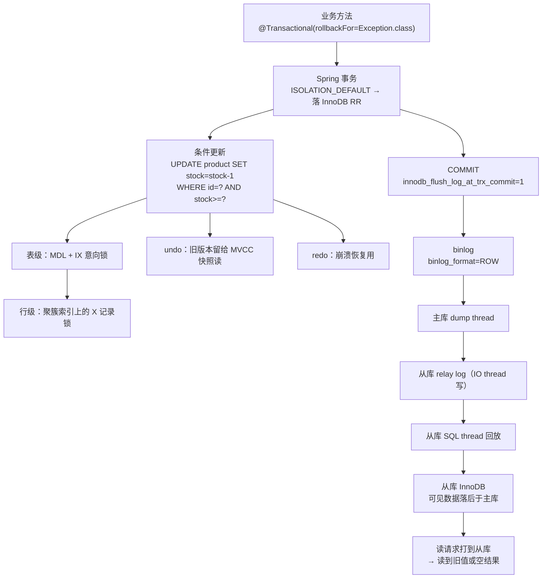
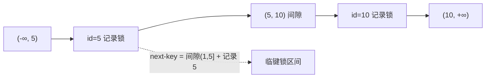
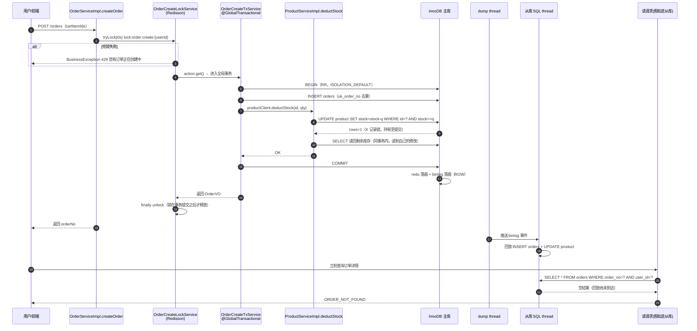

# MySQL 锁机制与主从复制读写分离：并发正确性与读扩展的两条暗线

> **一句话结论**：InnoDB 的行锁解决的是「同一行被 N 个事务同时改，结果仍然算对」；主从复制解决的是「同一份数据在另一台机器上有一份**滞后的**只读副本」——把这两件事都当成"数据库会自动兜底"，就会在并发里丢钱（超卖）、在查询里丢单（写完立刻读不到）。锁决定**同一行在并发下的可见顺序**，复制决定**跨机器可见的时间顺序**，两者都会以"偶发脏数据"的形式反噬。
> **阅读前置**：先读 [01-MySQL核心知识](01-MySQL核心知识.md) 的索引与执行计划、[06-事务进阶-MVCC实现与三大日志](06-事务进阶-MVCC实现与三大日志.md) 的 ReadView 与 redo/undo/binlog。不熟 MVCC 的话 §3.4 的"快照读 / 当前读"会跟不上；不熟 binlog 的话 §3.8 的 ROW 格式看不出意义。
> **证据基线**：MySQL 8.0 / InnoDB / utf8mb4（参数取自 `deploy/mysql/master.cnf`、`deploy/mysql/slave.cnf`），MyBatis-Plus 3.0.5、mybatis-spring 3.0.5、Spring Boot 4.2.0、JDK 17；代码行号以当前工作区为准。**MySQL / InnoDB 源码未入库**——`24-源码分析/assets/source/` 的 908 份摘录里没有任何一份 MySQL 源码，所以 InnoDB 侧结论一律标注"依据 MySQL 8.0 官方手册"，Spring 侧才有源码摘录（A 级）。本机**没有 MySQL**（`mysql` 命令 NOT FOUND、127.0.0.1:3306 未监听），因此所有 SQL 类实测写成"给命令 + 教你怎么读输出"，并明确标注未本机实测。预计阅读 40 分钟。

## 0. 先看现象

**现象一：库存被扣成负数，报错里带着负库存。** 生产上先是偶发、后是经常：

```text
com.aics.common.exception.BusinessException: 商品库存不足，当前库存: -3
	at com.aics.product.service.impl.ProductServiceImpl.deductStock(ProductServiceImpl.java:206)
```

这句文案出自 `ai-cs-product/src/main/java/com/aics/product/service/impl/ProductServiceImpl.java#L206-L207`，字面意思是"库存不足"，但 `-3` 这个数字本身说明**之前已经有人把库存扣穿了**。为什么 DB 没拦住？因为建表时它就是有符号整数、没有约束：

```sql
-- deploy/mysql/product-init.sql#L28（节选，完整表见该文件 L23-L41）
stock           INT             NOT NULL DEFAULT 0 COMMENT '库存数量',
```

`INT` 不是 `INT UNSIGNED`，也没有 `CHECK (stock >= 0)`，所以 `UPDATE product SET stock = stock - 1` 一路减到负数，数据库一声不响。更早的版本连"先判够不够"这一步都没有，代码里留着事故痕迹（`ai-cs-product/src/main/java/com/aics/product/service/impl/ProductServiceImpl.java#L233-L235`）：

> `// 运维校准：历史订单曾只扣 Redis 镜像、从不回写 DB，导致 Redis 与 DB 不一致。`

**现象二：偶发死锁，事务被数据库单方面回滚。** 典型堆栈尾巴（这条消息是 InnoDB 的标准错误文案，errno **1213**）：

```text
java.sql.SQLTransactionRollbackException: Deadlock found when trying to get lock; try restarting transaction
```

它有两个误导性特征：一是**概率性**，同一批压测可能一千次成功一次失败；二是**报错位置和执行 SQL 看起来毫无关系**——因为 InnoDB 牺牲的是"环里最便宜的那个事务"，不是你走的最后一条 SQL。

**现象三：一个事务卡住 30 秒后失败。** errno **1205**：

```text
java.sql.SQLTransactionRollbackException: Lock wait timeout exceeded; try restarting transaction
```

30 秒不是 MySQL 默认值（默认 50 秒），而是本项目显式改短的：

```ini
# deploy/mysql/master.cnf#L17
innodb-lock-wait-timeout=30
```

**现象四（预警型）：下单成功，立刻查订单却是"不存在"。** 这条现在**还不会发生**，因为项目跑的是单实例（`tools/nacos-config/ai-cs-order.yml` 里只有一个 `jdbc:mysql://123.60.31.79:3306/ai_customer_service`）。但一旦按 README 的描述接上 `mysql-slave1/2`，`getOrderDetail` 会稳定返回 `ORDER_NOT_FOUND`——不是"延迟几十毫秒"，而是**永远查不到**，因为从库白名单里压根没有订单库：

```ini
# deploy/mysql/slave.cnf#L15-L18（四行就是全部白名单，没有 ai_customer_service、没有 product_db）
replicate-do-db=user_db
replicate-do-db=knowledge_db
replicate-do-db=chat_db
replicate-do-db=nacos_config
```

这些现象指向同一件事：**我们误以为"数据库会给一个最新且正确的那一行"，但锁只保证并发下的正确性、复制只提供滞后副本；两个保证都需要应用层主动参与（加条件、判影响行数、读写分离时选主库），否则它们都在最关键的边界上什么也不保证。**

## 1. 整体地图



> **读图说明**：图分两条纵线。上半（A–H）是**锁线**：一次 `UPDATE` 先拿表级 MDL 与意向锁 `IX`，再在聚簇索引上拿行级 X 锁，同时生成 undo（给读用）与 redo（给崩溃恢复用），直到 `COMMIT` 才释放。下半（I–N）是**复制线**：`COMMIT` 之后 binlog 才完整，dump thread 推给从库 IO thread 写入 relay log，再用 SQL thread 单线程/并行回放。**两条线唯一的交点是 H（COMMIT）**：锁在 H 之前就生效、在 H 时释放；而复制从 H 之后才开始分叉。所以"事务提交成功"只等于"主库这一行改了"，绝不等于"任何一台机器都能读到"。注意 E→N 之间没有任何箭头——锁不跨越复制。

| 组件 | 责任 | 谁在调用 / 本项目证据 |
|---|---|---|
| Spring 事务管理器 | 决定事务边界、传播、隔离级别，把 `@Transactional` 变成 `BEGIN/COMMIT/ROLLBACK` | 7 处 `@Transactional(rollbackFor = Exception.class)` 全项目统一（见 §3.4） |
| MDL + 意向锁 `IX` | 表级闸门：有行锁前先声明"这张表有人在改" | 不可见，只能通过 `performance_schema.metadata_locks` 观察 |
| 行锁（记录/间隙/临键） | 让并发事务在同一行/同一区间上排队 | 由主键 `id` 或二级索引决定范围（§3.3） |
| undo / ReadView | 支撑快照读，让普通 `SELECT` 完全不加锁 | 详见 [06-事务进阶-MVCC实现与三大日志](06-事务进阶-MVCC实现与三大日志.md) |
| redo log | `COMMIT` 只要刷 redo 就算成功，数据页可异步落盘 | `innodb-flush-log-at-trx-commit=1`（`deploy/mysql/master.cnf` L16） |
| binlog + dump thread | 逻辑日志 + 主库推送线程，复制的源头 | `binlog-format=ROW`（`deploy/mysql/master.cnf` L8）；`REPLICATION SLAVE` 权限（`deploy/mysql/canal-init.sql` L3） |
| relay log + SQL thread | 从库落盘 + 回放，**延迟就长在这里** | `relay-log=relay-bin`（`deploy/mysql/slave.cnf` L7） |
| 读写分离路由 | 把 `SELECT` 分给从库、写与事务内读留给主库 | **本项目未落地**：`ai-cs-user/src/main/resources/sharding-user.yaml` 只有 `!SINGLE` 与 `!SHARDING`，无 `!READWRITE_SPLITTING` |
| 应用侧互斥 | 用 Redis 锁把"检查→写入"窗口串起来，兜住唯一索引兜不住的场景 | `ai-cs-order/src/main/java/com/aics/order/lock/OrderCreateLockService.java#L44-L63` |

## 2. 关键概念与关键类

| 名称 | 位置 | 角色 | 关键方法 / 观测手段 |
|---|---|---|---|
| 全局锁 | 服务端（`FLUSH TABLES WITH READ LOCK`） | 整库只读，全量物理备份用 | `LOCK INSTANCE FOR BACKUP`（8.0 推荐） |
| 表锁 MDL | 服务端，所有 DDL/DML 必经 | 防止"改表结构时还有人按旧结构写" | `performance_schema.metadata_locks` |
| 意向锁 IS / IX | InnoDB 表级 | 行锁的"预告片"，让表锁无需逐行检查 | 不可单独观测，随行锁一起出现 |
| 记录锁 Record Lock | InnoDB 聚簇/二级索引项 | 锁住一条索引记录 | `LOCK_MODE: X,REC_NOT_GAP` |
| 间隙锁 Gap Lock | InnoDB 索引区间 | 锁住"两记录之间的空隙"，防止插入 | `LOCK_MODE: X,GAP` |
| 临键锁 Next-Key Lock | 记录锁 + 其前面的间隙 | RR 下范围扫描的默认产物 | `LOCK_MODE: X`（不带 `REC_NOT_GAP` 即临键） |
| 插入意向锁 | InnoDB | 插入前声明"我要这个间隙"，与 GAP 锁冲突 | `LOCK_MODE: X,INSERT_INTENTION` |
| 快照读 / 当前读 | 语句层面 | 前者读 undo 旧版本不加锁，后者读最新已提交并加锁 | `SELECT` / `SELECT ... FOR UPDATE` / `UPDATE` |
| `innodb_lock_wait_timeout` | `deploy/mysql/master.cnf` L17 | 等锁上限，超时报 errno 1205 | 本项目 30 秒 |
| 死锁检测 | InnoDB `lock_sys` | 等锁成环时立刻挑一个事务回滚（errno 1213） | `SHOW ENGINE INNODB STATUS` 的 `LATEST DETECTED DEADLOCK` |
| `TransactionDefinition` | Spring（A 级源码） | 隔离级别常量与默认值 | `ISOLATION_DEFAULT`、`getIsolationLevel()` |
| `AbstractPlatformTransactionManager` | Spring（A 级源码） | 处理"参与已有事务时隔离级别不一致" | `validateExistingTransaction` |
| `OrderCreateLockService` | `ai-cs-order/.../lock/` | Redisson 用户维度下单锁，包在全局事务外层 | `withCreateLock` |
| binlog | 主库磁盘 | 逻辑变更日志，复制的原料 | `mysqlbinlog`；`binlog_format=ROW` |
| relay log | 从库磁盘 | 从库本地暂存的 binlog | `SHOW REPLICA STATUS` 的 `Relay_Source_Log_File` |
| GTID | 主从 | 用"事务全局编号"代替"文件名+偏移" | `gtid_mode`（本项目**未开启**） |
| 半同步复制 | 插件 | 至少一台从库 ACK 后才向客户端返回提交成功 | `rpl_semi_sync_source_wait_point` |
| `Seconds_Behind_Source` | `SHOW REPLICA STATUS` | 复制延迟的**唯一官方指标**（且会撒谎） | 见 §3.9 |

```java
// 并发正确性在应用侧的落点：条件更新 + 影响行数判定
// ai-cs-product/src/main/java/com/aics/product/service/impl/ProductServiceImpl.java#L189-L213（节选）
@Override
@Transactional(rollbackFor = Exception.class)
@CacheEvict(cacheNames = ProductCacheConfig.PRODUCT_DETAIL, key = "#productId")
public void deductStock(Long productId, int quantity) {
    // 实时库存扣减：以 DB 为权威源，用「条件更新」保证原子性，避免并发超卖。
    int rows = productMapper.update(null, new LambdaUpdateWrapper<Product>()
            .eq(Product::getId, productId)
            .ge(Product::getStock, quantity)
            .setSql("stock = stock - " + quantity)
            .setSql("sales = sales + " + quantity));
    if (rows == 0) {
        Product product = productMapper.selectById(productId);
        if (product == null) {
            throw new BusinessException(ResultCode.PRODUCT_NOT_FOUND, "商品不存在");
        }
        throw new BusinessException(ResultCode.PRODUCT_STOCK_INSUFFICIENT,
                "商品库存不足，当前库存: " + product.getStock());
    }
    // 同步 Redis 镜像……
}
```

这段 10 行的更新是整篇文档的地基，读它要读三件事：第一，`ge(Product::getStock, quantity)` 被翻译成 `WHERE id = ? AND stock >= ?`，**"判断"和"扣减"在同一条 SQL 里完成**，中间没有任何时间窗口给别的并发事务插进来；第二，`stock = stock - n` 不是"先 SELECT 出 100 再 UPDATE 成 99"，而是让数据库自己基于当前行做减法，天然免疫"读到的值过期"；第三，`rows == 0` 才是权威结论，后面那次 `selectById` 只是为了让报错文案好看——它查到的库存**可能是别人刚扣完的新值**，绝不能拿来当判定依据。

## 3. 原理与证据逐段精读

### 3.1 锁的粒度：全局锁 → 表锁 → 行锁，InnoDB 凭什么敢给行锁

**在干什么。** 数据库锁的本质是"给资源贴标签"，粒度决定冲突概率：全局锁（整个实例只读）、表锁（一张表）、行锁（一条索引记录）。MySQL 的服务层有 MDL（元数据锁，保护表结构）和显式表锁；InnoDB 引擎层有行锁。三者是叠加关系，不是替代关系：执行 `UPDATE product SET ... WHERE id=1` 时，你同时持有表级 MDL（共享/写）、表级意向锁 `IX`、行级 X 锁。

**为什么这么设计。** 粒度越细并发越高，但管理成本越大。MyISAM 只有表锁，一条 `UPDATE` 锁全表，写并发等于串行；InnoDB 把锁下沉到索引记录上，是因为它**能通过索引快速定位"到底动了哪几行"**——代价是：一旦没有索引可用，它就退化成全表扫描并锁住扫描到的所有行与间隙，等于变相表锁。这就是"锁是索引的副产品"这句话的由来。

**换写法会怎样。** 若要整库一致性备份，用全局锁会阻塞所有写；8.0 的替代是 `LOCK INSTANCE FOR BACKUP`（备份期间允许 DML，只阻塞会破坏备份一致性的 DDL）。若要"锁一张表"，`LOCK TABLES ... WRITE` 在 InnoDB 里几乎总是错的选择——它不参与事务、隐式提交、且与 MDL 语义打架；正确做法是给需要串行的操作加行锁或用应用层锁。

**常见坑。**
- **无索引更新 = 表级灾难**：`UPDATE product SET status=0 WHERE name='x'` 若 `name` 无索引，RR 下会扫描并锁住全表记录与间隙，其他事务几乎全卡；`product` 表只有 `idx_category_id/idx_status/idx_name/idx_create_time`（`deploy/mysql/product-init.sql` L37-L40），不含 `stock`，所以**任何按库存量的范围更新都是全表锁**。
- **MDL 长等待**：一个未提交的长事务会让 `ALTER TABLE` 等 MDL 写锁，而它后面的所有查询又在排队等 MDL 读锁——表现为"改表卡住，然后全站查询变慢"。排查靠 `performance_schema.metadata_locks` + `information_schema.innodb_trx`。
- **`LOCK TABLES` 与事务不共存**：InnoDB 下它会造成隐式提交，事务里中途使用会把前面的写入"提前落地"。

### 3.2 意向锁：为什么加行锁前要在表上先打个标记

**在干什么。** 事务 A 要对 `product` 的 id=1 加 X 记录锁时，会先在**表级**加一个 `IX`（意向排他）锁；事务 B 想对整表加 `LOCK TABLES ... WRITE`（表级 X 锁）时，只需检查表上有没有 `IX`/`IS`，就能瞬间判断"有人在改行，别进来"，不必逐行扫描聚簇索引。

**为什么这么设计。** 这是一个典型的"用少量表级标记换取 O(1) 判断"的空间换时间设计。行锁可能有上百万个，如果表锁申请要遍历所有行锁，一次 `LOCK TABLES` 就足以让实例停摆。意向锁的另一个性质很关键：**意向锁之间互相兼容**（`IX` 与 `IX` 不冲突），所以它不会降低行级并发能力——它只挡"表级"申请。

**换写法会怎样。** 如果不存在意向锁，MySQL 就只能靠"逐行检查行锁表"或者"表锁与行锁互斥（要么全表要么全行）"两种极端方案，前者性能不可接受，后者退化成 MyISAM。另一种替代是"只做谓词锁（predicate lock）"，那是 SERIALIZABLE 的路子，代价是并发崩溃。

**常见坑。**
- 死锁日志里出现 `lock_mode X` 的**表级**行（`TABLE LOCK table ... trx id ... lock mode IX`）是正常现象，别误判为"锁了整表"。
- 共享意向锁 `IS` 只由 `SELECT ... FOR SHARE` / `LOCK IN SHARE MODE` 产生，普通 `SELECT` 连 `IS` 都不加——这是快照读"零锁"的直接证据。

### 3.3 行锁的三种形态与 RR 下的加锁范围

**在干什么。** InnoDB 的行锁加在**索引项**上，所以"锁了几行"取决于"扫描命中哪些索引记录"。在 RR（可重复读，MySQL 默认也是本项目默认）下：

- **记录锁（Record Lock）**：只锁一条已存在的索引记录，对应 `LOCK_MODE: X,REC_NOT_GAP`。
- **间隙锁（Gap Lock）**：锁两记录之间的"空气"，只阻止别人 `INSERT`，对应 `X,GAP`。
- **临键锁（Next-Key Lock）**：记录锁 + 它前面的间隙，是**范围扫描的默认产物**；InnoDB 在 RR 下用它解决幻读。



> **读图说明**：把聚簇索引想成一串排好序的记录，记录之间是间隙。**记录锁**只钉住一个点（`id=5`），**间隙锁**只钉住两点之间的空气（`(5,10)`，注意它是开区间，且相邻间隙锁可以共存），**临键锁**是"左开右闭"的一段（`(1,5]`）。图里 `id=5` 那一格若被 `X,REC_NOT_GAP` 锁定，别人仍可以在 `(5,10)` 里插入；若被临键锁锁定，`(5,10)` 的插入也会被卡——这就是"唯一索引等值命中只加记录锁、非唯一或范围命中要加临键锁"的图形来源。

加锁范围速查表（RR，`product` 表，主键 `id`，`stock` 无索引）：

| 语句 | 命中情况 | 加什么锁 | 实际锁住范围 |
|---|---|---|---|
| `UPDATE product SET stock=stock-1 WHERE id=10` | 唯一索引等值、行存在 | X 记录锁（`REC_NOT_GAP`） | 仅 id=10 这一行 |
| `UPDATE ... WHERE id=10`（行不存在） | 唯一索引等值、行不存在 | X 间隙锁 | `(上一条, 下一条)` 之间，别人插不进 id=10 |
| `UPDATE ... WHERE stock >= 1` | 无索引 → 全表扫 | X 临键锁 × 全表 | 全表记录 + 全部间隙（≈表锁） |
| `UPDATE ... WHERE status=1` | 非唯一二级索引 | 二级索引临键锁 + 回表主键记录锁 | 该 `status` 区间 + 对应主键行 |
| `UPDATE ... WHERE id BETWEEN 100 AND 200` | 范围 | X 临键锁 | 区间内已有行 + 区间间隙（禁止插入） |
| `INSERT INTO product ...` | — | 插入意向锁；唯一键冲突时加 S 锁 | 插入位置所在的间隙 |
| `SELECT * FROM product WHERE id=10` | — | **不加锁**（快照读） | 读 undo 里的历史版本 |
| `SELECT * FROM product WHERE id=10 FOR UPDATE` | — | 同 `UPDATE` 的临键锁 | 同 `UPDATE` |
| `SELECT ... FOR SHARE`（旧写法 `LOCK IN SHARE MODE`） | — | S 临键锁 | 同范围共享锁 |

**为什么这么设计。** 间隙锁的存在纯粹是为了"防幻读"：RR 语义要求同一事务里两次 `WHERE stock>=1` 返回同样的行集合，如果允许别人往区间里插新行，第二次就会多出"幻影行"。InnoDB 选择"锁住间隙"而不是"用谓词锁/序列化"，是因为间隙锁之间**互相兼容**（多个事务可以同时持有同一间隙锁），只在真正 `INSERT` 时才冲突——这比 SERIALIZABLE 温和得多。

**换写法会怎样。** 若把隔离级别改成 RC（`SET SESSION TRANSACTION ISOLATION LEVEL READ COMMITTED`），间隙锁基本消失（仅剩外键检查与唯一键冲突检查用的间隙锁），幻读回来了，但死锁概率大幅下降——这就是很多互联网公司"线上用 RC"的真实动机。若坚持 RR 又不想踩间隙锁，最省事的办法是**让条件走唯一索引的等值匹配**，比如用 `order_no`（`orders` 表上有 `UNIQUE KEY uk_order_no`，`deploy/mysql/order-init.sql` L42）而不是"按状态范围"定位。

**常见坑。**
- **等值条件走非唯一索引也会加临键锁**：`WHERE status=1` 会锁 `status=1` 那一整段区间，包括你压根没查到的间隙，于是别人插入 `status=1` 的新商品被卡住。
- **"查不到就不锁"是错的**：等值查询未命中时加的是**间隙锁**，专门用来阻止别人插进来——这正是"先查有没有，没有就插"这种业务在 RR 下最容易死锁的原因。
- **RLIKE / 函数包裹字段导致索引失效**：`WHERE DATE(create_time)=...` 退化成全表扫，锁范围直接爆炸。
- **锁的持有时间 = 事务长度**，不是语句长度：事务里在 `UPDATE` 之后还去调 RPC（本项目的 `productClient.deductStock` 就在 `@GlobalTransactional` 内循环调用，见 `ai-cs-order/src/main/java/com/aics/order/service/impl/OrderCreateTxService.java#L93-L95`），锁就一直不释放，把并发度按 RPC 延迟倍数压低。

### 3.4 快照读与当前读：`SELECT` / `SELECT ... FOR UPDATE` / `UPDATE` 是三个世界

**在干什么。** 同一条 `WHERE id=10`，三种写法在锁上完全不同：

| 语句 | 读什么版本 | 加锁 | 会不会看到别人未提交的数据 |
|---|---|---|---|
| `SELECT ...`（普通） | undo 里的快照（ReadView 决定） | 不加锁 | 不会 |
| `SELECT ... FOR UPDATE` | 最新已提交版本（当前读） | 加 X 临键锁 | 不会，但**会等**别人 |
| `SELECT ... FOR SHARE` | 最新已提交版本 | 加 S 临键锁 | 不会，但会等 |
| `UPDATE` / `DELETE` | 先当前读定位，再改 | X 锁 | 会等 |
| `INSERT` | — | 插入意向锁 | 唯一键冲突时阻塞 |

关键结论：**普通 `SELECT` 完全不加锁、也不会被锁阻塞**（它读 undo），所以"我查库存是 100、扣的时候报不足"这件事在 RR 下完全可能发生——两次读的时间点之间别人扣了。判断当前库存够不够，只能靠"同一条 `UPDATE` 里带上条件"。

Spring 侧的隔离级别在这里登场。`@Transactional(isolation = ...)` 的默认值来自接口默认方法（A 级源码）：

```java
// [[源码:TransactionDefinition.java.md#L135-L140]]  →  ISOLATION_DEFAULT 的定义与语义
int ISOLATION_DEFAULT = -1;
// [[源码:TransactionDefinition.java.md#L194-L205]]  →  传播行为默认 PROPAGATION_REQUIRED
default int getPropagationBehavior() { return PROPAGATION_REQUIRED; }
```

`ISOLATION_DEFAULT = -1` 的意思是"不表态，用底层数据存储的默认级别"——对 MySQL/InnoDB 就是 **REPEATABLE READ**。本项目全项目没有一处表态，实测可复现（C 级命令，本机真实输出）：

```text
PS> $files = Get-ChildItem -Directory -Filter 'ai-cs-*' |
      ForEach-Object { Get-ChildItem -Path $_.FullName -Recurse -File -Include *.java,*.xml } |
      Where-Object { $_.FullName -notmatch '\\target\\' }
PS> "扫描文件数: $($files.Count)"
扫描文件数: 681
PS> foreach ($k in 'FOR UPDATE','isolation','propagation','@GlobalTransactional','setIsolationLevel') { ... }
FOR UPDATE -> 0
isolation -> 0
propagation -> 1
@GlobalTransactional -> 3
setIsolationLevel -> 0
```

读法：681 个源文件里，**`isolation` 命中 0 意味着没有任何 `@Transactional` 显式指定隔离级别**（因此全部落到 InnoDB 默认 RR）；`FOR UPDATE` 命中 0 意味着**全项目没有一处显式悲观锁**，并发正确性全靠 §3.5 的条件更新与唯一索引；`propagation` 唯一的命中经追查是一份 XML 里的 Maven `artifactId`（`context-propagation`），与事务无关。补充口径：`@Transactional(rollbackFor = Exception.class)` 共命中 7 处（`ProductServiceImpl` 2 处、`OrderServiceImpl` 4 处、`OrderCreateTxService` 1 处），全部只写了 `rollbackFor`。

**为什么这么设计。** Spring 把隔离级别设成"可选覆盖"而不是"必填"，是因为 Java 事务模型要同时适配 JDBC、JTA、JPA 等后端，`ISOLATION_DEFAULT` 让"交给数据库"成为零配置路径。而"只对新事务生效"是硬约束：隔离级别是连接级设置，参与一个已经开了的事务时改它没有意义。

**换写法会怎样。** 内层方法写 `@Transactional(isolation = ISOLATION_READ_COMMITTED)` 而外层已是另一个级别的事务时，Spring 不会报错，而是按外层来（A 级源码里的两条证据）——

```java
// [[源码:AbstractPlatformTransactionManager.java.md#L415-L416]]  没有真正开启事务时的告警
logger.warn("Custom isolation level specified but no actual transaction initiated; " +
        "isolation level will effectively be ignored: " + def);
// [[源码:AbstractPlatformTransactionManager.java.md#L503-L504]]  只有打开校验开关才会拒绝
throw new IllegalTransactionStateException("Participating transaction with definition [" +
        definition + "] specifies isolation level which is incompatible with existing transaction: " +
```

也就是说：想让"级别冲突"变成显式错误，必须把 `validateExistingTransaction` 打开，而它的默认值是 `false`（`[[源码:AbstractPlatformTransactionManager.java.md#L136]]`）。这与 `getIsolationLevel()` 的 Javadoc 完全一致——"only applies to newly started transactions"。

**常见坑。**
- **以为写了 `isolation = READ_COMMITTED` 就安全**：在已有事务里它被静默忽略（只有 `validateExistingTransaction=true` 才报错），压测时"改了就灵"的错觉往往来自别处。
- **`@Transactional` 自调用不走代理**：同类方法内部 `this.xxx()` 调用不经过代理，`isolation`、`rollbackFor`、甚至事务本身全部失效。本项目专门为此拆了 `OrderCreateTxService`（`ai-cs-order/src/main/java/com/aics/order/service/impl/OrderCreateTxService.java#L78-L79`），并由 `createOrder` 通过注入的代理调用（`OrderServiceImpl.java#L57-L60`）。
- **在事务里做 Redis/HTTP**：Redis 不是事务资源，事务回滚不会回滚缓存。`deductStock` 里的 `stringRedisTemplate.opsForValue().set("stock:"+id, ...)`（`ProductServiceImpl.java#L211`）就是"派生数据"，只能事后校准（`syncStockCache`）。
- **隔离级别与 binlog 格式的耦合**：历史上 `binlog_format=STATEMENT` + RC 会出现主从数据不一致（`LIMIT` 无 `ORDER BY` 等非确定语句在从库回放结果不同）；本项目用 ROW（`deploy/mysql/master.cnf` L8），这个坑被绕开了。

### 3.5 不加锁也能不超卖：条件更新、唯一索引、分布式锁的三层防线

**在干什么。** 防超卖有三层可叠加的防线，本项目三层都用了，只是分工不同：

1. **条件更新（乐观并发控制）**：把"判断 + 扣减"压进一条 SQL，靠 InnoDB 行锁保证原子性。`deductStock` 就是这一层，`rows == 0` 即失败。
2. **唯一索引**：兜住"重复插入"。下单幂等靠 `uk_order_no`（`deploy/mysql/order-init.sql` L42），购物车重复加购靠 `uk_user_product`（同文件 L19）。
3. **分布式锁**：兜住"唯一索引也兜不住的窗口"。本项目用 Redisson 按 `userId` 加锁，把同一用户的并发下单**快速失败**（而不是排队）：

```java
// ai-cs-order/src/main/java/com/aics/order/lock/OrderCreateLockService.java#L44-L63（节选）
public <T> T withCreateLock(Long userId, Supplier<T> action) {
    RLock lock = redissonClient.getLock(KEY_PREFIX + userId);   // lock:order:create:{userId}
    boolean acquired = false;
    try {
        acquired = lock.tryLock(0, TimeUnit.SECONDS);          // waitTime=0：抢不到直接失败
        if (!acquired) {
            throw new BusinessException(ResultCode.TOO_MANY_REQUESTS, "您有订单正在创建中，请勿重复提交");
        }
        return action.get();
    } finally {
        if (acquired && lock.isHeldByCurrentThread()) { lock.unlock(); }
    }
}
```

**为什么这么设计。** 关键在于**锁的位置**：`createOrder` 先拿 Redis 锁，再进入 `@GlobalTransactional`（见 `OrderServiceImpl.java#L57-L60` 的 `withCreateLock(userId, () -> orderCreateTxService.doCreateOrder(...))`）。这个顺序意味着：事务在 `action.get()` 内部提交，锁在 `finally` 里释放——**锁的持有期完整覆盖了事务提交**。反过来写（先开事务再抢锁）就会出现"事务已提交但锁还没拿到/已释放"的空窗，全局锁形同虚设，而且会让连接在等锁时被无谓占用。代码注释把它写成"避免锁内空占事务资源"，说的是同一件事。

**换写法会怎样。** 三种替代方案的代价：

| 方案 | 做法 | 代价 | 何时该用 |
|---|---|---|---|
| 悲观锁 | `SELECT ... FOR UPDATE` 后再改 | 锁持有跨两条 SQL + 业务代码，并发度低，易与其它索引形成死锁 | 业务必须"先读值再算"（如按阶梯价算钱） |
| 乐观锁版本号 | `UPDATE ... SET v=v+1 WHERE id=? AND v=?`，失败重试 | 冲突高时重试风暴 | 冲突稀疏、读多写少 |
| 条件更新（本项目） | `WHERE stock>=?` 一条 SQL 定胜负 | 拿不到"到底差多少"的信息，只能再查一次 | 扣减、状态位迁移这类"够不够/合不合法"的判定 |
| 队列串行化 | 把请求丢进 MQ 单分区消费 | 架构复杂、延迟上升 | 秒杀类极端热点 |

**常见坑。**
- **`rows == 0` 的语义是二义的**（不足 or 不存在），所以 `deductStock` 才要再 `selectById` 一次去区分文案——但那**只是文案**。若把这次查询结果当判定依据（比如"查到 stock=5 所以失败"），并发下必然误判。
- **`setSql` 拼字符串**：`.setSql("stock = stock - " + quantity)` 的正确性依赖 `quantity` 是 `int`（这里是 `int`，安全）。若参数是 `String`/`BigDecimal`，这就成了 SQL 注入与格式化陷阱，应改成占位符或先做类型校验。中文乱码、`1,000` 千分位、科学计数法都踩在这里。
- **签名和无符号都不该当兜底**：`stock INT` 有符号（`deploy/mysql/product-init.sql` L28），扣穿后落负数不报错；若改成 `INT UNSIGNED`，扣穿会抛 `1264 Out of range value`——错误更响亮，但仍然是在事务里"抛异常"而不是"返回 0 行"，下游判空逻辑会全部走错分支。
- **Redis 镜像不是权威**：代码注释里的历史事故（"只扣 Redis、从不回写 DB"）就是这一条的代价。派生数据只能靠校准任务（`syncStockCache`）与"以 DB 为准"的顺序（先 DB 成功再写缓存）维持。
- **跨服务调用削弱事务**：`OrderCreateTxService` 里 `productClient.deductStock(...)` 走的是 HTTP/Feign，本地事务对它无效，只能靠 `@GlobalTransactional`（Seata AT）；注释也明说"MQ 非 Seata 资源"，说明补偿边界要人工划清。

### 3.6 死锁：四个必要条件、InnoDB 怎么发现、以及怎么在日志里读出凶手

**在干什么。** 死锁是"两个以上事务各自持有对方想要的锁"。经典四个必要条件：互斥、持有并等待、不可抢占、循环等待。数据库**只能打破其中一个**——"不可抢占"（强行回滚某个事务）——所以 InnoDB 的策略是"检测到环 → 挑代价最小的回滚 → 抛 1213 给客户端"，客户端**必须重试整个事务**。

两个真实形态（RR 下最容易出现）：

```text
T1: BEGIN; UPDATE product SET stock=stock-1 WHERE id=1;   -- 持 id=1
T2: BEGIN; UPDATE product SET stock=stock-1 WHERE id=2;   -- 持 id=2
T1: UPDATE product SET stock=stock-1 WHERE id=2;          -- 等 T2
T2: UPDATE product SET stock=stock-1 WHERE id=1;          -- 等 T1 → 成环，回滚一个
```

第二种更隐蔽——**间隙锁 + 插入意向锁**的死锁：两个事务各自 `SELECT ... FOR UPDATE` 不存在的行（各拿到一个间隙锁），然后都去 `INSERT`，插入意向锁互相等待。这种死锁**在 RC 下不会出现**，是 RR 独有的。

**为什么这么设计。** InnoDB 用"等待图（wait-for graph）"做**即时检测**：每次加锁失败就检查"我等的这个事务是不是正在等我"，若是则立刻回滚（`innodb_deadlock_detect=ON` 默认）。即时检测的代价是 O(活跃事务数) 的 DFS，热点行上开销可观；关掉它（`innodb_deadlock_detect=OFF`）则死锁会退化成"等满 `innodb_lock_wait_timeout` 后报 1205"，只适合极端热点场景。

**换写法会怎样。** 若把等锁改成"无限等待"，死锁会永久挂住（不推荐）。若要降低死锁概率，可做三件事：**统一加锁顺序**（永远按 `id` 升序批量更新）、**缩小事务**（把 RPC/缓存移出事务）、**用 RC 级别**（干掉间隙锁）。本项目在批量场景（`doCancelOrder` 循环 `restoreStock`）没有排序保证，属于潜在死锁源，值得在改造时补上。

**怎么在日志里读出凶手。** 开启 `innodb_print_all_deadlocks=ON` 后每次死锁都会写进 error log；历史和"最近一次"则在 `SHOW ENGINE INNODB STATUS\G` 的 `LATEST DETECTED DEADLOCK` 段落里。下面是**结构示意**（字段名与层级依据 MySQL 8.0 官方手册 InnoDB 死锁示例，数值为示意，本机无 MySQL，未实测）：

```text
------------------------
LATEST DETECTED DEADLOCK
------------------------
2026-11-27 10:22:41 0x7f2c4a0b1700
*** (1) TRANSACTION:
TRANSACTION 84213, ACTIVE 3 sec starting index read
mysql tables in use 1, locked 1
LOCK WAIT 3 lock struct(s), heap size 1136, 2 row lock(s)
*** (1) HOLDS THE LOCK(S):
RECORD LOCKS space id 2 page no 5 n bits 72 index PRIMARY of table `ai_customer_service`.`product`
 lock_mode X locks rec but not gap
*** (1) WAITING FOR THIS LOCK TO BE GRANTED:
RECORD LOCKS space id 2 page no 5 n bits 72 index PRIMARY of table `ai_customer_service`.`product`
 lock_mode X locks rec but not gap waiting
*** (2) TRANSACTION:
TRANSACTION 84212, ACTIVE 5 sec starting index read
...
*** WE ROLL BACK TRANSACTION (2)
```

读法（四步）：① 看 `*** (1) HOLDS THE LOCK(S)` 与 `WAITING FOR`，把两个事务的"持有 → 等待"连成环，环就找到了；② 看 `index PRIMARY` / `index uk_order_no` 判断是哪条索引上的锁——**如果出现 `locks gap before rec` 或 `insert intention`，说明是 RR 间隙锁死锁**；③ 看 `WE ROLL BACK TRANSACTION (n)` 确认谁的活被回滚，那个事务的堆栈才是"受害者"而不是"凶手"；④ 结合 `TRANSACTION ... ACTIVE n sec starting index read` 里的时间判断是长事务还是瞬时冲突——3 秒以上的 ACTIVE 说明有事务持锁太久。

**常见坑。**
- **`LATEST DETECTED DEADLOCK` 会被覆盖**：只看这一处会丢掉历史，务必同时开 `innodb_print_all_deadlocks`。
- **只看到一条 1213 就以为"重试一次就好"**：重试必须放在**事务边界之外**（重新开事务、重跑整个 `@Transactional` 方法）。在 `@Transactional` 内部 `catch` 后继续执行，事务已被 InnoDB 标记为回滚，后续 SQL 全部无效。
- **死锁与锁等待超时的日志待遇完全不同**：1213 有日志，**1205 默认没有任何 InnoDB 日志**（只有一个客户端错误），所以"偶发 30 秒超时"往往查不到痕迹，只能靠 `performance_schema.data_lock_waits` 现场抓。
- **`information_schema.innodb_locks` 已经不存在**：8.0 移除，改用 `performance_schema.data_locks` / `data_lock_waits`（见 §6 手法二）。

### 3.7 锁等待超时：为什么它比死锁更难查

**在干什么。** 事务等锁超过 `innodb_lock_wait_timeout` 秒就放弃并报 errno 1205。本项目把它从默认 50 秒改成 30 秒（`deploy/mysql/master.cnf` L17），意图很明确：**让排队失败得更快**，避免 Tomcat 线程被吊死。代价是"慢查询"变多——原本 40 秒能成功的操作现在直接失败。

**为什么这么设计。** 等锁不是"等待磁盘 IO"，它没有任何进度可观测，也无法通过加资源改善。超时是唯一的安全阀：否则一个忘了提交的事务能把整条链路挂到天荒地老（并顺带把连接池耗尽）。30 秒对 Web 请求来说已经远超用户耐心，所以这个值配合前端超时通常是"宁可失败"。

**换写法会怎样。** 把它调成 1~3 秒：失败率会上升，但线程周转快、故障面收敛，很多团队在秒杀链路里就这么干（会话级 `SET SESSION innodb_lock_wait_timeout=2` 而非全局）。调成 300 秒：高峰期会看到"接口 RT 突然等于 300s"的雪崩曲线。

**常见坑。**
- **1205 与 1213 的处置策略不同**：1213 是"数据库已帮你回滚"，重试通常能成功；1205 是"你等不到锁"，重试要先解决源头（长事务、热点行），否则重试只会放大压力。
- **全局 vs 会话级**：`master.cnf` 里是全局默认，连接池里的连接不会重置 `SESSION` 变量，所以一旦某个连接被 `SET SESSION` 改过，它会带着这个值回到池子里继续用——`SET SESSION` 必须配 `RESET CONNECTION` 或在归还时显式恢复。
- **超时时间是"每条语句"还是"整个事务"**：它是**单次等锁**的上限，一个事务里有 5 条语句各等 30 秒，总耗时可以是 150 秒，因此不能把它当"事务超时"用；事务超时由 Spring 的 `timeout` 或 `innodb_rollback_on_timeout` 等另一套机制管。

### 3.8 主从复制三线程、binlog 格式、GTID 与半同步

**在干什么。** 复制就是"把主库的 binlog 搬到从库并重放"，三个线程各管一段：

| 线程 | 在哪 | 职责 | 卡住时的典型症状 |
|---|---|---|---|
| dump thread（`Binlog Dump GTID`） | **主库** | 读 binlog 事件、推给从库 | 主库 `SHOW PROCESSLIST` 里能看到，`Command=Binlog Dump`；从库报 1236（位点不存在） |
| IO thread（`Replica_IO_Running`） | 从库 | 连主库、拉 binlog、写 relay log | `Replica_IO_Running=Connecting`，通常是网络/账号/权限问题 |
| SQL thread（`Replica_SQL_Running`） | 从库 | 把 relay log 回放成数据变更 | `Replica_SQL_Running=No` + `Last_SQL_Error`（如 1062 主键冲突），`Seconds_Behind_Source` 持续增长 |

主库侧的关键配置（`deploy/mysql/master.cnf` L4-L11）：

```ini
server-id=1
log-bin=mysql-bin
binlog-format=ROW
binlog-cache-size=1M
max-binlog-size=500M
expire-logs-days=7
```

`binlog-format=ROW` 是本项目一个"没说出口的重要决定"——它同时服务两个消费者：**从库回放**和 **Canal CDC**。证据在 `deploy/mysql/canal-init.sql` L1-L3：Canal 专门要 `REPLICATION SLAVE` 权限（等价于"我要当一台假从库，读你的 binlog"）。

```sql
-- deploy/mysql/canal-init.sql（全部 4 行）
CREATE USER IF NOT EXISTS 'canal'@'%' IDENTIFIED BY 'canal';
GRANT SELECT, REPLICATION SLAVE, REPLICATION CLIENT ON *.* TO 'canal'@'%';
FLUSH PRIVILEGES;
```

`binlog_format` 三种取值的取舍：

| 维度 | STATEMENT | ROW（本项目） | MIXED |
|---|---|---|---|
| 记录内容 | 原始 SQL 语句 | 每行变更前后镜像 | 按语句自动切换 |
| 日志量 | 小（一条语句） | 大（批量更新放大 N 倍） | 折中 |
| 主从一致性 | 非确定函数（`NOW()`、`UUID()`、无 `ORDER BY` 的 `LIMIT`）会不一致 | 强一致（按行镜像重放） | 多数一致 |
| CDC / 数据订阅 | 不可用（解析 SQL 不可靠） | 可用（Canal/Debezium 的前提） | 部分可用 |
| 典型坑 | 从库数据"慢慢歪掉"，且查不出原因 | binlog 膨胀、`max_binlog_size` 频繁切换 | 边界难以预测 |

**为什么这么设计。** 逻辑日志（binlog）而不是物理复制，是为了"跨版本、跨平台、可订阅"；代价是重放必须**串行保序**（同一行不能乱序应用），这正是复制延迟的根源。

**GTID。** GTID 是"每个事务一个全局唯一编号 `source_uuid:事务号`"，让从库不再依赖"文件名 + 偏移量"这套易漂移的坐标。**本项目未开启**——`deploy/mysql/master.cnf` 里没有 `gtid_mode`，也没有 `enforce_gtid_consistency`，所以走的是传统的 `MASTER_LOG_FILE` + `MASTER_LOG_POS`。后果：做主从切换、重建从库时必须手工找位点，容易少复制或多重放。开启方式是 `gtid_mode=ON` + `enforce_gtid_consistency=ON`（两者必须同时设，且 `gtid_mode` 只能逐级从 `OFF → OFF_PERMISSIVE → ON_PERMISSIVE → ON` 切换）。

**半同步。** 默认复制是**异步**的：主库提交即返回，binlog 丢在发给从库的路上就会永久丢失。半同步（`rpl_semi_sync_source` 插件）要求"至少 N 个从库 ACK 后才返回成功"，把"数据丢失"从"必然可能"降为"超时后才可能"。两个关键参数：`rpl_semi_sync_source_wait_point=AFTER_SYNC`（8.0 默认思路，先等 ACK 再给客户端返回，最安全）与超时退化 `rpl_semi_sync_source_timeout`（超时后自动降级为异步——**降级这件事本身会静默发生**，是运维最该监控的点）。本项目**没有配置半同步**（`master.cnf` 中无相关参数），即当前是一主两从的纯异步复制。

**常见坑。**
- **`server-id` 重复**：`master.cnf` 是 1、`slave.cnf` 是 2、`slave2.cnf` 是 3，都正确；但 `slave.cnf` 的注释还写着"从库2需另配 server-id=3"（L1），说明这两个文件是**手工复制**出来的，改一处忘一处就会撞 id，表现为 IO 线程反复重连。
- **`replicate-do-db` 白名单漏库**：从库只复制 `user_db/knowledge_db/chat_db/nacos_config` 四个库（`deploy/mysql/slave.cnf` L15-L18），**订单库 `ai_customer_service` 与商品库 `product_db` 不在其中**。一旦读写分离把订单查询打到从库，读到的是"表都不存在"或"空结果"。另外这四行是**重复键**，选项文件里同一选项重复出现时以何种语义生效，必须以 `SHOW REPLICA STATUS` 的 `Replicate_Do_DB` 列实际值为准（本机无 MySQL，未实测，切勿凭文件内容推断）。
- **`super-read-only=0`**：从库设了 `read-only=1`（L11）却把 `super-read-only` 设为 0（L12），意味着**有 SUPER 权限的账号仍能在从库写入**。一写就和主库分叉，且 `SHOW REPLICA STATUS` 不会报警——只能靠数据校验发现。
- **`binlog_row_image` 没显式设置**：`master.cnf` 里没有这一项，实际值靠 MySQL 8.0 默认 `FULL`（前镜像 + 后镜像全字段）。很多文档（包括本目录 README）写成"binlog ROW + FULL"像是配过的，其实是**默认值**。一旦有人为了省空间改成 `MINIMAL`，Canal 拿不到完整行镜像，下游反查会出错。
- **`innodb-log-file-size=64M`**（L15）在 8.0.30 之后已被废弃（见 §7），改了不生效。

### 3.9 读写分离：延迟从哪来、为什么写完立刻读不到、怎么强制走主库

**在干什么。** 读写分离 = 写走主库、读走从库。它的收益是读扩展，代价是**读可能看不到刚写的数据**（read-your-writes 被破坏）。延迟不是"网络慢"这么简单，主要来自四处：

1. **SQL thread 回放能力**：单线程回放时，主库 8 并发的写入在从库只能 1 个串行消化（8.0 支持基于 `WRITESET` 的并行回放，但要求 `binlog_transaction_dependency_tracking=WRITESET` 且事务间无冲突）。
2. **大事务**：一个 `UPDATE` 改了 100 万行（或是 `OrderTimeoutScheduler` 那种一次性扫出全部超时订单再逐条处理），从库要等整个事务在 relay log 里收完 + 回放完，`Seconds_Behind_Source` 会瞬间飙到几分钟。
3. **从库自身负载**：从库同时承担回放与线上读，CPU/IO 打满时回放被饿死。
4. **锁冲突**：从库 SQL thread 也要拿行锁，如果从库上有长查询持有锁，回放会排队。

**本项目现状（必须说清）**：读写分离**没有落地**。证据有三层——① 所有服务的配置都指向单实例 `jdbc:mysql://123.60.31.79:3306/<db>`（如 `tools/nacos-config/ai-cs-order.yml` 第 9 行）；② 唯一引入 ShardingSphere 的服务是 `ai-cs-user`，而它的规则文件里只有 `!SINGLE` 和 `!SHARDING`，**没有 `!READWRITE_SPLITTING`**（`ai-cs-user/src/main/resources/sharding-user.yaml` L56-L91）；③ 三个数据源（`user_db`、`user_db_0`、`user_db_1`）全部指向同一台 `123.60.31.79:3306`，是分库分表而非主从。所以 `deploy/docker-compose/docker-compose-master-slave.yml` 里那两台从库（`mysql-slave1` 映射 3307、`mysql-slave2` 映射 3308）目前是**闲置备份**，没有被任何代码读过。

**为什么这么设计。** 延迟是物理事实，可选策略只有"回避"或"容忍"：

| 策略 | 做法 | 优点 | 代价 |
|---|---|---|---|
| 事务内读必走主库 | 同一事务/连接内的 `SELECT` 不路由到从库 | 天然满足 read-your-writes | 热点写后的读仍压主库 |
| 写后粘主窗口（sticky） | 写操作后 N 秒内该用户的读全走主库 | 覆盖"下单→详情"这类强时序 | 需要会话/用户维度状态，N 难调 |
| 显式指定主库 | `HintManager`（ShardingSphere）/ `@DS("master")`（dynamic-datasource） | 精确、可审计 | 侵入业务代码，漏标就出 bug |
| 关键写同步复制 | 半同步 / 组复制 | 数据不丢 | 吞吐下降，超时仍会退化 |
| 延迟阈值熔断 | 监控 `Seconds_Behind_Source` 超阈值时全量切主 | 兜底 | 需要切换机制与回切预案 |

**换写法会怎样。** 若把 `getOrderDetail`（`ai-cs-order/src/main/java/com/aics/order/service/impl/OrderServiceImpl.java#L86-L95`）直接路由到从库：用户下单 → 前端立刻查详情 → 从库还没回放到这条 `INSERT` → 返回 `ORDER_NOT_FOUND`。注意它**不是按主键查**，而是 `WHERE order_no=? AND user_id=?`（走 `uk_order_no` 等值 + 回表），这在 RR 下是记录锁级别的高效查询，问题不在锁、**纯粹在复制**。更进一步，若从库白名单仍漏掉订单库（当前 `slave.cnf` 就是这种状态），那就是"永远查不到"，问题性质从"延迟"升级为"数据缺失"。

**延迟怎么监控（C 级，未本机实测，给命令 + 判读法）。** `SHOW REPLICA STATUS\G` 里唯一的时间指标是 `Seconds_Behind_Source`，但它**只表示"SQL thread 当前正在回放的事件的时间戳，比主库当前时间落后多少秒"**，所以：

- SQL thread 空闲（无新事件）时它显示 `0` 或 `NULL`，此时可能落后了好几分钟——**空跑时它撒谎**。
- 主库长时间没有写入时它也是 0，**不能当"健康度"用**。
- 大事务在主库执行期间，从库还没收到完整事件，它可能显示很小甚至 0。

因此生产上要配合三种更可靠的观测：`performance_schema.replication_applier_status_by_worker`（看每个 worker 的 `APPLYING_TRANSACTION`）、`SHOW REPLICA STATUS` 的 `Retrieved_Gtid_Set` 与 `Executed_Gtid_Set` 差值（GTID 模式下最准）、以及 **心跳表**（pt-heartbeat 定期往主库写时间戳，从库读出来算差值——完全不依赖业务写入）。

**常见坑。**
- **把 `Seconds_Behind_Source=0` 当"数据是新的"**：见上，空闲即 0。
- **从库读到的"旧数据"被缓存放大**：读到的旧值进 Redis（本项目的 `@CacheEvict` + `stock:{id}` 镜像就有这个风险），缓存过期前一直是错的。
- **`replicate-do-db` 与跨库语句**：库级过滤在 ROW 格式下按**实际被改的库**判定（statement 格式下按 `USE db` 判定），混用时行为差异极易踩坑。
- **省略 `ORDER BY` 的 `LIMIT`**：即便 ROW 复制保了一致，从库回放顺序与主库执行顺序仍可能让"无排序取前 N 条"在不同时刻给出不同结果，业务层必须显式排序。

## 4. 一次完整执行时序



> **读图说明**：读这张图要抓三个"顺序即正确性"的点。**第一，锁在事务外、覆盖提交**（步骤 2 拿到锁，步骤 17 才释放，而事务在 16 提交）——顺序反了就会出现"提交了但锁已放"的空窗。**第二，行锁在步骤 10 拿到、步骤 16 的 `COMMIT` 才释放**，中间所有 RPC/缓存操作都在延长锁的持有时间。**第三，复制的起点是步骤 16 之后的主库 binlog**，它与步骤 18 的"立刻查询"之间没有任何同步关系——这就是 read-your-writes 被破坏的物理位置。图上 `alt` 分支只画了抢锁失败；其余失败点见下表。

| 失败发生在哪一步 | 报错原文（关键片段） | 谁负责回滚 / 怎么处置 |
|---|---|---|
| 2 抢锁失败 | `BusinessException: 您有订单正在创建中，请勿重复提交`（429） | 无需回滚，让用户重试 |
| 9 `INSERT orders` 撞唯一键 | `DuplicateKeyException ... uk_order_no` | 幂等命中，返回已有订单号最优 |
| 10 `UPDATE product` 命中 0 行 | `BusinessException: 商品库存不足，当前库存: x` | 本地事务回滚 + Seata 全局回滚 |
| 10 与其它事务成环 | `Deadlock found when trying to get lock; try restarting transaction`（1213） | InnoDB 已回滚，**在事务外重试** |
| 10 等锁超 30 秒 | `Lock wait timeout exceeded; try restarting transaction`（1205） | InnoDB 回滚当前语句，需查源头长事务 |
| 16 `COMMIT` 后 dump thread 断开 | 从库 `Last_IO_Error: ... error 1236` | 复制中断，主库数据无损；修复位点/GTID 后续传 |
| 18 读从库过早 | `BusinessException: 订单不存在`（`ORDER_NOT_FOUND`） | 业务侧强制主库或粘主窗口 |
| 18 从库白名单漏库 | 表不存在/空结果（当前 `slave.cnf` 白名单缺订单库） | 补 `replicate-do-db` 或改库级过滤方案 |

## 5. 设计取舍

| 议题 | 方案 A | 方案 B | 本项目选择与理由 |
|---|---|---|---|
| 防超卖 | 悲观锁 `FOR UPDATE` | 条件更新 `WHERE stock>=?` | **B**：单条 SQL 原子判定，无跨语句锁持有；`FOR UPDATE` 全项目 0 处 |
| 幂等 | 分布式锁串行化 | 唯一索引 + 捕获 DuplicateKey | **两者叠加**：Redisson 快速失败（`OrderCreateLockService`）+ `uk_order_no` 兜底 |
| 隔离级别 | RC（少间隙锁、易迁移） | RR（默认、防幻读） | **RR（没表态即默认）**：好处是幻读免疫，代价是间隙锁死锁风险 |
| 事务边界 | 大事务包住全部 | 拆 TxService + 事务外互斥 | **B**：`OrderCreateTxService` 独立成类，锁在外层（`OrderServiceImpl` L57-L60） |
| binlog 格式 | STATEMENT（省空间） | ROW（可 CDC、强一致） | **ROW**（`master.cnf` L8），因为 Canal 订阅依赖它 |
| 复制方式 | 异步（吞吐高） | 半同步（少丢数据） | **异步**（未配半同步）：可用性优先，接受极端情况丢最后几个事务 |
| 主从定位 | file + position | GTID | **file + position**（未开 `gtid_mode`）：切换/重建从库需人工找位点 |
| 读写分离 | 应用层双数据源 | 中间件（ShardingSphere/dynamic-datasource） | **未落地**；若落地建议中间件 + 显式 hint，避免业务代码散落数据源判断 |

可扩展点清单（按"投入产出比"排序）：

1. **把 `innodb_print_all_deadlocks` 打开**：一行配置换来完整死锁历史，是本章最高性价比的改动。
2. **给热点更新补"统一加锁顺序"**：`doCancelOrder` 里循环 `restoreStock` 时按 `productId` 升序排序，可消除一类环。
3. **延迟监控加心跳表**：不依赖业务写入，`Seconds_Behind_Source` 空跑撒谎的问题一次解决。
4. **补齐从库白名单**：把 `ai_customer_service`、`product_db` 加进 `replicate-do-db`，否则读写分离永远不能上线。
5. **`super-read-only=1`**：从库彻底只读，避免"人能写从库"这类不可恢复的分叉。
6. **给 `stock` 加 `CHECK (stock >= 0)` 或改无符号**：把"扣穿"从"静默成功"变成"显式报错"（注意这会让现有以 `rows==0` 判空的逻辑失效，需要同步改造）。
7. **事务内 RPC 外移**：把 `productClient.deductStock` 的循环调用改为批量接口，缩短锁持有时间。
8. **开 GTID**：为将来的主从切换/故障转移铺路（注意逐级切换 `gtid_mode`）。

## 6. 踩坑与调试手法

**坑 1：把 `rows == 0` 当作"商品不存在"。** `deductStock` 命中 0 行有两种原因（不存在 / 库存不足），代码靠二次 `selectById` 区分。但这次查询是**另一个时间点**的快照，并发下可能查到 `stock=5`（别人刚回补），于是把"不足"误报成"不足但库存显示充足"的自相矛盾日志。**正确姿势**：判定只依据 `rows`，文案里的库存值标注"（当前值，仅供参考）"。

**坑 2（⚙ 真调试手法）：用 `performance_schema.data_locks` 抓"谁在等谁"。** 出现 1205 时先别重启，开一个会话连上去执行：

```sql
-- 当前所有行锁（含间隙锁、插入意向锁），未本机实测
SELECT ENGINE_TRANSACTION_ID AS trx, OBJECT_NAME AS tbl, INDEX_NAME,
       LOCK_TYPE, LOCK_MODE, LOCK_STATUS, LOCK_DATA
FROM performance_schema.data_locks
WHERE OBJECT_SCHEMA = 'ai_customer_service'
ORDER BY trx, INDEX_NAME;
```

判读三列：`LOCK_MODE` 里带 `GAP` 或 `INSERT_INTENTION` 说明是 RR 间隙锁问题（改 RC 或换唯一索引等值可解）；`LOCK_STATUS='WAITING'` 的那行就是被堵的请求；`LOCK_DATA` 直接告诉你锁在哪个索引值上。再查等待链：

```sql
SELECT * FROM performance_schema.data_lock_waits;  -- REQUESTING_ENGINE_TRANSACTION_ID → BLOCKING_ENGINE_TRANSACTION_ID
```

拿到 `trx` 后去 `information_schema.innodb_trx` 看 `trx_started`、`trx_state`、`trx_mysql_thread_id`，用 `KILL <thread_id>` 处理真正的长事务（**先确认它是不是业务在跑，别误杀批量任务**）。

**坑 3（⚙ 真调试手法）：死锁只看 `LATEST DETECTED DEADLOCK` 会漏。** 手法：`SET GLOBAL innodb_print_all_deadlocks = ON;`（或写进 `master.cnf` 的 `[mysqld]` 段），此后每次死锁都会进 error log，配合日志采集就能看出"是不是同一对 SQL 在反复成环"。读到日志后**先看 `HOLDS`/`WAITING` 拼环，再看 `index`**——若 `index` 是二级索引，说明业务查询用的是非唯一条件，加锁范围比预想的大。

**坑 4：无索引的条件更新把并发打回单线程。** `product.stock` 上没有索引，任何 `WHERE stock > 0` 类更新都会全表扫 + 锁全表。表现是"QPS 突然个位数、CPU 不高、`data_locks` 里几千行 `LOCK_MODE=X`"。**手法**：`EXPLAIN` 看 `type=ALL` 就知道锁范围；改造方向不是加索引（低选择性的 `stock` 加索引反而更糟），而是改成按主键/唯一键逐行更新。

**坑 5：长事务阻塞 DDL，再阻塞全站。** 一个未提交的事务持有 MDL 读锁，`ALTER TABLE` 等 MDL 写锁，后续所有查询排在它后面等 MDL 读锁。**手法**：`SELECT * FROM performance_schema.metadata_locks WHERE lock_status='PENDING';` 找到 `OWNER_THREAD_ID`，再映射到 `information_schema.processlist` 的 `ID`，协商后 `KILL`。

**坑 6：`@Transactional` 自调用导致"事务没生效"。** 本项目的 `OrderCreateTxService` 就是为了绕开它才拆出来的（注释写明"必须经代理调用"）。**手法**：`mvn -pl ai-cs-order test -Dtest=OrderCreateTxWiringTest`——这个测试存在的唯一目的就是验证"`createOrder` 跑在事务里"（它通过 `TransactionSynchronizationManager.isActualTransactionActive()` 断言，见 `ai-cs-order/src/test/java/com/aics/order/service/impl/OrderCreateTxWiringTest.java#L71-L98`）。这是"用测试卡住架构约束"的范例：改名/重构一旦破坏代理调用，测试立刻红。

**坑 7：从库延迟误判为"数据丢失"。** 用户下单后查不到，第一反应是"事务没提交"。**判读顺序**：① 主库 `SELECT COUNT(*) FROM orders WHERE order_no=?`（主库有 → 写成功）；② 从库同一条 SQL（无 → 复制延迟或白名单漏库）；③ `SHOW REPLICA STATUS\G` 看 `Replica_SQL_Running`、`Seconds_Behind_Source`、`Last_SQL_Error`；④ 若 `Seconds_Behind_Source=0` 却查不到，去查 `Replicate_Do_DB` 白名单与实际库名——本项目当前配置下这一条**必然命中**。

**坑 8：从库被写坏且不报警。** `read-only=1` 只拦普通账号，SUPER 账号（很多运维用 root）照样能写；`slave.cnf` 又设了 `super-read-only=0`（L12），等于彻底不设防。一旦分叉，`SHOW REPLICA STATUS` 依然绿灯，只有数据校验能发现。**手法**：定期对比主从行数/校验和（`CHECKSUM TABLE` 或 pt-table-checksum），并把 `super-read-only` 改成 1。

**坑 9：定时任务的"大查询 + 大事务"拖垮复制。** `OrderTimeoutScheduler` 每 5 分钟扫一次 `status='PENDING_PAY' AND expire_time < now()`（`ai-cs-order/src/main/java/com/aics/order/task/OrderTimeoutScheduler.java#L36-L53`），查询本身是**快照读、不加锁**（好事），但随后对每条订单调 `cancelExpiredOrder`，如果积压几千单就是"一个大循环里几千次事务 + RPC"。在从库上这会表现为回放卡顿。**手法**：加 `LIMIT`、分批、把扫描与处理解耦到 MQ。

## 7. ⚠️ 版本差异

| 旧写法 | 当前基线 | 变化点 | 迁移动作 |
|---|---|---|---|
| `SHOW SLAVE STATUS` / `SHOW MASTER STATUS` | `SHOW REPLICA STATUS` / `SHOW BINARY LOG STATUS`（8.0.22+ / 8.2+） | 术语去 slave/master，旧命令仍可用但已废弃 | 监控脚本、运维手册统一改新名，告警规则同步 |
| `CHANGE MASTER TO` / `START SLAVE` | `CHANGE REPLICATION SOURCE TO` / `START REPLICA`（8.0.23 / 8.0.22） | 参数名 `MASTER_*` → `SOURCE_*` | 初始化脚本与文档同步，避免新老混用 |
| `information_schema.innodb_locks`、`innodb_lock_waits` | `performance_schema.data_locks`、`data_lock_waits`（8.0 起） | 5.7 的视图在 8.0 **已移除**，查锁语句直接报错 | 把所有"查锁"脚本迁移到 `performance_schema` |
| `innodb_log_file_size=64M`（`deploy/mysql/master.cnf` L15） | `innodb_redo_log_capacity`（8.0.30+ 推荐） | 8.0.30 起旧参数被废弃，设了不生效，实际由 `innodb_redo_log_capacity` 决定（默认 100MB） | 改配置项，并核对 `innodb_redo_log_capacity` 的实际值 |
| `--default-authentication-plugin=mysql_native_password`（`deploy/docker-compose/docker-compose-master-slave.yml` L22） | `caching_sha2_password`（8.0 默认） | `mysql_native_password` 8.0.34 起废弃、9.0 移除 | 升级到 9.x 前必须换认证插件，驱动与 Canal 连接串同步验证（本项目 8.0 基线仍可用） |
| `binlog_format=STATEMENT` 默许 | `ROW`（5.7.7 起默认；本项目 `master.cnf` L8 显式声明） | 非确定函数在 STATEMENT 下主从不一致 | 保留 ROW；若为省空间改 `MINIMAL`，需确认 Canal 是否需要完整行镜像 |
| 从库 `read-only=1` 即"只读" | `super-read-only=1` | `read_only` 不限制 SUPER 用户；本项目 `slave.cnf` L12 恰好是 `super-read-only=0` | 改成 1，并禁用业务账号的 SUPER 权限 |
| 复制位点靠 `MASTER_LOG_FILE`+`POS` | `gtid_mode=ON` + `SOURCE_AUTO_POSITION=1` | 本项目**未开 GTID**，切换需人工算位点 | 若要做高可用/自动 failover，先逐级开 GTID 再改复制拓扑 |
| 表名大小写"随缘" | `lower-case-table-names=1`（`master.cnf` L34） | 8.0 起该参数**必须在初始化时指定**，之后无法更改 | 新实例初始化即定好；已有实例别动，改了就起不来 |
| 字符集 `utf8` / `utf8mb4_general_ci` | `utf8mb4` + `utf8mb4_0900_ai_ci`（8.0 默认） | 本项目显式用 `utf8mb4_unicode_ci`（`master.cnf` L21） | 排序规则跨实例必须一致，否则主从 JOIN 排序结果不同（本项目已统一） |
| `innodb_lock_wait_timeout` 默认 50s | 本项目 30s（`master.cnf` L17） | 默认值未变，项目主动调小 | 与网关/Feign 超时对齐，避免"DB 还在等，上游已超时重试"的重复提交 |

## 8. 面试高频问与答

> 只列问题，答案请先自己说一遍，再对照 §3 各小节与小节末尾的坑位。

1. InnoDB 行锁到底加在什么上面？为什么"锁是索引的副产品"？
2. 记录锁、间隙锁、临键锁分别解决什么问题？RR 下 `WHERE id=10`（存在/不存在）各加什么锁？
3. 为什么要有意向锁？意向锁之间冲突吗？
4. 快照读和当前读的区别？`SELECT`、`SELECT ... FOR UPDATE`、`UPDATE` 在加锁上有什么不同？
5. 一条 `UPDATE ... WHERE stock >= 1`（`stock` 无索引）会锁多少行？怎么验证？
6. RR 和 RC 在锁上的本质差别是什么？为什么很多公司线上用 RC？
7. 死锁的四个必要条件是什么？InnoDB 打破了哪一个？`innodb_deadlock_detect` 关掉会发生什么？
8. 拿到 `SHOW ENGINE INNODB STATUS` 的死锁段，你怎么在 30 秒内定位到"谁和谁成环、锁在哪条索引"？
9. errno 1213 和 1205 的处置差别？为什么 1205 默认查不到日志？
10. `@Transactional(isolation = READ_COMMITTED)` 在内层方法上一定生效吗？为什么？
11. 主从复制的三个线程分别在哪、各管什么？`Replica_SQL_Running=No` 你先看哪个字段？
12. ROW 和 STATEMENT 格式各有什么致命问题？为什么做 CDC 必须 ROW？
13. GTID 解决了什么问题？不开 GTID 做一次从库重建要注意什么？
14. 半同步复制"超时降级"为什么危险？`AFTER_SYNC` 和 `AFTER_COMMIT` 差在哪？
15. 下单后立刻查不到订单，怎么在 5 分钟内判断是"没提交"、"复制延迟"还是"白名单漏库"？
16. `Seconds_Behind_Source=0` 能说明从库是新的吗？为什么？
17. 读写分离有哪几种"强制读主库"的做法？各自的代价？
18. 不用悲观锁，怎么保证并发扣库存不超卖？如果库存扣成负数了，你从哪几步排查？

## 9. 动手练习

**练习 1：复现"无索引更新锁全表"。** 起一台本地 MySQL 8.0（本项目 `deploy/docker-compose/docker-compose-master-slave.yml` 可直接用），导入 `deploy/mysql/product-init.sql`。会话 A `BEGIN; UPDATE product SET sales=0 WHERE stock>0;` 不提交；会话 B `UPDATE product SET name='x' WHERE id=1;` 观察是否被阻塞；再用第三个会话查 `performance_schema.data_locks`。
**验收标准**：能说出 A 实际锁了多少个 `LOCK_MODE=X` 行、B 卡在哪个 `LOCK_DATA` 上；把 A 的条件改成 `WHERE id=1` 后重做，能解释为什么 B 立刻成功。

**练习 2：制造并读懂一次死锁。** 两会话按 §3.6 的两条 `UPDATE` 交叉执行制造 1213，然后 `SHOW ENGINE INNODB STATUS\G` 抄出 `LATEST DETECTED DEADLOCK` 段。
**验收标准**：能指出哪个事务被回滚、两段 `HOLDS`/`WAITING` 如何成环、锁落在哪个索引；能说出"如果两个事务都按 id 升序更新，为什么不会死锁"。

**练习 3：验证间隙锁。** 在 RR 下会话 A `SELECT * FROM product WHERE id=10 FOR UPDATE`（id=10 不存在）不提交；会话 B `INSERT INTO product(id, name, price, stock) VALUES (10, 't', 1.00, 1);`，再试 `id=11`。
**验收标准**：记录哪些 `id` 被拦、哪些能插，并在 `data_locks` 里找到 `LOCK_MODE=X,GAP` 与 `INSERT_INTENTION`；把隔离级别换成 RC 重做，能解释行为差异。

**练习 4：条件更新的边界。** 用两条并发脚本（或用两个会话手工交替）对同一 `product` 扣库存，先跑"先 SELECT 再 UPDATE"，再跑 `deductStock` 的条件更新写法。
**验收标准**：前者能造出超卖（`stock` < 0），后者不能；能解释 `rows==0` 的两种语义，并说明为什么二次 `selectById` 不能作为判定依据。

**练习 5：搭一主一从并观察延迟。** 用 `deploy/mysql/master.cnf` + `deploy/mysql/slave.cnf` 起主从（注意先改 `server-id` 与白名单），主库连续插入 10 万行，同时 `SHOW REPLICA STATUS\G` 观察 `Seconds_Behind_Source`。
**验收标准**：能画出"延迟上涨 → 归零"的曲线，并指出哪一段是 SQL thread 回放瓶颈；能说明为什么在从库空闲后该指标立刻变 0。

**练习 6：验证白名单漏库。** 在练习 5 的环境里，用当前 `slave.cnf` 的四行 `replicate-do-db` 配置，向主库 `ai_customer_service.orders` 插一条数据，去从库查。
**验收标准**：能复现"从库查不到"，并说出两条修复路径（补白名单 / 去掉库级过滤改用 `replicate-wild-do-table`），以及各自的风险。

**练习 7：读一次真实的 1205。** 会话 A 持锁不提交，会话 B 执行更新并等待，把 `innodb_lock_wait_timeout` 设为 3 秒，观察 B 在 3 秒后报错。
**验收标准**：能贴出 `Lock wait timeout exceeded` 原文，并证明 `SHOW ENGINE INNODB STATUS` 里**没有**对应记录（对比 1213 有记录）。

**练习 8：给从库补上只读防线。** 把 `slave.cnf` 的 `super-read-only=0` 改成 1，用 root 尝试在从库写数据。
**验收标准**：能贴出 `ERROR 1290 (HY000): The MySQL server is running with the --super-read-only option`，并能解释 `read-only` 与 `super-read-only` 的差别。

## 小结

- **锁的粒度由索引决定**：`UPDATE`/`DELETE` 先是当前读定位，再按索引项加锁；无索引可用时退化成锁全表（本项目 `product.stock` 无索引，任何按库存的范围更新都是全表锁）。
- **RR 下有三种行锁**：唯一索引等值命中只加记录锁；未命中加间隙锁；范围/非唯一条件加临键锁——间隙锁是"防幻读"的代价，也是 RR 独有死锁的来源。
- **快照读不加锁**：普通 `SELECT` 读 undo 旧版本，永远不会被行锁阻塞，所以"先查再改"必然超卖；正确姿势是把判断写进 `UPDATE ... WHERE stock >= ?` 并只看 `rows`（`ProductServiceImpl#L189-L213`）。
- **死锁靠日志、锁等待靠现场**：1213 有 `LATEST DETECTED DEADLOCK`（务必开 `innodb_print_all_deadlocks` 才留全量历史），1205 默认无日志，只能用 `performance_schema.data_locks` / `data_lock_waits` 现场抓；两者的重试策略不同（1213 可在事务外重试，1205 要先治源头）。
- **Spring 侧隔离级别是"可选覆盖"**：不写即 `ISOLATION_DEFAULT=-1` → InnoDB RR；在已有事务里写别的级别会被静默忽略（`validateExistingTransaction` 默认 `false`）。本项目 681 个源文件里 `isolation` 命中 0、`FOR UPDATE` 命中 0。
- **复制三线程、延迟在 SQL thread**：dump（主库）→ IO（从库写 relay log）→ SQL（回放）。`Seconds_Behind_Source` 在空闲时会撒谎，要靠心跳表 / GTID 差值 / `replication_applier_status_by_worker` 交叉验证。
- **读写分离在本项目没有落地**（`sharding-user.yaml` 无 `!READWRITE_SPLITTING`，数据源全指单实例），而且 `slave.cnf` 的白名单缺订单库与商品库；一旦贸然接入，"下单后立刻查不到订单"会从"偶发延迟"变成"永久查不到"。
- **可操作归纳**：改任何一个"扣减/状态迁移"的写法前，先问三句——① 我的 `WHERE` 能走唯一索引等值吗？② 判定依据是 `rows` 还是一次额外的 `SELECT`？③ 这段代码跨不跨机器可见（要不要强制读主库）？三句都有答案，才不会以"偶发脏数据"的形式返工。

## 自测题

**Q1. 为什么说"InnoDB 的锁是加在索引上的"？**
<details><summary>参考答案</summary>InnoDB 以索引组织数据，锁的载体是索引项（聚簇索引或二级索引记录），而不是"行"这个概念本身。所以同一个 `WHERE` 走不同索引，锁范围完全不同：走主键等值只锁一行，走全表扫就要锁所有扫描到的记录与间隙。没有可用索引时，行锁退化成近似表锁。</details>

**Q2. RR 下 `UPDATE ... WHERE id=10` 在"行存在"和"行不存在"时分别加什么锁？**
<details><summary>参考答案</summary>行存在且 `id` 是唯一索引：加 X 记录锁（`REC_NOT_GAP`），只锁这一行。行不存在：加 X 间隙锁（`X,GAP`），锁住 `(上一条记录, 下一条记录)` 这个空隙，阻止别人插入 `id=10`。后者正是"先查不存在再插入"在 RR 下容易死锁的原因。</details>

**Q3. 意向锁是干什么的？为什么 `IX` 之间不冲突？**
<details><summary>参考答案</summary>意向锁是表级标记，表示"这张表里有人持有/将要持有行锁"，让表锁申请能 O(1) 判断是否要等待，不必逐行检查。`IX` 之间不冲突是因为它们的语义只是"我要改某些行"，两个事务改不同行本应并发，若 `IX` 互斥就退化成表锁了。</details>

**Q4. 普通 `SELECT` 会被行锁阻塞吗？为什么？**
<details><summary>参考答案</summary>RR/RC 下普通 `SELECT` 是快照读，读的是 undo 里的历史版本，不加任何锁，也不会被行锁阻塞。只有当前读（`FOR UPDATE`、`FOR SHARE`、`UPDATE`、`DELETE`）才读最新已提交版本并加锁。这就是"查库存够但扣的时候不够"的根本原因。</details>

**Q5. `deductStock` 里 `rows == 0` 代表什么？为什么后面的 `selectById` 不能当判定依据？**
<details><summary>参考答案</summary>`rows == 0` 代表"`WHERE id=? AND stock>=?` 没有匹配到行"，即商品不存在**或**库存不足，两种语义混在一起。后面的 `selectById` 是在另一个时间点做的快照读，并发下可能读到别人刚修改后的值，只能用来生成提示文案；权威判定必须只用 `rows`。</details>

**Q6. 死锁的四个必要条件是什么？InnoDB 用哪种方式打破？**
<details><summary>参考答案</summary>互斥、持有并等待、不可抢占、循环等待。InnoDB 通过"检测到等待图成环后强制回滚一个事务"来打破"不可抢占"（errno 1213）。它不会去破坏互斥（锁本身要求），也很难要求业务放弃持有并等待，所以回滚 + 客户端重试是唯一通用解。</details>

**Q7. 为什么 RR 下会多出一类"间隙锁 + 插入意向锁"的死锁？**
<details><summary>参考答案</summary>RR 为防止幻读会给间隙加锁，两个事务各自对"不存在的行"做当前读时都拿到同一间隙的间隙锁（间隙锁互相兼容），接着都尝试 `INSERT` 需要插入意向锁，而插入意向锁与对方的间隙锁冲突，于是互相等待成环。RC 下间隙锁基本不生效，这类死锁就消失了。</details>

**Q8. 1213 和 1205 的处置差别是什么？**
<details><summary>参考答案</summary>1213（`Deadlock found`）表示 InnoDB 已回滚你的事务，可在**事务边界之外**重试整个事务，通常能成功。1205（`Lock wait timeout exceeded`）表示等锁超过 `innodb_lock_wait_timeout`，只回滚当前语句，重试大概率仍然超时，必须先找出并处理长事务/热点行。而且 1213 会在 `SHOW ENGINE INNODB STATUS` 留档，1205 默认什么日志都没有。</details>

**Q9. 读 `LATEST DETECTED DEADLOCK` 时，最先看哪两段？**
<details><summary>参考答案</summary>先看两个事务的 `*** (n) HOLDS THE LOCK(S)` 与 `*** (n) WAITING FOR THIS LOCK TO BE GRANTED`，把"持有 → 等待"连成环；再看每段里的 `index XXX of table ...` 判断锁在哪条索引上（出现 `gap` / `insert intention` 即为 RR 间隙锁问题）。最后看 `WE ROLL BACK TRANSACTION (n)` 确认哪个是受害者。</details>

**Q10. `@Transactional(isolation = READ_COMMITTED)` 写在内层方法上一定生效吗？**
<details><summary>参考答案</summary>不一定。隔离级别的 Javadoc 明确它"只适用于新开启的事务"；当内层方法参与已有事务时，Spring 默认静默沿用外层级别，只在 `validateExistingTransaction = true` 时才抛 `IllegalTransactionStateException`（而该开关默认 `false`）。另外同类自调用不走代理，注解整体失效。</details>

**Q11. 主从复制的三个线程分别在哪、各管什么？**
<details><summary>参考答案</summary>dump thread 在主库，读 binlog 并推给从库；IO thread 在从库，连主库接收 binlog 并写入 relay log；SQL thread 在从库，回放 relay log 把变更应用到数据文件。链路断在 IO 侧看 `Last_IO_Error`（网络/权限/1236 位点），断在 SQL 侧看 `Last_SQL_Error`（如 1062 冲突）。</details>

**Q12. 为什么做 CDC（Canal）必须用 `binlog_format=ROW`？**
<details><summary>参考答案</summary>STATEMENT 只记录原始 SQL，下游拿不到"某一行变成了什么"，非确定函数还会导致解析结果与实际数据不一致；ROW 记录每行的前后镜像，才能可靠还原变更。本项目 `master.cnf` 显式 `binlog-format=ROW`，且 `canal-init.sql` 给 `canal` 账号授了 `REPLICATION SLAVE` 权限（等价于当一台假从库）。</details>

**Q13. `Seconds_Behind_Source = 0` 能否说明从库是最新的？**
<details><summary>参考答案</summary>不能。它表示"SQL thread 当前回放事件的时间戳与主库当前时间的差"，当 SQL thread 空闲（没有新事件、或大事务尚未完整到达）时它显示 0 甚至 NULL，此时从库可能落后很久。可靠做法是心跳表（pt-heartbeat）、GTID 的 `Retrieved` 与 `Executed` 集合差值，或 `replication_applier_status_by_worker`。</details>

**Q14. GTID 解决了什么问题？不开 GTID 重建从库有什么风险？**
<details><summary>参考答案</summary>GTID 给每个事务一个全局唯一编号，从库自动定位"我执行到哪了"，切换主库/重建从库不再依赖容易漂移的文件名+偏移量。本项目未开 `gtid_mode`（`master.cnf` 无该参数），重建从库要人工找位点，容易少复制（数据缺口）或多重放（冲突报错），failover 也难自动化。</details>

**Q15. 半同步复制的"超时降级"为什么危险？**
<details><summary>参考答案</summary>半同步要求至少一台从库 ACK 才算提交成功，一旦超过 `rpl_semi_sync_source_timeout` 就自动退回异步，此时事务在从库未落盘的情况下也可能被确认，等于悄悄回到"可能丢最后几个事务"的状态。所以除了配 `AFTER_SYNC` 等待点，还必须监控 `Rpl_semi_sync_source_status` 与降级次数。</details>

**Q16. 下单后立刻查不到订单，你的排查顺序是什么？**
<details><summary>参考答案</summary>① 主库按 `order_no` 查（有 → 写成功，不是事务问题）；② 从库查（无 → 复制问题）；③ `SHOW REPLICA STATUS` 看 `Replica_SQL_Running`、`Last_SQL_Error`、`Seconds_Behind_Source`；④ 若延迟为 0 却查不到，检查 `Replicate_Do_DB` 白名单是否漏了该库（本项目 `slave.cnf` 就漏了订单库与商品库）。修复方向是"关键读强制走主库 + 补齐白名单"，而不是加缓存。</details>

**Q17. 读写分离有哪几种"强制读主库"的做法？**
<details><summary>参考答案</summary>① 事务内读自动走主库（同一连接/路由规则）；② 写后粘主窗口（sticky，写后 N 秒该用户读全走主库）；③ 显式 hint（ShardingSphere `HintManager`、dynamic-datasource `@DS("master")`）；④ 复制延迟超阈值时整体切主；⑤ 关键路径用半同步/组复制缩短窗口。代价分别是：①覆盖不全、②状态难调、③侵入代码、④需要切换预案、⑤吞吐下降。</details>

**Q18. 发现库存被扣成负数，从哪几步排查？**
<details><summary>参考答案</summary>① 看更新语句是否带 `stock >= ?` 条件（本项目已带，历史版本没有）；② 看是否走了索引——无索引范围更新会锁全表但不影响正确性，真正的问题是"先 SELECT 再 UPDATE"这类非原子写法；③ 看是否有绕过 DB 的旁路（Redis 镜像被直接扣减，`syncStockCache` 注释记录过这次事故）；④ 看列定义是否允许负数（`INT` 无 `CHECK`/无符号），考虑加约束把静默变显式；⑤ 最后用流水/`sales` 字段对账，确认缺口来源。</details>
