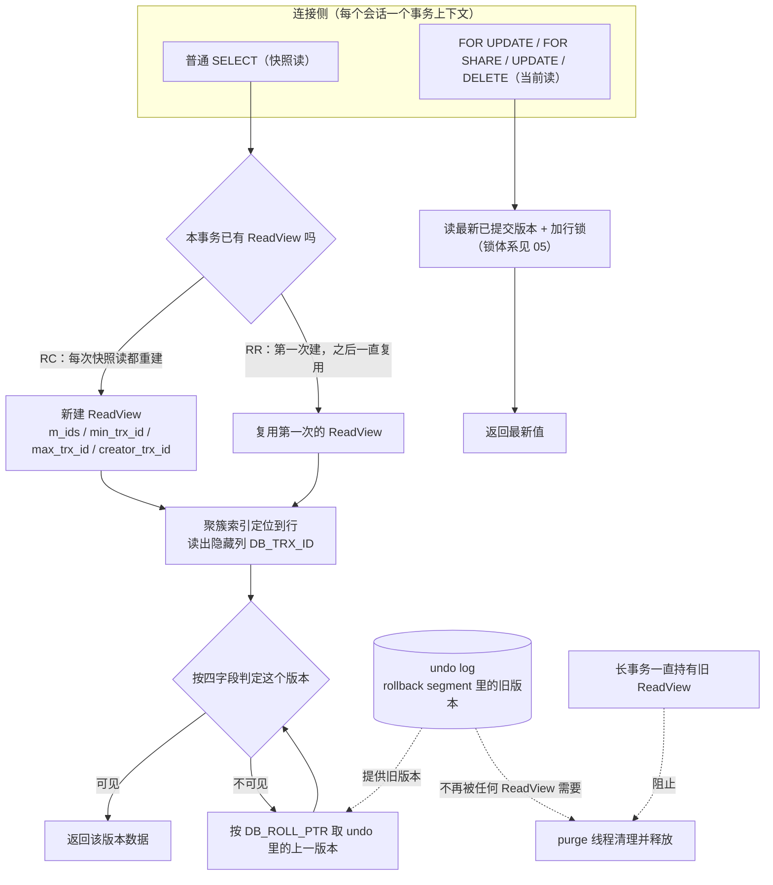
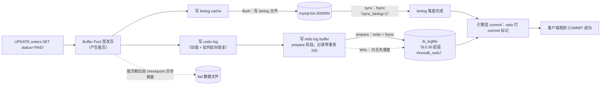
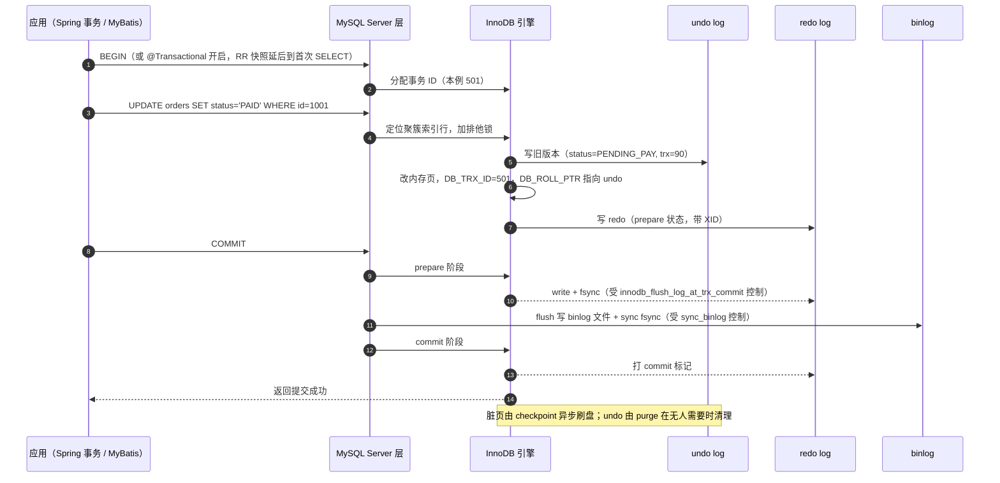

# 06-事务进阶：MVCC 的可见性判定与三大日志的耐久性契约

> **一句话结论**：`SELECT` 不加锁还能读到一致的历史，是因为 InnoDB 给每行带了两条隐藏列 `DB_TRX_ID`（最后改它的事务）与 `DB_ROLL_PTR`（上一个版本在哪），旧值被抄进 undo log 串成**版本链**，再用 `ReadView` 的四个字段（`m_ids` / `min_trx_id` / `max_trx_id` / `creator_trx_id`）逐版本判定"对我可见不可见"；而"提交了就不丢"靠的是 redo log 的 WAL 两阶段提交（prepare → binlog → commit）与 undo log 的回滚能力。
> **阅读前置**：需要先读 [01-MySQL核心知识](01-MySQL核心知识.md) 里的事务与四级隔离表（本篇专治"表背后的机制"）；加锁、死锁、主从复制在 [05-MySQL锁机制与主从复制读写分离](05-MySQL锁机制与主从复制读写分离.md)，本篇只在交界处点名。
> **证据基线**：MySQL 8.0（InnoDB / utf8mb4）、Spring Framework 7.1.0、MyBatis 3.6.0 / mybatis-spring 3.0.5、JDK 17，本项目 `ai-cs-order` 当前 main。A 级证据只引 `learning-docs/24-源码分析/assets/source/` 已入库摘录；**InnoDB 与 MySQL Server 的 C++ 源码未入库**，凡涉及引擎内部一律标注"依据 MySQL 8.0 官方手册"，且本篇所有 SQL 命令**未在本机实测**（本机无 MySQL 实例）。预计阅读 60 分钟。

## 0. 先看现象

### 现象一：同一个事务里，两次"查同一行"给出不同答案，而第二次还卡了 30 秒

客服后台的"支付结果核对"是一个事务：先读订单状态，再读一遍确认。线上表现是——事务开始后第一次 `SELECT` 读到 `PENDING_PAY`，用户此时付款成功，第二次读却读到 `PAID`；而当它写成"锁定读"版本（`FOR UPDATE`）时，如果支付回调恰好在该行上未提交，30 秒后客户端收到：

```text
ERROR 1205 (HY000): Lock wait timeout exceeded; try restarting transaction
```

（错误文本来自 MySQL 8.0 服务端；本机无实例，未实测。30 秒这个数字对应 `deploy/mysql/mysql.cnf#L7` 的 `innodb-lock-wait-timeout=30`。）

反直觉的地方有三处：

- 同一个事务、同一条 SQL、同一行数据，**结果能不一样**——说明"事务内一致"不是事务本身给的，是某种快照机制给的，而它有"不生效"的通道。
- 第一版写法（普通 `SELECT`）**从不阻塞**，第二版写法（`FOR UPDATE`）**会阻塞 30 秒**——同一张表、同一行，锁的行为完全不同。
- 超时不是死锁（`ERROR 1213`），是"等锁等到超时"，两者的排查入口不一样（见 [05 §四](05-MySQL锁机制与主从复制读写分离.md)）。

### 现象二：自己明明没提交，另一个连接已经看到新值了

一段"下单 + 扣库存"的代码，开发同学很确定 `@Transactional(rollbackFor = Exception.class)` 写在方法上，然后另一端的长连接立刻查到了新订单。另一种更隐蔽的形态：某天把隔离级别调成 `READ COMMITTED` 之后，SQL 里用到 `LIMIT` 的批量更新突然报错：

```text
ERROR 1665 (HY000): Cannot execute statement: impossible to write to binary log
since BINLOG_FORMAT = STATEMENT and at least one table uses a storage engine
limited to row-based logging. InnoDB is limited to row-logging when transaction
isolation level is READ COMMITTED or READ UNCOMMITTED.
```

（该错误码与文本依据 MySQL 8.0 官方手册"Replication and Binary Logging Options and Variables"一章的说明；未本机实测。）

第二类现象的根因往往不是数据库，而是**事务根本没开**：`@Transactional` 与 `@GlobalTransactional` 都依赖 Spring 代理，同一个类里 `this.doCreateOrder(...)` 自调用就绕过了代理。本项目为此专门把下单事务边界拆成独立 Bean，理由写在 `ai-cs-order/src/main/java/com/aics/order/service/impl/OrderCreateTxService.java#L34-L45`：放在 `OrderServiceImpl` 里自调用会"绕过代理导致事务注解失效"。

### 现象三：实例重启后，数据"回退"了半小时

压测时把 `innodb_flush_log_at_trx_commit` 从 1 改成 2 换取吞吐，机器一次意外掉电后重启，最近约 1 秒内返回过"下单成功"的订单不见了；错误日志里是这两行的组合：

```text
InnoDB: Database was not shut down normally!
InnoDB: Starting crash recovery.
```

（这两行是 MySQL 8.0 崩溃重启时 error log 的标准输出；未本机实测。）更麻烦的一种是**主库回退、从库没回退**：主库丢的那 1 秒事务，binlog 已经发给从库并应用，于是主从数据分叉——这正是"双 1"配置存在的意义，也是 [09-备份恢复与数据安全](09-备份恢复与数据安全.md) 讨论恢复点时绕不开的前提。

这些现象指向同一件事：**"读不加锁"和"提交不丢"都不是事务语义自带的魔法，而是版本链 + ReadView（管读）与 redo/undo/binlog 三份日志的两阶段提交（管写）两套独立机制在兜底；把读的机制用错通道、把写的机制配错等级，就分别得到"读到不该读的"和"丢到不该丢的"。**

## 1. 整体地图

先把"读"这一半画清楚——一次普通 `SELECT` 到底走过谁：



> **读图说明**：最关键的是 `HAS` 这个分叉和 `LONG` 那条虚线。**① `HAS` 分叉处 RC 与 RR 走的是同一条算法、只差 ReadView 什么时候建**——这是全篇最重要的一句话，两个隔离级别的实现差异仅此一处（§3.3 用逐行推演证明）。**② `LONG` 虚线**：purge 能不能清理旧版本，取决于"还有没有活的 ReadView 需要它"，所以一个开了不关的长事务会同时撑大 undo 表空间并让所有行的版本链变长——现象一里"卡 30 秒"和"库里越跑越慢"经常是同一件事。看错 `Q → VIS` 这条路径（以为普通 SELECT 也会加锁）会得出"读也会阻塞写"的错误结论，实际恰恰相反：快照读不加锁、也不被写阻塞。

再把"写"这一半画出来：一次 `UPDATE` 到 `COMMIT` 返回之间，日志是怎么排队的。



> **读图说明**：两条箭头决定这篇的全部结论。**① `BP -.-> DF` 是虚线**：数据页（真正改数据的地方）**不是**在提交时落盘的，提交只保证日志落盘——这就是 WAL（Write-Ahead Logging，先写日志再写数据）的核心，也是"提交很快、崩溃能恢复"的原因。**② `BFS → CM` 的先后顺序不可交换**：先让 binlog 完整落盘，再让 redo 打 commit 标记，恢复时才能拿 binlog 当裁判决定"这个事务到底算不算提交"。如果反过来先 commit redo 再写 binlog，主库恢复出的行从库没有，主从就永久分叉。

各组件责任与本篇对应的真实调用方：

| 组件 | 一句话责任 | 谁创建 / 谁触发 | 本项目锚点（B 级） |
|---|---|---|---|
| 隐藏列 `DB_TRX_ID` / `DB_ROLL_PTR` | 记录"谁最后改的"和"上一版本在 undo 哪里" | InnoDB 建表即隐含，无需 DDL | `deploy/mysql/order-init.sql#L24-L46` 的 `orders` 表只有业务列，隐藏列不可见但存在 |
| undo log 与 rollback segment | 存旧值：既供回滚，也供 MVCC 读旧版本 | 每次写操作由 InnoDB 写入 | 引擎内部，无项目配置项 |
| ReadView | 快照读时的"活跃事务名单"，可见性判定依据 | RC 每条语句、RR 首次快照读 | 由隔离级别决定；项目未显式配置，取 MySQL 默认 RR |
| purge 线程 | 清理不再被需要的 undo 版本 | InnoDB 后台线程 | 长事务会拖住它（§3.4） |
| redo log（日志缓冲 + 文件） | 崩溃恢复：已提交的物理变更不丢 | 每次写页前写 redo | `deploy/mysql/mysql.cnf#L4-L7` |
| binlog（Server 层） | 复制、归档、CDC 的数据源 | 语句/行变更后写 binlog cache | `deploy/mysql/mysql.cnf#L23-L28`（ROW + FULL + 保留 7 天） |
| 两阶段提交协调者 | 让 redo 与 binlog 要么都算提交、要么都算回滚 | 引擎层 commit 流程内部 | 无配置项，靠 `innodb_flush_log_at_trx_commit` 与 `sync_binlog` 保证"都落盘" |
| `@Transactional` 的隔离级别下发 | 把 Java 侧 `Isolation` 变成 JDBC `setTransactionIsolation` | Spring `DataSourceTransactionManager#doBegin` | A 级：`[[源码:DataSourceTransactionManager.java.md#L283-L286]]` |
| `undo_log` 表（Seata AT） | 存分支事务的前后镜像，供二阶段反向补偿 | Seata 数据源代理写入 | `deploy/mysql/seata-undo-log.sql#L14-L23`，与 InnoDB undo log **同名不同物** |

### 1.1 一句话区分三份日志

| | redo log | undo log | binlog |
|---|---|---|---|
| 谁写的 | InnoDB 引擎 | InnoDB 引擎 | MySQL Server 层（所有引擎共用） |
| 记什么 | **物理**页级变更："某页某偏移改成什么" | **逻辑**旧值：改之前长什么样、怎么反做 | **逻辑**变更：语句或行镜像 |
| 主要用途 | 崩溃恢复（crash-safe） | 事务回滚 + MVCC 版本链 | 主从复制、按时间点恢复、CDC |
| 生命周期 | 循环写，写满靠 checkpoint 推进 | 事务结束不立刻删，purge 择机清 | 追加写，按 `expire-logs-days` 过期 |
| 记忆句 | 说好要做的一定做到 | 做了没说好的撤回来 | 让从库和备份也做到 |

## 2. 关键概念与关键类

术语首现都在这里一次性解释清楚，后文直接用。

| 名称 | 所在位置 | 角色 | 关键方法 / 字段 / 判定 |
|---|---|---|---|
| `DB_TRX_ID` | 聚簇索引行的隐藏列（6 字节） | "最后修改这一行的事务 ID" | 与 ReadView 的字段比大小 |
| `DB_ROLL_PTR` | 聚簇索引行的隐藏列（7 字节） | 指向 undo log 里上一版本的指针 | 版本链的"next"指针 |
| undo log | InnoDB 的 rollback segment（回滚段），8.0 起是独立 undo 表空间 | 存旧值记录，一职两用（回滚 + MVCC） | `INSERT` 记"删掉它"，`UPDATE` 记反向更新，`DELETE` 记"重新插入" |
| 版本链（version chain） | 概念 | 同一行所有历史版本用 `DB_ROLL_PTR` 串成的单向链表 | 从新到旧遍历，直到找到可见版本或链尾 |
| `ReadView` | InnoDB 内部结构（`read/ReadView` 相关实现） | 快照读的"活跃事务名单" | `m_ids` / `min_trx_id` / `max_trx_id` / `creator_trx_id` |
| `m_ids` | `ReadView` 字段 | 生成时刻所有**读写活跃**（已分配 ID 未提交）事务 ID 的有序集合 | 判定"当时它还没提交" |
| `min_trx_id` | `ReadView` 字段 | `m_ids` 里最小那个（InnoDB 源码注释里叫 `m_up_limit_id`） | 小于它的版本一定已提交 |
| `max_trx_id` | `ReadView` 字段 | 生成时刻**下一个将要分配**的事务 ID（不是"最大活跃 ID"！） | 大于等于它的版本一定是快照之后才开的 |
| `creator_trx_id` | `ReadView` 字段 | 自己的事务 ID | 等于它就可见（自己改的自己看得见） |
| 快照读（consistent read） | 概念 | 普通 `SELECT` 走 MVCC，不加锁 | 由 ReadView + 版本链决定返回值 |
| 当前读（locking read） | 概念 | `UPDATE` / `DELETE` / `INSERT` / `FOR UPDATE` / `FOR SHARE` 读最新已提交版本并加锁 | 不走 ReadView，走锁体系（[05](05-MySQL锁机制与主从复制读写分离.md)） |
| purge | InnoDB 后台线程 | 清理"没有 ReadView 再需要"的 undo 版本 | `SHOW ENGINE INNODB STATUS` 的 `History list length` 是它的积压量 |
| redo log / log buffer | InnoDB：`ib_logfile*`（8.0.30 起为 `#innodb_redo` 目录） | 物理日志，崩溃后重放 | LSN（日志序号）、checkpoint |
| LSN / checkpoint | redo 内部概念 | LSN 是日志写入位置；checkpoint 表示"这之前的脏页已刷盘、日志可覆盖" | `SHOW ENGINE INNODB STATUS` 的 LOG 段 |
| binlog / binlog cache | Server 层，文件 `mysql-bin.00000N` | 逻辑变更日志，供复制与时间点恢复 | `binlog_format`、`binlog_row_image`、`sync_binlog` |
| XID（事务 ID） | redo 与 binlog 里都写同一个 XID | 两阶段提交的"对账单号" | 崩溃恢复时用它两边核对 |
| 组提交（group commit） | binlog 落盘流程 | 把多个事务的 fsync 合并成一次 | Flush / Sync / Commit 三阶段 |
| `undo_log` 表（Seata AT） | 业务库里的普通表 | 存分支事务前后镜像做反向补偿 | 与 InnoDB undo log 毫无关系（§3.10） |

## 3. 原理与证据逐段精读

每小节固定四层：**这段在干什么 → 为什么这么设计 → 换成另一种写法会怎样 → 常见坑**。

### 3.1 版本链：一条 `UPDATE` 在 undo 里留下了什么

**在干什么。** InnoDB 的聚簇索引行有三段隐藏内容：`DB_TRX_ID`、`DB_ROLL_PTR`、`DB_ROW_ID`（无主键时才有）。当 trx 501 执行 `UPDATE orders SET status='PAID' WHERE id=1001`，实际发生的是：把旧行内容写进 undo log，主记录上的 `status` 改成 `PAID`、`DB_TRX_ID` 改成 501、`DB_ROLL_PTR` 指向刚写的那条 undo 记录。这条 undo 记录自己也带"上一版本的指针"，于是串成链：

```text
最新行：status=PAID    DB_TRX_ID=501  DB_ROLL_PTR ─┐
                                                   ↓
undo：  status=PENDING_PAY  DB_TRX_ID=90   DB_ROLL_PTR ─┐
                                                        ↓
undo：  status=PENDING_PAY  DB_TRX_ID=77   DB_ROLL_PTR = NULL（链尾）
```

三类操作记进 undo 的形式不同（依据 MySQL 8.0 官方手册 InnoDB Multi-Versioning 一节）：`INSERT` 只需记"主键是谁"（回滚时删掉即可）；`UPDATE` 记被改列的旧值及反向更新；`DELETE` 记整行内容（回滚时重插）。`DELETE` 还分两步：先给行打删除标记（delete mark）再真正删除，所以快照读能看到"被我删掉之前的样子"。

**为什么这么设计。** 因为要同时满足两个互斥的需求：回滚必须能精确还原（所以存旧值而不是"存新值"）；读必须能不看未提交的新值（所以旧值是"另一份"，而不是覆盖原值）。一份只追加的数据结构同时喂饱这两个消费者，成本最低——写的时候只写一遍，读的时候按需往回走。

**换成另一种写法会怎样。** 假设不用版本链，而是"读的时候加共享锁、写完再放"（这就是纯锁并发控制，MyISAM 的表锁走的就是这条路）：一致性是有了，但读写互相阻塞，客服后台的一次 `SELECT` 就能把支付回调堵在锁外——本项目最不能接受的事（支付回调带着渠道的超时窗口，被堵 30 秒就是一次对账异常）。另一个极端是"每次读都去 undo 里恢复出一个临时副本再返回"，那 undo 就成了双份存储，写放大翻倍。

**常见坑。**

- 隐藏列**不参与 `SELECT *`**，所以 `EXPLAIN`/客户端里都看不到；想观察只能靠 `innodb_ruby`、`innodb_space` 这类页解析工具，或读 `information_schema.INNODB_TRX`（只给事务维度信息）。谁在"表结构里找不到 `DB_TRX_ID`"上纠结，方向就错了。
- 版本链长度等于"同一行被改过多少次且旧版本还没被 purge"，**不是**"这行改过多少次"——中间版本早被清掉了。
- 大字段（`TEXT`/`BLOB`）更新时 undo 会连带记录外部页引用，一次"只改一个状态字段"的 `UPDATE` 也可能产生不小的 undo；把 `status` 这类高频小字段和大字段拆表（本项目 `orders` 与 `order_item` 的分法就是这个思路，见 `deploy/mysql/order-init.sql#L24-L61`）能显著减少版本链体积。

### 3.2 ReadView 四个字段与可见性判断算法（本篇核心）

**在干什么。** 快照读开始时，InnoDB 拍一张"当前所有活跃读写事务的名单"，就是 `ReadView`。随后拿着版本链上每一层的 `DB_TRX_ID` 去问这张名单，直到找到一个可见版本。四个字段的含义与判定顺序如下（依据 MySQL 8.0 官方手册 Consistent Nonlocking Reads 一节与 InnoDB MVCC 实现）：

| 字段 | 含义 | 判定中的角色 |
|---|---|---|
| `creator_trx_id` | 自己的事务 ID | 先判：相等 → 可见（自己改的自己看得见） |
| `min_trx_id` | 生成时活跃事务里最小的 ID | `trx_id < min_trx_id` → 生成快照前就提交了 → 可见 |
| `max_trx_id` | 生成时**下一个待分配**的事务 ID | `trx_id >= max_trx_id` → 快照之后才开启的事务 → 不可见 |
| `m_ids` | 生成时活跃事务 ID 集合 | `min ≤ trx_id < max` 区间内：在名单里 → 不可见；不在名单里（已提交）→ 可见 |

判定算法写成伪代码只有 8 行：

```text
可见(trx_id, rv):
    if trx_id == rv.creator_trx_id      : return 可见      # 自己的修改
    if trx_id <  rv.min_trx_id          : return 可见      # 快照之前已提交
    if trx_id >= rv.max_trx_id          : return 不可见     # 快照之后才开的事务
    if trx_id in rv.m_ids               : return 不可见     # 快照时还没提交
    else                                : return 可见      # 区间内但已提交
不可见 → 沿 DB_ROLL_PTR 取上一版本，用它自己的 trx_id 重跑上面的判断
```

**为什么这么设计。** 因为"活跃名单"是一个**极小**的结构：它只有生成瞬间的活跃事务，与表有多少行、事务跑了多久都无关。所以快照读的开销是"每行一次区间比较 + 极少数情况下的版本链回溯"，而不是"复制整张表"。这也解释了为什么 `max_trx_id` 记的是"下一个待分配"而不是"当前最大活跃"：用 `>= max_trx_id` 一条比较就能把"未来才开启的事务"整段挡掉，不必把未来的 ID 也存进名单。

**换成另一种写法会怎样。** 如果 `max_trx_id` 记成"最大活跃 ID"，那么"快照之后开启、但 ID 小于它"的边界情况就漏判；如果只存 `m_ids` 不做 `min`/`max` 区间优化，`m_ids` 会随并发事务数线性膨胀，每个版本判定都要在集合里查一次——这就是早期实现慢的原因。

**常见坑。**

- **`max_trx_id` 不是"最大活跃 ID"**。它是 `m_ids` 的"下一个"，比任何活跃 ID 都大。面试里写错这一条直接露馅。
- `m_ids` 是**生成瞬间**的快照拷贝，之后有新事务开启或旧事务提交，**它都不变**——这正是 RR 能"重复读"的物理原因。
- 只读事务在 InnoDB 里也可能拿到 ID（例如 RR 下第一次快照读之后），但"有 ID"与"在 `m_ids` 里"是两件事，别混。
- 判断顺序不能颠倒：先判 `creator_trx_id`，否则"自己改的行"在 RR 里可能被 `m_ids` 判成不可见，出现"我自己改完自己看不到"的荒谬结果。

#### 3.2.1 逐行推演：同一场景下 RR 与 RC 各自看到什么

场景：`orders` 表一行 `id=1001, order_no='SO20261127001', status='PENDING_PAY'`，该行最后一次提交由 trx 90 完成。T1 是客服后台查询事务（trx 500），T2 是支付回调事务（trx 501）。所有事务 ID 只在执行第一条写语句或首次快照读时分配。

**推演一：RR（MySQL 默认隔离级别）**

| # | 谁 | 做什么 | ReadView | 链上版本 `trx_id` | 逐条判定 | 结果 |
|---|---|---|---|---|---|---|
| 1 | T2 | `BEGIN` | — | — | — | 事务开始 |
| 2 | T2 | `UPDATE orders SET status='PAID' WHERE id=1001` | — | 新版本 `trx_id=501`；undo 里旧版本 `trx_id=90` | — | 未提交，行被 T2 持排他锁 |
| 3 | T1 | `BEGIN`（trx 500），第一次 `SELECT status` | `m_ids={500,501}` `min=500` `max=502` `creator=500` | 501 | 501≠500；501≥min；501<max；501∈`m_ids` → 不可见 → 回退 | 读到 undo 里 `trx_id=90`：90<min=500 → 可见 → **PENDING_PAY** |
| 4 | T1 | 第二次 `SELECT status`（RR 复用 ReadView） | 不变（不重建） | 501 | 同上 | **PENDING_PAY** |
| 5 | T2 | `COMMIT`（501 退出活跃名单） | T1 的 ReadView 仍是第 3 步那张 | 501 | 501 依然∈快照里的 `m_ids` → 不可见 | **PENDING_PAY**（可重复读成立） |
| 6 | T1 | `SELECT ... FOR UPDATE`（当前读） | **不使用 ReadView** | 读最新已提交版本 | — | **PAID** ← 现象一的来源 |
| 7 | T1 | `UPDATE orders SET status='CANCELLED'` | 写成功后，行 `trx_id` 变为 500 | 500 | 之后的快照读里 500==`creator` → 可见 | 后续查询看到 **CANCELLED** |

第 5 步是全篇最值得记的一行：**T2 已经提交了，T1 依然看不到**——因为 T1 的 ReadView 里的 `m_ids` 是在第 3 步抄下来的，T2 的提交不会回溯修改那张名单。

**推演二：同一场景，改用 `READ COMMITTED`**

| # | 谁 | 做什么 | ReadView | 链上版本 `trx_id` | 逐条判定 | 结果 |
|---|---|---|---|---|---|---|
| 3' | T1 | 第一次 `SELECT` | `m_ids={500,501}` `min=500` `max=502` `creator=500` | 501 | 501∈`m_ids` → 不可见 → 回退到 90 → 可见 | **PENDING_PAY** |
| 5' | T2 | `COMMIT` | — | — | — | — |
| 6' | T1 | 第二次 `SELECT` → **重建 ReadView** | `m_ids={500}` `min=500` `max=502` `creator=500` | 501 | 501≥min、501<max、**501∉`m_ids`** → 可见 | **PAID** ← 不可重复读 |

对比第 4 步与第 6' 步：SQL 一字未改、数据一字未改，**唯一变化是第二次读有没有重拍 ReadView**。这就是"RC 与 RR 的实现差异只有 ReadView 生成时机"的全部证据，也是面试里最容易被追问到底的那一点。

**推演三：三个边界情形，用同一套字段判**

| 情形 | `trx_id` 与字段的关系 | 判定 | 现实含义 |
|---|---|---|---|
| T1 开快照后，T3（trx 502，`max_trx_id` 恰好等于它）插入新行并提交 | 502 ≥ `max=502` | 不可见 | RR 下"不幻读"的机制之一：**快照之后才开的事务写的行，看不见**（另一层是间隙锁，见 [05](05-MySQL锁机制与主从复制读写分离.md)） |
| 某版本 `trx_id=90`，`m_ids={500,501}` | 90 < `min=500` | 可见 | 快照之前就提交的历史版本直接放行，不必查名单 |
| 同一事务内先改后读 | `trx_id == creator` | 可见 | "自己的修改自己看得见"；这也解释了 `confirmPay` 里 `updateById` 之后继续用同一 session 查询能读到新状态（`ai-cs-order/src/main/java/com/aics/order/service/impl/OrderServiceImpl.java#L117-L151`） |

**常见坑（推演层面）。**

- 自己算的时候别忘了 `m_ids` **包含自己**：MySQL 的 `m_ids` 是"所有活跃读写事务"，creator 也在里面，只是判定顺序上先被 `creator_trx_id` 拦掉了。
- RR 下"看不到"只对**快照读**成立；`UPDATE` 的 `WHERE` 条件、唯一键冲突检查、外键检查全是**当前读**，它们看最新数据。所以 RR 里"查不到却更新成功了"是完全正常的组合。
- 现象一里"第二次读到 PAID"不一定是隔离级别被改过——先排除"第二条 SQL 是当前读"这种写法问题，再怀疑配置。

### 3.3 快照读与当前读：一条 SQL 走哪条通道由语法决定

**在干什么。** 下面五类语句走**当前读**（读最新已提交版本并加锁），其余普通 `SELECT` 走快照读：

| 语句 | 通道 | 加的锁 |
|---|---|---|
| `SELECT ...`（普通） | 快照读 | 不加锁 |
| `SELECT ... FOR UPDATE` | 当前读 | 排他行锁（RR 下是临键锁） |
| `SELECT ... FOR SHARE` | 当前读 | 共享行锁 |
| `UPDATE` / `DELETE` | 当前读 | 排他行锁（先读后写，读写都算） |
| `INSERT` | 当前读 | 插入意向锁 + 唯一性检查 |

**为什么这么设计。** 写操作必须基于最新数据，否则基于旧快照做计算再覆盖，会丢掉别人刚提交的修改（经典"丢失更新"）。而读操作没必要为了一致性付锁的代价，于是干脆让"要不要最新值"变成**语法层面**的选择：要最新就显式加锁，不要就默认快照。这是把并发控制策略交给开发者的设计——灵活，也危险。

**换成另一种写法会怎样。** 全都走当前读（等价于把隔离级别做到 SERIALIZABLE 的强度）：一致性最强，但客服后台的列表查询会和支付回调互相阻塞，`ERROR 1205` 变成日常。全都走快照读（把 `UPDATE` 也改成"先查后改"）：`UPDATE orders SET status=... WHERE id=?` 这种基于主键的幂等更新就没问题，但任何"读-判断-写"的业务（库存、状态机）都会丢更新。

**常见坑。**

- **"查了再改"必须用带条件的 `UPDATE` 或 `FOR UPDATE` 兜底**。本项目 `OrderServiceImpl#confirmPay` 用的是"先查 + 状态机校验 + `updateById`"，其并发安全实际由"唯一键/状态条件"与 Spring 事务共同保证，原理见 [05 §三](05-MySQL锁机制与主从复制读写分离.md)；纯靠快照读判断是会漏的。
- RR 下的"快照读不幻读"与"当前读不幻读"是两套机制：前者靠 ReadView，后者靠临键锁。只答 MVCC 会被追问。
- MyBatis 一级缓存（同一 `SqlSession` 内相同 `selectStatement + 参数` 直接返回缓存，见 [24-源码分析/02-executor 执行器与一级缓存](../24-源码分析/03-MyBatis/02-SqlSession与执行器/02-executor-执行器与一级缓存.md)）会让人误以为"数据库的 RR 生效了"——其实那条查询压根没发到 MySQL。

### 3.4 版本链的回溯成本与 purge：长事务为什么是"慢性中毒"

**在干什么。** 快照读找到一个不可见版本就沿 `DB_ROLL_PTR` 往回走一层，直到可见或到链尾；走得多深取决于"这个事务的快照有多旧"。而链能保留多久，取决于 purge 线程：purge 会删掉"所有活跃 ReadView 都确定不需要"的旧版本。

**为什么这么设计。** 版本链不能读一次就删——删了别人（旧快照）就读不到历史了。所以清理工作必须由"谁都不需要了"这个全局条件驱动，而这个条件由**最老的那个活跃 ReadView** 决定。purge 按 `History list length` 排队推进，这个指标直接反映积压。

**换成另一种写法会怎样。** 如果事务一提交就立刻删 undo：RR 就退化成 RC（旧快照无历史可读），MVCC 不成立。如果永不删：undo 表空间无限增长，最终撑爆磁盘——MySQL 早期版本确实有过"undo 只能靠重启回收"的阶段，这也是 8.0 引入独立 undo 表空间与在线 truncate 的动因。

**常见坑。**

- **长事务 = 最老的 ReadView 一直活着 = purge 永远推进不了**。后果是三条并行发生：undo/版本链膨胀（磁盘涨、回溯变慢）、`History list length` 飙升、行锁与 MDL 长期不释放（DDL 被堵、`ERROR 1205` 频发）。
- `SHOW ENGINE INNODB STATUS` 里 `History list length` 持续增长而 QPS 不高，几乎可以断定有长事务或未提交的空闲连接在挂着。
- 只读事务也会挂住 ReadView：一个 `START TRANSACTION` 之后只查了一次再没动静的连接，同样阻塞 purge。连接池的 `maxLifetime`/空闲回收对这类"忘了提交"的连接无效——它还是活的。

### 3.5 redo log：WAL、循环写与 checkpoint

**在干什么。** 修改数据页之前，先把"这个页该怎么变"写进 redo log buffer，再由它写进 redo 文件。redo 是**固定的几组文件循环使用**：写满一圈必须靠 checkpoint 推进"从这里往前的日志可以覆盖"，而 checkpoint 推进的前提是对应的脏页已经刷盘。

**为什么这么设计。** 数据页是随机写（一个事务可能碰几十个页，散落在磁盘各处），日志是顺序写。把"随机写"换成"顺序写 + 异步刷页"，提交延迟就从"等磁盘随机 IO"降到"等一次顺序 fsync"。这是所有 WAL 系统的共同理由。循环写则是为了不让日志无限增长：日志只是"恢复用的临时账本"，账本兑现（脏页刷盘）后就能擦掉重写。

**换成另一种写法会怎样。** 不用 redo（如 MyISAM）：每次提交都要把数据页刷盘，写性能差一个量级，而且崩溃后表可能损坏（MyISAM 需要 `REPAIR TABLE`）。redo 不循环而是无限追加：恢复时要重放历史全部日志，启动时间无法接受。

**常见坑。**

- **redo 不是"提交就刷数据页"**，提交只保证"日志落盘"。所以"提交成功但立刻断电"数据能恢复，而"提交成功但立刻 `kill -9` 后查表却看到旧值"是另一回事——那是 MVCC 快照读给的旧值，不是数据丢了。
- `innodb-log-file-size=64M`（`deploy/mysql/mysql.cnf#L5`）在学习环境里够用；高写入时日志一圈很快写满，checkpoint 被迫更频繁地刷脏页，出现"提交变慢但 CPU/IO 都不高"的抖动。生产环境这个值通常给到 GB 级（依据 MySQL 8.0 官方手册对 `innodb_log_file_size` 的建议）。
- 8.0.30 起该参数被 `innodb_redo_log_capacity` 取代（§7），照抄老配置会"配了但没生效"。

### 3.6 两阶段提交：redo 与 binlog 凭什么算一次原子提交

**在干什么。** 一份事务要同时留在两处：InnoDB 的 redo（保 crash-safe）和 Server 层的 binlog（保复制与恢复点）。两者跨层，无法放进同一个原子写，于是拆成两步：先把 redo 记为 **prepare**（内容完整、带事务 XID），再写 binlog 并 fsync，最后把 redo 记 **commit**。

**为什么这么设计。** 因为崩溃恢复时有"裁判"可查：重启后扫 redo，凡是处于 prepare 状态的事务，就去 binlog 里找同 XID 的事务记录——**binlog 完整则提交，不完整则回滚**。这样无论崩在哪一步，主库与从库对"这个事务算不算数"的结论必然一致。

**换成另一种写法会怎样。** 顺序反过来（先 redo commit 再写 binlog）：崩在中间 → 主库有、从库没有，永久分叉。或者干脆省掉两阶段（例如只写 redo 不写 binlog，等于关掉 binlog）：crash-safe 有了，但复制和按时间点恢复全没了。再或者用 MySQL 4.x 时代的老办法（先写 binlog 再 `prepare`，靠 `binlog` 当唯一真相），也不成立：binlog 是逻辑日志，无法重放页级变更。

**常见坑。**

- **`binlog` 与 `redo` 必须都落盘才算"双保险"**。只把 redo 配成 1、把 binlog 配成"靠 OS 刷"，崩主机时 redo 有、binlog 缺 → 恢复时按规则回滚这个事务，可客户端早就收到了"COMMIT 成功"。这不是数据丢失，而是**已确认的事务被撤销**，比丢数据更难解释。
- 事务里的 `XID` 是"对账单号"，人工排查两阶段问题时靠它把 binlog 事件与 redo 事务对齐（`mysqlbinlog` 输出里能看到 `Xid = N`）。
- prepare 阶段持有 `prepare_commit_mutex`（5.6 及更早的串行点，5.7 起被组提交取代），所以"两阶段提交一定比单日志慢"这句话只对老版本完全成立——8.0 靠组提交把 fsync 摊薄了。

### 3.7 组提交：高并发下"双 1"为什么没把吞吐打死

**在干什么。** binlog 落盘分成三段队列：**Flush**（把各会话的 binlog cache 写进文件）、**Sync**（fsync 文件）、**Commit**（引擎层提交、释放锁）。同一时刻排队的事务，在 Sync 阶段合并成**一次** fsync 一起落盘（依据 MySQL 8.0 官方手册 Binary Logging 与 Group Commit 说明）。

**为什么这么设计。** fsync 是固定成本（一次磁盘刷写），与"刷多少数据"关系不大。N 个事务各刷一次 = N 次成本；合并成一次 = 1 次成本，N 越大越划算。这就是"双 1 牺牲的是每事务一次 fsync，而不是每事务一次磁盘往返"的实际含义。

**换成另一种写法会怎样。** 关掉组提交（`binlog_group_commit_sync_delay=0` 且并发很低时退化为逐事务）：单事务场景没差别，批量导入场景吞吐能差数倍。反过来把 `binlog_group_commit_sync_delay` 设成几百微秒：吞吐上升，代价是每个事务多等一点点——这是"人为制造排队"，适合吞吐优先的批处理。

**常见坑。**

- 组提交的收益依赖**并发**。单线程压测永远看不到它的效果，于是有人得出"双 1 一定慢"的结论，到了线上又说"配了双 1 吞吐还挺好"——两次观察都不算错，前提不同。
- 组提交合并的是 **binlog 的 fsync**；redo 的 fsync 有自己的 group commit 机制，两者不是一回事。混着讲在面试里会被追到细节上崩。
- 大事务（一次更新几十万行）无法被"合并"，它会独占一次 fsync 且持有锁很久，直接顶掉组提交的收益。

### 3.8 binlog 三种格式：为什么本项目必须是 ROW + FULL

**在干什么。** `binlog_format` 有三档：`STATEMENT`（记 SQL 语句）、`ROW`（记每行变更前后镜像）、`MIXED`（默认 STATEMENT，遇到不确定语句切 ROW）。本项目 `deploy/mysql/mysql.cnf#L23-L28` 明确写了 `binlog-format=ROW` 与 `binlog-row-image=FULL`，注释里写着"CDC 必需：ROW 记录每行变化，FULL 保留完整前后镜像"。

| 格式 | 记什么 | 优点 | 代价 | 什么时候必须用 |
|---|---|---|---|---|
| `STATEMENT` | 原始 SQL | 体积最小、易读 | 非确定语句（`NOW()`、`UUID()`、无 `ORDER BY` 的 `LIMIT`）从库重放结果不同；RC/READ UNCOMMITTED 下 InnoDB 只能行记（§0 现象二的 1665） | 老系统、纯确定性 SQL |
| `ROW` | 每行的前后镜像 | 结果确定，与隔离级别无关；CDC 可解析 | 体积大（批量更新放大明显） | 复制正确性要求高、有 CDC（本项目） |
| `MIXED` | 按语句自动切 | 折中 | "什么时候切"不可预测，排查成本高 | 历史遗留 |

**为什么本项目必须有 `binlog_row_image=FULL`。** `ROW` 还有一个子开关：`FULL` 记变更前后完整行，`MINIMAL` 只记被改的列与主键（默认 `FULL`）。CDC 消费方（Canal，见 [04-中间件/11-CanalCDC商品索引同步](../04-中间件/11-CanalCDC商品索引同步.md)）要重建文档时，`MINIMAL` 只给"status 从 PENDING_PAY 变 PAID"，缺别的列就无法拼出完整商品/订单对象，只能回查——回查又引入"读到更新版本"的时序问题。

**换成另一种写法会怎样。** 用 `STATEMENT`：本项目有 `create_time DATETIME NOT NULL DEFAULT CURRENT_TIMESTAMP ON UPDATE CURRENT_TIMESTAMP`（`deploy/mysql/order-init.sql#L16-L17` 等）这类隐式时间列，从库重放的 `CURRENT_TIMESTAMP` 与主库可能不同 → 主从数据不一致，且没有任何报错告诉你。

**常见坑。**

- 改 `binlog_format` 是**全局动态变量**，改完只影响**新建立的会话**；已有连接上的事务仍按旧格式写。验证方式：`SHOW GLOBAL VARIABLES LIKE 'binlog_format'` 与 `SHOW SESSION VARIABLES LIKE 'binlog_format'` 都要看。
- `ROW` 不等于"binlog 里看不到 SQL"。`mysqlbinlog --base64-output=DECODE-ROWS -vv` 能把行镜像解码成伪 SQL，但那是解码结果，不是原始语句。
- 大字段 + `ROW` + 批量更新会让 binlog 暴涨，`expire-logs-days=7`（`deploy/mysql/mysql.cnf#L28`）意味着磁盘上最多堆 7 天的量；[09-备份恢复与数据安全](09-备份恢复与数据安全.md) 的"可恢复窗口也只有 7 天"结论就直接来自这里。

### 3.9 崩溃恢复的三种场景与"双 1"的可靠性等级

**在干什么。** 重启时 InnoDB 先重放 redo（把日志里已有的页变更全部应用到内存页，**包括未提交事务的**），再对"prepare 但没 commit"的事务用 binlog 判最终结果，最后用 undo 把不该留的改回去、把活跃事务标记为回滚。三种崩溃位置对应三种处理：

| 崩溃位置 | redo 状态 | binlog 状态 | 恢复动作 | 客户端感知 |
|---|---|---|---|---|
| A：日志缓冲还没 fsync | 无记录 | 无 | 事务当作没发生 | 未收到"COMMIT 成功"（或收到但被撤销，见 §3.6 坑 1） |
| B：redo 已 fsync，binlog 未写完 | prepare | 不完整（缺 `Xid`） | **回滚**（undo 反做），页变更被撤 | 同上：事务不算数 |
| C：binlog 完整 fsync，redo 未打 commit | prepare | 完整 | **提交**（补 commit，并靠 redo 保证页变更持久） | 事务算数，从库也能收到 |

对应的两个开关决定"哪些已提交事务能活下来"（依据 MySQL 8.0 官方手册 `innodb_flush_log_at_trx_commit` 与 `sync_binlog` 说明）：

| `innodb_flush_log_at_trx_commit` | 提交时做什么 | MySQL 进程崩溃（kill -9） | 主机/OS 崩溃、掉电 |
|---|---|---|---|
| `1`（本项目，`deploy/mysql/mysql.cnf#L6`） | 写 + fsync redo | 不丢 | 不丢 |
| `2` | 只 write 到 OS page cache，每秒 fsync | 不丢 | 丢最近约 1 秒 |
| `0` | 由后台线程每秒 write + fsync | 丢最近约 1 秒 | 丢最近约 1 秒 |

| `sync_binlog` | 含义 | 崩溃影响 |
|---|---|---|
| `1`（8.0 默认；本项目未显式写，取默认） | 每事务 fsync binlog | binlog 与 redo 同步落盘，"双 1"成立 |
| `0` | 交给 OS 刷 | 掉电可能丢 binlog，主从分叉风险 |
| `N` | 每 N 个事务 fsync 一次 | 折中：崩时可能丢最近 <N 个事务的 binlog |

**为什么这么设计。** 三种崩溃场景里，B 与 C 的差别只在于"binlog 完整与否"，用一条判据覆盖了所有中间态——不需要"猜"崩在哪，只看两份日志谁更完整。而双 1 的意义是把"已确认"这个承诺钉死：客户端收到"COMMIT 成功"时，两份日志都已经在盘上，任何崩溃都推翻不了。

**换成另一种写法会怎样。** `trx_commit=2` + `sync_binlog=1`：redo 可能在 OS cache 里丢 1 秒，但 binlog 已经落了 → 恢复时这些事务在 binlog 里完整、redo 里 prepare → 按场景 C **提交**，于是"以为丢了"的 1 秒事务其实会回来。这种组合看似更安全，实际制造了"不一致的直观预期"：你以为丢了，它却回来了。相反 `trx_commit=1` + `sync_binlog=0`：redo 有、binlog 可能缺 → 主库回滚、从库若已收到则多数据，这才是真正危险的不一致。

**常见坑。**

- 把双 1 之外的参数当成"性能开关"随手改，压测好看、事故难解释。含支付的本项目，`deploy/mysql/mysql.cnf#L6` 的 `=1` 是红线。
- `innodb_flush_log_at_trx_commit=2` 的"只丢 1 秒"有个前提：**OS 没崩**。云主机上"实例重启"通常是 OS 级别，所以 2 并不比 0 安全多少。
- 崩溃恢复本身可能很慢：大量未提交事务要用 undo 回滚，恢复时间近似"这些事务执行时间之和"。这也是长事务的第四宗罪（§3.4）。

### 3.10 项目侧的两处落点：隔离级别怎么下到 JDBC，以及 Seata 的 `undo_log` 表不是 undo log

**在干什么。** 第一处：Java 侧写的隔离级别最终变成 JDBC 调用。Spring 的抽象只有一个数字常量表，`TransactionDefinition` 里把隔离级别直接对齐到 JDBC：

```java (src: TransactionDefinition.java.md#L135-L171)
	/**
	 * Use the default isolation level of the underlying datastore.
	 * <p>All other levels correspond to the JDBC isolation levels.
	 * @see java.sql.Connection
	 */
	int ISOLATION_DEFAULT = -1;

	/**
	 * Indicates that dirty reads, non-repeatable reads, and phantom reads
	 * can occur.
	 * <p>This level allows a row changed by one transaction to be read by another
	 * transaction before any changes in that row have been committed (a "dirty read").
	 * If any of the changes are rolled back, the second transaction will have
	 * retrieved an invalid row.
	 * @see java.sql.Connection#TRANSACTION_READ_UNCOMMITTED
	 */
	int ISOLATION_READ_UNCOMMITTED = 1;  // same as java.sql.Connection.TRANSACTION_READ_UNCOMMITTED;

	/**
	 * Indicates that dirty reads are prevented; non-repeatable reads and
	 * phantom reads can occur.
	 * <p>This level only prohibits a transaction from reading a row with uncommitted
	 * changes in it.
	 * @see java.sql.Connection#TRANSACTION_READ_COMMITTED
	 */
	int ISOLATION_READ_COMMITTED = 2;  // same as java.sql.Connection.TRANSACTION_READ_COMMITTED;

	/**
	 * Indicates that dirty reads and non-repeatable reads are prevented;
	 * phantom reads can occur.
	 * <p>This level prohibits a transaction from reading a row with uncommitted changes
	 * in it, and it also prohibits the situation where one transaction reads a row,
	 * a second transaction alters the row, and the first transaction re-reads the row,
	 * getting different values the second time (a "non-repeatable read").
	 * @see java.sql.Connection#TRANSACTION_REPEATABLE_READ
	 */
	int ISOLATION_REPEATABLE_READ = 4;  // same as java.sql.Connection.TRANSACTION_REPEATABLE_READ;
```

**在干什么（续）。** 这个数字在事务真正开始时才生效：`DataSourceTransactionManager#doBegin` 把它交给 `DataSourceUtils.prepareConnectionForTransaction`：

```java (src: DataSourceTransactionManager.java.md#L281-L298)
			con = txObject.getConnectionHolder().getConnection();

			Integer previousIsolationLevel = DataSourceUtils.prepareConnectionForTransaction(con,
					definition.getIsolationLevel(),
					(definition.isReadOnly() && !isDefaultReadOnly()));
			txObject.setPreviousIsolationLevel(previousIsolationLevel);
			txObject.setReadOnly(definition.isReadOnly());

			// Switch to manual commit if necessary. This is very expensive in some JDBC drivers,
			// so we don't want to do it unnecessarily (for example if we've explicitly
			// configured the connection pool to set it already).
			if (con.getAutoCommit()) {
				txObject.setMustRestoreAutoCommit(true);
				if (logger.isDebugEnabled()) {
					logger.debug("Switching JDBC Connection [" + con + "] to manual commit");
				}
				con.setAutoCommit(false);
			}
```

**为什么这么设计。** 一是**只在非 DEFAULT 时才动连接**：隔离级别什么都不写就沿用数据库默认（本项目 MySQL 8.0 默认 `REPEATABLE-READ`，`deploy/mysql/mysql.cnf` 全文 32 行里没有一行 `transaction-isolation`，所以业务就是 RR）。二是必须记下 `previousIsolationLevel`：连接来自**连接池**，用完要还原，否则一个方法把连接改成 RC，后续从池里拿到这条连接的请求全都变成 RC——这类"污染型 bug"极难排查。

**换成另一种写法会怎样。** 如果 Spring 不还原隔离级别，你会看到"某个接口偶发读到不一致数据、重启后恢复正常"的幽灵故障。如果项目在 `application.yml` 里给连接池写死 `connection-init-sql` 改隔离级别，那与 `@Transactional(isolation=...)` 会互相覆盖，谁最后执行谁赢。

**常见坑。**

- 本项目所有 `@Transactional` 都只写了 `rollbackFor`（如 `ai-cs-order/src/main/java/com/aics/order/service/impl/OrderServiceImpl.java#L97-L98`、`#L179-L180`），**没有写 `isolation`** → 全部走 MySQL 默认 RR。想验证要查服务端变量，不要看 Java 代码。
- 第二处落点：`deploy/mysql/seata-undo-log.sql#L14-L23` 建的 `undo_log` 是一张**普通 InnoDB 业务表**（`branch_id` / `xid` / `rollback_info` LONGBLOB / `log_status`），存的是分支事务的**前后镜像**，供 Seata 二阶段生成反向补偿 SQL；它和 InnoDB 引擎内部那个 undo log **只是同名，毫无关系**。机制细节见 [02-Spring微服务/06-Seata分布式事务AT模式](../02-Spring微服务/06-Seata分布式事务AT模式.md)。
- 两者的边界值得说清：Seata 是**跨库**的补偿式一致性（业务层面反做），InnoDB 的 redo/undo 是**单实例**的原子性与持久性（物理层面重放/反做）。Seata 的每一个分支事务内部，仍然靠本篇讲的 InnoDB 机制保证"要么都改要么都不改"。

### 3.11 只读事务、嵌套传播与 AFTER_COMMIT：三种"事务好像没生效"

**在干什么。** 前面讲的全是数据库侧，但现象二里"没提交却被看到"多数发生在 Java 侧。三个高频落点：① `@Transactional(readOnly = true)`——它会同时做两件事，把连接标成只读（驱动层提示），并让 MySQL 侧以只读事务方式执行，**它不改变隔离级别、也不影响快照读的可见性规则**；② 传播行为 `REQUIRED`（默认）下内层方法**加入**外层事务，共用同一个连接、同一个事务 ID、同一个 ReadView，因此"内层回滚"其实做不到——只能给外层打上 rollback-only 标记；③ `TransactionPhase.AFTER_COMMIT` 的事件监听器在提交**之后**才跑，失败也不会回滚业务数据。

**A 级证据：提交后回调的窗口在哪。** `AbstractPlatformTransactionManager#processCommit` 在 `doCommit` 之后才触发 afterCommit，且注释里明确写了"回调抛异常会传给调用方，但事务仍视为已提交"：

```java (src: AbstractPlatformTransactionManager.java.md#L831-L843)
			// Trigger afterCommit callbacks, with an exception thrown there
			// propagated to callers but the transaction still considered as committed.
			try {
				triggerAfterCommit(status);
			}
			finally {
				triggerAfterCompletion(status, TransactionSynchronization.STATUS_COMMITTED);
				if (commitListenerInvoked) {
					this.transactionExecutionListeners.forEach(listener -> listener.afterCommit(status, null));
				}
			}
```

同一方法的另一处解释了"内层标记 rollback-only 会让外层莫名其妙失败"的报错来源：

```java (src: AbstractPlatformTransactionManager.java.md#L800-L805)
				// Throw UnexpectedRollbackException if we have a global rollback-only
				// marker but still didn't get a corresponding exception from commit.
				if (unexpectedRollback) {
					throw new UnexpectedRollbackException(
							"Transaction silently rolled back because it has been marked as rollback-only");
				}
```

**为什么这么设计。** 三层理由各不同。`readOnly` 的价值不是"看得更旧"，而是让驱动与数据库知道"这条连接不会写"——MySQL 因此可以省掉事务 ID 分配与 undo 维护，InnoDB 也能跳过一些写路径的开销；把它理解成"性能+语义声明"才对。嵌套共享同一事务是"物理上只有一个数据库事务"的必然结果：JDBC 一个连接上只能有一个事务，Spring 若强行给内层开新事务，就必须换连接（`REQUIRES_NEW` 干的就是这件事），而换连接意味着内层看不到外层未提交的写入。afterCommit 放在提交之后，是为了保证"消息发出去了，数据一定已经落库"——顺序不能反，否则消费方可能先收到消息、后看到数据（本项目 `ai-cs-order/src/main/java/com/aics/order/event/OrderPaidEventListener.java#L30` 就是用 `phase = TransactionPhase.AFTER_COMMIT` 的 `notify-topic` 推送，与 [02-Spring微服务/13-支付渠道集成与回调一致性](../02-Spring微服务/13-支付渠道集成与回调一致性.md) 讨论的"先落库再通知"同一条原则）。

**换成另一种写法会怎样。** 把 afterCommit 上的 `@TransactionalEventListener` 换成普通 `@EventListener`：监听器在 `publishEvent` 的那一刻（事务还没提交）就执行，等于把"未提交的数据"当成"已确认的事实"发出去——一旦外层后面回滚，消息已经飞了，消费方按消息改了别的库，形成跨库不一致。把内层改成 `REQUIRES_NEW`：内层立刻新开连接与事务，能看到外层已提交的数据，但外层回滚时内层不会跟着回滚，适合"日志/审计必须留痕"，绝不适合"扣库存"。

**常见坑。**

- **`UnexpectedRollbackException: Transaction silently rolled back because it has been marked as rollback-only`** 几乎总是这个形状：内层 `REQUIRED` 方法抛异常但被外层 `try/catch` 吞了，外层以为自己还能提交，提交时发现全局标记是 rollback-only，于是静默回滚并抛出该异常。它的危险点在于"代码里一个异常都没往外抛，事务却全回滚了"。本项目把 `@GlobalTransactional` 与 `@Transactional` 同时放在 `OrderCreateTxService#doCreateOrder` 上（`ai-cs-order/src/main/java/com/aics/order/service/impl/OrderCreateTxService.java#L78-L79`），就是要让"全局事务边界"和"本地事务边界"在同一个、被外部调用的 Bean 上成立，避免嵌套归属含糊。
- `readOnly = true` 下若真去写，MySQL 会直接报错（只读事务拒绝写），而不是"静默忽略"——所以它是能在测试期抓到的错误配置。
- `AFTER_COMMIT` 里做的事失败**不会**回滚业务数据，只会把异常抛给提交线程（见上引注释）。所以这一段必须有本地消息表/重试，否则就是"数据在、通知丢"。

### 3.12 案例推演：支付回调撞上客服改单，"校验通过"却覆盖了别人的状态

**在干什么。** 把 §3.2 的可见性算法套到一个真实业务交错上，看"快照读校验 + 当前读写入"为什么会得出错的结果。`orders` 行 `id=1001`，`status='PENDING_PAY'`，最后一次提交由 trx 90 完成。T1 = 客服取消（`cancelOrder`，trx 600，`ai-cs-order/src/main/java/com/aics/order/service/impl/OrderServiceImpl.java#L97-L113`），T2 = 支付回调（`confirmPay`，trx 601，同文件 `#L116-L151`）。

| # | 谁 | 做什么 | 读到的值来自 | 结果 |
|---|---|---|---|---|
| 1 | T1 | `BEGIN`，快照读 `status` | ReadView(`m_ids={600,601}`,`min=600`,`max=602`,`creator=600`) → 版本 `trx_id=90 < min` → 可见 | `PENDING_PAY`，状态机判定 `PENDING_PAY→CANCELLED` 合法 |
| 2 | T2 | `UPDATE ... SET status='PAID'` | 当前读，**不用 ReadView** | 拿到行排他锁，未提交 |
| 3 | T1 | `UPDATE ... SET status='CANCELLED'` | 当前读 → 需先拿行锁 | **阻塞**，30 秒后若 T2 仍未结束则 `ERROR 1205` |
| 4 | T2 | 事务内再读状态（校验金额/幂等） | `trx_id == creator(601)` → 可见 | 读到 `PAID`，记支付流水，`COMMIT` |
| 5 | T1 | 拿到锁，继续执行 | 当前读读到最新已提交 `PAID` | 但它**不再校验**，直接 `SET status='CANCELLED'` |
| 6 | — | 结果 | — | 一笔已支付订单被改成 `CANCELLED`，且两边都"没报错" |

**为什么这么设计（问题出在哪一层）。** 状态机校验发生在第 1 步的快照读上，而写入发生在第 5 步的当前读上——**读和写看的不是同一个时间点**，这是典型的 TOCTOU（Time-of-Check to Time-of-Use，检查时与使用时状态已变）。MVCC 没有做错任何事：它保证"读一致"，从不保证"读到的状态在你写的时候还成立"。

**换成另一种写法会怎样。** 三条路，代价依次递减：

| 写法 | 机制 | 代价 |
|---|---|---|
| `SELECT ... FOR UPDATE` 再判断再改 | 用锁把"检查"和"写入"绑成一个临界区 | 拿锁范围大，容易与支付回调互相阻塞（现象一的 1205） |
| 条件更新 `UPDATE ... WHERE id=? AND status='PENDING_PAY'` | 检查与写入在同一次当前读里完成，看 `affected rows` 是否为 1 | 需要改 Mapper 的 SQL；`updateById` 这种"按主键全字段覆盖"的写法不满足（`OrderServiceImpl.java#L147` 用的正是 `updateById`） |
| 乐观锁版本号 `WHERE id=? AND version=?` | 无锁，冲突时更新 0 行由业务重试 | 需要加 `version` 列与重试逻辑 |

**常见坑。**

- 用"先查后 `updateById`"实现状态机，本质上把并发正确性交给了"两个事务不会同时进来"这个假设。压测、重试、MQ 重投、Seata 补偿都可能打破它。
- 条件更新的 `affected rows = 0` 有两种含义："状态已变"和"行不存在"。业务上必须区分（先查一次再决定报"订单不存在"还是"状态已变更"），否则前端提示会误导人。
- 这类覆盖事故在快照读层面"完全合规"，所以查 MVCC 查不出来；正确排查方向是**看两条 SQL 的时间点是否落在同一读视图里**，以及"写是否带状态前置条件"。

## 4. 一次完整执行时序（UPDATE → COMMIT，以及崩在哪会怎样）



> **读图说明**：关键箭头只有两个。**① 第 12~13 步与第 14 步的次序**（先 redo fsync，再 binlog fsync，最后 redo commit）：这就是两阶段提交的形状，交换任意两步都会破坏"主从结论一致"。**② 最后一句 Note**：注意 `COMMIT` 返回时数据页可能还在内存里——这不是 bug，是 WAL 的必然结果；误以为"提交 = 落盘数据"会让人在"提交后查询偶发旧值"时查错方向（那是 MVCC 快照读给的旧值，见 §3.2）。

哪一步失败报什么错（错误文本依据 MySQL 8.0 官方手册，未本机实测）：

| 失败位置 | 客户端看到的错误 | 事务最终状态 |
|---|---|---|
| 第 5 步：等行锁超时（`innodb-lock-wait-timeout=30`） | `ERROR 1205 (HY000): Lock wait timeout exceeded; try restarting transaction` | 当前语句失败，事务通常需要整体回滚 |
| 第 5 步：与另一事务互相等锁 | `ERROR 1213 (40001): Deadlock found when trying to get lock; try restarting transaction` | InnoDB 主动回滚其中一个事务，可安全重试 |
| 第 11 步：redo 无法写（磁盘满 / 空间不足） | `ERROR 3 (HY000): Error writing file ... (Errcode: 28 "No space left on device")` 一族 | 提交失败，事务回滚 |
| 第 14 步：binlog 写入失败（磁盘满、`max_binlog_size` 相关 IO 错误） | 提交返回失败（`ERROR 1595`/`ERROR 3` 一族，具体码随版本） | 事务不算提交，恢复时按"binlog 不完整"回滚 |
| 事务开不起来（隔离级别/语法与 binlog 格式冲突） | `ERROR 1665 (HY000): ... InnoDB is limited to row-logging when transaction isolation level is READ COMMITTED or READ UNCOMMITTED.` | 语句直接被拒绝，不进入执行 |
| 服务重启后恢复 | 客户端无错误；error log 出现 `InnoDB: Starting crash recovery.` | 按 §3.9 三场景判定 |
| 应用侧根本没开事务（自调用绕过代理） | 无错误，但"没提交就被别人看到" | 每条 SQL 自动提交（§0 现象二） |

## 5. 设计取舍：为什么是这样，不那样

| 选择点 | 方案 A | 方案 B | 本项目怎么选 / 为什么 |
|---|---|---|---|
| 读一致性 | 快照读 + MVCC（读不加锁） | 读加共享锁（纯锁并发控制） | 选 A。支付回调和客服查询必须互不阻塞；代价是 undo 存储与 purge 负担 |
| 写冲突 | 悲观锁（`FOR UPDATE` 先锁后改） | 乐观控制（状态条件 `UPDATE` / 版本号） | 混合：状态迁移走"带条件 UPDATE"（[05 §3.2](05-MySQL锁机制与主从复制读写分离.md)），跨服务走 Seata AT 补偿 |
| 隔离级别 | RR（MySQL 默认） | RC（互联网常用） | 本项目不显式配置 → RR。RR 减少不可重复读问题，代价是间隙锁导致更大锁范围与更多死锁；改 RC 必须同时确认 binlog 是 ROW（否则 1665） |
| 崩溃安全 | 双 1（`trx_commit=1` + `sync_binlog=1`） | `trx_commit=2` / `sync_binlog=0` | 选双 1（`deploy/mysql/mysql.cnf#L6`）。含支付，不拿已确认事务换吞吐；高并发靠组提交摊薄 fsync |
| binlog 格式 | ROW + FULL（体积大） | STATEMENT / MIXED（体积小） | 选 ROW + FULL（`deploy/mysql/mysql.cnf#L26-L27`）。CDC 与主从正确性优先 |
| binlog 保留 | `expire-logs-days=7` | 更长保留 | 选 7 天（`deploy/mysql/mysql.cnf#L28`）。磁盘与恢复窗口的折中，直接决定 [09](09-备份恢复与数据安全.md) 的备份频率下限 |
| 事务粒度 | 一个方法一个事务，尽量短 | 长事务减少开启次数 | 选短。下单拆成独立 Bean 只为"事务边界成立"（`OrderCreateTxService.java#L34-L45`），并把分布式锁留在事务外 |
| 跨服务一致性 | 本地事务 + 消息最终一致 | Seata AT 全局事务 | 两者都用：同库多表走本地事务；跨库扣库存走 Seata，`undo_log` 表见 `deploy/mysql/seata-undo-log.sql#L11-L23` |

**可扩展点清单**（想动手改这一块时的入口）：

1. `deploy/mysql/mysql.cnf` 的 `[mysqld]` 段：redo 容量、双 1、binlog 格式与保留期都在这里，改完必须重启验证。
2. 会话级临时降级：`SET SESSION transaction_isolation='READ-COMMITTED'`（只影响当前连接，适合排查，不适合上线）。
3. 应用侧隔离级别：`@Transactional(isolation = Isolation.REPEATABLE_READ)`，会经 `prepareConnectionForTransaction` 下到 JDBC。
4. 只读快照：`START TRANSACTION WITH CONSISTENT SNAPSHOT`（RR 下立刻建 ReadView，而不是等第一条 SELECT）。
5. Seata AT 的镜像与补偿：`deploy/mysql/seata-undo-log.sql` 的 `rollback_info` 是序列化前后镜像，排障时可解出来看反向 SQL 会怎么写。
6. 监控接入点：`information_schema.INNODB_TRX`（长事务）、`SHOW ENGINE INNODB STATUS` 的 `History list length`（purge 积压）、`SHOW BINARY LOGS`（binlog 体积）。

## 6. 踩坑与调试手法

| # | 现象 | 根因 | 验证手段（含调试手法） | 解法 |
|---|---|---|---|---|
| 1 | 同一事务两次查询结果不同 | 第二条语句是**当前读**（`FOR UPDATE`）或写后读自己的修改 | 打开 MyBatis SQL 日志确认语句形态；或 `SELECT @@transaction_isolation` 排除级别被改 | 明确"这段读要不要最新值"，不要在一个事务里混用两种通道 |
| 2 | "没提交就被别人看到" | 事务没开：自调用绕过代理（`OrderCreateTxService.java#L34-L45` 记录的正是这个坑），或连接 `autoCommit=true` | **调试手法**：`logging.level.org.springframework.transaction.interceptor=TRACE`，看是否有 `Getting transaction for [xxx]`；没有这行说明根本没进事务 | 拆独立 Bean 或注入自身代理；确认方法 `public` 且被外部调用 |
| 3 | 库越跑越慢，磁盘涨，`ERROR 1205` 频发 | 长事务挂着旧 ReadView，purge 推不动，版本链膨胀 | **调试手法 ①**：`SELECT trx_id, trx_state, trx_started, trx_mysql_thread_id, trx_rows_modified, trx_query FROM information_schema.INNODB_TRX ORDER BY trx_started;` 看最老事务活了多久；**手法 ②**：`SHOW ENGINE INNODB STATUS\G` 看 `TRANSACTIONS` 段的 `History list length` 是否持续增长 | 找出行锁/MDL 持有者 `KILL`；业务侧把大事务拆小 |
| 4 | 重启后最近 1 秒订单消失 | `innodb_flush_log_at_trx_commit=2/0` | `SHOW VARIABLES LIKE 'innodb_flush_log_at_trx_commit';` + error log 里的 `InnoDB: Starting crash recovery.` | 业务库改回 1；吞吐问题用组提交/批量合并解决 |
| 5 | 主从数据不一致，且找不到报错 | `sync_binlog=0`，或 DDL/大事务导致 binlog 缺段 | **调试手法**：`SHOW MASTER STATUS` 记位点 → `mysqlbinlog --base64-output=DECODE-ROWS -vv mysql-bin.0000NN` 找 `Xid` 与 `COMMIT` 事件，核对从库 `SHOW SLAVE STATUS\G` 的 `Exec_Master_Log_Pos` | 双 1；从库重建（窗口受 `expire-logs-days=7` 限制，见 [09](09-备份恢复与数据安全.md)） |
| 6 | 改了 `binlog_format` 却报 1665 | 动态变量只影响新会话，旧连接仍是 STATEMENT | `SHOW GLOBAL VARIABLES LIKE 'binlog_format'` 与 `SHOW SESSION VARIABLES LIKE 'binlog_format'` 同时看 | 重启连接池或 `KILL` 老连接；配置落到 cnf |
| 7 | 单独跑没问题、压测时死锁 | RR 下范围条件走临键锁，锁范围扩散 | `SHOW ENGINE INNODB STATUS\G` 的 `LATEST DETECTED DEADLOCK` 段（含两条事务的 SQL 与持锁/等锁） | 缩小索引范围、把范围改等值、统一加锁顺序（[05 §四](05-MySQL锁机制与主从复制读写分离.md)） |
| 8 | Seata 回滚失败，日志提到 `undo_log` | `undo_log` 表没建或结构不符；或数据源代理没开 | `SHOW TABLES LIKE 'undo_log'`；确认 `ai-cs-order/src/main/resources/application.yml#L33-L49` 里 `data-source-proxy-mode: AT` 与 `enable-auto-data-source-proxy: true` | 执行 `deploy/mysql/seata-undo-log.sql`；核对后镜像是否被业务改过（前后镜像不一致时 Seata 会拒绝补偿） |
| 9 | 业务代码一个异常都没抛，事务却整体回滚 | 内层 `REQUIRED` 方法抛出的异常被 `try/catch` 吞掉，但事务已被标 rollback-only | **调试手法**：把 `org.springframework.transaction` 调到 `DEBUG`，在 `processCommit` 附近找 `Initiating transaction rollback` 与 `Global transaction is marked as rollback-only`；再反查哪个内层方法打了标记 | 内层异常不要在 `REQUIRED` 里吞；确需隔离用 `REQUIRES_NEW`；或在外层显式 `setRollbackOnly` 并自己抛业务异常 |
| 10 | 支付成功但用户没收到通知，数据却回滚了 / 反过来 | `@EventListener` 与 `@TransactionalEventListener(AFTER_COMMIT)` 混用 | 看监听器注解与实际相位：`OrderPaidEventListener.java#L30` 是 AFTER_COMMIT | 消息类副作用统一挂 AFTER_COMMIT，并配本地消息表或重试；不要在事务内直发 |

> 排查顺序建议：**先问"是读的问题还是写的问题"**。读的问题查 ReadView（隔离级别 + 语句形态 + 一级缓存），写的问题查日志与配置（双 1 + binlog 格式 + 长事务）。两条线不会互相解释。

## 7. ⚠️ 版本差异

| 事项 | 旧写法 / 老版本行为 | 当前基线（MySQL 8.0） | 变化点 | 迁移动作 |
|---|---|---|---|---|
| redo 容量 | `innodb_log_file_size` × `innodb_log_files_in_group` | 8.0.30 起用 `innodb_redo_log_capacity`（默认 100MB），旧参数被标记弃用 | 容量算法从"文件大小 × 个数"变成单一容量值，文件数由系统管理 | `deploy/mysql/mysql.cnf#L5` 的 `innodb-log-file-size=64M` 在 8.0.30+ 仍被接受但不推荐；改配 `innodb-redo-log-capacity` |
| binlog 过期 | `expire_logs_days`（天） | 8.0.3 起弃用，改用 `binlog_expire_logs_seconds`（秒，默认 2592000 = 30 天） | 单位从天变秒，默认值也不同 | `deploy/mysql/mysql.cnf#L28` 的 `expire-logs-days=7` 等价于 `binlog_expire_logs_seconds=604800` |
| 隔离级别变量名 | `tx_isolation` | 8.0 起移除，改名为 `transaction_isolation` | 名字变了，含义不变 | 排查脚本/监控里的 `@@tx_isolation` 全部替换 |
| 共享锁语法 | `SELECT ... LOCK IN SHARE MODE` | 8.0 推荐 `SELECT ... FOR SHARE` | 标准语法对齐；旧写法仍可用 | 新代码统一 `FOR SHARE` |
| undo 存储 | 早期版本 undo 放在共享表空间 `ibdata1` | 8.0 起独立 undo 表空间，`innodb_undo_log_truncate` 默认开启，可在线收缩 | undo 不再撑大 ibdata1，但会单独占磁盘 | 监控 undo 目录体积；长事务仍会让它增长 |
| `sync_binlog` 默认值 | 5.7 之前默认 `0` | 5.7.7 起默认 `1` | "没配"和"配了 1"效果相同 | 本项目未显式写，实际是 1；老资料里的"默认 0，必须手动改"已过时 |
| `binlog_format` 默认值 | 5.7 之前默认 `STATEMENT` | 5.7.7 起默认 `ROW` | 默认即安全 | 本项目显式写 ROW（`deploy/mysql/mysql.cnf#L26`），双保险 |
| 组提交成熟度 | 5.6 引入组提交，仍有 `prepare_commit_mutex` 串行点 | 5.7 起取消该串行点，redo 与 binlog 都能并行组提交 | 老资料常把"两阶段提交 = 串行 = 慢"当结论 | 讨论吞吐时必须区分版本，否则结论对不上现象 |
| Spring 侧隔离级别下发 | 一直由 `DataSourceUtils.prepareConnectionForTransaction` 完成 | Spring Framework 7.1.0 未变（A 级：`[[源码:DataSourceTransactionManager.java.md#L283-L286]]`） | 无变化 | 无需迁移；只需记住"连接池必须还原" |

> **本篇结论在 MyBatis 3.6.0 / mybatis-spring 3.0.5 一侧没有版本敏感点**：这两个版本都不参与 MVCC 与日志落盘，能影响的只有"一级/二级缓存让查询根本不发到 MySQL"（见 [24-源码分析/03-二级缓存与坑位](../24-源码分析/03-MyBatis/04-结果映射与插件/03-二级缓存与坑位.md)）。MyBatis 源码摘录已入库，但本篇未引用其类，故不列 A 级锚点。

## 8. 面试高频问与答（只列问题）

1. MVCC 让 `SELECT` 不加锁，那它凭什么保证读到"一致"的数据？一致性到底是哪个结构给的？
2. `DB_TRX_ID` 与 `DB_ROLL_PTR` 分别是什么？一条 `UPDATE` 之后版本链多了什么？
3. `ReadView` 的四个字段各是什么？`max_trx_id` 为什么记"下一个待分配"而不是"最大活跃"？
4. 给你 `m_ids={500,501}`、`min=500`、`max=502`、`creator=500`，行版本 `trx_id=501`，判一下可见性并说出理由。
5. RC 与 RR 在实现上的差异到底是几处？如果只有一处，是哪一处？
6. RR 下"不幻读"是靠 MVCC 还是靠锁？两种情况分别怎么答？
7. 同一条 SQL 在同一事务里两次结果不同，可能有哪些原因（至少三种）？
8. undo log 一职两用指哪两用？为什么事务提交后不能立刻删掉 undo？
9. 长事务会带来哪些具体危害？怎么用命令证明"现在就有长事务"？
10. redo log 和 binlog 都能"恢复"，为什么还要两阶段提交？把顺序调换会怎样？
11. 崩溃发生在"redo prepare 已写、binlog 未写完"，恢复后这个事务算不算提交？依据是什么？
12. `innodb_flush_log_at_trx_commit=1/2/0` 与 `sync_binlog=1/0/N` 组合，掉电分别丢什么？为什么说双 1 是"承诺"而不是"性能选项"？
13. 为什么本项目必须 `binlog_format=ROW` 且 `binlog_row_image=FULL`？
14. Seata 的 `undo_log` 表和 InnoDB 的 undo log 是同一种东西吗？各自解决什么问题？
15. 组提交省的是哪一次操作？为什么单线程压测看不出它的效果？

## 9. 动手练习（含验收标准）

1. **手算可见性（不连库）**：给定 `m_ids={500,501}`、`min=500`、`max=502`、`creator=500`，分别判定 `trx_id` 为 90 / 500 / 501 / 502 四个版本的可见性，并写出每一步落在哪条规则上。**验收标准**：四条结论依次是"可见（小于 min）/ 可见（creator）/ 不可见（在 m_ids）/ 不可见（≥max）"，且能说出第 3 条与第 4 条走的是不同分支。
2. **两张表的推演对照**：照 §3.2.1 的场景，把 RR 与 RC 的判定表各画一遍，标出"哪一步是两者唯一不同的动作"。**验收标准**：能指出差异只在"第二次 SELECT 是否重建 ReadView"，并能说明重建后 `501` 为什么从"不可见"翻成"可见"。
3. **观察隔离级别与语句形态**（需本地 MySQL，本机未实测）：在 `mysql` 客户端执行 `SELECT @@transaction_isolation;`、`SHOW VARIABLES LIKE 'innodb_flush_log_at_trx_commit';`、`SHOW VARIABLES LIKE 'sync_binlog';`、`SHOW VARIABLES LIKE 'binlog_format';`。**验收标准**：能分别说出"这些值来自 `deploy/mysql/mysql.cnf` 的哪一行"或"哪里都没配、取的是 8.0 默认值"。
4. **复现现象一**（需本地 MySQL，未实测）：A 会话 `BEGIN; SELECT status FROM ... WHERE id=1;` → B 会话改该行并 `COMMIT` → A 再 `SELECT`（结果不变）→ A 执行 `SELECT ... FOR UPDATE`（结果变了）。**验收标准**：能拍下两次不同结果，并解释"快照读 vs 当前读"是唯一变量；再把 A 会话设成 `READ COMMITTED` 重跑，第二次普通 `SELECT` 也能看到新值。
5. **找出一次"没开事务"**（只读代码/日志）：在 `OrderServiceImpl` 里故意把 `createOrder` 改成 `this.doCreateOrderForTest(...)` 形式（本地实验分支，不提交），跑一次下单并开 `logging.level.org.springframework.transaction.interceptor=TRACE`。**验收标准**：日志里搜不到 `Getting transaction for`，且数据库连接上 `@@in_transaction` 为 0；改回独立 Bean 后日志出现该行。
6. **读一次 redo 的位置**（需本地 MySQL，未实测）：`SHOW ENGINE INNODB STATUS\G` 找到 `LOG` 段的 `Log sequence number` 与 `Last checkpoint at`，跑一条更新 1000 行的 `UPDATE` 后再看。**验收标准**：两个数字都前进，且差值代表"尚未刷盘但日志已写的量"；能解释这个差值为什么不是"未提交事务的量"。
7. **用 binlog 复盘一次提交**（需本地 MySQL 且有 binlog，未实测）：`SHOW BINARY LOGS;` 找到当前文件 → `mysqlbinlog --base64-output=DECODE-ROWS -vv <file>` 找到你那次 `UPDATE` 的 `Table_map`/`Update_rows` 与结尾 `Xid`。**验收标准**：能指出 `Xid` 与 redo 里 prepare 记录的是同一个号，并说明这就是两阶段提交的"对账单号"。

## 小结

- **读不加锁的机制是"版本链 + ReadView"**：隐藏列 `DB_TRX_ID`/`DB_ROLL_PTR` 把旧值串成链，`ReadView` 的四字段决定"这个版本对我要不要"。
- **RC 与 RR 的实现差异只有一处**：ReadView 是每条语句重建（RC）还是首次建完复用（RR）。推演表里第 4 步与第 6' 步的差别就是全部答案。
- **快照读不阻塞、当前读阻塞**：`SELECT` 走 MVCC，`FOR UPDATE`/`UPDATE`/`DELETE` 走锁体系；同一事务里混用两者，就会出现"两次查询不同"和 `ERROR 1205`。
- **undo 一职两用（回滚 + MVCC），因此不能立刻删**：清理权在 purge 手里，而 purge 被最老的活跃 ReadView 挡住——长事务的代价是 undo 膨胀、版本链变长、锁不释放、恢复变慢。
- **写的契约是两阶段提交**：redo 先 prepare 并 fsync、binlog 再 fsync、redo 最后 commit；崩溃后靠 binlog 是否完整当裁判，决定该事务算提交还是回滚。
- **双 1 是"承诺"不是"性能开关"**：`innodb_flush_log_at_trx_commit=1` 管 redo、`sync_binlog=1` 管 binlog，两者都到 1，客户端收到的"提交成功"才不可推翻；吞吐靠组提交摊薄 fsync，而不是降低它们。
- **本项目三处落点**：`deploy/mysql/mysql.cnf`（L4-L7 双 1 与 redo、L23-L28 ROW+FULL+7 天）、`@Transactional` 只写 `rollbackFor` 于是全程 RR、Seata 的 `undo_log` 表与 InnoDB undo log 同名不同物。
- **碰到"数据看起来不对"时的可操作归纳**：先判断是**读**还是**写**——读的问题只查三样（隔离级别、语句是否当前读、有无事务/缓存拦截），写的问题只查三样（双 1 配置、binlog 格式与完整性、有无长事务）。这两组变量之外，几乎不会有第四种原因。

## 自测题

**题 1：MVCC 让普通 `SELECT` 不加锁，它靠什么保证读到一致的数据？**

<details><summary>参考答案</summary>
靠 undo log 里保存的旧值组成的版本链，加上快照读时生成的 ReadView。InnoDB 读行时先取该行 `DB_TRX_ID`，用 ReadView 的四字段判断这个版本是否可见，不可见就沿 `DB_ROLL_PTR` 回溯到上一版本，直到找到可见版本或链尾。所以一致性来自"多版本 + 可见性判定"，不是来自锁。
</details>

**题 2：`max_trx_id` 为什么记"下一个待分配的事务 ID"而不是"当前最大活跃 ID"？**

<details><summary>参考答案</summary>
因为判定要一条比较就把"快照之后才开启的事务"整段排除：只要 `trx_id >= max_trx_id` 就必定是快照之后才开的，直接不可见。如果记成"最大活跃 ID"，那么"快照之后开启但 ID 恰好等于或小于它"的边界就会漏判，还得额外规则补洞。
</details>

**题 3：给定 `m_ids={500,501}`、`min=500`、`max=502`、`creator=500`，版本 `trx_id=501` 可见吗？为什么？**

<details><summary>参考答案</summary>
不可见。501 不等于 creator(500)，不满足 `<min`，也不满足 `>=max`，落在 `[500,502)` 区间内，而 501 在 `m_ids` 里，说明快照生成时该事务还没提交。因此要沿 `DB_ROLL_PTR` 回溯到上一版本重新判断。
</details>

**题 4：RC 与 RR 的实现差异有几处？具体是什么？**

<details><summary>参考答案</summary>
只有一处：ReadView 的生成时机。RC 每条快照读都重新生成，RR 在事务内第一次快照读时生成并全程复用（`START TRANSACTION WITH CONSISTENT SNAPSHOT` 会提前到事务开始）。可见性判断算法本身完全一样。
</details>

**题 5：RR 下为什么"快照读不幻读"和"当前读不幻读"要分开答？**

<details><summary>参考答案</summary>
因为两者是两套机制。快照读不幻读靠 ReadView——快照之后才开启的事务插入的行，其 `DB_TRX_ID >= max_trx_id`，直接判为不可见。当前读不幻读靠临键锁（记录锁 + 间隙锁），在 RR 下锁住索引区间阻止插入，机制见 `05-MySQL锁机制与主从复制读写分离.md`。只答 MVCC 是不完整的。
</details>

**题 6：同一事务内两次查询同一行结果不同，列出至少三种可能原因。**

<details><summary>参考答案</summary>
① 第二条语句是当前读（`FOR UPDATE`/`FOR SHARE`），它读最新已提交版本；② 事务内自己改过这行，`creator_trx_id` 规则让后续读看到自己的修改；③ 第二条语句根本没发到 MySQL，命中了 MyBatis 一级/二级缓存；④ 应用层"以为在同一事务"但其实没开事务（每条 SQL 自动提交），每次都读到新快照。
</details>

**题 7：事务提交后为什么不能立刻删除 undo log？**

<details><summary>参考答案</summary>
因为 undo 不只是回滚用的，它还是 MVCC 的版本来源。别的活跃事务可能持有更早的 ReadView，需要沿版本链读旧值；一旦删掉，那些快照读就读不到历史、RR 退化成 RC。因此清理权在 purge 线程手里，条件是"没有任何活跃 ReadView 还需要这个版本"。
</details>

**题 8：长事务带来哪些具体危害？怎么用命令证明"现在就有长事务"？**

<details><summary>参考答案</summary>
危害：undo/版本链膨胀占磁盘并使回溯变慢、`History list length` 增长、行锁与 MDL 长期不释放（DDL 被堵、`ERROR 1205` 频发）、崩溃恢复时回滚耗时长。证明：`SELECT trx_id, trx_started, trx_mysql_thread_id, trx_rows_modified, trx_query FROM information_schema.INNODB_TRX ORDER BY trx_started;` 看最老事务的时间；再看 `SHOW ENGINE INNODB STATUS` 的 `History list length`。
</details>

**题 9：redo 和 binlog 为什么必须两阶段提交？把顺序调换会怎样？**

<details><summary>参考答案</summary>
因为两者跨层（引擎/Server），无法放进一个原子写，而"崩溃后算不算提交"需要一个共同判据。做法是 redo 先 prepare 并 fsync、binlog 再 fsync、redo 最后 commit；恢复时对 prepare 事务查 binlog，完整则提交、不完整则回滚。若先 commit redo 再写 binlog，崩在中间会导致主库有、从库没有，永久主从不一致。
</details>

**题 10：崩溃发生在"redo prepare 已落盘、binlog 只写了一半"，恢复后这个事务算提交还是回滚？**

<details><summary>参考答案</summary>
回滚。binlog 里没有完整的事务记录（缺少结尾 `Xid`/`COMMIT` 事件），按两阶段提交的恢复规则该事务不算提交，InnoDB 会用 undo 把已重放的页变更反做掉。这也是为什么"只把 redo 配成 1、binlog 不 fsync"很危险：客户端可能已收到提交成功。
</details>

**题 11：`innodb_flush_log_at_trx_commit=2` 相比 `=1` 到底差在哪？**

<details><summary>参考答案</summary>
`=1` 每次提交都 write + fsync redo，主机掉电也不丢已提交事务；`=2` 每次提交只把 redo write 到 OS page cache，由后台每秒 fsync，因此 MySQL 进程崩溃不丢，但主机/OS 崩溃会丢最近约 1 秒。云主机"实例重启"通常是 OS 级别，所以 `=2` 并不比 `=0` 安全多少。
</details>

**题 12：为什么本项目要 `binlog_format=ROW` 且 `binlog_row_image=FULL`？**

<details><summary>参考答案</summary>
`ROW` 保证从库重放结果确定（不受 `NOW()`/`CURRENT_TIMESTAMP` 等非确定函数影响），并且是 CDC 可解析的前提；`FULL` 保留变更前后完整行镜像，Canal 之类消费方才能重建完整对象，否则只拿到被改的列还得回查。配置见 `deploy/mysql/mysql.cnf#L23-L28`。
</details>

**题 13：Seata 的 `undo_log` 表和 InnoDB 的 undo log 是一回事吗？**

<details><summary>参考答案</summary>
不是。`undo_log` 是业务库里的普通 InnoDB 表（`branch_id`/`xid`/`rollback_info`/`log_status`），存分支事务前后镜像，供 Seata 二阶段做反向补偿，解决**跨服务/跨库**的一致性；InnoDB 的 undo log 是引擎内部的物理结构，解决**单实例**的回滚与 MVCC。二者只是同名。
</details>

**题 14：组提交省下的是哪一次操作？为什么单线程压测看不出效果？**

<details><summary>参考答案</summary>
省的是 binlog 的 fsync（以及合并引擎层提交的串行点）。它把同一时刻排队事务的刷盘合并成一次 fsync，收益与并发度正相关。单线程时队列里永远只有一个事务，合并无从发生，所以看不到差别。
</details>

**题 15：看到"重启后数据回退"，你的排查顺序是什么？**

<details><summary>参考答案</summary>
先看 error log 是否有 `InnoDB: Starting crash recovery.` 确认是崩溃恢复而非人为恢复；再查 `innodb_flush_log_at_trx_commit` 与 `sync_binlog` 是否被改（`SHOW VARIABLES`）；然后判断丢的是"仅主库"还是"主从都少"——只主库少说明 redo 没落盘，从库也多数据说明 binlog 已落盘而 redo 未落盘，属于最危险的双 1 破坏组合。
</details>
