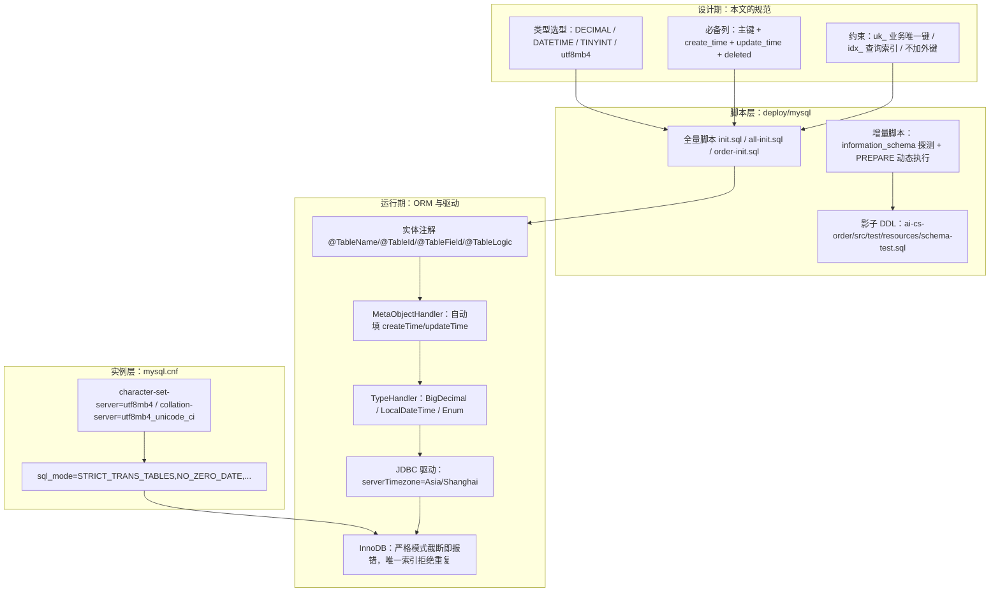
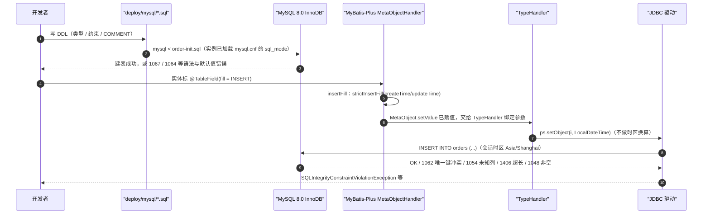

# 建表规范与字段类型选型：把"上线后改不动"的坑堵在 DDL 里

> **一句话结论**：表结构是整个系统里最难回滚的代码——类型选错（用 FLOAT 存钱）、约束错位（唯一索引叠加逻辑删除）、时区错配（TIMESTAMP + 会话时区）这三类错误一旦落库，改一列就是一次停写迁移；规范的唯一价值窗口就是"建表那一刻"。
> **阅读前置**：能看懂 `CREATE TABLE`、知道 InnoDB 有聚簇索引和二级索引、知道 MyBatis-Plus 的 `@TableName/@TableId/@TableField/@TableLogic` 四个注解；SQL 语法不熟的话先看 [01-MySQL核心知识.md](01-MySQL核心知识.md)。
> **证据基线**：MySQL 8.0（InnoDB / utf8mb4）+ MyBatis 3.6.0 + MyBatis-Plus 3.0.5 + JDK 17。A 级证据来自 `learning-docs/24-源码分析/assets/source/` 里已入库的 MyBatis 3.6.0 原文摘录（注意：入库文件名形如 `Xxx.java.md`，锚点必须写全名才能被校验器解析）；B 级证据来自本项目 `deploy/mysql/*.sql`、`ai-cs-*/src/main/java/**` 实体类与配置（行号已于本次核对）；C 级证据是本机 pwsh 对全部 DDL 的统计输出。预计阅读 45~60 分钟。

## 0. 先看现象

### 现象一：金额乘出来是 0.00999…

订单对账出现"少一分钱"。把金额列写成 `FLOAT`（或 Java 侧用 `double`）后，计算链路是这样的：

```text
$ node -e "const f=Math.fround(0.01); console.log('float32(0.01) =', f); console.log('float32(0.01)*100 =', f*100); console.log('0.1+0.2 =', 0.1+0.2); console.log('0.1+0.2 === 0.3 ?', 0.1+0.2===0.3)"
float32(0.01) = 0.009999999776482582
float32(0.01)*100 = 0.9999999776482582
0.1+0.2 = 0.30000000000000004
0.1+0.2 === 0.3 ? false
v24.16.0
```

这段输出是本机 `node` 实测（浮点数的 IEEE-754 单精度/双精度表示，与 MySQL `FLOAT`/`DOUBLE` 的二进制表示同源），**不是 MySQL 服务器实测**，但足以说明机制：`FLOAT` 只保留约 7 位有效十进制位，`0.01` 根本无法精确表示，一旦参与乘加就会漂成 `0.9999999…`。MySQL 8.0 官方手册"Problems with Floating-Point Values"与"Floating-Point Types"两节把这类误差明确列为 `FLOAT/DOUBLE` 的固有行为，并建议用 `DECIMAL` 表示货币。

有意思的是：本项目 `deploy/mysql/*.sql` 里 **`FLOAT`/`DOUBLE` 列数是 0**（见 6.1 的扫描命令），说明这条规范在这个仓库里被真正守住了。

### 现象二：库里比代码早/晚 8 小时

上线后出现"下单时间比实际早 8 小时"或"定时任务扫不到过期订单"。日志里常见这一条（Connector/J 8.x 的经典报错原文）：

```text
java.sql.SQLException: The server time zone value '中国标准时间' is unrecognized or represents more than one time zone.
  You must configure either the server or JDBC driver (via the 'serverTimezone' configuration property)
  to use a more specific time zone value if you want to utilize time zone support.
```

根因不在 SQL 写错，而在"表里那一列到底存了什么"。项目里唯一的 JDBC URL 出现在 `ai-cs-mq/src/main/resources/application.yml#L27`：

```yaml
url: jdbc:mysql://${MYSQL_HOST:123.60.31.79}:3306/mq_db?useUnicode=true&characterEncoding=utf-8&useSSL=false&serverTimezone=Asia/Shanghai&allowPublicKeyRetrieval=true
```

`serverTimezone=Asia/Shanghai` 是显式声明，而 MyBatis 侧把 `LocalDateTime` 交给驱动时**不做任何时区换算**（见 3.2 的源码摘录 `ps.setObject(i, parameter)`），所以 DT 列的时区语义完全由"驱动声明的会话时区 + 列类型"共同决定——`DATETIME`（无时区语义，原样存取）和 `TIMESTAMP`（按会话时区转 UTC）混用就必然错 8 小时。

### 现象三：逻辑删除后同一个用户名再也加不回来

`sys_user_0` 建表语句里同时有这两行（`deploy/mysql/init.sql#L61`、`deploy/mysql/init.sql#L63`）：

```text
L61: deleted         TINYINT         NOT NULL DEFAULT 0 COMMENT '逻辑删除：0-未删除 1-已删除',
L63: UNIQUE KEY uk_username (username),
```

用户注销（`UPDATE sys_user_0 SET deleted=1 WHERE username='zhangsan'`，由实体 `ai-cs-user/src/main/java/com/aics/user/entity/User.java#L76` 上的 `@TableLogic` 自动生成）之后，行还在、索引项还在，再注册同名用户就撞：

```text
java.sql.SQLIntegrityConstraintViolationException: Duplicate entry 'zhangsan' for key 'sys_user_0.uk_username'
```

这就是"唯一索引 + 逻辑删除"的经典死锁：**逻辑删除只改了业务可见性，没有改索引可见性**。

这些现象指向同一件事：**表结构里的类型、约束、时区语义才是运行期行为的真正契约，ORM 只是把这些契约翻译成 SQL 的解释器**——契约错了，改 ORM 注解、加拦截器、写补偿任务都是在错误的地基上打补丁。

## 1. 整体地图



> **读图说明**：这张图把"规范"拆成四层，核心是两条竖线——第一条 `A1/A2/A3 → B1`，说明所有规范都必须能落到可执行的 `.sql` 脚本上，否则只是口头约定；第二条 `D2 → D3 → D4 → D5`，说明运行期真正碰数据的顺序是"自动填充 → 类型转换 → 驱动时区 → 存储引擎约束"，任何一环的假设与表结构不一致都会在第 9 步（见第 4 节）以 SQL 异常的形式暴露。另外注意 `B2 → B3` 这条侧链：增量脚本和测试影子 DDL 是项目里最容易与主脚本漂移的两个地方。

各组件谁负责、谁调用：

| 组件 | 位置 | 责任 | 谁在调用 |
| --- | --- | --- | --- |
| 全量建表脚本 | `deploy/mysql/init.sql`、`deploy/mysql/all-init.sql`、`deploy/mysql/order-init.sql`、`deploy/mysql/product-init.sql` | 定义库、表、索引、注释；本地与 CI 的初始结构来源 | 开发者手工执行、`docker-compose` 首次初始化 |
| 增量变更脚本 | `deploy/mysql/vlm-multimodal-init.sql` | 对已有库做幂等 `ALTER` | 同上，可重复执行 |
| 实例级默认值 | `deploy/mysql/mysql.cnf` | 字符集、排序规则、`sql_mode`、binlog 格式 | MySQL 容器启动加载 |
| 实体注解 | `ai-cs-order/src/main/java/com/aics/order/entity/Order.java` 等 | 声明表名、主键策略、字段填充、逻辑删除 | MyBatis-Plus 启动时扫描 |
| 填充器 | `ai-cs-message/src/main/java/com/aics/message/config/MybatisPlusConfig.java#L47-L63` | `insert`/`update` 前写 `createTime`/`updateTime` | MyBatis-Plus 的 `MetaObjectHandler` 回调 |
| 类型处理器 | MyBatis 内置 `TypeHandlerRegistry` | `BigDecimal`↔`DECIMAL`、`LocalDateTime`↔`DATETIME` 的转换 | `StatementHandler` 绑定参数、`ResultSetHandler` 取值 |
| 影子 DDL | `ai-cs-order/src/test/resources/schema-test.sql` | 单元测试用 H2 建表 | `@SpringBootTest` 的 H2 数据源 |

## 2. 关键概念与关键类

| 名称 | 位置 | 角色 | 关键方法/字段 |
| --- | --- | --- | --- |
| `DECIMAL(M,D)` | MySQL 定点类型（`M` 总位数、`D` 小数位） | 精确十进制存储，金额唯一可选类型 | 项目里只有两种精度：`DECIMAL(10,2)` 与 `DECIMAL(12,6)`（C 级统计） |
| `BigDecimal` | Java 侧对应类型 | 与 `DECIMAL` 精确互转 | `JdbcType.DECIMAL`[[源码:JdbcType.java.md#L49-L49]] |
| `BigDecimalTypeHandler` | MyBatis 内置 | `PreparedStatement.setBigDecimal` / `ResultSet.getBigDecimal` | 注册点：`register(BigDecimal.class, null, BigDecimalTypeHandler.INSTANCE)`[[源码:TypeHandlerRegistry.java.md#L110-L110]] |
| `DATETIME` / `TIMESTAMP` | MySQL 时间类型 | 前者无时区语义原样存取，后者按会话时区转 UTC 且范围受 2038 限制 | 项目里 `TIMESTAMP` 列数 = 0 |
| `LocalDateTime` + `LocalDateTimeTypeHandler` | MyBatis 内置（3.4.5 起） | 时区无关的本地时间存取 | `ps.setObject(i, parameter)`[[源码:LocalDateTimeTypeHandler.java.md#L32-L35]] |
| `TINYINT` 状态列 | 表结构层 | 用小整数表达枚举，配 `COMMENT` 写成 `0-禁用 1-启用` | 项目里 24 处 `status` 用 `TINYINT` |
| `EnumTypeHandler` | MyBatis 内置 | 把枚举存成 `name()` 字符串，而不是 `ordinal()` | `ps.setString(i, parameter.name())`[[源码:EnumTypeHandler.java.md#L38-L44]] |
| `@TableId(type=IdType.*)` | 实体注解 | 主键生成策略：`AUTO` 自增、`ASSIGN_ID` 雪花、`INPUT` 外部给的业务单号 | 项目统计 `AUTO` 22 处、`ASSIGN_ID` 2 处、`INPUT` 2 处 |
| `@TableField(fill=...)` + `MetaObjectHandler` | 实体注解 + 配置类 | 声明"这个字段由框架填"，`INSERT` 填创建时间、`INSERT_UPDATE` 更新时也填 | `strictInsertFill/strictUpdateFill` |
| `MetaObject.setValue` | MyBatis 反射工具 | 填充器真正落地赋值的地方 | `setValue(String name, Object value)`[[源码:MetaObject.java.md#L128-L128]] |
| `@TableLogic` | MyBatis-Plus 注解 | 把 `delete` 改写成 `UPDATE ... SET deleted=1`，把查询自动追加 `deleted=0` | 项目里 4 个实体使用 |
| `uk_` / `idx_` 命名前缀 | 命名规范 | 让人一眼分出唯一约束与普通索引 | `uk_username`、`uk_user_product`、`idx_expire_time` |
| `information_schema.COLUMNS` | MySQL 元数据表 | 判断列是否已存在，是幂等 `ALTER` 的依据 | `SELECT COUNT(*) ... WHERE COLUMN_NAME='image_description'` |
| `sql_mode` | 实例变量 | `STRICT_TRANS_TABLES` 让超长/非法值直接报错而不是静默截断 | `deploy/mysql/mysql.cnf#L32` |

## 3. 原理与证据逐段精读

### 3.1 金额：`DECIMAL` 是唯一正确答案，`FLOAT/DOUBLE` 一律禁用

`deploy/mysql/order-init.sql` 里五个金额列全部是 `DECIMAL(10,2)`（`deploy/mysql/order-init.sql#L28-L32`，下面是含上下文的 `#L26-L32`）：

```sql
    order_no                VARCHAR(32)     NOT NULL                COMMENT '订单号',
    user_id                 BIGINT          NOT NULL                COMMENT '用户ID',
    total_amount            DECIMAL(10,2)   NOT NULL                COMMENT '商品总金额（原价合计）',
    discount_amount         DECIMAL(10,2)   DEFAULT 0.00            COMMENT '优惠金额（满减+优惠券）',
    pay_amount              DECIMAL(10,2)   NOT NULL                COMMENT '应付金额 = total - discount',
    full_reduction_amount   DECIMAL(10,2)   DEFAULT 0.00            COMMENT '满减抵扣金额',
    coupon_amount           DECIMAL(10,2)   DEFAULT 0.00            COMMENT '优惠券抵扣金额',
```

台账类的"很长的小数"也有现成答案：`deploy/mysql/all-init.sql#L460` 的 `estimated_cost DECIMAL(12,6) NOT NULL DEFAULT 0` 用来存 LLM 调用的估算成本（单价可到 0.000001 量级），6 位小数刚好够，而 `DECIMAL(10,2)` 会把小额调用抹成 0。C 级统计证明项目里只有这两档精度：`DECIMAL(10,2)` 26 次、`DECIMAL(12,6)` 4 次。

- **在干什么**：用定点数把"分"作为最小单位精确存下来，`0.01` 就是 `0.01`，做 `×100`、`SUM` 不会有漂移。
- **为什么这么设计**：`DECIMAL` 是"字符串式精确十进制"，不经过二进制浮点表示；而 `FLOAT`（4 字节，约 7 位有效数字）与 `DOUBLE`（8 字节，约 15~16 位）是近似值类型，MySQL 8.0 手册明确写它们"是近似值，可能带来舍入误差"。金额、库存单价、佣金、汇率这类必须对账的数值没有任何理由用近似值。
- **换写法会怎样**：写成 `DOUBLE` 时，`9999999.99` 这类 9 位有效数字已经在精度边缘，`SUM()` 汇总十万行就会差几分；写成 `DECIMAL(10,2)` 而业务要做"按毫厘计价"（如按 token 计费），则会被静默四舍五入成 0，比误差更危险——这正是 `model_usage` 用 `(12,6)` 的原因。
- **常见坑**：① 表结构是 `DECIMAL`，但 Java 侧字段写成 `double`，误差在 ORM 转换时就已经产生，务必用 `BigDecimal`——项目里 `ai-cs-order/src/main/java/com/aics/order/entity/Order.java#L23-L31` 五个金额字段全是 `BigDecimal`，`ai-cs-order/src/main/java/com/aics/order/service/impl/CartServiceImpl.java#L46` 的小计也用 `multiply(BigDecimal.valueOf(quantity))` 而不是 `*`；② 只在表里禁 `FLOAT`、却在中间表/报表表里放行，本项目 `order_item` 的成交单价快照 `product_price`（`deploy/mysql/order-init.sql#L55`）与 `subtotal`（`#L57`）同样是 `DECIMAL(10,2)`，快照表最容易被漏掉；③ `DECIMAL` 的 `D` 定小了以后要改，`ALTER TABLE ... MODIFY` 对大表是全表重建，成本远高于建表时想清楚。

### 3.2 时间：`DATETIME` 与 `TIMESTAMP` 的时区语义差异，比类型名重要得多

先看 MyBatis 侧到底做了什么。`LocalDateTime` 的写入只有一行：

```java (src: LocalDateTimeTypeHandler.java.md#L32-L35)
  @Override
  public void setNonNullParameter(PreparedStatement ps, int i, LocalDateTime parameter, JdbcType jdbcType)
      throws SQLException {
    ps.setObject(i, parameter);
  }
```

读取同样直白，`rs.getObject(columnName, LocalDateTime.class)`（[[源码:LocalDateTimeTypeHandler.java.md#L38-L40]]）。注意：**这里没有任何 `TimeZone` 参数**，`LocalDateTime` 是"没有时区的时间"，驱动也不会替你换算。

- **在干什么**：把 Java 的 `LocalDateTime` 原样交给 JDBC 驱动，读写都不做时区平移；时区语义被完全推给"列类型 + 会话时区"。
- **为什么这么设计**：MyBatis 3.4.5 引入 `java.time` 支持时，刻意让 `LocalDateTime`/`LocalDate` 保持"无时区"语义（对应 SQL 标准里的 `TIMESTAMP WITHOUT TIME ZONE`），需要带时区的场景用 `OffsetDateTime`/`Instant`。这样 ORM 不会在应用层偷偷加减 8 小时，行为可预测。
- **换写法会怎样**：如果列写成 `TIMESTAMP`，MySQL 会把写入值按**会话时区**转成 UTC 存、读取时再按会话时区转回来；一旦连接池里两个连接的 `serverTimezone` 不一致（或一个走 `Asia/Shanghai`、一个没配走服务器默认），同一行数据就会读出两种时间。换成 `DATETIME` 则原样存储原样读出，只会"整体差 8 小时"而不是"随机差 8 小时"——后者更难查。
- **常见坑**：① 项目全库 `DATETIME` 179 处、`TIMESTAMP` 0 处（C 级统计），这是刻意的统一，因为 `TIMESTAMP` 还有 1970-2038 的范围天花板（MySQL 8.0 手册 "The DATE, DATETIME, and TIMESTAMP Types" 一节）与"第一个 TIMESTAMP 列自动 `ON UPDATE`"的历史包袱；② `orders.pay_time`、`coupon.expire_time` 这类列写成 `DATETIME NOT NULL` 却没给默认值（`deploy/mysql/order-init.sql#L38`），插入时必须显式赋值，否则严格模式直接报 `Field 'expire_time' doesn't have a default value`；③ 应用层用 `LocalDateTime.now()` 生成时间而服务器时区是 UTC 容器时，库里存的是 UTC 的"墙上时间"，读出来却当成北京时间展示——这类问题只能靠统一"谁生成时间"来治（见 3.3）。

### 3.3 `create_time` / `update_time`：数据库默认值与 ORM 填充必须二选一，不能两套都假设

项目里其实是"三层保障"，但不是每个模块都三层齐全：

第一层是 DDL 默认值，`deploy/mysql/order-init.sql#L16-L17`：

```sql
    create_time             DATETIME        NOT NULL DEFAULT CURRENT_TIMESTAMP COMMENT '创建时间',
    update_time             DATETIME        NOT NULL DEFAULT CURRENT_TIMESTAMP ON UPDATE CURRENT_TIMESTAMP COMMENT '更新时间',
```

C 级统计：全库 `DEFAULT CURRENT_TIMESTAMP` 144 处、`ON UPDATE CURRENT_TIMESTAMP` 56 处——说明"数据库自己维护时间"是这个项目的主流做法。

第二层是 ORM 填充。`ai-cs-message/src/main/java/com/aics/message/config/MybatisPlusConfig.java#L47-L63` 注册了 `MetaObjectHandler`：

```java
    @Bean
    public MetaObjectHandler metaObjectHandler() {
        return new MetaObjectHandler() {
            @Override
            public void insertFill(MetaObject metaObject) {
                this.strictInsertFill(metaObject, "createTime", LocalDateTime.class, LocalDateTime.now());
                this.strictInsertFill(metaObject, "updateTime", LocalDateTime.class, LocalDateTime.now());
            }

            @Override
            public void updateFill(MetaObject metaObject) {
                this.strictUpdateFill(metaObject, "updateTime", LocalDateTime.class, LocalDateTime.now());
            }
        };
    }
```

第三层是实体上的开关：`ai-cs-order/src/main/java/com/aics/order/entity/Order.java#L45-L49` 给 `createTime` 标 `FieldFill.INSERT`、给 `updateTime` 标 `FieldFill.INSERT_UPDATE`。填充器最终是通过 `MetaObject.setValue(String name, Object value)`（[[源码:MetaObject.java.md#L128-L128]]）把值塞进实体对象的，所以**实体必须有同名（或映射后同名）属性**，否则 `strictInsertFill` 会静默跳过。

- **在干什么**：把"谁写时间"这件事分成三份：DDL 兜底（任何来源的 insert 都有值）、填充器补精度（应用层的时间更贴近业务发生时刻）、实体注解声明哪些字段参与。
- **为什么这么设计**：DDL 默认值对"绕过应用的写入"（数据修复脚本、canal 同步、手工 SQL）同样生效；填充器则保证 Java 侧 `LocalDateTime` 与库列类型一致，不依赖数据库服务器时钟。
- **换写法会怎样**：`ai-cs-mq/src/main/java/com/aics/mq/entity/WorkOrder.java#L16` 的类注释给了实际答案——"时间字段由数据库默认值维护（本模块组件扫描不含 common 的 MetaObjectHandler）"。也就是说这个模块**只有第一层**，`createTime`/`updateTime` 两字段没有 `@TableField(fill=...)`（`#L41`、`#L44`），值全靠 DDL 的 `DEFAULT CURRENT_TIMESTAMP`。如果谁把这个模块的时间列改成无默认值，插入立刻报 `not has a default value`。
- **常见坑**：① 只写 DDL 默认值但实体字段标了 `fill=INSERT_UPDATE`，`updateById` 时 `update_time` 会被应用时间覆盖，而"库时间"和"应用时间"因时区不同相差 8 小时，审计上看起来像时间倒流；② `coupon` 表只有 `create_time` 没有 `update_time`（`deploy/mysql/order-init.sql#L74`，整表 L64-L78 内无该列），但状态会从 `UNUSED` 变 `USED`，状态变更无法审计；③ `chat_message` 同理只有 `create_time`（`deploy/mysql/init.sql#L313`），这与消息"只增不改"的语义相符，属于合理取舍——规范要能区分"该有的没有"和"不需要所以没有"。

### 3.4 状态字段：`TINYINT` + 注释枚举 vs `VARCHAR`，项目里各占一半

C 级统计最能说明现状：`status` 列 **`TINYINT` 24 处、`VARCHAR` 24 处**，五五开。

`TINYINT` 阵营的代表是商品表，注释把枚举写全了（`deploy/mysql/product-init.sql#L31`）：

```sql
    status          TINYINT         NOT NULL DEFAULT 1        COMMENT '状态：0-下架 1-上架',
```

`VARCHAR` 阵营的代表是订单表（`deploy/mysql/order-init.sql#L35`）与售后申请表（`#L108`），用的是"字面量枚举名"：

```sql
    status          VARCHAR(20)     NOT NULL DEFAULT 'PENDING_PAY'  COMMENT '状态：PENDING_PAY/PAID/CANCELLED/REFUNDING/REFUNDED',
```

纯从性能看差异很小（`VARCHAR(20)` 存值也就 5~13 字节），真正的差异在**转换链路**。MyBatis 的 `EnumTypeHandler` 存的是 `name()`：

```java (src: EnumTypeHandler.java.md#L38-L44)
  @Override
  public void setNonNullParameter(PreparedStatement ps, int i, E parameter, JdbcType jdbcType) throws SQLException {
    if (jdbcType == null) {
      ps.setString(i, parameter.name());
    } else {
      ps.setObject(i, parameter.name(), jdbcType.TYPE_CODE); // see r3589
    }
  }
```

读取是 `Enum.valueOf(type, s)`（[[源码:EnumTypeHandler.java.md#L47-L49]]），字符串对不上枚举常量名就直接抛 `IllegalArgumentException`。

- **在干什么**：把业务状态落到一列上，两种载体：小整数（省空间、便于范围查询、看数字得靠注释）或字符串（自解释、可读、跨语言友好）。
- **为什么这么设计**：`TINYINT` 的前提是"注释即字典"，所以注释必须写清 `0-禁用 1-启用`，这是本项目所有 `TINYINT` 状态的统一格式（对照 `deploy/mysql/init.sql#L292` 的 `status TINYINT NOT NULL DEFAULT 1 COMMENT '0-已结束 1-进行中 2-转人工'`）；`VARCHAR` 的前提是"枚举名即契约"，所以类型必须是 `enum` 而不是裸 `String`，否则查出来的值拼错一个字母就 500。
- **换写法会怎样**：`TINYINT` 列 + Java 侧 `enum`（默认 `EnumTypeHandler`）会写进 `'PAID'` 这种字符串，严格模式下直接报 `Incorrect integer value: 'PAID' for column 'status'`；反过来，`VARCHAR` 列 + `@EnumValue` 之外的默认映射是安全的，但一旦有人给枚举加了 `ordinal` 风格的自定义 `TypeHandler`，库里的 `'PAID'` 就再也读不出来。项目现状是"实体用 `String`/`Integer`、不用 `enum`"——`ai-cs-order/src/main/java/com/aics/order/entity/Order.java#L37` 的 `status` 是 `String`，而项目里明明有 `ai-cs-order/src/main/java/com/aics/order/enums/OrderStatus.java#L13-L17` 这个枚举类，二者没接上。
- **常见坑**：① 注释没写枚举 = 半年后没人知道 `3` 是什么；② `VARCHAR(20)` 卡得太紧，`'PARTIAL_REFUNDED'`（16 字符）能进、`'PENDING_MANUAL_REVIEW'`（21 字符）就被严格模式拒绝（`Data too long for column 'status'`）；③ 同一语义在不同表用不同编码（`orders.status` 用 `PENDING_PAY`，`chat_session.status` 用 `1`），跨表统计时要写两套映射。

### 3.5 主键：自增 `BIGINT` 做物理主键，业务单号只做唯一索引

项目的三种主键策略并存，各司其职：

| 策略 | 典型场景 | 证据 |
| --- | --- | --- |
| `IdType.AUTO`（自增） | 单库单表、无分片 | `ai-cs-order/src/main/java/com/aics/order/entity/Order.java#L16`，配合 `deploy/mysql/order-init.sql#L25` 的 `id BIGINT NOT NULL AUTO_INCREMENT` |
| `IdType.ASSIGN_ID`（雪花） | 分库分表后自增会撞 | `ai-cs-user/src/main/java/com/aics/user/entity/User.java#L27`，对应 `deploy/mysql/init.sql#L49-L66` 里 `sys_user_0` 的 `id BIGINT NOT NULL`（**无 `AUTO_INCREMENT`**） |
| `IdType.INPUT`（调用方给） | 天然唯一的外部标识 | 项目里 `AgentRun` 用 `UUID` 生成 `run_id`、`LlmTrace` 直接用 `request_id` 做主键（`deploy/mysql/all-init.sql#L442` 的 `request_id VARCHAR(64) PRIMARY KEY`） |

关键区分：**业务单号永远是唯一索引，不是主键**。`deploy/mysql/order-init.sql#L42` 的 `UNIQUE KEY uk_order_no (order_no)` 与自增主键 `id` 并存，好处是聚簇索引（InnoDB 按主键组织数据）保持窄而有序，插入不随机、二级索引也不必挂着 32 字节的字符串。

- **在干什么**：让物理主键只承担"行标识 + 聚簇顺序"，让业务键只承担"唯一性 + 查询"。
- **为什么这么设计**：InnoDB 的二级索引叶子节点存的是主键值，主键越宽、二级索引越胖；而自增主键保证 B+ 树尾部顺序追加，不会页分裂。若用 `VARCHAR(32)` 的订单号做主键，每插入一个新订单都是随机位置插入，且所有二级索引都要复制 32 字节。
- **换写法会怎样**：用 `UUID`（36 字符）做主键的表，写入吞吐通常掉一个档；用雪花 ID（`BIGINT` 但非连续）做主键，插入也变成随机写，但仍是 `BIGINT`，代价小于 UUID——这正是分片表选择 `ASSIGN_ID` 而不是 `AUTO` 的权衡（分片下 `AUTO` 会在每张表内重复）。
- **常见坑**：① 分片表忘了去掉 `AUTO_INCREMENT` 又切到 `ASSIGN_ID`，MyBatis-Plus 会以实体 ID 为准插入，若某条 SQL 走了裸 `INSERT` 则自增值与雪花值混在一列；② 项目里 `sys_user_0` 的注释明确写了"`uk_username` 仅单表内唯一，全局唯一靠应用层广播查询"（`deploy/mysql/init.sql#L42-L43`），跨表唯一性不能靠 DDL 兜底；③ 业务单号生成器不幂等（重试生成两个不同单号），此时 `uk_order_no` 也救不了重复下单，需要靠 `uk_idempotency_key` 那种"入参指纹"（`deploy/mysql/order-init.sql#L112`）。

### 3.6 字符集与排序规则：`utf8mb4` 是底线，`ci` 后缀的差别会咬人

实例级设置在 `deploy/mysql/mysql.cnf#L10-L11`：`character-set-server=utf8mb4`、`collation-server=utf8mb4_unicode_ci`；库级设置在 `deploy/mysql/init.sql#L7`：`CREATE DATABASE IF NOT EXISTS user_db DEFAULT CHARACTER SET utf8mb4 COLLATE utf8mb4_unicode_ci`。

但表级有两套并存——C 级统计：`utf8mb4_unicode_ci` 116 处、`utf8mb4_general_ci` 12 处，且分布很集中（`all-init.sql` 6 处、`order-init.sql` 6 处）。`deploy/mysql/order-init.sql#L21` 就是后者：

```sql
) ENGINE=InnoDB DEFAULT CHARSET=utf8mb4 COLLATE=utf8mb4_general_ci COMMENT='购物车';
```

- **在干什么**：`utf8mb4` 决定"能存什么"（4 字节，能存 emoji 与生僻字），collation（排序规则）决定"怎么比较、怎么排序"（大小写是否敏感、重音是否等价）。
- **为什么这么设计**：`utf8`（即 `utf8mb3`）最多 3 字节，存 emoji 会报 `Incorrect string value: '\xF0\x9F...'`；MySQL 8.0 已把 `utf8` 视为 `utf8mb3` 的别名并标注为待废弃。排序规则上 `unicode_ci` 依据 Unicode 排序算法（更准），`general_ci` 是老的简化规则（更快、更粗糙），MySQL 8.0 的默认值又是 `utf8mb4_0900_ai_ci`（第三种），所以显式声明 collation 是必要的。
- **换写法会怎样**：同一实例里两张表 collation 不同，JOIN 时 MySQL 会做隐式转换——通常按"更宽"的规则转换，代价是**索引失效**（`A JOIN B ON a.name=b.name` 走不了 `b.name` 上的索引）。这就是 12 处 `general_ci` 的现实风险，而不是"纯粹的代码风格"。
- **常见坑**：① 新建表忘了写 `COLLATE`，就会继承实例默认（本项目是 `unicode_ci`，但云上 MySQL 8.0 默认 `0900_ai_ci`），于是同一个库出现三种规则；② `ci`（case-insensitive）意味着 `WHERE username='ZhangSan'` 能查到 `zhangsan`——登录场景通常无害，但"校验码/邀请码"这种区分大小写的列必须显式 `COLLATE utf8mb4_bin`；③ 只改表默认值不会改已有列，`ALTER TABLE ... CONVERT TO CHARACTER SET` 才会重写列定义。

### 3.7 NULL 的三宗罪，以及"逻辑删除 + 唯一索引"的三种解法

先看项目现状：`deleted` 列 26 处（C 级统计），而 `@TableLogic` 只标在 4 个实体上（`ai-cs-user/src/main/java/com/aics/user/entity/User.java#L76`、`ai-cs-product/src/main/java/com/aics/product/entity/Product.java#L45`、`ai-cs-message/src/main/java/com/aics/message/entity/ChatSession.java#L54`、`ai-cs-knowledge/src/main/java/com/aics/knowledge/entity/KnowledgeDocument.java#L65`），且 C 级统计显示 **唯一键里包含 `deleted` 的有 0 个**——也就是说 0.1 节的第三个现象在项目里有 26 个潜在触发点，只是多数表现在还没有"删了再加同名"的路径。

NULL 的"三宗罪"在这里具体是：

- **索引**：`NULL` 参与 B+ 树索引但不等于任何值，`WHERE col = NULL` 永远查不到，必须写 `IS NULL`；`COUNT(col)` 会跳过 `NULL`，而 `COUNT(*)` 不会——统计口径不一致的第一步。
- **聚合**：`SUM`/`AVG` 会忽略 `NULL` 行，`AVG` 更危险：分母也一起去掉，算出来的"平均客单价"偏高。
- **唯一约束**：MySQL 的唯一索引允许多个 `NULL`（因为 `NULL != NULL`），于是 `UNIQUE KEY uk_x (a, b)` 在 `b IS NULL` 时形同虚设——这正是逻辑删除列若用 `NULL` 表示"已删除"会立刻失效的原因。

三种解法，代价从低到高：

| 解法 | 做法 | 代价 | 适用 |
| --- | --- | --- | --- |
| 唯一键并入 `deleted` | `UNIQUE KEY uk_username (username, deleted)`，`deleted` 用 `TINYINT DEFAULT 0` | 同一用户只能被删一次（第二次删除时 `deleted=1` 冲突） | 只删一次的业务实体 |
| `deleted` 存删除时间/行 ID | `deleted BIGINT DEFAULT 0`，删除时写 `id` 或时间戳 | 语义稍绕，需改 `@TableLogic` 的 value 约定 | 允许反复增删 |
| 物理删除 + 归档表 | 直接 `DELETE`，历史进 `xxx_archive` | 失去"可恢复"，需要归档任务 | 项目里购物车就是这么干的：`ai-cs-order/src/main/java/com/aics/order/service/impl/CartServiceImpl.java#L145` 的 `deleteById` 是真删除，而 `uk_user_product`（`deploy/mysql/order-init.sql#L19`）不含 `deleted`，所以"删了再加"完全正常 |

- **在干什么**：让"业务上的删除"与"存储上的删除"解耦；同时保证唯一性约束不因逻辑删除而形同虚设或过度约束。
- **为什么这么设计**：唯一索引的作用域是"行是否存在于表中"，而 `@TableLogic` 只影响 SQL 生成（查询自动 `AND deleted=0`），两者管的是不同维度，所以必须显式对齐。
- **换写法会怎样**：把 `deleted` 改成 `NULL`/时间戳混合（未删除为 `NULL`）看似优雅，但 `UNIQUE KEY uk_username (username, deleted)` 会**允许多个未删除行**（因为 `NULL` 不参与唯一比较），等于把约束彻底放掉——这是最常见的"越想越错"的改法。
- **常见坑**：① 只给 `deleted` 加了索引就以为唯一性没问题（`uk_username` 不带 `deleted`，索引再全也没用）；② `@TableLogic` 默认 `value=1, delval=0`，若列定义是 `DEFAULT 0` 但历史数据是 `NULL`，查询 `AND deleted=0` 会把历史行全部过滤掉，表现为"数据凭空消失"（MyBatis-Plus 官方文档 "逻辑删除" 一节明确建议列 `NOT NULL DEFAULT 0`）；③ 订单主表 `orders` **没有** `deleted` 列（`deploy/mysql/order-init.sql#L24-L46` 内无此列），订单不可删只可改状态，这是正确的业务建模，别为了"字段七件套整齐"硬塞。

### 3.8 大字段与宽表：拆表不是洁癖，是页大小与备份的现实约束

项目里两处典型的大字段处理，方向完全相反：

知识库文档把正文放在主表上（`deploy/mysql/init.sql#L242`）：`content LONGTEXT`，并为它建了全文索引（`deploy/mysql/init.sql#L258` 的 `FULLTEXT KEY ft_title_content (title, content) WITH PARSER ngram`）——因为检索就是它的主用途，拆出去反而要回表 JOIN。

聊天消息把"结构化附加信息"单独放 JSON 列（`deploy/mysql/init.sql#L312`：`metadata JSON`），正文用 `TEXT`（`#L310`），且整表只有 `create_time`、没有 `update_time`——消息是只增不改的时序数据。

C 级统计给出整体水位：`TEXT` 14 处、`LONGTEXT` 14 处、`MEDIUMTEXT` 2 处、`JSON` 2 处、`CHAR` 2 处，其余 480 处 `VARCHAR`；`VARCHAR` 最宽到 2048，没有超过 2048 的定长变长字符串。

- **在干什么**：把"行内变长的大负载"和"高频访问的窄列"分开，控制单行长度与页内碎片。
- **为什么这么设计**：InnoDB 页默认 16KB，行太长会溢出到溢出页（off-page），每次读取都要额外一次 IO；`ORDER BY`/`GROUP BY` 用不上含大字段的行时，临时表还会把大字段一起搬走。此外统一用 `VARCHAR` 而不是 `CHAR` 是因为 `CHAR` 会补齐空格（`CHAR(10)` 存 `'a'` 读出来是 `'a         '`，比较时又要 `TRIM`）。
- **换写法会怎样**：把所有 `VARCHAR(2000)` 的备注列也塞进主表，单行可能超过 8KB（InnoDB 行溢出的阈值与 `innodb_page_size` 相关），`SELECT *` 的 IO 立刻翻倍；反过来把 `kb_document.content` 拆到 `kb_document_content` 子表，全文检索 `ft_title_content` 就得跨表，索引设计复杂度上升。
- **常见坑**：① `tags VARCHAR(1024)` 逗号分隔（`deploy/mysql/init.sql#L246`）导致 `WHERE tags LIKE '%Java%'` 全表扫，且无法保证标签一致性——项目另建了 `kb_tag` + `kb_document_tag`（`#L262-L279`）做规范化，两套并存；② 列数失控：C 级统计全库 42 张表平均 12.5 列、最多 21 列（`orders`、`after_sale_application`），没有出现"一张表 80 列"的经典宽表；③ `TEXT` 列不能有默认值（MySQL 限制），`NOT NULL` 且无默认值的 `TEXT` 在严格模式下插入必须显式赋值。

### 3.9 审计字段与乐观锁 `version`：规范里写了，项目里没落地

诚实地说：全仓 grep `@Version` 与 `OptimisticLockerInnerInterceptor` 的结果是 **0 处**。也就是说"乐观锁 version 字段"在本项目只是待办，不是现状。审计人字段也只有一处：`deploy/mysql/init.sql#L249` 的 `create_by BIGINT`（知识库文档记录创建人），其余表连 `create_by`/`update_by` 都没有。

- **在干什么**：审计字段回答"谁在什么时候创建/修改了这行"，`version` 回答"这次更新是否基于我读到的那一版"。
- **为什么这么设计**：`version` 是乐观锁（先读后写，写时 `WHERE version = ?` 且 `SET version = version + 1`，影响行数为 0 即冲突）的成本最低形态，不需要 `SELECT ... FOR UPDATE` 的悲观锁（悲观锁会在事务期间持锁，扣库存这种热点行会排队）。
- **换写法会怎样**：库存扣减若无 `version` 也未用 `UPDATE stock = stock - ? WHERE stock >= ?` 的原子写，就只能靠 `synchronized`（单机有效）或分布式锁（Redis 成本、失效风险）——`ai-cs-product` 的 `stock INT`（`deploy/mysql/product-init.sql#L28`）目前是哪种做法，取决于 `ProductServiceImpl` 的实现，规范层面应先补 `version INT NOT NULL DEFAULT 0`。
- **常见坑**：① 加 `version` 但 MyBatis-Plus 没配 `OptimisticLockerInnerInterceptor`，注解静默失效——`@Version` 只负责标记，拦截器才负责生成 `WHERE version=?`；② `version` 用 `TIMESTAMP` 或 `updated_at` 代替，同一毫秒的两次更新分不出先后；③ 加了 `version` 后所有 `updateById` 都必须带 version 值，前端回传旧版本时会表现为"更新无效"而没有任何报错（影响行数为 0），必须检查返回的 `int`。

### 3.10 幂等 DDL：脚本可重复执行，才敢在 CI 和线上跑第二遍

全量脚本用 `CREATE TABLE IF NOT EXISTS` 保证幂等（C 级统计里 42 张表全部如此），但**加列**就没这个语法糖，于是项目用了一段可复用的模板——`deploy/mysql/vlm-multimodal-init.sql#L7-L22` 的核心内容（为便于阅读合并了续行）：

```sql
SET @dbname = DATABASE();
SET @col_exists = (SELECT COUNT(*) FROM information_schema.COLUMNS
  WHERE TABLE_SCHEMA = @dbname AND TABLE_NAME = 'product' AND COLUMN_NAME = 'image_description');
SET @ddl = IF(@col_exists = 0,
  'ALTER TABLE product ADD COLUMN image_description VARCHAR(1024) NULL COMMENT ''视觉模型生成的图片描述，用于增强检索''',
  'SELECT ''product.image_description 已存在，跳过'' AS info');
PREPARE stmt FROM @ddl; EXECUTE stmt; DEALLOCATE PREPARE stmt;
```

- **在干什么**：先用 `information_schema.COLUMNS` 探测列是否存在，再用 `PREPARE` 把"要执行的 DDL"当字符串拼进一个占位语句里——因为 MySQL 不允许 `ALTER TABLE` 在 `IF` 里直接分支。
- **为什么这么设计**：运维脚本最怕"跑第二遍就报 `Duplicate column name`"；用元数据表探测 + 动态 SQL，把脚本变成幂等的，就能放进 CI、放进 k8s initContainer 反复执行。
- **换写法会怎样**：直接 `ALTER TABLE product ADD COLUMN ...` 在已迁移的库上会报 `ERROR 1060 (42S21): Duplicate column name 'image_description'`，若包在 `initContainer` 里会导致 Pod 启动失败；用 `ALTER TABLE ... ADD COLUMN IF NOT EXISTS` 只在 MariaDB 有，MySQL 8.0 不支持（官方手册 "ALTER TABLE" 语法未列该选项）。
- **常见坑**：① `PREPARE` 语句里的字符串要双层引号（`''...''`），漏一层就变成语法错误 `ERROR 1064`；② 探测语句用的 `DATABASE()` 依赖"先 `USE` 了正确的库"，脚本里若只写了 `product_db.product` 全限定名却没 `USE`，`@dbname` 会是 `NULL`，`COUNT(*)` 恒为 0，于是每次都执行 `ALTER`；③ 增量脚本不进版本库的迁移记录表（项目没有 Flyway/Liquibase），"这个库到底跑到第几个脚本"靠人脑记——这是本项目 DDL 治理里最大的缺口。

### 3.11 逐段点评 `deploy/mysql/order-init.sql`：哪些类型选得好，哪些可以改进

只挑真实内容点评，不臆测：

| 位置 | 真实写法 | 评价 |
| --- | --- | --- |
| `deploy/mysql/order-init.sql#L28-L32` | 五个金额列全 `DECIMAL(10,2)`，`discount_amount DEFAULT 0.00` | ✅ 好：精度统一、默认值给了 0 而不是 `NULL`，聚合不会跳过 |
| `deploy/mysql/order-init.sql#L42` | `UNIQUE KEY uk_order_no (order_no)` 与自增主键并存 | ✅ 好：业务键做唯一索引，主键保持窄 |
| `deploy/mysql/order-init.sql#L45` | `KEY idx_expire_time (expire_time)` | ✅ 好：为"扫描过期订单"的定时任务准备的范围索引 |
| `deploy/mysql/order-init.sql#L35` | `status VARCHAR(20) NOT NULL DEFAULT 'PENDING_PAY'` | ⚠️ 可改进：与 `product.status TINYINT` 风格不一致；`PENDING_PAY` 已占 11 字符，`REFUNDING`/`REFUNDED` 够用但无余量 |
| `deploy/mysql/order-init.sql#L44` | `KEY idx_status (status)` | ⚠️ 可改进：5 个枚举值的等值查询区分度低，优化器多半不走；真正需要的是 `(status, expire_time)` 这类组合索引 |
| `deploy/mysql/order-init.sql#L49-L61` | `order_item` 全表**没有** `create_time`/`update_time` | ⚠️ 可改进：明细表无时间列，排查"这条明细什么时候进来的"只能靠 `orders.create_time`；且 H2 影子 DDL 里反而有 `create_time`（`ai-cs-order/src/test/resources/schema-test.sql#L43`），属于测试与生产漂移 |
| `deploy/mysql/order-init.sql#L54-L57` | `product_name`/`product_price`/`subtotal` 三列快照 | ✅ 好：反范式快照，商品改名改价后历史订单金额不变（这是必须冗余的典型例子） |
| `deploy/mysql/order-init.sql#L64-L78` | `coupon` 只有 `create_time`，无 `update_time` | ⚠️ 可改进：`status` 会从 `UNUSED` 变 `USED`、`use_time` 也会写值，缺 `update_time` 无法审计变更时刻 |
| `deploy/mysql/order-init.sql#L70` | `status VARCHAR(20) NOT NULL DEFAULT 'UNUSED'` | ⚠️ 可改进：同表 `expire_time` 已是 `DATETIME NOT NULL` 却无默认值，插入必须显式赋值 |
| `deploy/mysql/order-init.sql#L19-L20` | `UNIQUE KEY uk_user_product (user_id, product_id)` + 单独的 `KEY idx_user_id (user_id)` | ⚠️ 冗余索引：`idx_user_id` 是 `uk_user_product` 的最左前缀，`WHERE user_id=?` 已能命中唯一索引；`idx_user_id` 只增加写放大 |
| `deploy/mysql/order-init.sql#L21` 等 6 处 | 表尾 `COLLATE=utf8mb4_general_ci` | ⚠️ 与实例级 `unicode_ci`（`deploy/mysql/mysql.cnf#L11`）不一致，跨表 JOIN 有隐式转换风险 |
| `deploy/mysql/order-init.sql#L91` | `KEY idx_enabled_time (enabled, start_time, end_time)` | ✅ 好：三列组合索引，等值列在前、范围列在后，符合最左前缀 |
| `deploy/mysql/order-init.sql#L95-L117` | `after_sale_application` 与 `deploy/mysql/after-sales-agent-init.sql#L94-L116` 重复定义 | ⚠️ 隐患：同一张表在两个脚本里各写一份，改一处忘一处就会漂移；C 级统计里 42 个表名对应 83 个 `CREATE TABLE` 块，就是这类重复的量化结果 |

## 4. 一次完整执行时序



> **读图说明**：关键在两条箭头——第 7 步 `ps.setObject(i, LocalDateTime)` 说明"应用层不做时区换算"，时区语义完全由第 8 步的连接会话时区决定，所以 `serverTimezone` 必须显式配置；第 9~10 步说明所有规范问题最终都以**存储引擎的某个错误码**收尾，因此排查建表规范问题的起点永远是"拿到真实的 MySQL 错误码"，而不是猜。

哪一步失败会报什么错（错误码取自 MySQL 8.0 官方手册 "Server Error Message Reference"）：

| 步骤 | 失败原因 | 典型报错 |
| --- | --- | --- |
| 2 | 脚本用了 MariaDB 专有语法或 `ADD COLUMN IF NOT EXISTS` | `ERROR 1064 (42000): You have an error in your SQL syntax` |
| 2 | `DATETIME` 列默认给了非法值（如 `DEFAULT '0000-00-00'`） | `ERROR 1067 (42000): Invalid default value for 'xxx'` |
| 3 | 表已存在但脚本没写 `IF NOT EXISTS` | `ERROR 1050 (42S01): Table 'xxx' already exists` |
| 6 | 实体字段名与列名不一致且没有 `@TableField` | 运行期 `1054`（见下） |
| 7 | 时间列是 `TIMESTAMP` 且驱动未配 `serverTimezone` | `java.sql.SQLException: The server time zone value ... is unrecognized` |
| 8 | 实体声明了 DDL 不存在的列（如 `chat_message.session_key`） | `ERROR 1054 (42S22): Unknown column 'session_key' in 'where clause'` |
| 8 | 逻辑删除后重复插入同一业务键 | `ERROR 1062 (23000): Duplicate entry 'zhangsan' for key 'uk_username'` |
| 8 | 字符串超长且 `sql_mode` 含 `STRICT_TRANS_TABLES` | `ERROR 1406 (22001): Data too long for column 'status' at row 1` |
| 8 | `NOT NULL` 列既无默认值又未赋值（严格模式） | `ERROR 1364 (HY000): Field 'expire_time' doesn't have a default value` |
| 8 | 往 `TINYINT` 状态列写枚举名 | `ERROR 1366 (HY000): Incorrect integer value: 'PAID' for column 'status'` |

## 5. 设计取舍

| 决策点 | 本项目选择 | 收益 | 代价 | 替代方案 |
| --- | --- | --- | --- | --- |
| 金额类型 | 一律 `DECIMAL` | 精确对账 | 比 `DOUBLE` 慢一点、占空间多一点 | 整数存"分"（`BIGINT`），代价是每处都要 ×100/÷100 |
| 时间类型 | 一律 `DATETIME` | 无时区歧义、无 2038 限制 | 跨时区业务要应用层显式转换 | `TIMESTAMP`（自动 UTC 归一，但有范围与隐式 `ON UPDATE` 风险） |
| 时间维护 | DDL `DEFAULT CURRENT_TIMESTAMP` + 部分模块 `MetaObjectHandler` | 双保险 | 两套时间源可能不一致 | 只留 DDL 默认值（简单）或只留应用填充（可控但绕不过脚本写库） |
| 状态编码 | `TINYINT` 24 处 / `VARCHAR` 24 处并存 | 各取所长 | 跨表统计要写两套映射 | 统一 `TINYINT` + 字典表，或统一 `VARCHAR` + `enum` |
| 主键 | `AUTO` 22 / `ASSIGN_ID` 2 / `INPUT` 2 | 按分片与否分别最优 | 主键语义不统一 | 全雪花（统一但要接受随机写） |
| 逻辑删除 | `deleted TINYINT DEFAULT 0`，仅 4 个实体开 `@TableLogic` | 可恢复、查询自动过滤 | 唯一索引失效风险、索引膨胀 | 物理删除 + 归档表（购物车已这么做） |
| 外键 | 全库 0 个 `FOREIGN KEY` | 写入无跨表锁、可自由分库 | 一致性靠应用保证 | 真外键（强一致，但分库/批量导入时是枷锁） |
| 大字段 | 检索型留主表（`kb_document.content`），附加型进 `JSON` | 兼顾检索与灵活 | 单行变长 | 全部拆子表（JOIN 成本上升） |
| 迁移工具 | 手写幂等脚本 + `information_schema` 探测 | 零依赖 | 无版本记录、易漂移 | Flyway / Liquibase |

可扩展点清单（想改这个体系，从这些钩子入手）：

- **全局填充器**：把 `MetaObjectHandler` 从 `ai-cs-message` 的模块配置提升到 `ai-cs-common`，所有模块一次生效（当前 `ai-cs-mq` 就是因为它不在扫描范围内才退回"只靠 DDL 默认值"）。
- **逻辑删除值约定**：把 `@TableLogic` 的 value/delval 统一到 `application.yml` 的 `mybatis-plus.global-config.db-config.logic-delete-value`，避免每个实体各写一遍。
- **唯一键规范**：给所有"业务唯一键"补上 `deleted` 列的组合（或明确约定该表禁止逻辑删除），并把检查写进 CI。
- **乐观锁**：引入 `OptimisticLockerInnerInterceptor` + `version INT NOT NULL DEFAULT 0`，先在库存、优惠券核销两处落地。
- **字符集收敛**：把 12 处 `utf8mb4_general_ci` 统一成 `utf8mb4_unicode_ci`，避免 JOIN 隐式转换。
- **影子 DDL 对齐**：用 6.2 的漂移脚本同时比对 `deploy/mysql/*.sql` 与 `ai-cs-order/src/test/resources/schema-test.sql`。
- **迁移留痕**：引入 Flyway 或自建 `schema_version` 表，替掉"靠人脑记跑到哪一步"。

## 6. 踩坑与调试手法

### 6.1 坑：`FLOAT`/`DOUBLE` 混进来，只能靠扫描而不是靠自觉

**手法（可复跑）**：在仓库根运行下面这条 pwsh，把"列定义行"按类型聚合，并把危险类型单独计数。本机真实输出如下（2026-11-27 实测，`deploy/mysql/*.sql` 共 16 个文件）：

```powershell
$bt = [char]96
$rows = Select-String -Path deploy\mysql\*.sql -Pattern ('^\s+' + $bt + '?\w+' + $bt + '?\s+(VARCHAR|BIGINT|DATETIME|TIMESTAMP|INT|TINYINT|SMALLINT|DECIMAL|DOUBLE|FLOAT|LONGTEXT|MEDIUMTEXT|TEXT|CHAR|JSON|BOOLEAN|BOOL)\b')
"column lines = $($rows.Count)"
$rows | ForEach-Object { $_.Matches[0].Groups[1].Value.ToUpper() } |
    Group-Object | Sort-Object Count -Descending |
    ForEach-Object { "{0,-10} {1,5}  {2,5:P1}" -f $_.Name, $_.Count, ($_.Count / $rows.Count) }
```

```text
column lines = 1054
VARCHAR      480  45.5%
BIGINT       192  18.2%
DATETIME     179  17.0%
INT           73   6.9%
TINYINT       66   6.3%
DECIMAL       30   2.8%
TEXT          14   1.3%
LONGTEXT      14   1.3%
MEDIUMTEXT     2   0.2%
CHAR           2   0.2%
JSON           2   0.2%
---- DECIMAL precision
DECIMAL(10,2)    26
DECIMAL(12,6)     4
---- danger scan
TIMESTAMP cols  = 0
FLOAT/DOUBLE    = 0
FOREIGN KEY     = 0
general_ci      = 12
unicode_ci      = 116
ON UPDATE CUR.. = 56
deleted 列      = 26
```

**怎么读**：① `FLOAT/DOUBLE = 0`、`TIMESTAMP = 0` 是"规范被守住"的两个硬指标，任何一个不为 0 都要逐个复核；② `DECIMAL` 只有两档精度说明选型是集体决定而不是各写各的；③ `general_ci = 12` 与 `unicode_ci = 116` 的比例说明还有 12 处待收敛；④ `deleted 列 26` 但"唯一键含 `deleted`"为 0——下面 6.3 会用到这个落差。

### 6.2 坑：实体改了、脚本忘了——`Unknown column` 只在运行期炸

**手法（真调试手法，两次迭代才收敛）**：写脚本把"实体的 `@TableName` + 字段名（转 snake_case）"与"DDL 里该表的列清单"对撞。核心三步是：去反引号 → 用 `(?s)CREATE TABLE ... \( ... \n\)\s*ENGINE` 切块 → 逐字段比对。

```powershell
$bt = [char]96   # 反引号
$text = (Get-ChildItem deploy\mysql\*.sql | ForEach-Object { (Get-Content $_.FullName -Raw) -replace $bt, '' }) -join "`n"
$blocks = @{}
foreach ($m in [regex]::Matches($text, '(?s)CREATE TABLE(?:\s+IF NOT EXISTS)?\s+(\w+)\s*\((.*?)\n\)\s*ENGINE')) {
    $blocks[$m.Groups[1].Value] = $m.Groups[2].Value
}
"blocks = $($blocks.Count)"
$missing = New-Object System.Collections.ArrayList
foreach ($f in (Get-ChildItem ai-cs-*\src\main\java -Recurse -Filter *.java)) {
    $src = Get-Content $f.FullName -Raw
    $tm = [regex]::Match($src, '@TableName\("(\w+)"\)')
    if (-not $tm.Success) { continue }
    $table = $tm.Groups[1].Value
    if (-not $blocks.ContainsKey($table)) { continue }
    foreach ($fm in [regex]::Matches($src, 'private\s+[\w<>,\.\[\]]+\s+(\w+);')) {
        $col = ($fm.Groups[1].Value -creplace '([A-Z])', '_$1').TrimStart('_').ToLower()
        if ($col -eq 'serial_version_uid') { continue }
        if ($blocks[$table] -notmatch ('(?m)^\s*' + [regex]::Escape($col) + '\s')) {
            [void]$missing.Add("$table / $col / $($f.Name)")
        }
    }
}
"columns missing = $($missing.Count)"
$missing | ForEach-Object { "  $_" }
```

```text
blocks = 42
entities matched = 24
columns missing = 3
  chat_message / session_key / ChatMessage.java
  chat_message / role / ChatMessage.java
  product / image_description / Product.java
```

**怎么读**：这三行就是"实体比 DDL 多出来的列"。`chat_message / session_key` 对应 `ai-cs-message/src/main/java/com/aics/message/mapper/ChatMessageMapper.java#L35-L38` 的 `@Select("SELECT * FROM chat_message WHERE session_key = #{sessionKey} ...")`，而 `deploy/mysql/init.sql#L305-L318` 的 `chat_message` 只有 `session_id/sender_type/sender_id/content/...`，一旦这个查询被调用就是 `1054 Unknown column`。`product / image_description` 是脚本的**假阴性**：该列由增量脚本 `deploy/mysql/vlm-multimodal-init.sql#L16` 的 `ALTER` 补上，而本脚本只扫 `CREATE TABLE`——所以这类检查必须同时扫 `ALTER TABLE ... ADD COLUMN`。

**这次调试踩的坑本身也值得记**：脚本第一版在 PowerShell 双引号字符串里直接写 `` `? `` 想去匹配反引号，结果反引号被当成转义符，正则彻底失效，输出 **69 行假阳性**；改成先 `$bt=[char]96` 再用 `-replace $bt,''` 去掉反引号后，结果收敛到 3 行。**PowerShell 里处理反引号，永远用 `[char]96` 或在单引号字符串里写。**

### 6.3 坑：逻辑删除 + 唯一索引 = 无法重复添加

判定方法（不用连库，只看脚本）：找同一张表里同时出现的「`UNIQUE KEY uk_xxx`」与「`deleted` 列」，且 `uk_xxx` 的列清单里不含 `deleted`。项目里这个组合的典型是 `deploy/mysql/init.sql#L61-L63`（`sys_user_0`：`deleted TINYINT NOT NULL DEFAULT 0` + `UNIQUE KEY uk_username (username)`）。若要看运行期实锤，在测试环境执行下面这条（**本机无 MySQL，未实测**，仅给命令与判读方法）：

```sql
-- 判读：第二条若报 1062，说明唯一键没把 deleted 纳入
UPDATE sys_user_0 SET deleted = 1 WHERE username = 'zhangsan';
INSERT INTO sys_user_0 (username, password, deleted) VALUES ('zhangsan', 'x', 0);
```

**判读要点**：报 `ERROR 1062 (23000): Duplicate entry 'zhangsan' for key 'uk_username'` 即证实；解法见 3.7 的三条路，最小改动是把唯一键改成 `(username, deleted)` 且 `deleted` 语义改为"0 未删除 / 1 已删除且不可再删"，或者干脆改成物理删除 + 归档。

### 6.4 坑：时间少 8 小时——先分清是"列类型"还是"会话时区"

三步定位，不要一上来就改代码：① 看列类型（`SHOW CREATE TABLE orders` 里是 `DATETIME` 还是 `TIMESTAMP`）；② 看连接串有没有 `serverTimezone`（本项目 `ai-cs-mq/src/main/resources/application.yml#L27` 有，其它模块的 `application.yml` 只有 `useUnicode/characterEncoding`，靠环境变量覆盖——这是隐患）；③ 看谁生成时间（`MetaObjectHandler` 用 `LocalDateTime.now()`，取的是**应用进程时区**，容器里常是 UTC）。

判读口诀：**只有一处时间不对 → 看那条写入路径；所有时间都差 8 小时 → 会话时区/进程时区；同一行两个人读到不同值 → 列是 `TIMESTAMP` 且两个连接时区不同。**

### 6.5 坑：`TINYINT` 状态列写进枚举名

报错原文 `Incorrect integer value: 'PAID' for column 'status' at row 1`（`ERROR 1366`）。成因是 Java 侧字段用了 `enum` 而列是 `TINYINT`——`EnumTypeHandler` 默认写 `name()`（见 3.4 摘录）。判读方法：拿到报错后先 `SHOW CREATE TABLE` 看列类型，再看实体字段是 `enum`/`String`/`Integer` 哪一种，三者任意两两组合都会在某个方向上失败（读回时 `Enum.valueOf` 对不上常量名则抛 `IllegalArgumentException`）。

### 6.6 坑：冗余索引拖慢写入，却看不出慢在哪

判定方法：`KEY idx_user_id (user_id)` 与 `UNIQUE KEY uk_user_product (user_id, product_id)` 同时存在时，前者是后者的最左前缀，属于纯冗余。核对办法是对每条 `WHERE user_id = ?` 的查询跑 `EXPLAIN`，看 `key` 列是否总选中 `uk_*`；若是，则 `idx_*` 只在拖累写性能。批量体检的命令（需实例，**本机未实测**）：

```sql
-- 找出"某索引是另一个索引最左前缀"的冗余索引
SELECT TABLE_NAME, INDEX_NAME, GROUP_CONCAT(COLUMN_NAME ORDER BY SEQ_IN_INDEX) AS cols
FROM information_schema.STATISTICS
WHERE TABLE_SCHEMA = 'order_db'
GROUP BY TABLE_NAME, INDEX_NAME
ORDER BY TABLE_NAME, cols;
```

**判读要点**：同一 `TABLE_NAME` 下，若某行 `cols` 是另一行 `cols` 的前缀（如 `user_id` vs `user_id,product_id`），前者冗余。

### 6.7 坑：测试能过、生产报错——H2 影子 DDL 与 MySQL 结构漂移

`ai-cs-order/src/test/resources/schema-test.sql` 用 H2 兼容模式模拟 MySQL，差异是真金白银的：`selected BOOLEAN`（`#L10`）对应 MySQL 的 `selected TINYINT(1)`（`deploy/mysql/order-init.sql#L15`）；时间列用 `TIMESTAMP`（`#L11-L12`）对应 MySQL 的 `DATETIME`；`order_item` 里多出 `create_time`（`#L43`），而 `coupon` 有 `start_time`/`end_time`（`#L53-L54`）——MySQL 的 `coupon` 只有 `expire_time`（`deploy/mysql/order-init.sql#L71`）。

后果：单测里能通过"按 `start_time` 过滤"的逻辑，到生产直接 `Unknown column 'start_time'`。**手法**：把 6.2 的脚本扩展成三路对撞（`deploy/mysql/*.sql` × 各模块 `schema-test.sql` × 实体），并在 CI 里跑成一条 gate。

## 7. ⚠️ 版本差异

| 旧写法 / 旧文档说法 | 当前基线（本项目实测） | 变化点 | 迁移动作 |
| --- | --- | --- | --- |
| 旧文档称"`deploy/mysql` 有 14 个脚本" | 实际 `deploy/mysql/*.sql` 16 个（本次 `Get-ChildItem` 实测） | 脚本数量随功能迭代增长 | 不要再引用具体数字，改引用目录或统计命令 |
| 字符串类型默认 `utf8`（即 `utf8mb3`） | `character-set-server=utf8mb4`（`deploy/mysql/mysql.cnf#L10`）+ 表级 `CHARSET=utf8mb4` | MySQL 8.0 把 `utf8` 标为 `utf8mb3` 别名，存 emoji 会 `1366` | 新表一律 `utf8mb4`；存量表 `ALTER TABLE ... CONVERT TO CHARACTER SET utf8mb4` |
| 排序规则不显式声明（依赖实例默认） | 实例 `unicode_ci`，但 MySQL 8.0 出厂默认是 `utf8mb4_0900_ai_ci` | 云数据库多为 `0900_ai_ci`，同一份脚本换实例后规则不同 | 每张表显式写 `COLLATE`，并把 12 处 `general_ci` 收敛到 `unicode_ci` |
| 时间列用 `TIMESTAMP`（隐式 `ON UPDATE`） | 全库 `TIMESTAMP` 列 0 处，统一 `DATETIME` | `TIMESTAMP` 有 1970–2038 范围上限与"首个 TIMESTAMP 列自动 `ON UPDATE`"的历史行为 | 新表用 `DATETIME` + 显式 `DEFAULT CURRENT_TIMESTAMP` / `ON UPDATE CURRENT_TIMESTAMP` |
| `TINYINT(1)` 当布尔（显示宽度） | 现存 `deploy/mysql/order-init.sql#L15`、`#L88` 仍是 `TINYINT(1)` | MySQL 8.0.17 起**整数类型的显示宽度被弃用**（官方手册 "Numeric Type Attributes"），`(1)` 不再影响存储 | 新表写 `TINYINT`，布尔语义靠注释或 `BOOLEAN`（MySQL 内部映射为 `TINYINT(1)`） |
| 金额用 `FLOAT`/`DOUBLE`（老项目常见） | 全库 `FLOAT/DOUBLE` 0 处，`DECIMAL(10,2)` 26 处 + `DECIMAL(12,6)` 4 处 | 8.0 提高了 `DECIMAL` 运算精度支持，仍不推荐浮点存钱 | 存量 `FLOAT` 列迁 `DECIMAL`，同步把 Java 字段换 `BigDecimal` |
| 旧文档说"状态字段 `TINYINT` 与 `VARCHAR` 两套并存" | 仍是各 24 处（C 级统计）——旧说法**没变**，但多了 `chat_feedback.rating TINYINT`（`deploy/mysql/init.sql#L326`）这种混合用法 | 规范未收敛 | 新表统一 `TINYINT`+注释，或统一 `VARCHAR`+`enum`，二选一并写入规范 |
| 常见模板都写"乐观锁 `version` 字段" | 全仓 `@Version`/`OptimisticLockerInnerInterceptor` **0 处**，未落地 | 旧文档把"规范建议"当成了"项目现状" | 先在库存/优惠券核销补 `version INT NOT NULL DEFAULT 0` + 拦截器 |
| MyBatis `java.time` 支持 | MyBatis 3.4.5 起内置 `LocalDateTimeTypeHandler`，本项目 3.6.0 直接可用 | 老版本要自己写 `TypeHandler` | 无需自定义；注意它不做时区换算（见 3.2） |
| 测试 DDL 用 `TIMESTAMP`/`BOOLEAN`（H2 方言） | `ai-cs-order/src/test/resources/schema-test.sql` 仍是 H2 写法 | H2 与 MySQL 的类型系统不同 | 用 6.2 脚本定期对撞，或改用 Testcontainers 跑真 MySQL |

## 8. 面试高频问与答

1. 金额字段为什么必须用 `DECIMAL` 而不是 `DOUBLE`？`DECIMAL(10,2)` 的 `10` 和 `2` 分别限制了什么？
2. `DECIMAL` 存不下的值在严格模式下会怎样？`TINYINT` 超范围呢？
3. `DATETIME` 和 `TIMESTAMP` 在存储、时区、范围上分别有什么差异？为什么有的团队一律用 `DATETIME`？
4. `LocalDateTime` 与 `Instant` 在 JDBC 读写上有何不同？MyBatis 的 `LocalDateTimeTypeHandler` 会不会做时区转换？
5. `serverTimezone` 不配置会出什么问题？连接池里多数据源时区不一致会怎样？
6. `create_time`/`update_time` 应该由数据库维护还是应用维护？两者同时使用会有什么冲突？
7. 逻辑删除与唯一索引冲突的三种解法分别是什么？各自适合什么业务？
8. 为什么唯一索引允许多个 `NULL`？这会导致什么陷阱？
9. 用自增 `BIGINT`、雪花 ID、`UUID` 做主键，对 InnoDB 聚簇索引和二级索引分别有什么影响？
10. 为什么不建议用外键？不用外键时如何保证引用完整性？
11. 如何识别冗余索引？`(a, b)` 与 `(a)` 两个索引共存时，哪个查询会用到哪个？
12. `utf8mb4_general_ci`、`utf8mb4_unicode_ci`、`utf8mb4_0900_ai_ci` 的差别？两张不同 collation 的表 JOIN 会发生什么？
13. `@TableLogic` 生成的 SQL 长什么样？它为什么不能替代唯一约束？
14. 表结构变更如何做到幂等？MySQL 8.0 有没有 `ADD COLUMN IF NOT EXISTS`？

## 9. 动手练习

1. **给 `order_item` 补时间列并写成幂等脚本**：在 `deploy/mysql/` 新建一个脚本，仿 `deploy/mysql/vlm-multimodal-init.sql#L7-L22` 的模板，为 `order_item` 增加 `create_time DATETIME NOT NULL DEFAULT CURRENT_TIMESTAMP`。
   - 验收标准：连续执行两次不报错；第二次输出 `order_item.create_time 已存在，跳过` 之类的提示；`SHOW CREATE TABLE order_item` 能看到新列。
2. **把 6.2 的漂移脚本扩展成三路对撞**：同时比对 `deploy/mysql/*.sql`、各模块 `src/test/resources/schema-test.sql`、实体字段。
   - 验收标准：能报出 `coupon.start_time`（只在 H2 侧存在）与 `order_item.create_time`（只在 H2 侧存在）这两条；脚本输出行数可复现。
3. **修复 `sys_user_0` 的唯一键冲突**：给出 `(username, deleted)` 方案的完整迁移脚本（含存量数据 `deleted` 归一为 0）。
   - 验收标准：脚本幂等；迁移后能演示"删除 → 再插入同名 → 成功"；在说明里写清"同一用户只能删除一次"的副作用。
4. **统计并收敛 collation**：列出 12 处 `utf8mb4_general_ci` 的具体文件与行号，给出收敛脚本。
   - 验收标准：`Select-String -Path deploy\mysql\*.sql -Pattern 'utf8mb4_general_ci'` 结果为 0；给出 `ALTER TABLE ... CONVERT TO CHARACTER SET utf8mb4 COLLATE utf8mb4_unicode_ci` 的逐表清单与执行顺序。
5. **给库存扣减加乐观锁**：为 `product` 表加 `version INT NOT NULL DEFAULT 0`，实体加 `@Version`，配置 `OptimisticLockerInnerInterceptor`。
   - 验收标准：并发两个线程扣同一商品，只有一个成功、另一个返回"影响行数 0"并被上层转成业务异常；`SHOW CREATE TABLE product` 有 `version` 列；单元测试覆盖冲突分支。
6. **写一份"新表评审清单"**：把本文 3.1~3.9 的检查点压缩成 15 条以内、可勾选的清单（含类型、必备列、索引命名、注释、字符集、逻辑删除与唯一键的组合校验）。
   - 验收标准：清单每条都能对应到一条可执行的检查（SQL 或 pwsh），且用它对 `deploy/mysql/order-init.sql` 跑一遍能列出 ≥5 条改进项（对照 3.11 的表格）。

## 小结

- 表结构的三类硬错误——**金额用浮点、时间混用 `TIMESTAMP`、唯一索引叠加逻辑删除**——代价都是"停写迁移"，所以规范只能前移到建表时刻；本项目在这三项上的实测水位分别是 `FLOAT/DOUBLE = 0`、`TIMESTAMP = 0`、唯一键含 `deleted = 0`（最后一项是待修项）。
- `DECIMAL` 是金额的唯一答案，且精度要按业务定档：交易金额 `DECIMAL(10,2)`，计量成本 `DECIMAL(12,6)`；Java 侧必须 `BigDecimal`，否则 ORM 转换时误差已经产生。
- 时间列统一 `DATETIME` + 显式 `DEFAULT CURRENT_TIMESTAMP`/`ON UPDATE CURRENT_TIMESTAMP`，并明确"谁生成时间"；MyBatis 的 `LocalDateTimeTypeHandler` 不做时区换算，时区语义由连接串的 `serverTimezone` 决定。
- 状态列在项目里 `TINYINT` 与 `VARCHAR` 各占一半（各 24 处），无论选哪种，"`COMMENT` 里写清枚举"和"Java 侧与列类型匹配"是两条不可省的前提；`EnumTypeHandler` 默认存 `name()`。
- 主键保持窄与有序（自增 `BIGINT`），业务单号只做 `uk_` 唯一索引，分片表才用 `ASSIGN_ID`，外部天然唯一标识才用 `INPUT`。
- 逻辑删除必须与唯一键联合设计：三种解法（唯一键并入 `deleted`、`deleted` 存删除时间、物理删除+归档）各有副作用，项目里购物车走的是第三种。
- 规范的可维护性靠"能跑的检查"支撑：6.1 的类型分布扫描、6.2 的实体↔DDL 漂移检测，都是几行 pwsh 就能放进 CI 的 gate。
- 下一步最值钱的三件事：给 `order_item`/`coupon` 补时间列并写成幂等脚本、修 `sys_user_0` 的唯一键、把 12 处 `general_ci` 收敛——三件都能在不影响业务读写的前提下分步上线。

## 自测题

1. 为什么 `DECIMAL(10,2)` 存 `123456789.99` 会失败，而 `12345678.99` 可以？

<details><summary>参考答案</summary>`DECIMAL(M,D)` 的 `M` 是总位数、`D` 是小数位，所以整数部分最多 `M-D = 8` 位。`12345678.99` 是 8 位整数 + 2 位小数，总量正好 10 位，能存；`123456789.99` 需要 9 位整数，总量 11 位，严格模式报 `ERROR 1264 (22003): Out of range value for column`。也就是说 `DECIMAL(10,2)` 的金额上限是 `99999999.99`，订单金额要留出这个余量。</details>

2. 一条 `INSERT` 报 `Data too long for column 'status' at row 1`，可能有两种根因，分别怎么确认？

<details><summary>参考答案</summary>第一种是值真超长：`VARCHAR(20)` 里塞了 21 个字符，用 `SHOW CREATE TABLE` 确认列宽、用日志确认实际写入值长度。第二种是字符集不匹配：列是 `utf8mb3` 却写入了 4 字节字符，报错通常是 `Incorrect string value` 而不是 `Data too long`。确认顺序：先看错误码（1406 是长度、1366/1367 是字符或类型），再看列定义，最后核对写入值。</details>

3. 为什么 MyBatis 的 `LocalDateTimeTypeHandler` 里看不到任何时区处理代码，却仍可能出现 8 小时偏差？

<details><summary>参考答案</summary>因为它刻意不做换算：`ps.setObject(i, parameter)` 把 `LocalDateTime` 原样交给驱动（`(src: LocalDateTimeTypeHandler.java.md#L32-L35)`）。偏差来自两端：应用进程时区（`LocalDateTime.now()` 取的是进程时区）与数据库会话时区（由 `serverTimezone` 决定）。当列是 `TIMESTAMP` 时，MySQL 还会按会话时区做 UTC 归一，读回时再用当时的会话时区反算，两处不一致就会偏。</details>

4. `TIMESTAMP` 与 `DATETIME` 各有什么范围限制？为什么项目选 `DATETIME`？

<details><summary>参考答案</summary>`TIMESTAMP` 的范围是 1970-01-01 00:00:01 UTC 到 2038-01-19 03:14:07 UTC（受 32 位秒数限制），`DATETIME` 是 1000-01-01 到 9999-12-31。项目统一 `DATETIME` 是为了避开 2038 上限、避开"第一个 `TIMESTAMP` 列自动 `ON UPDATE CURRENT_TIMESTAMP`"的历史行为，以及避开"按会话时区转 UTC"带来的歧义（全库 `TIMESTAMP` 列实测为 0）。</details>

5. 唯一索引 `uk_username(username)` 加上 `deleted TINYINT DEFAULT 0` 的逻辑删除，为什么删除后无法再插入同名用户？最小改动是什么？

<details><summary>参考答案</summary>因为逻辑删除只是 `UPDATE ... SET deleted=1`，行还在表里，唯一索引项也还在，新插入的同名行会撞索引。最小改动是把唯一键改为 `UNIQUE KEY uk_username (username, deleted)`，让"已删除"的行与"未删除"的行处于不同索引项；副作用是同一用户只能被逻辑删除一次（第二次删除时 `(username,1)` 会冲突）。</details>

6. 如果把逻辑删除列改成"未删除为 `NULL`、已删除为删除时间"，`UNIQUE KEY (username, deleted)` 会不会失效？

<details><summary>参考答案</summary>会，而且是最隐蔽的失效方式：MySQL 唯一索引里多个 `NULL` 是允许的（因为 `NULL != NULL`），所以所有未删除行（`deleted IS NULL`）都能重复插入 `username`，约束等于被彻底放掉。正确做法是"未删除用固定值 `0`"，或用可空的唯一键但只用一列（如 `deleted_at` 用 `NULL` 表示未删除、唯一键只落在业务列上并改为物理删除）。</details>

7. `KEY idx_user_id (user_id)` 与 `UNIQUE KEY uk_user_product (user_id, product_id)` 并存时，为什么说前者是冗余的？

<details><summary>参考答案</summary>因为 InnoDB 的索引按最左前缀生效，`WHERE user_id = ?` 可以直接用 `uk_user_product` 的前缀扫描，优化器会选它。`idx_user_id` 只带来额外的写放大（每次 `INSERT`/`UPDATE` 都要维护一棵额外的 B+ 树）和更多缓冲池占用，几乎不会带来更快的读。判定方法是 `EXPLAIN` 看 `key` 列是否总选 `uk_*`。</details>

8. 为什么说"外键"在微服务/分库场景下是枷锁？不用外键怎么保一致性？

<details><summary>参考答案</summary>外键要求父行存在，跨库无法生效；而单库内它会在插入/删除时对父表加共享锁，批量导入与删除父行都可能被阻塞，也限制了在线 DDL 与分库拆分。项目全库 `FOREIGN KEY` 为 0。替代做法：应用层校验（插入前查父表）、事务内保证、异步对账与定期一致性巡检、逻辑删除代替物理删除父行。</details>

9. `EnumTypeHandler` 默认把枚举存成什么？这对 `TINYINT` 状态列意味着什么？

<details><summary>参考答案</summary>存成 `parameter.name()`（枚举常量名字符串），读取时用 `Enum.valueOf(type, s)` 反解（`(src: EnumTypeHandler.java.md#L38-L44)`）。如果列是 `TINYINT`，写入 `'PAID'` 会报 `ERROR 1366 Incorrect integer value`；如果列是 `VARCHAR` 但枚举常量被重命名，历史值就再也反解不出来（抛 `IllegalArgumentException`）。项目现状是实体用 `String`/`Integer` 而不是枚举来避开这层耦合。</details>

10. `DEFAULT CURRENT_TIMESTAMP` 与 `MetaObjectHandler` 同时存在时，`create_time` 以哪个为准？

<details><summary>参考答案</summary>以 INSERT 语句里实际出现的值为准：若实体字段标了 `fill=INSERT`，MyBatis-Plus 会在 SQL 里带上 `createTime`，DDL 默认值不生效；若没标（如 `ai-cs-mq` 的 `WorkOrder`），SQL 里不带该列，才由 `DEFAULT CURRENT_TIMESTAMP` 兜底。风险在于两个时间源的时区可能不同，导致"应用写的时间"与"库默认时间"相差 8 小时。</details>

11. 表结构变更脚本要幂等，MySQL 8.0 里加列的正确姿势是什么？

<details><summary>参考答案</summary>MySQL 8.0 不支持 `ADD COLUMN IF NOT EXISTS`（那是 MariaDB 语法），通用做法是先查 `information_schema.COLUMNS` 判断列存在与否，再用 `PREPARE/EXECUTE/DEALLOCATE` 执行动态 SQL，如 `deploy/mysql/vlm-multimodal-init.sql#L7-L22` 的模板。注意探测用的库名要显式取自 `DATABASE()` 或写死，脚本里的字符串常量需要双层单引号。</details>

12. H2 影子 DDL 用 `TIMESTAMP`/`BOOLEAN`、MySQL 用 `DATETIME`/`TINYINT`，会带来什么具体风险？

<details><summary>参考答案</summary>测试能过、生产报错：例如 `ai-cs-order/src/test/resources/schema-test.sql#L53-L54` 的 `coupon.start_time/end_time` 在 MySQL 的 `coupon` 表里并不存在（只有 `expire_time`），单测里"按 `start_time` 过滤"的逻辑到生产就是 `Unknown column`；`order_item.create_time` 也是 H2 侧独有。此外 `BOOLEAN` 的默认值与 `TINYINT(1)` 的比较语义也不同，容易掩盖"0/1 之外还有 2"这类状态值问题。</details>

13. 从 `deploy/mysql/*.sql` 的统计结果能读出哪三条"规范被执行了"的硬指标？

<details><summary>参考答案</summary>`FLOAT/DOUBLE = 0`（金额统一 `DECIMAL`）、独立 `TIMESTAMP` 列 = 0（时间统一 `DATETIME`）、`DECIMAL` 只有 `(10,2)` 与 `(12,6)` 两档精度（选型是集体决定）。反过来，"唯一键含 `deleted` = 0"说明逻辑删除与唯一约束的组合还没被治理，是待修项。这些都可以用一条 `Select-String` 统计命令复现。</details>

14. 为什么 `VARCHAR` 的定长兄弟 `CHAR` 在本项目只有 2 处，而 `VARCHAR` 有 480 处？

<details><summary>参考答案</summary>`CHAR` 是定长，不足部分用空格补齐，读取时又需 `TRIM` 才符合预期，且比较语义受 `PAD SPACE` 影响的规则更绕；`VARCHAR` 按实际长度存储、语义直观，除长度完全固定的码值（如固定位数的状态码、MD5 摘要）外没有理由选 `CHAR`。本项目的 480 处 `VARCHAR` 也说明命名与长度是逐列评估的——宽度分布从 8 到 2048 都有，没有出现"全部 `VARCHAR(255)`"的偷懒写法。</details>
