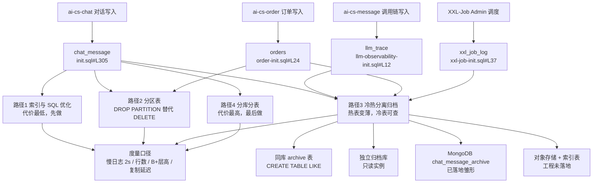
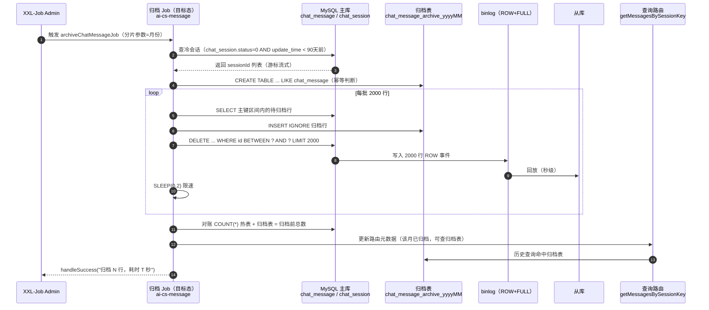

# 大表治理：冷热分离与数据归档

> **一句话结论**：表过千万行之后，"查得慢"只是最轻的症状，真正会出生产事故的是**DDL 卡住全站、备份窗口撑爆、批量删除把主从延迟推到几十分钟**这三件事；所以治理顺序是「索引与 SQL → 分区 → 冷热分离归档 → 最后才分库分表」，而本项目当前**一条 MySQL 侧的归档/清理任务都还没有落地**，只有 `ai-cs-chat` 里的 Mongo 归档三件套是目标态雏形。
> **阅读前置**：先读 [07-建表规范与字段类型选型](07-建表规范与字段类型选型.md)（知道 `TEXT`/`JSON` 这类大字段的代价）、[05-MySQL锁机制与主从复制读写分离](05-MySQL锁机制与主从复制读写分离.md)（知道行锁、MDL 与 1 主 2 从拓扑）；会看 EXPLAIN 的基本列，不熟先补 [12-性能工程/05-SQL调优与执行计划](../12-性能工程/05-SQL调优与执行计划.md)。
> **证据基线**：MySQL 8.0（InnoDB，utf8mb4）+ 本项目 `deploy/mysql/*.sql` 全部 16 个脚本 + MyBatis 3.6.0 `Executor` 源码摘录（已完成入库取证，见 `learning-docs/24-源码分析/assets/source/`）+ 本文档自带 C 级脚本 `bigtable-estimate.mjs` 的真实输出。**凡标"工程未落地 / 未入库"的，均为目标态方案而非本项目现状。** 预计阅读 45 分钟。

---

## 0. 先看现象

大表的问题不是"某天突然坏了"，而是三条曲线同时变差，最后在同一次发版里一起爆掉。

**症状一：给订单表加一个字段，全站接口超时 30 秒。**

DBA 在业务高峰执行了一条看起来毫无风险的 `ALTER TABLE`，三十秒后监控全红，应用侧日志刷出：

```text
ERROR 1205 (HY000): Lock wait timeout exceeded; try restarting transaction
ERROR 1040 (08004): Too many connections
```

`SHOW PROCESSLIST` 里能看到几十个 `Waiting for table metadata lock`，而那条 `ALTER` 自己卡在 `Waiting for table metadata lock` 上排在队首。等待时长不是偶然：本项目 `deploy/mysql/mysql.cnf#L4-L7` 把 `lock-wait-timeout` 设成了 `30`，也就是每个被挡住的会话最多熬 30 秒然后抛 1205。

**症状二：清理一个测试账号的历史会话，从库延迟半小时。**

`ai-cs-message` 的"删除会话"是物理删除该会话下所有消息（见 `ai-cs-message/src/main/java/com/aics/message/service/impl/MessageServiceImpl.java#L150-L163`），条件只有 `session_id = ? OR session_key = ?`，**没有 `LIMIT`、没有分批**。会话一多，就是一条几十万行的 DELETE 单事务。从库上：

```text
mysql> SHOW REPLICA STATUS\G
             Slave_IO_Running: Yes
            Slave_SQL_Running: Yes
Seconds_Behind_Source: 1893
 Slave_SQL_Running_State: applying batch of row changes (delete)
```

1893 秒 ≈ 31 分钟。这半小时里所有走从库的读请求都在读旧数据，用户看到的"已删除会话"还会再出现半小时。

**症状三：备份窗口越来越长，翻页越翻越慢。**

备份从 20 分钟变成 3 小时，凌晨窗口装不下了（备份策略见 [09-备份恢复与数据安全](09-备份恢复与数据安全.md)）；同时后台的调用链查询页，第 1 页 40ms，翻到第 5000 页要 8 秒——那条 SQL 用的是 MyBatis-Plus 的 `Page<>(page, size)` + `orderByDesc(createTime)`（`ai-cs-message/src/main/java/com/aics/message/service/impl/LlmTraceServiceImpl.java#L91-L106`），翻译成 SQL 就是 `LIMIT 100000, 20`。

> **这些现象指向同一件事：** 表从"数据容器"变成了"运维负债"——行数一多，**任何全表级操作（DDL、备份、大事务删除）的耗时都随数据量线性甚至超线性增长，而它们持有的锁与产生的 binlog 会外溢成对业务和对从库的故障**。所以大表治理要解决的从来不是"这条查询怎么快一点"，而是"如何让这张表的体积别无限长大、如何让维护动作不再需要全表扫描"。

---

## 1. 整体地图

大表治理由四个角色组成：**产生流量的写入方**、**正在膨胀的热表**、**四条治理路径**、**冷数据落点**。四条路径不是并列备选，而是按代价从低到高排的阶梯。



> **读图说明**：横向看是"数据从哪来"——四张热表的写入方分别是对话、可观测、订单、调度；纵向看是"数据往哪去"——同一条 `chat_message` 可以走四条不同的治理路径，路径 1 改的是**访问方式**（不改数据），路径 2/3/4 改的是**存放方式**（动数据）。特别注意路径 3 的四个落点：只有 `MongoDB chat_message_archive` 在本项目里有真实代码（`ChatMessageArchiveDocument`），其余三个是目标态。最下方 `度量口径` 是判定"该走哪条路"的唯一依据——没有度量就别谈治理。

| 组件 | 责任 | 调用方 / 触发者 | 本项目证据 |
|---|---|---|---|
| `chat_message` | 对话消息事实源，日增 60 万行级别 | `ai-cs-message` 经 RocketMQ 落库 | `deploy/mysql/init.sql#L304-L318` |
| `chat_session` | 会话状态，冷热判定的"权威依据" | `ai-cs-message` | `deploy/mysql/init.sql#L285-L302` |
| `llm_trace` / `model_usage` | 可观测日志表，无界增长、只写不更 | `ai-cs-message`，由 `TraceRecorder` 经 Feign 投递 | `deploy/mysql/llm-observability-init.sql#L12-L49` |
| `orders` | 订单主表，带唯一键 `uk_order_no` | `ai-cs-order` | `deploy/mysql/order-init.sql#L24-L46` |
| `xxl_job_log` | 调度日志，天然 TTL 数据 | XXL-Job Admin 自己有清理策略 | `deploy/mysql/xxl-job-init.sql#L37-L57` |
| 归档执行器 | 负责"搬数据"的定时任务 | XXL-Job Admin / Spring `@Scheduled` | `OrderTimeoutScanJob#L27-L32`、`OrderTimeoutScheduler#L29-L53`（目前只有超时扫描，**无归档任务**） |
| Mongo 归档 | 第三路最佳努力归档 | `ChatHistoryServiceImpl#L78-L82` | `MongoChatHistoryArchiveService#L16-L31` |
| 复制拓扑 | 决定"删除/归档"会不会拖垮读 | docker-compose 1 主 2 从 | `deploy/docker-compose/docker-compose-master-slave.yml#L8-L80` |
| 判定指标 | 行数、行宽、B+ 树层高、复制延迟 | 本文 C 级脚本 + 慢日志 | `deploy/mysql/mysql.cnf#L19-L21`（`long-query-time=2`） |

---

## 2. 关键概念与关键类

先把术语钉死，后面才谈得下去。

- **热数据 / 冷数据**：按"最近是否被业务读到"划分，而不是按"是否还有用"划分。判据必须落在**一个有索引的时间列 + 一个状态列**上（本项目 `chat_session.status` + `update_time`、`orders.status` + `create_time`）。
- **归档（archive）**：把冷数据从热表**搬走**并保留可检索能力，区别于"删除"。搬走 = 先插入冷表、校验、再删热表。
- **冷热分离**：不搬数据，只让查询走不同路径（热表查近 N 天、归档表查历史，或 Mongo/ES 兜历史）。
- **MDL（metadata lock）**：MySQL 的元数据锁，DDL 需要 `EXCLUSIVE`，任何未提交事务持有的 `SHARED` 都会挡住 DDL，而排队的 DDL 又会挡住后续所有新查询。
- **Online DDL**：MySQL 5.6 起把 DDL 拆成 `ALGORITHM=INSTANT/INPLACE/COPY` × `LOCK=NONE/SHARED/EXCLUSIVE` 的组合，只有 `ALGORITHM=INPLACE, LOCK=NONE`（或 INSTANT）才允许 DDL 期间并发读写。
- **分区裁剪（partition pruning）**：查询条件带上分区键时，优化器只扫命中的分区；不带则扫全部分区（等价于全表）。
- **影子表（gh-ost/pt-osc）**：建同构空表 + 追平数据 + 原子 `RENAME` 换名，把"改表"变成"搬家"。

| 名称 | 位置 | 角色 | 关键方法 / 关键列 |
|---|---|---|---|
| `chat_message` | `deploy/mysql/init.sql#L304-L318` | 最大的热表，8 列 + 3 个二级索引 + `content TEXT`/`metadata JSON` | 索引：`idx_session_id`、`idx_sender(sender_type,sender_id)`、`idx_create_time` |
| `chat_session` | `deploy/mysql/init.sql#L285-L302` | 冷热判定的权威来源 | `status`（0-已结束 1-进行中 2-转人工）、`update_time`、`deleted` |
| `orders` | `deploy/mysql/order-init.sql#L24-L46` | 订单主表，分区改造的真实障碍样本 | `uk_order_no`（**不含时间列**，卡死按 `create_time` 分区）、`idx_status`、`idx_expire_time` |
| `llm_trace` | `deploy/mysql/llm-observability-init.sql#L12-L26` | 无界增长日志表 | `request_id` 主键、`spans_json TEXT`、`idx_create_time` |
| `xxl_job_log` | `deploy/mysql/xxl-job-init.sql#L37-L57` | 现成的 TTL 数据样本 | `trigger_time`、`trigger_msg TEXT`、`handle_msg TEXT` |
| `MessageServiceImpl#deleteSession` | `ai-cs-message/src/main/java/com/aics/message/service/impl/MessageServiceImpl.java#L150-L163` | **批量删除反例**：无 LIMIT 的物理删除 | `chatMessageMapper.delete(wrapper)` |
| `LlmTraceServiceImpl#pageTraces` | `ai-cs-message/src/main/java/com/aics/message/service/impl/LlmTraceServiceImpl.java#L91-L106` | 深翻页隐患样本 | `new Page<>(page, size)` + `orderByDesc(createTime)` |
| `ChatHistoryServiceImpl` | `ai-cs-chat/src/main/java/com/aics/chat/service/impl/ChatHistoryServiceImpl.java#L45-L83` | 三层数据路径（Redis→MQ→Mongo） | `append`、`fallbackToMessage` |
| `MongoChatHistoryArchiveService` | `ai-cs-chat/src/main/java/com/aics/chat/history/mongo/MongoChatHistoryArchiveService.java#L16-L31` | 目标态归档雏形，默认关闭、失败只 warn | `archive(sessionKey, role, content)` |
| `ChatMessageArchiveDocument` | `ai-cs-chat/src/main/java/com/aics/chat/history/mongo/ChatMessageArchiveDocument.java#L14-L30` | Mongo 归档文档结构（复合索引设计） | `@Document("chat_message_archive")`、`session_created_idx` |
| `OrderTimeoutScheduler` | `ai-cs-order/src/main/java/com/aics/order/task/OrderTimeoutScheduler.java#L29-L53` | 现有定时任务里唯一的"扫表"样本 | `selectList` 一次性捞全部（**无分页**） |
| `BatchExecutor#doUpdate` | `24-源码分析/assets/source/BatchExecutor.java.md#L54-L79` | 解释"批量执行拿不到真实影响行数" | `handler.batch(stmt)` → `return BATCH_UPDATE_RETURN_VALUE` |
| `BatchExecutor#doQueryCursor` | `24-源码分析/assets/source/BatchExecutor.java.md#L99-L103` | 流式游标入口，归档导出该用它 | `doQueryCursor` + `flushStatements()` |

---

## 3. 原理与证据逐段精读

每一小节都按同一顺序推进：**这段代码/这条机制在干什么 → 为什么这么设计 → 换一种写法会怎样 → 常见坑在哪**。

### 3.1 增长账：为什么"两千万行"是一个坎

**在干什么。** 先把"多大"量化出来，否则所有治理都是拍脑袋。下面这个脚本只读 `deploy/mysql/*.sql`，不连数据库（C 级实测，全文见 §9 练习 1 附录）。

```js
// bigtable-estimate.mjs —— 关键片段：解析 DDL 求最大行宽
const m = t.match(/^(tinyint|smallint|...|text|json|blob|longblob)/);
if (base === 'varchar' || base === 'char') return { bytes: 4 * n, big: false };
return { bytes: base === 'longtext' || base === 'json' ? 1048576 : 65535, big: true };
```

跑起来（`node bigtable-estimate.mjs`）的真实输出，节选两段：

```text
=== [1] 项目 DDL 里的列宽 Top10（静态最大行宽，utf8mb4 按 4 字节/字符）===
表名                       列数 二级索引 大字段 最大行宽KB
config_info                17        1      2     2057.1
chat_message                8        3      2     1088.2
kb_document                13        5      1     1037.2
handoff_ticket             15        4      1       72.9
llm_trace                   9        3      1       68.7
小计：去重后 43 张表，平均最大行宽 203.2KB，含 TEXT/JSON/BLOB 的 12 张
大字段明细（Top4）：
  chat_message: content:TEXT, metadata:JSON
  kb_document: content:LONGTEXT
```

```text
=== [2] chat_message 增长账（行宽假设 1.5KB，含索引与行头）===
DAU=  10000  行/天=   600000  GB/天=  0.86  GB/月=    26  GB/年=   313  达 2000 万行需 33.3 天
DAU=  50000  行/天=  3000000  GB/天=  4.29  GB/月=   129  GB/年=  1566  达 2000 万行需 6.7 天
```

**怎么读这两段。** 第一段说明本项目 43 张表里有 12 张带大字段，`chat_message` 的 `content TEXT` + `metadata JSON` 让它静态最大行宽到 1MB 级（`config_info` 是 Nacos 自己的表，不归业务治理）；这意味着"一行多大"是设计期决定的，不是运行期慢慢长出来的。第二段把增长率折算成时间：1 万 DAU 时 33 天就到 2000 万行，5 万 DAU 时 6.7 天。**行数增长是乘法，不是加法**——所以"等它慢了再优化"这条路在大表上根本不成立。

**为什么这么设计（为什么恰好是 2000 万）。** 三条独立的经验线在 2000 万～5000 万行附近交汇：

1. **缓冲池装不下**。本项目 `innodb-buffer-pool-size=256M`（`deploy/mysql/mysql.cnf#L4-L7`），按 §3.1 的 1.5KB/行算，2000 万行≈28.6GB，是缓冲池的 **114 倍**；行业常用警戒线是"单表 > 缓冲池 10~20 倍"。越过这条线后每次查询都变成随机 IO，索引再好也救不了。
2. **B+ 树层高再多一层**。C 级脚本第三段实测：

```text
=== [3] B+ 树层高估算（聚簇索引，页 16KB，叶填充 90%，非叶条目 24B）===
行宽B     叶页行数 叶页数@2000万 层高 非叶页数 非叶MB
1500           9       2222223    4     3265   51.0
200           73        273973    3      403    6.3
```

行宽 1.5KB 时 2000 万行要 222 万个叶页、层高 4：一次主键等值查要读 4 个页（3 个非叶页 + 1 个叶页）。好消息是非叶页总量只有 51MB，能整块装进 256MB 缓冲池——**所以"层高 4"并不致命，致命的是叶页 IO**。把行宽从 1.5KB 压到 200B（大字段拆分出去），层高直接掉到 3，叶页数少 8 倍。
3. **维护动作的耗时**。备份、`ALTER TABLE`、`OPTIMIZE`、全表校验的耗时都跟表体积成正比，2000 万行以上单表 DDL 常突破 30 分钟——而 DDL 期间锁的影响面是**整库**（见 §3.2）。

**换写法会怎样。** 如果把 `content` 从 `TEXT` 挪到独立的消息体表（`chat_message_body(message_id, content)`），`chat_message` 行宽降到 100B 级：列表查询、计数、归档判定都在瘦表上做，只有"点开某条消息"才回查大字段。代价是多一次 join、以及"消息必须成对存在"的一致性约束——这正是 [07-建表规范与字段类型选型](07-建表规范与字段类型选型.md) 里"大字段独立成表"的由来。

**常见坑。** ①把 `TEXT` 当 `VARCHAR` 用：`content` 存的是几十字短句，却让每行都带一个 20 字节溢出指针，行外存储一多，`SELECT *` 的 IO 放大非常明显；②只看行数不看行宽——1000 万行 × 2KB 比 5000 万行 × 100B 更该治理；③拿 `config_info` 这类中间件自带表进业务治理名单，浪费精力。

### 3.2 DDL 为什么能锁住全站：MDL 与 Online DDL 三档

**在干什么。** 先交代证据来源：**MySQL 服务端行为没有源码摘录入库**，本节结论依据 MySQL 8.0 官方手册《Online DDL Operations》《Metadata Locking》两章，以及本项目 `deploy/mysql/*.cnf` 的实际参数与 §0 的现场报错。

`ALTER TABLE` 要拿表的 `MDL_EXCLUSIVE`。规则是：**任何活着的事务只要还持着这张表的 `MDL_SHARED`（哪怕只是 `BEGIN` 后查了一次没提交），DDL 就得等**；而 MySQL 为了保证"后来的请求不能插队"，一旦有 DDL 在等，**后续所有新查询也会一起排队**。于是：一个 30 秒未提交的事务 + 一条 `ALTER` = 全站这个表的读写全部挂起（症状一）。

**为什么这么设计。** 元数据必须对所有人一致：如果 DDL 能在别人正在用旧表结构时完成，服务器就可能按新结构解析旧数据。所以 MySQL 选择"宁可阻塞，也不让元数据打架"。项目把 `lock-wait-timeout` 设成 30（`deploy/mysql/mysql.cnf#L4-L7`），就是让被挡住的会话 30 秒后自己抛 `ERROR 1205` 退出，避免无限堆积。

**三档算法与锁级别。** 这条链路决定了"你的 DDL 到底锁不锁业务"：

| 档位 | 写什么 | 允许并发 DML | 典型操作 | 本项目例子 |
|---|---|---|---|---|
| `ALGORITHM=INSTANT` | **只改元数据**，不动数据页 | ✅ 完全并发 | 8.0.12+ 末尾 `ADD COLUMN`、8.0.29+ 任意位置加列/删列/改列名、加 `DEFAULT` | `vlm-multimodal-init.sql#L15-L18` 给 `product` 加 `image_description` |
| `ALGORITHM=INPLACE, LOCK=NONE` | 重建/整理页，写 row log 追平 | ✅ 并发读写 | 加普通二级索引、改索引类型、`VARCHAR` 扩容（记录长度前缀不变时） | 目标态 |
| `ALGORITHM=INPLACE, LOCK=SHARED` | 重建 | ❌ 只读 | 加全文索引、改主键 | 无 |
| `ALGORITHM=COPY` | 建临时表逐行拷 | ❌ 全锁 | 改列类型、改字符集、8.0 前加列 | 无 |

**证据：本项目怎么给"加字段"打补丁。** `deploy/mysql/vlm-multimodal-init.sql#L7-L18` 用 `information_schema` 做幂等判断，先查列是否存在再决定执行 `ALTER` 还是跳过：

```sql
-- deploy/mysql/vlm-multimodal-init.sql#L7-L18
SET @dbname = DATABASE();
SET @col_exists = (
    SELECT COUNT(*) FROM information_schema.COLUMNS
    WHERE TABLE_SCHEMA = @dbname AND TABLE_NAME = 'product'
      AND COLUMN_NAME = 'image_description'
);
SET @ddl = IF(@col_exists = 0,
    'ALTER TABLE product ADD COLUMN image_description VARCHAR(1024) NULL COMMENT ''...''',
    'SELECT ''product.image_description 已存在，跳过'' AS info'
);
PREPARE stmt FROM @ddl;
```

**逐句读**：这段的价值不在 `ALTER` 本身，而在**可重放**——发布脚本失败重跑、多环境执行、CI 反复 apply 都不会报 `ERROR 1060 Duplicate column name`。加 `VARCHAR(1024) NULL` 且排在末尾，MySQL 8.0 会走 `INSTANT`；如果写成 `MODIFY content TEXT NOT NULL` 这类改定义，就掉到 `COPY` 档，`product` 表多大的数据量就要拷多久，期间业务全锁。

**换写法会怎样（gh-ost / pt-osc）。** 当 DDL 只能走 `COPY`、而表又不能停写时，工业界的办法是把"改表"变成"搬家"：

| 维度 | `pt-online-schema-change`（pt-osc） | `gh-ost` |
|---|---|---|
| 增量同步机制 | 在原表上建 **3 个触发器**（INSERT/UPDATE/DELETE）把变更写进影子表 | **不建触发器**，伪装成从库**消费 binlog** 回放到影子表 |
| 对主库写入的影响 | 每条 DML 多一次触发器开销，高写入表上更明显 | 触发器零开销，但要从主库拉 binlog（需要 `ROW` 格式 + 复制权限） |
| 前置条件 | 不能有同名触发器、不能有外键引用 | 必须 `binlog_format=ROW`（本项目 `master.cnf` 已满足，`binlog-row-image=FULL`） |
| 切表方式 | `RENAME TABLE` 原子切换 | `RENAME TABLE` 原子切换，可 `--postpone-cut-over` 挂起等窗口 |
| 限流/暂停 | `--max-lag`、`--critical-load` | `--max-load`、`--throttle-*`、可交互 `unthrottle` |
| 额外成本 | 双倍磁盘 + 触发器 | 双倍磁盘 + binlog 消费连接 |

两个工具**工程未落地**（仓库里没有它们的配置或脚本）。它们的共同前提是"多一倍的磁盘"和"表必须有主键（否则分块拷贝无法定位）"——这也是为什么 [07-建表规范与字段类型选型](07-建表规范与字段类型选型.md) 把"必须有主键"写成硬规范。

**常见坑。** ①在业务高峰直接 `ALTER`，不看当前有没有长事务（`information_schema.innodb_trx` 里 `trx_started` 超过 10 分钟的先 `KILL`）；②以为加了 `ALGORITHM=INPLACE` 就"在线"——必须显式写 `LOCK=NONE`，否则 MySQL 可能自行降级为 `LOCK=SHARED`（只读），业务写立刻报错；③一次性在一个脚本里写 5 条 `ALTER`，前面一条慢的把后面全卡住，而监控只看到"发布超时"；④改完表不 `ANALYZE TABLE`，统计信息陈旧导致执行计划反而更差。

### 3.3 批量删除的正确姿势：分批 + 主键范围 + 限速

**在干什么。** 先看本项目真实的反例。`deleteSession` 的做法是"会话下所有消息一条 DELETE 全删"：

```java
// ai-cs-message/src/main/java/com/aics/message/service/impl/MessageServiceImpl.java#L150-L163
@Override
public void deleteSession(Long sessionId) {
    log.info("删除会话: sessionId={}", sessionId);
    LambdaQueryWrapper<ChatMessage> msgWrapper = new LambdaQueryWrapper<>();
    msgWrapper.eq(ChatMessage::getSessionId, sessionId)
            .or()
            .eq(ChatMessage::getSessionKey, String.valueOf(sessionId));
    int deletedMsg = chatMessageMapper.delete(msgWrapper);
    int deletedSession = chatSessionMapper.deleteById(sessionId);
    log.info("会话删除完成: sessionId={}, deletedMsg={}, deletedSession={}",
            sessionId, deletedMsg, deletedSession);
}
```

一行 `delete` 对应 SQL 是 `DELETE FROM chat_message WHERE session_id = ? OR session_key = ?`。会话消息少时没问题，一旦碰上"压测账号/导入的历史会话"这种几十万行的，就变成灾难。

**为什么这么设计（为什么长事务这么贵）。** 一个 DELETE 语句就是一个事务，它的代价有四项，全部随行数线性增长：

1. **undo 必须保留到事务提交**（为了 MVCC 能回滚/读到旧版本）。C 级脚本第五段给的数量级是：删 100 万行 × 1.5KB ≈ **1.43GB undo** 被钉住，undo 表空间暴涨会触发 `ibdata`/`undo_001` 扩容，甚至撑爆磁盘。
2. **binlog 体量**。本项目主库是 `binlog-format=ROW` + `binlog-row-image=FULL`（`deploy/mysql/master.cnf`），即每行前后镜像各一份，删 100 万行约 **2.86GB binlog**。
3. **从库回放**。MySQL 的并行复制以"同一个 commit 组"为单位分发，**一个巨大的事务无法被拆开并行**——所以哪怕从库开了 4 个 worker，这 2.86GB 也只能单线程串行回放，脚本按 5000 行/秒估算是 3.3 分钟，实际遇到大字段/随机 IO 会更久（症状二里的 31 分钟就是这么来的）。
4. **锁与 MDL**。大事务持有大量行锁，期间谁要改这些行就排队；同时它持着表的 `MDL_SHARED`，**期间任何 `ALTER` 都进不来**——于是"清理任务"和"发版 DDL"互相踩。

**改正后的骨架（分批 + 主键范围 + 限速）。** 下面三件事缺一不可：

```sql
-- 目标态示例（当前仓库无此脚本，工程未落地）
-- 分批：每批 2000 行，用主键范围而不是 LIMIT offset
DELETE FROM chat_message
 WHERE create_time < '2026-01-01'
   AND id BETWEEN ? AND ?
 LIMIT 2000;
```

- **分批**：单事务 undo 峰值从 1.4GB 降到 7.3MB（C 级脚本第五段），从库延迟从"分钟级"降到"秒级"。
- **主键范围**而不是 `LIMIT offset`：`LIMIT offset` 形式每批都要重新扫描并丢弃前 offset 行，越往后越慢（O(n²)）；主键范围每批都是精确的区间扫描，可续跑、可重放。
- **限速**：批与批之间 `SELECT SLEEP(0.2)` 或在应用层 `Thread.sleep`，让从库有机会追平；配合 `--max-lag` 式的判断（读 `SHOW REPLICA STATUS` 的 `Seconds_Behind_Source`，超过阈值就继续睡）。

**关键约束（A 级证据）：批处理拿不到真实影响行数。** MyBatis 的 `BatchExecutor.doUpdate` 在批处理模式下直接返回哨兵值：

```java (src: BatchExecutor.java.md#L54-L79)
@Override
public int doUpdate(MappedStatement ms, Object parameterObject) throws SQLException {
    ...
    if (sql.equals(currentSql) && ms.equals(currentStatement)) {
      int last = statementList.size() - 1;
      stmt = statementList.get(last);
      applyTransactionTimeout(stmt);
      handler.parameterize(stmt);// fix Issues 322
      ...
    } else {
      Connection connection = getConnection(ms.getStatementLog());
      stmt = handler.prepare(connection, transaction.getTimeout());
      ...
    }
    handler.batch(stmt);
    return BATCH_UPDATE_RETURN_VALUE;
}
```

`BATCH_UPDATE_RETURN_VALUE` 定义为 `Integer.MIN_VALUE + 1002`（[[源码:BatchExecutor.java.md#L42]]），意思是"这条语句还没执行，别信返回值"。所以**归档/清理任务绝不能靠批处理的返回值判断"这批删了几行、要不要继续"**——要么用普通执行器逐批执行拿到真实 `affected rows`，要么在每批前先用 `SELECT COUNT(*)` 探明剩余量。这是很多人写了"分批删除"却仍然一删到底的隐藏原因。

**流式导出要用游标，不要 `selectList`。** 归档读侧同理：`selectList` 会把全表结果集堆进 JVM 堆（症状：`java.lang.OutOfMemoryError: Java heap space`）。MyBatis 提供 `Cursor` 通道，`BatchExecutor.doQueryCursor` 先 `flushStatements()` 再走 `StatementHandler` 流式拉取（[[源码:BatchExecutor.java.md#L99-L103]]），配 `fetchSize` + `ResultSet.TYPE_FORWARD_ONLY` 才是"一边读一边写"的正确姿势。项目里 `OrderTimeoutScheduler#L29-L53` 的 `selectList` 一次性捞全部超时订单，就是同一个坑的另一面。

**换写法会怎样。** 如果确实需要"删得快"，那就别用 DELETE：用 §3.4 的 `DROP PARTITION`，它是元数据 + 文件删除，1 亿行也是秒级，且几乎不产生 binlog 行事件。

**常见坑。** ①`DELETE ... WHERE create_time < ?` 走不到索引（`idx_create_time` 存在时能走，但删完 30% 数据后统计信息可能让它改走全表）；②忘了 `ORDER BY`/范围限定，MySQL 虽支持 `DELETE ... LIMIT` 但**不保证每次删的是同一批**（没 `ORDER BY` 时是"随便哪 2000 行"），续跑会重复/漏删；③在事务里"先删消息再删会话"（如本项目）——两个操作必须同事务才保证一致性，但一旦消息量巨大，这个"必须同事务"就要求你**先把消息分批删完、再把会话删除放进最后一个短事务**，一致性靠"会话 deleted=1 后不可见"这层兜底。

### 3.4 分区表：把"删数据"变成"删文件"

**在干什么。** 分区的本质是**把一张逻辑表拆成多个物理文件（.ibd），按分区键路由**。对治理而言它最大的价值不是"查询快"，而是 `ALTER TABLE ... DROP PARTITION` 能在秒级抹掉一个月的数据。

**为什么本项目动不了 `orders`（真实障碍）。** 想按 `create_time` 做月分区，先要满足一条硬约束：**分区键必须出现在表的每一个唯一索引（含主键）里**。而 `orders` 的定义是：

```sql
-- deploy/mysql/order-init.sql#L41-L45
PRIMARY KEY (`id`),
UNIQUE KEY `uk_order_no` (`order_no`),
KEY `idx_user_id` (`user_id`),
KEY `idx_status` (`status`),
KEY `idx_expire_time` (`expire_time`)
```

`uk_order_no(order_no)` 不含 `create_time`，直接分区会报：

```text
ERROR 1503 (HY000): A UNIQUE INDEX must include all columns in the table's partitioning function
```

解法只有三条，各有代价：把唯一键改成 `(order_no, create_time)`（`order_no` 已全局唯一，这个复合键等于放宽了业务约束，语义上可接受但要想清楚）；放弃分区改用归档（§3.5）；接受非分区表的"按 id 范围分批删"。

**目标态 DDL（工程未落地）。** 若新表从一开始就按分区设计，可以写成：

```sql
-- 目标态示例：按月 RANGE 分区（当前仓库无此 DDL，工程未落地）
CREATE TABLE orders_partitioned (
    id          BIGINT       NOT NULL,
    order_no    VARCHAR(32)  NOT NULL,
    user_id     BIGINT       NOT NULL,
    pay_amount  DECIMAL(10,2) NOT NULL,
    status      VARCHAR(20)  NOT NULL DEFAULT 'PENDING_PAY',
    create_time DATETIME     NOT NULL DEFAULT CURRENT_TIMESTAMP,
    PRIMARY KEY (id, create_time),
    UNIQUE KEY uk_order_no (order_no, create_time)
) ENGINE=InnoDB DEFAULT CHARSET=utf8mb4
PARTITION BY RANGE COLUMNS(create_time) (
    PARTITION p202608 VALUES LESS THAN ('2026-09-01'),
    PARTITION p202609 VALUES LESS THAN ('2026-10-01'),
    PARTITION pmax    VALUES LESS THAN (MAXVALUE)
);
```

**逐句读**：①`PARTITION BY RANGE COLUMNS(create_time)` 用 `COLUMNS` 而不是 `RANGE(YEAR(...)*100+MONTH(...))`，前者能直接对 `DATETIME` 做范围比较、支持 `pruning` 且不受函数表达式限制；②主键与唯一键都被迫带上 `create_time`——这是分区的"税"；③`pmax MAXVALUE` 是**必须保留的兜底分区**，否则插入超出范围的日期会直接 `ERROR 1526 (HY000): Table has no partition for value`；④新增月份分区要对 `pmax` 做 `REORGANIZE`（`ALTER TABLE ... REORGANIZE PARTITION pmax INTO (PARTITION p202610 ..., PARTITION pmax ...)`），它会重建 `pmax` 里的数据（正常应为空）；⑤清理就变成 `ALTER TABLE orders DROP PARTITION p202608`——秒级、几乎无 binlog。

**分区的边界与代价（重要，别迷信它）。**

- **它不解决"单分区太大"**。C 级脚本第四段：

```text
=== [4] 按月分区后单分区行数 + 到警戒线的月数 ===
DAU      行/月 单分区GB 达2000万行 达5000万行
10000      18000000     25.7     1.1 月     2.8 月
50000      90000000    128.7     0.2 月     0.6 月
```

1 万 DAU 时一个月的 `chat_message` 就有 1800 万行、25.7GB，**按月分区根本压不到警戒线以下**（1.1 个月就满了）。要真正变小只能按日分区或加更细的维度；而分区数上限是 8192，按日分区三年就会撞墙。
- **没有全局索引**。每个分区有自己的 B+ 树，`ORDER BY create_time DESC LIMIT 20` 这类跨分区排序要做 merge，分区越多越贵。
- **不带分区键的查询会扫全部分区**，等于全表（`EXPLAIN` 里 `partitions` 列会列出所有分区名，这是判断 pruning 是否生效的最快方法）。
- **`information_schema.partitions` 是唯一可靠的"每分区行数"来源**（`TABLE_ROWS` 是估算值）。

**换写法会怎样。** 对 `xxl_job_log` 这种"纯 TTL 日志表"（`deploy/mysql/xxl-job-init.sql#L37-L57`），分区是性价比最高的选择：按天分区 + 每天 `DROP PARTITION`，比 XXL-Job 自己的"日志保留天数"逐条删除干净得多（本项目执行器侧 `XxlJobConfig#L23-L46` 里的 `setLogRetentionDays(7)` 只约束本地日志文件，不处理 DB 里的 `xxl_job_log`）。

**常见坑。** ①分区键选 `id` 而不是时间：`id` 是雪花/自增，`RANGE` 边界要人工算，且删"旧数据"要先换算 id 区间；②分区键允许 `NULL` 时所有 `NULL` 行都落进第一个分区；③以为分区能加速点查——点查还是 B+ 树，分区只让"范围删除/归档"变便宜；④`DROP PARTITION` 不触发触发器、不影响其他分区，但也**没有任何回滚余地**（所以它的 DDL 必须进变更评审）。

### 3.5 冷热分离与归档任务设计：判定、搬运、可检索

**在干什么。** 归档任务永远是同三段的循环：**判定哪些是冷数据 → 搬进同构的归档表 → 校验后删热表**。三段里最容易写错的是第一段（判定标准），最容易写崩的是第三段（删除）。

**第一步：判定标准必须落在有索引的列上。** 常见两种判法，本项目都能落地：

| 判据 | 正确写法 | 错误写法 | 为什么 |
|---|---|---|---|
| 会话类 | `chat_session.status = 0`（已结束）**且** `update_time < NOW() - INTERVAL 90 DAY` | 直接按 `chat_message.create_time` 判 | 消息的创建时间不能代表会话"结束"，一个 3 个月的活跃会话消息会被误归档，用户点开历史就断片；`chat_session` 上已有 `idx_status`、`idx_create_time` |
| 单据类 | `orders.status IN ('COMPLETED','CANCELLED')` 且 `create_time < NOW() - INTERVAL 90 DAY` | 只按 `status` 或只按时间 | 未付款订单要留着（可能有支付回调），只按时间会把 PENDING 的也搬走；`orders` 上有 `idx_status`、`idx_expire_time` |
| 日志类 | `llm_trace.create_time < NOW() - INTERVAL 30 DAY` | 按 `request_id` 分片 | 日志表就该纯粹按时间 TTL；`idx_create_time` 已存在 |
| 调度日志 | `xxl_job_log.trigger_time < NOW() - INTERVAL 7 DAY` | 无 | XXL-Job 有"日志保留天数"的语义，DB 侧必须自己实现 |

**第二步：归档表结构必须与热表一致。** 最省事也最安全的做法是 `CREATE TABLE ... LIKE`——它复制列定义、索引、`AUTO_INCREMENT` 属性，但**不复制外键与触发器**：

```sql
-- 目标态示例（工程未落地）：按月归档表，索引先裁剪再按需重建
CREATE TABLE chat_message_archive_202608 LIKE chat_message;
-- 归档表通常只需要"按会话查"和"按时间查"两个入口，sender 维度可以砍
ALTER TABLE chat_message_archive_202608 DROP INDEX idx_sender;
```

**为什么要裁索引**：归档表是只读的，`idx_sender` 这种为"按发送者过滤"服务的索引只会让写入更慢、体积更大；而 `idx_session_id`、`idx_create_time` 必须留，因为它们是"归档后可检索"的唯一保障。**为什么用 `LIKE` 而不是手写 `CREATE TABLE`**：手写就会漏字段，而 `chat_message` 在本项目已经出现过**实体与 DDL 不一致**的漂移（实体 `ChatMessage` 有 `session_key`、`role` 字段，见 `ai-cs-message/src/main/java/com/aics/message/entity/ChatMessage.java#L34-L38`，但 `deploy/mysql/init.sql#L305-L318` 的建表里没有这两列）。`LIKE` 复制的正是真实 DDL，不会把实体层的幻想带进归档表——但反过来，**归档任务上线前必须先修掉这个漂移**，否则 `ChatMessageMapper#L35-L38` 里那条 `WHERE session_key = ?` 的查询在归档表上会直接 `ERROR 1054 (42S22): Unknown column 'session_key'`。

**第三步：先插后删 + 可检索性设计。** 顺序必须是 `INSERT INTO archive SELECT ... LIMIT N` → 校验条数 → `DELETE ... LIMIT N`，绝不能反过来（先删后插，一旦中途失败就是"数据永久消失"）。搬运期间热表与归档表会**短暂同时存在同一行**，这是可接受的（幂等靠归档表主键冲突 `INSERT IGNORE` 或 `ON DUPLICATE KEY UPDATE` 兜底），而反过来"先删后插"的窗口里数据**哪都不在**。

**可检索性是归档方案的分水岭**，三条路线：

| 路线 | 检索方式 | 代价 | 本项目状态 |
|---|---|---|---|
| 同库归档表 | 应用层路由：热表查近 N 天，历史走归档表，用 `UNION ALL` 视图或代码分支合并 | 归档数据仍占同一实例的磁盘与备份体积，**备份窗口的问题没解决** | 工程未落地 |
| 独立归档库/只读实例 | 路由同左，但归档库不参与主从链、可以用更便宜的存储 | 多一套实例与路由代码；跨库事务不可用 | 工程未落地 |
| MongoDB / 对象存储 | 按 `sessionKey` + 时间查，文档型结构天然适合消息列表 | 需要一条"回写/回源"的路由，以及"归档库不可用时的降级读" | **已落地雏形**：`ChatHistoryServiceImpl#L78-L82` 可选调用 Mongo 归档 |

**证据：本项目的 Mongo 归档三件套（真实代码，默认关闭）。** 它是"第三路最佳努力归档"的完整样本：

```java
// ai-cs-chat/src/main/java/com/aics/chat/history/mongo/MongoChatHistoryArchiveService.java#L16-L31
@ConditionalOnProperty(prefix = "aics.chat.mongo-archive", name = "enabled", havingValue = "true")
public class MongoChatHistoryArchiveService {
    public void archive(String sessionKey, String role, String content) {
        try {
            ...
        } catch (Exception e) {
            log.warn("Mongo 对话归档失败（不阻断对话）: sessionKey={}", sessionKey, e);
        }
    }
}
```

配套的文档结构 `ChatMessageArchiveDocument#L14-L30` 定义 `@Document("chat_message_archive")` + `@CompoundIndex(name = "session_created_idx", def = "{'sessionKey':1,'createdAt':-1}")`——复合索引的字段顺序正好对应"按会话查、按时间倒排"的归档读法，这是归档表设计的通用原则：**索引要按归档后的查询模式重建，不是照抄热表**。

**它的三个设计决定值得抄。** ①`@ConditionalOnProperty` 默认 `false`：归档链路上线前不影响主流程；②`try/catch` 只 `warn`：归档是**旁路**，绝不能因为 Mongo 挂了让用户发不出消息（对比 `ChatHistoryServiceImpl#L45-L83` 的写入路径：Redis 写失败/MQ 发送失败同样只 `warn`，`chat_message` 才是事实源）；③归档写入点挂在"消息已成功落库/入队之后"，保证"宁可少归档，不可错归档"。

**换写法会怎样。** 若把归档放在写入路径的同步流程里（`append` 里 `mongoArchiveProvider.get().archive(...)` 且不加 try/catch），Mongo 抖动就会变成对话接口 5xx——这正是本项目"`getIfAvailable()` + `Optional` + 默认关闭"这套写法要防的事。

**常见坑。** ①按消息创建时间判冷热（见上表）；②归档表用 `LIKE` 之后忘了裁索引，归档一亿行后索引比数据还大；③`INSERT ... SELECT` 不分批，直接锁住源表并生成巨大 binlog；④只校验 `COUNT(*)` 不校验内容（本项目旧稿提到的做法：抽样 `MD5(GROUP_CONCAT(...))` 或按主键区间对账）；⑤归档没有"回滚预案"——一旦发现判错，需要能从归档表反向搬回，所以归档表**必须保留原主键**、且归档脚本要幂等可反向执行。

### 3.6 历史表命名与查询路由

**在干什么。** 归档落地的最后一步是"让代码知道去哪查"。命名和路由是同一个决定的两面。

**命名约定（推荐，工程未落地）：**

| 形态 | 例子 | 适用 | 说明 |
|---|---|---|---|
| 同库后缀 + 年月份 | `chat_message_archive_202608` | 按月滚动归档 | 表名即时间边界，`DROP` 时不用查元数据；缺点是表多、`information_schema` 变脏 |
| 同库后缀 + `_his` | `orders_his` | 不按时间切片、只做"冷表" | 简单，但冷表自己也会长大（等于把问题推后） |
| 分库后缀 | `chat_db_archive.chat_message` | 独立归档库 | 路由最简单（一个数据源切换），备份策略可单独设 |
| 集合/索引名 | `chat_message_archive`（Mongo）/ `chat_message_v1`（ES） | 异构存储 | 与本项目 `ChatMessageArchiveDocument` 保持一致 |

**查询路由的三层实现（从简到繁）：**

1. **代码分支路由**（最简）：`getMessagesBySessionKey(sessionKey)`（`MessageServiceImpl#L117-L121`，上限 200 条）先查热表，`total < 期望` 时再查归档表名（按消息时间算出 `_archive_yyyyMM` 后缀）。优点是零中间件，缺点是要在每处查询里写两遍。
2. **视图/`UNION ALL` 路由**：`CREATE VIEW chat_message_all AS SELECT * FROM chat_message UNION ALL SELECT * FROM chat_message_archive_202608 ...`。优点是对查询透明，缺点是视图无法走分区裁剪、写操作必须打回原表，且每加一个归档月就要改视图（DDL 又要过 MDL，很讽刺）。
3. **中间件路由**：ShardingSphere 逻辑表 + 自定义分片算法按时间列路由到不同物理表（本项目已有按"用户 ID 后四位"分片的 `UserIdLast4ModShardingAlgorithm`，见 [03-ShardingSphere用户表分库分表实战](03-ShardingSphere用户表分库分表实战.md)）。优点是路由集中、可测；缺点是把"归档"这个低频需求绑上了分库分表的重资产。

**为什么推荐"代码分支 + 明确的后缀约定"而不是视图。** 归档是低频运维动作，而视图/中间件是常驻的运行时成本。本项目已经用三层路径（Redis 热缓存 → `chat_message` 事实源 → Mongo 归档）证明了"路由写在代码里、每层各自负责"是可行的（`ChatHistoryServiceImpl#L45-L83`）；把归档塞进视图，等于给每一条 SQL 都加上"可能跨 24 个物理表"的负担。

**换写法会怎样。** 若归档表与热表**同名不同库**（`chat_db_archive.chat_message`），可以用 ShardingSphere 的"读写分离 + 影子库"来兜，但要注意本项目 `slave.cnf` 里 `replicate-do-db` 只列了 `user_db/knowledge_db/chat_db/nacos_config` 四个库——**归档库默认不会被复制**，这是好事（省带宽）也是坑（以为归档库有备份，其实没有，备份策略要单独配）。

**常见坑。** ①归档表名带大写（如 `ChatMessage_Archive`），在 `lower_case_table_names=0` 的 Linux 上跨平台迁移直接报"表不存在"；②路由代码里硬编码月份字符串，跨年（`_202612` → `_202701`）时忘记加；③归档表与热表的字段类型漂移（归档时 `DECIMAL(10,2)` 变成 `DECIMAL(12,2)`），`UNION ALL` 时隐式转换导致索引失效；④归档后不更新应用的"数据保留期"文案，用户投诉"我的历史消息丢了"（这其实是最贵的成本）。

### 3.7 索引维护成本与备份窗口：两条被忽略的曲线

**在干什么。** 大表的两条"隐性成本曲线"，做容量规划时必须一起算。

**索引维护成本 = 写放大。** `chat_message` 有 3 个二级索引（`idx_session_id`、`idx_sender`、`idx_create_time`，`deploy/mysql/init.sql#L314-L317`），意味着**每插入一行要写 4 棵 B+ 树**（聚簇 + 3 个二级）。二级索引的写入是**随机 IO**（按索引键排序，与插入顺序不一致），依赖 change buffer 缓冲；一旦 change buffer 占满或遇到唯一索引校验，随机 IO 就落到磁盘。本项目 `innodb-buffer-pool-size=256M` 里还要分一块给 change buffer，能缓的量非常有限——**"加一个索引顺手"的真实代价是每次写入多一次随机 IO 与更多的 redo**。

**备份窗口 = 数据量的线性函数。** 逻辑备份（`mysqldump`）要扫全表 + 生成 SQL 文本，耗时与"表体积 ÷ 磁盘顺序读带宽"成正比，还额外需要一份等大小的临时空间（细节与"从库备份的过滤缺口"见 [09-备份恢复与数据安全](09-备份恢复与数据安全.md)）。物理备份（xtrabackup）快得多，但"拷贝 300GB"依然是 300GB。所以**归档不是"为了查询快"，它首先是为了让备份窗口回到可接受范围**——这是很多团队做归档的真实动机。

**为什么"查询越翻越慢"跟这两条曲线是同一件事。** 深翻页 `LIMIT 100000, 20`（`LlmTraceServiceImpl#L91-L106` 的 `Page<>(page, size)`）必须扫过前 10 万行再丢弃，扫描的行分散在 3 层 B+ 树里，而这些叶页在 28.6GB 的表里、缓冲池只有 256MB——命中率趋零，于是每一页都要随机 IO。**索引维护成本（写放大）→ 表体积增长 → 缓冲池命中率下降 → 深翻页与备份双双变慢**，这是一条因果链，不是三个独立问题。

**换写法会怎样。** ①深翻页改"游标分页"（`WHERE create_time < 上一页最后一条的时间 ORDER BY create_time DESC LIMIT 20`），让每页都是索引区间扫描，成本恒定；②把 `idx_sender` 这类低选择性的索引删掉或改成联合索引的后缀列；③归档后立刻 `OPTIMIZE TABLE`（或用 `ALTER TABLE ... ENGINE=InnoDB` 重建）回收空洞——注意它本身也是个重操作，要安排在窗口内。

**常见坑。** ①只看索引"加速查询"不看"拖慢写入"，在日志表上建 6 个索引；②归档删完数据后表体积不降（InnoDB 不归还磁盘，只有重建才还），于是"归档没效果"；③`ORDER BY create_time DESC` 的深翻页在 `create_time` 有重复值时结果不稳定（同一秒几百条消息），要用 `(create_time, id)` 复合游标。

---

## 4. 一次完整执行时序

下面这条时序是"归档任务从被调度到可回滚"的完整链路。它把 §3.3（分批删除）、§3.5（判定/搬运/校验）、§3.6（路由）串起来，也标注了每一步失败时的真实报错。



> **读图说明**：注意 `loop` 块内部——**每一次循环都是一个独立短事务**（`INSERT` 提交、`DELETE` 提交），这正是"分批"的全部意义；`Bin->>Slave` 是每批都触发的，所以从库延迟的峰值由"单批 2000 行的回放时间"决定，而不是"总量"决定。最后一步 `更新路由元数据` 必须在**对账通过之后**，否则会出现"路由指向归档表但数据还没搬完"的空窗读。真实项目里的 `ai-cs-chat` 三层路径（Redis → `chat_message` → Mongo）就是这个图的一个变体：Mongo 归档相当于 `Arc`，而它**默认关闭**且失败只 `warn`（`MongoChatHistoryArchiveService#L16-L31`）。

| 失败步骤 | 真实报错 | 原因与处置 |
|---|---|---|
| 判定冷数据 | 慢日志里 `SELECT ... chat_session` > 2s | `status`/`update_time` 没有合适索引，或 `deleted` 未参与条件导致扫全表；先 `EXPLAIN` 看 `type` 是否 `ALL` |
| `CREATE TABLE ... LIKE` | `ERROR 1050 (42S01): Table 'xxx' already exists` | 重跑时归档表已存在；必须用 `information_schema.TABLES` 做幂等判断（比照 `vlm-multimodal-init.sql#L7-L18` 的写法） |
| 建分区表/改唯一键 | `ERROR 1503 (HY000): A UNIQUE INDEX must include all columns in the table's partitioning function` | 分区键没进唯一键，见 §3.4 `orders` 的例子 |
| `INSERT` 归档行 | `ERROR 1062 (23000): Duplicate entry '...' for key 'PRIMARY'` | 上一轮已搬过（幂等缺口）：改用 `INSERT IGNORE` 或 `ON DUPLICATE KEY UPDATE`，并检查批次边界是否重叠 |
| `DELETE` 批次 | `ERROR 1205 (HY000): Lock wait timeout exceeded` | 批次过大或有并发写同一区间；缩小批次、加 `SLEEP` 限速；等待超时值由 `lock-wait-timeout=30` 决定 |
| 从库追平 | `SHOW REPLICA STATUS` 的 `Seconds_Behind_Source` 持续 > 60 | 单批太大或从库单线程回放（单事务无法并行）；把批次降到 500~1000 行 |
| 对账 | 应用侧"热表 + 归档表 = 归档前总数"不等 | 搬运窗口内又有新写入（把对账条件限定为"归档判定时间点之前的数据"），或某批 DELETE 只删了一半 |
| 归档后查询 | `ERROR 1054 (42S22): Unknown column 'session_key' in 'where clause'` | 实体与 DDL 漂移（`ChatMessage.java#L34-L38` vs `init.sql#L305-L318`），归档表照抄了真实 DDL 但代码按实体查 |
| Mongo 归档 | 日志 `Mongo 对话归档失败（不阻断对话）` | 归档是旁路：`catch` 住只 warn，主流程继续（`MongoChatHistoryArchiveService#L16-L31`） |
| 调度侧 | XXL-Job 控制台"调度成功但执行器无日志" | 执行器未注册（`aics.xxl-job.enabled` 默认 `false`，见 `ai-cs-order/src/main/resources/application.yml#L51-L58`）；或阻塞处理策略为"丢弃后续调度"导致本轮被跳过 |

---

## 5. 设计取舍

四条治理路径不是"哪个高级用哪个"，而是**代价递增的阶梯，能停在低的就别往上爬**。

| 方案 | 适用边界 | 代价 | 本项目现状 | 落点 |
|---|---|---|---|---|
| **①索引与 SQL 优化** | 单表 < 2000 万行、慢在特定查询 | 改索引可能拖慢写入；需要回归验证执行计划 | 已有 `idx_create_time`/`idx_session_id`；深分页与 `selectList` 全量捞是已知缺口 | 先做：游标分页、砍低选择性索引 |
| **②分区表** | 有明确时间维度、且唯一键能容纳分区键；"删除旧数据"是主要痛点 | 唯一键被污染、无全局索引、分区数上限 8192、跨分区排序变贵 | `orders` 的 `uk_order_no` 不含时间列，**当前不可分区** | 新表设计期就分区（日志类首选） |
| **③冷热分离 / 归档** | 数据有明确"只查不写"的阶段；备份窗口/磁盘是主要痛点 | 需要路由、需要归档库的备份策略、需要回滚预案 | 仅 Mongo 侧雏形（默认关闭）；MySQL 侧**零落地** | 最该补的一块 |
| **④分库分表** | 写入 QPS 与数据量都超单机上限，且业务能接受分布式事务与跨库查询约束 | 路由、分布式 ID、跨库 join/分页、扩容迁移、运维复杂度 | 仅 `user_db` 的 2 库 × 4 表（见 [03-ShardingSphere用户表分库分表实战](03-ShardingSphere用户表分库分表实战.md)） | 最后手段 |

**"该先做哪个"的判定顺序：**

1. 慢日志里排第一的 SQL 能靠加/改索引解决 → 走 ①，**别动表结构**。
2. 如果痛点是"删旧数据删得慢、从库延迟大" → 走 ②（分区），因为 `DROP PARTITION` 的成本与数据量无关。
3. 如果痛点是"磁盘/备份窗口/表太大导致缓冲池命中率崩" → 走 ③（归档），因为分区**不减少总量**，只改变分布。
4. 如果写入 QPS 已经打满单机、或单表再怎么治理都超 5000 万行 → 才考虑 ④。

**可扩展点清单（想动手改这个项目，从这些位置入手）：**

- `ai-cs-message` 新增 `task/ArchiveChatMessageJob.java`：`@XxlJob("archiveChatMessageJob")` + `XxlJobHelper.getJobParam()` 拿月份参数，骨架参考 `ai-cs-order/src/main/java/com/aics/order/task/OrderTimeoutScanJob.java#L27-L32`（**它只是调度入口，业务逻辑在 Scheduler 里**，别把循环塞进 Job）。
- 归档判定 SQL 落到 `ChatSessionMapper` 新增方法，复用 `idx_status`（`deploy/mysql/init.sql#L300-L301`）。
- 新增一个归档建表脚本（`deploy/mysql/` 下尚未创建，待新建）：`chat_message_archive_yyyyMM` 的建表模板 + `information_schema` 幂等判断（照 `vlm-multimodal-init.sql#L7-L18`）。
- 路由层：`MessageServiceImpl#getMessagesBySessionKey`（`#L117-L121`）里加"热表不足则回查归档表"的分支；返回结果保持"按 `create_time` 升序 + 上限 200"的既有契约。
- 复制侧：若要归档到独立库，注意 `slave.cnf#L4-L40` 的 `replicate-do-db` 是库级白名单，归档库需单独决策是否参与复制。
- 调度侧：`aics.xxl-job.enabled` 默认 `false`（`ai-cs-order/src/main/resources/application.yml#L51-L58`），上线归档任务必须显式打开并配 `admin-addresses`；分片广播参数可用 `XxlJobHelper.getShardIndex()/getShardTotal()` 做"按会话哈希分片"。
- 观测侧：归档任务的每批耗时应打点（Micrometer），并把 `Seconds_Behind_Source` 作为自动降速信号。
- 数据校验：把"归档前后总数对账"做成任务的一部分，`RAISE`/`handleFail` 到 XXL-Job 告警，别只写日志。

---

## 6. 踩坑与调试手法

**坑 1：没 `LIMIT` 的 DELETE 是生产事故的模板。** 本项目 `MessageServiceImpl#deleteSession`（`#L150-L163`）就是活例子：`chat_messageMapper.delete(wrapper)` 一个事务删完一个会话的全部消息。会话消息超过 10 万行时，undo 膨胀 + binlog 暴涨 + 从库单线程回放，症状就是开头那 31 分钟延迟。**处置**：分批 + 主键范围 + 限速（§3.3），并且把"消息删除"和"会话逻辑删除"拆成两个阶段。

**坑 2：按 `create_time` 分区一张带唯一键的表。** `orders` 的 `uk_order_no`（`deploy/mysql/order-init.sql#L42`）不含时间列，直接分区报 `ERROR 1503`。**处置**：要么把唯一键改成 `(order_no, create_time)`（并评估业务唯一性是否仍成立），要么放弃分区改走归档。

**坑 3：实体与 DDL 漂移会在归档时集中爆雷。** `ChatMessage` 实体有 `session_key`/`role`（`ai-cs-message/src/main/java/com/aics/message/entity/ChatMessage.java#L34-L38`），`ChatMessageMapper#L35-L38` 的 `@Select` 也在用 `session_key`，但 `deploy/mysql/init.sql#L305-L318` 的建表里没有这两列。热表上可能靠某个环境的"手工加列"活着，而 `CREATE TABLE ... LIKE` 出来的归档表**严格照抄 DDL** → 归档后一查就 `Unknown column`。**处置**：归档任务上线前先跑一次列对账脚本（`information_schema.COLUMNS` vs 实体字段）。

**坑 4：归档导出用 `selectList` 一次捞完。** 与 `OrderTimeoutScheduler#L29-L53` 同一个毛病。**处置**：用 MyBatis 的 `Cursor` 流式读（`BatchExecutor#doQueryCursor`，[[源码:BatchExecutor.java.md#L99-L103]]）+ `fetchSize`，逐批写归档表。

**坑 5：以为批处理能拿到影响行数。** 用 `ExecutorType.BATCH` 时 `doUpdate` 返回的是 `BATCH_UPDATE_RETURN_VALUE`（[[源码:BatchExecutor.java.md#L42]]），不是真实行数。归档循环若用这个值判断"是否还有数据"，会直接死循环或提前退出。**处置**：清理循环用普通执行器；需要加速时只在"写归档表"这一侧用批处理。

**坑 6：`ALTER` 不看长事务。** 一条 `SET autocommit=0` 后忘记提交的客户端，持着 `MDL_SHARED` 就能让 DDL 排队、进而阻塞全站。**处置**：见下面的调试手法①，先找出"谁持有元数据锁"。

**坑 7：归档库没备份。** `slave.cnf` 的 `replicate-do-db` 只列了四个业务库，归档库不在内 → 归档数据只有一份。**处置**：归档库必须有独立备份策略（见 [09-备份恢复与数据安全](09-备份恢复与数据安全.md)），并在归档任务的设计文档里写清 RPO。

**坑 8：`expire-logs-days` 是历史写法。** 三份 cnf 里都在用 `expire-logs-days`（`deploy/mysql/master.cnf` 等），MySQL 8.0 已推荐 `binlog_expire_logs_seconds`（见 §7）。同时 `master.cnf` 的 `max-binlog-size=500M` 意味着**归档产生的大事务会立刻切多个 binlog 文件**，让"按 binlog 位置增量恢复"变得更琐碎。

**调试手法①：定位元数据锁阻塞链（SQL，本机无 MySQL 实例，未实测）。**

```sql
-- 谁在等锁、谁挡着它（MySQL 8.0 sys schema 视图）
SELECT waiting_pid, waiting_query, blocking_pid, blocking_query
  FROM sys.schema_table_lock_waits\G
-- 更底层：直接看元数据锁持有情况
SELECT OBJECT_SCHEMA, OBJECT_NAME, LOCK_TYPE, LOCK_DURATION, LOCK_STATUS,
       OWNER_THREAD_ID
  FROM performance_schema.metadata_locks
 WHERE OBJECT_NAME = 'chat_message';
```

**怎么读**：`sys.schema_table_lock_waits` 一行就是一组"等待者-阻塞者"，`blocking_query` 如果是 `NULL` 而 `blocking_pid` 有值，说明阻塞者是一个**空闲未提交事务**（`information_schema.innodb_trx` 里 `trx_state='RUNNING'` 但 `trx_query IS NULL`），这种必须先 `KILL` 掉，`ALTER` 才可能前进。`metadata_locks` 里 `LOCK_STATUS='PENDING'` 且 `LOCK_TYPE='EXCLUSIVE'` 的那行就是你的 DDL。

**调试手法②：确认从库延迟的成因（是大事务还是没开并行）。**

```sql
SHOW REPLICA STATUS\G   -- 8.0.22+ 新语法；等价于老的 SHOW SLAVE STATUS
-- 关注四行：Replica_IO_Running / Replica_SQL_Running /
--           Seconds_Behind_Source / Replica_SQL_Running_State
SELECT * FROM performance_schema.replication_applier_status_by_worker\G
```

**怎么读**：`Replica_SQL_Running_State` 显示 `applying batch of row changes (delete)` 说明正在回放 DELETE 的行事件（典型的大删除）；`replication_applier_status_by_worker` 里只有 **一个 worker 的 `LAST_APPLIED_TRANSACTION` 在推进、其余空闲**，就说明"当前这个事务太大、无法并行"——这正是 §3.3 的结论。此时正确的动作是**让上游批次变小**，而不是去调 `replica_parallel_workers`。

**调试手法③：用慢日志确认"变慢"到底慢在哪。** 本项目已开 `slow-query-log=1`、`long-query-time=2`（`deploy/mysql/mysql.cnf#L19-L21`），所以任何超过 2 秒的语句都会进慢日志。把慢日志里 `Rows_examined` 与 `Rows_sent` 一比：**比值巨大**说明是"扫了很多行只返回几条"（深翻页、无索引），**比值接近 1 但 `Query_time` 大**说明是单行大字段 IO（`SELECT content` 的典型症状）。这个判读方法比"看表有多大"有用得多。

**调试手法④：用 `information_schema.partitions` 核对分区是否真的被裁剪。**

```sql
SELECT PARTITION_NAME, TABLE_ROWS, DATA_LENGTH, INDEX_LENGTH
  FROM information_schema.PARTITIONS
 WHERE TABLE_SCHEMA = 'chat_db' AND TABLE_NAME = 'chat_message_archive_202608';
```

**怎么读**：`TABLE_ROWS` 是**估算值**（InnoDB 采样），只能看数量级；`DATA_LENGTH + INDEX_LENGTH` 告诉你"索引占了多少"——如果归档表砍掉 `idx_sender` 后 `INDEX_LENGTH` 没降，说明那次 `DROP INDEX` 没生效或表还没重建。配合 `EXPLAIN` 的 `partitions` 列验证 pruning（该列列出所有被扫的分区名）。

---

## 7. ⚠️ 版本差异

| 旧写法 | 当前基线（MySQL 8.0 / MyBatis 3.6.0 / Spring Boot 4.2.0） | 变化点 | 迁移动作 |
|---|---|---|---|
| `SHOW SLAVE STATUS` / `Seconds_Behind_Master` | `SHOW REPLICA STATUS` / `Seconds_Behind_Source`（8.0.22 起） | 术语去 slave 化，旧语法仍兼容但已不推荐 | 监控脚本与 Runbook 里的字段名统一改新名，避免新人对着报错找不到字段 |
| `expire_logs_days=7` | `binlog_expire_logs_seconds=604800`（8.0 推荐） | 秒级精度、可与 `binlog_expire_logs_auto_purge` 配合 | 三份 cnf 里的 `expire-logs-days` 逐步替换；替换时注意旧参数仍在生效期不能同时设 |
| `innodb_log_file_size` | `innodb_redo_log_capacity`（8.0.30+） | redo 从"固定文件"变成"容量池" | 本项目 `mysql.cnf` 里的 `innodb-log-file-size=64M` 属旧写法，新建实例改新参数 |
| `ALTER TABLE ... ADD COLUMN` 一律拷表 | 8.0.12+ 末尾加列可 `ALGORITHM=INSTANT`；8.0.29+ 任意位置加/删列也支持 | "加字段"从分钟级降到毫秒级 | 显式写 `ALGORITHM=INSTANT, LOCK=NONE`，让不支持时**直接报错**而不是悄悄降级 |
| 加索引必须停机 | `ALTER TABLE ... ADD INDEX ..., ALGORITHM=INPLACE, LOCK=NONE` | Online DDL 覆盖大部分索引变更 | 大表加索引一律显式声明算法与锁级别，并在窗口内执行 |
| 触发器方案改表（pt-osc 思路） | `gh-ost` 走 binlog 消费，零触发器开销 | 高写入表上触发器成为瓶颈；`ROW` 格式普及后 binlog 方案更稳 | 本项目 `master.cnf` 已是 ROW + FULL，具备 gh-ost 前提；工具本身**工程未落地** |
| `slave_parallel_workers` / `slave_parallel_type` | `replica_parallel_workers` / `replica_parallel_type`（8.0.26+） | 参数改名；并行仍以"事务组"为单位 | 记住关键限制：**单个大事务永远无法并行回放**，改参数没用，只能减小事务 |
| 非原生分区（MyISAM 等） | 8.0 只支持 InnoDB 原生分区 | 分区实现统一 | 老库若还有非原生分区表，升级前必须先 `ALTER` 回非分区再重建 |
| `DELETE ... LIMIT` 作为清理主力 | 分区表 `DROP PARTITION` 才是主力 | 元数据级删除 vs 行级删除 | 新建 TTL 表直接用"按时间分区 + DROP"，别再设计逐行清理 |
| MyBatis `ExecutorType.BATCH` 的返回值 | `doUpdate` 恒返回 `BATCH_UPDATE_RETURN_VALUE`（3.6.0 未变，[[源码:BatchExecutor.java.md#L42]]） | 语义是"还没执行"，不是"影响 0 行" | 清理/归档循环别用批处理返回值做终止条件 |
| 手写脚本反复 apply | 幂等 DDL 模板（查 `information_schema` 后 `PREPARE/EXECUTE`） | 发布体系要求可重放 | 照 `vlm-multimodal-init.sql#L7-L18` 的写法，所有 DDL 脚本都要可重复执行 |

---

## 8. 面试高频问与答

（只列问题，答案在 §自测题与正文里：每题都能在 §3 找到对应的"为什么"。）

1. 一张表到什么规模算"大表"？你的判断依据是行数、体积，还是某个具体指标？
2. `ALTER TABLE` 为什么会把整站拖死？MDL 的排队规则是什么，为什么后续查询也会被挡？
3. `ALGORITHM=INSTANT` / `INPLACE` / `COPY` 的区别是什么？为什么加了 `INPLACE` 还要求写 `LOCK=NONE`？
4. gh-ost 和 pt-osc 的核心差异在哪？为什么高写入表上更推荐 gh-ost？各自的硬前提是什么？
5. 删一千万行历史数据，你会怎么写？为什么不能一条 DELETE 干完？
6. 为什么"分批"能降低主从延迟？什么样的写法即使分批了也没用？
7. 分区表能不能解决"单表太大导致查询慢"？它到底解决什么问题，又有哪些代价？
8. 为什么带唯一键的表按时间分区会报 `ERROR 1503`？有哪些解法，各自代价是什么？
9. 分区表按什么维度分？按月、按日分别适合什么场景？分区数有上限吗？
10. 归档任务怎么判断"哪些是冷数据"？为什么不能直接按消息的 `create_time`？
11. 归档的顺序为什么必须"先插后删"？中间出现重复数据怎么办？
12. 归档之后用户还能查到历史消息吗？你会在哪一层做路由，为什么不推荐用视图？
13. `ExecutorType.BATCH` 下怎么知道"这批删了几行"？为什么返回值不可信？
14. 归档/清理任务放在应用里跑，还是用 XXL-Job？分片、幂等、失败重试分别怎么设计？
15. 你会用什么指标证明"这次大表治理有效"？（提示：不能只看接口 RT）

---

## 9. 动手练习

**练习 1（C 级，必做）：跑通本文的估算脚本，得出你自己项目的"最大表"。**
把 §3.1 的脚本完整写到 `%TEMP%\bigtable-estimate.mjs`（内容见本文 §3.1 与 §3.3/§3.4/§3.5 引用的五段输出对应的同一份脚本），执行 `node bigtable-estimate.mjs`。
**验收标准**：能贴出与本机一致的 Top10 输出；能解释为什么 `chat_message` 只有 8 列却是"列宽第二"（答案要点：`content TEXT` + `metadata JSON` 两个大字段）；能说出本项目 43 张表里有多少张带大字段（12 张）。

**练习 2（B 级）：给 `deleteSession` 写出分批版。**
基于 `ai-cs-message/src/main/java/com/aics/message/service/impl/MessageServiceImpl.java#L150-L163`，改造成"按主键区间分批删 + 每批 2000 行 + `SLEEP` 限速"，并要求"消息全删完后再逻辑删除会话"。
**验收标准**：给出方法签名与关键循环代码；说明为什么不能继续用 `chatMessageMapper.delete(wrapper)`；能解释"主键区间从哪来"（先 `SELECT MIN(id), MAX(id)` 或从上一批 `MAX(id)+1` 续跑）；能指出单批事务的 undo 峰值量级（≈ 批大小 × 行宽）。

**练习 3（B 级）：给 `orders` 写一份"为什么现在不能分区"的诊断报告。**
读 `deploy/mysql/order-init.sql#L24-L46`，尝试写一条 `PARTITION BY RANGE COLUMNS(create_time)` 的 DDL，预测报错并给出三条解法与代价。
**验收标准**：准确写出 `ERROR 1503` 的完整报错文本与触发原因（唯一索引缺分区键）；三条解法（改唯一键 / 归档替代 / 按 id 范围清理）各写一句代价；说明 `pmax MAXVALUE` 分区的作用。

**练习 4（C 级）：算一次"删 100 万行"的成本。**
用 §3.3 的 C 级输出（undo ≈ 1.43GB、binlog ≈ 2.86GB、单线程回放 ≈ 3.3 分钟）反推：如果行宽是 4KB（`LONGTEXT` 消息），这三个数字分别变成多少？分批 5000 行时单事务 undo 峰值是多少？
**验收标准**：给出四组数字（都可按"行数 × 行宽"线性推算）；解释为什么"从库回放时间"与"行宽"正相关但与"分批数"无关（回放的是同样的行事件总量）。

**练习 5（B 级 + 设计）：设计 `chat_message` 的归档任务。**
要求给出：冷数据判定 SQL（基于 `chat_session.status` + `update_time`）、归档表命名与建表语句、每批搬运与删除的 SQL、对账 SQL、路由改造点（`getMessagesBySessionKey`）、失败回滚预案。
**验收标准**：判定 SQL 能走索引（`idx_status` 或 `idx_create_time`）；归档表名符合 §3.6 命名表；搬运顺序是"先插后删"且带 `INSERT IGNORE`；对账是"归档前总数 = 热表剩余 + 归档表"；能说出 XXL-Job handler 放哪、参数怎么传（参考 `OrderTimeoutScanJob#L27-L32`）。

**练习 6（C 级，选做）：验证"深翻页"的代价。**
在本机有 MySQL 的环境里造 100 万行日志表，对比 `LIMIT 0,20` 与 `LIMIT 900000,20` 的 `EXPLAIN ANALYZE` 输出（**本文未实测，本机无 MySQL；只给判读方法**）。
**验收标准**：能指出两次执行 `rows_examined` 的差异；能给出"游标分页"改写后的 SQL 并说明为什么成本恒定。

**练习 7（B 级，选做）：找出项目里所有"无界增长"的表。**
扫描 `deploy/mysql/*.sql`，列出"没有删除路径、只有插入"的表（提示：`llm_trace`、`model_usage`、`xxl_job_log`、`mq_fail_record`、`security_*` 审计表），并为每张表写一句治理建议。
**验收标准**：至少列出 5 张表；每张给出"保留期 + 治理路径（分区/归档/直接 TTL 删除）"；指出 `xxl_job_log` 已被 XXL-Job 自身策略覆盖到哪一层、DB 侧还差什么。

---

## 小结

- 大表治理的第一个动作是**量化**：行数、行宽、B+ 树层高、缓冲池倍数（本项目 256MB 缓冲池意味着 2000 万行 ≈ 114 倍超载），没有这组数字就没有治理。
- "两千万行"不是魔法数字，它是三条曲线（缓冲池命中率、B+ 树层高、维护动作耗时）交汇的经验点；本项目 1 万 DAU 下 `chat_message` **33 天**就会越过它。
- 事故形态是**运维级的**：`ALTER` 靠 MDL 锁死全站、`DELETE` 靠大事务把从库延迟推到 30 分钟、备份窗口随体积线性膨胀——三者都不是"查询优化"能解决的。
- Online DDL 只有 `INSTANT` 与 `INPLACE + LOCK=NONE` 才算在线；`gh-ost`（吃 binlog）与 `pt-osc`（建触发器）是"改表变搬家"的兜底，前提都是"有主键 + 双倍磁盘"，本项目**均未落地**。
- 批量删除的正确姿势三条缺一不可：**分批（2000 行）+ 主键范围（可续跑）+ 限速（让从库追平）**；且不能用 `ExecutorType.BATCH` 的返回值判断进度（`BATCH_UPDATE_RETURN_VALUE`）。
- 分区解决"删旧数据贵"，不解决"单分区太大"（C 级实测：1 万 DAU 的月分区仍有 1800 万行）；`orders` 因 `uk_order_no` 不含时间列，当前**不可分区**。
- 归档必须"先插后删 + 对账 + 可回滚"，命名与路由是同一决定；本项目 MySQL 侧归档**零落地**，Mongo 三件套（默认关闭、失败只 warn）是可抄的最佳努力样本。
- **下一步动作**：给 `ai-cs-message` 补一个 `archiveChatMessageJob`（判定用 `chat_session.status=0 AND update_time < 90 天`），并把 `MessageServiceImpl#deleteSession` 改成分批删除——这两件事做完，这篇文档的知识才算真正落到代码里。

## 自测题

**1. 为什么说大表治理的痛点是"运维级事故"而不是"查询慢"？**

<details><summary>参考答案</summary>因为行数增长会让所有**全表级操作**的耗时线性膨胀，而它们持的锁与外溢效应会打到业务和从库：`ALTER TABLE` 需要 `MDL_EXCLUSIVE`，被未提交事务挡住时会连带阻塞后续所有查询（`lock-wait-timeout=30` 后抛 `ERROR 1205`）；大事务 `DELETE` 的 binlog 在从库只能单线程回放（如 `MessageServiceImpl#deleteSession` 那种无 LIMIT 删除）。查询慢只是这些机制最温和的表现。</details>

**2. 本项目缓冲池 256MB，2000 万行的 `chat_message` 大约超载多少倍？这个数字意味着什么？**

<details><summary>参考答案</summary>按 C 级脚本的行宽假设 1.5KB/行，2000 万行 ≈ 28.6GB，约等于 `innodb-buffer-pool-size=256M` 的 114 倍。意味着随机 IO 必然发生、缓冲池命中率趋零，此时加索引只能减少"扫多少行"，无法解决"每次读都落磁盘"，治本要靠压缩行宽（拆大字段）或归档减量。</details>

**3. `ALGORITHM=INPLACE` 就等于"在线 DDL"吗？为什么？**

<details><summary>参考答案</summary>不等于。在线与否由 `LOCK` 级别决定：只有 `LOCK=NONE`（DDL 期间允许并发读写）才算在线，`INPLACE` + `LOCK=SHARED` 是只读、业务写入会失败。所以必须显式写 `ALTER TABLE ... ALGORITHM=INPLACE, LOCK=NONE`，让 MySQL 在无法满足时**直接报错**，而不是悄悄降级成锁表。8.0.12+ 的 `ADD COLUMN` 走 `INSTANT` 更优，只改元数据。</details>

**4. gh-ost 与 pt-osc 的核心差异是什么？为什么本项目具备 gh-ost 的前提？**

<details><summary>参考答案</summary>pt-osc 在原表建 3 个触发器把增量写进影子表，高写入表上触发器成为瓶颈；gh-ost 不建触发器，伪装成从库消费 binlog 回放到影子表，对本表零额外写开销，但要求 `binlog_format=ROW`。本项目 `deploy/mysql/master.cnf` 已是 ROW + `binlog-row-image=FULL`，满足前提；不过两个工具**工程未落地**，且都需要主键与双倍磁盘。</details>

**5. 为什么删一千万行不能用一条 `DELETE`？从库延迟为什么无法靠并行复制缓解？**

<details><summary>参考答案</summary>一条 DELETE 是一个事务：undo 必须保留到提交（100 万行 ≈ 1.43GB）、binlog 是行镜像（≈2.86GB）、持有大量行锁并长期占据 `MDL_SHARED`。而 MySQL 并行复制以"事务/提交组"为单位分发，**单个大事务无法拆开**，所以从库只有一个 worker 在跑（`replication_applier_status_by_worker` 里只有一个在推进）。唯一的解法是让上游事务变小。</details>

**6. 写出分批删除的三要素，并说明 `LIMIT offset` 为什么不行。**

<details><summary>参考答案</summary>三要素：分批（如 2000 行）、主键范围（`WHERE id BETWEEN ? AND ?`，可续跑可重放）、限速（批间 `SLEEP` 或按 `Seconds_Behind_Source` 自适应）。`DELETE ... LIMIT offset, n` 每批都要重新扫描并丢弃前 offset 行，总代价是 O(n²)，越往后越慢；主键范围每批都是精确定位。</details>

**7. 为什么 `ExecutorType.BATCH` 下 `doUpdate` 的返回值不能用？**

<details><summary>参考答案</summary>MyBatis 3.6.0 的 `BatchExecutor.doUpdate` 在把语句加进批次后直接 `return BATCH_UPDATE_RETURN_VALUE`（`Integer.MIN_VALUE + 1002`，见 [[源码:BatchExecutor.java.md#L42]]），表示"语句尚未执行"。归档循环若拿它判断"这批删了几行/是否还有数据"，会误判甚至死循环；应改用普通执行器取真实 `affected rows`，或每批前 `SELECT COUNT(*)` 探明剩余量。</details>

**8. 为什么 `orders` 现在无法按 `create_time` 分区？报错是什么？三条解法？**

<details><summary>参考答案</summary>因为分区键必须出现在每个唯一索引（含主键）中，而 `orders` 的 `uk_order_no(order_no)`（`deploy/mysql/order-init.sql#L42`）不含时间列，报 `ERROR 1503 (HY000): A UNIQUE INDEX must include all columns in the table's partitioning function`。三条解法：把唯一键改成 `(order_no, create_time)`；放弃分区改走归档；保持单表用"按 id 范围分批清理"。</details>

**9. 按月分区为什么不能解决"单表太大导致查询慢"？用数字说明。**

<details><summary>参考答案</summary>分区只改变数据的物理分布、不减少总量：C 级实测 1 万 DAU 时一个月的 `chat_message` 就有 1800 万行 / 25.7GB，单分区仍在警戒线上（1.1 个月就撞 2000 万行）。而且分区没有全局索引、跨分区 `ORDER BY ... LIMIT` 要 merge、不带分区键的查询扫全部分区。它真正解决的是"删除旧数据贵"（`DROP PARTITION` 秒级）。</details>

**10. 冷数据判定为什么不能按 `chat_message.create_time`？应该按什么？**

<details><summary>参考答案</summary>因为消息创建时间不能代表会话"结束"：一个跨月的活跃会话，早期消息会被误判为冷数据，归档后用户点开历史就断片。正确判据是"会话维度"：`chat_session.status = 0`（已结束）且 `update_time < NOW() - INTERVAL 90 DAY`，且这两列在 `chat_session` 上都有索引（`idx_status`/`idx_create_time`，`deploy/mysql/init.sql#L300-L301`）。</details>

**11. 归档为什么必须"先插后删"？出现重复行怎么处理？**

<details><summary>参考答案</summary>"先删后插"在两步之间失败会导致数据**哪都不在**（永久丢失）；"先插后删"最坏情况是同一行在两处共存（可重放）。重复处理靠归档表保留原主键并用 `INSERT IGNORE` 或 `ON DUPLICATE KEY UPDATE`，使每批搬运幂等；这也是归档表必须保留原主键、脚本必须可重放的原因。</details>

**12. 归档表为什么要用 `CREATE TABLE ... LIKE`，又为什么要裁掉部分索引？**

<details><summary>参考答案</summary>`LIKE` 复制真实 DDL 的列定义与索引（不复制外键/触发器），避免手写建表漏字段——本项目实体与 DDL 已存在漂移（`ChatMessage` 有 `session_key`/`role`，`init.sql#L305-L318` 没有这两列），手写必然出错。裁索引是因为归档表只读：`idx_sender` 这类为写路径服务的索引只会让体积更大、搬运更慢，而 `idx_session_id`/`idx_create_time` 必须保留以支撑"归档后可检索"。</details>

**13. 归档后用户还能查到历史消息，路由应该做在哪一层？为什么不推荐视图？**

<details><summary>参考答案</summary>推荐"代码分支路由"：先查热表，不足时按消息时间算出 `_archive_yyyyMM` 后缀再查归档表（本项目 `MessageServiceImpl#getMessagesBySessionKey` 的上限 200 契约可保持不变）。不推荐 `UNION ALL` 视图：视图把常驻成本压到每条 SQL 上，无法分区裁剪，且每新增一个归档月都要改视图——而改视图又是一次要吃 MDL 的 DDL。</details>

**14. `chat_message` 有 3 个二级索引，这对写入意味着什么？对大表治理有什么启示？**

<details><summary>参考答案</summary>每插入一行要维护 4 棵 B+ 树（聚簇 + 3 个二级），二级索引写入是随机 IO、依赖 change buffer；本项目缓冲池仅 256MB，可缓冲量有限，于是写入被放大成随机 IO 与更多 redo。启示：日志/大表上不要滥加索引，低选择性索引（如 `idx_sender`）应删或并入联合索引后缀，并在归档表上按"归档后的查询模式"重建索引。</details>

**15. 归档库为什么可能"没有备份"？根因在哪个配置？**

<details><summary>参考答案</summary>因为从库的复制过滤是库级白名单：`deploy/mysql/slave.cnf#L4-L40` 的 `replicate-do-db` 只列了 `user_db/knowledge_db/chat_db/nacos_config`，归档库不在其中，所以从库不会有归档库的数据；若备份只在从库上做（09 篇推荐的做法），归档库就等于裸奔。所以归档库必须配独立备份策略，并在设计文档里写清 RPO。</details>

**16. 一条 DDL 卡住时，你怎么在 3 分钟内定位到"谁挡着它"？**

<details><summary>参考答案</summary>先看 `sys.schema_table_lock_waits`（`waiting_pid/blocking_pid/blocking_query`），再用 `performance_schema.metadata_locks` 过滤目标表看 `LOCK_STATUS='PENDING'` 的 `EXCLUSIVE`（就是你的 DDL）与持有 `SHARED` 的 `OWNER_THREAD_ID`。若阻塞者的 `blocking_query` 为空而 pid 存在，通常是空闲未提交事务（`information_schema.innodb_trx` 里 `trx_query IS NULL`），必须 `KILL` 才能让 DDL 前进。</details>
