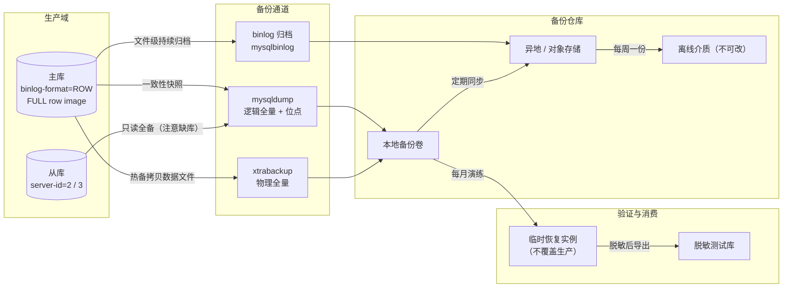
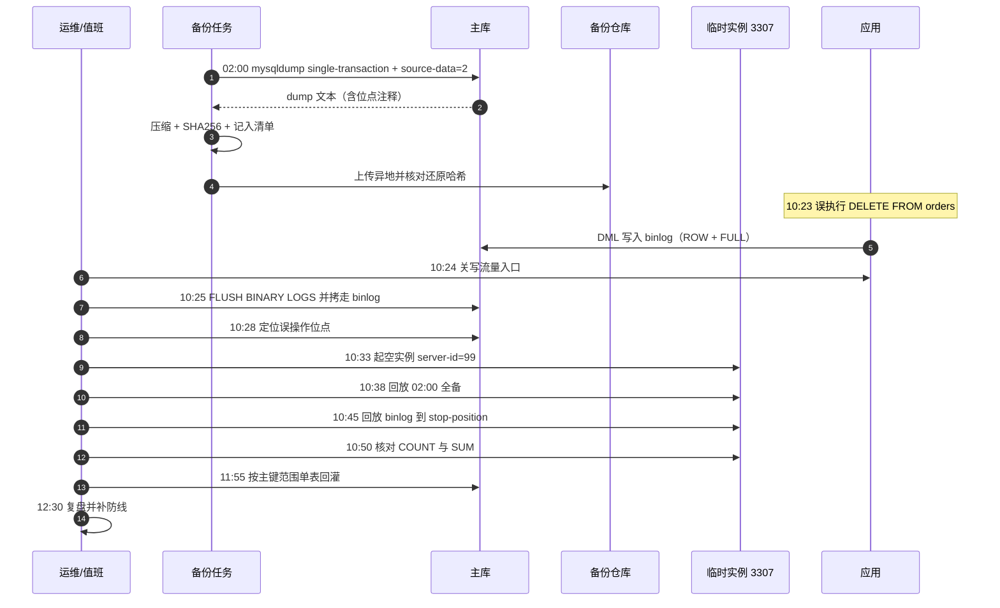

# 备份恢复与数据安全：备份不是目的，30 分钟内能回到指定时刻才是

> **一句话结论**：备份的价值不在"文件存在"，而在"**有全备锚点 + binlog 连续没被 purge + 能在一个不覆盖生产的临时实例里回放到指定秒 + 有账号权限和脱敏边界兜住**"这四件事同时成立；本项目目前只做了第三件里的一半（开了 binlog、留 7 天），其余三件都缺，所以真实 RPO 不是"7 天"而是"从来没有可恢复点"。
> **阅读前置**：读过本目录 [05-MySQL锁机制与主从复制读写分离.md](05-MySQL锁机制与主从复制读写分离.md) 与 [06-事务进阶-MVCC实现与三大日志.md](06-事务进阶-MVCC实现与三大日志.md)（知道 redo/undo/binlog 各管什么、知道从库在干什么）；会在 pwsh 里跑 `Select-String`、会读 YAML/INI 配置；不需要本地有 MySQL 实例。
> **证据基线**：MySQL 8.0（InnoDB / utf8mb4，服务端与 `mysqldump` / `mysqlbinlog` 源码**未入库**，本篇 A 级证据为 0，相关行为依据 MySQL 8.0 官方手册并逐条标注"未本机实测"）；B 级 = 本仓库 `deploy/mysql/`、`deploy/docker-compose/`、`deploy/k8s/`、`ai-cs-*` 配置与 `docs/28-故障案例库.md` 的真实行号（写作时逐行核对）；C 级 = 本机 Windows + pwsh 7 实跑输出（含一次"用 `all-init.sql` 冒充全备"的压缩/校验/篡改演示）。预计阅读 45 分钟。

---

## 0. 先看现象

### 现象一：备份文件在，但是 0 字节，哈希还是"合法"的

本机实测（`$env:TEMP\aics-bak-demo`，把 `deploy/mysql/all-init.sql` 当作"昨天的全备"去做一次压缩 + 校验演练，同时故意放一个 0 字节文件模拟失败的那一晚）：

```text
empty_2026-11-26.sql            0 bytes
full_2026-11-27.sql         60493 bytes
full_2026-11-27.sql.gz.zip       9758 bytes  压缩比 16.1%
E8DAD5A000E27B0E  full_2026-11-27.sql
E3B0C44298FC1C14  empty_2026-11-26.sql
src   : E8DAD5A000E27B0E
restore: E8DAD5A000E27B0E  size=60493
match : True
--- 损坏检测：改一个字节 ---
tampered hash: FA12135AC58FEF49
```

怎么读这几行：

- 第三行的压缩比 16.1% 说明 SQL 文本压得很狠——**所以"压缩后还有 9 KB"绝不能当成"备份有内容"的证据**，一个失败的空导出压缩后可能只剩几百字节，肉眼很容易放过。
- `E3B0C44298FC1C14…` 是**空字符串的 SHA256**。它有哈希、能算出来、能写进清单，但内容是零。这说明"校验清单里有这条哈希"≠"这一晚的备份是好的"——**校验必须校验"内容能还原"，不是"文件能哈希"**。
- 最后一行"改一个字节哈希就变"是对照组：哈希对内容敏感，所以它可以用来证明"还原出来的东西和当初一模一样"，这是它唯一该被信任的用途。
- 还有个小细节：从控制台直接打印 dump 里的中文会看到 `全量数据库��始化` 这种乱码，但用严格 UTF-8 解码核对时是全好的（首 3 字节 `45,45,32` = `-- `，无 BOM，`初始化` 出现 3 次，U+FFFD 计数 0）。**这是代码页渲染问题，不是文件损坏**——如果靠"眼睛看中文对不对"来判断备份完整性，你会把好备份判成坏的，也会把坏备份（内容截断但前几行正常）判成好的。

### 现象二：误删表之后，能恢复到的时间点不是"昨天"，而是"没有"

旧稿的设想是"每天 02:00 全量 + binlog 保留 7 天，最坏丢一天"。但把本仓库翻一遍，这个设想里的第一块砖就不存在：

```text
空工程里搜备份：
Select-String -Path . -Pattern "mysqldump|xtrabackup|mysqlbinlog" -Recurse
→ 只命中 docs\ 和 learning-docs\ 下的叙述文字
→ deploy\scripts\ 下 18 个脚本（check-local.ps1、deploy-host1~3.sh、verify-deploy.sh…）没有一个做备份
→ docker-compose-master-slave.yml 起的是 mysql / redis / nacos / es / minio / 从库，没有任何备份服务
```

也就是说：**没有任何一次全备被做过，所以 `mysqlbinlog` 拿到一堆 binlog 也无处可回放**。而"7 天"这个数字还有两个坑：

- `deploy/mysql/mysql.cnf#L28` 与 `deploy/mysql/master.cnf#L11` 都是 `expire-logs-days=7`。binlog 保留 7 天只决定"最多能翻多远"，**不决定"能不能翻"**——起点（全备 + 位点）缺失时，7 天的 binlog 只是一堆无法对齐的增量。
- 从库并不能替代备份。`deploy/mysql/slave.cnf#L15-L18` 只复制 4 个库：

```ini
replicate-do-db=user_db
replicate-do-db=knowledge_db
replicate-do-db=chat_db
replicate-do-db=nacos_config
```

漏了 `ai_customer_service`（订单库）和 `product_db`（商品库）。这个坑在本仓库是记录在案的：`docs/28-故障案例库.md#L145-L151` 把它写成事故案例，原话是"以为'有从库就安全'，实际订单数据没有副本"，并总结"把'冗余 ≠ 备份'这句话变成了一个具体事故"。

### 现象三：测试库直接用生产数据，而账号是 root

`deploy/mysql/demo-data.sql#L19-L24` 造的用户数据是明文手机号 + 明文邮箱（密码字段是 bcrypt 哈希，这点是对的）：

```text
手机号命中数 = 5
原值样例 : 13800000002 / 13800000003
邮箱命中数 = 5
```

而这套"演示数据"用的库和表结构，与生产完全同构——`deploy/mysql/all-init.sql#L57-L75` 起，8 张 `sys_user_0..3` 分片表每张都有 `password VARCHAR(128)` / `phone VARCHAR(20)` / `email VARCHAR(128)`，还都建了 `KEY idx_phone`、`KEY idx_email`。于是"把生产库 dump 下来灌到测试库"这一步，天然就是把 PII 明文搬出生产边界。

更糟的是**谁在搬**：`deploy/docker-compose/docker-compose-master-slave.yml#L15` 是 `MYSQL_ROOT_PASSWORD: root`，L154-L155 的 Nacos 也是 `MYSQL_SERVICE_USER: root` / `MYSQL_SERVICE_PASSWORD: root`；`ai-cs-user/src/main/resources/sharding-user.yaml#L31-L33` 里写的是 `password: $${DB_PASSWORD::root}`——**默认值直接兜底成 root 明文**。只要有一个 dump 客户端用 root 连生产导出，一次 `--all-databases` 就是把整个实例（含 `nacos_config.users` 的 bcrypt、`chat_db.chat_message` 的全部对话）复制走。

> 这些现象指向同一件事：**"备份 + 恢复 + 数据安全"是一条链，链上任何一环缺失，其他环做得再漂亮都不产生可恢复性**。有 binlog 没全备 = 无法回放；有全备没验证 = 不知能不能用；能恢复但用 root 恢复 = 恢复动作本身就是一次事故；能恢复但把生产数据灌进测试 = 恢复能力换来了泄露。本篇按这条链一节一节拆，每节都回答同一个问题：**这一环现在能不能在 30 分钟内交出一个"指定时刻的、可核对的、有权限边界的"数据集。**

---

## 1. 整体地图



| 组件 | 一句话责任 | 本项目现状（B 级证据） | 缺口 |
|---|---|---|---|
| 主库 binlog | 记录所有改数据的逻辑，唯一能"回到指定秒"的材料 | `deploy/mysql/mysql.cnf#L24-L28`：`log-bin` / `ROW` / `FULL` / `expire-logs-days=7` | 归档到哪儿？没人拷走。7 天后自动 purge |
| 从库 | 承接读流量、故障切换 | `slave.cnf#L15-L18` 只复制 4 库；`slave.cnf#L11-L12` `read-only=1` 但 `super-read-only=0` | 缺订单/商品库；无 `SOURCE_DELAY`，救不了误删 |
| 逻辑全备 | 可跨版本、可单库单表还原 | **不存在**（全仓无 mysqldump 脚本/任务） | 需要从零建 |
| 物理全备 | 大库快速还原、省 RTO | **不存在**（无 xtrabackup 任何痕迹） | 数据量大时才需要 |
| 备份仓库 | 存得住、留得下、异地可拿 | `docker-compose-master-slave.yml` 的 volumes 只有数据卷，无备份卷 | 无备份卷、无异地上传 |
| 演练恢复实例 | 证明备份能用，且不污染生产 | **不存在** | 唯一有效的备份验证手段 |
| 脱敏测试库 | 生产数据的结构 + 假数据的值 | `demo-data.sql` 手写假数据（方向对）；`PiiMasker.java` 有脱敏规则但只用于聊天内容 | 无 dump 脱敏流水线 |
| 账号与权限 | 应用账号不能 DDL、备份账号只读 | 全仓仅 `canal-init.sql#L2-L3` 建过一个账号，应用全用 root | 需要"应用 / 备份 / 运维"三账号分离 |

> **读图说明**：这张图最关键的不是"有几个框"，而是**两条线的方向**。第一条是 `主库 → binlog 归档 → 异地`：它是唯一一条能实现"回到 10:23:59"的路径，断了就只剩全备那天凌晨（或者像本项目一样什么都没有）。第二条是 `备份仓库 → 临时恢复实例 → 脱敏测试库`：**恢复动作一律落在临时实例上，永远不要直接对着生产主库回放**（第 6 节有一个把 DROP 再重放一遍的经典事故）。图中唯一"看起来有、其实有毒"的箭头是从库到全备——它每天都在跑，但少复制了两个库，用它当备份等于给自己一个假的安全感。

---

## 2. 关键概念与关键类

本篇没有"Java 类"可拆（备份工具是 C 程序，MySQL 服务端也不在本仓库源码里），所以这一节改成"**概念 → 它落在哪个文件/命令上 → 怎么验证它在起作用**"。术语首次出现都给了白话解释。

| 名称 | 位置 | 角色 | 关键参数 / 关键命令 |
|---|---|---|---|
| **RPO**（Recovery Point Objective，能容忍丢多久的数据） | 不是文件，是一条承诺 | 决定"全备多密、binlog 留多久" | 承诺 5 分钟 → binlog 必须实时归档到异地 |
| **RTO**（Recovery Time Objective，能容忍停多久） | 不是文件，是一次演练的实测值 | 决定"逻辑备份还是物理备份、能不能并行回放" | 本项目目标：**30 分钟**（本篇标题的由来） |
| **逻辑备份** | `mysqldump`（未入库，MySQL 8.0 官方手册 `mysqldump` 一章） | 导出成 SQL 文本，可读、可改、可单表还原 | `--single-transaction`、`--source-data=2`、`--routines --triggers --events` |
| **物理备份** | Percona XtraBackup（未入库，据 Percona 官方文档） | 直接拷 InnoDB 数据文件 + redo，还原快 | `--backup`、`--prepare`、`--incremental-basedir` |
| **binlog**（二进制日志，记"改了什么的逻辑"） | `deploy/mysql/mysql.cnf#L24-L28` | PITR 的唯一材料 | `binlog-format=ROW`、`binlog-row-image=FULL` |
| **PITR**（Point-In-Time Recovery，时间点恢复） | 全备 + binlog 的组合动作 | 把库带回"任意一秒" | `mysqlbinlog --start-position/--stop-position` |
| **一致性快照**（InnoDB 在某一刻的稳定视图） | `--single-transaction` 打开的 MVCC 快照 | 让全备不锁表 | 依赖"没有 DDL 在同一时段跑" |
| **位点**（binlog 文件内的字节偏移） | `SHOW BINARY LOGS` / dump 头部注释 | 全备和增量之间的"接缝" | `SOURCE_LOG_FILE` + `SOURCE_LOG_POS` |
| **GTID**（全局事务 ID） | MySQL 8.0 服务端 | 位点的替代品，跨主从更稳 | `--set-gtid-purged=OFF` 时要心里有数 |
| **脱敏**（把 PII 换成不可反推的假值） | `ai-cs-chat/src/main/java/com/aics/chat/util/PiiMasker.java#L78-L93` | 让测试库有结构无隐私 | 手机/身份证/银行卡/邮箱/地址五条正则 |
| **最小权限** | `deploy/mysql/canal-init.sql#L2-L3`（反面教材） | 让"一条错 SQL"炸不掉整个实例 | 应用账号不给 `DROP`；备份账号只给 `SELECT, LOCK TABLES, RELOAD, REPLICATION CLIENT` |
| **审计** | `deploy/mysql/security-guardrails-init.sql#L11-L30` | 事后追"谁在什么时候改了什么" | `chat_db.security_event`，`type` 里有 `SQL_BLOCKED`/`PII_MASKED` |

> 说明：A 级证据（`24-源码分析/assets/source/` 里的 Java 摘录）与本篇主题不重合——**`mysqldump`、`mysqlbinlog`、InnoDB 服务端都不在源码库中，未入库**，所有服务端行为依据 MySQL 8.0 官方手册（`mysqldump` / `mysqlbinlog` / Server System Variables / Point-in-Time Recovery 四章）；凡本机没跑过的命令，下文都明确标"未本机实测"。

---

## 3. 原理与证据逐段精读

### 3.1 `--single-transaction` 到底省掉了什么

**这段在做什么。** 一次逻辑全备必须解决"备到一半数据又变了"的问题。`mysqldump --single-transaction` 的做法不是锁表，而是在备份开始时开一个 REPEATABLE READ 事务（InnoDB 的 MVCC 一致性读视图），之后所有表的读都走这个视图，所以**备份看到的是同一个时间点**，业务照常写。

```bash
# 只读演示：不连生产，用本地演示实例（未本机实测，本地无 MySQL）
mysqldump -h127.0.0.1 -P3307 -uroot -p \
  --single-transaction --source-data=2 \
  --routines --triggers --events \
  --set-gtid-purged=OFF \
  --databases user_db user_db_0 user_db_1 \
  > full_2026-11-27.sql
```

**为什么这么设计。** 逻辑备份要跨几十张表、几分钟时间，如果每张表单独拿快照，`orders` 早一秒、`order_item` 晚一秒，还原出来的账就对不上。一个长事务把整段时间缝成一点，是成本最低的做法——代价是 undo 不能被 purge，备份期间写得多会把 undo 撑大（"备份把磁盘写满"就是这么来的）。

**换成另一种写法会怎样。** 去掉 `--single-transaction`，`mysqldump` 默认回到 `--lock-tables`（每个库一把读锁）甚至 `--lock-all-tables`：备份期间**应用全写不进去**，60 万行的库可能锁几分钟——这就是为什么很多人印象里"mysqldump 会锁库"，其实锁不锁取决于这个参数。反过来，加了 `--single-transaction` 却不用 InnoDB 表（本项目全是 InnoDB，没问题；如果哪天混进 MyISAM 表），那些表不在事务里，一致性直接失效。

**常见坑。** 三个，按出现频率排：

1. **备份期间有人跑 DDL**。MySQL 8.0 的表元数据锁（MDL）会让 `mysqldump` 要么被阻塞，要么更坏——拿到的是"DROP 之后"或"ALTER 之前"的元数据，备份里表结构对不上。判断依据：dump 时如果出现 `Error 1412` 或等 MDL 超时，就是撞上了。做法：备份窗口内禁止 DDL，或用 `--skip-lock-tables` 之外的显式约定写进上线检查单。
2. **`--source-data=2` 忘了加**。那这份 dump 就是"没有位点的全备"——恢复时你只知道"回到了备份那一刻"，但**不知道后面的 binlog 该从哪儿接着放**。本项目目前没有任何 dump，但一旦开始做，这条注释就是整个 PITR 的接缝。
3. **把 dump 当"逻辑一致性 = 业务一致性"**。`--single-transaction` 保证的是"数据库看到的一致"，不保证"事务之间跨表的业务不变量"。比如 `orders` 和 `order_item` 在备份窗口内被两个事务改过，快照能看到中间状态，但那是真实的中间状态，属于业务层要解决的问题，别赖备份工具。

### 3.2 binlog 是唯一能"回到指定秒"的材料，而它有三个开关项

**这段在做什么。** `deploy/mysql/mysql.cnf#L24-L28` 这几行决定了 PITR 的上限：

```ini
server-id=1
log-bin=mysql-bin
binlog-format=ROW
binlog-row-image=FULL
expire-logs-days=7
```

逐个说人话：

- `log-bin=mysql-bin`：开二进制日志，文件叫 `mysql-bin.000001`、`000002`…，写满（`master.cnf#L9-L10` 的 `max-binlog-size=500M`）就切下一个。
- `binlog-format=ROW`：记"哪一行的旧值→新值"，不记 SQL 文本。**好处**是回放结果确定（不依赖函数、`NOW()`、`UUID()`）、跨版本安全；**代价**是一条 `DELETE FROM orders` 删 100 万行会写 100 万条 row 事件，binlog 体积暴涨。
- `binlog-row-image=FULL`：每条 row 事件里带**整行前后像**。如果不设（默认 `MINIMAL`），只带主键和被改的列——那么"把一行改回原样"在某些场景（`UPDATE ... SET a = a`）就没材料了。**这是本项目做对的地方。**
- `expire-logs-days=7`：7 天后文件自动删。**它同时就是 RPO 的硬上限**：凌晨 02:00 做的全备，到第 8 天上午你只有一份 7 天前的全备和一堆被删掉的中间 binlog，中间 6 天全部不可恢复。

**为什么这么设计。** ROW + FULL 是"交易型系统 + 需要审计/复制"的默认最优解：Canel/主从/回放都吃它。而 `expire-logs-days=7` 是学习环境的直觉值（"省磁盘"），在生产里通常是**先算 RPO 再定值**：承诺丢 4 小时，那就得留 ≥ 全备间隔 + 4 小时，再乘一个安全系数。

**换成另一种写法会怎样。** 换成 `binlog-format=STATEMENT`：binlog 小很多，`mysqlbinlog` 直接可读（这也让"按库过滤"变得可行），但任何非确定性语句（`UUID()`、`LIMIT` 不带 `ORDER BY`、`NOW()`）都会让回放结果和当时不同——**做 PITR 的系统绝不该用 STATEMENT**。换成 `MIXED`：MySQL 自己挑，看起来聪明，实际让你不知道"这条到底记的是 row 还是语句"，排查时最痛苦。

**常见坑。** 最要命的一条：**purge 是悄无声息的**。`expire-logs-days=7` 到期后 MySQL 自己删文件，不报警、不写业务日志，你只有在要恢复的那天才发现"要的那个 book 不在了"。验证手段：`SHOW BINARY LOGS;` 看最老的 `Log_name` 是不是你需要的那个时间点；`SHOW BINARY LOGS` 里的 `Encrypted` 列还能告诉你文件有没有加密（见 3.9）。再补一句版本坑：`expire-logs-days` 粒度是"天"，8.0 推荐秒级变量 `binlog_expire_logs_seconds`，详见第 7 节。

### 3.3 全量 + 增量怎么组合，保留策略怎么定

**这段在做什么。** 备份体系只有一种正确形状：**一个全备锚点 + 连续不断的增量 + 一份"不跟着一起被删"的最老副本**。三样东西缺一样，恢复链就断在最老那一环。

| 层 | 内容 | 频率（建议） | 保留 | 解决的 RPO/RTO |
|---|---|---|---|---|
| L0 基线 | 每周一次全备（逻辑或物理） | 每周日 02:00 | 4 份（1 个月） | RTO 的下限：还原基线 |
| L1 增量 | binlog 实时归档到异地 | 分钟级（`mysqlbinlog --read-from-remote-server` 或文件同步） | ≥ 3 天在线 + 30 天冷存 | **RPO 的真实值** |
| L2 归档 | 每月 1 日全备打冷 | 每月 | 12 份（1 年） | 合规 / 大事故 |
| L3 离线 | 每季度拷到离线介质，物理不可改 | 每季度 | 2 份 | 勒索软件 / 内部恶意删除 |

**为什么这么设计。** 天数不是拍出来的，是**两个约束夹出来的**：RPO 决定"binlog 要连续到多近"，RTO 决定"最坏要回放多少 binlog"（回放 7 天 binlog 可能要几小时，远超 30 分钟 → 于是全备要更密）。L3 存在的原因跟 RPO 无关：**在线可写的备份会跟生产一起被删、一起被加密**，只有物理隔离的那份能对抗"人在系统内作恶"和勒索。

**换成另一种写法会怎样。** 只做每日全备、不做 binlog 归档：RPO = 24 小时，且**误删场景直接退化成"退到昨天凌晨"**——这正是本篇标题里"指定时刻"要反对的做法。反过来只归档 binlog 不做全备：一堆增量没有起点，等于零（本项目现状）。还有第三种常见错法：全备 6 天一次、binlog 留 7 天——表面刚好接上，但只要有**一次全备失败**，缺口立刻出现，所以留存量至少要能容纳 2 个全备周期。

**常见坑。** 保留策略写在文档里、靠人执行 = 不存在。要么有定时任务 + 失败告警，要么什么都不算。判断"我们到底有没有"的最快办法就是本篇现象二那条 `Select-String`：**搜不到脚本就是没有**。

### 3.4 PITR 三步法：定锚点 → 回放全备 → 裁剪 binlog

**这段在做什么。** 目标：把库带回 `2026-11-27 10:23:59`（误删前一秒）。三步，一步都不能跳。

**第一步，从全备里抠出锚点。** `--source-data=2` 会在 dump 头部写一段注释（8.0.26+ 的写法）：

```text
-- CHANGE REPLICATION SOURCE TO SOURCE_LOG_FILE='mysql-bin.000012', SOURCE_LOG_POS=1569877;
```

两件事要做：① 找到这行，记下 `文件 + 位点`；② **确认它还在**——`SHOW BINARY LOGS;` 里必须能看到 `mysql-bin.000012`。看不到就说明已被 purge，这条路当场断掉，只能退到"全备那一刻"，或者去翻 L2/L3 归档。

**第二步，回放全备到临时实例。** 注意目标是 3307 的临时实例，不是生产：

```bash
# 未本机实测（本地无 MySQL），给的是判读方法
mysql -h127.0.0.1 -P3307 -uroot -p < full_2026-11-27.sql
```

**第三步，裁剪并回放 binlog。** 先在 binlog 里找到"误操作那一行的位点"：

```bash
# 未本机实测。关键点：ROW 格式下 DDL（含 DROP/DELETE 之外的 ALTER）仍以语句形式记录，
# 所以可以直接 grep 出来；DML 要先解码成伪 SQL 才看得见
mysqlbinlog -vv --base64-output=DECODE-ROWS mysql-bin.000012 |
  Select-String -Pattern "DROP TABLE|TRUNCATE|DELETE FROM|# at " -Context 1,1
```

输出里每条事件前面都有一行 `# at 8823104`——**这个数字就是位点**。找到 `DROP TABLE`/`DELETE` 那一行的 `# at` 值，就是 `--stop-position`。

```bash
# 未本机实测。跨多个文件时：--start-position 只作用于第一个文件，
#  --stop-position 只作用于最后一个文件（这条不看手册必踩）
mysqlbinlog --start-position=1569877 --stop-position=8823104 \
  mysql-bin.000012 mysql-bin.000013 |
  mysql -h127.0.0.1 -P3307 -uroot -p
```

**为什么这么设计。** binlog 是"只追加的逻辑流"，回放它必然带副作用（它会把误删也重放一遍），所以必须**用位点把它切成"错误之前"**。为什么不用 `--database` 过滤？因为在 `binlog-format=ROW` 下，DML 的 row 事件里**只有 table_id，没有库名**——库名靠前面出现的 `Table_map` 事件映射，跨文件裁剪时上下文容易丢，过滤结果不可靠。**按位点裁剪是 ROW 格式唯一稳的做法。**

**换成另一种写法会怎样。** 换成"用从库顶上"：只有**故障**（主库宕机）能这么干，**误删**不行——因为删除语句早就同步到从库了（本项目还没有延时从库，`slave.cnf` 里搜不到 `SOURCE_DELAY`）。换成"用 `mysqlbinlog --database=xxx`"：ROW 格式下会漏事件或一条不剩，你以为过滤成功，其实是"回放了个寂寞"。换成"直接把 binlog 灌进生产主库"：第 6 节第 4 条专门讲这个事故。

**常见坑。** ① `--stop-position` 用的是**下一条**要跳过的事件位点，写"稍微早一点"很安全，写"稍微晚一点"就把 DROP 重放了——**宁早勿晚，早的损失可以再用 binlog 补一段**；② 回放前务必关掉 binlog 里可能存在的 `SET @@SESSION.GTID_NEXT`（用 `--set-gtid-purged=OFF` 备的 dump 一般没这问题）；③ 回放的是**同一个 server 的 binlog 到另一个实例**，如果临时实例 `server-id` 和源一样，某些工具会报重复 id，起实例时显式给 `--server-id=99`。

### 3.5 备份验证：唯一合格的验证是"在另一台实例上恢复成功并核对数字"

**这段在做什么。** "备份成功"有三个层次，只有第三层算数：

| 层次 | 判据 | 本机实测（本项目） | 能发现什么问题 |
|---|---|---|---|
| L1 文件层 | 文件存在、大小 > 0、`SHA256` 记录 | `full_2026-11-27.sql` 60493 B，哈希 `E8DAD5A000E27B0E` | 只发现"彻底空/彻底没写" |
| L2 可解压层 | 压缩包能解开，解开后哈希与记录一致 | `restore: E8DAD5A000E27B0E size=60493` / `match : True` | 发现传输截断、压缩损坏 |
| L3 可恢复层 | 灌进临时实例，表数量/行数/关键金额与预期一致 | **本项目从未做过** | 发现"能解开但内容不完整/结构错/权限不够" |

L1 有多不可靠，看现象一那个 `empty_2026-11-26.sql`：0 字节，哈希 `E3B0C442…` 照样能算出来、照样能进清单。**"有哈希"和"有内容"是两件独立的事。**

**为什么这么设计。** 备份文件是"没用过的代码"。它可能因为磁盘满、`mysqldump` 中途被 OOM kill、dump 权限不足（少了某张表的 `SELECT`，`mysqldump` 会打 warning 继续，于是少表而文件正常）、LDAP/网络抖动而**部分失败但退出码是 0**。只有真灌一次，才会暴露"少了一张表"或"表进去了但行数只有 40%"。

**换成另一种写法会怎样。** 只做 L1/L2 + 每天早上看一眼文件大小（大多数团队的实际做法）：你会在真出事那天第一次知道备份是坏的。反过来，"每次备份都全量恢复一遍到生产从库"也不行——那是用演练污染从库，而且成本高到没人坚持。**正确姿势是每月一次"计时演练"**：起临时实例、恢复、核对、记录耗时（RTO 实测值），把结果写进检查单。

**常见坑。** ① 演练只恢复不核对数字（恢复"成功"但 `orders` 少了 3 万行，因为 dump 用的账号没权限读某张表）；② 演练用的 dump 和真出事的 dump 不是同一条流水线（人工导出的和定时任务导出的参数不一样）；③ 演练不隔离网络，临时实例默认允许外连，等于把生产数据复制到一个没人管的库——**恢复环境的安全边界要和生产同一档**。

### 3.6 误删应急止血：顺序错了就救不回来

**这段在做什么。** 误删之后的前 10 分钟，比后面 30 分钟更能决定结果。固定顺序：

| 顺序 | 动作 | 命令/位置 | 为什么必须在这一步 |
|---|---|---|---|
| 1 | 停写（不是停库） | 关掉写流量入口/切只读，`SET GLOBAL super_read_only=ON`（**需 root，见第 6 节第 6 条**） | 每多写一条，回放时要多走一段 binlog，且新写入在"回到过去"后必然要补偿 |
| 2 | 切 binlog 并**立刻拷走** | `FLUSH BINARY LOGS;` 后把 `mysql-bin.*` 复制到另一块盘 | 之后任何一次重启/`PURGE`/磁盘满清理都可能让材料消失 |
| 3 | 定位误操作位点 | `mysqlbinlog -vv --base64-output=DECODE-ROWS … \| Select-String "# at "` | 有它才有"停止位点"，没有它只能全量退到昨天 |
| 4 | 起临时实例 | `--datadir` 新目录 + `--port=3307 --server-id=99` | **绝不覆盖生产**；也绝不先在生产上试 |
| 5 | 恢复全备 + 回放到停止位点 | 见 3.4 | 这是唯一能给出"误删前一刻"的路径 |
| 6 | 核对 | `SELECT COUNT(*), SUM(pay_amount) …` 与业务侧对账 | 数字不对说明基线和增量接缝错了 |
| 7 | **单表回灌生产** | `mysqldump tmp.orders \| mysql prod`（按主键范围） | 只回灌被删的表，别整库覆盖（整库覆盖 = 用旧数据抹掉误删之后的所有合法写入） |
| 8 | 复盘 + 补防线 | 加权限边界、加 `sql_safe_updates`、加延时从库 | 否则下次还会有 |

**为什么这么设计。** 核心思想是把"恢复"和"接管生产"解耦：**恢复永远发生在旁路实例上，生产只接受最终的、范围最小的回灌**。这样即使恢复失败十次，生产也不会更糟。

**换成另一种写法会怎样。** 直接 `mysql < full.sql` 覆盖生产：数据回到昨天凌晨，误删之后的**所有合法业务数据全丢**，损失远大于原来那次误删。只把主从切过去（如果有从库）：删除语句已经复制到从库，切过去照样是空表。先重启数据库"看看能不能好"：什么都不会好，但你可能顺手触发崩溃恢复、甚至让 binlog 被清掉。

**常见坑。** ① 忘了第 2 步——10:23 出事，11:00 有人为了"释放空间"跑了 `PURGE BINARY LOGS BEFORE NOW() - INTERVAL 1 HOUR`，材料当场没了；② 停写停了应用没停定时任务/`xxl-job`（本项目有 `xxl-job-init.sql`，说明确实跑着调度），补偿脚本继续写；③ 在临时实例上恢复了却**忘了它监听 0.0.0.0 且 root 空密码**，生产数据被复制成一个公开可连的库。

### 3.7 数据脱敏：生产数据进测试，要么改造值，要么别搬

**这段在做什么。** 两种情况必须分开处理：**结构可以搬，值不行**。本项目已经有一套现成的脱敏规则，落在 `ai-cs-chat/src/main/java/com/aics/chat/util/PiiMasker.java`（137 行，`@Component`）：

| 类型 | 正则（源码位置） | 掩码形态 | 备注 |
|---|---|---|---|
| 手机号 | `PiiMasker.java#L33` `(?<!\d)(1[3-9]\d)\d{4}(\d{4})(?!\d)` | `138****0002` | 保留前 3 后 4 |
| 身份证 | `PiiMasker.java#L45` | `110101********123X` | 保前 6 后 4 |
| 银行卡 | `PiiMasker.java#L56` | `622202******1234` | 配 `luhnValid`（`#L115-L136`）先校验再掩 |
| 邮箱 | `PiiMasker.java#L63` | `***@aics.com` | 只留域名 |
| 地址 | `PiiMasker.java#L70` | `***$2` | 只留尾部 |

`mask()` 在 `#L78-L93`，顺序是**身份证 → 银行卡 → 手机 → 邮箱 → 地址**。反过来的话，18 位身份证里的 11 位子串会先被"手机号"规则啃掉，剩下的掩码就变成了四不像。**这个顺序是设计出来的，不是随手排的。**

**为什么这么设计。** 三个约束逼出来的：① 测试要能复现问题，所以**保留格式、长度、可校验性**（Luhn 校验能过，才能测到"卡号校验"分支）；② 掩码必须**不可反推**（不做"映射表可逆"那套，那等于把密钥一起搬走了）；③ 一条正则要能同时用在日志、聊天内容、dump 上，所以写成与上下文无关的行内替换。`#L85-L86` 的注释记了个真实教训：20 位订单号 `20260814000000123456` 曾被身份证（18 位子串）和手机号（11 位子串）在长数字串内部滑动命中，加上 `(?<!\d)(?!\d)` 前后边界才不再误伤——**脱敏规则本身也会误删业务信息**，这跟"备份误删"是同一类风险。

**换成另一种写法会怎样。** 用固定的假值（所有人 `13800000000`）：唯一键冲突、`idx_phone` 全命中同一值导致执行计划失真，测试出的性能结论都是假的。用哈希（`SHA256(phone)`）：不可逆但**不可校验**，测不到"手机号格式校验"分支，而且长度变化会让 `VARCHAR(20)` 字段看不出边界问题。用"只生产假数据、从不导入生产结构"：结构会长期与生产不一致，`all-init.sql` 和 `init.sql` 对 `sys_user` 归属的分歧（`all-init.sql#L50` 说不再在 user_db 建 sys_user，而 `demo-data.sql#L19` 仍在往 `user_db.sys_user` 插）就是这类漂移的现场。

**常见坑。** ① **只脱敏 dump，忘了索引**：dump 里的 `INSERT` 脱敏了，但 `KEY idx_phone` 上的统计信息还是生产分布，性能结论失真；② 只脱敏 `phone`/`email`，漏了本项目 8 张分片表的 `password VARCHAR(128)`——bcrypt 不可逆但仍然算敏感，离线爆破在弱口令上很有效；③ 漏了 `nacos_config.users`（`all-init.sql#L832`，`password VARCHAR(500)`），配置中心里也有账号；④ 脱敏脚本本身把明文写到临时文件，临时文件权限 644 放在共享盘上。

### 3.8 最小权限与账号分离：应用账号不能有 DROP

**这段在做什么。** 三层账号，各管一段，互不越界：

| 账号 | 该有的权限 | 本项目现状 | 风险 |
|---|---|---|---|
| 应用账号 `app_*` | 只 `SELECT/INSERT/UPDATE/DELETE` + 必要的 `EXECUTE`，**无 DDL** | **不存在**。`ai-cs-mq/src/main/resources/application.yml#L29` 默认 `root`；`sharding-user.yaml#L32-L33` 默认 `root/root`；`tools/nacos-config/ai-cs-order.yml#L10-L11` 直接 `username: root` | 一条错的 Flyway/手写 SQL 就能 `DROP TABLE`；被注入时攻击面是整个实例 |
| 备份账号 `bak_*` | `SELECT, LOCK TABLES, RELOAD, REPLICATION CLIENT, SHOW VIEW, TRIGGER` | **不存在** | 用 root 备份 = 备份机持有全实例最高权限 |
| 复制账号 `rep_*` | `REPLICATION SLAVE, REPLICATION CLIENT` + 需要的 `SELECT` | 只有 `canal`：`deploy/mysql/canal-init.sql#L2-L3` | 见下 |

`canal-init.sql` 这两行是全仓库唯一一处 `CREATE USER`，也正好是最小权限的教科书反面：

```sql
CREATE USER IF NOT EXISTS 'canal'@'%' IDENTIFIED BY 'canal';
GRANT SELECT, REPLICATION SLAVE, REPLICATION CLIENT ON *.* TO 'canal'@'%';
```

两个问题叠在一起：**弱口令明文**（`'canal'`/`'canal'`，写在版本库里）× **`*.*` 全实例授权**（任何库都能读，包括 `chat_db.chat_message` 的完整对话和 `nacos_config.users` 的密码哈希）× **`'%'` 允许任意来源 IP**。它只需要读 `product_db`，却拿到了整个实例的读权限。

**为什么这么设计（为什么实际常常不是这样）。** 因为 "root 一把梭"在开发期最省事：不用管建账号的脚本、不用管 GRANT 顺序、也不会出现"新加一张表应用报没权限"。代价是把**DDL 能力交给了每一个应用进程**——而应用进程恰恰是唯一可能执行"拼接 SQL"的地方。所以最小权限不只是防内鬼，更是**缩小"应用被攻破"到"数据被摧毁"的桥梁**。

**换成另一种写法会怎样。** 假设现在给应用换成 `app` 账号且不给 `DROP`：第 3.6 节那类误删仍然会发生（`DELETE` 是业务必需的），但"DRO 整个库"和"改表结构"这类不可逆动作被挡在数据库层——这是**唯一在应用层出 bug 时还能兜住的地方**。再进一步，用 `sql_safe_updates=1` 让"不带 `WHERE` 或 `KEY` 的 `UPDATE/DELETE`"直接报错（`Error 1175: You are using safe update mode`），这一条对"`DELETE FROM orders` 忘写 WHERE"是精准打击。

**常见坑。** ① 权限变更后没 `FLUSH PRIVILEGES`（用 `GRANT` 语句改的话不需要，直接改 `mysql.*` 表才需要）；② 应用账号给了 `SELECT, INSERT, UPDATE, DELETE ON db.*`，看起来最小，但 `db.*` 包含未来所有新表——包括不该被应用看到的审计表（本项目 `chat_db.security_event` 就不该给业务账号写权限，它应该是只追加的、由安全组件写）；③ 备份账号给成 `ALL`，因为"备份什么都要读"——其实固定给那 6 个权限就够，`ALL` 会把 `DROP` 一起带上。

### 3.9 审计日志：三张网，各自答不同的问题

**这段在做什么。** 出事之后要回答三个不同的问题，对应三套机制，混用会很贵：

| 问题 | 靠什么 | 本项目落地 | 代价 |
|---|---|---|---|
| "哪一秒、哪一行被改成什么" | **binlog**（要 ROW + FULL） | `mysql.cnf#L25-L27` 已开 | 磁盘；7 天后消失（`#L28`） |
| "谁（哪个应用/账号）发起了这个动作" | **应用层审计表** | `deploy/mysql/security-guardrails-init.sql#L11-L30` 的 `chat_db.security_event` | 写入开销；需要脱敏后再落库 |
| "这条 SQL 是谁连上来发的" | **通用日志 / 审计插件** | 未启用（无 `general_log` 配置；MySQL 企业版审计插件不可得，社区版常用 `general_log` 或 MariaDB audit 插件替代） | **极大**：`general_log` 会把每条查询写文件，生产开等于自杀 |

`security_event` 的设计值得单独看两处：`type` 枚举里直接包含 `SQL_BLOCKED` 与 `PII_MASKED`，说明它记录的是"被拦下的危险动作"而不是"所有动作"；`input_digest VARCHAR(512)` 的注释写的是「敏感输入摘要（PII脱敏+截断，**禁止明文**）」——**审计表本身要是泄露了，不能成为第二份 PII 库**，这条原则比表结构更重要。配上 `idx_type_time(type, create_time)`，典型查询是"过去 1 小时 `SQL_BLOCKED` 有多少"。

**为什么这么设计。** 因为审计的成本是**二次方**的：记全量太贵，记太少没用。折中做法是"**记决策、不记原文**"——记"谁、什么类型、什么规则命中、做了什么 action"，原文只留脱敏摘要。binlog 负责"能还原"，审计表负责"能追责"，两者不重复。

**换成另一种写法会怎样。** 只靠 binlog：能还原数据，但**分不清**"是应用 A 的正常批处理还是人手工执行的"（除非开 `general_log` 才有 `user@host`）。只靠应用审计表：应用被绕过（直连数据库）就没有记录——`canal` 这种 `@'%'` 的账号正好绕过了应用层。所以两层都要有，且**数据库账号必须一一对应到主体**，否则 binlog 里的 `user@host` 永远是 `root@somehost`，等于没记。

**常见坑。** ① 审计表和应用库同实例同账号 → 攻击者删完业务表顺手删审计表（`security_event` 放在 `chat_db` 里，就在同一个实例，这是真实的设计缺陷）；② 审计写入失败把业务请求一起拖垮（应该异步、失败要能降级），取决于 `chat` 模块怎么调它；③ 只记"被拦"不记"被放行的高危动作"，事后无法证明"没有越权"。

### 3.10 传输与静态加密：本项目两处都是裸的

**这段在做什么。** 数据在三个位置会暴露，三处都要管：

| 位置 | 保护手段 | 本项目现状（B 级） | 结论 |
|---|---|---|---|
| 客户端 ↔ MySQL 传输 | TLS（`useSSL=true` + 校验 CA） | `ai-cs-mq/src/main/resources/application.yml#L26`、`sharding-user.yaml#L31`、`tools/nacos-config/ai-cs-order.yml#L9` 全是 **`useSSL=false`** | 明文过公网。而且目标是 `123.60.31.79` 这种**公网 IP** |
| 备份文件静态 | 加密 + 权限收敛 | 无备份，也就无加密 | 需要 `age`/`gpg` 或磁盘层加密 |
| 备份传输 | TLS / 离线介质 | 无 | 需要 |

`application.yml#L26-L30` 的实际内容是：

```yaml
url: jdbc:mysql://${MYSQL_HOST:123.60.31.79}:3306/mq_db?useUnicode=true&characterEncoding=utf-8&useSSL=false&serverTimezone=Asia/Shanghai&allowPublicKeyRetrieval=true
username: ${MYSQL_USER:root}
password: ${DB_PASSWORD:}
driver-class-name: com.mysql.cj.jdbc.Driver
```

三个问题连在一起：`useSSL=false`（明文）、`allowPublicKeyRetrieval=true`（允许客户端从服务端取公钥，削弱了中间人防护——它本来就是给"临时连不上"场景的补丁）、`password: ${DB_PASSWORD:}`（未设置时默认空串，等于"忘了配就静默用空密码连"，不会有任何报错）。

**为什么这么设计（为什么现实里常常这样）。** 学习环境图省事：自签证书要生成、要分发、要处理 `SSLHandshakeException`，而 `useSSL=false` 一劳永逸。加上云上 RDS 常常"内网直连不走 TLS"性能更好，久而久之就成了默认。

**换成另一种写法会怎样。** 打开 `useSSL=true` 但**不校验 CA**（不传 `trustCertificateKeyStoreUrl`）：能防被动嗅探，但防不了中间人，属于半成品，还会让你误以为"加密了"。正确做法是云端用 CA 证书 + `sslMode=VERIFY_IDENTITY`（Connector/J 8.0 的 `sslMode` 参数），内网用内网地址而不是公网 IP。

**常见坑。** ① 只开应用侧加密，**备份通道仍明文**（备份里是整库，比单条 SQL 更值钱）；② 备份文件权限 644、放在 NAS 共享目录，同网段任何人都能读；③ 加密了备份**却把密钥和备份放在同一个目录**（等于没加密，勒索软件会一起加密）。

### 3.11 备份存放与异地：在线可写的备份等于没有备份

**这段在做什么。** 决定"备份到底救得了什么"的，是它的**存放位置**，不是它的类型：

| 存放方式 | 救得了 | 救不了 | 本项目 |
|---|---|---|---|
| 同实例同一块盘 | 逻辑误删（配合 binlog） | 盘坏、实例毁、勒索 | `docker-compose-master-slave.yml` 的 volumes 只有数据卷，**连这个都没有** |
| 本机另一块盘 | 盘坏 | 机器/机房毁、勒索（会遍历挂载点） | 无 |
| 异地/对象存储（在线） | 机器毁、机房毁 | 勒索（快照可删）、内部恶意删除 | 无 |
| 离线介质（不可改） | 上面全部 + 内部作恶 | — | 无 |

`docker-compose-master-slave.yml` 的 volumes 里只有三个数据库 data 目录，**没有 binlog 独立卷、没有备份卷**。这意味着即使你今晚就写一个 `mysqldump` 脚本，默认也会把文件写进容器可写的那个卷——容器一删，备份跟着走；更糟的是**同一块盘写满会让 MySQL 也写不进 binlog**，备份动作本身可能触发生产故障。

**为什么这么设计。** 备份的威胁模型里，最凶的不是硬件，是**拥有同等权限的人**（内部人员、被盗的运维账号、勒索软件）。对抗它只有一个办法：**备份的删除权限不能和生产的删除权限是同一个**（对象存储开 `Object Lock`/合规保留、离线介质、另一套独立凭证）。这也是"3-2-1 原则"（3 份副本、2 种介质、1 份异地）要表达的意思——它的重点从来不是"三份"，而是"**最后那份你删不掉**"。

**换成另一种写法会怎样。** 用从库当异地：本项目已证伪（缺订单/商品库，见 `docs/28-故障案例库.md#L145-L151`）。用云盘同步盘当异地：勒索软件会同步加密后的版本上来，还会把好版本覆盖掉。用同一个 root 账号往对象存储传：拿到应用配置的人顺手就能删掉备份。

**常见坑。** ① 备份和 binlog 同盘 → 磁盘满时先删 binlog（很多运维脚本就这么写），于是备份和增量一起没了；② 异地只有"上传成功"的日志，没有"能下载回来"的验证——异地备份要**每月随机抽一份下载并恢复**；③ 备份文件命名里带 IP 和库名，本身泄露拓扑。

---

## 4. 一次完整执行时序

场景：2026-11-27 10:23，有人在生产上误执行了 `DELETE FROM orders WHERE create_time < '...'`（漏了本该有的 `AND status = ...`），影响约 4.2 万行。目标：**30 分钟内交回"10:23:00 那一刻"的 `orders` 表**。



> **读图说明**：看三处。① **第 8~9 条（10:24/10:25）是全图最值钱的两步**——它们必须在任何人碰"清理磁盘""重启实例"之前完成，顺序错了后面全白做；② 第 13 条那条箭头从**临时实例**出发去生产，而不是从生产读自己，说明生产在整段恢复期间只做一件事：停写等待，不参与恢复；③ 第 15 条 `完成核对才回灌` 是硬门槛，第 14 条如果数字对不上（比如回放位点写晚了，误删被重放一遍），必须回到第 11 条重做，**绝不"先进生产看看"**。

每一步失败会报什么错（含怎么定位，未本机实测，据 MySQL 8.0 手册与常见错误码）：

| 步 | 失败表现 | 判决 |
|---|---|---|
| 1 全备 | `mysqldump: Error 1412: Table definition has changed` | 备份窗口内有 DDL，备出来的结构不一致，这份 dump 直接作废 |
| 1 全备 | 退出码 0 但文件很小 / 有 `Warning: Skipping the data of table` | 备份账号对某表没 `SELECT`，**少表但"成功"**——必须查 warning |
| 5 拷 binlog | `Could not find first log file name in binary log index file` | binlog 索引和物理文件不一致（常见于手工删文件），需要人工重建索引 |
| 9 定位位点 | `mysqlbinlog: File 'mysql-bin.000012' not found` | 已被 `expire-logs-days=7` purge 或 `PURGE` 手工清掉 → 只能退到全备时刻 |
| 11 回放 | `ERROR 1062 (23000): Duplicate entry` | 基线与增量接缝错位（回放起点早于全备位点），从 `SOURCE_LOG_POS` 重来 |
| 11 回放 | `ERROR 1146 (42S02): Table 'x' doesn't exist` | 回放的 binlog 里含 DDL 建表语句，但基线里没有（跨全备点回放），需要裁剪掉 |
| 12 核对 | `SUM(pay_amount)` 比财务侧少 | 停止位点写早了（少放了一段）或全备不全（少表） |
| 13 回灌 | `ERROR 1213 (40001): Deadlock found` | 回灌期间生产还有写；应先 `super_read_only` 再回灌 |
| 10:25 之后 | `ERROR 1290 (HY000): The MySQL server is running with the --super-read-only option` | 自己给自己上了只读锁，需要临时账号持有 `SUPER`/`CONNECTION_ADMIN` 才能解开（见第 6 节第 6 条） |

---

## 5. 设计取舍

### 5.1 备份类型的取舍

| 方案 | 优点 | 代价 | 本项目怎么选 |
|---|---|---|---|
| 逻辑全备（`mysqldump`） | 可读、可改、可单表/单库还原、跨版本、体积小（压缩后，本机实测 60493 B → 9758 B，16.1%） | 恢复要重放 SQL，大库慢（RTO 大）；`--single-transaction` 期间 undo 膨胀 | **首选**。当前数据量（`all-init.sql` 60 KB 级别）下恢复只要秒级 |
| 物理全备（XtraBackup） | 恢复快（直接拷文件）、支持增量 | 版本绑定严格（PXB 版本号要匹配 MySQL 版本，跨版本报 unsupported server version，据 Percona 官方文档）；不可读，单表还原要 `--export` | 现在不需要，数据量上 GB 后再引入 |
| 只备 binlog | 体积小、可到秒 | 没有全备就没有起点 | **不是方案** |
| 从库当备份 | 零成本、自动 | 缺库（本项目就是）、误删照样同步、误操作无保护 | **明确否决**，`docs/28-故障案例库.md#L145-L151` 已列事故 |
| 延时从库 | 误删时能立刻切（`SOURCE_DELAY=3600`） | 多一个实例；延迟窗口内读不到最新数据；**本项目未配置** | 值得做，但**必须和全备并行**，不能替代 |

### 5.2 恢复方式的取舍

| 方案 | 优点 | 代价 | 本项目怎么选 |
|---|---|---|---|
| 全库覆盖恢复 | 简单 | 丢掉误删之后的合法写入；不可逆 | **禁止**在生产直接做 |
| 旁路实例恢复 + 单表回灌 | 生产风险最小；可多次重试 | 需要额外实例与磁盘；操作步骤多 | **标准动作**（第 4 节时序） |
| 只从 binlog 里抠出被删行反向生成 `INSERT` | 最精准、不碰其他表 | 需要解析 ROW 事件（`mysqlbinlog -vv --base64-output=DECODE-ROWS` 能给出伪 SQL）；大批量时笨重 | 小批量（几百行）时最优 |
| 主从切换 | 秒级 | 只对故障有效，对误删无效 | 仅故障场景 |

### 5.3 可扩展点清单

- **备份任务**：`deploy/scripts/` 加 `backup-mysql.ps1`（Windows 侧）与 `backup-mysql.sh`（host 侧），参数化 `--single-transaction --source-data=2`，输出到独立备份卷。
- **备份账号**：新增 `backup-user-init.sql`（放在 `deploy/mysql/` 下），`CREATE USER 'bak'@'10.%'`，只授 `SELECT, LOCK TABLES, RELOAD, REPLICATION CLIENT, SHOW VIEW, TRIGGER`。
- **应用账号**：新增 `app_user_init.sql`，`GRANT SELECT, INSERT, UPDATE, DELETE ON <db>.* `，**不含 `DROP`/`ALTER`/`CREATE`**；把 `sharding-user.yaml#L33` 的 `$${DB_PASSWORD::root}` 默认值改成必填。
- **binlog 保留**：`mysql.cnf#L28` 的 `expire-logs-days=7` → `binlog-expire-logs-seconds=604800`（见第 7 节）。
- **归档**：用 `mysqlbinlog --read-from-remote-server --stop-never` 或文件级同步，把 `mysql-bin.*` 实时推到异地。
- **演练**：新增 `verify-restore.ps1`（放在 `deploy/scripts/` 下），每月跑一次，产物是"RTO 实测分钟数 + 行数对比表"。
- **脱敏**：把 `PiiMasker.java` 的 5 条正则复用到 dump 后处理脚本，顺序照抄（身份证→银行卡→手机→邮箱→地址）。
- **审计**：把 `chat_db.security_event` 迁到独立实例，或至少给业务账号只给 `INSERT`（不给 `SELECT`/`DELETE`）。

> 取舍总纲：**优先买"可验证"，再买"快"**。一个 40 分钟能恢复且每月验证的 `mysqldump`，胜过一个理论上 5 分钟恢复但从没验证过的物理备份链。

---

## 6. 踩坑与调试手法

> 说明：第 1~3 条是本仓库的真实缺陷（B 级证据）；第 4~8 条是恢复链上的通用事故。标注【调试手法】的是可以照着敲的排查动作。

### 坑 1：备份"成功"但文件是空的 / 缺表

- **现象**：`full_2026-11-27.sql` 0 字节，或 60 KB 但里面只有 6 张表。
- **根因**：磁盘满；`mysqldump` 被 OOM kill；备份账号缺某表 `SELECT`（`mysqldump` 打 warning 继续，退出码仍为 0）。
- **验证手段**：`Select-String -Path full.sql -Pattern "CREATE TABLE" | Measure-Object` 数表数量，与 `information_schema.tables` 的期望数量对比；同时看 dump 日志里有没有 `Warning: Skipping`。**0 字节文件的 SHA256 恒为 `E3B0C442…`（本机实测）**，拿这个值当哨兵值可以直接识别。
- **解法**：备份后必跑"表数量比对 + 哈希记账"，并且**退出码不够，要检查 stderr**。

### 坑 2：`--single-transaction` 期间撞上 DDL，备份悄悄不一致

- **现象**：还原时 `ERROR 1146 Table doesn't exist`，或表结构比生产少一列。
- **根因**：备份窗口内跑了 `ALTER TABLE`，MDL 让 dump 的元数据和数据来自不同时间点。
- **验证手段**：备份窗口内 `SHOW PROCESSLIST` 里搜 `ALTER|CREATE|DROP`；或事前用 `performance_schema.metadata_locks` 看有没有 pending 的 MDL。
- **解法**：备份窗口冻结 DDL（写进上线检查单）；对关键表用 `--single-transaction` + 之后立刻做一次 `CHECKSUM TABLE` 与临时实例比对。

### 坑 3：把从库当备份，结果少了一整个订单库

- **现象**：主库故障切从库，订单查不到；或从库 dump 出来没有 `orders` 表。
- **根因**：`deploy/mysql/slave.cnf#L15-L18` 的 `replicate-do-db` 白名单只有 4 个库，漏了 `ai_customer_service`、`product_db`（`slave2.cnf#L15-L18` 同样）。
- **验证手段**：【调试手法】在从库上直接比库表数量：

```sql
-- 在主库和从库各跑一次，diff 结果（未本机实测，本地无 MySQL）
SELECT table_schema, COUNT(*) AS tables_cnt
FROM information_schema.tables
WHERE table_schema NOT IN ('mysql','sys','performance_schema','information_schema')
GROUP BY table_schema ORDER BY table_schema;
```

主库有 `ai_customer_service`、`product_db` 而从库没有 → 复制过滤漏配，立刻能确认。再补 `SHOW REPLICA STATUS\G` 看 `Replicate_Do_DB` 字段与文档是否一致。
- **解法**：补白名单（`STOP REPLICA` → 改配置 → `START REPLICA`，历史写法 `STOP SLAVE` 见第 7 节）；或去掉过滤复制全量；短期用 `mysqldump --single-transaction` 重建复制。

### 坑 4：把 binlog 直接回放到生产，把误删又执行了一遍

- **现象**：回放开始后 `orders` 又少了几万行，或 `ERROR 1062 Duplicate entry`。
- **根因**：`--stop-position` 写晚了（包含了误删事件）；或 `--start-position` 早于全备位点。
- **验证手段**：【调试手法】回放前先把 binlog 输出成文本，人工确认最后一条事件是"误删之前"的：

```powershell
# 本机可跑（不连数据库，只需 binlog 文件）
mysqlbinlog.exe -vv --base64-output=DECODE-ROWS --start-position=1569877 --stop-position=8823104 mysql-bin.000012 |
  Select-String -Pattern "^# at \d+|DROP TABLE|DELETE FROM" | Select-Object -Last 8
```

看清最后 8 行里没有 `DROP TABLE`/目标 `DELETE` 才开始灌库。**宁早勿晚**：早放一段的损失，可以再用一段 binlog 补回来；晚放一段就是把事故重演一遍。
- **解法**：永远先恢复到临时实例；`--stop-position` 取"误操作事件的 `# at` 值"。

### 坑 5：`mysqlbinlog --database` 在 ROW 格式下"过滤成功"但什么都没回放

- **现象**：加了 `--database=user_db`，回放后目标库一行没变，也不报错。
- **根因**：ROW 格式的 row 事件只带 `table_id`，库名靠前置 `Table_map` 事件映射；裁剪区间把 `Table_map` 切掉或跨文件后上下文丢失，过滤就会漏掉全部事件。
- **验证手段**：`mysqlbinlog -vv --base64-output=DECODE-ROWS` 直接看有没有 `Table_map: \`user_db\`.\`sys_user_0\` mapped to number 108` 这种行；若输出里只剩 `Write_rows` 而前面没有 `Table_map`，就是这个坑。
- **解法**：**按位点裁剪，不按库名过滤**（3.4 的做法）；必须先按库筛的话，先整段回放到临时实例再按库导出。

### 坑 6：`super_read_only` 上去了下不来

- **现象**：止血时执行 `SET GLOBAL super_read_only=ON`，回灌时应用账号报 `ERROR 1290 (HY000): The MySQL server is running with the --super-read-only option so it cannot execute this statement`，连自己都改不回来。
- **根因**：`super_read_only=ON` 也禁止非 `CONNECTION_ADMIN`/`SUPER` 账号改 `read_only`；而本项目应用账号是 root（`docker-compose-master-slave.yml#L15`），root 恰好有权限——**但一旦按 3.8 改成最小权限，止血动作就会把自己锁在门外**。
- **验证手段**：事前确认手上有没有一个独立于应用的 break-glass 账号（能 `SET GLOBAL`）；`SELECT user, host, Super_priv FROM mysql.user WHERE Super_priv='Y';`
- **解法**：止血用 `read_only=ON`（业务账号写不进，管理账号可改）+ 应用层熔断；真要 `super_read_only` 就必须留一个只用于应急的 DBA 账号，且它的口令在密码库里、不在应用配置里。

### 坑 7：`drop-all.sql` 删不干净，重建后残留旧数据

- **现象**：`DROP DATABASE` 跑完重跑初始化，发现 `mq_db` 还是旧数据；`user_db_0/1` 分片表还是老的。
- **根因**（本机实测对比）：`deploy/mysql/all-init.sql` 声明 9 个库，`deploy/mysql/drop-all.sql#L7-L12` 只删 6 个：

```text
created: ai_customer_service, chat_db, knowledge_db, mq_db, nacos_config, product_db, user_db, user_db_0, user_db_1
dropped: ai_customer_service, chat_db, knowledge_db, nacos_config, product_db, user_db
未纳入 drop-all 的库: mq_db, user_db_0, user_db_1
```

- **验证手段**：【调试手法】用两条 `Select-String` 抽出两个清单做差集（本机跑过，命令见第 9 节练习 3）。这比"看脚本以为删全了"可靠得多——**危险脚本必须机器对账**。
- **解法**：`drop-all.sql` 补齐 3 个库（注意 `user_db_0/1` 是分片库，删的顺序无所谓但别漏）；更彻底的做法是让 `drop-all.sql` 从 `information_schema.schemata` 动态生成，禁止手写清单。

### 坑 8：配置里到处都是 root 明文，恢复动作本身成了最大风险

- **现象**：任何一台开发机 `git clone` 之后，`sharding-user.yaml#L33` 的默认值就能连上 `123.60.31.79:3306` 的 root；`deploy/k8s/mysql.yaml#L145` 是 `value: "root"`（注释自己都写着"生产应改用 Secret"）。
- **根因**：把"方便"当成了默认值（`${DB_PASSWORD:}`、`$${DB_PASSWORD::root}`），以及 compose 里 `MYSQL_ROOT_PASSWORD: root`（`docker-compose-master-slave.yml#L15`）本身就是设计。
- **验证手段**：【调试手法】全仓搜"凭据形态"，一行命令定性：

```powershell
Select-String -Path (Get-ChildItem -Recurse -Include *.yml,*.yaml,*.properties -File).FullName `
  -Pattern "password:\s*(root|canal|minioadmin|\$\{[A-Z_]+:\}|"")" |
  Select-Object Path, LineNumber, Line | Format-Table -AutoSize
```

输出里 `password:` 后面直接跟具体值、或跟一个"空默认/root 默认"的，都是待修项；`deploy/k8s/middleware-secrets.example.yaml#L47` 那种 `replace-with-real-password` 占位是**正确做法**的样板。
- **解法**：密码只从外部注入（K8s Secret / 环境变量 / 配置中心加密项），配置里不写默认值——**宁可启动失败，也不要静默用 root 连上生产**。

---

## 7. ⚠️ 版本差异

| 旧写法 | 当前基线（MySQL 8.0 / 本仓库） | 变化点 | 迁移动作 |
|---|---|---|---|
| `expire_logs_days=7` | `deploy/mysql/mysql.cnf#L28` 仍写着它 | 8.0 手册把天级变量标为 deprecated，推荐秒级 `binlog_expire_logs_seconds`（默认 2592000 秒 = 30 天） | 改成 `binlog-expire-logs-seconds=604800`；旧变量值会与秒级变量交互，以 `SHOW VARIABLES` 实测为准（未本机实测） |
| `mysqldump --master-data=2` | 8.0.26+ 推荐 `--source-data=2` | 术语从 MASTER/SLAVE 改为 SOURCE/REPLICA，`--master-data` 被废弃 | 脚本里全部替换为 `--source-data`；解析 dump 头部时要认 `CHANGE REPLICATION SOURCE TO` 而不是 `CHANGE MASTER TO` |
| `CHANGE MASTER TO` / `SHOW SLAVE STATUS` / `STOP SLAVE` | `CHANGE REPLICATION SOURCE TO` / `SHOW REPLICA STATUS` / `STOP REPLICA` | 同一次改名 | 旧文档里的复制命令照抄会报语法错（8.0 仍兼容旧语法但已 deprecated）；本项目 `docs/28-故障案例库.md#L157` 里的 `STOP SLAVE` 属于旧写法 |
| 旧文档：`CHANGE REPLICATION SOURCE TO … SOURCE_DELAY=3600` 建延时从库 | 本项目无任何延时复制配置（`slave.cnf` 全文搜不到 `DELAY`） | 旧稿把"建议"写成了"方案" | 真要加：在从库 `STOP REPLICA; CHANGE REPLICATION SOURCE TO SOURCE_DELAY=3600; START REPLICA;`，并注意 `SOURCE_DELAY` 只对 `CHANGE` 后的事件生效 |
| `xtrabackup` 通用叫法 | Percona XtraBackup 版本号与 MySQL 版本绑定（8.0.x ↔ 8.0，8.4 ↔ 8.4，据 Percona 官方文档） | 用错版本会直接报 unsupported server version | 引入时固定版本矩阵，写进 `deploy/` 说明 |
| 旧文档口径：MyBatis-Plus 3.0.5 | 本仓库 `pom.xml#L47` 是 `3.5.13` | 口径不一致 | 引用 MP 行为时以 `pom.xml` 为准；与备份主题无关但影响"照旧稿抄版本号"的做法 |

> 一句总结：**这一节里唯一会直接毁掉恢复的，是第一条**。`expire-logs-days` 看起来还在生效，但它的"天"粒度和 deprecated 状态意味着：你以为留了 7×24 小时，实际可能因为版本行为变化而少于你的假设。判断方法永远是 `SHOW VARIABLES LIKE 'binlog_expire_logs_seconds';` + `SHOW BINARY LOGS;`，别看配置文件。

---

## 8. 面试高频问与答

> 只列问题（答案自己讲，能讲清 1、3、5 三题就算过关）。

1. 冗余（主从、快照）和备份的区别是什么？举一个"有冗余但救不回来"的具体例子。
2. RPO 和 RTO 分别由什么决定？如果承诺 RPO=5 分钟、RTO=30 分钟，备份体系要怎么配？
3. `mysqldump --single-transaction` 为什么能不锁表还保证一致性？它保证不了什么？
4. `--source-data=2` 写进 dump 的那行注释，在恢复流程里起什么作用？丢了会怎样？
5. 一次"误删表"的完整恢复流程讲一遍，说出每一步失败会报什么错。
6. `binlog-format=ROW` 和 `STATEMENT` 对 PITR 有什么影响？为什么本项目用 `binlog-row-image=FULL`？
7. 为什么 `mysqlbinlog --database` 在 ROW 格式下不可靠？正确的裁剪方式是什么？
8. binlog 保留 7 天，是不是就意味着最多能恢复到 7 天前的任意时刻？
9. 怎么验证一份备份是"真的能用"？为什么"文件大小正常 + 有 SHA256"不算验证？
10. 延时从库能替代备份吗？它解决的是哪类问题？本项目为什么没配？
11. 应用账号为什么不能有 `DROP` 权限？给了 `SELECT/INSERT/UPDATE/DELETE ON db.*` 还有哪些越权面？
12. 生产数据要进测试库，具体怎么做脱敏？掩码规则为什么要"身份证先于手机号"？
13. 备份文件放哪里才安全？"3-2-1 原则"里最关键的是哪一条？
14. 出事之后怎么在 binlog 里定位误操作的具体位点？

---

## 9. 动手练习

> 全部可在本机完成，不需要 MySQL 实例、不联网、不启动服务。命令均在本仓库根执行。

### 练习 1：给"备份"算哈希，并证明 0 字节文件也能有合法哈希

```powershell
$dir = Join-Path $env:TEMP "aics-bak-demo"; New-Item -ItemType Directory -Force $dir | Out-Null
Copy-Item deploy\mysql\all-init.sql "$dir\full_2026-11-27.sql" -Force
New-Item -ItemType File -Force "$dir\empty_2026-11-26.sql" | Out-Null
Get-ChildItem $dir | ForEach-Object { "{0,-28} {1,8} bytes" -f $_.Name, $_.Length }
Get-ChildItem $dir -Filter *.sql | ForEach-Object {
  "{0}  {1}" -f (Get-FileHash $_.FullName -Algorithm SHA256).Hash.Substring(0,16), $_.Name
}
```

**验收标准**：输出里 `empty_2026-11-26.sql` 是 0 bytes，且它的哈希前 16 位是 `E3B0C44298FC1C14`；能一句话解释"为什么有哈希不等于有内容"。

### 练习 2：压缩 → 解压 → 比对哈希 → 篡改 1 字节看哈希变化

```powershell
$dir = Join-Path $env:TEMP "aics-bak-demo"
Compress-Archive "$dir\full_2026-11-27.sql" "$dir\full.zip" -Force
Expand-Archive "$dir\full.zip" "$dir\restore" -Force
$src = (Get-FileHash "$dir\full_2026-11-27.sql" -Algorithm SHA256).Hash.Substring(0,16)
$res = (Get-FileHash "$dir\restore\full_2026-11-27.sql" -Algorithm SHA256).Hash.Substring(0,16)
"src   : $src"; "restore: $res"; "match : $($src -eq $res)"
# 篡改一个字节
$bytes = [IO.File]::ReadAllBytes("$dir\full_2026-11-27.sql")
$bytes[100] = $bytes[100] -bxor 0xFF
[IO.File]::WriteAllBytes("$dir\full_2026-11-27.sql", $bytes)
"tampered hash: " + (Get-FileHash "$dir\full_2026-11-27.sql" -Algorithm SHA256).Hash.Substring(0,16)
```

**验收标准**：`match : True`；篡改后哈希变成与 `E8DAD5A0…` 完全不同的值（本机实测 `FA12135AC58FEF49`）；能说明"哈希只证明内容没变，不证明内容完整"。

### 练习 3：给危险脚本做机器对账（`all-init.sql` vs `drop-all.sql`）

```powershell
$created = Select-String -Path deploy\mysql\all-init.sql -Pattern "CREATE DATABASE IF NOT EXISTS (\w+)" -Encoding utf8 |
  ForEach-Object { $_.Matches[0].Groups[1].Value } | Sort-Object -Unique
$dropped = Select-String -Path deploy\mysql\drop-all.sql -Pattern "DROP DATABASE IF EXISTS (\w+)" -Encoding utf8 |
  ForEach-Object { $_.Matches[0].Groups[1].Value } | Sort-Object -Unique
"created: " + ($created -join ', ')
"dropped: " + ($dropped -join ', ')
"未纳入 drop-all 的库: " + (($created | Where-Object { $dropped -notcontains $_ }) -join ', ')
```

**验收标准**：输出必须包含 `未纳入 drop-all 的库: mq_db, user_db_0, user_db_1`（本机实测结果）；并能解释"为什么 `DROP DATABASE` 清单必须机器生成而对账"。

### 练习 4：统计全仓 DDL/数据里的敏感字段分布

```powershell
$pat = '\b(phone|mobile|email|id_card|idcard|bank_card|card_no|password|address)\b'
$hits = Select-String -Path deploy\mysql\*.sql -Pattern $pat -Encoding utf8
"total_hits=$($hits.Count)"
$hits | Group-Object Filename | Sort-Object Count -Descending | ForEach-Object { "{0,-34} {1}" -f $_.Name, $_.Count }
```

**验收标准**：`total_hits=92`（本机实测），文件分布 `all-init.sql 44 / init.sql 43 / demo-data.sql 2 / xxl-job-init.sql 2 / order-init.sql 1`；能指出敏感字段最集中的是 8 张 `sys_user_*` 分片表（`password`/`email`/`phone`）。

### 练习 5：用 `PiiMasker` 的规则对 demo 数据做一次脱敏，并核对命中数

```powershell
$txt   = Get-Content deploy\mysql\demo-data.sql -Encoding utf8 -Raw
$phone = '(?<!\d)(1[3-9]\d)\d{4}(\d{4})(?!\d)'
$email = '[A-Za-z0-9._%+-]+@([A-Za-z0-9.-]+\.[A-Za-z]{2,})'
"手机号命中数 = " + ([regex]::Matches($txt, $phone)).Count
"邮箱命中数   = " + ([regex]::Matches($txt, $email)).Count
($txt -replace $phone, '$1****$2') -replace $email, '***@$1' |
  Set-Content "$env:TEMP\demo-data.masked.sql" -Encoding utf8
Select-String -Path "$env:TEMP\demo-data.masked.sql" -Pattern "1[3-9]\d\*{4}\d{4}|\*{3}@" | Measure-Object | Select-Object -ExpandProperty Count
```

**验收标准**：`手机号命中数 = 5`、`邮箱命中数 = 5`（本机实测）；掩码后的文件里搜不到原始 `13800000002`，但仍能搜到 `138****0002` 这种形态；能解释为什么"保留格式"对测试很重要。

### 练习 6：把"30 分钟恢复"写成一份可执行检查单，并对它做一次桌面推演

产出一份 Markdown 检查单，至少包含：停写 → 保 binlog → 定位位点 → 起临时实例 → 回放 → 核对 → 单表回灌 → 复盘，每一步写清**命令、判据、失败时退回哪一步**。

**验收标准**：检查单里每一步都有"判据"（不是"检查一下"这种空话）；能给出一条"如果第 4 步起不来，退回到第 2 步"的显式回退路径；能报出一次桌面推演的**估算耗时**并说明它为什么还不是 RTO（RTO 必须实测）。

---

## 小结

- **备份的产物不是文件，是可恢复性**：全备锚点 + 连续 binlog + 临时实例演练 + 权限/脱敏边界，缺一环就没有可恢复性。本项目目前只有"开了 binlog、留 7 天"这一环的一半。
- **本项目没有备份**：全仓搜不到 `mysqldump|xtrabackup|mysqlbinlog` 的任何脚本或定时任务，`deploy/scripts/` 18 个脚本无一做备份；这不是"没写文档"，是"没有能力"。
- **从库不是备份**：`slave.cnf#L15-L18` 只复制 4 库，漏了 `ai_customer_service`（订单）和 `product_db`（商品），`docs/28-故障案例库.md#L145-L151` 已把它记成事故。
- **哈希只证明"没变"，不证明"能还原"**：0 字节文件的 SHA256 恒为 `E3B0C442…`（本机实测）；验证的最低合格线是"在另一台实例上恢复成功 + 行数与金额对得上"。
- **PITR 的接缝是位点，不是库名**：`ROW` 格式下 `--database` 过滤不可靠，只能 `--start-position/--stop-position` 裁剪，且**宁早勿晚**。
- **恢复绝不能落在生产**：旁路实例恢复 + 按主键范围单表回灌，是唯一不放大事故的做法。
- **权限就是最后一道备份**：应用账号没有 `DROP`、备份账号只读、`sql_safe_updates=1`，这三条能挡住"不可逆操作"，而 `sharding-user.yaml#L33` 的 `root` 默认值、`docker-compose-master-slave.yml#L15` 的 `MYSQL_ROOT_PASSWORD: root` 把这道门完全敞着。
- **可以立刻做的三件事**：① 在 `deploy/scripts/` 加一个带 `--single-transaction --source-data=2` 的全备脚本并写哈希清单；② 把 `expire-logs-days=7` 换成 `binlog-expire-logs-seconds=604800` 并把 binlog 归档到异地；③ 建 `bak_*`/`app_*` 两个账号、收回 root。

---

## 自测题

**1. 为什么"每天 02:00 全量 + binlog 保留 7 天"不等于"能恢复到 7 天内任意时刻"？**

<details><summary>参考答案</summary>
binlog 保留期只决定"最多能翻多远"，恢复必须有一个全备作为起点并带上位点。本项目根本没有全备，所以那 7 天 binlog 没有可对齐的接缝，实际可恢复点是"无"。另一个独立风险是 purge 静默发生，你要恢复的那一天才发现文件已删。</details>

**2. 一个 0 字节的备份文件，为什么它的 SHA256 是"合法"的？这说明什么？**

<details><summary>参考答案</summary>
空文件内容的 SHA256 是固定值 `E3B0C44298FC1C14…`，算法对任何输入都能算出结果，包括空输入。这说明"能算出哈希"和"有内容"是两件独立的事，哈希只能用来证明"内容没变"，不能证明"内容完整或可用"。</details>

**3. `--single-transaction` 解决了什么问题？它不能保证什么？**

<details><summary>参考答案</summary>
它用 InnoDB 的一致性读视图把整个备份过程固定在一个时间点，从而不锁表、不阻塞写入。但它不保证跨表的业务不变量，也无法抵御备份窗口内的 DDL——MDL 会让元数据与数据来自不同时刻，备出来的结构可能不一致。</details>

**4. `--source-data=2` 在 dump 里写的那行注释，为什么是 PITR 的关键？**

<details><summary>参考答案</summary>
它记录"这份全备对应的 binlog 文件与位点"，是基线与增量之间唯一的接缝。没有它，你只能恢复到备份那一刻，无法和后面的 binlog 拼接，也就做不出"回到误删前一秒"。8.0.26 之前这行是 `CHANGE MASTER TO MASTER_LOG_FILE=…`。</details>

**5. 为什么在 ROW 格式下不能用 `mysqlbinlog --database` 来筛库？正确做法是什么？**

<details><summary>参考答案</summary>
ROW 格式的 row 事件只带 table_id，库名来自前置的 `Table_map` 事件；裁剪区间切掉或跨文件丢掉这个上下文后，过滤会漏掉全部事件，看起来"成功"其实什么都没回放。正确做法是按 `--start-position/--stop-position` 精确裁剪。</details>

**6. `binlog-row-image=FULL` 和默认 `MINIMAL` 的差别，在恢复场景里意味着什么？**

<details><summary>参考答案</summary>
FULL 让每条 row 事件带上整行前后像，任何一行都能被完整还原；MINIMAL 只带主键和被改的列，遇到"把某列改成同值"之类的更新时缺材料。本项目在 `mysql.cnf#L27` 设了 FULL，这是做 PITR 的正确配置。</details>

**7. 从库为什么不能当备份用？举出本项目的具体证据。**

<details><summary>参考答案</summary>
从库复制的是"操作"而不是"时刻"，误删会被同步过去；而且复制可以是部分的。`deploy/mysql/slave.cnf#L15-L18` 的 `replicate-do-db` 只含 4 个库，缺 `ai_customer_service` 和 `product_db`，所以从库根本没有任何订单数据。</details>

**8. 备份验证分三层，哪一层才算合格？为什么前两层不够？**

<details><summary>参考答案</summary>
只有"在临时实例上恢复成功并核对表数量/行数/金额"这一层算合格。文件存在且有哈希（L1）挡不住空文件和缺表；能解压且哈希一致（L2）挡不住"内容不完整但完整传输"，因为缺表发生时 dump 仍然正常结束。</details>

**9. 误删之后的正确顺序是什么？为什么"立刻重启数据库看看"是最坏的选择？**

<details><summary>参考答案</summary>
顺序是：停写 → `FLUSH BINARY LOGS` 并拷走 binlog → 定位误操作位点 → 起临时实例 → 回放全备与 binlog → 核对 → 单表回灌 → 复盘。重启什么也修不好，反而可能触发崩溃恢复或让人顺手清理 binlog，把唯一能回到指定时刻的材料销毁。</details>

**10. 为什么说"恢复动作绝不能直接落在生产主库"？**

<details><summary>参考答案</summary>
用全备覆盖生产会把误删之后的所有合法写入一起抹掉，损失通常大于原事故；而且回放 binlog 时如果停止位点写晚，会把误删再执行一遍。正确做法是在旁路实例恢复到目标时刻，再按主键范围把被删的表回灌生产。</details>

**11. 应用账号为什么不能有 `DROP`？给了 `SELECT/INSERT/UPDATE/DELETE ON db.*` 之后还有哪些越权面？**

<details><summary>参考答案</summary>
因为应用是唯一会拼接 SQL 的进程，DDL 权限会把一次注入或一个错脚本升级为不可逆破坏。即使只给这四个 DML 权限，仍可读写未来新增的表（包括不该让业务看到的审计表），并且仍能执行不带 WHERE 的全表 `DELETE`，需要配合 `sql_safe_updates` 和权限收敛。</details>

**12. 脱敏规则里"身份证先于手机号"为什么是必须的？**

<details><summary>参考答案</summary>
18 位身份证里含有 11 位子串，如果先跑手机号规则，会先把身份证的中间段掩掉，剩下的部分再也匹配不上身份证规则，得到四不像的结果。`PiiMasker.java#L78-L93` 的顺序是身份证→银行卡→手机→邮箱→地址，正是为了避免长模式被子模式先吃掉。</details>

**13. 本项目里脱敏做得对的地方和缺的地方分别是什么？**

<details><summary>参考答案</summary>
对的地方是 `PiiMasker.java` 有完整的 5 类规则且带边界断言、`security_event.input_digest` 的注释明确"禁止明文"、测试数据用假手机号假邮箱。缺的地方是没有"生产 dump → 脱敏 → 测试库"的流水线，而且 8 张 `sys_user_*` 分片表的 `password`/`phone`/`email` 一旦原样搬走就是整批泄露。</details>

**14. "3-2-1 原则"里最关键的是哪一条？为什么？**

<details><summary>参考答案</summary>
最关键的是那份"异地且你删不掉"的副本。备份最大的威胁不是硬件损坏而是拥有同等权限的人（内部作恶、被盗账号、勒索软件），只有在线的、可写的副本会跟着生产一起被删或被加密；离线介质或开了对象锁的存储才能对抗它。</details>

**15. 如果明天就要给这个项目补上"30 分钟可恢复"，最小可行方案是什么？**

<details><summary>参考答案</summary>
三件事：① 加一个每日全备脚本（`--single-transaction --source-data=2 --routines --triggers --events`）并把 dump 与 SHA256 清单写到独立卷；② 把 binlog 保留改成秒级 7 天并把 `mysql-bin.*` 实时归档到异地，保证"全备 + 增量"连续；③ 建 `bak` 账号（只读所需 6 个权限）并每月做一次计时演练，产出 RTO 实测值与行数对比。做完这三件，RPO≈分钟级、RTO 可度量，"30 分钟"才有依据。</details>
