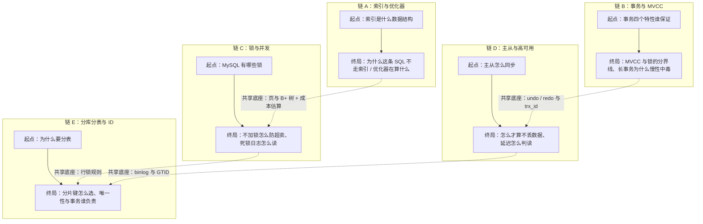
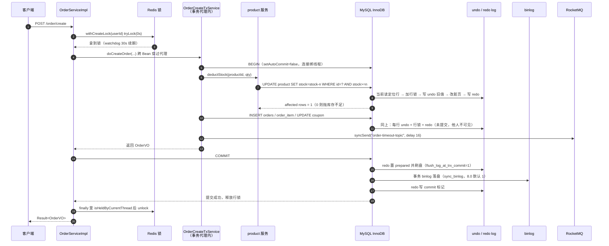

# 10-数据库面试专练：把前九篇压成五条「七层追问」链

> **一句话结论**：数据库面试不考你背了多少结论，考的是"这个结论背后是哪个字段、哪条命令、哪个类在做主"；本篇把本模块前九篇压成五条追问链（索引与优化器 / 事务与 MVCC / 锁与并发 / 主从与高可用 / 分库分表与 ID），每条链都按同一把七层标尺从"人人都能背"走到"只有真看过日志、真读过配置才答得出"。
> **阅读前置**：先读 [01-MySQL核心知识](./01-MySQL核心知识.md)、[05-MySQL锁机制与主从复制读写分离](./05-MySQL锁机制与主从复制读写分离.md)、[06-事务进阶-MVCC实现与三大日志](./06-事务进阶-MVCC实现与三大日志.md)、[03-ShardingSphere用户表分库分表实战](./03-ShardingSphere用户表分库分表实战.md)、[04-分布式ID规范](./04-分布式ID规范.md)；只想背答案的话本篇用处不大，因为本篇的每一层都要求你答出"证据在哪"。
> **证据基线**：MySQL 8.0（InnoDB / utf8mb4，镜像见 `deploy/docker-compose/docker-compose-master-slave.yml#L9`）/ MyBatis 3.6.0 / mybatis-spring 3.0.5 / MyBatis-Plus 3.0.5 / Spring Boot 4.2.0 / JDK 17。**A 级**证据取自 `learning-docs/24-源码分析/assets/source/` 里已入库的真实源码摘录（该目录下文件实际命名为 `Xxx.java.md`，故锚点写作 `Xxx.java.md#L起-L止`）；**B 级**为本项目真实代码与脚本，行号已逐条核对；**C 级**为本篇实跑命令的原样输出。**本机没有 MySQL 实例**，凡需要连库执行的命令都只给"该跑什么、输出里看哪一列"，并标注"未本机实测"。预计阅读 55~70 分钟（含自测）。

## 0. 先看现象

面试现场不需要"知道什么"，需要"被问穿时还能往下接三层"。下面三个断面是我在真实面试与被面试里反复见到的样子——它们的共同特征是：**第一句完全正确，第二句开始就只剩语气词**。

### 场景一：背得出 B+ 树三层结构，答不出"为什么这条 SQL 就是不走索引"

```text
面试官：InnoDB 的索引是什么结构？
你  ：B+ 树，非叶子节点只存键、叶子节点存数据且用双向链表串起来，三层就能撑两千万行。
面试官：那这条 SQL 为什么没走索引？
        select * from orders where date_format(create_time,'%Y-%m-%d') = '2026-11-27';
你  ：……因为索引失效了吧。
面试官：失效的判定发生在哪个阶段？优化器在选索引之前看过什么信息？
你  ：……（沉默）
```

"索引失效"这四个字是**结论**，不是**答案**。真答案要说清三件事：① 索引列上套了函数，优化器无法把常量映射回索引范围，只能退化成"逐行算表达式"；② 它退化之后仍可以走索引做全扫描（`type=index`，代价接近全表），所以"走没走索引"和"快不快"是两件事；③ `EXPLAIN` 里能看出这个退化——而且要先会读那 12 列里的 5 列（见 [01-MySQL核心知识](./01-MySQL核心知识.md) 的 §3.6）。

这类问题最硬的报错原文来自它的极端版本——当优化器连统计信息都对不上时，你在慢日志里看到的是这一行，而不是任何 SQL 报错：

```text
# Time: 2026-11-27T02:14:07.512345+08:00
# User@Host: app[app] @ 10.0.3.11 []  Id: 88421
# Query_time: 4.732109  Lock_time: 0.000142 Rows_sent: 20  Rows_examined: 2841903
SET timestamp=1795702447;
SELECT * FROM orders WHERE DATE_FORMAT(create_time,'%Y-%m-%d') = '2026-11-27' LIMIT 20;
```

`Rows_examined: 2841903` 与 `Rows_sent: 20` 之间差五个数量级——**慢日志的这一列就是"索引失效"的证据形态**，比任何形容词都有力（该命令本机未实测，读法见 §6 故事四）。

### 场景二：讲得清 MVCC 的四个字段，讲不清 MVCC 与锁的关系

```text
面试官：MVCC 靠什么实现？
你  ：隐藏列 DB_TRX_ID、DB_ROLL_PTR，undo 版本链，加上 ReadView 四个字段 m_ids、min_trx_id、max_trx_id、creator_trx_id。
面试官：那 MVCC 不加锁，为什么你同事昨天还被锁住了 30 秒？
你  ：……因为 UPDATE 是当前读？
面试官：所以到底是"MVCC 让读写不阻塞"，还是"锁让写写阻塞"？这两句话在同一行数据上同时成立吗？
你  ：……
```

这两句话同时成立，但**作用对象不同**：MVCC 只服务于**快照读**（普通 `SELECT`），它让读不阻塞写、写不阻塞读；一旦语句是**当前读**（`SELECT ... FOR UPDATE`、`UPDATE`、`DELETE`、`INSERT`），走的就是加锁读，锁规则照旧生效。答不上这条分界线，就会出现"我讲得出 ReadView，却解释不了线上锁超时"的割裂。

本项目把这条分界线踩在了真实报错上（库存扣减与优惠券核销在同一行上抢锁）：

```text
org.springframework.dao.CannotAcquireLockException: 
### Error updating database.  Cause: java.sql.SQLException: Lock wait timeout exceeded; try restarting transaction
### The error may involve com.aics.product.mapper.ProductMapper.update
```

对应配置是 `deploy/mysql/mysql.cnf#L6-L12` 里的 `innodb-lock-wait-timeout=30`——**30 秒不是巧合，是你配的**。面试里说得出这个数字的来源，和只会说"MySQL 会锁超时"是两个人。

### 场景三：分库分表只会背概念，一追问落地细节就露

```text
面试官：你们用户表怎么分的？
你  ：ShardingSphere 分库分表，按用户 ID 取模，水平拆成 8 张表。
面试官：8 张表里每张的 QPS 均匀吗？为什么？唯一索引在分片之后还有效吗？跨片的 count 怎么算的？
你  ：……均匀吧。有效吧？
```

真实答案很扫兴：本项目 `deploy/mysql/user-sharding-migrate.sql#L7-L8` 写的规则是"取用户 ID **后四位**，库 = 后四位 % 2，表 = 后四位 % 4"，一共 2 库 × 4 表；因为"库取 %2、表取 %4"不是正交的两个维度，**8 张真实表里有 4 张永远为空**（详见 [03-ShardingSphere用户表分库分表实战](./03-ShardingSphere用户表分库分表实战.md) §3.4，这篇把账算给你看）。唯一索引这件事同样扫兴：`deploy/mysql/init.sql#L43` 的注释写着——

```sql
-- 注意：uk_username 仅保证单表内唯一，全局唯一由应用层用户名查重（广播查询）保证
```

也就是说 `uk_username` 在老的单表里是"数据库兜底"，分片之后它退化成"单表兜底"，全局唯一责任被搬回了应用层。**能说出责任被搬走了、代价是什么的人，才算做过分库分表。**

三个场景各自的"病根定位"如下表——**注意它们的病灶不在同一个深度上**：场景一缺第 5 层（落地判读），场景二缺第 4 层（分界线），场景三缺第 7 层（验证）。这也解释了为什么"补知识"对这三种人都没用，他们缺的是不同的层。

| 面试现场 | 表面症状 | 真正缺的层 | 本篇对应小节 |
|---|---|---|---|
| 背了索引原理，答不出为什么失效 | 只会说"索引失效了" | 第 5 层：不会把现象翻译成 `EXPLAIN` 列与慢日志比值 | §3.1 第 3~5 层 |
| 讲不清 MVCC 与锁的关系 | 两套词各背各的 | 第 4 层：不知道"快照读/当前读"这条分界线 | §3.2 第 4 层 |
| 分库分表只会背概念 | 说得出方案说不出代价 | 第 7 层：没有"文件 + 行号"级的验证，也没承认过缺陷 | §3.5 第 2 层、§3.7 |

### 这些现象指向同一件事

三个场景断在不同位置，根因是同一个：**你把数据库学成了"结论集"，而不是"一条能往下追的证据链"**。面试官每追问一层，问的都是同一句话——"这一步是哪个字段 / 哪条命令 / 哪个配置项在做主，你怎么知道？"本仓库恰好把这三样东西都留在了磁盘上：源码摘录在 `24-源码分析/assets/source/`，配置在 `deploy/mysql/*.cnf`，业务 SQL 在 `ai-cs-*/src/main/resources/mapper/*.xml` 与各 `ServiceImpl`。所以本篇所有答案都按同一个结构组织，缺一段就算没答完：

| 层 | 内容 | 缺了会怎样 |
|---|---|---|
| ① 定性 | 一句话说准是什么（术语+一句话定义） | 像背过，但没懂 |
| ② 机制 | 点到具体字段 / 命令 / 日志段 / 类名 | 追问一层就崩 |
| ③ 落本项目 | 具体文件 + 行号 + 我们怎么配、怎么踩 | 像教科书，不像工程师 |
| ④ 边界与代价 | 什么情况下失效、代价是什么、怎么兜 | 显得没有实战判断 |

## 1. 整体地图

五条链是横向主题，七层是纵向深度，合起来是本篇的全部结构。**图的读法是：横着看五大主题，竖着看每条链从"起点问题"走到"终局问题"，虚线是链与链之间真正共享的同一套机制。**



> **读图说明**：先横着看五个 subgraph 里的两个节点——那是一条链的起点与终点，中间还压着 3~4 层，写在 §3；再竖着看四条虚线，它们是"不同主题共用同一套机制"的地方，也是面试官最爱串场的地方。**最容易被看错的箭头是 B2→D2**：很多人把 MVCC 当成纯理论题，其实"不丢数据"这条链的终局答案（两阶段提交 + redo/binlog 的 XID 对账）用的就是同一批日志和同一个 `trx_id` 概念；另一条容易看错的是 C2→E2——分库分表之后行锁变成"单库内的行锁"，防超卖的那套条件更新就成了唯一还站在你这边的东西。

七层标尺（每条链都按它从浅到深走）：

| 层 | 面试官在测什么 | 合格答案的形态 | 典型问法 |
|---|---|---|---|
| 第 1 层 | 你有没有学过 | 一句准确定义 | "索引是什么结构？" |
| 第 2 层 | 你懂不懂机制 | 点到字段/数据结构 | "聚簇索引的叶子节点存什么？" |
| 第 3 层 | 你会不会用 | 结合语法与限制 | "联合索引为什么最左前缀？" |
| 第 4 层 | 你能不能定位 | 点到命令与输出列 | "怎么证明它没走索引？" |
| 第 5 层 | 你有没有实战 | 落到本项目行号与配置 | "你们哪儿踩过？怎么配的？" |
| 第 6 层 | 你有没有判断力 | 边界、代价、替代方案 | "换成 RC 会怎样？" |
| 第 7 层 | 你能不能负责 | 故障复盘 + 兜底设计 | "如果当时没发现，怎么兜住？" |

五条链与本模块正文的对应关系（背不出某一层的机制时，回到对应那篇）：

| 链 | 起点问题（人人都能答） | 终局问题（分水岭） | 配套正文 |
|---|---|---|---|
| A 索引与优化器 | InnoDB 索引是什么结构？ | 同一张表两条 SQL，为什么一条 `ref` 一条 `ALL`？优化器按什么算的？ | [01-MySQL核心知识](./01-MySQL核心知识.md)、[12-性能工程/05-SQL调优与执行计划](../12-性能工程/05-SQL调优与执行计划.md) |
| B 事务与 MVCC | 事务的 ACID 靠什么？ | MVCC 与锁在同一条 SQL 上怎么分工？长事务到底慢在哪、坏在哪？ | [06-事务进阶-MVCC实现与三大日志](./06-事务进阶-MVCC实现与三大日志.md)、[15-SpringAOP与声明式事务原理](../02-Spring微服务/15-SpringAOP与声明式事务原理.md) |
| C 锁与并发 | MySQL 有哪些锁？ | 不加锁怎么保证不超卖？死锁日志里哪三行能定凶手？ | [05-MySQL锁机制与主从复制读写分离](./05-MySQL锁机制与主从复制读写分离.md)、[07-Redisson分布式锁](../04-中间件/07-Redisson分布式锁.md) |
| D 主从与高可用 | 主从怎么同步？ | "我们不会丢数据"这句话凭什么成立？延迟该怎么判读？ | [05-MySQL锁机制与主从复制读写分离](./05-MySQL锁机制与主从复制读写分离.md)、[09-备份恢复与数据安全](./09-备份恢复与数据安全.md) |
| E 分库分表与 ID | 为什么分表？ | 分片键怎么选？全局唯一与跨库事务的责任搬到哪了？ | [03-ShardingSphere用户表分库分表实战](./03-ShardingSphere用户表分库分表实战.md)、[04-分布式ID规范](./04-分布式ID规范.md)、[06-Seata分布式事务AT模式](../02-Spring微服务/06-Seata分布式事务AT模式.md) |

### 1.1 五条链 × 六层的一句话地图

下面这张表是"面试前 10 分钟能扫完"的版本：每格只给一个**必须出现的关键词**。关键词答不出来，就回到 §3 对应小节的完整四段。这张表的价值不在背，而在**自查缺口**——扫一遍，把答不出的格子圈出来，那些就是你今晚要补的层。

| 链 | 第 1 层（定义） | 第 2 层（机制） | 第 3 层（怎么用） | 第 4 层（怎么证明） | 第 5 层（落地） | 第 6 层（终局） |
|---|---|---|---|---|---|---|
| A 索引 | B+ 树 / 扇出 / 层高 | 聚簇叶子存整行、二级叶子存主键 | 最左前缀 + 四种失效 | `EXPLAIN` 五列 + `EXPLAIN ANALYZE` | `idx_user_id` 与联合索引的取舍 | 优化器成本模型 + 深分页 |
| B 事务 | undo / redo / 锁 / MVCC 各管一段 | `DB_TRX_ID` + `DB_ROLL_PTR` 版本链 | ReadView 四字段 + RC/RR 创建时机 | `innodb_trx` 找长事务 | 只读事务、`AFTER_COMMIT` | MVCC 与锁的分界线 + 内部 2PC |
| C 锁与并发 | 粒度三层 + S/X + MDL | 记录/间隙/临键三形态 | 唯一索引等值退化为记录锁 | `SHOW ENGINE INNODB STATUS` | `innodb-lock-wait-timeout=30` | 三层防线防超卖 + 死锁重试幂等 |
| D 主从与高可用 | dump / IO / SQL 三线程 | `ROW` + `binlog_row_image=FULL` | 位点 vs GTID、半同步 | GTID 差集 + `replica_applier_status_by_worker` | 1 主 2 从编排 + `expire-logs-days=7` | 单机不丢 / 主从不丢 / 灾难可恢复 |
| E 分片与 ID | 分片键 / 逻辑表 vs 真实表 | 雪花 `41+5+5+12`、号段 | 标准路由 / 全路由 / 笛卡尔积 | `sharding-user.yaml` 的 `actualDataNodes` | 后四位 %2/%4 与"4 张空表" | 广播查重 + Seata `undo_log` ≠ undo log |

> 用法：横向扫一遍是"同一条链的深浅"，纵向竖着看一列是"同一深度在五个主题上的样子"。**面试官经常横着跳**——从"你说索引走 B+ 树"跳到"那你们分片之后这个索引还怎么用"，跳的就是第 2 层到第 5 层的跨度。

## 2. 关键概念与关键类

面试里"一句话准确定义"永远比长篇大论得分高。下表每个定义都刻意压到一句，并且带一个能立刻接着往下答的字段、命令或方法名——**第 3 列背下来，第 4 列是"我还知道它在哪"的证明**。

| 名称 | 位置（结构/文件） | 一句话准确定义 | 关键字段 / 命令 / 方法 |
|---|---|---|---|
| 页（page） | InnoDB 存储引擎，默认 16KB | InnoDB 读写磁盘的最小单位，索引和行数据都住在页里；"三次 IO"这类结论全部建立在页大小之上 | `innodb_page_size` |
| 聚簇索引（clustered index） | 主键索引即聚簇索引 | 叶子节点直接存整行数据的索引；一张表只有一个，因为行数据只能放在一个地方 | `PRIMARY`，叶子页的行记录 |
| 二级索引（secondary index） | 除主键外的所有索引 | 叶子节点存"索引列 + 主键值"的索引；查到主键还得回聚簇索引再查一次 | 叶子页的 `DB_ROW_ID` 指向 |
| 回表 | 二级索引 → 聚簇索引 | 用二级索引拿到主键、再拿主键去聚簇索引取整行，这一跳就叫回表，一跳就是一次额外的树查找 | `EXPLAIN` 的 `type`/`rows` 估算 |
| 覆盖索引 | 索引本身就够用 | 查询要的列全在索引里，不需要回表；`EXPLAIN` 的 `Extra` 会显示 `Using index` | `Using index` |
| 索引条件下推（ICP） | 5.6+ 优化 | 把 `WHERE` 里能用索引列判断的条件下推到引擎层，在回表前先过滤，减少回表次数 | `Using index condition` |
| 隐藏列 | 每行记录 | InnoDB 给每行加的 `DB_TRX_ID`（最后改它的 `trx_id`）与 `DB_ROLL_PTR`（指向 undo 里上一版本） | `DB_TRX_ID`、`DB_ROLL_PTR` |
| undo 版本链 | undo 表空间 | 每次 `UPDATE` 都把旧版本写进 undo，并用 `DB_ROLL_PTR` 串成链表；MVCC 就是"顺着链往回找可见版本" | `DB_ROLL_PTR` 链、`purge` 线程 |
| ReadView | 事务内的快照 | 判断"某个版本对我可不可见"的四字段结构：`m_ids`（活跃事务集合）、`min_trx_id`、`max_trx_id`（**下一个将分配的 ID，不是最大活跃 ID**）、`creator_trx_id` | `m_ids` / `min_trx_id` / `max_trx_id` |
| 快照读 / 当前读 | SQL 语法决定 | 普通 `SELECT` 是快照读（走 MVCC，不加锁）；`SELECT ... FOR UPDATE`、`UPDATE`、`DELETE` 是当前读（读最新版本并加锁） | `FOR UPDATE` / `LOCK IN SHARE MODE` |
| 临键锁（next-key lock） | RR 隔离级别下的行锁形态 | 记录锁 + 它前面的间隙锁，锁住"左开右闭"区间；RR 下范围条件默认加临键锁，这是"幻读被挡住"和"锁范围变大"的同一个原因 | 记录锁 + 间隙锁 |
| 间隙锁（gap lock） | RR | 锁两行记录之间的空隙，只为阻止别的事务往里插；**间隙锁之间不互斥**，这是死锁的常见来源 | `supremum` 伪记录 |
| 意向锁（IS/IX） | 表级 | 加行锁前先给表打一个"我下面有行锁"的标记，让表级操作不必逐行检查 | `IS` / `IX` |
| MDL（metadata lock） | Server 层 | 表结构变更时加的元数据锁；`ALTER TABLE` 卡住时，通常是它前面有长事务/长查询没放 | `performance_schema.metadata_locks` |
| redo log | `#innodb_redo`（8.0）/ `ib_logfile*`（5.7） | 物理日志，记"哪个页哪个偏移改了什么"，用于崩溃恢复；循环写、有 checkpoint | `innodb_flush_log_at_trx_commit` |
| binlog | Server 层，`mysql-bin.00000x` | 逻辑日志，记"事务做了哪些变更"，用于主从复制与点恢复；有三种格式 | `binlog_format`、`binlog_row_image` |
| 两阶段提交（内部 2PC） | redo + binlog | 提交时先写 redo 到 prepare、再写 binlog、最后写 redo commit 标记；崩溃恢复靠"redo 有 prepare 但 binlog 不完整就回滚"这条对账规则 | `XID` 事件、`innodb` 恢复阶段 |
| GTID | `gtid_mode=ON` | 全局事务 ID（`server_uuid:事务序号`），把"复制到哪个位点"变成"已执行过哪些事务集合"，主从切换不用再算偏移 | `Executed_Gtid_Set`、`Retrieved_Gtid_Set` |
| 半同步复制 | 插件 `rpl_semi_sync_*` | 主库提交后至少等一个从库 ACK 收到 binlog 才返回，把"主库宕机丢最后几个事务"变成"可能变慢但少丢" | `rpl_semi_sync_source_timeout` |
| 分片键（sharding key） | 分片规则 | 决定一行去哪个库哪张表的列；它同时决定了"路由代价、扩容代价、唯一性边界" | `shardingColumn` |
| 广播查询 / 全路由 | ShardingSphere | 不带分片键的 SQL 必须发往所有真实表再归并，`count`/`order by`/深分页的代价都在这里 | `actualDataNodes` |
| 逻辑表 / 真实表 | ShardingSphere | `sys_user` 是逻辑表（你写的），`user_db_0.sys_user_1` 是真实表（实际存在的） | `!SHARDING` 规则 |
| 雪花算法 | MyBatis-Plus `IdType.ASSIGN_ID` | 64 位 ID 切成 `1 符号位 + 41 毫秒时间 + 5 机器 + 5 机房 + 12 序列`，按时间递增，天然适合做 B+ 树主键 | `IdType.ASSIGN_ID` |
| Seata `undo_log` | 业务库里的**业务表** | AT 模式的一阶段前后镜像记录表，二阶段用它做反向补偿；**它和 InnoDB 的 undo log 只是同名，答混直接出局** | `rollback_info LONGBLOB`、`xid`、`branch_id` |
| `SqlSession` 提交链路 | mybatis-spring | `SqlSessionTemplate` 的动态代理决定"这次调用要不要替我 commit"，而真正的 `commit` 落在 `SpringManagedTransaction`；Spring 事务在管时它全是 no-op | `SqlSessionInterceptor#invoke`、`isSqlSessionTransactional` |
| 自适应哈希索引（AHI） | InnoDB 内存结构 | InnoDB 自己观察热点等值查询、自动在内存里建哈希索引的装置；它是**自动的、你建不出来**，所以"为什么不用哈希索引"要区分"主索引"与"AHI" | `innodb_adaptive_hash_index` |
| `key_len` | `EXPLAIN` 输出列 | 实际用到的索引前缀字节数；靠它反推"联合索引用到了第几列"，是最容易被忽略的一列 | `EXPLAIN` 的 `key_len` |
| `Rows_examined` / `Rows_sent` | 慢日志 | 扫描行数与返回行数；两者比值 > 1000 基本等于"索引没走对"，比 `Query_time` 更能定性 | `mysqldumpslow`、`pt-query-digest` |
| `History list length` | `SHOW ENGINE INNODB STATUS` | 还没被 purge 的 undo 版本数量；它只涨不降 = 有长事务或活跃快照挡着回收 | `History list length` 段 |
| `binlog_row_image` | binlog 配置 | 控制 ROW 格式记录哪些列：`FULL` 记全部列（CDC 必需）、`MINIMAL` 只记被改列（省空间但缺上下文） | `binlog-row-image=FULL` |
| `actualDataNodes` | ShardingSphere 规则 | 逻辑表到真实表的路由表达式（`user_db_${0..1}.sys_user_${0..3}`）；它同时决定路由与"哪些真实表其实用不到" | `!SHARDING` 规则里的 `actualDataNodes` |
| `gtid_executed` | 复制状态 | 本实例已执行过的事务集合；主从对齐只需比较集合差，不用算文件偏移 | `Executed_Gtid_Set` |

> 使用方式：面试前只背第 3 列。如果某一行的第 4 列你念不出来，说明那条链你只到第 2 层，回到 §3 对应小节做一遍。

### 2.1 五组最容易答混的"同名词"

数据库面试有一类失分特别冤枉：**两个东西名字像、位置完全不同，答混一次就被判"没实操"**。这五组必须能一句话分开。

| 易混对 | 左边是什么 | 右边是什么 | 一句话判据 |
|---|---|---|---|
| `undo_log` / undo log | Seata AT 的**业务表**，存在业务库里，一阶段写前后镜像，二阶段用它补偿（`deploy/mysql/seata-undo-log.sql#L14-L23`） | InnoDB 的**引擎内部结构**，undo 表空间里的版本链，服务回滚与 MVCC | 一个能被 `SELECT * FROM undo_log` 查出来，一个查不出来 |
| 快照读 / 当前读 | 普通 `SELECT`，走 MVCC，不加行锁 | `FOR UPDATE` / `UPDATE` / `DELETE` / `INSERT`，读最新版本并加锁 | 看语句里有没有"要改/要锁"的意图 |
| 位点复制 / GTID 复制 | `文件 + 偏移`，切主时要人工对位点 | `server_uuid:序号` 的事务集合，切主自动定位 | 出问题时你要不要手算偏移 |
| 逻辑表 / 真实表 | `sys_user`，你 SQL 里写的名字 | `user_db_0.sys_user_1`，磁盘上真实存在的表 | `SHOW TABLES` 只看得见真实表 |
| 分表 / 分库 | 拆单表容量（同库多表） | 拆连接数与写并发（多实例） | 瓶颈在"数据量"还是"连接/写" |
| 隔离级别 / 锁机制 | 声明式的"我要看到什么"（RC/RR） | 实现式的"怎么做到"（MVCC + 各种锁） | 前者是配置，后者是实现 |

## 3. 原理与证据逐段精读

每条链都按同一个节奏走：**面试官问什么 → 合格答案要点（点到字段/命令/源码行）→ 加分点 → 常见失分答案 → 证据**。合格答案要点是"必须说出来"的骨架；加分点是"说出来面试官会点头"的细节；失分答案是"说了就掉档"的原话。

### 3.1 链 A：索引与优化器

#### 第 1 层 · "InnoDB 的索引是什么结构，为什么它是 B+ 树？"

- **面试官问**：MySQL 索引的数据结构是什么？为什么不是哈希、不是 B 树、不是跳表？
- **合格答案要点**：① InnoDB 唯一支持的索引类型是 B+ 树（全文索引与 8.0 的空间索引是另外的机制，面试别混进来）；② B+ 树的三个特征——非叶子节点只存键不存数据（扇出大）、叶子节点串成双向链表（范围扫描不用回根）、所有数据都在叶子同层（任何查询的 IO 次数一致）；③ 扇出决定层高：16KB 的页，键 8 字节 + 指针 6 字节，一个非叶子页能放约 1100 个键，三层就能装下千万级到亿级的行；④ 点查的 IO 次数 = 层高，所以"三层 B+ 树 = 3 次 IO"是一道可以现场推的题，不是背的。
- **加分点**：主动说"哈希索引只支持等值、不支持范围与排序，所以 InnoDB 只在自适应哈希索引（AHI）里用它，且它是内存里的自动装置，你建不出来"；再说"B 树每个节点都存数据，扇出只有 B+ 树的几十分之一，层高更高、范围扫描还要中序遍历"。
- **能现场算的四个数**（比背"三层两千万"更值）：① 一行索引项大约 `8 字节主键 + 6 字节页指针 = 14 字节`；② 16KB 页去掉页头页尾约 15KB 可用 → 一个非叶子页约 `15KB / 14B ≈ 1097` 个指针，取整算 1000；③ 两层能指向 `1000 × 1000 = 100 万个`叶子页；④ 若每行 1KB（每页 16 行），三层树约能装 `100 万 × 16 ≈ 1600 万`行——这就是"两千万行是一个坎"的来源。**面试时把 1000 这个扇出数说出来，比说"三层"有说服力得多。**
- **常见失分答案**："因为 B+ 树查询快"——没说清快在哪，也没说清对比对象的代价，一追问"快多少、为什么"就空了。
- **证据**：推演过程见 [01-MySQL核心知识](./01-MySQL核心知识.md) §3.1；官方依据为 MySQL 8.0 Reference Manual 的 InnoDB Index Types 章节（本篇不贴源码，InnoDB 未入库）。

#### 第 2 层 · "聚簇索引和二级索引差在哪？为什么会回表？"

- **面试官问**：我建了一个 `idx_user_id`，查 `select * from orders where user_id=?` 时发生了什么？
- **合格答案要点**：① 先在 `idx_user_id` 这棵树里定位，叶子拿到的是**主键值**，不是整行；② 再拿主键去聚簇索引（`PRIMARY`）定位一次，取出整行——这一跳叫回表；③ 所以"二级索引的叶子存索引列 + 主键"，"聚簇索引的叶子存整行"；④ 一张表只能有一个聚簇索引，因为行数据只能放一处；没有主键时 InnoDB 会挑唯一非空索引，都没有才用隐藏的 `DB_ROW_ID`。
- **加分点**：说清"主键为什么必须短、必须有序"——二级索引的每个叶子都存主键值，主键变长等于所有二级索引一起变胖；主键乱序（UUID）等于每次插入都往 B+ 树中间插，引发页分裂与随机 IO（本项目订单表就用 `BIGINT AUTO_INCREMENT` 当物理主键、把业务单号放唯一索引：`deploy/mysql/order-init.sql#L24-L46`，其中 L42 是 `UNIQUE KEY uk_order_no (order_no)`）。
- **常见失分答案**："建了索引就不用扫表了"——把"少扫行"和"不回表"混成一件事；覆盖索引那一问会立刻打脸。
- **证据**：B 级 `deploy/mysql/order-init.sql#L24-L46`。

#### 第 3 层 · "联合索引为什么最左前缀？哪些写法会让索引失效？"

- **面试官问**：`idx(a,b,c)` 上，`where b=1` 为什么用不上？`where a=1 and c=3` 呢？
- **合格答案要点**：① 联合索引在 B+ 树里按 `(a,b,c)` 字典序排，只给 `b` 时无法在树里定位起点，只能全扫；② `a=1 and c=3` 能用上 `a`（`EXPLAIN` 里 `key=idx`、`key_len` 只算到 `a`），`c` 靠 ICP 在回表前过滤；③ 四种最常见的"失效"：索引列上套函数/表达式、隐式类型转换（字符串列传数字）、`like '%x'` 前导通配、`or` 中有列没索引；④ 右模糊 `like 'x%'` 与范围条件（`>`、`between`）之后，后面的列只能靠 ICP，不能用于定位。
- **加分点**：把"隐式转换"讲成字段级细节——`phone VARCHAR(20)` 上写 `where phone = 13800138000`，MySQL 要把列转成数字比较，索引直接作废；本项目 `deploy/mysql/init.sql#L63-L66` 的 `uk_username`、`idx_phone`、`idx_email`、`idx_status` 四行就是面试时可以指着说的真实索引清单。
- **常见失分答案**："索引失效是因为数据量太大/区分度不高"——区分度不高是"优化器可能不选它"，不是"用不上"，两者要分开答。
- **证据**：B 级 `deploy/mysql/init.sql#L63-L66`；机制与逐条对账见 [01-MySQL核心知识](./01-MySQL核心知识.md) §3.4。

#### 第 4 层 · "怎么证明它到底走没走索引？"

- **面试官问**：不许猜，你怎么拿证据？
- **合格答案要点**：① `EXPLAIN` 看五列就够：`type`（`const`/`eq_ref`/`ref`/`range`/`index`/`ALL` 从好到烂）、`key`（实际用了哪个）、`key_len`（用了联合索引前几列）、`rows`（估算扫描行数）、`Extra`（`Using index` = 覆盖、`Using index condition` = ICP、`Using filesort`/`Using temporary` = 要警惕）；② 8.0.18 起用 `EXPLAIN ANALYZE` 拿**真实耗时**而不是估算；③ 拿不到实例时看慢日志的 `Rows_examined` 与 `Rows_sent` 的比值。
- **加分点**：说清 `key_len` 的算法能反推"最左前缀用到了第几列"，这是最容易被忽视的一列；再补一句 8.0 的 `EXPLAIN FORMAT=TREE`/`FORMAT=JSON` 会打印成本估算值，可以直接对上"优化器为什么选它"。

`type` 六档的速查（面试官说"你这条 `ALL`，怎么优化"时，答的第一句应该是"先把它推到 `range` 或 `ref`"）：

| `type` | 含义 | 出现时的第一反应 |
|---|---|---|
| `const` | 主键/唯一索引等值命中，最多一行 | 最优，无需优化 |
| `eq_ref` | 联表时被驱动表用主键/唯一索引等值匹配 | 正常，注意驱动表顺序 |
| `ref` | 非唯一索引等值匹配 | 正常，看 `rows` 是否可接受 |
| `range` | 索引范围扫描（`>`、`between`、`in`） | 正常，注意范围之后的列用不上定位 |
| `index` | 扫整棵索引树（"全索引扫描"） | 危险：**看起来走了索引，其实扫了全部** |
| `ALL` | 全表扫描 | 先确认是否真的没有可用索引，再谈加索引 |
- **常见失分答案**："加个 `force index` 就好了"——能救急，但说不出它为什么选错，等于承认没定位。
- **证据**：逐列读法见 [01-MySQL核心知识](./01-MySQL核心知识.md) §3.6，深挖见 [12-性能工程/05-SQL调优与执行计划](../12-性能工程/05-SQL调优与执行计划.md)；命令判读见本篇 §6 故事二（未本机实测）。

#### 第 5 层 · "明明有索引，优化器为什么还是全表扫？"

- **面试官问**：你说索引选错了，优化器错在哪？
- **合格答案要点**：① 优化器是**基于成本**的：它按统计信息估"走索引要多少次随机 IO + 多少次回表"和"全表扫要读多少页"，然后选便宜的那个；② 统计信息来自采样（`innodb_stats_persistent`，默认持久化，采样页数由 `innodb_stats_persistent_sample_pages` 控制），不实时；③ 最常见的三种"选错"：回表比例太高（结果集占表比例大时全表扫反而便宜）、统计信息过期（大批量写入后没 `ANALYZE TABLE`）、条件区分度低（`status='PAID'` 占 90%）；④ 修法是让统计信息回到现实（`ANALYZE TABLE`）、让索引更"值钱"（覆盖索引、联合索引把过滤列带进来），而不是先上 `force index`。
- **加分点**：能说"回表是随机 IO，全表扫是顺序 IO + 预读（`innodb_read_ahead_threshold`），所以行数占比超过某个百分比后扫表更划算"——这句话一出口，"成本模型"就变成了你脑子里的东西而不是名词。
- **常见失分答案**："MySQL 有时候就是会抽风"——这类回答直接把第 5 层判成 0。
- **证据**：成本估算与统计信息细节见 [01-MySQL核心知识](./01-MySQL核心知识.md) §3.7；InnoDB 优化器内部实现未入库，口径依据 MySQL 8.0 官方手册的 Optimizer Statistics 章节。

#### 第 6 层 · "为什么本地测试快、线上慢？深分页怎么改？"

- **面试官问**：同一条 SQL，测试库 20ms、生产 4s，你的排查顺序是什么？
- **合格答案要点**：① 先分清是"计划不同"还是"数据量不同"：两边都跑 `EXPLAIN`（或 `EXPLAIN ANALYZE`），对比 `type`/`key`/`rows`；② 数据量差一个量级以上时，深分页、`order by` 无索引、`count(*)` 全扫这三件事会依次浮出来；③ 深分页两种改法——游标式（`where id > 上次最大 id order by id limit 20`，要求有序且不可跳页）、延迟关联（先用覆盖索引查出主键再回表）；④ `count(*)` 在 InnoDB 上必须真扫（MVCC 让"行数"没有全局缓存），要么走覆盖索引的二级索引，要么上计数表/Redis。
- **加分点**：能报出本项目订单列表的真实查询形态——`ai-cs-order/src/main/java/com/aics/order/service/impl/OrderServiceImpl.java#L69-L76` 用 `LambdaQueryWrapper.eq(userId).orderByDesc(createTime)`，靠的就是 `deploy/mysql/order-init.sql#L43` 的 `idx_user_id`；如果再加 `status` 过滤，就该考虑 `(user_id, status, create_time)` 的联合索引而不是三个单列索引。
- **常见失分答案**："加 `limit` 就快了"——深分页慢的正是 `limit 1000000, 20` 这种，"加 limit"说明没量过。
- **证据**：B 级 `ai-cs-order/src/main/java/com/aics/order/service/impl/OrderServiceImpl.java#L69-L76`、`deploy/mysql/order-init.sql#L43`；深分页细节见 [01-MySQL核心知识](./01-MySQL核心知识.md) §3.9。

### 3.2 链 B：事务与 MVCC

#### 第 1 层 · "ACID 分别是靠什么保证的？"

- **面试官问**：一句话，A、C、I、D 各由谁负责？
- **合格答案要点**：① A（原子性）靠 undo log——回滚就是把旧版本写回去；② C（一致性）是**结果**，靠 A + I + D 加上业务约束共同保证，数据库没有"一致性模块"；③ I（隔离性）靠锁 + MVCC；④ D（持久性）靠 redo log + 刷盘策略（`innodb_flush_log_at_trx_commit`）。
- **加分点**：直接点出"C 不是数据库单独能给你的"——唯一索引、外键、`CHECK`、应用层校验都算，本项目订单金额校验抛 `ORDER_PAY_AMOUNT_MISMATCH`（`ai-cs-order/src/main/java/com/aics/order/service/impl/OrderServiceImpl.java#L138-L143`）就是"应用层参与一致性"的样本。
- **常见失分答案**："一致性靠两阶段提交"——把内部 2PC（redo/binlog 对账）和分布式 2PC 混成一件事，这是后面几层会连环崩的开端。
- **证据**：B 级 `ai-cs-order/src/main/java/com/aics/order/service/impl/OrderServiceImpl.java#L138-L143`；三份日志的分工见 [06-事务进阶-MVCC实现与三大日志](./06-事务进阶-MVCC实现与三大日志.md) §1.1。

#### 第 2 层 · "undo 版本链是怎么串起来的？"

- **面试官问**：我改了三次，MVCC 怎么找到"我该看的那个版本"？
- **合格答案要点**：① 每行有 `DB_TRX_ID` 与 `DB_ROLL_PTR`；② 每次 `UPDATE` 都把"旧值 + 上一个 undo 的位置"写进 undo 页，`DB_ROLL_PTR` 指向它，于是形成一条从新到旧的链；③ 快照读时如果当前版本的 `DB_TRX_ID` 对自己不可见，就顺着 `DB_ROLL_PTR` 往回走，直到找到可见版本；④ 这条链的清理靠 `purge` 线程，**长事务不结束 = 链上旧的 undo 不能回收 = undo 表空间只涨不降**。
- **加分点**：说清"undo 里的旧版本不是给人看的备份，是给 MVCC 和回滚共用的"，并补一条运维事实——`information_schema.innodb_trx` 里 `trx_started` 最早的那条就是毒源。
- **常见失分答案**："undo 就是备份表"——它不存整行快照，只存被改的列的旧值 + 回滚指针。
- **证据**：字段级推演见 [06-事务进阶-MVCC实现与三大日志](./06-事务进阶-MVCC实现与三大日志.md) §3.1。

#### 第 3 层 · "ReadView 的四个字段怎么用？RC 和 RR 差别在哪一行？"

- **面试官问**：可见性判断的算法你能背出来吗？RC 和 RR 的代码差别是什么？
- **合格答案要点**：① 四字段：`m_ids`（创建快照时活跃事务 ID 集合）、`min_trx_id`（其中最小）、`max_trx_id`（**系统下一个将分配的 ID**）、`creator_trx_id`（自己）；② 判断顺序：`DB_TRX_ID < min_trx_id` → 可见；`>= max_trx_id` → 不可见（未来事务）；在 `m_ids` 里 → 不可见；否则可见；③ **RC 与 RR 的唯一差别是 ReadView 的创建时机**：RC 每条语句新建一次，RR 只在事务里第一次快照读时建一次并用到底；④ 所以"同一个事务里两次查同一行结果不同"只可能发生在 RC（或 RR 里中间夹了当前读）。
- **加分点**：主动纠正一个流传极广的错答——"`max_trx_id` 是最大活跃事务 ID"是错的，它是**下一个将分配的 ID**；能指出这一点，说明你是照着实现读的而不是照抄博客。
- **常见失分答案**："RC 不加间隙锁、RR 加"——这句话本身对，但它答的是"隔离级别的锁差异"，不是"ReadView 的创建时机"，问的是哪个就答哪个。
- **证据**：四字段与判定算法逐行见 [06-事务进阶-MVCC实现与三大日志](./06-事务进阶-MVCC实现与三大日志.md) §3.2；这些是 InnoDB 内部实现，未入本仓库源码库，口径依据 MySQL 8.0 官方手册 InnoDB Multi-Versioning 章节。

#### 第 4 层 · "MVCC 不是不加锁吗？那我的 UPDATE 为什么被锁住了？"

- **面试官问**（这一层是本链的转折）：到底哪种语句加锁？
- **合格答案要点**：① 分界线是语法：普通 `SELECT` = 快照读（MVCC，不加行锁）；`SELECT ... FOR UPDATE`、`SELECT ... LOCK IN SHARE MODE`、`UPDATE`、`DELETE`、`INSERT` = 当前读（读最新版本 + 加锁）；② 所以"读写不阻塞"只对快照读成立，写写之间照样靠行锁排队；③ 更精确的一句：**MVCC 解决的是"读-写"冲突的可见性，锁解决的是"写-写"冲突的互斥**；④ 同一条 SQL 在 RR 下通常两者都参与：`UPDATE` 先当前读并加锁，再写 undo/redo。
- **加分点**：能举"同一事务里快照读 + 当前读混用"的后果（先 `SELECT` 拿到旧值，再 `UPDATE` 用的是最新值，造成"看起来自相矛盾"的业务判断），这正是本项目把库存判断写成"条件更新 + 影响行数"而不是"先查再改"的原因：`ai-cs-product/src/main/java/com/aics/product/service/impl/ProductServiceImpl.java#L195-L199`。
- **常见失分答案**："MVCC 让数据库无锁并发"——听到这句，面试官下一问必然是"那 `UPDATE` 撞车怎么排队"，然后你就没词了。
- **证据**：B 级 `ai-cs-product/src/main/java/com/aics/product/service/impl/ProductServiceImpl.java#L195-L199`；快照读/当前读的语法清单见 [05-MySQL锁机制与主从复制读写分离](./05-MySQL锁机制与主从复制读写分离.md) §3.4。

#### 第 5 层 · "长事务到底坏在哪？"

- **面试官问**：一个跑了 30 分钟的事务，除了慢还有什么罪？
- **合格答案要点**：① undo 不能回收 → undo 表空间膨胀 → 查询要回溯的版本链变长，全库查询一起变慢；② 可能拖住 `purge`，导致 `History list length` 只涨不降；③ 持有 MDL 或行锁，`ALTER TABLE` 排在它后面，后面所有请求再排在 `ALTER` 后面 → 全站雪崩；④ 主从延迟的直接来源之一（大事务在从库单线程重放）。
- **加分点**：给出可执行的三条判读——`information_schema.innodb_trx` 按 `trx_started` 排序、`SHOW ENGINE INNODB STATUS` 里的 `History list length`、`performance_schema.metadata_locks` 找 `PENDING` 的 DDL。
- **常见失分答案**："长事务就是把锁占久了"——只说了四宗罪里的半条。
- **证据**：回溯成本与 purge 的账见 [06-事务进阶-MVCC实现与三大日志](./06-事务进阶-MVCC实现与三大日志.md) §3.4；大表 DDL 与 MDL 的现场见 [08-大表治理-冷热分离与数据归档](./08-大表治理-冷热分离与数据归档.md) §3.2。

#### 第 6 层 · "一次提交到底写了哪几样东西？凭什么说它原子？"

- **面试官问**：`COMMIT` 那一刻，磁盘上发生了什么？
- **合格答案要点**：① 写事务的 redo 并置为 prepared（受 `innodb_flush_log_at_trx_commit` 控制是否 fsync）；② 把事务的 binlog 从 binlog cache 落到文件并 fsync（受 `sync_binlog` 控制）；③ 在 redo 里写 commit 标记，事务真正提交；④ 崩溃恢复时的对账规则：redo 里 prepared 且 binlog 完整 → 提交；redo 里 prepared 但 binlog 不完整 → 回滚。这就是"redo 与 binlog 算一次原子提交"的全部秘密。
- **加分点**：把本项目配置如实报出来——`deploy/mysql/mysql.cnf#L6` 显式写了 `innodb-flush-log-at-trx-commit=1`，但**全仓库 `*.cnf` 里没有一行 `sync_binlog`**（C 级证据见 §6 故事五），第二个"1"靠的是 MySQL 8.0 的默认值；能这么答的人，明显是自己翻过配置的（8.0 与 5.7 的差别见 §7）。
- **常见失分答案**："双 1 就是两个参数都配成 1"——追问"你们配置文件哪一行"就答不出，这属于背结论的典型翻车点。
- **证据**：C 级 §6 故事五、B 级 `deploy/mysql/mysql.cnf#L1-L30`；2PC 细节见 [06-事务进阶-MVCC实现与三大日志](./06-事务进阶-MVCC实现与三大日志.md) §3.6。

### 3.3 链 C：锁与并发

#### 第 1 层 · "MySQL 里有哪些锁？"

- **面试官问**：把锁分类说一遍，别只背名字。
- **合格答案要点**：① 按粒度：全局锁（`FLUSH TABLES WITH READ LOCK`，全库只读备份用）→ 表锁（`LOCK TABLES`、以及 InnoDB 的意向锁）→ 行锁（InnoDB 的三种形态）；② 按模式：共享（S）/ 排他（X）；③ 按实现层：Server 层的 MDL（元数据锁）+ 引擎层的行锁；④ 另外三个常被漏掉的：自增锁（`innodb_autoinc_lock_mode`）、插入意向锁、`AUTO-INC` 在 8.0 默认已是交叉模式（`innodb_autoinc_lock_mode=2`）。
- **加分点**：说清"InnoDB 敢给行锁是因为行锁加在索引记录上，而索引在 buffer pool 的页里，页上有一块锁位图（lock bitmap）"——这句话把"行锁"从名词变成了位置。
- **常见失分答案**："MySQL 有表锁、行锁、页锁"——页锁是 BDB 时代的东西，InnoDB 没有。
- **证据**：锁的层级与形态见 [05-MySQL锁机制与主从复制读写分离](./05-MySQL锁机制与主从复制读写分离.md) §3.1-§3.3；InnoDB 内部实现未入库，口径依据 MySQL 8.0 官方手册 InnoDB Locking 章节。

#### 第 2 层 · "记录锁、间隙锁、临键锁分别锁什么？"

- **面试官问**：RR 下 `where id between 5 and 10` 加的是什么锁？
- **合格答案要点**：① 记录锁（record lock）锁索引记录本身；② 间隙锁（gap lock）锁两条记录之间的开区间，只为阻止插入，**间隙锁彼此不互斥**；③ 临键锁（next-key lock）= 记录锁 + 前面的间隙，锁"左开右闭"区间，RR 下范围条件默认用它；④ 三个特例必须背：唯一索引**等值**命中时临键锁退化为记录锁；唯一索引等值但**记录不存在**时加间隙锁；`where` 不带索引列时退化成锁全表所有记录（看起来像表锁，其实是"锁了所有临键"）。
- **加分点**：把"为什么 RR 下幻读被挡住"与"为什么 RR 下死锁更多"用同一句话解释——都是因为这多出来的间隙锁；再说 RC 不加间隙锁，所以 RC 的并发更高、但需要应用层兜住幻读。
- **常见失分答案**："间隙锁锁的是行与行之间的数据"——间隙里没有数据，它锁的是"这个位置不能插"。
- **证据**：三形态与加锁范围推导见 [05-MySQL锁机制与主从复制读写分离](./05-MySQL锁机制与主从复制读写分离.md) §3.3。

#### 第 3 层 · "UPDATE 一个不存在的行，为什么也会锁住别人？"

- **面试官问**：`update t set c=1 where id=999`（999 不存在）会不会加锁？加什么锁？
- **合格答案要点**：① 会，加的是间隙锁（在 RR 下）；② 因为 `UPDATE` 是当前读，要在索引上定位记录，定位到 999 落在哪个区间，就把那段间隙锁住，防止别人插一条 999 进来；③ 后果：两个事务各持一段间隙锁、都想插进去，就会出现"插入意向锁互相等待"的死锁；④ 这也是"`INSERT ... ON DUPLICATE KEY`、批量插入偶发死锁"的常见根因。
- **加分点**：说清业务侧的应对——插入冲突靠唯一索引 + 捕获 `DuplicateKeyException` 做幂等，而不是靠"先查再插"（先查再插在并发下必然被插队）；本项目购物车表就是这个思路：`deploy/mysql/order-init.sql#L8-L21` 的 `UNIQUE KEY uk_user_product (user_id, product_id)`。
- **常见失分答案**："不存在就不加锁"——这是 RC 的直觉，在 RR 下是死锁来源。
- **证据**：B 级 `deploy/mysql/order-init.sql#L8-L21`；间隙锁与插入意向锁的互斥关系见 [05-MySQL锁机制与主从复制读写分离](./05-MySQL锁机制与主从复制读写分离.md) §3.6。

#### 第 4 层 · "死锁日志怎么读？哪几行能定凶手？"

- **面试官问**：线上报 `Deadlock found when trying to get lock`，你怎么定位？
- **合格答案要点**：① 立刻 `SHOW ENGINE INNODB STATUS\G`，看 `LATEST DETECTED DEADLOCK` 段，它会保留最近一次；② 段内三段结构：`TRANSACTION 1/2`（各自持有什么锁 `HOLDS THE LOCK(S)`、在等什么 `WAITING FOR THIS LOCK TO BE GRANTED`）+ `WE ROLL BACK TRANSACTION (x)`（InnoDB 挑代价小的回滚）；③ 读法：先在 `WAITING FOR` 里找到"被等的那把锁属于谁"，再看那个事务 `HOLDS THE LOCK(S)` 里的 `index` 与 `lock_mode`，就能还原"谁先锁了哪段区间"；④ 应对：业务侧固定加锁顺序（例如库存按 `product_id` 升序扣）、缩短事务、把非事务操作移出事务。
- **加分点**：报出发生时的真实形态——InnoDB 只回滚**一个**事务，另一个照常提交，所以死锁不是"双输"，而是"一赢一重试"；被回滚的那一方必须能安全重试（幂等），本项目支付/取消的幂等判断（`ai-cs-order/src/main/java/com/aics/order/service/impl/OrderServiceImpl.java#L168-L176`）就是为此准备的。
- **常见失分答案**："死锁了就重启数据库"——这句话在面试里等价于"我不会定位"。
- **证据**：B 级 `ai-cs-order/src/main/java/com/aics/order/service/impl/OrderServiceImpl.java#L168-L176`；死锁日志逐段读法见 [05-MySQL锁机制与主从复制读写分离](./05-MySQL锁机制与主从复制读写分离.md) §3.6。

#### 第 5 层 · "锁等待超时和死锁有什么区别？"

- **面试官问**：`Lock wait timeout exceeded` 和 `Deadlock found` 是两个错吗？
- **合格答案要点**：① 死锁是**循环等待**，InnoDB 有等待图检测，秒级内主动回滚一个（错误码 1213）；② 锁等待超时是**单向等待**，没人检测、也没法判断"再等等会不会通"，只能等到 `innodb_lock_wait_timeout`（错误码 1205）；③ 所以超时更常见也更难查——它往往不是死锁，而是"某个长事务/未提交事务把行锁住了"；④ 排查顺序：`information_schema.innodb_trx` 找 `trx_state='RUNNING'` 且 `trx_started` 最早的，再看 `performance_schema.data_locks` 看它锁了哪些行。
- **加分点**：把本项目配置报出来——`deploy/mysql/mysql.cnf#L10` 是 `innodb-lock-wait-timeout=30`，所以线上 30 秒后报错是"配置决定的行为"；并且指出调小这个值对业务更快失败、但会放大重试压力，属于取舍而不是优化。
- **常见失分答案**："超时就是死锁了但没检测到"——把两套机制混成一套。
- **证据**：B 级 `deploy/mysql/mysql.cnf#L1-L30`；超时为何更难查见 [05-MySQL锁机制与主从复制读写分离](./05-MySQL锁机制与主从复制读写分离.md) §3.7。

#### 第 6 层 · "你怎么保证不超卖？三层防线分别兜什么？"

- **面试官问**（本链终局）：扣库存这个动作，你的方案是什么？为什么不是先查再减？
- **合格答案要点**：① 先否掉"先 `select` 再 `update`"——两条语句之间的窗口在并发下必然被穿透；② 第一层：**条件更新 + 影响行数判成败**，`UPDATE ... SET stock=stock-? WHERE id=? AND stock>=?`，`rows==0` 就是失败（这是数据库内的原子判断）；③ 第二层：**唯一索引/约束**兜住"只能有一条"的语义；④ 第三层：**分布式锁**兜住"跨库/跨服务没有唯一索引可用"的场景；⑤ 三层不是互相替代，而是覆盖不同的失败面。
- **加分点**：把本项目的实现逐行说出来——`ai-cs-product/src/main/java/com/aics/product/service/impl/ProductServiceImpl.java#L195-L199` 用 `LambdaUpdateWrapper` 拼出 `ge(stock, quantity)` + `setSql("stock = stock - n")` + `setSql("sales = sales + n")`，L200-L208 再用 `rows==0` 区分"商品不存在"和"库存不足"（**注意这两者要分开报错**，否则用户永远不知道是哪个原因）；下单侧再加一把 Redis 锁，锁在事务外：`ai-cs-order/src/main/java/com/aics/order/service/impl/OrderServiceImpl.java#L57-L60`。
- **常见失分答案**："用 Redis 扣库存就不会超卖"——Redis 扣减成功、DB 写失败时照样不一致，本项目 `ProductServiceImpl.java#L233-L241` 的注释就承认历史上曾"只扣 Redis 不写 DB"，后来靠 `syncStockCache()` 对账。
- **证据**：B 级 `ai-cs-product/src/main/java/com/aics/product/service/impl/ProductServiceImpl.java#L195-L208`、`ai-cs-product/src/main/java/com/aics/product/service/impl/ProductServiceImpl.java#L233-L241`、`ai-cs-order/src/main/java/com/aics/order/service/impl/OrderServiceImpl.java#L57-L60`、`ai-cs-order/src/main/java/com/aics/order/lock/OrderCreateLockService.java#L44-L63`。

```java
        int rows = productMapper.update(null, new LambdaUpdateWrapper<Product>()
                .eq(Product::getId, productId)
                .ge(Product::getStock, quantity)
                .setSql("stock = stock - " + quantity)
                .setSql("sales = sales + " + quantity));
```
`ai-cs-product/src/main/java/com/aics/product/service/impl/ProductServiceImpl.java#L195-L199`

> 这五行的信息量在面试里可以拆成三层来讲：① `ge(Product::getStock, quantity)` 把"库存够不够"的判断塞进了 `WHERE`，于是判断与扣减成为**同一条语句**，天然原子；② `setSql` 用的是 `stock - n` 而不是 Java 里算好的绝对值，避免"读-算-写"的丢失更新；③ 返回的 `rows` 是唯一的成功判据——`0` 就代表"条件不成立"，此时方法体（L200-L208）再用 `selectById` 区分"商品不存在"与"库存不足"。**这三层就是"为什么不先查再减"的完整答案。**

### 3.4 链 D：主从与高可用

#### 第 1 层 · "主从复制的三个线程分别干什么？"

- **面试官问**：一条 `INSERT` 从主库到从库，经过哪些线程？
- **合格答案要点**：① 主库 side：事务提交时写 binlog，`dump thread`（binlog dump）把 binlog 事件推给从库；② 从库 side：`IO thread` 收事件写进 relay log；`SQL thread`（或 8.0 并行复制的 worker 线程）读 relay log 重放；③ 判读命令：`SHOW REPLICA STATUS`（8.0.22 起取代 `SHOW SLAVE STATUS`），看 `Replica_IO_Running`、`Replica_SQL_Running` 必须都是 `Yes`；④ 复制是**异步**的默认形态，主库提交不等从库。
- **加分点**：说清"并行复制"在 8.0 靠 `LOGICAL_CLOCK`（同组提交的事务可并行回放），`binlog_transaction_dependency_tracking=WRITESET` 能把并行度进一步提高；再说半同步插件 `rpl_semi_sync_source/slave` 把"异步"改成"至少一个从库 ACK"。
- **常见失分答案**："从库直接读主库的 binlog 文件"——从库读的是自己落盘的 relay log。
- **证据**：本项目 1 主 2 从的编排在 `deploy/docker-compose/docker-compose-master-slave.yml#L8-L80`（`mysql-master` L8-L30、`mysql-slave1` L32-L55、`mysql-slave2` L57-L80，端口 3306/3307/3308），配置分别在 `deploy/mysql/master.cnf`、`deploy/mysql/slave.cnf`、`deploy/mysql/slave2.cnf`（`server-id` 为 1/2/3）。

#### 第 2 层 · "binlog 三种格式，你们为什么必须是 ROW？"

- **面试官问**：`STATEMENT`、`ROW`、`MIXED` 的区别，你们用哪个？为什么？
- **合格答案要点**：① `STATEMENT` 记 SQL 原文，日志小，但 `now()`、`uuid()`、`limit` 不带 `order by` 这类不确定语句会让主从不一致；② `ROW` 记"每行改前/改后镜像"，确定性强、可解析（CDC 依赖它），代价是日志量大；③ `MIXED` 让 MySQL 自己选；④ 选 ROW 的两个硬理由：主从一致 + CDC 生态（Canal 只能解析 ROW），而 CDC 又是本项目把数据同步到 ES 的通路。
- **加分点**：把 `binlog_row_image` 说出来——本项目 `deploy/mysql/mysql.cnf#L27` 显式写 `binlog-row-image=FULL`（记录全部列的改前改后值），因为 CDC 拿 `MINIMAL` 会缺列；能同时指出 `deploy/mysql/master.cnf` 只写了 `binlog-format=ROW`（L8）而没有 `binlog-row-image` 行，靠的是 8.0 默认值 FULL——这种"两个配置文件不一致但不影响结果"的细节，是最能证明你真读过配置的。
- **常见失分答案**："ROW 更安全"——没有落到"安全为的是什么"（一致性 + CDC + 点恢复）。
- **证据**：B 级 `deploy/mysql/mysql.cnf#L26-L28`、`deploy/mysql/master.cnf#L8`；格式对比见 [06-事务进阶-MVCC实现与三大日志](./06-事务进阶-MVCC实现与三大日志.md) §3.8。

#### 第 3 层 · "主从延迟从哪来？Seconds_Behind_Master 能信吗？"

- **面试官问**：用户说"刚提交的数据查不到"，你怎么证明是延迟？
- **合格答案要点**：① 延迟三个来源：大事务（一个事务重放很久）、从库单线程回放（并行度不足）、从库机器/IO 跟不上；② `Seconds_Behind_Master` 的真实含义是"从库 SQL 线程正在重放的事件，其时间戳与主库当前时间的差"，**不是"落后多少秒的数据"**；③ 它的四个陷阱：网络断时该值为 `NULL`、从库空闲时可能是 `0` 但实际差很多事务、时钟不同步会失真、大事务期间会突然跳到很大；④ 更可靠的判据是**位点/GTID 差集**：`Retrieved_Gtid_Set` 减掉 `Executed_Gtid_Set` 就是"已收到但还没执行"的部分。
- **加分点**：把 8.0 的两个新工具报出来——`performance_schema.replication_applier_status_by_worker` 看每个 worker 的 `APPLYING_TRANSACTION`；`SHOW REPLICA STATUS` 里的 `Replica_SQL_Running_State` 会直接显示"正在等待 relay log"。本项目把延迟的业务兜底写在 [05-MySQL锁机制与主从复制读写分离](./05-MySQL锁机制与主从复制读写分离.md) §3.9。
- **常见失分答案**："`Seconds_Behind_Master` 就是延迟秒数"——这句会被追问两句就打穿。
- **证据**：B 级 `deploy/docker-compose/docker-compose-master-slave.yml#L45-L47`（`depends_on: condition: service_healthy` ——注意：从库等的是主库"健康"，**不等于复制通道已建立**，这是本项目编排里一个真实的语义缺口）；判读手法见本篇 §6 故事三（未本机实测）。

#### 第 4 层 · "位点复制和 GTID 复制差在哪？切换主库时差在哪？"

- **面试官问**：为什么要上 GTID？
- **合格答案要点**：① 位点复制（`MASTER_LOG_FILE + MASTER_LOG_POS`）是"文件 + 偏移"，人工容易算错，切主后要在所有从库上重新指向新主的新位点；② GTID（`server_uuid:序号`）是"事务身份"，从库只需知道"我已执行过哪些事务集合"，重连时自动补齐差值；③ 切换成本差异：位点切换是**运维事故高发点**（新主位点算错 = 数据错乱），GTID 切换靠 `SET GLOBAL gtid_purged` 与自动定位；④ 8.0 里 `gtid_mode` 默认仍是 `OFF`，要显式打开——这是面试里区分"真配过"与"只知道名词"的一句话。
- **加分点**：补一句 GTID 的代价——`gtid_executed` 集合会持续增长，`gtid_purged` 与 binlog 过期策略（本项目 `expire-logs-days=7`）必须联动，否则从库断连超过 7 天就只能全量重建。
- **常见失分答案**："GTID 是全局事务 ID，用来做主从复制"——同义反复，没说它解决什么。
- **证据**：B 级 `deploy/mysql/mysql.cnf#L28`（`expire-logs-days=7`）；GTID 与半同步细节见 [05-MySQL锁机制与主从复制读写分离](./05-MySQL锁机制与主从复制读写分离.md) §3.8。

#### 第 5 层 · "读写分离之后，写完立刻读读不到，怎么办？"

- **面试官问**：下单成功后跳详情页，用户看到"订单不存在"，你怎么修？
- **合格答案要点**：① 根因是延迟：写走主库、读走从库，从库还没重放完；② 三种解法：一是"写后一段时间强制走主库"（例如同一会话/同一用户 N 秒内读主）；二是关键读（支付结果、订单详情）一律走主库；三是写成功后把结果放缓存、读缓存（把"读不到"变成"读缓存"）；③ 分布式事务/消息不要依赖从库读——消息幂等判断必须读主。
- **加分点**：把这个坑说成本项目里的具体形态——`ai-cs-order/src/main/java/com/aics/order/service/impl/OrderServiceImpl.java#L86-L95` 的详情查询同时 `eq(orderNo)` 与 `eq(userId)`，它一旦被路由到从库，就要面对"刚下单查不到"；而支付回调的幂等判断（L126-L129 先查是否已 PAID）**必须**走主库，否则会重复处理。
- **常见失分答案**："用 `/* master */` 注释强制走主就行了"——那是中间件的语法糖，说不出"哪些读必须走主"等于没方案。
- **证据**：B 级 `ai-cs-order/src/main/java/com/aics/order/service/impl/OrderServiceImpl.java#L86-L95`、`ai-cs-order/src/main/java/com/aics/order/service/impl/OrderServiceImpl.java#L126-L129`。

#### 第 6 层 · "『我们不会丢数据』这句话凭什么成立？"

- **面试官问**（本链终局）：主库突然断电，已经返回 success 的订单会不会丢？
- **合格答案要点**：① 承诺的边界要先说清：`innodb_flush_log_at_trx_commit=1` 保证"提交返回即 redo 落盘"，`sync_binlog=1` 保证"binlog 落盘"，两者共同保证"主库恢复后事务不丢"；② 主库整机丢失时，还要靠复制：异步复制会丢最后几个事务，半同步能保证"至少一个从库收到"；③ 再往外是备份：`expire-logs-days=7` 意味着 7 天前的 binlog 已删，点恢复窗口只有 7 天；④ 所以要分三层回答——**单机不丢（双 1）、主从少丢（半同步/GTID）、灾难可恢复（全备 + binlog 点恢复）**。
- **加分点**：敢说"我们其实是 1 个 1 + 1 个默认值"——C 级证据见 §6 故事五；再补一句"InnoDB 内部 2PC 只管 redo 与 binlog 的对账，管不了跨实例，跨实例是 Seata/消息表的事"，一句话把 D 链和 E 链扣上。
- **常见失分答案**："我们开了双 1，所以不会丢"——第二个"1"在哪配的都答不出，等于自曝。
- **证据**：C 级 §6 故事五、B 级 `deploy/mysql/mysql.cnf#L1-L30`；崩溃恢复三场景见 [06-事务进阶-MVCC实现与三大日志](./06-事务进阶-MVCC实现与三大日志.md) §3.9。

### 3.5 链 E：分库分表与 ID

#### 第 1 层 · "为什么要分库分表？什么时候才该分？"

- **面试官问**：单表多大该分？先分库还是先分表？
- **合格答案要点**：① 触发点不是"行数"，而是"单表 B+ 树层高上升 + 索引维护成本 + DDL/备份窗口 + 单机容量"这几条曲线的合力（本模块 [08-大表治理-冷热分离与数据归档](./08-大表治理-冷热分离与数据归档.md) §3.1 把这笔账算到了两千万行）；② 顺序上先做能被撤回的事：索引优化 → 冷热分离/归档 → 读写分离 → 分区表 → 最后才是分片；③ 分片是**不可逆**的架构决定（分片键一旦定错，改造成本接近重写），所以它是最后一招。
- **加分点**：说清"分表解决容量、分库解决连接数与写并发"，两件事的瓶颈不同——本项目 `ai-cs-user` 分的是用户表，而订单表仍留单库（`deploy/mysql/order-init.sql` 里只有一张 `orders`），这个不对称本身就是取舍的证据。
- **常见失分答案**："超过一千万行就分"——数字不假，但没说出为什么是这个量级、也没说前面还有几步。
- **证据**：B 级 `deploy/mysql/order-init.sql#L24-L46`（订单表仍是单表 + 三个索引）；扩容与迁移路径见 [03-ShardingSphere用户表分库分表实战](./03-ShardingSphere用户表分库分表实战.md) §3.10。

#### 第 2 层 · "分片键怎么选？为什么不能选低基数列？"

- **面试官问**：用户表按 `status` 分 8 片行不行？
- **合格答案要点**：① 分片键的第一职责是**让查询能定位**（等值查询必须带它），第二职责是**让数据均匀**；② 低基数列（`status`、`deleted`、`type`）只有几个值，取模后必然严重倾斜——热点分片打到单机上限，其它分片闲着；③ 分片键还决定扩容方式：`id % N` 扩容要全量重分布，一致性哈希/号段能减轻但不能免除；④ 所以选"高基数 + 查询必带 + 分布均匀"的列，最常见就是业务主键（用户 ID、订单 ID）。
- **加分点**：把本项目的算法当场写出来——`ai-cs-user/src/main/java/com/aics/user/sharding/UserIdLast4ModShardingAlgorithm.java` 实现"取 ID 后四位"，配置在 `ai-cs-user/src/main/resources/sharding-user.yaml`（`actualDataNodes: user_db_${0..1}.sys_user_${0..3}`，两条策略都用 `shardingColumn: id`，库算法 `sharding-count: 2`、表算法 `sharding-count: 4`，算法类型 `CLASS_BASED`）；再说一句它自己的缺陷：库用 `%2`、表用 `%4` 不是正交维度，8 张表里有 4 张永远为空。
- **常见失分答案**："用雪花 ID 取模，所以均匀"——雪花 ID 的确均匀，但如果业务查询不带 ID（比如"按手机号查用户"），均匀也救不了你，那会变成全路由。
- **证据**：B 级 `ai-cs-user/src/main/resources/sharding-user.yaml`、`ai-cs-user/src/main/resources/application.yml`（`driver-class-name: org.apache.shardingsphere.driver.ShardingSphereDriver`）。

```yaml
  - !SHARDING
    tables:
      sys_user:
        actualDataNodes: user_db_${0..1}.sys_user_${0..3}
        databaseStrategy:
          standard:
            shardingColumn: id
            shardingAlgorithmName: user-id-last4-db
        tableStrategy:
          standard:
            shardingColumn: id
            shardingAlgorithmName: user-id-last4-table
    shardingAlgorithms:
      user-id-last4-db:
        type: CLASS_BASED
        props:
          strategy: STANDARD
          algorithmClassName: com.aics.user.sharding.UserIdLast4ModShardingAlgorithm
          sharding-count: 2
      user-id-last4-table:
        type: CLASS_BASED
        props:
          strategy: STANDARD
          algorithmClassName: com.aics.user.sharding.UserIdLast4ModShardingAlgorithm
          sharding-count: 4
```
`ai-cs-user/src/main/resources/sharding-user.yaml#L60-L84`

> 这段配置就是"8 张真实表里只有 4 张会被路由到"的**直接证据**：`actualDataNodes` 声明了 2×4=8 个节点，但库侧算法的 `sharding-count: 2` 只会产出 `user_db_0` / `user_db_1`，而表侧 `%4` 的结果是 `0..3`——两个取模的周期不同源，组合起来必然有节点拿不到数据。面试时能指到这两行，比说十句"ShardingSphere 很强大"有用。

#### 第 3 层 · "不带分片键的查询会发生什么？"

- **面试官问**：`select count(*) from sys_user where phone=?` 怎么执行？
- **合格答案要点**：① 没有分片键 → **全路由**（广播到 8 张真实表）→ 结果在内存归并；② 路由有三种：标准路由（带分片键、单表命中）、全路由（不带、扫所有）、笛卡尔积（多表关联且分片键不同）；③ 归并的代价：`count`/`sum` 要聚合、`order by` 要内存排序、分页要"每片取前 N 再归并"（越深越亏）；④ 所以分片系统里"按手机号登录"这类查询，要么建映射表（手机号 → userId），要么走 ES，要么接受广播。
- **加分点**：本项目 `deploy/mysql/init.sql#L43` 的注释已经把这件事写明了——"全局唯一由应用层用户名查重（广播查询）保证"。面试里能指着这句话说"我们知道这是广播"，比假装没有代价强得多。
- **常见失分答案**："ShardingSphere 会自动优化"——优化的是拼 SQL，不是帮你消掉广播。
- **证据**：B 级 `deploy/mysql/init.sql#L43`；路由与归并细节见 [03-ShardingSphere用户表分库分表实战](./03-ShardingSphere用户表分库分表实战.md) §3.5、§3.8。

#### 第 4 层 · "分布式 ID 有哪几种？雪花算法的位是怎么切的？"

- **面试官问**：分片之后自增主键为什么不能用了？
- **合格答案要点**：① 自增的三个隐含假设（唯一、单点分配、有序）在分片后全部破掉：每张表各自从 1 开始 → ID 冲突；② 方案谱系：UUID（无序，作主键会导致页分裂）、数据库号段（Leaf-segment，一次取 1000 个）、Redis `INCR`（快但持久性弱）、雪花（时间有序、无中心）；③ 雪花 64 位切法：`1 位符号 + 41 位毫秒时间 + 5 位机器 + 5 位机房 + 12 位序列`，单机每毫秒 4096 个、可用 69 年；④ 时钟回拨是它的唯一硬伤，要自己做兜底。
- **加分点**：指到项目里的真实注解——`ai-cs-user/src/main/java/com/aics/user/entity/User.java#L27` 的 `@TableId(type = IdType.ASSIGN_ID)`（雪花），并说明订单侧还额外把业务单号与主键分离：`ai-cs-order/src/main/java/com/aics/order/service/impl/OrderCreateTxService.java#L160-L164` 生成 `yyyyMMddHHmmss + "01" + 4 位序列` 的单号，主键仍是自增 `BIGINT`（`deploy/mysql/order-init.sql#L24-L46`）。MyBatis-Plus 的雪花实现**未入库本仓库**（`24-源码分析` 只覆盖 MyBatis 与 mybatis-spring），口径依据 MP 3.0.5 官方文档。
- **常见失分答案**："用 UUID 就行，反正不重复"——把它当主键写进 InnoDB 的代价（页分裂、二级索引变胖）一句说不出。
- **证据**：B 级 `ai-cs-user/src/main/java/com/aics/user/entity/User.java#L27`、`ai-cs-order/src/main/java/com/aics/order/service/impl/OrderCreateTxService.java#L160-L164`；算法细节见 [04-分布式ID规范](./04-分布式ID规范.md) §3.4、§3.5。

#### 第 5 层 · "分片之后唯一索引还有效吗？"

- **面试官问**：你们靠 `uk_username` 保证用户名唯一，分片之后还成立吗？
- **合格答案要点**：① 不成立——唯一索引只在**单张真实表**内生效，8 张表各自的 `uk_username` 只能挡住"同一分片内重复"；② 所以责任上移到应用层：注册时先广播查重，再插入；③ 这个方案的窗口是存在的（查重与插入之间有并发），要补唯一性兜底：把用户名做成分片键（同一用户名必然同片，唯一索引恢复有效），或引入全局唯一表/Redis `SETNX` 预占；④ 本项目选择的是"广播查重 + 接受窗口"，注释写在 `deploy/mysql/init.sql#L43`。
- **加分点**：把这个"窗口"和下单侧的思路对照——下单侧因为"分库分表后无法用唯一索引兜住并发窗口"，所以外挂了 Redis 锁（`ai-cs-order/src/main/java/com/aics/order/lock/OrderCreateLockService.java#L14-L24` 的类注释就是这个结论），两个模块的取舍一致：**唯一性由数据库保证的时代结束了，就搬一部分到应用层，并且要能说出窗口在哪。**
- **常见失分答案**："加唯一索引就行"——在分片场景下这句话直接判错。
- **证据**：B 级 `deploy/mysql/init.sql#L43`、`deploy/mysql/init.sql#L63-L66`、`ai-cs-order/src/main/java/com/aics/order/lock/OrderCreateLockService.java#L14-L24`。

#### 第 6 层 · "跨库事务怎么办？Seata 的 undo_log 和 InnoDB 的 undo log 是一回事吗？"

- **面试官问**（本链终局）：下单要扣库存（product 库）、写订单（order 库）、发消息，你怎么保证一致？
- **合格答案要点**：① 先问一致性等级——多数电商是最终一致；② 强一致：Seata AT，一阶段各分支本地提交并写 `undo_log`（前后镜像），二阶段全局提交则异步删 `undo_log`，全局回滚则按 `undo_log` 反向补偿；③ 最终一致：RocketMQ 事务消息 / 本地消息表 / `@TransactionalEventListener(AFTER_COMMIT)` 后再投递；④ **必须点明**：Seata 的 `undo_log` 是业务库里的**业务表**，InnoDB 的 undo log 是引擎内部结构，两者只是同名。答混这一条，前面答得再好也会被扣到底。
- **加分点**：把落地细节说出来——本项目 `deploy/mysql/seata-undo-log.sql#L14-L23` 建了 `undo_log` 表（字段 `xid`、`branch_id`、`rollback_info LONGBLOB`、`log_status`，唯一键 `ux_undo_log (xid, branch_id)`），并且在 `ai_customer_service` 与 `product_db` 两个库各建一张；注解叠了两层：`ai-cs-order/src/main/java/com/aics/order/service/impl/OrderCreateTxService.java#L78-L79` 的 `@GlobalTransactional` + `@Transactional`。协议一侧的中立口径：AT 不是 2PC，一阶段就已本地提交。
- **常见失分答案**："Seata 就是两阶段提交"（AT 一阶段已提交，靠补偿回滚）、"undo_log 就是 undo log"（直接出局）。
- **证据**：B 级 `deploy/mysql/seata-undo-log.sql#L14-L23`、`ai-cs-order/src/main/java/com/aics/order/service/impl/OrderCreateTxService.java#L78-L79`；XID 传播见 [07-服务调用统一与SeataXID传播](../02-Spring微服务/07-服务调用统一与SeataXID传播.md)。

### 3.6 链 F（附加）：你说的"数据库事务"到底是谁提交的

这一条不是那五条链之一，但它是本项目被追问最多的"缝"——**面试官问"你们用 MyBatis，事务谁提交"，答不上就会连带前面的 MVCC 一起被怀疑**。这一节有 A 级源码。

#### 第 1 层 · "MyBatis 的 `SqlSession` 和 Spring 的 `@Transactional` 谁说了算？"

- **面试官问**：`@Transactional` 方法里调 Mapper，最后是谁 commit？
- **合格答案要点**：① Mapper 方法最终落到 `SqlSessionTemplate` 的动态代理上，拦截器 `SqlSessionInterceptor#invoke` 先取"与当前事务绑定的 SqlSession"，执行后判断要不要替它提交：只有**非 Spring 事务**时才 `sqlSession.commit(true)`（[[源码:SqlSessionTemplate.java.md#L327-L357]]）；② 真被调用到的 `commit` 在 `SpringManagedTransaction#commit`，而它内部还有一层判断：连接由 Spring 托管时直接 no-op（[[源码:SpringManagedTransaction.java.md#L85-L99]]）；③ 所以答案是"Spring 的 `DataSourceTransactionManager` 说了算"，MyBatis 只是把 `Connection` 借来用。
- **加分点**：能背出 `SqlSessionTemplate` 那句注释的语义——"force commit even on non-dirty sessions because some databases require a commit/rollback before calling close()"（同段 L334-L338），这说明强制提交不是为了业务，而是为了满足 JDBC 驱动的关闭语义。
- **常见失分答案**："MyBatis 自己会 commit"——在 Spring 环境里这句话只在没有事务时成立。
- **证据**：A 级 [[源码:SqlSessionTemplate.java.md#L330-L338]]、[[源码:SpringManagedTransaction.java.md#L85-L99]]；完整链路见 [mybatis-spring 集成原理](../24-源码分析/03-MyBatis/05-Spring集成与Boot自动配置/01-mybatis-spring-集成原理.md)。

```java
  private class SqlSessionInterceptor implements InvocationHandler {
    @Override
    public Object invoke(Object proxy, Method method, Object[] args) throws Throwable {
      var sqlSession = getSqlSession(SqlSessionTemplate.this.sqlSessionFactory, SqlSessionTemplate.this.executorType,
          SqlSessionTemplate.this.exceptionTranslator);
      try {
        var result = method.invoke(sqlSession, args);
        if (!isSqlSessionTransactional(sqlSession, SqlSessionTemplate.this.sqlSessionFactory)) {
          // force commit even on non-dirty sessions because some databases require
          // a commit/rollback before calling close()
          sqlSession.commit(true);
        }
        return result;
```
(src: SqlSessionTemplate.java.md#L327-L339)

#### 第 2 层 · "那 `commit(true)` 一路走到哪？为什么它经常什么都不做？"

- **面试官问**：`sqlSession.commit(true)` 之后，`Connection#commit()` 被调用了吗？
- **合格答案要点**：① `SqlSessionTemplate#commit(boolean force)` 转给 `SqlSessionUtils`/`DefaultSqlSession`，最终落 `BaseExecutor#commit`：清本地缓存 → 刷 `flushStatements()` → `if (required) transaction.commit()`（[[源码:BaseExecutor.java.md#L250-L260]]）；② `transaction` 在 Spring 环境下是 `SpringManagedTransaction`，它的 `commit` 有一个三段与：`connection != null && !isConnectionTransactional && !autoCommit` 才真正调 `Connection#commit()`（[[源码:SpringManagedTransaction.java.md#L85-L99]]）；③ 而 `isConnectionTransactional` 是在 `openConnection` 时用 `DataSourceUtils.isConnectionTransactional` 判定的（同文件 L76-L83）——也就是说"连接是不是被 Spring 事务管着"在**借连接那一刻**就定下来了。
- **加分点**：顺带把"一级缓存为什么必须在 commit 时清"说清——`clearLocalCache()` 是 `commit` 的第一句；这也解释了"同一个 `SqlSession` 里更新后再查还是旧值/新值"的那些诡异现象，详情见 [Executor 执行器与一级缓存](../24-源码分析/03-MyBatis/02-SqlSession与执行器/02-executor-执行器与一级缓存.md)。
- **常见失分答案**："`transaction.commit()` 一定提交"——它有三重判断，Spring 事务在外层时它是 no-op。
- **证据**：A 级 [[源码:BaseExecutor.java.md#L250-L260]]、[[源码:SpringManagedTransaction.java.md#L76-L99]]。

```java
  @Override
  public void commit(boolean required) throws SQLException {
    if (closed) {
      throw new ExecutorException("Cannot commit, transaction is already closed");
    }
    clearLocalCache();
    flushStatements();
    if (required) {
      transaction.commit();
    }
  }
```
(src: BaseExecutor.java.md#L250-L260)

```java
  @Override
  public void commit() throws SQLException {
    if (this.connection != null && !this.isConnectionTransactional && !this.autoCommit) {
      LOGGER.debug(() -> "Committing JDBC Connection [" + this.connection + "]");
      this.connection.commit();
    }
  }
```
(src: SpringManagedTransaction.java.md#L85-L91)

#### 第 3 层 · "连接是怎么被 Spring 事务『绑住』的？"

- **面试官问**：`@Transactional` 一进来，连接从哪来？
- **合格答案要点**：① `DataSourceTransactionManager#doBegin` 取连接、`setAutoCommit(false)`，再把这个连接的持有者绑到当前线程（[[源码:DataSourceTransactionManager.java.md#L263-L310]]，其中 L297 是 `setAutoCommit(false)`、L310 是 `bindResource`）；② 于是同一线程里 MyBatis 通过 `DataSourceUtils.getConnection` 拿到的是**同一个连接**，`DataSourceUtils.isConnectionTransactional` 返回 true；③ `doCommit`/`doRollback` 在 L336/L351；④ 这条链解释了三个高频现象：事务不跨线程、异步里拿不到同一连接、`REQUIRES_NEW` 会多占一条连接。
- **加分点**：把"事务边界 = 一条连接的生命周期"这句话说出来，并把本项目的锁位置对照一下——`ai-cs-order/src/main/java/com/aics/order/service/impl/OrderServiceImpl.java#L57-L60` 的 Redis 锁是包在事务**外面**的，所以锁的持有时长 ≥ 事务时长，这也是它们刻意的顺序（先拿锁、再开事务，避免锁等待时占着数据库连接）。
- **常见失分答案**："连接池每次给新连接"——事务内不是"每次"，是"每次从 ThreadLocal 里取同一个"。
- **证据**：A 级 [[源码:DataSourceTransactionManager.java.md#L263-L310]]；B 级 `ai-cs-order/src/main/java/com/aics/order/service/impl/OrderServiceImpl.java#L57-L60`。

#### 第 4 层 · "执行 DML 的那个 Executor 是谁造的？`ExecutorType` 影响什么？"

- **面试官问**：你说 `BaseExecutor#commit`，那这个 Executor 从哪来？`SIMPLE`/`REUSE`/`BATCH` 三个类型差在哪？
- **合格答案要点**：① Executor 由 `Configuration#newExecutor` 按 `ExecutorType` 分支创建（[[源码:Configuration.java.md#L735-L745]]）：`BATCH` → `BatchExecutor`、`REUSE` → `ReuseExecutor`、其余 → `SimpleExecutor`（默认）；② `BatchExecutor` 会把多条 `INSERT/UPDATE` 攒着，等到 `flushStatements()`（也就是 `commit` 里那一句）才真正发出去——所以"批量插入快"和"事务变长"是同一件事的两面；③ 三种类型的差别只在"语句如何执行与复用"，而 `query`/`update` 的协议由 `Executor` 接口固定（[[源码:Executor.java.md#L33-L43]]），这就是接口存在的意义：**上层（`SqlSession`）不需要知道下面换了谁**。
- **加分点**：把"批处理与主键回填"这条坑说出来——`BatchExecutor` 下 `insert` 的自增主键要等批次执行后才回填，如果你在循环里立刻读 `order.getId()`，拿到的可能还是 `null`；本项目订单创建用逐条 `insert`（`ai-cs-order/src/main/java/com/aics/order/service/impl/OrderCreateTxService.java#L117-L130`）而不是 `saveBatch`，正是为了"每条插入后立刻拿到主键 ID 去写明细"，这是**用性能换正确性**的明确取舍。
- **常见失分答案**："Executor 就是执行 SQL 的"——没有类型、没有 `flushStatements`、没有"什么时候真正发出去"，等于没说。
- **证据**：A 级 [[源码:Configuration.java.md#L735-L745]]、[[源码:Executor.java.md#L33-L43]]；B 级 `ai-cs-order/src/main/java/com/aics/order/service/impl/OrderCreateTxService.java#L117-L130`；执行器与一级缓存的完整推演见 [Executor 执行器与一级缓存](../24-源码分析/03-MyBatis/02-SqlSession与执行器/02-executor-执行器与一级缓存.md)。

### 3.7 第 7 层：面试官的最后一句「你怎么验证」

前六层考的是"知不知道"，第 7 层考的是"**敢不敢被查**"。一个有经验的面试官在这一层只问一句："你说你们是这么做的，我怎么验证？"下面五段就是五条链的验证答案——**能被外部验证的结论，才是你真正掌握的结论**。

**链 A · 索引**："我说这条查询走了 `idx_user_id`，证据是 `EXPLAIN` 的 `key` 与 `key_len` 两列；我说它'看起来走了但很慢'，证据是慢日志里 `Rows_examined` 比 `Rows_sent` 大三个数量级；我说'优化器选错了'，证据是 `EXPLAIN ANALYZE` 里 `actual rows` 与 `rows` 估算差一个量级。"——三段话，三个不同层级的证据，能按需切换的人才不会在追问下崩。

**链 B · 事务与 MVCC**："我说我们没长事务，证据是 `information_schema.innodb_trx` 里 `trx_started` 最早的那条距今多久；我说 undo 在膨胀，证据是 `SHOW ENGINE INNODB STATUS` 的 `History list length` 只涨不降；我说提交是原子的，证据是两份日志：redo 的 prepare 记录和 binlog 的 XID 事件能对上号。"——注意第三句，它把"我知道 2PC"升级成"我知道 2PC 留下了什么痕迹"。

**链 C · 锁与并发**："我说这里会加临键锁，证据是 `performance_schema.data_locks` 里那行的 `LOCK_MODE` 带 `GAP`；我说这次报错是锁等待不是死锁，证据是 `SHOW ENGINE INNODB STATUS` 的 `LATEST DETECTED DEADLOCK` 段里没有对应记录，而 `innodb_lock_wait_timeout` 的值和报错耗时对得上（本项目 `deploy/mysql/mysql.cnf#L10` 是 30）。"——这最后半句"耗时与配置值对得上"，是区分"我看过报错"和"我查过原因"的分水岭。

**链 D · 主从与高可用**："我说从库落后，不用 `Seconds_Behind_Master`，用 `Retrieved_Gtid_Set` 减 `Executed_Gtid_Set` 的差集；我说复制通道正常，证据是 `Replica_IO_Running` 与 `Replica_SQL_Running` 都是 `Yes` 且 `Replica_SQL_Running_State` 不在等 relay log；我说编排只是'主库健康就启动从库'，证据是 `deploy/docker-compose/docker-compose-master-slave.yml#L45-L47` 的 `condition: service_healthy`——它不等复制建立。"最后一句是本篇最"内行"的一句：**主动指出自己编排里的语义缺口**。

**链 E · 分片与 ID**："我说分片规则是'后四位 %2 取库、%4 取表'，证据是 `deploy/mysql/user-sharding-migrate.sql#L7-L8`；我说有 4 张表永远为空，证据是 `ai-cs-user/src/main/resources/sharding-user.yaml` 里 `actualDataNodes: user_db_${0..1}.sys_user_${0..3}` 配了两条策略——库算法 `sharding-count: 2`、表算法 `sharding-count: 4`，`%2` 的结果永远落在 `0..3` 的前两位；我说全局唯一靠应用层，证据是 `deploy/mysql/init.sql#L43` 的注释原话。"——能把"缺陷"配上"文件 + 行号"讲出来的人，一定是自己动过手。

> 这一层的通用套路只有一句：**每个结论都配一条"别人能自己跑一遍"的证据**。面试里最稀缺的不是知识，是可复验性。

### 3.8 串场追问预演：20 组「连环问」

面试官真正的杀招不是单点提问，而是**跨链跳跃**。下面 20 组是照着本项目真实链路设计的连环问，每组前半句是"引子"、后半句是"陷阱"，答案压到一句——**能连着答完 5 组不卡，说明五条链已经串起来了**。

1. 「你说索引是 B+ 树，那主键用 UUID 行不行？」→ 行，但叶子存主键的二级索引全部变胖、插入落在树中间引发页分裂；本项目主键用自增 `BIGINT`、业务单号另放唯一索引（`deploy/mysql/order-init.sql#L24-L46`）。
2. 「既然主键有序好，那分库分表之后自增还能用吗？」→ 不能，每片各自从 1 开始会撞；本项目用户表用雪花（`@TableId(type = IdType.ASSIGN_ID)`），订单主键仍是自增因为订单表没分片。
3. 「MVCC 不是不加锁吗，那你分片之后行锁还有效吗？」→ 有效，但只在**单库内**生效；跨库的互斥得靠 Redis 锁（`OrderCreateLockService`）或分布式事务。
4. 「你说 RR 靠快照读防幻读，那 `UPDATE` 撞到别人新插的行怎么办？」→ `UPDATE` 是当前读、加临键锁，挡的是"插"，不是"读"；两条路一条走 MVCC、一条走锁。
5. 「临键锁范围这么大，那你们死锁多吗？」→ 多，尤其是"范围更新 + 加锁顺序不一致"；本项目靠固定顺序 + 死锁重试幂等兜，日志看 `LATEST DETECTED DEADLOCK`。
6. 「死锁被回滚的事务重试安全吗？」→ 只有幂等才安全；本项目支付/取消都先查状态再动（`OrderServiceImpl.java#L126-L129`、`#L168-L176`）。
7. 「条件更新防超卖，那 Redis 那层还要吗？」→ 要，但定位不同：DB 条件更新是最终正确性，Redis 锁是减少冲突与保护下游；顺序上锁在事务外。
8. 「Redis 扣了库存、DB 写失败怎么办？」→ 这正是本项目历史缺陷（`ProductServiceImpl.java#L233-L241` 的注释承认"曾只扣 Redis 不写 DB"），现在靠 `syncStockCache()` 对账。
9. 「那对账靠什么保证不丢？」→ 单机靠 redo + binlog 双 1（1 个显式、1 个 8.0 默认），主从靠半同步/GTID 差集，灾难靠全备 + 7 天 binlog 窗口。
10. 「你说 binlog 是 ROW，那从库重放一条 UPDATE 需要什么？」→ 需要行镜像；本项目 `binlog-row-image=FULL`（`mysql.cnf#L27`）保证改前改后全列都在，这也是 Canal 能解析的前提。
11. 「主从延迟高，你把 `innodb_flush_log_at_trx_commit` 调成 0 行不行？」→ 那是拿持久性换性能：崩溃会丢最近 1 秒事务，而且**不解决**从库回放慢的问题（延迟在 SQL 线程，不在主库刷盘）。
12. 「那你调大 `innodb_parallel_read_threads` 或并行复制呢？」→ 方向对：8.0 的 `LOGICAL_CLOCK` 并行回放按组提交并发；但大事务天生不可并行，还是要把事务拆小。
13. 「分片键用用户 ID，那运营要按手机号查用户怎么办？」→ 全路由或映射表（手机号 → userId）或走 ES；`init.sql#L43` 的注释已经承认这是广播查询。
14. 「广播查重能保证用户名唯一吗？」→ 只能降低概率，窗口在查重与插入之间；要真正兜住就把用户名做分片键，或加全局唯一表/Redis 预占。
15. 「你说用 Seata，那 `undo_log` 和 InnoDB 的 undo log 是一回事吗？」→ 不是。前者是业务库里的业务表（`deploy/mysql/seata-undo-log.sql#L14-L23`，含 `rollback_info LONGBLOB`），后者是引擎内部的版本链。答混直接出局。
16. 「AT 一阶段就提交了，那脏读怎么防？」→ 靠全局锁 + 本地锁的写隔离，读隔离默认是读未提交（可配 `@GlobalTransactional` 的 lockRetryInterval/隔离级别）；本质是"用补偿换性能"，所以要求业务能承受中间态。
17. 「你们的 Mapper 是谁提交的？」→ Spring 的 `DataSourceTransactionManager`；`SqlSessionTemplate` 只在没有 Spring 事务时才替提交（[[源码:SqlSessionTemplate.java.md#L327-L357]]）。
18. 「那 `spring-managed` 的时候 MyBatis 的 `commit` 白调了？」→ 是 no-op（[[源码:SpringManagedTransaction.java.md#L85-L99]]），但仍会清一级缓存、刷语句（[[源码:BaseExecutor.java.md#L250-L260]]）。
19. 「所以一级缓存为什么老出问题？」→ 它绑在 `SqlSession` 作用域上，而 Spring 环境下的 `SqlSession` 生命周期被事务接管；跨事务读不到更新、同事务读到自己未提交的更新，两类诡异现象都从这来。
20. 「最后一个问题：如果明天流量翻十倍，你先改哪一处？」→ 先看证据再动手：慢日志 Top 的 `Rows_examined/Rows_sent` 比值 → 加/改联合索引（成本最低）；再读写分离；最后才谈分片。**这个顺序本身就是答案。**

### 3.9 五条链之间最容易崩的三个「缝」

最后补三个"跨链"的位置。它们的共同点是：**单独看每一条链你都答得对，一交叉就互相打脸**。面试官如果面到中高级岗，八成会在这三个缝上停一下。

**缝一：隔离级别（B 链）与行锁范围（C 链）**——很多人先说"RR 靠 MVCC 实现读写不阻塞"，又说"RR 下行锁会锁间隙"；这两句都对，但必须补一句"因为快照读和当前读是两套路径"。判据：能否用一句话说清"同一条 `SELECT` 在 RR 下加不加锁"取决于它是不是当前读，而不是取决于隔离级别。

**缝二：长事务（B 链）与主从延迟（D 链）**——"长事务让 undo 不能回收"是 B 链的答案，"从库单线程重放大事务会延迟"是 D 链的答案，而现实里它们是**同一个事务的两端**：一个 30 分钟的批量更新，在主库上撑着 undo，在从库上被当成一个大事务重放。判据：能否说出"把事务拆小"同时改善这两个指标。

**缝三：分片（E 链）与自增/唯一索引（A、E 链）**——A 链教过"主键要短且有序"，E 链教过"分片后自增会撞"。合起来才是完整判断：**分片后主键从"自增"换成"雪花"，是拿"绝对有序"换"全局唯一 + 近似递增"**，代价是 ID 变长（8 字节 → 仍 8 字节但不再连续，二级索引页填充率下降）与"不再能靠 ID 推断创建顺序的粒度"。判据：能否说出"为什么雪花 ID 仍然适合做 InnoDB 主键"（因为它是**时间前缀递增**，插入仍在树的右端）。

> 这三个缝的共同答案可以压成一句：**数据库的每个机制都在替别的机制擦屁股**——MVCC 擦锁的、锁擦隔离的、日志擦崩溃的、分片擦容量的。面试里能讲出"谁在替谁擦"，层次就上去了。

## 4. 一次完整执行时序

把五条链扣在一条真实业务链上：本项目下单从 `BEGIN` 到 `COMMIT`，中间 undo、redo、binlog、行锁、Redis 锁、MQ 各自在什么时刻被动到。**每个标号都是一个可以被追问的点，§4.1 的表格逐个给出"这一步失败报什么错"。**



> **读图说明**：看三段最值钱。第一段是第 2~3 步——**锁在事务外面**（`S->>L` 早于 `T->>M` 的 BEGIN），所以"锁的持有时长 ≥ 事务时长"，这也是为什么拿锁失败要快速失败（`tryLock(0, SECONDS)`）而不是排队等；第二段是第 7~9 步——**每一条 DML 都在写 undo 和 redo，但此刻谁都看不见**（`M->>U` 的箭头出现了三次，binlog 却一次都没出现），这就是"binlog 由 Server 层在提交时统一写"与"redo 由引擎在变更时随时写"的分工，也是两阶段提交能成立的原因；第三段是第 12~14 步——提交的三拍子必须按 `redo prepared → binlog → redo commit` 顺序，顺序一颠倒，崩溃恢复就再也无法判断"这条 binlog 对应的事务该不该提交"。最容易被看错的是第 11 步：**MQ 是在事务内发的**（`syncSend` 在 `doCreateOrder` 方法体里），所以它超时会连着整个事务一起回滚，这不是"缺点"，是刻意的取舍（要么都成，要么都别成）。

### 4.1 哪一步失败会报什么错

| 步骤 | 失败表现（报错原文 / 现象） | 谁兜住 |
|---|---|---|
| 2 | `tryLock` 返回 false → 业务异常"请勿重复提交"（不进事务，最省资源） | `OrderCreateLockService#withCreateLock`（`ai-cs-order/src/main/java/com/aics/order/lock/OrderCreateLockService.java#L44-L63`） |
| 4 | 连接池耗尽 → `CannotGetJdbcConnectionException`；库不可用 → `Communications link failure` | Hikari 超时 + 全局异常处理 |
| 7 | 等锁超过 30 秒 → `java.sql.SQLException: Lock wait timeout exceeded; try restarting transaction` | `innodb-lock-wait-timeout=30`（`deploy/mysql/mysql.cnf#L10`） |
| 7 | 循环等待 → `Deadlock found when trying to get lock; try restarting transaction`（1213，InnoDB 已回滚一方） | 业务需可重试 + 幂等 |
| 7 | `affected rows = 0` 且商品存在 → 库存不足（**不是报错，是业务分支**，本项目 L200-L208 显式区分两种原因） | `ProductServiceImpl#deductStock` |
| 9 | 唯一键冲突 → `Duplicate entry 'xxx' for key 'orders.uk_order_no'` | 事务回滚 + 重试生成新单号 |
| 11 | `syncSend` 超时 5s → 抛异常 → **整个事务回滚**（消息已在事务内发出，可能出现"消息发了、事务回滚"） | 消费端幂等 + 超时取消的兜底 |
| 12-14 | redo 刷盘失败/磁盘满 → `ER_RECORD_FILE_FULL`、`No space left on device`，提交失败 | 监控磁盘 + 事务回滚 |
| 13 | binlog 写失败 → 提交失败（事务无法完成 2PC） | 同上，且此时 redo 已是 prepared，崩溃恢复时会回滚 |
| 全链 | 提交返回后主库崩溃 → 已提交事务由 redo 重做（不丢）；若 binlog 不完整则该事务回滚 | InnoDB 崩溃恢复的 XID 对账 |

> 面试用法：这张表最好的用法不是背，而是**任选一行说成故事**——"我们遇到过第 7 步的锁超时，最后定位到是一个没提交的批处理事务"。有具体步骤号的故事，比"我们做过数据库优化"值钱得多。

### 4.2 同一个时序在 InnoDB 里的落点

上面那张图是"应用视角"，面试官往往紧接着问"那在引擎里对应什么"。下表把每一步翻译成引擎侧的动作，**第 3 列就是你被追问时应该脱口而出的那句话**。

| 应用侧步骤 | 引擎/Server 层落点 | 被追问时的关键一句 |
|---|---|---|
| `BEGIN` | 分配 `trx_id`、登记到活跃事务列表；**不产生任何日志** | "`BEGIN` 是纯内存动作，它只让你被 ReadView 看见" |
| 当前读定位行 | 从根页走到叶子页，命中记录后在锁位图上置位 | "行锁不是锁'行对象'，是锁索引记录，所以锁定范围由**用哪棵索引**决定" |
| 写 undo | undo 表空间里写一条 undo record，记录旧值并与上一个版本指针相连 | "回滚和 MVCC 用的是同一份 undo，只是取法不同" |
| 改数据页 | 只改 buffer pool 里的页，标为脏页；此时**磁盘上的数据文件还是旧值** | "脏页不等于未提交，刷脏与提交是两套节拍" |
| 写 redo | 每个修改动作生成 redo record，随事务推进累积（可能已在 buffer 里） | "redo 是物理日志，保证'改过的页不丢'；它先于 binlog" |
| COMMIT（第一拍） | 事务 redo 置 prepared 并刷盘（由 `innodb_flush_log_at_trx_commit=1` 保证） | "刷盘这一下就是本项目 `mysql.cnf` 里显式配的那个 1" |
| COMMIT（第二拍） | Server 层把事务 binlog 组提交、写盘（由 `sync_binlog` 保证，8.0 默认 1） | "binlog 是提交时才写的，所以 DML 执行期间你看不到它" |
| COMMIT（第三拍） | 在 redo 里写 commit 标记，事务真正提交，行锁释放 | "顺序不能换：颠倒后崩溃恢复无法判断该提交还是回滚" |
| 提交之后 | 锁释放，`purge` 线程在"没有更早的 ReadView 需要它"时才回收 undo | "长事务不结束，undo 就不能回收——这是 History list 只涨不降的成因" |
| 崩溃恢复 | 重放 redo（含 prepared 事务）→ 用 XID 对账 binlog：binlog 完整则补 commit，不完整则回滚 | "两阶段提交的'原子性'是恢复阶段补出来的，不是提交阶段保证的" |

> 如果只给你三分钟看这张图：记住三句话就够——**DML 期间只有 undo 和 redo 在动（binlog 还没写）、提交是三拍子（prepared→binlog→commit）、原子性由恢复阶段的对账补齐**。这三句能连起来讲，B 链与 D 链就算打通了。

### 4.3 倒着读：从一条报错回溯到哪一步

排障时你手上先有的是报错，不是时序图。所以这张表要**倒着背**：看到某条报错，立刻能定位到第几步、看哪个日志段、动哪个配置。

| 报错 / 现象 | 落在第几步 | 先看什么 | 多半要动什么 |
|---|---|---|---|
| `Lock wait timeout exceeded` | 7 或 9 | `information_schema.innodb_trx` 里 `trx_started` 最早的活跃事务 | 事务拆分 / `innodb-lock-wait-timeout`（本项目 30） |
| `Deadlock found when trying to get lock` | 7 或 9 | `LATEST DETECTED DEADLOCK` 段的 `HOLDS` / `WAITING FOR` | 固定加锁顺序 / 重试幂等 |
| `Duplicate entry ... for key ...` | 9 | 索引名 → `SHOW INDEX` → 是否有逻辑删除占位 | 唯一键设计（见 §6 故事七） |
| 提交成功但重启后数据没了 | 12-14 | `innodb_flush_log_at_trx_commit` / `sync_binlog` | 持久性配置（见 §6 故事五） |
| 主库有、从库没有（且不延迟） | 13 之后 | `binlog_format`、`binlog_row_image`、`replicate-do-db` 白名单 | 复制配置（`deploy/mysql/slave.cnf` 只复制四个库） |
| `History list length` 只涨不降 | 9 之后 | `innodb_trx`（只读事务也会挡 purge） | 连接池 `autocommit` / 报表超时（见 §6 故事八） |
| 事务提交了但下游没收到消息 | 11 与 12 之间 | 消息是否在事务内发送（本项目是 `syncSend` 在方法体内） | 改 `AFTER_COMMIT` 或本地消息表 |

> 这张表最值钱的一行是最后一行：**"提交了但消息没了"与"消息发了但事务回滚了"是同一个设计的两个失败面**——都在"两个不同系统共享一个事务边界"这件事上。面试里能主动说出这个二难，说明你思考过边界，而不只是背过方案。

## 5. 设计取舍

面试官最爱问的不是"怎么用"，而是"凭什么这么设计"。**所有取舍题都可以套同一个三步框架**，先答框架再答细节，会比直接背结论高一档：

1. **它在替代什么？**——任何设计都有一个被否掉的对手（B+ 树对 B 树、ROW 对 STATEMENT、条件更新对悲观锁）。说不出对手，就等于没比较。
2. **它把代价放在了哪里？**——没有免费的取舍：B+ 树把代价放在写放大、间隙锁把代价放在死锁、ROW 把代价放在日志体积、分片把代价放在跨片查询。
3. **它把责任转移给了谁？**——这一问最能显出工程判断：分片把"全局唯一"转给了应用层，AT 把"中间态可读"转给了业务，Redis 锁把"最终正确性"转回了数据库。

下表每一行都能展开三分钟，第 3 列是"换成另一种设计会怎样"，**这一列才是分水岭**。

| 面试官爱问的"为什么" | 官方答案的关键一句 | 换成另一种设计会怎样 | 证据 |
|---|---|---|---|
| 为什么用 B+ 树而不用 B 树？ | 非叶子节点不存数据 → 扇出大 → 层高小 → 点查 IO 次数稳定且少；叶子串成链表 → 范围扫描顺序读 | 用 B 树则每个节点都存数据，扇出下降一个数量级，同样行数层高更高；范围扫描要在树里中序回溯，随机 IO 变多 | MySQL 8.0 官方手册 InnoDB Index Types；推演见 [01-MySQL核心知识](./01-MySQL核心知识.md) §3.1 |
| 为什么不用哈希索引？ | 哈希只支持等值，`>`、`between`、`order by` 全废；且哈希冲突要链式比较 | 若主索引用哈希，范围查询只能全扫；InnoDB 因此只把哈希用在内存里的自适应哈希索引（AHI），且它是自动的、你建不出来 | 同上 |
| 为什么默认隔离级别是 RR 而不是 RC？ | 历史与复制安全：早期 binlog 用 STATEMENT 时，RC 会导致主从不一致，RR 才能让"语句级复制"安全；InnoDB 的 RR 又靠间隙锁挡住了幻读 | 若默认 RC：并发更高、间隙锁消失、死锁更少，但**现在必须配 ROW binlog**，且应用层要自己处理不可重复读（同一事务两次查不同） | `deploy/mysql/mysql.cnf#L26`（本项目显式 ROW）；官方口径见 MySQL 8.0 手册 Transaction Isolation Levels |
| 为什么 binlog 必须用 ROW？ | 确定性：记录行级前后镜像，`now()`/`limit` 这类不确定语句不会让主从分叉；而 CDC（Canal）只能解析 ROW | 用 STATEMENT：日志小、可读性好，但主从一致性靠运气；对 CDC 直接不可用（Canal 无法从 SQL 原文还原行变更） | `deploy/mysql/mysql.cnf#L26-L27`（`binlog-format=ROW` + `binlog-row-image=FULL`） |
| 为什么分片键不能选低基数列？ | 低基数列取模后必然倾斜：热点分片打满、其余空闲，扩容也无意义（`status` 只有几个值，分 8 片最多用到 3 片） | 若按 `status` 分：某一分片承载 90% 流量，等于把单表问题变成"单分片问题"；且查询带 `status` 就能定位，看似方便，实际是"均匀性换便利"的亏本买卖 | `ai-cs-user/src/main/resources/sharding-user.yaml`（`shardingColumn: id`） |
| 为什么主键用自增 `BIGINT` 而业务单号单独一列？ | 主键要"短 + 有序"，业务单号要"可读 + 可对外"，两者诉求冲突就拆开 | 若把 `order_no` 当主键：有序性差（时间串虽递增但更宽）→ 二级索引变胖、页分裂；且单号规则一变就动主键 | `deploy/mysql/order-init.sql#L24-L46`（`id` 自增 + `uk_order_no` 唯一） |
| 为什么下单要把锁放在事务外？ | 锁在事务内会让"等锁时间"也算进事务持有时长，连接被白占，且容易与行锁形成嵌套等待 | 若锁在事务内：高并发下连接池被锁等待拖满，一个慢请求能拖垮整个服务 | `ai-cs-order/src/main/java/com/aics/order/service/impl/OrderServiceImpl.java#L57-L60` |
| 为什么订单创建同时用 Seata 和 MQ？ | 强一致与最终一致的边界不同：跨库写要强一致（AT），"超时未支付取消"是延迟事件（MQ 延迟消息） | 全用 AT：多一层全局锁与 undo_log 开销；全用消息：本地订单与库存之间会出现长时间不一致窗口 | `ai-cs-order/src/main/java/com/aics/order/service/impl/OrderCreateTxService.java#L78-L79`、`deploy/mysql/seata-undo-log.sql#L14-L23` |

| 为什么唯一索引能挡并发、普通索引不能？ | 唯一索引的"检查唯一"与"插入"在同一个原子操作里（由 B+ 树插入路径 + 锁保证），冲突直接报错；普通索引只是加速查找 | 若只用普通索引，就必须"先查再插"，两条语句之间的窗口在并发下必然被穿透——这正是本项目购物车用 `uk_user_product`、而优惠券表没有唯一键因此存在并发核销风险的原因 | `deploy/mysql/order-init.sql#L8-L21`、`#L64-L78` |
| 为什么 RR 需要间隙锁，只锁记录不行吗？ | 只锁记录挡不住"插入"：别人能在你两次查询之间插一行满足条件的记录，这就是幻读；间隙锁锁的是"这个位置不许插" | 若只要记录锁（即 RC 的行为）：并发更高、死锁更少，但幻读要应用层兜住——这就是"RC + ROW binlog"这套现代组合的由来 | 见 §3.2 第 3 层、§7 的隔离级别行 |
| 为什么主从靠 binlog，而不是应用双写？ | binlog 是"数据库已经提交的事实"，双写是"两条互不保证的写入"：主库成功、从库失败就是分叉，且 DDL 与批量变更双写不了 | 双写的好处是延迟低、可控；代价是一致性要自己解决（事务消息 + 对账），而且 CDC 生态用不上 | `deploy/mysql/mysql.cnf#L26-L27`（ROW + FULL 是 CDC 前提） |
| 为什么分片用取模而不是范围？ | 取模让数据均匀、单分片大小可控；范围分片天然倾斜（新数据全落最后一片），除非刻意按时间冷热分离 | 范围分片的优势是"范围查询只扫一片"、扩容可新增尾片；取模的优势是均匀、劣势是扩容要重分布——所以才需要"双倍扩容 + 双写迁移"这套工程手段 | `deploy/mysql/user-sharding-migrate.sql#L7-L8`、`#L21-L28` |
| 为什么慢日志阈值是 2 秒？ | 它是"抓取门槛"不是"性能目标"：太小日志爆炸，太大漏掉劣化；2 秒能覆盖用户可感知的劣化又不淹没日志 | 设 0.1 秒高峰期写满磁盘；设 10 秒则"扫描量爆炸但耗时还行"这类退化永远抓不到 | `deploy/mysql/mysql.cnf#L20-L21` |

可扩展点清单（被问"如果让你改，你从哪下手"时的标准答案）：

- 索引侧：把"列表查询 + 状态过滤 + 排序"的 SQL 收敛成 `(user_id, status, create_time)` 这类联合索引，而不是堆三个单列索引（本项目 `deploy/mysql/order-init.sql#L43-L45` 就是三个单列）。
- 观测侧：给每个服务的慢日志接 `pt-query-digest`，按 `Rows_examined/Rows_sent` 排 Top，而不是按耗时排——耗时会被偶发抖动污染。
- 事务侧：把"校验 + 写库 + 发消息"里的发消息改成 `AFTER_COMMIT` 事件或本地消息表，让事务变短。
- 分片侧：把 `sys_user` 的分片算法从"后四位 %2 / %4"改成两个正交维度（库 %2、表 %2），先把 4 张空表救回来。
- 一致性侧：给 `coupon` 表加"用户 + 券模板"的唯一键（`deploy/mysql/order-init.sql#L64-L78` 目前只有 `idx_user_id`、`idx_status`，并发核销没有数据库兜底）。
- ID 侧：把订单号生成从"秒级 + 进程内序列"升级到"号段 + 机器位"，否则多实例同秒会撞（同 `OrderCreateTxService.java#L160-L164`）。

## 6. 踩坑与调试手法

面试官问"你遇到过什么数据库问题"，考的不是坑本身，而是**你有没有留下可复现的证据**。下面六个故事，每个都给"该跑什么命令 + 输出里看哪一列 + 面试怎么说"。

### 故事一：死锁不是重启能解决的——读 `LATEST DETECTED DEADLOCK`

- **现象**：批量下单偶发 `Deadlock found when trying to get lock; try restarting transaction`（1213），重试一次就好，抓不到规律。
- **定位手法（真调试）**：① 立刻执行 `SHOW ENGINE INNODB STATUS\G`，翻到 `LATEST DETECTED DEADLOCK` 段；② 只读三行就够——两个事务的 `HOLDS THE LOCK(S)` 里 `index` 是哪棵索引、`lock_mode` 是什么（`X` 还是 `X,GAP`）、`WAITING FOR THIS LOCK TO BE GRANTED` 等的是哪一行记录；③ 段尾 `WE ROLL BACK TRANSACTION (2)` 告诉你牺牲了谁；④ 交叉验证：`performance_schema.data_locks` 与 `data_lock_waits` 能看"当下的等待图"，比 `INNODB STATUS` 更及时。
- **怎么读**：如果两边的 `index` 都是 `PRIMARY` 且 `lock_mode` 带 `GAP`，几乎一定是范围 `UPDATE`/插入顺序不一致导致的间隙锁交叉；如果一边是 `uk_user_product`，那是唯一键并发插入的经典形态。
- **面试怎么说**：先说命令与段名，再说"我读到的是两个事务各持一段间隙锁、加锁顺序相反"，最后说改法（固定按 `product_id` 升序处理）。**不要**说"加索引就解决了"。

### 故事二：加了索引反而更慢——`EXPLAIN ANALYZE` 对比

- **现象**：给 `orders(status)` 加了索引，某个后台报表反而从 800ms 变成 6s。
- **定位手法（真调试）**：① 8.0.18 起用 `EXPLAIN ANALYZE SELECT ...`，它会**真跑**并给出每一步的 `actual time`、`actual rows`、`loops`，直接暴露"估算 1 行、实际 200 万行"；② 对比加索引前后的 `EXPLAIN`：`key` 从 `NULL` 变成 `idx_status`、`rows` 估算却严重偏离，说明优化器被统计信息骗了；③ `ANALYZE TABLE orders` 刷新统计后再看，若计划回到全表扫 → 结论是"这个索引对这个查询无益"；④ 判据是 `actual rows × loops` 与 `rows` 估算的比值，相差一个数量级以上就要怀疑统计信息。
- **怎么读**：`EXPLAIN ANALYZE` 的输出是树状的，**从下往上读**：最深的节点是真正的扫描方式，它的 `actual rows` 就是进来多少行；上面的 `loops` 大说明这一层被反复执行（常见于 NLJ 驱动表的行数被低估）。
- **面试怎么说**：一句话点透——"索引不是越多越好，一个低区分度的索引会把优化器引到'回表几百万次'那条路上"。

### 故事三：主从延迟到底多少——别只看 `Seconds_Behind_Master`

- **现象**：从库 `Seconds_Behind_Master = 0`，但业务仍报"刚下的订单查不到"。
- **定位手法（真调试）**：① `SHOW REPLICA STATUS\G`（8.0.22+；旧命令 `SHOW SLAVE STATUS`），先确认 `Replica_IO_Running` / `Replica_SQL_Running` 都是 `Yes`；② **不看** `Seconds_Behind_Master`，改看 GTID 差集：`Retrieved_Gtid_Set` 里有、`Executed_Gtid_Set` 里没有的那部分才是"收到了但还没重放"；③ 再看 `Replica_SQL_Running_State`：显示"Waiting for dependent transaction to commit"或"Waiting for relay log"说明是并行回放等待，不是网络问题；④ 深挖用 `performance_schema.replication_applier_status_by_worker`，看哪个 worker 卡在哪个事务。
- **怎么读**：`Seconds_Behind_Master = 0` 只说明"SQL 线程当前没有在重放事件"，空闲也等于 0；它与"从库数据落后多少"不是同一件事。**这是本故事唯一要背的一句。**
- **面试怎么说**：先否认这个指标的可靠性，再给出 GTID 差集这个可验证判据，最后说业务兜底（关键读走主库 / 写后短窗口读主）。本项目 1 主 2 从的编排在 `deploy/docker-compose/docker-compose-master-slave.yml#L8-L80`，其中 L45-L47 的 `depends_on: condition: service_healthy` 只保证"主库健康"，不保证"复制已建立"——这是编排层面的语义缺口，可以主动讲出来当加分项。（以上命令未本机实测：本机无 MySQL 实例。）

### 故事四：慢日志怎么读才有用——两列比值定生死

- **现象**：老板说"接口慢"，`top` 看不出问题，应用日志里也没有异常。
- **定位手法（真调试）**：① 本项目已开慢日志：`deploy/mysql/mysql.cnf#L20-L21` 的 `slow-query-log=1` 与 `long-query-time=2`；② 用 `mysqldumpslow -s t -t 20 slow.log`（按总耗时排序）或 `pt-query-digest` 聚合；③ **读法的核心是 `Rows_examined / Rows_sent` 的比值**，比值 > 1000 基本就是"索引没走对"或"缺索引"，此时看 `Query_time` 意义不大（同样的 SQL 在小表上只花 20ms）；④ 再看 `Lock_time`：它高说明是在等锁（回故事一），不是执行慢。
- **怎么读**：慢日志里有三列决定判断方向——`Query_time`（真执行）、`Lock_time`（等锁）、`Rows_examined` vs `Rows_sent`（扫描效率）。三个一起看才能分清"慢在算、慢在等、还是慢在扫"。
- **面试怎么说**：直接报配置值（`long-query-time=2`）+ 判读三列 + 一个真实比值，比"我们做了慢查询优化"具体一百倍。（以上命令未本机实测。）

### 故事五：「双 1 你们怎么配的」——一条命令把话说实

- **现象**：被问"怎么保证提交不丢"，很多人张口就是"我们开了双 1"。本项目到底配了什么？别猜，跑一条命令。
- **定位手法（真调试）**：用文本检索直接对账配置文件（C 级，本机已跑，秒级）：

```powershell
Select-String -Path deploy\mysql\*.cnf -Pattern "innodb-flush-log-at-trx-commit|sync-binlog|sync_binlog|binlog-format|binlog-row-image"
```

真实输出（11 行命中里的关键几行，原样）：

```text
master.cnf:8: binlog-format=ROW
master.cnf:16: innodb-flush-log-at-trx-commit=1
mysql.cnf:6: innodb-flush-log-at-trx-commit=1
mysql.cnf:26: binlog-format=ROW
mysql.cnf:27: binlog-row-image=FULL
```

再数一下第二个"1"到底在不在：

```powershell
(Select-String -Path deploy\mysql\*.cnf -Pattern "sync-binlog|sync_binlog" | Measure-Object).Count
```

真实输出：

```text
0
```

- **怎么读**：`innodb-flush-log-at-trx-commit=1` 是显式写的；`sync_binlog` **一行都没有**——所以本项目口径是"1 个显式 + 1 个默认值"，因为 MySQL 8.0 里 `sync_binlog` 默认就是 1（5.7 默认 0，那时必须显式写）。**这条差异正好是 §7 的一行。**
- **面试怎么说**："我们的 cnf 显式开了 `innodb_flush_log_at_trx_commit=1`，`sync_binlog` 依赖 8.0 的默认值 1——所以严格说是 1+默认。如果哪天降到 5.7 兼容模式或者换 MariaDB，必须补上这一行。"这段话的效果远好于"双 1"两个字。

### 故事六：大表加字段把全站锁死——MDL 排队

- **现象**：给一张 3000 万行的表加字段，执行 `ALTER TABLE` 后接口全部超时，`SHOW PROCESSLIST` 里全是 `Waiting for table metadata lock`。
- **定位手法（真调试）**：① `SHOW PROCESSLIST` 找到 `State = Waiting for table metadata lock` 的那一条，它的 `Time` 就是排队时长；② 反查谁挡住了它：`performance_schema.metadata_locks` 里同表的 `GRANTED` 持有者（通常是某个长事务的 `SELECT`）；③ 长事务清单：`SELECT trx_id, trx_started, trx_mysql_thread_id FROM information_schema.innodb_trx ORDER BY trx_started`；④ 处理：先 `KILL` 长事务再等 DDL，或者直接换工具（`gh-ost`/`pt-online-schema-change`），注意 gh-ost 自己也需要短暂持 MDL。
- **怎么读**：MDL 的特点是**它排在 DDL 后面**——一个 DDL 在等，后面所有请求都在等 DDL，所以"看起来只是加个字段"能锁住全站。这条时间线（先有长事务 → 再有 DDL 排队 → 再有全站请求排队）是面试里最值钱的因果链，细节见 [08-大表治理-冷热分离与数据归档](./08-大表治理-冷热分离与数据归档.md) §3.2。
- **面试怎么说**："我们上线 DDL 前会先查 `innodb_trx` 里的长事务，并给 `ALTER` 设置 `lock_wait_timeout`，避免它无限排队。"（命令未本机实测。）

### 故事七：逻辑删除撞上唯一索引——"我删了，为什么还占着用户名"

- **现象**：用户注销后重新注册同名账号失败，报 `Duplicate entry 'alice' for key 'uk_username'`；后台查 `delete_flag=1`，明明"已经删了"。
- **根因**：逻辑删除只是改标记，行还在，唯一索引照样生效。本项目 `deploy/mysql/product-init.sql#L23-L40` 的 `product` 表就带 `deleted TINYINT`，`cart_item` 用的是 `UNIQUE KEY uk_user_product (user_id, product_id)`（`deploy/mysql/order-init.sql#L8-L21`）——一旦把"删除"实现成 `deleted=1`，唯一键的语义就从"存在唯一"变成"历史上曾经唯一"。
- **定位手法（真调试）**：① 报错里的键名直接告诉你是哪个索引（`uk_username`）；② 用 `SHOW INDEX FROM sys_user` 看这个索引的列顺序；③ 用 `select id, username, deleted from sys_user where username='alice'` 确认是"删掉的那行"占位（逻辑删除的查询过滤器会把它藏起来，所以业务代码"看不见"它）。
- **三种改法**：把删除标记并入唯一键（`UNIQUE(username, deleted)`，注意多次删除仍会冲突）；用 `deleted_at` 时间戳进唯一键（每次删值不同，天然不冲突）；删除时把 `username` 改写为 `alice_deleted_20261127`（历史可追溯，推荐）。
- **面试怎么说**："逻辑删除和唯一索引是天生冲突的，必须显式设计其中一方"，然后给出你选的那种与你承担的历史数据清洗成本。

### 故事八：一条没人管的查询，把 undo 撑爆了

- **现象**：监控告警"`History list length` 2.4 亿"，磁盘用量一周涨 60G，所有查询的 P99 一起劣化。
- **根因**：有个 BI 报表会话每分钟开一次 `SELECT` 却从不提交（`autocommit=0` 的连接池配置错误），它持有的 ReadView 一直有效，因此比它更旧的 undo 版本全部不能回收。
- **定位手法（真调试）**：① `SHOW ENGINE INNODB STATUS` 的 `TRANSACTIONS` 段看 `History list length`；② `SELECT trx_id, trx_state, trx_started, trx_mysql_thread_id, trx_is_read_only FROM information_schema.innodb_trx ORDER BY trx_started LIMIT 10`——只有只读事务也能挡 purge（`trx_is_read_only=1` 且 `trx_started` 很早，就是元凶）；③ `KILL` 掉该连接后观察 `History list length` 是否回落，回落即确认。
- **怎么读**：判断标准是"**下降速率**"而不是绝对值——`purge` 一秒钟能清多少条（`purge` 线程数与 `innodb_purge_batch_size` 决定），如果它涨得比清得快，就是有长事务；如果两者都慢，是 IO 瓶颈。**这个区分能救命**：前者改连接池，后者加机器。
- **修复与预防**：连接池统一 `autocommit=true`（本项目 Hikari 数据源见 `ai-cs-user/src/main/resources/sharding-user.yaml`）；给只读报表设 `SET SESSION TRANSACTION READ ONLY` + 强制超时；把"长事务"变成一条巡检项（就是 §3.2 第 5 层那两条 SQL）。
- **面试怎么说**："undo 膨胀不是磁盘问题，是并发控制问题"——一句话就把话题从运维拉回原理层。

### 故事九：emoji 插入失败，`utf8` 不是 UTF-8

- **现象**：用户昵称带 emoji 时插入报 `Incorrect string value: '\xF0\x9F\x98\x80' for column 'nickname'`，英文名一切正常。
- **根因**：`utf8` 在 MySQL 里是 `utf8mb3` 的别名，最多 3 字节，而 emoji 是 4 字节的 `U+1F600`；8.0 已把 `utf8` 标记为弃用，官方建议直接用 `utf8mb4`。
- **定位手法**：`SHOW CREATE TABLE sys_user` 看列与表的 `CHARSET`；`SHOW VARIABLES LIKE 'character_set%'` 看服务端三级设置（server / database / connection）；再看应用侧 JDBC URL 是否带 `characterEncoding=utf-8`——**注意这行只是 JDBC 参数名，它不会把库的 `utf8mb3` 变成 `utf8mb4`**，本项目 `ai-cs-user/src/main/resources/sharding-user.yaml` 里就带着这行，容易让人误以为已经处理好了。
- **修复**：列改 `utf8mb4`（`ALTER TABLE ... MODIFY nickname VARCHAR(64) CHARACTER SET utf8mb4`），连接串换 `characterEncoding=utf8mb4`（或驱动参数 `connectionCollation=utf8mb4_0900_ai_ci`），并确认 `max_allowed_packet` 足够。
- **面试怎么说**："`utf8` 是个谎言，它只有 3 字节"——这句判定 + 一条 `SHOW CREATE TABLE` 的证据，比背"用 utf8mb4"有效。（以上命令未本机实测。）

### 6.1 症状 → 命令 → 看哪一列（速查）

九个故事讲完了，但面试现场更需要"听到症状就知道敲什么命令"的条件反射。这张表是上面所有故事的压缩版，**第 3 列是唯一要看的判据**（全部未本机实测：本机无 MySQL 实例，判据来自 MySQL 8.0 官方手册与本节各故事的读法）。

| 症状 | 命令 | 只看这一列/段 |
|---|---|---|
| 怀疑没走索引 | `EXPLAIN` / `EXPLAIN ANALYZE` | `type` + `key_len`；`EXPLAIN ANALYZE` 里 `actual rows` 与 `rows` 的比值 |
| 怀疑扫描量爆炸 | 慢日志 + `pt-query-digest` | `Rows_examined / Rows_sent` 比值 |
| 怀疑等锁 | `information_schema.innodb_trx` | `trx_started`（最早的那条）与 `trx_state` |
| 怀疑死锁 | `SHOW ENGINE INNODB STATUS` | `LATEST DETECTED DEADLOCK` 段的 `HOLDS` / `WAITING FOR` |
| 怀疑行锁范围过大 | `performance_schema.data_locks` | `LOCK_MODE`（有没有 `GAP`）与 `INDEX_NAME` |
| 怀疑 undo 膨胀 | `SHOW ENGINE INNODB STATUS` | `History list length` |
| 怀疑 DDL 被堵 | `performance_schema.metadata_locks` + `SHOW PROCESSLIST` | `LOCK_STATUS=PENDING` 与 `State=Waiting for table metadata lock` |
| 怀疑主从延迟 | `SHOW REPLICA STATUS` | `Retrieved_Gtid_Set` 与 `Executed_Gtid_Set` 的差集 |
| 怀疑复制断开 | `SHOW REPLICA STATUS` | `Replica_IO_Running` / `Replica_SQL_Running` / `Last_IO_Error` |
| 怀疑配置与文档不符 | `Select-String -Path deploy\mysql\*.cnf -Pattern "参数名"` | 命中的行号（本项目就是这么发现 `sync_binlog` 缺失的，见故事五） |

> 一条纪律：**先看列，再看结论**。绝大多数人排障失败的顺序是"先有猜测，再找证据印证猜测"；正确的顺序是"先看那一列的数字，再让数字决定猜什么"。

## 7. ⚠️ 版本差异

面试最容易翻车的不是不懂，而是**答的是三年前的版本**。左列是网上流传最广的旧答案，右列是 8.0 基线的正确口径。

| 旧写法（常见过期答案） | 当前基线（MySQL 8.0） | 变化点 | 迁移动作 |
|---|---|---|---|
| `binlog_format` 默认 `STATEMENT` | 默认 `ROW`（5.7.7 起就改了），本项目显式固定 `binlog-format=ROW`（`deploy/mysql/mysql.cnf#L26`） | 5.6 时代默认 STATEMENT，是"主从不一致"故事的时代背景 | 新实例确认 `binlog_format=ROW`、`binlog_row_image=FULL`（`mysql.cnf#L27`） |
| 双 1 要手配两个参数 | `innodb_flush_log_at_trx_commit` 默认 1；**`sync_binlog` 8.0 默认也是 1**（5.7 默认 0） | 8.0 把 `sync_binlog` 默认值从 0 改成 1，持久性默认更安全 | 本项目只显式写了前者（`mysql.cnf#L6`），后者靠默认值——C 级证据见 §6 故事五 |
| "默认字符集是 latin1/utf8" | 8.0 默认 `utf8mb4` + `utf8mb4_0900_ai_ci`；`utf8` 是 `utf8mb3` 的别名且已弃用（存不了 emoji、4 字节字符） | 5.7 默认 `latin1`；`utf8` 只有 3 字节 | 本项目显式 `character-set-server=utf8mb4` + `collation-server=utf8mb4_unicode_ci`（`deploy/mysql/mysql.cnf`），**注意 `unicode_ci` 与 8.0 默认的 `0900_ai_ci` 排序结果不同**，跨库 JOIN 时 collation 不一致会直接报错 |
| 加索引一定锁表 / `ALTER` 只能 INPLACE | 8.0 支持 `ALGORITHM=INSTANT` 加列（8.0.12 起；8.0.29 起支持任意位置加列/删列即时完成），其余走 INPLACE + `LOCK=NONE` | 5.7 只有 INPLACE，秒级到分钟级；8.0 的 INSTANT 是元数据级，毫秒完成 | DDL 脚本显式写 `ALGORITHM=INSTANT, LOCK=NONE`，不被支持就显式失败而不是悄悄锁表 |
| 多表连接只有 NLJ 和 BNL | 8.0.18 引入 **hash join**（等值连接无索引时的默认手段），8.0.20 起 BNL 基本被 hash join 取代 | 5.7 只能 Block Nested-Loop，大表连接慢得离谱 | `EXPLAIN` 里看到 `Using join buffer (hash join)` 是新常态，不要再背"MySQL 只有 NLJ/BNL" |
| `EXPLAIN` 只能看估算 | 8.0.18 起有 `EXPLAIN ANALYZE`（真跑 + 真实耗时），还有 `FORMAT=TREE`/`FORMAT=JSON` | 5.7 只有传统表格与估算行数 | 排查"优化器选错"时优先用 `EXPLAIN ANALYZE` |
| 降序索引不支持 | 8.0.0 起支持真实降序索引（`KEY idx (a DESC, b ASC)`） | 5.7 能解析但会忽略 `DESC` | 需要"混合排序"的查询可以真正建索引了 |
| 主从命令 `CHANGE MASTER TO` / `SHOW SLAVE STATUS` | 8.0.23 起术语改为 `CHANGE REPLICATION SOURCE TO` / `SHOW REPLICA STATUS` | 术语去 slave 化；旧命令仍可用但会告警 | 脚本与巡检模板换新命令，避免 9.0 移除后返工 |
| redo log 用 `innodb_log_file_size` × `innodb_log_files_in_group` | 8.0.30 起用 `innodb_redo_log_capacity` 统一控制（默认 100M，32 个文件） | 两套参数不能同时用，混配会启动报错 | 本项目 `mysql.cnf` 仍写 `innodb-log-file-size=64M`，升级到 8.0.30+ 应改用 `innodb_redo_log_capacity` |
| 认证插件 `mysql_native_password` | 8.0 默认 `caching_sha2_password`（8.4 已移除 `default_authentication_plugin` 参数） | 老客户端连不上新库的第一个坑 | 本项目 compose 用 `--default-authentication-plugin=mysql_native_password`（`deploy/docker-compose/docker-compose-master-slave.yml#L22`）显式降级——**迁移到 8.4 时这行会直接启动失败** |
| `GTID` 默认开启 | 8.0 里 `gtid_mode` 默认仍是 `OFF`，要显式开；开启需 `OFF → OFF_PERMISSIVE → ON_PERMISSIVE → ON` 逐步切 | 网上"8.0 默认 GTID"是错的 | 切换脚本按四步走，不要一步 `ON` |

**面试口径三句话**：① 说版本号，不说"新版本"；② 说自己**配的是什么**，不说"应该配什么"；③ 不确定就补"这块我按 8.0 的手册理解，8.4 改了认证插件，具体要看版本"——比硬编一个错答案安全。

## 8. 面试高频问与答

30 问速查，按五条链分组，**只列问题**——每题都要能不看稿答出 §3 对应层的四段。

**链 A：索引与优化器（6 问）**

1. InnoDB 的索引为什么是 B+ 树，而不是 B 树、哈希或跳表？
2. 聚簇索引和二级索引的叶子节点分别存什么？一次回表多花几次 IO？
3. 联合索引 `(a,b,c)` 上 `where b=1` 为什么用不上？`where a=1 and c=3` 用到了几列？
4. `phone` 是 `VARCHAR`，`where phone = 13800138000` 为什么会索引失效？
5. 有索引却全表扫，优化器是按什么算的？统计信息从哪来、什么时候会过期？
6. 深分页为什么慢？两种改法各自的限制是什么？

**链 B：事务与 MVCC（6 问）**

7. ACID 各由哪个机制保证？为什么说"C 不是数据库单独能给的"？
8. `DB_TRX_ID` 和 `DB_ROLL_PTR` 分别是什么？undo 版本链怎么串起来？
9. ReadView 四个字段是什么？`max_trx_id` 到底是"最大活跃 ID"还是"下一个将分配的 ID"？
10. RC 和 RR 的实现差别只有一个点，是哪个点？
11. MVCC 不加锁，为什么你的 `UPDATE` 还会被锁住？
12. 长事务的四宗罪是什么？怎么用两条 SQL 把凶手找出来？

**链 C：锁与并发（6 问）**

13. 记录锁、间隙锁、临键锁分别锁什么？RR 下 `between 5 and 10` 加的是哪种？
14. 唯一索引等值命中时，临键锁为什么会退化成记录锁？
15. `UPDATE` 一条不存在的记录会加锁吗？为什么这会引发死锁？
16. 死锁日志里哪三行能定凶手？InnoDB 回滚了谁、依据是什么？
17. `Lock wait timeout exceeded` 与 `Deadlock found` 是两个完全不同的机制，差别在哪？
18. 不用锁怎么防超卖？三层防线分别兜住什么失败面？

**链 D：主从与高可用（6 问）**

19. 主从复制三个线程分别在哪一侧、各干什么？
20. `STATEMENT`/`ROW`/`MIXED` 的取舍是什么？为什么 CDC 依赖 ROW？
21. `Seconds_Behind_Master` 为什么不靠谱？更可靠的判据是什么？
22. 位点复制切主为什么容易出事？GTID 怎么解决的？
23. 写完立刻读读不到，你的三种解法分别适合什么场景？
24. "我们不丢数据"这句话，从单机到主从到备份分别靠什么成立？

**链 E：分库分表与 ID（6 问）**

25. 什么时候才该分库分表？在它之前还有哪几步？
26. 分片键怎么选？为什么低基数列不行？
27. 不带分片键的 `count(*)` 怎么执行？归并的代价在哪？
28. 雪花算法 64 位怎么切？时钟回拨怎么兜？
29. 分片之后唯一索引还成立吗？唯一的责任搬到哪了、窗口在哪？
30. 跨库事务用 Seata AT 还是消息表？Seata 的 `undo_log` 和 InnoDB 的 undo log 是一回事吗？

**答题纪律**：每问先结论（1 句）→ 机制（字段/命令/类名）→ 落本项目（文件行号）→ 边界与代价。超过 90 秒还没进到"机制"层，说明这题你只有一层。

### 8.1 两道示范：同一题的"及格版"与"满分版"

面试表达和知识是两件事。下面两道题各给两个版本，**注意差别不在信息量，而在"证据层级"**。

**示范一 · "为什么这条 SQL 不走索引？"**

> 及格版：因为索引列上用了函数，`DATE_FORMAT(create_time,...)` 会导致索引失效，改成 `create_time >= '2026-11-27' and create_time < '2026-11-28'` 就能走索引了。

> 满分版：① 定性——这条 SQL 的问题不是"索引存在与否"，而是**索引列被函数包裹后，优化器无法把常量映射回索引的键空间**，只能退化成逐行求值；② 机制——退化后它仍可能显示 `key=idx_create_time`（全索引扫描，`type=index`），所以"走没走索引"和"快不快"是两件事，判据是慢日志里 `Rows_examined / Rows_sent` 的比值（我们那条是 2841903 / 20）；③ 落地——`orders` 表的 `create_time` 本来就有 `idx_expire_time`、`idx_status`、`idx_user_id` 这些兄弟索引（`deploy/mysql/order-init.sql#L42-L45`），所以正确改法是把范围条件写成开闭区间，让 `idx_create_time` 真正被用上；④ 边界——如果业务确实要按天聚合，就该建生成列（`generated column`）或额外维护一张按天汇总表，而不是让每条查询都算一遍函数。

**示范二 · "你们怎么保证提交不丢？"**

> 及格版：我们开了双 1，`innodb_flush_log_at_trx_commit=1` 和 `sync_binlog=1`，还有主从和备份。

> 满分版：① 定性——"不丢"要分三层说：单机不丢、主从少丢、灾难可恢复，混在一起说就是空话；② 机制——单机靠 redo 提交即刷盘 + binlog 提交即刷盘，两者再由内部 2PC 的 XID 对账保证"要么都算提交、要么都回滚"；③ 落地——我们 cnf 里显式写的是 `innodb-flush-log-at-trx-commit=1`（`deploy/mysql/mysql.cnf#L6`），`sync_binlog` 没写，靠的是 8.0 的默认值 1（5.7 默认是 0，所以这个"默认"是有版本前提的）；主从侧 1 主 2 从（`deploy/docker-compose/docker-compose-master-slave.yml#L8-L80`），默认异步、可用半同步收紧；灾难侧全备 + binlog 点恢复，但我们的 `expire-logs-days=7` 意味着恢复窗口只有 7 天；④ 边界——半同步能减少丢失但不能消除（超时会退化回异步），所以关键业务还要幂等 + 对账；另外我承认一个缺陷：编排里从库只是 `condition: service_healthy`（同文件 L45-L47），它保证主库健康，不保证复制通道建立。

**这两版的差距就是本篇的全部目的**：及格版给结论，满分版给"结论 + 机制 + 文件行号 + 边界 + 一句自曝缺陷"。

## 9. 动手练习

五条限时演练，全部"限时 + 可验收"。做完这五条，五条链才算长在身上。

1. **限时口述：三分钟讲完一条链**
   抽一条链（A~E），限时 3 分钟不看稿，从第 1 层讲到第 6 层，录音回放标出卡壳点。
   **验收标准**：3 分钟内至少点到 8 个具体字段/命令/文件名；第 6 层（终局问题）的答案能落到本仓库的一条 B 级路径上（如 `deploy/mysql/mysql.cnf#L10`）；卡壳点能对应到 §2 表格里某一行的第 4 列。

2. **画图：把一次提交画成三拍子**
   白纸上画"redo prepared → binlog → redo commit"，并在每个箭头旁标出失败后崩溃恢复怎么判（提交还是回滚）。
   **验收标准**：能说清"redo 有 prepared、binlog 不完整 → 回滚"这条规则；能在图上标出 `innodb_flush_log_at_trx_commit` 与 `sync_binlog` 各控制哪一次刷盘；能指出本项目哪个文件配了哪个。

3. **写 SQL 复现：让索引失效、让锁等你 30 秒**
   本地起一个 MySQL（或用你已有的测试库），建 `orders` 表（照 `deploy/mysql/order-init.sql#L24-L46`），然后：① 写一条 `DATE_FORMAT(create_time,...)` 的查询，用 `EXPLAIN` 对比"套函数/不套函数"的 `type` 与 `rows`；② 开两个会话，A 会话 `UPDATE ... WHERE id=1` 不提交，B 会话改同一行，量一下报错文案与耗时。
   **验收标准**：两次 `EXPLAIN` 的 `type` 一为 `ALL`（或 `index`）一为 `range`/`ref`；B 会话的报错原文是 `Lock wait timeout exceeded; try restarting transaction`，耗时接近 `innodb_lock_wait_timeout` 的配置值。（本机无实例时，改为写出两条完整 SQL + 预判的 `type` 与报错，并注明未实测。）

4. **读配置并写结论：把"双 1"说实**
   跑 §6 故事五里的两条 `Select-String` 命令，把输出贴进笔记，然后写一句"我们的持久性配置是 X + Y"。
   **验收标准**：结论里必须出现"显式/默认"的区分；能额外指出 `master.cnf` 缺 `binlog-row-image` 这一行（靠默认值 FULL）与 `mysql.cnf` 显式写了它之间的差别；能说明这行差异为什么"不影响结果但值得记"。

5. **改一个真实缺陷：给 `coupon` 补唯一性**
   本项目 `coupon` 表只有 `idx_user_id`、`idx_status`（`deploy/mysql/order-init.sql#L64-L78`），并发核销没有数据库兜底。写一版 DDL 补上"用户 + 券模板"的唯一键，并说明历史脏数据怎么清洗。
   **验收标准**：DDL 语法正确且用 `ALGORITHM=INPLACE, LOCK=NONE`；能说清"先清洗再加唯一键"的顺序（否则加索引直接失败）；能指出应用侧 `ai-cs-order/src/main/java/com/aics/order/service/impl/OrderCreateTxService.java#L133-L141` 的 `updateById` 需要改成"带条件更新 + 影响行数判断"。

6. **限时 15 分钟：把一条慢 SQL 写成五段复盘**
   从慢日志里挑一条真实慢查询（或从本模块 [01-MySQL核心知识](./01-MySQL核心知识.md) 的示例里挑），按固定五段写成一段可讲的话：现象（耗时/扫描行数）→ 计划（`type`/`key`/`rows`）→ 根因（为什么这个计划会产生）→ 改法（SQL/索引/表结构）→ 验证（改完看哪个数变了）。
   **验收标准**：五段齐全；根因段必须出现具体机制名（函数包裹、最左前缀、回表比例、统计信息过期之一）；验证段必须写出"改后应该看到的那个数字变化"，而不是"应该会变快"。

做完上面六条还有余力，就把每条练习换个"刁钻角度"再走一遍（这些角度正是面试官的第二问）：

- 练习 1 的变体：让别人随机追加一个问题，你只能答 30 秒——**限时压缩**比"讲全"更难。
- 练习 2 的变体：把图的顺序改成"binlog 先写、redo commit 后写"，讲清崩溃恢复会出什么后果。
- 练习 3 的变体：把 `DATE_FORMAT` 改成 `left(order_no, 8) = '20261127'`，再判断一次是否失效（答案是同样失效，原因不同：表达式 vs 前导通配的变体）。
- 练习 4 的变体：把 `Select-String` 的匹配项换成 `innodb-buffer-pool-size|max-connections|sql-mode`，练习"从配置反推容量与兼容性风险"。
- 练习 5 的变体：把"补唯一键"改成"加生成列 + 唯一索引"，比较两种方案对历史数据与写入性能的影响。

### 9.1 考前 30 分钟速览卡

最后 30 分钟不要再看长文，只看这张卡——**它是本节 30 层的索引，不是替代品**。每念完一行，必须能立刻说出"证据在哪"。

```text
索引：B+ 树 → 扇出/层高 → 聚簇存整行、二级存主键 → 回表 → 覆盖索引(Using index) → ICP
      → 最左前缀 + 四种失效 → EXPLAIN 五列(type/key/key_len/rows/Extra) → EXPLAIN ANALYZE
      → 优化器成本 + 统计信息(ANALYZE TABLE) → 深分页(游标/延迟关联)
事务：undo(原子+MVCC) / redo(持久) / 锁(隔离) / 一致性是结果
      → DB_TRX_ID + DB_ROLL_PTR → undo 版本链 → ReadView(m_ids/min/max/creator)
      → RC/RR 差别=创建时机 → 快照读 vs 当前读 → 长事务四宗罪 → 提交三拍子
锁　：粒度(全局/表/行) + S/X + 意向锁 + MDL → 记录锁/间隙锁/临键锁
      → 唯一索引等值退化记录锁 → 不存在记录加间隙锁 → 死锁(1213, 等待图)
      → 超时(1205, 无检测) → 三层防线防超卖(条件更新/唯一键/Redis 锁)
主从：dump / IO / SQL 三线程 → ROW + FULL(CDC 前提) → 位点 vs GTID → 半同步
      → 延迟三来源 + Seconds_Behind_Master 的四个陷阱 → GTID 差集才是判据
      → 单机不丢(双1) / 主从少丢(半同步) / 灾难可恢复(全备+7天binlog)
分片：分片键(高基数+查询必带+均匀) → 逻辑表/真实表 → 标准/全路由/笛卡尔积
      → 后四位%2 %4 的"4张空表" → 全局唯一搬应用层(广播查重) → Seata AT(undo_log 表)
      → 雪花 41+5+5+12 → 时钟回拨
```

> 怎么用这张卡：**顺着念，卡在研究某一行，就回到 §3 那一小节**。它最大的作用是防止你在面试前一小时去学新东西——数据库这门课的边际收益，全在"把已有的挖深一层"。

## 小结

- 数据库面试的分水岭不在"知道多少结论"，而在"每个结论能不能往下追三层"；本篇 30 层追问本质上是同一个问题问了 30 遍：**这一步是哪个字段、哪条命令、哪个配置项在做主？**
- 五条链共享四个底座：页与 B+ 树（A、C 的地基）、事务 ID 与 undo/redo（B、D 的地基）、行锁规则（C、E 的分界线）、binlog 与 GTID（D、E 的迁移通道）。串场能力就是靠这四个底座。
- MVCC 与锁的分界线是一句话的事：**快照读走 MVCC 不加锁，当前读（`FOR UPDATE`/`UPDATE`/`DELETE`）走加锁读**；讲不清这条线，就会出现"我讲得出 ReadView 却解释不了锁超时"的割裂。
- 「不丢数据」必须分三层答：单机不丢（`innodb_flush_log_at_trx_commit` + `sync_binlog`）、主从不丢（半同步 / GTID 差集判读）、灾难可恢复（全备 + binlog 点恢复 + `expire-logs-days` 窗口）。本项目实测口径是"1 个显式 + 1 个 8.0 默认值"（§6 故事五）。
- 分库分表最该讲的是**代价**而不是收益：跨片唯一性靠应用层广播查重（`deploy/mysql/init.sql#L43`）、跨库事务靠 AT 或消息表、无分片键就是全路由；能主动说出"8 张表里有 4 张永远空"这种缺陷的人，才是真做过。
- MyBatis 侧的"事务谁提交"是一个高性价比的缝：`SqlSessionTemplate` 决定要不要替提交（[[源码:SqlSessionTemplate.java.md#L327-L357]]），`SpringManagedTransaction` 在 Spring 事务下全是 no-op（[[源码:SpringManagedTransaction.java.md#L85-L99]]），真正提交的是 `DataSourceTransactionManager`。
- 版本对齐是廉价的加分项：`sync_binlog` 8.0 默认 1、`utf8` 只是 `utf8mb3` 别名、8.0.18 起有 hash join 与 `EXPLAIN ANALYZE`、8.0.30 起 redo 用 `innodb_redo_log_capacity`——这四句比多背两个名词有用。
- **可操作归纳**：今晚只做一件事——挑你最虚的那条链，把 §3 对应小节的六层答案默写一遍，然后对着本模块 [06-事务进阶-MVCC实现与三大日志](./06-事务进阶-MVCC实现与三大日志.md)（B 链）或 [05-MySQL锁机制与主从复制读写分离](./05-MySQL锁机制与主从复制读写分离.md)（C/D 链）校正一遍；第二天换一条链，五天走完。校正时只问自己一句："这层答案的文件行号在哪？"

## 自测题

1. 为什么 InnoDB 的主索引用 B+ 树，而"哈希索引更快"这句话在范围查询上是错的？

<details><summary>参考答案</summary>

B+ 树非叶子节点只存键、扇出大，三层即可容纳千万到亿级行，点查 IO 次数等于层高且稳定；叶子节点串成双向链表，范围扫描是顺序读。哈希索引只能等值定位，`>`、`between`、`order by` 全部退化为全扫，且不支持最左前缀。InnoDB 因此只用内存里的自适应哈希索引（AHI）做等值加速，它是自动的、用户建不出来。

</details>

2. 二级索引的叶子节点存什么？为什么"主键要短"和"回表"其实是同一件事的两面？

<details><summary>参考答案</summary>

二级索引叶子存"索引列 + 主键值"，所以主键越长，每个二级索引的叶子记录越大、页能放的条目越少、树越高；主键无序（如 UUID）还会让插入落在树中间引发页分裂。回表就是用二级索引拿到的主键去聚簇索引再查一次，一跳就是一次额外树查找——这也是覆盖索引（`Using index`）能把性能拉回来的原因。

</details>

3. 联合索引 `(a,b,c)` 上，`where a=1 and c=3` 与 `where b=1 and c=3` 的执行差别是什么？

<details><summary>参考答案</summary>

前者能用上 `a` 定位（`key_len` 只算到 `a`），`c` 通过索引条件下推（ICP，`Extra` 显示 `Using index condition`）在回表前过滤；后者无法定位起点，只能全扫或退化到全索引扫描。要点是"最左前缀只影响定位，ICP 能把过滤下推到引擎层"，两者不要混谈。

</details>

4. ReadView 的四个字段是什么？`max_trx_id` 常被答错，错在哪？

<details><summary>参考答案</summary>

`m_ids`（创建快照时的活跃事务 ID 集合）、`min_trx_id`（其中最小）、`max_trx_id`（**系统下一个将分配的 trx_id**）、`creator_trx_id`（本事务 ID）。常见错答是把 `max_trx_id` 说成"最大活跃事务 ID"——那会让判断逻辑错位：`DB_TRX_ID >= max_trx_id` 表示"这是在我快照之后才开始的事务"，必须用未分配的下一个 ID 才能表达这条边界。

</details>

5. RC 与 RR 的实现差别只有一个点，是哪一点？RR 下"幻读"真的被完全挡住了吗？

<details><summary>参考答案</summary>

差别只在 ReadView 的创建时机：RC 每条语句新建，RR 只在事务内第一次快照读时建一次并复用。幻读在 RR 下被"快照读 + 间隙锁"组合挡住——普通 `SELECT` 靠快照读看不到别人新插的行，当前读靠临键锁不让别人插；但若同一事务里先用快照读、再对同范围做当前读，仍可能看到"多出来的行"，这就是所谓"RR 下仍可能幻读"的真实边界。

</details>

6. 为什么 MVCC 说"读写不阻塞"，而你同事的 `UPDATE` 却报了锁等待超时？

<details><summary>参考答案</summary>

MVCC 只服务快照读（普通 `SELECT`），它解决"读-写"冲突的可见性；`UPDATE`/`DELETE`/`SELECT ... FOR UPDATE` 是当前读，读最新版本并加行锁，解决"写-写"冲突的互斥。两者在同一行数据上同时成立，作用对象不同。再配上本项目 `deploy/mysql/mysql.cnf#L10` 的 `innodb-lock-wait-timeout=30`，就能解释"为什么恰好是 30 秒后报错"。

</details>

7. RR 下 `where id between 5 and 10` 加什么锁？如果 `id=10` 不存在呢？

<details><summary>参考答案</summary>

默认加临键锁（记录锁 + 前间隙），锁住 `(上一条记录, 10]` 这类型区间；`id=10` 不存在时，10 落在某个间隙里，加的是间隙锁，作用是"不许别人插入 10"。三个特例要一起答：唯一索引等值命中退化为记录锁；唯一索引等值不命中加间隙锁；`where` 不带索引列时等同于锁住所有记录（所有临键），看起来像表锁。

</details>

8. 死锁日志里你怎么定位？`Lock wait timeout exceeded` 和它有什么本质区别？

<details><summary>参考答案</summary>

`SHOW ENGINE INNODB STATUS\G` 的 `LATEST DETECTED DEADLOCK` 段里读三处：两个 `TRANSACTION` 各自的 `HOLDS THE LOCK(S)`（`index` + `lock_mode`）、`WAITING FOR THIS LOCK TO BE GRANTED`、以及 `WE ROLL BACK TRANSACTION (x)`。死锁是循环等待，InnoDB 有等待图检测并主动回滚一方（1213）；锁等待超时是单向等待，没有检测机制，只能等 `innodb_lock_wait_timeout`（1205），因此更常见也更难查，通常的元凶是没提交的长事务。

</details>

9. 不用锁怎么防超卖？三层防线分别兜什么？

<details><summary>参考答案</summary>

第一层条件更新 + 影响行数：`UPDATE ... SET stock=stock-n WHERE id=? AND stock>=n`，`rows==0` 即失败，判断在数据库内原子完成（本项目 `ai-cs-product/src/main/java/com/aics/product/service/impl/ProductServiceImpl.java#L195-L208`，并把"商品不存在"与"库存不足"分开报）；第二层唯一索引/约束兜"只能有一条"的语义（如 `uk_user_product`）；第三层分布式锁兜"跨库、无唯一索引可用"的场景（`ai-cs-order/src/main/java/com/aics/order/lock/OrderCreateLockService.java#L44-L63`，且锁在事务外）。

</details>

10. 「我们不丢数据」这句话，请分三层说清它凭什么成立。

<details><summary>参考答案</summary>

① 单机：`innodb_flush_log_at_trx_commit=1` 保证提交返回即 redo 落盘，`sync_binlog=1` 保证 binlog 落盘，二者配合内部 2PC 的 XID 对账让"redo 与 binlog 算一次原子提交"；② 主从：异步复制会丢最后几个事务，半同步至少一个从库 ACK，GTID 让断连补齐可判读；③ 灾难：全备 + binlog 点恢复，但恢复窗口受 `expire-logs-days` 限制（本项目 `deploy/mysql/mysql.cnf#L28` 是 7 天）。补一句本项目口径：cnf 里只显式写了第一个 1，`sync_binlog` 靠 8.0 默认值（§6 故事五）。

</details>

11. 分片之后唯一索引还成立吗？唯一的责任搬到哪、窗口在哪？

<details><summary>参考答案</summary>

不成立：唯一索引只在单张真实表内生效，8 张 `sys_user_N` 各自的 `uk_username` 只能挡"同片内重复"。责任上移到应用层做广播查重（`deploy/mysql/init.sql#L43` 的注释写明了这一点），窗口在"查重"与"插入"之间。补齐办法有三条：把用户名做成分片键（同用户名必然同片）、全局唯一表/Redis `SETNX` 预占、或接受窗口并加对账；下单侧因为"分库分表后无法用唯一索引兜住并发窗口"才外挂了 Redis 锁（`ai-cs-order/src/main/java/com/aics/order/lock/OrderCreateLockService.java#L14-L24`）。

</details>

12. `@Transactional` 方法里调 Mapper，最后到底是谁提交的？请说到源码行。

<details><summary>参考答案</summary>

Mapper 最终走 `SqlSessionTemplate` 的代理，`SqlSessionInterceptor#invoke` 只在"当前不是 Spring 事务"时才 `sqlSession.commit(true)`（[[源码:SqlSessionTemplate.java.md#L330-L338]]）；往下 `BaseExecutor#commit` 会清本地缓存、刷语句，再 `transaction.commit()`（[[源码:BaseExecutor.java.md#L250-L260]]）；但 `SpringManagedTransaction#commit` 有三重判断，连接被 Spring 事务托管时直接 no-op（[[源码:SpringManagedTransaction.java.md#L85-L99]]）。真正的提交发生在 `DataSourceTransactionManager#doCommit`（[[源码:DataSourceTransactionManager.java.md#L336]]），连接是 `doBegin` 时 `setAutoCommit(false)` 并绑到线程的（同文件 L297、L310）。

</details>

