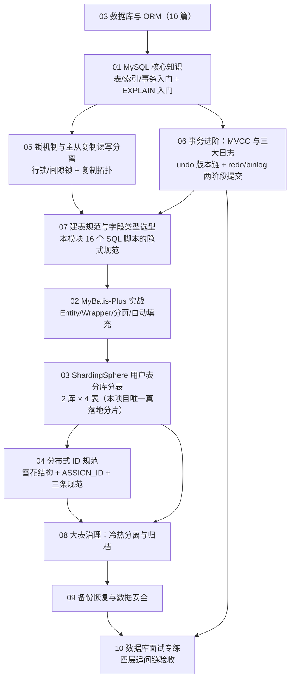
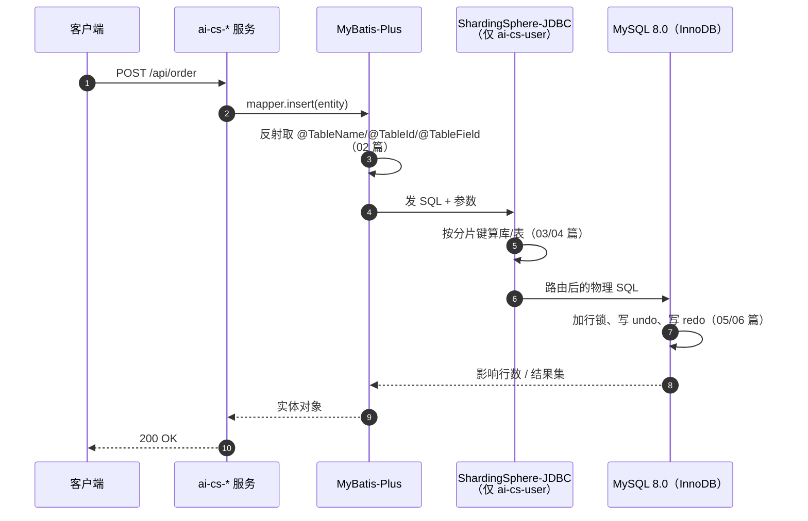

# 数据库与 ORM（03 模块入口）

> **一句话结论**：这个模块不教 SQL 语法，它补的是"**表怎么设计、SQL 为什么慢、事务凭什么隔离、数据量涨上来以后往哪挪**"这四件事的判断力——本项目的证据主干只有三样：`deploy/mysql/` 下 16 个真实 SQL 脚本、各服务 `src/main/resources` 里的真实数据源/分片配置、以及 `ai-cs-*/src/main/java` 里真实的 Entity 与 Mapper 用法。
> **阅读前置**：会写 `SELECT/INSERT/UPDATE`、用过 MyBatis-Plus 的 `BaseMapper`、知道 `@Transactional` 能开事务；不懂 InnoDB 与索引也能读，但请从 01 开始。
> **证据基线**：MySQL 8.0（InnoDB，utf8mb4）/ MyBatis-Plus 3.5.13（`pom.xml#L47-L49`，Boot 4 starter）/ ShardingSphere-JDBC 5.5.0（`pom.xml#L48`）/ MyBatis 3.6.0 与 mybatis-spring 3.0.5（规范基线，由 MyBatis-Plus starter 传递引入，仓库未显式钉版本）；本篇引用的行号当次核对过 2026-11 的仓库状态。预计阅读 20 分钟（读完 10 篇另需 15~20 小时）。

---

## 1. 定位：这个模块补的是哪块能力缺口

### 1.1 缺口长什么样（三个真实症状）

**症状一：分片改造当天，所有按 id 查用户的接口开始报"表不存在"。**

```text
java.sql.SQLSyntaxErrorException: Table 'user_db.sys_user' doesn't exist
```

这不是代码写错，而是 `deploy/mysql/user-sharding-migrate.sql` 的第一步就把原表改名了（`RENAME TABLE user_db.sys_user TO user_db.sys_user_migrated`），逻辑表 `sys_user` 从此只存在于 ShardingSphere 的规则里、由 8 张物理表拼成。不知道"逻辑表 ≠ 物理表"的人，会去数据库里找一张永远不存在的表。

**症状二：并发注册同名账号，数据库不报错，但线上出现了两条 `alice`。**

单个分片的唯一键只保证"**这张表内**唯一"。`deploy/mysql/init.sql#L42-L43` 的注释写得很直白：`uk_username` 仅保证单表内唯一，全局唯一由应用层查重保证；而应用层的查重是一次**广播计数**（`UserServiceImpl#L51-L52` 用 `selectCount` 扫全部分片）。并发时两个请求各自扫到 0 条，然后各自写入不同分片——谁都没错，数据就是重了。

**症状三：批量更新跑几分钟后全部回滚，日志里是锁等待超时。**

```text
java.sql.SQLException: Lock wait timeout exceeded; try restarting transaction
```

阈值来自 `deploy/mysql/mysql.cnf#L7` 的 `innodb-lock-wait-timeout=30`。真正要回答的是"谁持着锁、持了多久、我这句 UPDATE 是等行锁还是等元数据锁"——那属于 05/06 两篇的内容。

这些现象指向同一件事：**数据库层的问题几乎都不是"语法写错"，而是"物理结构（表/分片/索引）与并发语义（事务/锁/复制）和你脑子里的模型不一致"；不一致的地方，恰好就是这 10 篇要讲的地方。**

### 1.2 读者画像

| 画像 | 现在的水准 | 卡在哪 | 从这个模块拿走什么 |
| --- | --- | --- | --- |
| 业务开发（1~3 年） | 能靠 MyBatis-Plus `QueryWrapper` 写完 CRUD | 建表凭模板、慢查询靠加索引碰运气 | 一份可查表的建表规范 + EXPLAIN 入门判读 |
| 要过面试的人 | 背过"MVCC 靠 ReadView"这句话 | 被追问"ReadView 里存什么、什么时候生成"就断 | 06 篇的 undo 版本链手算 + 追问链 |
| 被叫去救火的人 | 会看日志但不会归因 | 分不清"慢"是缺索引、锁等待还是从库延迟 | 05/08/09 三篇的排查清单 |

### 1.3 读完能验证的行为（不是"了解"，是能当场演示）

1. 拿到一条慢 SQL，能写出 `EXPLAIN` 并指出 `type`/`key`/`rows`/`Extra` 里哪一列说明"没走索引"或"回表太多"（回表 = 二级索引拿到主键后再回聚簇索引取整行）。
2. 能在 `deploy/mysql/` 里找到任意一张表的 DDL，说出它的主键类型、索引清单、以及"加一个字段会不会锁表"。
3. 能对着一行 `UPDATE` 说出它在 RR（可重复读）隔离级别下加了什么锁、为什么另一条 `UPDATE` 会被阻塞。
4. 能画出 `sys_user` 的 2 库 × 4 表路由：给定一个用户 id，算出它落在 `user_db_?` 的 `sys_user_?`，并说明范围查询为什么会广播到 8 张表。
5. 能列出本项目**没有**落地的能力（读写分离、分区表、备份脚本……），并说明各自缺什么条件——这一条在 §9 有完整清单。

### 1.4 术语最小集（后面 10 篇会反复用到，先在这里认全）

| 术语 | 一句话解释 | 在本项目里的落点 |
| --- | --- | --- |
| 聚簇索引（clustered index） | InnoDB 把整行数据按主键顺序存放在 B+ 树的叶子节点上，**表就是索引**；没有主键时会退化到隐藏的 `DB_ROW_ID` | `sys_user_0` 的 `PRIMARY KEY (id)`，`id` 是雪花 `BIGINT` |
| 二级索引 / 回表 | 除主键外的索引只存"索引列 + 主键值"；用它查非索引列时要拿主键回聚簇索引再取一次整行，这次额外读取叫回表 | `idx_phone`、`idx_email`、`idx_status` 都是二级索引 |
| 最左前缀 | 联合索引按定义顺序逐列排序，查询条件必须从最左列开始连续匹配才能用上索引 | 订单表 `uk_user_product (user_id, product_id)`：只按 `product_id` 查用不上 |
| 分片键（sharding key） | 决定一行数据落到哪个库/哪张表的那个列；**一旦选定几乎无法改** | `sys_user.id`（`sharding-user.yaml#L70`、`#L74` 都写 `shardingColumn: id`） |
| 逻辑表 / 物理表 | 逻辑表是 SQL 里写的名字（`sys_user`），物理表是真正存在的 8 张（`user_db_0/1.sys_user_0..3`） | 这就是"`Table 'user_db.sys_user' doesn't exist`"的来源 |
| 广播查询 | 分片中间件把一条 SQL 发到全部分片再合并结果，代价与分片数成正比 | 用户名查重 `UserServiceImpl#L51-L52` |
| MVCC / ReadView | 多版本并发控制：读操作不加锁，而是按"可见性快照"（ReadView）挑一个旧版本；快照在 RR 下是事务第一次读时生成 | 06 篇主线 |
| 双 1 | `innodb_flush_log_at_trx_commit=1` 与 `sync_binlog=1` 同时开启：每次提交都落盘，崩溃不丢已提交事务，代价是 IOPS | `deploy/mysql/mysql.cnf#L6` 有前者；后者未在该文件出现（见 09/06 两篇的差异说明） |
| binlog / CDC | binlog 是 MySQL 的二进制变更日志；CDC（Change Data Capture）指下游订阅 binlog 拿变更 | `binlog-format=ROW` + `binlog-row-image=FULL`（`mysql.cnf#L26-L27`），供 Canal 消费 |
| 读写分离 | 写走主库、读走从库；难点不是"怎么分"，而是"事务内的读必须回主库"与"复制延迟导致的读旧值" | 本项目**未落地**（§9） |

### 1.5 这个模块明确**不**覆盖什么（查重声明，防止你在两处读同一个东西）

| 主题 | 在别处讲 | 本模块的处理 |
| --- | --- | --- |
| `EXPLAIN` 全列含义、索引失效八场景、ICP、深分页、Join 优化 | [12-性能工程/05-SQL调优与执行计划](../12-性能工程/05-SQL调优与执行计划.md) | 01 只留"能读懂 `type`/`key`/`rows`/`Extra`"的入门，深水区直接跳过去 |
| MyBatis / mybatis-spring 内部实现 | [24-源码分析/03-MyBatis](../24-源码分析/03-MyBatis/README.md) | 只讲"项目怎么用"，机制一律链接过去（对照表见 §7） |
| Seata AT/TCC、`undo_log` 表、XID 传播 | [02-Spring微服务](../02-Spring微服务/README.md) | 06 只辨析"Seata 的 `undo_log` 表 ≠ InnoDB 的 undo log"，机制不展开 |
| binlog 三种格式细节、Canal 全链路 | [04-中间件/11-CanalCDC商品索引同步](../04-中间件/11-CanalCDC商品索引同步.md) | 06/09 只讲 binlog 在"两阶段提交/复制/恢复"里的角色 |
| Redis 缓存一致性、Redisson 分布式锁 | [04-中间件/07-Redisson分布式锁](../04-中间件/07-Redisson分布式锁.md) | 不讲；二级缓存为什么不开也只给一句结论 |
| 对话数据的 Mongo 归档落地 | [04-中间件/10-MongoDB对话审计归档](../04-中间件/10-MongoDB对话审计归档.md) | 08 只讲 MySQL 侧"什么数据、什么时候、怎么搬" |
| 主从切换、仲裁、脑裂 | [13-稳定性工程](../13-稳定性工程/README.md) | 09 只讲备份与恢复，切换流程链接过去 |
| 数仓分层、CDC 进 OLAP | [14-数据工程与OLAP/04-CDC与实时同步链路](../14-数据工程与OLAP/04-CDC与实时同步链路.md) | 不讲 |

## 2. 模块地图：10 篇的依赖顺序



> **读图说明**：两条箭头最关键。**① `A03 --> A04`（分片决定 ID，而不是反过来）**：先有分片键才有"ID 必须自带分片语义"的约束——本项目分片键就是 `id`，路由算法取 id 后四位取模（`UserIdLast4ModShardingAlgorithm.java#L38-L52`），所以雪花 ID 的"末尾位分布"直接决定数据是否倾斜；顺序反过来（先随便生成 ID 再分片）就会出现热点分片。**② `A06 --> A07`（先懂日志与锁，再谈建表规范）**：`07` 里"能不能用 `NULL`、能不能用 `TEXT`、`update_time` 要不要 `ON UPDATE`"这些结论的根因都在 06 的 redo/undo 与行格式里；跳过 06 直接背 07 的模板，改一次需求就又回到"凭感觉"。看错 `A01 --> A05 / A06` 这条分叉会得出错误结论：以为"锁"和"事务隔离"是同一个话题——它们是同一套机制的**表象**与**实现**，05 讲"谁能拦住谁"，06 讲"拦住之后怎么保证读到旧版本"。

### 2.1 推荐顺序与理由

| 顺序 | 篇目 | 为什么排在这 |
| --- | --- | --- |
| ① 打底 | [01-MySQL核心知识](01-MySQL核心知识.md) | 唯一一篇从"怎么连上、怎么建表、怎么看执行计划"讲起的；后面的每一篇都假设你知道 B+ 树索引与聚簇索引 |
| ② 并发语义 | [05](05-MySQL锁机制与主从复制读写分离.md) → [06](06-事务进阶-MVCC实现与三大日志.md) | 先看"锁"这个可观测的表象（谁在等谁），再看 MVCC 这个"不加锁也能读旧值"的实现；反过来读会觉得 06 里的 `ReadView` 凭空出现 |
| ③ 结构决策 | [07-建表规范与字段类型选型](07-建表规范与字段类型选型.md) | 把前两步的结论落到 DDL：类型选错（比如金额用 `DOUBLE`）是**上线后最贵**的错误 |
| ④ 编码层 | [02-MyBatisPlus实战](02-MyBatisPlus实战.md) | 结构定了才谈"怎么写 SQL"；本项目 **0 个 Mapper XML**（下面会核），所有 SQL 来自注解 + `BaseMapper` + Wrapper |
| ⑤ 增长 | [03-ShardingSphere用户表分库分表实战](03-ShardingSphere用户表分库分表实战.md) → [04-分布式ID规范](04-分布式ID规范.md) | 分片是本项目唯一真落地的水平扩展手段，ID 规范是它的前置约束（`@TableId(type = IdType.ASSIGN_ID)`） |
| ⑥ 善后 | [08-大表治理-冷热分离与数据归档](08-大表治理-冷热分离与数据归档.md) → [09-备份恢复与数据安全](09-备份恢复与数据安全.md) | 表长大了才谈归档；备份是"误删之后还能不能活"的最后一道 |
| ⑦ 验收 | [10-数据库面试专练](10-数据库面试专练.md) | 用追问链把 01~09 串起来，答不上来的那题就是没读透的那篇 |

### 2.2 顺序读反了会得出什么错误结论（这比"顺序"本身更重要）

| 错误读法 | 会得到的错误结论 | 正确的因果 |
| --- | --- | --- |
| 先读 03（分片）再读 04（ID） | "分片就是把表拆开，ID 用什么无所谓" → 用 `AUTO_INCREMENT` 做主键，结果每个分片各自从 1 开始，id 立刻撞车 | 分片键决定 ID 必须**全局唯一且自带分片语义**；本项目选 `ASSIGN_ID`（雪花）正是为了满足这一点 |
| 先读 08（归档）再读 07（建模） | "表大了就归档" → 归档时才发现表没有主键、没有时间列，删不动也定位不了 | 07 要求"必备字段 + 必须有主键"，就是为了让 08 的归档与 Online DDL 有落点 |
| 先读 02（MyBatis-Plus）再读 06（事务） | "`@Transactional` 一加就稳了" → 事务里跑了慢 SQL 或 RPC，锁持有时间被拉长到秒级 | 06 讲清"事务边界 = 锁的持有窗口"，才知道为什么事务里不能做重活 |

## 3. 每篇一句话摘要：解决什么问题、证据有多硬

### 3.1 证据分级与总览表

本模块的证据分三级，先给定义，再给每篇的实际情况：

- **B 级（主干）**：本项目真实代码/配置/SQL 的路径 + 行号，例如 `deploy/mysql/init.sql#L49-L67`。本模块 10 篇全部以 B 级为主干。
- **C 级（补充）**：可复现命令 + 真实输出（`EXPLAIN`、`SHOW ENGINE INNODB STATUS`、`SHOW SLAVE STATUS`）。
- **A 级（框架源码）**：本模块正文 **A 级 0 处**，而且这是必须说清的事实——`24-源码分析/assets/source/` 里 889 份摘录**没有一份 MyBatis-Plus 或 ShardingSphere 的类**（`MetaObjectHandler`、`BaseMapper`、`TableInfo`、`ShardingAlgorithm` 全部 0 命中）。所以凡是"插件怎么改写 SQL""分片路由怎么算"这类问题，本模块只能给项目侧证据和官方文档出处，源码级的答案要去 [24-源码分析/03-MyBatis](../24-源码分析/03-MyBatis/README.md)（那里只覆盖 MyBatis 本体与 mybatis-spring）。

| 篇 | 解决什么问题 | 证据类型 | 含未落地方案？ |
| --- | --- | --- | --- |
| [01-MySQL核心知识](01-MySQL核心知识.md) | 索引为什么这么建、`EXPLAIN` 每一列怎么读、事务隔离级别的入门 | B（`deploy/mysql/` + 配置）+ C（执行计划示例） | 否（`EXPLAIN` 全列、深分页优化明确指向 [12-性能工程/05](../12-性能工程/05-SQL调优与执行计划.md)） |
| [02-MyBatisPlus实战](02-MyBatisPlus实战.md) | 本项目日常写库的全部姿势：Entity 注解、`BaseMapper`、Wrapper、分页、自动填充、逻辑删除 | B（27 处 `@TableName`、8 处 `@TableLogic` 的真实用法） | **是**：`@Version` 乐观锁全仓 0 处、Mapper XML 0 个，均按"目标态示例"给出 |
| [03-ShardingSphere用户表分库分表实战](03-ShardingSphere用户表分库分表实战.md) | `sys_user` 怎么从单表变成 2 库 × 4 表，存量数据怎么迁，踩了哪些坑 | B（分片 YAML + 自定义算法 + 迁移脚本） | 否（本篇是本模块唯一"真的上线了"的水平扩展） |
| [04-分布式ID规范](04-分布式ID规范.md) | 雪花 ID 的位结构、`ASSIGN_ID` 怎么接、分片场景下 ID 的三条硬规范 | B（`@TableId` 声明 + 算法取模规则） | 否 |
| [05-MySQL锁机制与主从复制读写分离](05-MySQL锁机制与主从复制读写分离.md) | 行锁/间隙锁/意向锁怎么加、死锁怎么读、主从拓扑长什么样 | B（`mysql.cnf`/`master.cnf`/`slave.cnf` 逐行）+ C（`SHOW ENGINE INNODB STATUS` 判读方法） | **是**：读写分离**未落地**（只有主从拓扑，没有 `!READWRITE_SPLITTING` 规则） |
| [06-事务进阶-MVCC实现与三大日志](06-事务进阶-MVCC实现与三大日志.md) | undo 版本链 + ReadView 手算、redo/undo/binlog 的分工、两阶段提交与"双 1" | B（`mysql.cnf#L6` 等刷盘参数）+ C（需本地 MySQL，部分标注未实测） | 否（日志实测受限于无本地实例，文中已标注） |
| [07-建表规范与字段类型选型](07-建表规范与字段类型选型.md) | 字段类型怎么选、必备列有哪些、什么时候该反范式冗余快照 | B（16 个 SQL 脚本的隐式规范显式化，引用密度最高） | **是**：分区表 0 处、`@Version` 0 处 |
| [08-大表治理-冷热分离与数据归档](08-大表治理-冷热分离与数据归档.md) | 表过千万行之后：归档 vs 分区 vs 分片怎么选、Online DDL 边界 | B（真实表增长来源 + `ChatMessage` 等实体）+ 目标态 DDL | **是**：`gh-ost`/`pt-osc`、分区 DDL、归档 Job 与归档表**都未落地** |
| [09-备份恢复与数据安全](09-备份恢复与数据安全.md) | 为什么 1 主 2 从仍然要有备份、误删之后怎么用 binlog 点恢复 | B（`slave.cnf` 的复制过滤）+ MySQL 8.0 官方手册 | **是**：`xtrabackup`、延时从库、备份脚本仓库里均为 0 |
| [10-数据库面试专练](10-数据库面试专练.md) | 把 01~09 变成"能接住第二轮追问"的答题结构 | 无代码证据（纯题组与追问链） | 否（它本身是验收出口） |

### 3.2 证据锚点速查（想自己核对时直接打开这几处）

| 路径 | 能证明什么 |
| --- | --- |
| `ai-cs-user/src/main/resources/sharding-user.yaml#L64-L88` | 逻辑表 `sys_user` → `user_db_${0..1}.sys_user_${0..3}`，库路由 `sharding-count: 2`、表路由 `sharding-count: 4` |
| `ai-cs-user/src/main/java/com/aics/user/sharding/UserIdLast4ModShardingAlgorithm.java#L38-L52` | 精确路由取 id 后四位取模；范围查询直接返回全部分片（广播） |
| `ai-cs-user/src/main/java/com/aics/user/entity/User.java#L20-L28` | `@TableName("sys_user")` + `@TableId(type = IdType.ASSIGN_ID)`：逻辑表名与雪花 ID 都写在实体上 |
| `ai-cs-user/src/main/java/com/aics/user/config/UserMybatisConfig.java#L16-L29` | 自动填充只填 `createTime`/`updateTime`/`deleted` 三个字段，靠 `strictInsertFill` |
| `ai-cs-user/src/main/java/com/aics/user/service/impl/UserServiceImpl.java#L51-L52` | 用户名全局唯一靠"广播 `selectCount`"实现，不是靠唯一键 |
| `deploy/mysql/init.sql#L49-L67` | `sys_user_0` 的真实 DDL：`BIGINT` 雪花主键 + 1 个唯一键 + 4 个二级索引 |
| `deploy/mysql/mysql.cnf#L6-L28` | 双 1（`innodb-flush-log-at-trx-commit=1`）+ 慢日志 2s + binlog `ROW`/`FULL` |
| `deploy/mysql/slave.cnf#L11-L18` | `read-only=1` 与 `replicate-do-db` 的四个库白名单（缺口见 §9） |
| `ai-cs-chat/src/main/java/com/aics/chat/nl2sql/Nl2SqlDataSourceConfig.java#L40-L41` | AI 问数的只读数据源：连接串追加 `readOnly=true` |
| `ai-cs-chat/src/main/java/com/aics/chat/history/mongo/MongoChatHistoryArchiveService.java#L19-L20` | Mongo 归档受 `aics.chat.mongo-archive.enabled` 控制，**默认关闭** |

## 4. 三条学习路线（按你的目的选，不要全读）

| 路线 | 篇目顺序 | 耗时 | 产出物（怎么算走完） |
| --- | --- | --- | --- |
| **面试速通** | [06](06-事务进阶-MVCC实现与三大日志.md) → [05](05-MySQL锁机制与主从复制读写分离.md) → [01](01-MySQL核心知识.md) → [10](10-数据库面试专练.md) | 6~8 小时 | 白板写出 undo 版本链与 ReadView 判定过程；说出 `UPDATE` 加了哪些锁；把 10 的四层追问链接住两轮 |
| **项目落地** | [07](07-建表规范与字段类型选型.md) → [02](02-MyBatisPlus实战.md) → [03](03-ShardingSphere用户表分库分表实战.md) → [04](04-分布式ID规范.md) | 8~10 小时 | 交一张符合 `deploy/mysql/` 规范的新表 DDL（含 `create_time`/`update_time`/`deleted`、索引命名、utf8mb4）；说清新表要不要分片、分片键是谁 |
| **线上排障** | [01](01-MySQL核心知识.md) → [05](05-MySQL锁机制与主从复制读写分离.md) → [08](08-大表治理-冷热分离与数据归档.md) → [09](09-备份恢复与数据安全.md) | 每次 1~2 小时按需 | 一份归因记录：慢 SQL 的 `EXPLAIN` 截图 + "是缺索引/锁等待/从库延迟/大表扫描"的判断 + 处置动作 |

### 4.1 三条路线各自的"第一天"

- **面试速通**：第一天只做一件事——拿一张纸，把 06 篇 `UPDATE` 的 undo 记录、`ReadView` 的四个字段、以及"什么时候能看见旧版本"画成三行时序；画不出来就先别背结论。第二天用 05 的死锁案例检验：如果加锁顺序反了，MVCC 能不能救你（答案：不能，写操作永远读最新版本）。
- **项目落地**：第一天读 07 并真的写一张新表 DDL，然后拿 `deploy/mysql/init.sql#L49-L67` 逐列对照（主键类型、`create_time`/`update_time`/`deleted`、索引命名 `idx_`/`uk_`、`ENGINE=InnoDB` + `utf8mb4_unicode_ci`）。第二天读 02 并回答："本项目为什么不需要 Mapper XML"。
- **线上排障**：不要从头读。打开 §8 的症状表定位到篇，只读那一篇的"踩坑与调试手法"小节，按里面的命令取证据，再回来看原理。排障时**先取证再改代码**，否则你会把"锁等待"误判成"缺索引"然后加一个没用的索引。

## 5. 依赖关系：读它之前要会什么，读完能接什么

### 5.1 前置（本库内，读之前最好先过一遍）

| 前置知识 | 在哪 | 为什么本模块假设你会 |
| --- | --- | --- |
| 集合与哈希/比较语义 | [01-Java基础/05-集合框架与源码](../01-Java基础/05-集合框架与源码.md) | 联合索引的"最左前缀"本质是排序后的二分；`hashCode/equals` 的坑与唯一键的唯一性是同一类思维 |
| 反射与动态代理 | [01-Java基础/06-反射动态代理与SPI](../01-Java基础/06-反射动态代理与SPI.md) | Mapper 接口没有实现类却能注入，靠的就是 JDK 动态代理（源码级解释在 24 那侧） |
| Spring 事务与 AOP | [02-Spring微服务](../02-Spring微服务/README.md) | 06 篇会大量出现"事务提交发生在代理边界"，不知道 AOP 顺序会读不懂 |

### 5.2 后续（本模块是这些模块的前置）

| 后续模块 | 具体依赖 | 真实链接 |
| --- | --- | --- |
| 中间件 | Canal 靠 binlog `ROW` 格式做 CDC；Mongo 归档承接冷数据 | [04-中间件/11-CanalCDC商品索引同步](../04-中间件/11-CanalCDC商品索引同步.md)、[04-中间件/10-MongoDB对话审计归档](../04-中间件/10-MongoDB对话审计归档.md) |
| 性能工程 | 本模块的 `EXPLAIN` 入门 → 那边的执行计划全列、深分页、Join 优化 | [12-性能工程/05-SQL调优与执行计划](../12-性能工程/05-SQL调优与执行计划.md) |
| 数据工程与 OLAP | 业务库 → 数仓的 CDC 与指标口径，前提是懂 binlog 与事务 | [14-数据工程与OLAP/04-CDC与实时同步链路](../14-数据工程与OLAP/04-CDC与实时同步链路.md) |
| 架构与分布式 | 分布式事务、一致性理论；分片与 ID 是分布式数据面的地基 | [21-架构与分布式/03-分布式一致性理论](../21-架构与分布式/03-分布式一致性理论.md) |
| 源码分析 | 本模块讲"怎么用、为什么这么设计"，那边讲"MyBatis 内部怎么实现" | [24-源码分析/03-MyBatis](../24-源码分析/03-MyBatis/README.md) |

### 5.3 本模块在一次请求里的位置（谁在持久化这件事上"卡住"，该问哪一篇）



> **读图说明**：这条链路上一共有四个"会失败的地方"，而它们**报的错完全不同**——②③ 出错是应用层异常（比如实体没标 `@TableName` 会拼出错误的表名），④ 出错是 `Table ... doesn't exist` 或路由异常（03 篇），⑤⑥ 出错是 `Lock wait timeout`、`Deadlock found`、`Duplicate entry`（05/06 篇）。看错箭头会做错动作：⑤ 处的 `Duplicate entry` 若发生在分片表上，加唯一键是**解决不了全局重复**的，因为唯一键只在单表内生效。

## 6. 检查点清单（能说出 / 能画出 / 能复现，才算过）

> 复现前提：本机有 MySQL 8.0（`docker-compose` 里的单节点即可）时，"能复现"类条目可以真跑；没有实例时，请按条目里写的"该跑什么命令、看哪一列"写成判读笔记，并注明未实测——这也是合格标准，**禁止假装跑过**。

**阶段一：结构（01 + 07）**

- [ ] 能说出聚簇索引与二级索引的差别，并解释"为什么 `SELECT *` 比覆盖索引慢"。
- [ ] 能画出本项目任意一张表的索引结构，指出哪个索引服务于哪个查询（例：`idx_phone` 服务于手机号登录）。
- [ ] 能复现：对一条 SQL 执行 `EXPLAIN`，读出 `type=ALL` 说明全表扫描（本机无 MySQL 时，写清该跑什么命令、看哪一列）。
- [ ] 能说出金额为什么用 `DECIMAL` 而不是 `DOUBLE`，并用 `deploy/mysql/order-init.sql` 里的 `product_price DECIMAL(10,2)` 举例。
- [ ] 能说出 `deploy/mysql/` 里 `init.sql`、`all-init.sql`、`drop-all.sql` 三个脚本的正确执行顺序，以及为什么 `drop-all.sql` 不能在生产跑。

**阶段二：并发（05 + 06）**

- [ ] 能画出一次 `UPDATE ... WHERE id = ?` 的加锁路径（行锁 + 记录所在索引）。
- [ ] 能说出 `ReadView` 里存了什么，并手算"事务 A 先读、B 改、A 再读"在 RR 下读到什么。
- [ ] 能说出 redo log、undo log、binlog 各自解决什么问题，以及两阶段提交里"崩在哪个点会怎样"。
- [ ] 能复现：`SHOW ENGINE INNODB STATUS` 里 `LATEST DETECTED DEADLOCK` 段怎么读（需本地实例，未实测时标注）。

**阶段三：编码与扩展（02 + 03 + 04）**

- [ ] 能说出本项目 **0 个 Mapper XML** 的情况下，SQL 从哪里来（`BaseMapper` 方法名 + Wrapper + 注解）。
- [ ] 能画出 `sys_user` 的路由：给定 id 后四位 `0137`，说出库号与表号（`0137 % 2 = 1` → `user_db_1`；`0137 % 4 = 1` → `sys_user_1`）。
- [ ] 能说出范围查询（`WHERE id > ?`）为什么要扫 8 张表，依据是 `UserIdLast4ModShardingAlgorithm.java#L48-L52`。
- [ ] 能复现：改一个不合法的 `sharding-count`，观察自定义算法在 `init()` 抛 `IllegalArgumentException`（看源码即可复述，不必启动服务）。

**阶段四：治理与验收（08 + 09 + 10）**

- [ ] 能说出"归档 / 分区 / 分片"三种手段各自解决什么、代价是什么。
- [ ] 能说出"1 主 2 从为什么仍然不等于备份"，并指出本项目从库只复制 4 个库这一缺口。
- [ ] 能接住 10 篇里"追问链"的第二轮，且回答里带上本项目的具体表名/配置项。

## 7. 与 [24-源码分析/03-MyBatis](../24-源码分析/03-MyBatis/README.md) 的分工

一句话分工：**本模块回答"该不该这么建、这么写、这么拆"；24 回答"框架内部气怎么走"**。同一个术语在两处的落点完全不同，读错地方会浪费几个小时。

| 主题 | 本模块（03）讲什么 | 24-源码分析/03-MyBatis 讲什么 | 去哪读 |
| --- | --- | --- | --- |
| Mapper 接口没有实现类 | 项目里怎么组织 Mapper、`@MapperScan` 之后能直接注入 | 为什么能注入：`MapperProxyFactory` + JDK 动态代理 | [SqlSession 与 Mapper 代理](../24-源码分析/03-MyBatis/02-SqlSession与执行器/01-sqlsession-与-mapper-代理.md) |
| SQL 从哪里来 | 本项目 0 个 XML，SQL 来自 `BaseMapper`/Wrapper/注解 | 有 XML 时：`XMLMapperBuilder` 怎么把它变成 `MappedStatement` | [Mapper XML 解析与 MappedStatement](../24-源码分析/03-MyBatis/01-初始化与配置解析/02-mapperxml-解析与-mappedstatement.md) |
| `#{}` 与 `${}` | 业务上只用 `#{}`；`${}` 的注入风险与本项目怎么规避 | 源码级差别：`#{}` 走 `ParameterMapping` 预编译，`${}` 直接拼进 `BoundSql` | [动态 SQL：SqlNode 树的构建与应用](../24-源码分析/03-MyBatis/03-动态SQL与参数映射/01-动态sql-sqlnode树的构建与应用.md)、[参数映射与 TypeHandler](../24-源码分析/03-MyBatis/03-动态SQL与参数映射/02-参数映射-parametermapping与typehandler.md) |
| 一级/二级缓存 | 本项目**不开**二级缓存（跨服务共享数据靠 Redis），一级缓存的生命周期与坑 | `BaseExecutor` 的 `localCache`、`CachingExecutor` 装饰顺序、二级缓存的三个坑 | [Executor 执行器与一级缓存](../24-源码分析/03-MyBatis/02-SqlSession与执行器/02-executor-执行器与一级缓存.md)、[二级缓存与坑位](../24-源码分析/03-MyBatis/04-结果映射与插件/03-二级缓存与坑位.md) |
| 插件机制 | 只用到 MyBatis-Plus 自带插件（分页、`jsqlparser` 依赖），不自己写 | `InterceptorChain` 与 4 个可拦截点，能写一个分页/脱敏插件 | [插件机制：Interceptor 与四大对象代理](../24-源码分析/03-MyBatis/04-结果映射与插件/02-插件机制-interceptor与四大对象代理.md) |
| 实体 ↔ 结果集 | `@TableName`/`@TableField`/`@TableLogic` 怎么写、逻辑删除后 SQL 长什么样 | `ResultSetHandler` 与自动映射的规则、`TypeHandler` 注册 | [结果映射：ResultSetHandler 与自动映射](../24-源码分析/03-MyBatis/04-结果映射与插件/01-结果映射-resultsethandler与自动映射.md) |
| 事务边界 | `@Transactional` 在哪个方法上加、分片场景下事务范围是什么 | `SqlSessionTemplate` 如何把 Session 绑到事务、`TransactionSynchronizationManager` 的作用 | [mybatis-spring 集成原理](../24-源码分析/03-MyBatis/05-Spring集成与Boot自动配置/01-mybatis-spring-集成原理.md) |
| Boot 自动配置 | 为什么加了 starter 就有 `SqlSessionFactory`，属性前缀怎么配 | `MybatisAutoConfiguration` 的 `@ConditionalOnMissingBean` 与注册顺序 | [Boot 自动配置深入 MybatisAutoConfiguration](../24-源码分析/03-MyBatis/05-Spring集成与Boot自动配置/02-boot-自动配置-深入-mybatisautoconfiguration.md) |
| 整体心智模型 | 不重复讲 | 四大对象 + 七大组件的一张图 | [MyBatis 整体架构与四大对象](../24-源码分析/03-MyBatis/00-总览/01-mybatis-整体架构与四大对象.md) |

那侧读的是真源码（A 级），本篇读的是项目资产（B 级）。举个"哪一侧才是 A 级"的例子——24 里能直接引到手写行号，而本篇只能引到项目配置：

```java (src: SqlSessionFactory.java.md#L25-L35)
public interface SqlSessionFactory {

  SqlSession openSession();

  SqlSession openSession(boolean autoCommit);

  SqlSession openSession(Connection connection);

  SqlSession openSession(TransactionIsolationLevel level);

  SqlSession openSession(ExecutorType execType);
```

这段就是 `[[源码:SqlSessionFactory.java.md#L25-L35]]`（注意 `assets/source/` 下文件的实际命名是 `类名.java.md`，锚点必须带 `.md` 才能被校验器命中）。它证明"`SqlSessionFactory` 只负责开会话，有 8 个重载"——但**本项目用的是 `SqlSessionTemplate`，不是直接裸用这个接口**，两者的关系在 24 的 mybatis-spring 那篇里讲。

**MyBatis-Plus 与 ShardingSphere 的源码不在库里**：`MetaObjectHandler`（自动填充钩子）、`BaseMapper`（通用 CRUD）、分片路由算法都只有官方文档可引。所以本模块凡是涉及它们"内部怎么实现"的句子，都明确标成"依据 MyBatis-Plus 3.5.13 / ShardingSphere 5.5.0 官方文档 + 本项目配置推得"，不冒充源码。

### 7.1 遇到一个主题时，怎么判断该去哪边（三条规则，省得两边都读）

1. **问"为什么能跑起来" → 24 那侧。** 只要你的疑问是"这行代码明明没人实现/没写 SQL，为什么能执行"，答案一定在代理、拦截器、自动配置里。
2. **问"我该怎么写才不出事" → 本模块。** 建表、索引、类型、事务边界、分片键、归档策略，这些是设计决策，源码里没有答案。
3. **问"线上这个报错是谁的锅" → 先本模块 §8，再按错误类型分流。** 应用层异常（`binding exception`、`Invalid bound statement`、`TooManyResultsException`）去 24；数据库层异常（`Duplicate entry`、`Lock wait timeout`、`Deadlock found`）留在这里。

## 8. 常见问题直达表（按症状查，不按目录查）

| 你看到的症状（报错原文 / 现象） | 最可能的根因 | 去哪篇 |
| --- | --- | --- |
| `Table 'user_db.sys_user' doesn't exist` | 逻辑表在分片规则里，物理表是 `user_db_0/1.sys_user_0..3` | [03](03-ShardingSphere用户表分库分表实战.md) |
| 两条同名用户，唯一键没拦住 | 唯一键只在本分片内生效，全局唯一靠广播 `selectCount` | [03](03-ShardingSphere用户表分库分表实战.md)、[04](04-分布式ID规范.md) |
| `Lock wait timeout exceeded; try restarting transaction` | 行锁/间隙锁等待超过 `innodb-lock-wait-timeout=30` | [05](05-MySQL锁机制与主从复制读写分离.md) |
| `Deadlock found when trying to get lock; try restarting transaction` | 两个事务加锁顺序相反，InnoDB 主动回滚代价小的一方 | [05](05-MySQL锁机制与主从复制读写分离.md) |
| 同一条 `SELECT` 在事务里两次读结果不同 | 隔离级别被降成 RC，或走了从库（本项目未做读写分离，属前者） | [06](06-事务进阶-MVCC实现与三大日志.md) |
| 慢查询日志里一条 SQL 反复出现、`EXPLAIN` 显示 `type=ALL` | 缺索引或条件列被函数包住（索引失效） | [01](01-MySQL核心知识.md) → [12-性能工程/05](../12-性能工程/05-SQL调优与执行计划.md) |
| `Data too long for column 'nickname'` | 字段长度与实体校验不一致（如 `VARCHAR(64)` 存了 70 字符） | [07](07-建表规范与字段类型选型.md) |
| `ALTER TABLE` 执行几分钟，接口全超时 | 非 Online DDL 拿了元数据锁，阻塞了后续所有查询 | [08](08-大表治理-冷热分离与数据归档.md) |
| 备份只能靠手工 `mysqldump`，没人知道能不能恢复 | 仓库里没有备份脚本，也没演练过恢复 | [09](09-备份恢复与数据安全.md) |
| 逻辑删除后数据"查不到"，但库里明明还在 | `@TableLogic` 给所有查询自动加了 `deleted = 0` | [02](02-MyBatisPlus实战.md) |
| `create_time` 是 `0000-00-00` 或被写入 `null` | 自动填充没配 `MetaObjectHandler`，或字段没标 `fill` | [02](02-MyBatisPlus实战.md) |

## 9. 诚实清单：哪些方案本项目**没有**落地

这份清单是本模块最重要的部分之一。**旧稿曾把"1 主 2 从 + 分库分表"写成既成事实**，读者据此做设计会踩坑。以下逐条按"仓库现状"核对过（2026-11 状态）：

| 能力 | 现状 | 证据 | 落地缺什么 |
| --- | --- | --- | --- |
| 分库分表 | **部分落地**：只有 `sys_user` 一张逻辑表 | `ai-cs-user/src/main/resources/sharding-user.yaml#L64-L88` | 其余库（`order`/`product`/`knowledge`/`chat`）仍是单库单表 |
| 读写分离 | **未落地**：只有主从拓扑（`docker-compose-master-slave.yml`），应用侧没有读写分离规则 | `sharding-user.yaml` 里只有 `!SINGLE` 与 `!SHARDING`，没有 `!READWRITE_SPLITTING` | 需要路由规则 + 事务内读强制走主库的策略；05 篇给出方案与代价 |
| 从库覆盖范围 | **有缺口**：从库只复制 4 个库 | `deploy/mysql/slave.cnf#L15-L18` 为 `user_db`/`knowledge_db`/`chat_db`/`nacos_config` | `user_db_0/1`（分片库）、`ai_customer_service`（订单）、`product_db` **不在复制白名单**，从库上根本没有这些数据 |
| 分区表 | **未落地**：16 个 SQL 脚本里 `PARTITION` 出现 0 次 | `deploy/mysql/` 全量 | 需要按时间维度的分区策略与"分区裁剪"验证 |
| 归档 Job / 归档表 | **未落地**：无归档表 DDL、无定时任务；Mongo 侧有一个归档写入器但默认关闭 | `MongoChatHistoryArchiveService.java#L19-L20`（`ConditionalOnProperty`，`havingValue="true"`） | 需要归档表 + 调度 + 双写/校验 |
| `gh-ost` / `pt-osc` | **未落地**：仓库无配置、无脚本 | `deploy/` 下无相关文件 | 需要多一倍磁盘 + 表必须有主键 |
| 备份脚本 / 恢复演练 | **未落地**：无备份脚本、无恢复文档化流程 | `deploy/` 下无 `*backup*`/`*dump*` 脚本 | `mysqldump` 全量 + binlog 增量在当前数据量（<几 GB）够用，但没有自动化 |
| `xtrabackup` | **未落地** | 同上 | 数据量到几十 GB 才需要热备 |
| 延时从库 | **未落地**：`slave.cnf` 里没有 `MASTER_DELAY` 相关配置 | `deploy/mysql/slave.cnf` | 需要额外的从库实例或改复制参数 |
| 乐观锁 `@Version` | **未落地**：全仓 `@Version` 与 `OptimisticLockerInnerInterceptor` 命中 0 次 | `ai-cs-*/src/main/java` 全量 | 需要版本列 + 插件 + 冲突重试策略 |
| Mapper XML | **未使用**：全仓 `*Mapper.xml` 0 个，`mapper-locations` 未配置 | `ai-cs-*/src/main/resources` 全量 | 复杂 SQL 目前靠 Wrapper 与注解；动态 SQL 需求变复杂时才需要 XML |
| 多租户 / 分库分表中间件代理（ShardingSphere-Proxy） | **未使用**：走的是 JDBC 侧（`ShardingSphereDriver`） | `ai-cs-user/src/main/resources/application.yml#L13-L14` | Proxy 需要独立部署与额外运维 |

另外两处需要读者注意的"版本事实"，与规范基线不完全一致：

- 规范与 24 那侧写 MyBatis `3.6.0` / mybatis-spring `3.0.5`，但本仓库根 `pom.xml#L47-L49` 钉的是 **MyBatis-Plus `3.5.13`**（`mybatis-plus-spring-boot4-starter`），MyBatis 核心版本由它传递引入、仓库未显式声明。写升级/迁移结论时以 starter 版本为准。
- `sharding-user.yaml` 头部注释写"ShardingSphere-JDBC 5.4.1"，同文件第 13 行又写"5.5.0 的 `$${ENV::默认值}` 占位符…"，而 `pom.xml#L48` 实际是 **5.5.0**。注释是历史残留，以 pom 为准。

### 9.1 如果要把未落地项补上，按这个顺序（有依赖，别乱序）

| 步 | 补什么 | 为什么必须在这个位置 | 前置条件（缺一样都做不成） |
| --- | --- | --- | --- |
| 1 | 备份脚本 + 恢复演练 | 它是所有 DDL 与迁移的**安全网**；没有可恢复的备份就动表，等于裸奔 | 一个能连的从库或独立磁盘；`mysqldump` + binlog 位置记录 |
| 2 | 备份 `sync_binlog=1`（补齐"双 1"） | 崩溃恢复依赖它；目前 `deploy/mysql/mysql.cnf` 只有 `innodb_flush_log_at_trx_commit=1` | 先测量写入 IOPS 余量，再评估是否牺牲吞吐 |
| 3 | 归档表 + 归档 Job（先手动跑通） | 大表不瘦身，任何 `ALTER TABLE` 都会变成事故 | 表必须有主键与时间列（07 篇的规范）；冷热边界要先和业务确认 |
| 4 | `slave.cnf` 补齐复制白名单 | 从库缺 `user_db_0/1`、`ai_customer_service`、`product_db`，此时谈读写分离毫无意义 | 确认从库磁盘能装下全量数据 |
| 5 | 读写分离（`!READWRITE_SPLITTING`） | 顺序必须在 4 之后；并且要先有"事务内读走主库"的策略 | 业务能接受读旧值；有延迟监控 |
| 6 | 乐观锁 `@Version` | 并发写冲突要靠它兜底，但它解决的是丢失更新，不是锁等待 | 版本列 + `OptimisticLockerInnerInterceptor` + 冲突重试 |
| 7 | 更多表分片 | 最后做。分片键一旦定死无法回头 | 已有全局唯一 ID 方案（04 篇）+ 跨分片查询的退路 |

## 怎么用这份 README

- **第一次来**：按 §2.1 的 ① → ⑦ 顺序走，每读完一篇回来打 §6 的勾；打不上勾的那条就是没读懂的地方。
- **带着问题来**：直接查 §8 的症状表，它按"你会看到什么"索引，不按知识点索引。
- **要做设计**：先看 §9，确认你要用的手段本项目到底有没有落地，别把"目标态"当"现状"。
- **要读框架源码**：去 [24-源码分析/03-MyBatis](../24-源码分析/03-MyBatis/README.md)，本模块只负责"用它、评它、修它的数据"。

> **维护约定**：本 README 与 10 篇正文里的行号（形如 `Xxx.java#L120-L136` 或 `init.sql#L1-L30`）是"写作时核对过、会随代码漂移"的证据指针。改动 `deploy/mysql/` 下的脚本、`sharding-user.yaml`、实体类之后，请顺手校正引用；`node tools/check-doc.mjs 03-数据库与ORM` 会把指向不存在文件的引用报成 error，但**行号偏移它查不出来**——行号对不对，只能由你打开文件数一遍。
