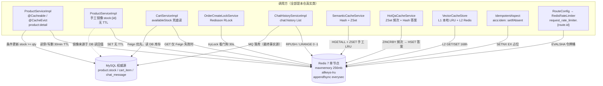
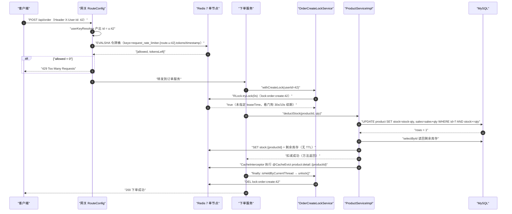

# Redis 缓存实战：缓存不是"加一层就快"，而是"用一致性换性能"

> **一句话结论**：Redis 缓存的真正难点不是把数据塞进去，而是决定"谁说了算"——本仓最终把库存的权威源判给 MySQL、把 Redis 降级为镜像与兜底，这个决定解释了项目里绝大多数缓存行为（含那些看起来像 bug 的行为）。
> **阅读前置**：读得懂 `@Cacheable` / `@Transactional` 的注解语义；知道 Spring Bean 与 AOP 代理的基本概念；对 Docker Compose 与 Kubernetes 的 YAML 有粗浅印象即可，不需要装过 Redis。
> **证据基线**：Redis 本体源码（redis 7 / Redisson 3.27.2 / spring-data-redis）**未入库**，凡涉及它们内部行为的判断均标注为"依据官方文档 + 本仓配置/代码"；A 级摘录只有 `RedisRateLimiter.java.md`（网关限流，已入 `24-源码分析/assets/source/`）一处，其余全部是本仓真实代码（B 级）与本机静态统计（C 级）。预计阅读 60~75 分钟。

**本篇的证据边界，先说清楚再开始**：

| 类别 | 本仓状态 | 本篇怎么处理 |
|---|---|---|
| `ProductCacheConfig` / `ProductServiceImpl` / `CartServiceImpl` / `OrderCreateLockService` / `RedissonConfig` | 真实存在，行号已逐行核对 | 直接引 `文件#L起-L止`，当 B 级证据 |
| `SemanticCacheService` / `HotQaCacheService` / `VectorCacheStore` / `ChatHistoryServiceImpl` / `IdempotentAspect` | 真实存在，行号已核对 | 同上；**点评的是设计取舍，不是"这里有 bug"** |
| `RedisRateLimiter`（Spring Cloud Gateway） | 已入 `assets/source/RedisRateLimiter.java.md` | 唯一 A 级摘录，用来说明 Lua 原子性与 hash tag |
| `request_rate_limiter.lua` 脚本本体 | **未入库** | 只讲它的输入输出契约（由 Java 侧调用点反推），不引脚本行号 |
| Redis 服务端（淘汰、fork、IO 多线程、集群协议） | **未入库，且本机没有 Redis 实例** | 依据 Redis 官方文档（`redis.conf` 注释 + docs.redis.io 的 eviction/persistence 章节）说明，并写清章节名 |
| 布隆过滤器、Canal 订阅 binlog | **本项目未落地** | 明确标注"未落地，属选型讨论"，并给出若要落地需要改哪些文件 |

本机探测结果（pwsh 7，2026-11-27 勘）：`redis-cli`、`redis-server`、`docker` 三个命令**均不存在**。因此本篇所有 `redis-cli ...` 命令都是**未实测**的判读方法，我会写明"预期输出长什么样、怎么读"；而文件路径校验、行号核对、源码静态统计是本机真实跑出来的输出，这类才是本篇的硬证据。

## 0. 先看现象

### 现象 1：运营改完价，前台 30 分钟还是旧价；库存删了，购物车还说"有货"

改价走 `updateProduct`，它带着 `@CacheEvict`，看起来"缓存已经删了"：

```java
// ai-cs-product/src/main/java/com/aics/product/service/impl/ProductServiceImpl.java#L118-L138
    @CacheEvict(cacheNames = ProductCacheConfig.PRODUCT_DETAIL, key = "#id")
    public ProductVO updateProduct(Long id, ProductUpdateDTO dto) {
        ...
        if (dto.getStock() != null) {
            stringRedisTemplate.opsForValue().set("stock:" + id, String.valueOf(dto.getStock()));
        }
```

`@CacheEvict` 删的是 `product:detail::{id}`，而 `stock:{id}` 是**同一份库存数据的第二个副本**，由方法体里的 `opsForValue().set(...)` 手工维护——注意这三件事的先后：L137 先写 Redis，L151 才 `productMapper.updateById(product)`。也就是说 Redis 已经被改成了新值，DB 还没改；如果 L151 抛异常（比如 `productVectorService.indexProduct` 在 L153 失败、或将来加上 `@Transactional` 后回滚），Redis 与 DB 就永久分叉。

这类分叉在本仓不是猜测。`ai-cs-product/src/main/java/com/aics/product/service/impl/ProductServiceImpl.java#L232-L241` 的 `syncStockCache()` 方法注释里留着血泪原文：「历史订单曾只扣 Redis 镜像、从不回写 DB，导致 Redis 与 DB 不一致」，以及「切换为 DB 权威源后，部署完成时全量把 DB 同步到 Redis」。

这个方法的存在本身就是证据：如果缓存本来就不可能不一致，就不需要一个"上线后手工跑一遍全量校准"的运维接口。

用户侧感知到的日志，往往是这一行（`ai-cs-order/src/main/java/com/aics/order/service/impl/CartServiceImpl.java#L185` 的真实格式串）：

```text
获取实时库存失败，改用 Redis 兜底: productId=1234
```

它一出现，就意味着**这次库存判断用的是 Redis 镜像而不是 DB**，镜像旧了就会误判"还有货"。

### 现象 2：一个人气商品的 key 十几 MB，整个实例的其它接口一起变慢

Redis 是单线程处理命令的（Redis 官方文档 "Redis single-threaded" / `docs.redis.io` 的 FAQ 条目反复强调这一点），一条命令的执行时间就是**所有人都要排队的时间**。本仓有一处按设计就会产生大 value 的读取：

```java
// ai-cs-chat/src/main/java/com/aics/chat/cache/SemanticCacheService.java#L67-L81
        try {
            float[] queryVector = embeddingModel.embed(question);
            Map<Object, Object> entries = redisTemplate.opsForHash().entries(ENTRY_KEY + knowledgeBase);
            if (entries.isEmpty()) {
                return Optional.empty();
            }
            double bestScore = -1;
            ...
                double score = EmbeddingMath.cosine(queryVector, entry.getVector());
```

`opsForHash().entries(...)` 在协议层是一条 `HGETALL`：服务端要把**整个 Hash 的所有 field/value 一次性拼成响应**，客户端再把 200 条 JSON 全部反序列化成 `CachedEntry`（每条含一个 `float[]` 向量和一份完整回答）。上限由 `aics.cache.semantic.max-entries: 200` 控制（`ai-cs-chat/src/main/resources/application.yml#L170-L193`），按 1536 维 `float[]` 的 JSON 体积粗算，这个 Hash 的量级是**数百 KB 到 MB**，而不是"几个小字段"。

同一类问题在会话历史上更直白：`ai-cs-chat/src/main/java/com/aics/chat/service/impl/ChatHistoryServiceImpl.java#L46-L56` 的 `load()` 直接 `redisTemplate.opsForList().range(key, 0, -1)`，即 `LRANGE key 0 -1`，把整个 List 全拉回来；这个文件里**没有 `LTRIM`、也没有 `expire`**（3.2 节用静态统计证明）。会话聊得越久 List 越大，读一次就搬一次全量。

客户端先扛不住时会看到 `SemanticCacheService.java#L103` 的真实格式串：`语义缓存读取失败（不影响业务）: kb=xxx, err=...`。**这条 warn 恰恰是设计意图**——缓存故障不阻断业务；但它同时说明「这里的缓存故障率是被容忍的」，所以它只会让链路变慢、不会报错，问题因此更难被发现。

### 现象 3：一个热点商品把"小集群"打满，其它商品跟着超时

本仓的 Redis 是单节点、内存上限 256 MB：

```text
# deploy/redis/redis.conf#L24-L25
maxmemory 256mb
maxmemory-policy allkeys-lru
```

`allkeys-lru` 的语义是"内存满了就在**所有 key** 里按近似 LRU 淘汰"。它和"热点商品"叠在一起会出事：热点 key 被高频访问所以不容易被淘汰，但**它邻居的 key 会被挤掉**——于是每次挤掉的都是那些"不那么热但很重要"的库存镜像、分类缓存，形成"越忙越容易穿透、越穿透越忙"的正反馈。再加上 `stock:{id}` 全部**没有 TTL**（3.2 节会用统计证明），这些 key 只增不减，只能等 LRU 淘汰。

网关侧的热点则在另一条链路上体现。限流 key 的粒度是「用户或 IP」（`ai-cs-gateway/src/main/java/com/aics/gateway/config/RouteConfig.java#L155-L167` 的 `userKeyResolver()`：优先 `X-User-Id` → `u:{userId}`，退化按客户端 IP → `ip:{ip}`）。当一个 NAT 出口背后有上千人时，他们共享同一个 `ip:xxx` 令牌桶，Redis 里那两三个 `request_rate_limiter.{...}` key 会被高频 `EVALSHA` 单独打热；而 Redis 单线程意味着**限流脚本的排队会拖慢同一实例上的所有缓存读写**——本仓限流与缓存共用同一个 Redis 实例。

Redis 不可用时，这一层还会静默失效。网关配置文件自己写了风险（`ai-cs-gateway/src/main/resources/application.yml#L10-L16` 注释原文）：「RequestRateLimiter（Redis + Lua 分布式令牌桶）的连接配置；Redis 不可用时分布式限流失效，可临时把下方 aics.gateway.rate-limit.enabled 改回 true 切回本地内存限流兜底」。

而 A 级证据里能直接看到"Redis 出错就放行"的代码：

```java
// [[源码:RedisRateLimiter.java.md#L271-L273]]
			return flux.onErrorResume(throwable -> {
				log.error("Error calling rate limiter lua", throwable);
				return Flux.just(Arrays.asList(1L, -1L));
			}).reduce(new ArrayList<Long>(), (longs, l) -> {
```

返回 `1L` 就是 `allowed = true`（`results.get(0) == 1L`，见同文件 `#L278`）。也就是说 Redis 挂了，限流**不是拒绝而是全放**。日志里出现 `Error calling rate limiter lua` 时，别以为"限流生效把请求挡了"，真实情况相反。

这些现象指向同一件事：**缓存的每一次写入都是一次"主动制造的第二份真相"，而 Redis 单线程 + 256MB + allkeys-lru 的部署形态，把这个第二份真相的成本放大成整个实例的延迟与淘汰抖动**。要治它，先得看清谁在读、谁在写、谁有资格说了算。

## 1. 整体地图



| 组件 / 类 | 责任 | 调用方 | 是否权威源 | 失效方式 |
|---|---|---|---|---|
| `ProductCacheConfig`（`@EnableCaching` 全仓唯一一处） | 装配 `RedisCacheManager`，定义两个 cache 名与 TTL | Spring Cache 代理 | 否 | TTL + `@CacheEvict` |
| `product:detail`（30 min）/ `product:categories`（10 min） | 商品详情、分类列表 | `ProductServiceImpl` | 否 | 写操作显式删除；分类用 `allEntries` |
| `stock:{id}`（手工镜像，无 TTL） | 商品服务不可用时给购物车兜底 | `CartServiceImpl` | **否，MySQL 才是** | 只有写操作覆盖 + `syncStockCache()` 全量校准 |
| `lock:order:create:{userId}` | 同用户下单防重 | `OrderCreateLockService` | — | 看门狗到期 / `unlock()` |
| `chat:history:{sessionKey}` | 会话热缓存（List） | `ChatHistoryServiceImpl` | 否，`chat_message` 表才是 | **无 TTL、无 LTRIM** |
| `aics:semcache:entry:/index:` | RAG 语义缓存 + LRU 索引 | `SemanticCacheService` | 否 | TTL 168h + 超上限按 ZSet 淘汰 |
| `aics:hotqa:freq:/answer:` | 热门问题频次与标准答案 | `HotQaCacheService` | 否 | TTL 24h（每次写入续期） |
| `aics:veccache:{model}:{sha256}` | 向量结果两级缓存 | `VectorCacheStore` | 否 | L2 TTL 168h + L1 容量淘汰 |
| `aics:idem:{key}` | 幂等占位 | `IdempotentAspect` | — | `@Idempotent.ttlSeconds` |
| `request_rate_limiter.{route.id}.tokens` | 网关令牌桶 | Spring Cloud Gateway 过滤器 | — | Lua 内按时间补充 |

> **读图说明**：
> 1. 先看**唯一一条"从 Redis 指回 MySQL"的虚线**（`STOCK -.-> DB`）。它是本篇的主线：`stock:{id}` 这个 key 的内容永远复制自 DB 的读回值，方向是单向的 DB→Redis，而"扣减"发生在 DB 的 `stock = stock - qty` 条件更新上。任何试图把扣减写在 Redis 侧、指望它反向同步回 DB 的做法，本仓历史上已经试过并留下了 `syncStockCache()` 的注释。
> 2. 再看**有两条边没有 TTL 兜底**：`STOCK`（SET 无 TTL）与 `CHAT`（RPUSH 无 TTL 无 LTRIM）。它们直接违背了"缓存必须能自动过期"这条底线，配合 `allkeys-lru` + 256MB，就是现象 3 里"别人的 key 被挤掉"的根源。

## 2. 关键概念与关键类

先统一三个术语，后文会反复用到：

- **权威源（source of truth）**：数据最终正确的那一份。本项目是 MySQL。Redis 里的一切都是**可丢弃的副本**，这一条决定了后面所有取舍。
- **命中率**：`命中次数 / 总查询次数`。它决定缓存值不值，但**不决定缓存对不对**——一个命中率 99% 的缓存照样可以让用户看到 1% 的旧数据。
- **可容忍的不一致窗口**：从"DB 改了"到"所有缓存副本都变新"之间的时间。工程上不是消灭它，而是**把它压到业务能接受的量级**（商品描述可以几十秒，库存余额不行）。

| 名称 | 位置 | 角色 | 关键方法 / 属性 |
|---|---|---|---|
| `StringRedisTemplate` | `ai-cs-order/src/main/java/com/aics/order/config/OrderConfig.java#L53-L56` | 纯 String 序列化的模板，本仓手写缓存的默认入口 | `opsForValue/Hash/List/ZSet` |
| `RedisCacheManager` + `RedisCacheConfiguration` | `ai-cs-product/src/main/java/com/aics/product/config/ProductCacheConfig.java#L30-L45` | 声明式缓存的装配点，全仓唯一 | `disableCachingNullValues()`、`entryTtl(...)`、`withCacheConfiguration(...)` |
| `GenericJackson2JsonRedisSerializer` | 同上 `#L34-L35` | value 序列化器，会往 JSON 里写 `@class` 类型信息 | `fromSerializer(...)` |
| `@Cacheable(sync = true)` | `ai-cs-product/src/main/java/com/aics/product/service/impl/ProductServiceImpl.java#L109` | 读穿透缓存 + 单 key 互斥回源 | `cacheNames`、`key = "#id"` |
| `@CacheEvict` | 同文件 `#L119`、`#L159`、`#L191`、`#L217`、`#L244` | 写后删缓存（默认 `beforeInvocation = false`） | `key`、`allEntries` |
| `RedissonClient` / `RLock` | `ai-cs-order/src/main/java/com/aics/order/config/RedissonConfig.java#L24-L41`、`ai-cs-order/src/main/java/com/aics/order/lock/OrderCreateLockService.java#L44-L63` | 分布式锁，带看门狗自动续期 | `tryLock(0, TimeUnit.SECONDS)`、`isHeldByCurrentThread()`、`unlock()` |
| `RedisRateLimiter` | A 级：`assets/source/RedisRateLimiter.java.md#L245-L279` | 网关令牌桶，一次 `EVALSHA` 完成读-算-写 | `isAllowed(routeId, id)`、`static getKeys(id, routeId)` |
| `CacheProperties` | `ai-cs-chat/src/main/java/com/aics/chat/cache/CacheProperties.java` | `aics.cache.*` 的类型安全绑定 | `getSemantic()`、`getHotQa()`、`getVector()` |
| `IdempotentAspect` | `ai-cs-common/src/main/java/com/aics/common/idempotent/IdempotentAspect.java#L49-L75` | 基于 `SET NX EX` 的幂等占位，Redis 异常时 fail-open | `ops.setIfAbsent(key, "1", ttl)` |
| `EmbeddingMath` | `ai-cs-chat/src/main/java/com/aics/chat/cache/EmbeddingMath.java` | 问题归一化 + 余弦相似度（纯客户端计算） | `normalizeQuestion(...)`、`cosine(float[], float[])` |
| hash tag（`{...}`） | A 级：`RedisRateLimiter.java.md#L160-L171` | 让多个 key 落在同一个 slot，集群下才能同脚本操作 | `"request_rate_limiter.{" + routeId + "." + id + "}."` |
| 看门狗（watchdog） | Redisson 内建（源码未入库，依据官方文档 "RLock / lockWatchdogTimeout"） | 不指定 `leaseTime` 时每 10s 续期一次，默认 30s 过期 | 与 `tryLock(waitTime, leaseTime, unit)` 互斥 |
| 近似 LRU | Redis 服务端（源码未入库，依据 `docs.redis.io` "Eviction policies" 章节） | 采样 `maxmemory-samples`（默认 5）个 key 选最久未用，不是精确 LRU | `maxmemory-policy allkeys-lru` |

## 3. 原理与证据逐段精读

### 3.1 五大数据结构：本仓真实用法与选型依据

**在干什么**：Redis 的五种基础结构不是"五个 API"，而是五种**访问模式**。本仓的真实分布（C 级统计，668 个 `.java` 文件里按 `opsForXxx` 计数）：

| 结构 | 本仓调用点数 | 真实 key / 用途 | 为什么非它不可 |
|---|---|---|---|
| String | `opsForValue` 18 处 | `stock:{id}` 库存镜像、`aics:veccache:{model}:{sha256}` 向量结果、`aics:idem:{key}` 幂等占位、`aics:agent:run:{runId}` | 单值、整取整存；`SET NX EX` 天生是原子的分布式锁/占位原语 |
| Hash | `opsForHash` 8 处 | `aics:semcache:entry:{kb}`（field = UUID，value = 问题+向量+回答 JSON）、`aics:hotqa:answer:{kb}`（field = 归一化问题，value = 回答 JSON） | 想按知识库聚成一个可整体过期的容器，同时按 field 精确取、避免为每个问题建一个 key |
| List | `opsForList` 3 处 | `chat:history:{sessionKey}` 会话消息（`RPUSH` 追加、`LRANGE` 全读） | 需要**保持时序**且只从尾部追加，List 的 `RPUSH` 是 O(1) |
| ZSet | `opsForZSet` 11 处 | `aics:hotqa:freq:{kb}` 问题频次、`aics:semcache:index:{kb}` 最近命中时间（手工 LRU）、`topQuestions` 排行榜 | 需要按 score 排序/取 Top-N/按 score 淘汰，这是 ZSet 独有的能力 |
| Set | `opsForSet` **0 处** | 无 | 本仓没有"去重集合/标签交集"场景；需要交并集的检索需求已经由 Elasticsearch 承担 |

**为什么这么设计**：选择结构的依据只有三条——① value 多大（单个 key 是否会被整体读写）；② 访问粒度（整取还是取单字段）；③ 是否需要有序/排序。`stock:{id}` 三条都指向 String；`hotqa` 需要"按频次取 Top-N"所以频次必须是 ZSet 的 score，不能是 Hash 的 field 计数。

**换成别的写法会怎样**：

- `chat:history` 若改用 Hash（field = 消息序号）→ 丢失严格的追加语义，且取"最近 N 条"要靠 `HSCAN`+排序，比 `LRANGE key -N -1` 复杂一档。
- `semcache` 若把每个条目拆成独立 String（`aics:semcache:entry:{kb}:{id}`）→ 单 key 变小（治好大 Key），但每次查询从 1 次 `HGETALL` 变成 1 次 `SCAN`/索引读 + N 次 `GET`，**网络往返次数上升**。这正是 3.6 要展开的取舍。
- `hotqa` 的频次若改用 `INCR`（String）→ 立刻失去 `ZREVRANGE` 取 Top-N 的能力，只能自己扫全量。

**常见坑**：

1. **Hash 不能给单个 field 设 TTL**。Redis 7.4 才引入 `HEXPIRE`（官方文档 "Redis 7.4 release notes" 的 hash field expiration 条目），本仓镜像是 `redis:7`（`deploy/k8s/redis.yaml#L112`），不能依赖它。所以 `SemanticCacheService` 只能对整个 Hash 设 TTL（见其 `put()` 的 `expire(...)`），一个条目过期需要等整个 Hash 过期。
2. **ZSet 的 score 是 double**。用 `System.currentTimeMillis()` 当 score（`SemanticCacheService.java#L130` 的做法）在 Java 侧安全，但如果哪天塞进 Lua 参与运算，就要注意 Lua 数字精度是 2^53−1——A 级摘录里正好留了这个常量：`REDIS_LUA_MAX_SAFE_INTEGER = 9007199254740991L`（`[[源码:RedisRateLimiter.java.md#L92-L94]]`，注释写明"2^53-1，Lua 能可靠处理的最大整数"）。
3. **List 不是队列的银弹**。`RPUSH` + `LRANGE 0 -1` 的组合意味着"写一端、读全部"，规模上去就是 O(n) 搬运；队列语义应当交给 RocketMQ（本仓已有）而不是 Redis List。

### 3.2 Key 命名与 TTL 设计：本仓 11 个前缀，两个没有 TTL

**在干什么**：Key 命名是"数据模型之外的第二套索引"，它决定了三件事——能不能按业务批量失效、能不能在集群里落到同一 slot、能不能被运维一眼看懂归属。TTL 则是缓存的**最后一道自愈机制**：即使所有失效逻辑都写错，过期也能把系统拉回正确。

本仓真实 key 全清单（C 级：对 668 个 `.java` 文件做前缀字面量提取，去重后）：

| Key 前缀 | 定义位置 | TTL | 谁负责续期 / 删除 |
|---|---|---|---|
| `product:detail::{id}` | `ProductCacheConfig.java#L27`（cache 名，实际 key 由 `RedisCacheManager` 加 `cacheName::key`） | 30 min | TTL 到点 + 5 处 `@CacheEvict` |
| `product:categories::all` | `ProductCacheConfig.java#L28` | 10 min | TTL + `createCategory` 的 `allEntries = true` |
| `stock:{id}` | `ProductServiceImpl.java#L73` 等 5 处 | **无** | 仅靠写操作覆盖 + `syncStockCache()` 全量校准 |
| `lock:order:create:{userId}` | `OrderCreateLockService.java#L32` | 30s（看门狗续期） | `unlock()` / 进程崩溃后自然过期 |
| `chat:history:{sessionKey}` | `ChatHistoryServiceImpl.java#L39` | **无** | **无**（也没有 `LTRIM`） |
| `aics:semcache:entry:{kb}` / `aics:semcache:index:{kb}` | `SemanticCacheService.java#L49`、`#L51` | 168 h | 每次 `put()` 重置 TTL + 超 `max-entries` 按 ZSet 淘汰 |
| `aics:hotqa:freq:{kb}` / `aics:hotqa:answer:{kb}` | `HotQaCacheService.java#L45`、`#L47` | 24 h | 每次 `record()`/`save()` 重置 |
| `aics:veccache:{model}:{sha256}` | `VectorCacheStore.java#L38`、`#L101-L103` | 168 h | TTL；L1 本地 LRU 另行淘汰 |
| `aics:agent:run:{runId}` | `RedisAgentRunStore.java#L24` | 超时秒数 + 缓冲 | TTL |
| `aics:idem:{bizKey}` | `IdempotentProperties.java#L19` | `@Idempotent.ttlSeconds` | 业务失败时 `tryRelease` 提前删 |
| `request_rate_limiter.{routeId.userKey}.tokens/timestamp` | A 级：`RedisRateLimiter.java.md#L160-L171` | 无（由 Lua 内的令牌与时间戳自行收敛） | 脚本内更新 |

命名规范上，本仓做到了三件事：**域前缀**（`aics:` 表示平台自建、`product:`/`chat:` 表示业务域）、**冒号分层**（`域:子域:标识`）、**标识在最右**（便于人眼扫 `--bigkeys` 输出）。`aics:` 这一层还有一个隐性作用：本仓 Redis 是单实例多模块共用，前缀就是事实上的多租户边界。

**为什么这么设计**：TTL 的取值不是拍脑袋，而是按"这份数据能容忍多旧"反推的——商品详情 30 分钟是因为运营改价有缓存意识、会接受延迟；分类 10 分钟是因为分类树小而稳定；语义缓存 168 小时是因为 RAG 回答昂贵、且知识库更新本来就走"重建"而不是"逐条失效"。

**换成别的写法会怎样**：

- 全部 key 都给个统一 30 分钟 TTL → 语义缓存失去意义（昂贵的 RAG 回答每小时重算一遍），库存镜像又太旧。
- 全部 key 都不给 TTL（靠业务失效）→ 本仓正好有两处这么干，结果就是现象 2 与现象 3 里"key 只增不减、只能靠 LRU 淘汰"。

**常见坑**：

1. **"活跃即永久"**。`HotQaCacheService.record()` 每次写入都会 `expire(...)` 一遍（`#L98-L99`），意味着**只要还有人问，这个 key 的 TTL 就一直被续期**，永远轮不到过期自愈。这不算错（热门数据本来就该留住），但它推翻了"TTL 会兜底"的假设——一旦某条脏数据进了热门问答，TTL 帮不了你。
2. **两步写的非原子**。同一个 `record()` 里先 `incrementScore` 再 `expire`：

   ```java
   // ai-cs-chat/src/main/java/com/aics/chat/cache/HotQaCacheService.java#L97-L99
               Double count = redisTemplate.opsForZSet().incrementScore(FREQ_KEY + knowledgeBase, normalized, 1);
               redisTemplate.expire(FREQ_KEY + knowledgeBase,
                       Duration.ofHours(Math.max(1, properties.getHotQa().getTtlHours())));
   ```

   如果进程在两条命令之间被杀（或第二条报错），ZSet 就变成一个**没有 TTL 的永久键**。正确写法是一条 Lua 或 `ZINCRBY` + `EXPIRE` 打包（见 3.8）。

3. **"无 TTL"的两处正是最难发现的**。C 级统计口径要小心：`set(k, v, Duration)` 这种把 TTL 随命令下发的写法，会让"全文搜 `expire(`"的静态检查漏判——`RedisAgentRunStore.java#L38` 与 `VectorCacheStore.java#L91` 都属于这种（它们在 `set(` 的重载里带了 TTL，全文没有 `expire(`），所以它们**不是**问题；真正没有 TTL 的是 `stock:`（5 处 `set` 全不带 TTL）与 `chat:history:`（List 无 TTL、无 `LTRIM`）。

### 3.3 内存淘汰：8 种 policy 为什么本仓选 allkeys-lru，以及它埋了什么

**在干什么**：`maxmemory` 是硬上限，`maxmemory-policy` 决定"撞上上限时删谁"。Redis 官方文档（`docs.redis.io` → Reference → "Eviction policies"）列出的 8 种：

| policy | 淘汰范围 | 淘汰依据 | 本仓适用性判断 |
|---|---|---|---|
| `noeviction` | — | 不淘汰，写命令直接报错 `OOM command not allowed when used memory > 'maxmemory'` | 不适用：本仓 Redis 同时承载限流与幂等，写失败会升级为业务失败 |
| `allkeys-lru` | 所有 key | 近似最近最少使用 | **本仓选择**（`deploy/redis/redis.conf#L25`） |
| `allkeys-lfu` | 所有 key | 访问频率（Redis 4.0+） | 更贴合"热点商品"场景，可作为改进项 |
| `allkeys-random` | 所有 key | 随机 | 不可控，等于随机丢数据 |
| `volatile-lru` | **仅设了 TTL 的** key | 近似 LRU | 危险：本仓 `stock:` 与 `chat:history:` 无 TTL → 内存被它们占满时**无可淘汰对象**，退化成 `noeviction` 报错 |
| `volatile-lfu` | 仅设 TTL 的 key | 访问频率 | 同上 |
| `volatile-random` | 仅设 TTL 的 key | 随机 | 同上 |
| `volatile-ttl` | 仅设 TTL 的 key | 剩余 TTL 最短优先 | 同上；适合"过期时间即优先级"的场景 |

**为什么这么设计**：本仓的 Redis 是"共用缓存池"，既没有把"不可丢的数据"放进来（锁和幂等占位丢了也能自愈），也没有 TTL 全覆盖，所以只能选 `allkeys-*` 家族。`allkeys-lru` 是其中实现最成熟、对"热点访问"最友好的一种。配套的 `maxmemory 256mb` 与 K8s 的 `limits.memory: 512Mi` 是刻意留了一倍余量：

```text
# deploy/k8s/redis.yaml#L41-L44
    # Redis 最大可用内存 256MB，超过后触发淘汰策略
    maxmemory 256mb
    # 内存满时的淘汰策略：删除最久未被使用的 key（缓存典型用法）
    maxmemory-policy allkeys-lru

# deploy/k8s/redis.yaml#L128-L130
            limits:               # 硬上限（注意 limits.memory 要大于 maxmemory+开销）
              cpu: "500m"
              memory: "512Mi"
```

**换成别的写法会怎样**：

- 换成 `volatile-lru` 而 TTL 没铺满 → 现象 3 会以"写入报 OOM"的形式出现，比"淘汰别人"更直接也更致命。
- 换成 `noeviction` + 报警 → 变成一个"必须人工介入"的系统，单机 256MB 撑不住本仓 168 小时的语义缓存 + 无限增长的会话 List。
- 换成 `allkeys-lfu` → 热点商品更稳，但 LFU 有"历史热度退不掉"的问题（计数器衰减是概率性的），且本仓 Redis 版本 `redis:7` 支持，属于可选改进。

**常见坑**：

1. **`allkeys-lru` 是近似 LRU**：服务端每次只采样 `maxmemory-samples`（默认 5）个 key 挑最旧的，不是全量排序。这意味着"很久没用的 key 有可能活下来"，不是严格语义。要更准就得调大采样数，代价是每次淘汰更慢。
2. **淘汰是"删数据"，不会"通知业务"**。`stock:{id}` 被淘汰后，`CartServiceImpl` 读到 `null` 就走兜底 `Integer.MAX_VALUE`（见 3.5），于是**库存校验静默放宽**——这是"缓存被淘汰"变成"业务行为改变"的真实路径。
3. **`maxmemory` 只算数据集，不算 fork 后的 COW 增量**。RDB 触发 fork 时子进程与父进程共享页，写入会复制页，实际 RSS 可能显著超过 256MB——这也是 `limits.memory` 留一倍余量的原因（详见 3.7）。

### 3.4 穿透 / 击穿 / 雪崩：三件套在本仓的真实状态

**在干什么**：三个词对应三种不同的失效模式，混着讲会导致用错方案：

| 名称 | 一句话定义 | 典型触发 | 后果 |
|---|---|---|---|
| 穿透 | 查一个**根本不存在**的数据，缓存永远不命中 | 恶意 ID、已删除商品、爬虫扫 ID | 每次都打到 DB |
| 击穿 | **某一个热点 key** 过期的瞬间，大量并发同时回源 | 爆款商品详情到期 | 瞬时把 DB 打出一个尖峰 |
| 雪崩 | **大量 key 同时过期**或 Redis 整体不可用 | 同批写入同 TTL、实例宕机 | DB 被全量击穿 |

本仓的真实状态，逐条对照代码：

1. **空值缓存：被显式关掉了。** 关键证据在 `ProductCacheConfig`：

   ```java
   // ai-cs-product/src/main/java/com/aics/product/config/ProductCacheConfig.java#L30-L37
       @Bean
       public RedisCacheConfiguration productDefaultCacheConfiguration() {
           return RedisCacheConfiguration.defaultCacheConfig()
                   .disableCachingNullValues()
                   .serializeValuesWith(RedisSerializationContext.SerializationPair
                           .fromSerializer(new GenericJackson2JsonRedisSerializer()))
                   .entryTtl(Duration.ofMinutes(20));
       }
   ```

   `disableCachingNullValues()` 的意思是"**返回值是 null 就报错，禁止缓存 null**"。而 `getProductDetail` 对不存在的商品干脆抛异常（`ProductServiceImpl.java#L112-L114`），连 null 都不返回。所以本仓的穿透防护是 **0**：查一个不存在的 `id`，每次都会落到 `selectById`。

2. **互斥重建：部分有了，但只在单实例内有效。** `@Cacheable` 上的 `sync = true`（`ProductServiceImpl.java#L109`）会让同一个 key 的回源在**本 JVM 内**串行化（Spring 的 `sync` 语义，官方文档 "Cache Abstraction → Synchronizing cache operations"）。多实例部署时，每个实例仍会各回源一次——N 个实例就是 N 次 DB 查询，而不是 1 次。

3. **布隆过滤器：未落地。** 全仓没有任何 Bloom 相关实现（C 级：668 个 `.java` 里 `opsForSet` 0 处、也没有 `BloomFilter` 类）。若要落地，改这几个文件：`ai-cs-product/pom.xml`（引入客户端，如 Guava 的 `BloomFilter` 或 Redisson 的 `RBloomFilter`）、新增一个 `ProductBloomConfig`（启动时全量加载商品 ID）、在 `ProductServiceImpl.getProductDetail` 的 `selectById` 之前加一层判断，并在 `createProduct`/`deleteProduct` 里增量维护。**注意布隆过滤器只防"确定不存在"，不支持删除**（标准 Bloom），删商品场景需要计数型 Bloom 或定期重建。

**为什么这么设计（以及为什么本仓可以不做穿透防护）**：商品详情接口是登录后走网关的，网关有 `RequestRateLimiter`（A 级证据那套 Lua 令牌桶）拦在入口，而且商品 ID 是自增 Long，不是可枚举的短串；穿透的"性价比"在本仓不高。这是一个**真实的取舍**：不做穿透防护省下一个组件，代价是恶意流量直接落到 MySQL 的 `selectById`（主键查询，压力可控）。

**换成别的写法会怎样**：

| 方案 | 一致性代价 | 本仓落地成本 | 适用判断 |
|---|---|---|---|
| 空值缓存（缓存 `"NULL"` / 空对象，短 TTL） | 新增"不存在"这一状态要被正确识别与清除（新增商品后必须删掉这个 null 标记，否则新商品也会被当成不存在——这是最经典的坑） | 低：去掉 `disableCachingNullValues()`，让 `getProductDetail` 返回 null 而不是抛异常，并给 detail cache 的 null 一个更短的 TTL（`@Cacheable` 无法按返回值区分 TTL，需自定义 `CacheManager` 或改成手写） | 数据一旦存在就必须立刻可见 → 与"运营上架新商品"冲突，需要额外失效 |
| 布隆过滤器 | 只保证"不存在的一定拒绝"，存在误判（白名单假阳性），且不支持删 | 中：新增依赖 + 启动预热 + 商品增删同步 | 恶意扫 ID 场景值得 |
| 互斥重建（分布式锁 + 双检） | 同一 key 的回源变成串行，热点 key 回源期间有排队延迟 | 中：本仓已有 Redisson，可复用 `RLock` | 爆款详情、高价值 RAG 查询 |
| 逻辑过期（value 里存过期时间，异步刷新，永不物理过期） | 读到的永远是"略旧但可用"的值 | 高：要额外维护刷新线程/任务 | 对延迟极敏感、对新鲜度不敏感 |

**常见坑**：

1. **雪崩在本仓的真实风险点不是"TTL 都一样"，而是"同一批写入"**。`semantic` 与 `vector` 的 TTL 都是 168 小时（`ai-cs-chat/src/main/resources/application.yml#L170-L193`），同一批预热写入的 key 会在 168 小时后**同一分钟内集体过期**。标准解法是给 TTL 加随机抖动（例如 `168h ± 10%`）——本仓没有做。旧稿里写的 `ThreadLocalRandom.nextInt(300)` 是个思路，但它在旧稿里只是示例、本仓并未实现。
2. **`sync = true` 不能和 `unless`/`condition` 之外的复杂自定义逻辑共处**。Spring 对 `sync` 模式下的缓存实现有约束（官方文档明确：`sync` 时 `Cache.get(key, Callable)` 生效，某些实现不支持并发更新通知），把 `sync = true` 当成"分布式互斥"是常见误读。
3. **布隆过滤器与删除的冲突**：误以为"用 Redis 的 Set 记所有已存在的 ID 就行"——那是 O(n) 内存且随商品量线性增长，不是布隆过滤器要解决的问题（布隆用固定位图换误判率）。

### 3.5 缓存与 DB 一致性：先删还是先更？本仓踩过哪几个窗口

**在干什么**：缓存一致性问题的本质是"两份数据的写入不是原子的"。所有方案的差别只在于**把不一致窗口放在哪一侧、放多大**。

先看四种经典写法在本仓的可行性与代价：

| 方案 | 步骤 | 残留窗口 | 本仓落地情况 |
|---|---|---|---|
| 更新 DB，再删缓存（Cache-Aside 标准写法） | `update` → `del cache` | 极小的并发窗口：读者在 del 之后、DB 提交之前读到旧 DB 值并回填缓存 → 永久脏 | **本仓采用**（`@CacheEvict` 默认 `beforeInvocation = false`，方法成功返回后才删） |
| 先删缓存，再更新 DB | `del` → `update` | 窗口更大：删完到更新完之间所有读都会回填旧值 | 未采用（这是最差的一种顺序） |
| 延迟双删 | `del` → `update` → 睡眠 N 毫秒 → 再 `del` | 只要"N > 主从复制延迟 + 一次回源耗时"，窗口可收敛到接近 0；N 取小了等于没做 | **未落地**（全仓无 `sleep`/延迟任务配合失效逻辑） |
| 订阅 binlog 异步失效（Canal） | MySQL binlog → Canal → MQ → 消费者删缓存 | 存在秒级延迟，但**不依赖业务代码写对**，是最终一致的最佳工程解 | **未落地**（`Canal` 相关只出现在学习文档，见 `./11-CanalCDC商品索引同步.md`） |

**为什么本仓选了最简单的那个**：因为本仓把"缓存可丢"当成了默认假设——`syncStockCache()` 可以全量重建、`SemanticCacheService` 的失败只是 warn、`CartServiceImpl` 在拿不到库存时返回 `Integer.MAX_VALUE`。**当你能随时重建缓存时，一致性问题的严重性就降了一级**：错了也能校准回来。

**换写法之前，先看清本仓已有的三处真实窗口**（这是本节的核心，全部来自代码而非推测）：

窗口一：**`updateProduct` 没有事务，`@CacheEvict` 又只在成功返回时执行**：

```java
// ai-cs-product/src/main/java/com/aics/product/service/impl/ProductServiceImpl.java#L118-L156（节选）
    @CacheEvict(cacheNames = ProductCacheConfig.PRODUCT_DETAIL, key = "#id")
    public ProductVO updateProduct(Long id, ProductUpdateDTO dto) {
        ...
            stringRedisTemplate.opsForValue().set("stock:" + id, String.valueOf(dto.getStock()));   // L137 先写 Redis
        ...
        productMapper.updateById(product);                                                          // L151 再写 DB
        productVectorService.indexProduct(product);                                                 // L153 可能抛异常
        log.info("商品更新成功: id={}", id);                                                        // L154
        return toVO(product, getCategoryName(product.getCategoryId()));                             // L155
    }
```

如果 L153 抛异常（向量服务不可用、ES 超时），方法**异常退出 → `@CacheEvict` 不执行 → `product:detail::{id}` 保留旧值最多 30 分钟**；而 L137 已经把 `stock:{id}` 改成了新值。结果是：详情页价格是旧的、库存镜像却是新的，两份缓存自己先打起来了。

窗口二：**事务体内的 Redis 写入**。`deductStock` 把 `opsForValue().set("stock:...")` 放在 `@Transactional` 方法体里（`ProductServiceImpl.java#L190-L212`）：

```java
// ai-cs-product/src/main/java/com/aics/product/service/impl/ProductServiceImpl.java#L189-L212（节选）
    @Override
    @Transactional(rollbackFor = Exception.class)
    @CacheEvict(cacheNames = ProductCacheConfig.PRODUCT_DETAIL, key = "#productId")
    public void deductStock(Long productId, int quantity) {
        ...   // L195-L199 条件更新 WHERE id=? AND stock>=qty，rows==0 抛库存不足
        stringRedisTemplate.opsForValue().set("stock:" + productId, String.valueOf(product.getStock()));  // L211
    }
```

Redis 不是事务资源（不参与 `@Transactional` 的回滚）。只要这层事务因为**任何**原因回滚——调用方的外层事务失败、L210 的查询抛异常、后续步骤报错——DB 会把库存加回去，而 `stock:{id}` 留在"已扣减"的值上。方向上是**镜像偏小**（少卖，而不是超卖），属于"可接受但必须知道"的偏差；`restoreStock` 回滚时方向正好相反（镜像偏大 = 可能超卖），更危险。

窗口三：**镜像写回用的是快照读，不是 DB 当前值**。L210-L211 先用 `selectById` 读回再写 Redis。在 MySQL 默认 `REPEATABLE READ` 下，这是一次**一致性快照读**，并发扣减场景下读到的值不保证等于 DB 的实时值；两个并发请求写回的先后顺序也可能与 DB 提交顺序不一致。本仓用 `syncStockCache()` 全量校准兜底，本质上是承认"镜像会漂移，定期对齐"。

**常见坑**：

1. **把 `@CacheEvict` 当成"事务提交后回调"**。它不是。Spring 官方文档的 `Cache Abstraction` 章节没有把缓存操作纳入事务边界描述，两者的拦截器顺序在默认配置下都不受业务控制。要"提交后删缓存"，正确做法是 `TransactionSynchronizationManager.registerSynchronization(...)` 在 `afterCommit` 里删，或者干脆交给 binlog 方案。
2. **延迟双删的"延迟"要算清楚**：`N > 主从复制延迟 + 一次「读 DB 回源 + 写缓存」的耗时`。取 500ms 而主从延迟 800ms，等于删了两次还是脏。而且睡眠不能放在请求线程里（会拖慢接口），必须异步。
3. **缓存删了但"本地缓存"还在**。本仓 `VectorCacheStore` 有一层 JVM 内 LRU（`Collections.synchronizedMap(LinkedHashMap)`），Redis 里的 key 删掉后，各实例的 L1 仍然命中，直到被容量淘汰——多级缓存的失效必须同时打到两层，这是下一节要展开的。

### 3.6 大 Key 与热 Key：定位、本仓候选、怎么拆

**在干什么**：大 Key 与热 Key 是两种不同的病：大 Key 的问题在**单次操作耗时与内存峰值**（阻塞单线程、拖慢 fork、网络放大）；热 Key 的问题在**单点 QPS 集中**（单分片打满，加机器无效）。

定位手法（本机没有 Redis 实例，以下命令**未实测**，只给判读方法）：

| 命令 | 作用 | 预期输出怎么读 | 风险 |
|---|---|---|---|
| `redis-cli --bigkeys` | 遍历所有 key 按类型报告最大者 | 每类型一行 `Biggest string found 'stock:1001' has 12 bytes`，末尾给 "Sampled N keys"；看谁出现在 top | 走 `SCAN`，全库扫，生产低峰用 |
| `redis-cli --hotkeys` | 报告访问频率最高的 key | 输出 `hot key 'xxx' with count N` | **只在 `maxmemory-policy` 为 `*-lfu` 时可用**，本仓是 `allkeys-lru`，跑它会直接提示不支持 |
| `MEMORY USAGE <key>` | 单 key 的内存占用（含样本估算） | 返回字节数；>kb 级要警惕，>1MB 必须处理 | 对大 key 本身较慢（要遍历） |
| `SLOWLOG GET 10` | 最近 10 条慢命令 | 本仓 `slowlog-log-slower-than 10000`（10ms，`deploy/redis/redis.conf#L38`），能进 slowlog 的命令都是"卡住过实例"的 | 无 |
| `INFO commandstats` | 各命令调用次数与平均耗时 | `cmdstat_hgetall:calls=...,usec_per_call=...`，平均耗时高的命令就是嫌疑 | 无 |
| `INFO memory` | `used_memory_human` / `mem_fragmentation_ratio` | 碎片率 >1.5 说明内存回收不理想 | 无 |

本仓的两个真实候选：

1. **`aics:semcache:entry:{kb}`（Hash，大 value）**：`HGETALL` 全量 + 客户端遍历 + 每条含 `float[]` 向量与完整回答。上限由 `max-entries: 200` 控制，但"200 条 × 1536 维 float 的 JSON"是数百 KB~MB 级。拆分方案：把每个条目拆成独立 String（`aics:semcache:entry:{kb}:{id}`，TTL 单条可控），Hash 只留 `id → 元信息`，查询时先读索引 ZSet 再批量 `MGET`。收益是单 key 变小、可 `HEXPIRE` 语义的替代品（单 key TTL）；代价是往返次数增加，且相似度计算仍要全量向量（这部分本质上该交给向量库，见 `../24-源码分析/06-SpringAI/02-工具调用与RAG/02-rag-questionanswer-与-检索增强.md`）。
2. **`chat:history:{sessionKey}`（List，无 TTL 无 LTRIM）**：一条会话聊 2000 轮就是一个几千元素的 List，每次 `load` 全量搬运。拆分方案：`LTRIM key -200 -1` 保留最近 200 条（老消息本来就在 `chat_message` 表里）+ `EXPIRE 7d`，并且把 `load` 改成 `LRANGE key -50 -1` 只取最近窗口。本仓 `fallbackToMessage` 已经依赖"message 侧 LIMIT 保证条数上限"（`ChatHistoryServiceImpl.java#L93` 注释），说明"只取最近 N 条"本来就是设计意图，只是 Redis 侧没落实。

**热 Key 在本仓的形态**：`stock:{id}` 对爆款商品、`request_rate_limiter.{route.u:xxx}` 对大促主账号、`aics:hotqa:answer:{kb}` 对头部知识库。热 Key 在这个部署形态下（单实例单线程）无法靠加副本解决，只能：① 本地缓存挡一层（本仓 `VectorCacheStore` 就是这么干的，`l1-max-entries: 4096`）；② 把读路径拆成"进程内 + 集中式"两级，并接受 L1 的 TTL 更短；③ 从源头减少 QPS（网关限流）。

**常见坑**：

1. **`--bigkeys` 只报"每种类型最大的一个"，不报第 2~N 名**，容易漏掉"中号但很多"的 key 群（例如 10 万个 500KB 的 String）。
2. **`MEMORY USAGE` 需要 `MEMORY USAGE key SAMPLES 0` 才是全精度**，默认采样估算；用估算值判断"要不要拆"是可以的，用它做容量规划会偏。
3. **`KEYS *` 在任何有大 key 的实例上都是自杀**。好消息是本仓没有这个坑：C 级统计显示全仓 `.keys(` 0 处、`.scan(` 0 处，运维巡检也没写进去——排查时应该用 `--bigkeys`（内部走 `SCAN`）。

### 3.7 持久化：RDB、AOF 与 fork 的真实代价

**在干什么**：本仓**两种持久化都开着**：

```text
# deploy/redis/redis.conf#L14-L21
appendonly yes
appendfilename "appendonly.aof"
appendfsync everysec
...
save 900 1
save 300 10
save 60 10000
```

`save 900 1` / `save 300 10` / `save 60 10000` 是 RDB 快照触发条件（任一满足即 fork 出子进程写快照）；`appendonly yes` + `appendfsync everysec` 是 AOF 每秒刷盘。

**为什么这么设计**：AOF `everysec` 是"性能与安全"的默认折中——最多丢 1 秒写入；RDB 则是"快速重启"的基线（AOF 重放比加载 RDB 慢一个量级，官方文档 `docs.redis.io` → "Persistence" 章节对两者的对比表就是这个结论）。

**代价在 fork**：

- fork 本身要复制页表，数据集越大、页表越大，**fork 的阻塞时间随内存线性增长**（官方文档 "Persistence" 明确提示大实例 fork 可能造成百毫秒级停顿）。
- fork 之后父进程写入会触发**写时复制（COW）**，被修改的页要复制一份，于是 RSS 可能显著超过 `maxmemory`。本仓 `maxmemory 256mb` 而 `limits.memory: 512Mi`（`deploy/k8s/redis.yaml#L128-L130`）只留了一倍余量，在 AOF 重写 + RDB 快照叠加时会紧张。
- **大 Key 会放大 COW**：一页 4KB，一个 10MB 的 Hash 占 2560 页，只要其中几页被改就要复制；这也是"大 Key 拖慢实例"的第二个通道（第一个是单线程执行）。

**换成别的写法会怎样**：

| 选择 | 何时合适 | 本仓可否采用 |
|---|---|---|
| `save ""` + `appendonly no`（纯缓存，不持久化） | 数据完全可从 DB 重建、且能接受重启后冷启动 | 理论上可以（缓存全部可丢），但幂等占位与下单锁会一起消失；锁丢失影响小，幂等占位丢失会导致重启后重复提交被放过一次。属于可接受但需要写明 |
| 只留 AOF `everysec` | 想省掉 fork 停顿 | 可行，改 `redis.conf` 删掉三条 `save` |
| `appendfsync always` | 不能丢任何写入 | 不可接受：每条命令一次 fsync，单线程被拖死 |

**常见坑**：

1. **`appendfsync everysec` 不是"最多丢 1 秒"这么简单**：如果上一次 fsync 卡住超过 2 秒，Redis 会**主动阻塞主线程**等 fsync 完成（官方文档 "Persistence" 对 `everysec` 的说明），表现是偶发的 P99 毛刺。
2. **AOF 重写同样 fork**。`auto-aof-rewrite-percentage` 默认 100（AOF 体积翻倍就重写），这条配置在本仓 `redis.conf` 里**没有显式设置**，即走默认值。排查"周期性毛刺"时要把 AOF 重写和 RDB 快照两个 fork 源都想到。
3. **把持久化当备份**。RDB/AOF 在同一块盘上，误删/坏盘一起没；用于救数据的必须是外部备份。

### 3.8 单线程模型、IO 多线程、Pipeline 与 Lua 原子性

**在干什么**：这四个概念经常被混着说，实际是四层不同的保证：

| 概念 | 保证什么 | 不保证什么 |
|---|---|---|
| 单线程执行命令 | 单个命令内部原子；命令之间串行（一个慢命令阻塞所有人） | 多命令整体原子；不阻塞网络与 fsync |
| IO 多线程（Redis 6+，`io-threads`） | socket 读写、协议解析并行 | **命令执行仍然单线程**；本仓 `redis.conf` 没开 |
| Pipeline | 减少 N 次网络往返为 1 次 | 不是原子：中间可以插入别人的命令 |
| Lua 脚本（`EVAL`/`EVALSHA`） | 整段脚本作为一条命令执行，中间不被插入 | 脚本越长，独占主线程越久 |

A 级证据——Spring Cloud Gateway 的令牌桶为什么必须用 Lua：

```java
// [[源码:RedisRateLimiter.java.md#L238-L245]]
	/**
	 * This uses a basic token bucket algorithm and relies on the fact that Redis scripts
	 * execute atomically. No other operations can run between fetching the count and
	 * writing the new count.
	 */
	@Override
	@SuppressWarnings("unchecked")
	public Mono<Response> isAllowed(String routeId, String id) {
```

注释把话说明白了：**读计数与写计数之间不能有别的操作混进来**，否则两个并发请求会读到同一个剩余令牌数，限流就漏了。调用侧把一个"空串"当第三个参数传进去，让脚本自己取时间：

```java
// [[源码:RedisRateLimiter.java.md#L262-L269]]
			List<String> keys = getKeys(id, routeId);
			// The arguments to the LUA script. time() returns unixtime in seconds.
			List<String> scriptArgs = Arrays.asList(replenishRate + "", burstCapacity + "", "", requestedTokens + "");
			Flux<List<Long>> flux = this.redisTemplate.execute(this.script, keys, scriptArgs);
```

**本仓自己的 Lua 使用情况（C 级统计，668 个 `.java`）**：`executePipelined` **0 处**、`DefaultRedisScript` **0 处**、`RedisScript` 仅 1 处且只是 `RouteConfig.java#L13` 的一条 `import`（文件内并未使用）。也就是说：**本仓没有自定义 Lua、也没有用 Pipeline**，限流用的是框架内置脚本（`REDIS_SCRIPT_NAME = "redisRequestRateLimiterScript"`，`[[源码:RedisRateLimiter.java.md#L67]]`）。

**为什么本仓可以没有 Lua**：因为本仓的 Redis 写入几乎都是"单命令可完成"的操作（`SET`、`HSET`、`ZINCRBY`）。一旦需要"多命令 + 原子"，就必须上 Lua 或 Pipeline——3.2 里 `HotQaCacheService.record()` 的 `incrementScore` + `expire` 就是最典型的"该用 Lua 而没用"的例子。

**换成别的写法会怎样**：

- `incrementScore` + `expire` 改用 `MULTI/EXEC`：能原子，但事务里无法读取中间结果（`EXEC` 才返回全部结果），"计数达标就 `save`"这个逻辑做不了，得再查一次。
- 改用 Pipeline：只省 RTT，**完全不解决原子性**，甚至更容易误以为原子。
- 改用一条 Lua：`ZINCRBY` + `EXPIRE` 一次完成，`count` 作为返回值拿回来，正好满足"达标就写答案"的需求。这是本仓最小、最值得做的一处改进。

**常见坑**：

1. **脚本越原子越独占**：Lua 执行期间整个实例不处理其它命令。在脚本里做 `HGETALL` 大 Hash、或对大 ZSet 做 `ZRANGE`，等于把一次慢查询升级成"全局停顿"。
2. **`EVALSHA` 会撞 `NOSCRIPT`**：脚本缓存随重启丢失，客户端要做"先 `EVALSHA`，失败退回 `EVAL`"（Spring Data Redis 的 `DefaultRedisScript` 已内置该逻辑，但它在本仓 0 使用，所以这条属于"若落地要注意"）。
3. **Lua 的整数上限是 2^53−1**（A 级常量 `REDIS_LUA_MAX_SAFE_INTEGER = 9007199254740991L`，`[[源码:RedisRateLimiter.java.md#L92-L94]]`）。用毫秒时间戳参与乘法/大数运算前先想清楚是否会溢出。

### 3.9 集群 / 主从 / 哨兵：本仓现状与迁移会踩的坑

**在干什么**：三种拓扑解决三个不同问题——主从解决"读扩展 + 故障备份"，哨兵解决"主从的自动故障转移"，Cluster 解决"单机内存与写 QPS 上限"。

本仓现状（行号已核）：

| 部署文件 | 实际形态 | 证据 |
|---|---|---|
| `deploy/docker-compose/docker-compose-all.yml#L32-L49` | 单节点 `aics-redis`，`redis:7`，挂 `../redis/redis.conf`（实测存在） | `command: redis-server /usr/local/etc/redis/redis.conf`，healthcheck 用 `redis-cli ping` |
| `deploy/k8s/redis.yaml#L99-L101` | StatefulSet `replicas: 1`，注释写明"Redis 主从/哨兵可在学习进阶后扩展" | 单副本 |
| `deploy/docker-compose/docker-compose-master-slave.yml#L82-L133` | 名为 master-slave，实际是 `redis-node1/2/3` 三个容器 | **三个都挂同一份 `./deploy/redis/redis.conf`** |

第三行是个真实缺陷，值得单独说：该路径是**相对 compose 文件所在目录**解析的，即 `deploy/docker-compose/deploy/redis/redis.conf`，本机实测 `Test-Path` = **False**（而 `deploy/redis/redis.conf` = **True**）。Docker 在宿主机挂载源不存在时会**创建一个同名目录**，于是容器里那个"配置文件"实际是个目录，`redis-server` 启动时会报 `Fatal error, can't open config file`（依据 Redis 与 Docker 官方文档行为；本机无 docker，**未实测**）。即便把它修好，那份 conf 里也没有 `cluster-enabled yes` 或 `replicaof`，三个节点仍是**三个互不相干的单机**，不是主从、更不是集群。

**为什么本仓停在单节点**：本仓是学习型项目，单节点 + `maxmemory 256mb` 已经能覆盖功能验证；而 Cluster 会带来三个立刻生效的约束——① 多 key 操作必须同 slot，② `SELECT` 切库不可用（本仓配置里 `database: ${REDIS_DATABASE:0}` 就没法再用了），③ 扩容需要 `redis-cli --cluster reshard` 且键迁移有成本。

**迁移到 Cluster 前必须先改的地方（这是本节最有用的部分）**：本仓所有"成对写入的 key"都没有 hash tag：

| 成对 key | 定义位置 | 集群下的问题 |
|---|---|---|
| `aics:semcache:entry:{kb}` + `aics:semcache:index:{kb}` | `SemanticCacheService.java#L49`、`#L51` | 两个 key 落在不同 slot。今天是分两条命令写（不原子但有 `try/catch`），改成 Lua/`MULTI` 立刻 `CROSSSLOT Keys in request don't hash to the same slot` |
| `aics:hotqa:freq:{kb}` + `aics:hotqa:answer:{kb}` | `HotQaCacheService.java#L45`、`#L47` | 同上；而这两个恰恰是最该用 Lua 保证原子性的一对 |

正确写法就是照抄 A 级证据的做法——把"同一业务组"的部分包进 `{}`：

```java
// [[源码:RedisRateLimiter.java.md#L160-L171]]
	static List<String> getKeys(String id, String routeId) {
		// use `{}` around keys to use Redis Key hash tags
		// this allows for using redis cluster

		// Make a unique key per user and route.
		String prefix = "request_rate_limiter.{" + routeId + "." + id + "}.";

		// You need two Redis keys for Token Bucket.
		String tokenKey = prefix + "tokens";
		String timestampKey = prefix + "timestamp";
		return Arrays.asList(tokenKey, timestampKey);
	}
```

改造后本仓的 key 应该长成 `aics:semcache:{kb}:entry` 与 `aics:semcache:{kb}:index`（花括号里放真正的分片维度 `kb`，而不是一个随机 UUID——**hash tag 放错内容等于没放**）。

**常见坑**：

1. **主从切换会丢写**：主从是异步复制，主库刚写入就宕机，从库升主后这批写消失。Redisson 的锁在这种场景下可能被"两个人同时持有"。关于分布式锁与复制延迟的经典争论，见 Martin Kleppmann《How to do distributed locking》(2016) 与 Redisson 作者的回应——工程结论是：**锁的用途是"减少并发冲突"，不能当"绝对互斥"的强一致原语**。
2. **哨兵模式对客户端透明但配置项变了**：`RedissonConfig` 现在是 `useSingleServer()`，上哨兵要改成 `useSentinelServers().addSentinelAddress(...)`；不改就只能连到某个固定节点，主挂了直接不可用。
3. **`spring.data.redis.database` 在 Cluster 下无意义**，配置写了也不报错，属于"静默失效"型坑（与 7 节的配置前缀迁移是同一类问题）。

### 3.10 连接池与超时：本仓的 15 秒意味着什么

**在干什么**：Redis 客户端的超时设置决定"缓存故障时，业务要陪着等多久"。本仓 Redisson 侧：

```java
// ai-cs-order/src/main/java/com/aics/order/config/RedissonConfig.java#L24-L41
    @Bean(destroyMethod = "shutdown")
    public RedissonClient redissonClient(
            @Value("${spring.data.redis.connect-timeout:15000}") int connectTimeout,
            @Value("${spring.data.redis.timeout:15000}") int timeout) {
        config.useSingleServer().setAddress("redis://" + host + ":" + port).setDatabase(database)
                .setConnectTimeout(connectTimeout).setTimeout(timeout)
                .setRetryAttempts(5).setRetryInterval(3000);
        // 注意：不调用 setPassword —— Redis 未启用 AUTH
        return Redisson.create(config);
    }
```

把它翻译成最坏情况：连接超时 15s + 命令超时 15s + 重试 5 次、每次间隔 3s ≈ **最长 90 秒量级**才能拿到一个"缓存不可用"的失败。幸运的是下单锁用的是 `tryLock(0, TimeUnit.SECONDS)`（快速失败），业务语义上不会真的等这么久；但这是由调用方式决定的，不是由配置决定的。

**为什么这么设计**：这是「可用性优先」的默认值——局域网内 Redis 偶发抖动不该被判定为故障。服务端侧也配合得不激进（`deploy/redis/redis.conf#L31-L35`）：`maxclients 10000`、`tcp-keepalive 300`、`timeout 0`。`timeout 0` 表示服务端**不主动断开**空闲连接，配合客户端连接池可以减少重连；`tcp-keepalive 300` 是 TCP 层的死连接探测。

**本仓的连接池现状（与旧稿的重要差异）**：`application.yml` 里**没有任何 lettuce 连接池配置**（旧稿写的 `lettuce.pool.max-active: 20 / max-idle: 10 / min-idle: 5` 在仓库里不存在）。Lettuce 默认用**单条共享连接**做普通命令，需要时才开新连接（`spring.data.redis.lettuce.pool` 不配 = 不启用池化）。这在单实例、低并发的本仓是合理的；一旦出现 Pipeline/事务/阻塞命令，单连接会成为瓶颈。

**换成别的写法会怎样**：

| 设置 | 效果 | 何时该改 |
|---|---|---|
| `connect-timeout` 15s → 1s | 连不上就快速失败，走业务降级 | 缓存是可选依赖时都该这么改 |
| `timeout` 15s → 500ms | 命令超时快速失败 | 缓存热路径（读比写更该短） |
| `retryAttempts` 5 → 1 | 少一次重试，少 3s | 幂等锁/限流这类"失败就放行"的场景 |
| 开 Lettuce 池化（`commons-pool2` + `lettuce.pool.*`） | 高并发下多连接并行 | 有大量并发阻塞命令时 |

**常见坑**：

1. **超时设太大 = 把 Redis 故障放大成业务雪崩**。缓存的意义是"快"，慢到 15s 的缓存比没有缓存更糟：线程全堵在等 Redis，DB 连接池也跟着耗光。
2. **`spring.data.redis.timeout` 是 `Duration` 类型**（写 `500ms` / `2s`），写 `500` 会被当成 500ms 还是 500ns 取决于绑定规则，这类"数值 + 单位"的坑在 7 节一起说。
3. **`destroyMethod = "shutdown"` 不是装饰**：没有它，应用关闭时 Redisson 的 Netty 线程池不会释放，测试里会看到进程不退出。本仓显式写了，属于已经踩过并修好的点。

## 4. 一次完整执行时序

下面这条链路一次性用到了本仓四种 Redis 用法：**限流（Lua）→ 分布式锁（Redisson）→ 缓存失效（`@CacheEvict`）→ 镜像读兜底（`GET stock:`）**。



> **读图说明**：
> 1. 注意第 4 步和第 15 步是**两条完全独立的 Redis 操作，分属不同的失败语义**：限流脚本失败会 fail-open 放行（A 级证据 `#L271-L273`），锁获取失败会立刻抛 `TOO_MANY_REQUESTS`；而第 11 步写镜像和第 14 步删详情缓存之间**没有任何事务**——这就是 3.5 窗口二的来源。
> 2. 第 14 步的 `@CacheEvict` 画在"方法返回"之后，是因为它默认 `beforeInvocation = false`；换句话说是"扣库存成功才删详情缓存"，一旦第 11 步之后抛异常（例如 `selectById` 失败），这条 evict 就不会发生，详情缓存会旧最多 30 分钟。

各步骤失败时的表现，逐个对应真实代码路径：

| 失败在哪一步 | 触发条件 | 用户看到什么 | 证据 |
|---|---|---|---|
| 第 4 步 Lua 执行出错 | Redis 不可用 / 脚本报错 | **正常放行**（不是 429），日志出现 `Error calling rate limiter lua` | `[[源码:RedisRateLimiter.java.md#L271-L273]]` |
| 第 5 步令牌不足 | 超过 `replenish-rate`/`burst-capacity` | `429 Too Many Requests`，响应头带 `X-RateLimit-Remaining` | A 级常量 `REMAINING_HEADER`（`#L72`）+ SCG 官方文档 "RequestRateLimiter GatewayFilter Factory" |
| 第 8 步抢锁失败 | 同用户已有下单在跑 | `BusinessException(TOO_MANY_REQUESTS, "您有订单正在创建中，请勿重复提交")` | `OrderCreateLockService.java#L50-L53` |
| 第 8 步被中断 | 线程被打断 | `BusinessException(INTERNAL_ERROR, "下单操作被中断")`，且 `Thread.currentThread().interrupt()` 复原中断位 | `OrderCreateLockService.java#L55-L57` |
| 第 10 步 `rows = 0` | 库存不足或商品不存在 | `商品库存不足，当前库存: N` 或 `商品不存在` | `ProductServiceImpl.java#L200-L208` |
| 第 11 步 Redis 写失败 | Redis 挂了 / 内存满 | **不影响下单**（异常向上抛则事务回滚；本仓此处未捕获），但镜像会与 DB 分叉 | `ProductServiceImpl.java#L211` + 3.5 窗口二 |
| 购物车校验时 Feign 失败 | 商品服务不可用 | 静默改用 Redis 镜像；镜像缺失则按"无限库存"放行 | `CartServiceImpl.java#L178-L197`（兜底 `Integer.MAX_VALUE`） |

## 5. 设计取舍

### 5.1 本仓已经做出的判断，以及它们的代价

| 关键决策 | 本仓选择 | 换来的好处 | 付出的代价 | 何时该改 |
|---|---|---|---|---|
| 库存的权威源 | **MySQL 说了算，Redis 只是镜像** | 不超卖（DB 条件更新 `stock >= qty`）；Redis 挂了不影响正确性 | 每次扣减要读回一次 DB 再写 Redis（多一次查询 + 一个不一致窗口） | 极高并发的秒杀场景可改为"Redis 预扣 + 异步落库"，但那要求把"不超卖"重新定义成"最终不超卖" |
| 声明式缓存范围 | **只有 product 模块用 `@Cacheable/@CacheEvict`** | 语义清晰、失效点集中、不易漏删 | 其余模块手写 `StringRedisTemplate`，key 与 TTL 各自维护 | 当手写缓存超过 3 处同类逻辑时，抽 `CacheService` 或扩 `@EnableCaching` |
| 缓存故障的处置 | **降级放行**（`SemanticCacheService`/`HotQaCacheService`/`VectorCacheStore`/`IdempotentAspect` 全是 catch 后 warn） | 缓存不是单点，挂了业务还能跑 | 故障被静默吞掉，问题只在日志里；幂等 fail-open 意味着"Redis 挂了重复提交会被放过" | 交易类接口的幂等不该 fail-open，应 fail-closed |
| 语义缓存的相似度计算位置 | **客户端遍历 + 余弦**（`opsForHash().entries()` 全量取回） | 实现简单，不依赖向量数据库 | 大 Key + 网络放大 + O(n) CPU；上限只能靠 `max-entries: 200` 硬压 | 条目数上去必须换"向量索引"（Redis Stack 的 RediSearch KNN，或 Milvus/ES 向量检索） |
| 多级缓存 | **`VectorCacheStore` L1 进程内 LRU + L2 Redis** | 热向量零网络开销 | L1 与 L2 失效不同步；每个实例各自一份，内存随实例数放大 | L1 与 L2 的 TTL 比值应显式设计（L1 必须远小于 L2），本仓 L1 只按容量淘汰、不看时间 |
| 持久化 | **AOF everysec + RDB 双开** | 重启快、最多丢 1 秒 | fork 停顿 + COW 内存峰值 | 纯缓存部署可关掉（见 3.7） |
| 部署形态 | **单节点 256MB，Cluster 未启用** | 简单、够用、能验证全部功能 | 单点故障 + 无横向扩展 + `allkeys-lru` 全局互挤 | 内存逼近上限或 QPS 逼近单线程上限时，先加本地缓存挡一层，再考虑 Cluster（注意 3.9 的 hash tag 前置改造） |

### 5.2 如果重做一次：三套候选方案的横向对比

| 维度 | 当前实现（手写 + 镜像 + 降级） | 声明式为主（全模块 `@Cacheable`） | 事件驱动（binlog → MQ → 失效） |
|---|---|---|---|
| 一致性 | 靠"DB 权威 + 定期校准"，窗口秒级~分钟级 | 与当前相当，但漏删风险更高（注解分散） | 最终一致，窗口 = binlog 延迟，通常亚秒级 |
| 代码侵入 | 高（每个 key 自己管 TTL） | 低（注解即可） | 中（需要 Canal + MQ + 消费者） |
| 失效可靠性 | 低（`updateProduct` 那种"异常就不删"的路径真实存在） | 中（同样有异常不删问题） | 高（不依赖业务代码是否写对） |
| 排障难度 | 低（逻辑都在代码里） | 中（要理解代理与 key 生成规则） | 高（跨组件，链路长） |
| 本仓现状 | ✅ 已落地 | 仅 product 已落地 | ❌ 未落地（Canal 只在学习文档中） |

### 5.3 可扩展点清单（想做就能接着做的地方）

1. **给 `stock:` 加 TTL 或改结构**：5 处写入点全部在 `ai-cs-product/src/main/java/com/aics/product/service/impl/ProductServiceImpl.java`（L73/137/211/228/238），加一个 `Duration` 参数即可；同时 `CartServiceImpl` 的兜底逻辑要接受"镜像过期 → 返回 `Integer.MAX_VALUE`"这个已有行为。
2. **把 `record()` 的两步写改成一条 Lua**：改 `ai-cs-chat/src/main/java/com/aics/chat/cache/HotQaCacheService.java#L97-L99`，新增一个 `DefaultRedisScript` Bean（本仓当前 `DefaultRedisScript` 0 处，属于新增基础设施）。
3. **`chat:history` 加 `LTRIM` + `EXPIRE`**：改 `ai-cs-chat/src/main/java/com/aics/chat/service/impl/ChatHistoryServiceImpl.java#L67-L83`（`append` 里追加后裁剪），并把 `load` 的全量 `range(0,-1)` 改成窗口读。
4. **给成对 key 加 hash tag**：`SemanticCacheService.java#L49-L51`、`HotQaCacheService.java#L45-L47` 两处前缀改为 `aics:semcache:{kb}:entry` 形式，为将来上 Cluster 铺路。
5. **补穿透防护**：新增布隆过滤器配置类 + 改 `ProductServiceImpl.java#L110-L116`（3.4 已列出需要动的文件）。
6. **把 `aics.cache.*` 挪到 Nacos**：`CacheProperties` 的注释本身就写了"生产环境可放到 Nacos（ai-cs-chat.yml）动态调整"，配置治理侧已有通道，见 `../24-源码分析/02-SpringBoot/04-配置与属性绑定/01-configurationproperties-属性绑定原理.md`。

## 6. 踩坑与调试手法

### 6.1 坑：Redisson 对着"没密码的 Redis"发 AUTH，启动即失败

这个坑本仓已经踩过并写进注释，是最值得先知道的一个：

```java
// ai-cs-order/src/main/java/com/aics/order/config/RedissonConfig.java#L13-L19
 * <p>学习要点（踩坑）：redisson-spring-boot-starter 会从 {@code spring.data.redis.password}
 * 读取密码——YAML 无法表达「无密码」（null 发布后还原为空串），Redisson 拿到空串会发
 * {@code AUTH}，被未设密码的 Redis 拒绝（{@code ERR AUTH called without any password configured}）。
 * Lettuce 对空串自动跳过 AUTH，所以只有 Redisson 受影响。</p>
 *
 * <p>自定义 Bean 后 starter 的 {@code @ConditionalOnMissingBean(RedissonClient.class)}
 * 自动让位；这里不设置 password，Redis 无 AUTH 也能正常工作。</p>
```

判读要点：错误串 `ERR AUTH called without any password configured` 出现在 Redisson 的启动异常里，而同一个应用里 `StringRedisTemplate`（走 Lettuce）却正常——**"一个客户端能用、另一个不能用"是这条坑的指纹**。修复方式是自定义 `RedissonClient` Bean 并且不调 `setPassword`，本仓正是这么做的。

### 6.2 坑：compose 里的相对挂载路径，让你以为起了集群其实是三个残废节点

`deploy/docker-compose/docker-compose-master-slave.yml#L82-L133` 三个节点都写 `./deploy/redis/redis.conf`。compose 的相对路径是**相对 compose 文件所在目录**，所以实际找的是 `deploy/docker-compose/deploy/redis/redis.conf`。本机实测（C 级）：

```powershell
PS> Test-Path deploy/docker-compose/deploy/redis/redis.conf
False
PS> Test-Path deploy/redis/redis.conf
True
```

怎么读这两行：第一条 `False` 说明 compose 里的挂载源不存在；Docker 会因此创建一个**同名目录**当挂载点，容器里的配置文件变成目录，`redis-server` 启动报 `Fatal error, can't open config file`（依据 Redis/Docker 官方行为，本机无 docker 未实测）。第二条 `True` 才是正确路径，`docker-compose-all.yml#L32-L49` 用的 `../redis/redis.conf` 就是对的。**教训**：所有 compose 挂载路径都应该用 `Test-Path` 从 compose 文件所在目录校验一遍。

### 6.3 坑：`limits.memory` 贴着 `maxmemory` 设，fork 时被 OOMKilled

`deploy/k8s/redis.yaml` 里 `maxmemory 256mb`（L42）配 `limits.memory: 512Mi`（L130）。看起来留了一倍，但 RDB 快照与 AOF 重写都会 fork，COW 峰值可能把 RSS 顶到 512Mi 以上，Pod 被内核 OOMKilled（对应现象：Redis 反复重启、`redis-cli ping` 探针间歇失败）。L128 那行注释"limits.memory 要大于 maxmemory+开销"正是这个意思，只是"开销"该留多少需要按写入峰值估。

### 6.4 坑：`GenericJackson2JsonRedisSerializer` 写进去的 `@class` 会背叛你

`ProductCacheConfig.java#L34-L35` 用的是 `GenericJackson2JsonRedisSerializer`，它会把类型信息写进 JSON（形如 `"@class":"com.aics.product.vo.ProductVO"`）。两个后果：

- **改包名/改类名/加字段后，旧缓存反序列化直接失败**。滚动发布期间新旧实例共存时尤其明显：新代码读到旧 `@class` 会报反序列化异常，而 `@Cacheable` 的默认行为是把异常抛给调用方。
- **非 Java 客户端读不懂这批 value**。运维想用 `redis-cli GET product:detail::1` 肉眼看，看到的是带 `@class` 的 JSON，不能直接喂给前端。

对策：要么对缓存 value 显式指定 `ObjectMapper` 并关掉 `activateDefaultTyping`（同时接受"反序列化目标类型必须由 `Cache` 的返回值决定"），要么在发布流程里加"清空受影响 cache"的步骤。

### 6.5 坑：没有 TTL 的 key 是"内存中的沉默增长"

C 级证据（对 668 个 `.java` 的静态统计）：`opsForValue().set(` 共 7 处，其中只有 2 处把 TTL 随命令下发（`RedisAgentRunStore.java#L38`、`VectorCacheStore.java#L91`），另外 **5 处全在写 `stock:` 且不带 TTL**；`LTRIM` 出现 **0 次**，所以 `chat:history:` 的 List 永不裁剪。

定位方法（本机无 Redis，**命令未实测**）：

```text
# 1) 哪些 key 永不过期（TTL 返回 -1 就是永不过期）
redis-cli --scan --pattern 'stock:*' | head -5 | xargs -I{} redis-cli TTL {}
# 预期：每行 -1。若出现正数说明有人改成了带 TTL，行为已变化

# 2) 单个 key 的内存占用
redis-cli MEMORY USAGE stock:1001
# 预期：几十字节。若某 key 是 KB 级，说明 value 结构错了

# 3) 整体内存水位与碎片
redis-cli INFO memory | Select-String 'used_memory_human|mem_fragmentation_ratio'
# 预期：used_memory 稳定在 maxmemory 以下；碎片率长期 >1.5 说明内存回收不理想
```

【调试手法】**"TTL 巡检"应该做成例行检查**：`redis-cli --scan --pattern 'aics:*' | xargs TTL` 后统计 `-1` 的占比。本仓按设计允许 `stock:` 与 `chat:history:` 出现 `-1`，其它前缀出现 `-1` 就是 bug。

### 6.6 【调试手法】慢查询三连：先看谁慢，再看它多大

本机无 Redis，以下为判读方法（**未实测**）：

```text
# ① 谁卡住过实例：本仓 slowlog 阈值是 10ms（deploy/redis/redis.conf#L38）
redis-cli SLOWLOG GET 10

# ② 哪类命令平均最耗时：HGETALL / LRANGE / ZRANGE 是重点怀疑对象
redis-cli INFO commandstats | Select-String 'cmdstat_(hgetall|lrange|zrange|zincrby|eval)'

# ③ 最大的 key 是哪些（内部走 SCAN，不阻塞）
redis-cli --bigkeys
```

判读顺序很重要：**先 ① 确认"慢是真实发生的"，再看 ② 定位命令类型，最后 ③ 找到具体 key**。反过来从 `--bigkeys` 入手容易陷入"优化了一个不痛的大 key"。

### 6.7 【调试手法】用真实日志关键字定位"正在降级"

本仓的降级路径都会打日志，而且**日志文案是唯一的可观测线索**（因为请求不会失败）。可以直接按这些真实格式串 grep 应用日志：

| 日志关键字（源码原文） | 出处 | 说明什么 |
|---|---|---|
| `获取实时库存失败，改用 Redis 兜底: productId=` | `CartServiceImpl.java#L185` | 商品服务 Feign 失败，本次库存判断来自 Redis 镜像 |
| `读取 Redis 会话历史失败，走回源: sessionKey=` | `ChatHistoryServiceImpl.java#L55` | 会话 List 读失败，正在回源 message 服务 |
| `语义缓存读取失败（不影响业务）: kb=` | `SemanticCacheService.java#L103` | 语义缓存整条链路失效，所有问题都会走完整 RAG |
| `热门问答频次记录失败（不影响业务）: kb=` | `HotQaCacheService.java#L104` | 频次统计丢点，热门提升会变慢 |
| `幂等组件 Redis 异常，fail-open 放行 key=` | `IdempotentAspect.java#L63` | **重复请求正在被放过**，交易类接口要立刻处理 |
| `Error calling rate limiter lua` | `RedisRateLimiter.java.md#L272` | 限流已失效且**全部放行**，不是"挡多了"而是"没挡" |

另一个可验证的端到端手法是看响应头：限流生效时网关会带回 `X-RateLimit-Remaining`（A 级常量 `REMAINING_HEADER = "X-RateLimit-Remaining"`，`[[源码:RedisRateLimiter.java.md#L72]]`）。请求一个商品接口，如果**响应里没有这个头**，说明限流过滤器没有生效（可能 `aics.gateway.rate-limit.enabled` 或路由配置的问题），而不是"没超限所以没头"。

### 6.8 坑：测试里的 `embedded-redis` 用 6370 端口，与本机真实 Redis 撞车

`ai-cs-order/src/test/resources/application-test.yml#L17-L21` 把测试端口写成 `6370`，注释「embedded-redis 使用非标准端口避免冲突」；依赖见 `ai-cs-order/pom.xml:128-129` 与根 `pom.xml:74`（版本 0.7.3）。风险：CI 机上若恰有真实 Redis 监听 6370，测试会连到外部实例并清空其 `db0`。验证：跑测试前 `Test-NetConnection -ComputerName 127.0.0.1 -Port 6370` 确认端口归属。

## 7. ⚠️ 版本差异

本仓基线：Spring Boot 4.2.0 / Spring Cloud 2026.0.0 / Spring Cloud Alibaba 2025.1.0.0 / JDK 17 / Redis 7 / Redisson 3.27.2（根 `pom.xml#L80`）/ embedded-redis 0.7.3（根 `pom.xml#L74`）。下表逐条对照"旧资料里常见写法"与"本仓实际基线"。

| 旧写法 / 旧认知 | 当前基线（本仓实际） | 变化点 | 迁移动作 |
|---|---|---|---|
| `spring.redis.host` / `spring.redis.port` | `spring.data.redis.host/port/password/database`（`ai-cs-product/src/main/resources/application.yml#L10-L15`、`ai-cs-chat/src/main/resources/application.yml#L54-L63`） | Spring Boot 3.0 起 Spring Data 相关属性整体从 `spring.*` 迁到 `spring.data.*`（官方 "Spring Boot 3.0 Migration Guide → Relocating Spring Data Properties"） | 老配置**不会报错也不会生效**，只表现为"连到了默认的 127.0.0.1"。全仓 grep `spring.redis` 应为 0 命中 |
| `spring.redis.lettuce.pool.max-active/max-idle/min-idle` | **本仓 yml 里没有任何 lettuce pool 配置** | 不配 = 不启用连接池（Lettuce 默认单共享连接） | 需要池化时必须显式加 `spring.data.redis.lettuce.pool.*` 并引入 `commons-pool2` |
| `protected-mode no` 写在 redis.conf 里 | `deploy/redis/redis.conf` **没有这一行**（39 行全文核对） | 旧资料常为"远程连不上"随手关保护模式 | 本仓用 `bind 0.0.0.0` + 容器网络访问；如要远程暴露，正确做法是配 `requirepass`（该行在本仓是注释状态 `# requirepass aics_redis_2024`） |
| `@Bean RedisRateLimiter` 由自动装配提供 | `ai-cs-gateway/src/main/java/com/aics/gateway/config/RouteConfig.java#L50-L54` **自定义覆盖** | SCG 的自动装配带 `@ConditionalOnMissingBean`，自定义优先 | 改限流参数要改 `aics.gateway.rate-limit.*`（`ai-cs-gateway/src/main/resources/application.yml#L36-L49`），或改这个 Bean |
| 用 `redisson-spring-boot-starter` 自动配置密码 | `ai-cs-order/src/main/java/com/aics/order/config/RedissonConfig.java#L24-L41` **自定义 Bean 绕开自动配置** | starter 会把空密码发成 `AUTH`，被拒绝 | 保持"自定义 Bean + 不 setPassword"的写法；升级 Redisson 版本后要重新验证这条坑 |
| `embedded-redis` 0.7.3（`ai-cs-order/pom.xml#L128-L129`） | 仍在使用，端口 6370（`ai-cs-order/src/test/resources/application-test.yml#L18-L20`） | 该项目社区已多年未更新，对新 Redis 命令/新架构支持有限 | 可选迁移到 Testcontainers（**本仓未落地**，属于改进项） |
| 单文件 `docker-compose.yml` 直接起 Redis | `deploy/docker-compose/` 下 4 份 compose（all / host1 / host2 / master-slave）+ `deploy/k8s/redis.yaml` | 部署拆成"单机全栈 / 双机 / 主从演练 / K8s"四套 | 改挂载与端口要逐份核对；`master-slave.yml` 现有路径缺陷（6.2） |
| 键名随手起：`chat:{sessionId}`、`lock:order:{orderId}`、`rate:{userId}:{api}` | 真实为 `chat:history:{sessionKey}`、`lock:order:create:{userId}`、`request_rate_limiter.{routeId.userKey}.tokens` | 命名加了域前缀与语义层级；限流 key 由框架生成（A 级 `getKeys`） | 旧文档里的键名会误导排查；以 3.2 的 11 个前缀为准 |
| 认为可以给 Hash 的单个 field 设过期 | 本仓镜像是 `redis:7`（`deploy/k8s/redis.yaml#L112`），`HEXPIRE`/`HPEXPIRE` 是 Redis 7.4 才有的能力 | 7.4 release notes 新增 hash field expiration | 别写依赖 `HEXPIRE` 的代码；要单条过期就拆 key（3.6） |

## 8. 面试高频问与答

1. 你说"缓存是用一致性换性能"——具体换掉了什么？不一致窗口在高并发下会怎样被放大？
2. 缓存穿透、击穿、雪崩分别该用什么方案？为什么"空值缓存"和"布隆过滤器"不能互相替代？
3. 布隆过滤器为什么不支持删除？如果业务一定要删商品，你怎么做？
4. 先删缓存再更新 DB、先更新 DB 再删缓存，哪个更好？各自的不一致窗口在哪里？
5. 延迟双删的"延迟"应该设多少？设错了会出现什么现象？
6. 为什么大厂最终会选择订阅 binlog 做缓存失效？它的缺点是什么？
7. Redis 是单线程的，为什么还能这么快？既然单线程，为什么还会有 IO 多线程？
8. Lua 脚本和 Pipeline 有什么本质区别？为什么令牌桶必须用 Lua 实现？
9. 什么是 hash tag？不用 hash tag 直接上 Cluster 会发生什么报错？
10. 大 Key 有哪几种危害？除了拖慢单次命令，还会影响什么？
11. 热 Key 怎么发现？发现之后除了加本地缓存还有什么办法？
12. `maxmemory-policy` 选 `allkeys-lru` 和 `volatile-lru` 的分界线是什么？什么情况下后者会让写入直接报错？
13. RDB 和 AOF 各自的代价是什么？fork 为什么会让内存翻倍？什么时候可以干脆关掉持久化？
14. 分布式锁能保证绝对互斥吗？主从切换时 Redisson 的锁会出什么问题？
15. `@Cacheable(sync = true)` 能替代分布式锁做"缓存击穿"防护吗？多个实例时呢？

## 9. 动手练习

> 全部练习都**不需要启动服务、不需要连 Redis、不需要联网**，只用本机 `pwsh` + `node` + 读文件，每条命令都在 30 秒内完成。改代码只允许改自己新建的文件，**不许改别人负责的模块**。

### 练习 1：把"没有 TTL 的 key"用统计找出来（验证 3.2、6.5）

**目标**：证明"静态搜 `expire(` 会误判"这件事。

**步骤**：
1. 在仓库根执行统计，列出所有 `opsForValue().set(` 调用点与它是否带 `Duration` 参数。
2. 人工核对每一个调用点：带 `Duration` 的算"有 TTL"，不带的算"无 TTL"。
3. 把结论与 3.2 的表格对齐，指出哪两个前缀真的没有 TTL。

**验收标准**：
- [ ] 能报出 `opsForValue().set(` 共 7 处
- [ ] 能指出其中 2 处带 TTL（`RedisAgentRunStore.java#L38`、`VectorCacheStore.java#L91`）
- [ ] 能指出 5 处 `stock:` 写入点（`ProductServiceImpl.java` L73/137/211/228/238）全无 TTL
- [ ] 能解释为什么"全文搜 `expire(` 只有 4 处"不能反推出"7 处里只有 4 处没 TTL"

### 练习 2：核对五大数据结构的真实分布（验证 3.1）

**目标**：用真实计数验证"本仓 Set 用了 0 次"。

**步骤**：
1. 遍历各模块 `src/main` 下所有 `.java`（跳过 `target`），分别统计 `opsForValue`/`opsForHash`/`opsForList`/`opsForSet`/`opsForZSet` 出现次数。
2. 把你算出的数字与 3.1 的表格对比。

**验收标准**：
- [ ] 报出 `opsForSet` = 0，并说明"为什么本仓不需要 Set"（提示：检索需求在 Elasticsearch）
- [ ] 报出 ZSet 的 11 处里，至少能指名 3 个 key（`aics:hotqa:freq:`、`aics:semcache:index:`、`topQuestions` 的 `reverseRange`）

### 练习 3：校验部署挂载路径（验证 6.2）

**目标**：亲手复现 `docker-compose-master-slave.yml` 的路径缺陷。

**步骤**：
1. 用 `Test-Path` 分别校验 `deploy/redis/redis.conf` 与 `deploy/docker-compose/deploy/redis/redis.conf`。
2. 打开 `deploy/docker-compose/docker-compose/master-slave` 中三个节点的 `volumes`，说明相对路径是相对哪个目录解析的。
3. 写出正确的两种改法。

**验收标准**：
- [ ] 输出 `True` / `False` 两行并解释差异
- [ ] 指出正确改法之一是 `../redis/redis.conf`（与 `docker-compose-all.yml#L32-L49` 一致）
- [ ] 能解释"挂载源不存在时 Docker 会创建目录"从而让 `redis-server` 读配置失败

### 练习 4：用日志关键字给降级归因（验证 6.7）

**目标**：把"应用变慢"与"正在降级"关联起来。

**步骤**：
1. 在 `ai-cs-chat`、`ai-cs-order`、`ai-cs-common`、`ai-cs-product` 里 grep 出所有 `log.warn` 中包含 Redis 关键词的语句。
2. 为每条日志写出：哪个类、什么条件下触发、降级后的行为是什么、对用户有什么可见影响。

**验收标准**：
- [ ] 至少列出 6 条，且包含 `幂等组件 Redis 异常，fail-open 放行 key=` 与 `Error calling rate limiter lua`
- [ ] 能指出这两条都属于"故障时放行"而非"故障时拒绝"
- [ ] 能说明为什么"用户只看响应码"无法发现这些降级

### 练习 5：给 `updateProduct` 画一致性时间线（验证 3.5）

**目标**：把 3.5 的窗口一画成可核查的时序。

**步骤**：
1. 逐行读 `ai-cs-product/src/main/java/com/aics/product/service/impl/ProductServiceImpl.java#L118-L156`，标出每一次"数据被改"的位置（Redis / DB / 向量索引）。
2. 画一条时间线，标出"如果 L153 抛异常"时三个副本各自停在哪一步。
3. 提出两种修法（一种最小改动、一种架构级），并写出各自要动哪些文件。

**验收标准**：
- [ ] 时间线能体现"Redis 先改、DB 后改、evict 最后"
- [ ] 最小改动方案要能说出"把 Redis 写挪到 evict 之后 / 用 `afterCommit` 回调"中的至少一种
- [ ] 架构级方案要能指出"binlog → MQ → 失效"，并说明它依赖哪个中间件（Canal，本仓未落地）

### 练习 6：给"频次记录"写一版 Lua（验证 3.8）

**目标**：把 `incrementScore` + `expire` 两步写合成一步，且不改现有行为。

**步骤**：
1. 用纯文本写出脚本：`ZINCRBY` 加分 → `EXPIRE` 设 TTL → 返回新分值。
2. 说明 `KEYS[1]` / `ARGV[1..3]` 各是什么。
3. 说明如果将来上 Cluster，这两个 key 需不需要 hash tag，为什么。

**验收标准**：
- [ ] 脚本只操作 1 个 key，返回值能直接与 `promote-threshold` 比较
- [ ] 能说出 `EVALSHA` 撞 `NOSCRIPT` 时的回退动作
- [ ] 能指出改造点位于 `HotQaCacheService.java#L97-L99`

## 小结

- **Redis 的一切正确性判断都要先问"谁是权威源"**。本仓的答案是 MySQL：`stock:{id}` 是镜像（`ProductServiceImpl.java#L211`），`chat:history` 是热缓存（最终事实在 `chat_message`），语义缓存是可选加速。这个前提决定了"错了也能校准"（`syncStockCache()`）。
- **缓存必须有 TTL，例外必须写明理由**。本仓 11 个 key 前缀里只有 `stock:` 与 `chat:history:` 没有 TTL，而这两个恰好是现象 2、现象 3 的根源；其余前缀都是"TTL + 写入时续期"的组合。
- **一致性问题的窗口都藏在"步骤顺序"里**：`updateProduct` 是 Redis → DB → evict（异常就不 evict），`deductStock` 是"事务体内写 Redis"（回滚不回滚 Redis）。看代码时要专门找这种"跨资源的两步"。
- **单线程模型把"大 Key"从"局部慢"升级成"全局慢"**；`opsForHash().entries()` + 客户端遍历余弦，是本仓最典型的一处（`SemanticCacheService.java#L69-L87`）。
- **原子性只能靠 Lua**：Pipeline 只省 RTT，`MULTI/EXEC` 读不到中间值。A 级证据的令牌桶注释把这件事说透了（`RedisRateLimiter.java.md#L238-L242`），而本仓自己的 `ZINCRBY + EXPIRE` 两步写就是反面例子。
- **Cluster 不是"改个配置"**：key 没有 hash tag 的多 key 操作会直接 `CROSSSLOT`，本仓成对的 semcache / hotqa key 现在都没有 tag。
- **可观测性靠日志文案**：所有降级都只打 warn 不报错，`fail-open` 会把"限流失效"伪装成"一切正常"，必须靠关键字和 `X-RateLimit-Remaining` 响应头确认。
- **落到一个动作上**：现在就去做练习 1 与练习 5——前者让你看清"哪些 key 永远不会自己消失"，后者让你看清"异常路径下缓存为什么没被删"。这两件事是本篇最容易被忽略、也最容易在线上变成事故的两处。

## 自测题

**Q1. 本仓为什么把库存的权威源判给 MySQL，而不是让 Redis 直接扣减？**

<details><summary>参考答案</summary>
因为"不超卖"只能靠 DB 的条件更新保证：`ProductServiceImpl.deductStock` 用 `WHERE id=? AND stock>=qty` 的原子更新，返回受影响行数为 0 就区分"不存在"与"库存不足"。Redis 不参与事务、也没有跨命令原子扣减的默认保证，所以只让它当镜像。历史上本仓曾经"只扣 Redis 镜像、从不回写 DB"，最终靠 `syncStockCache()` 全量校准收场，代码注释里留着这条教训。
</details>

**Q2. `ProductCacheConfig.disableCachingNullValues()` 对缓存穿透意味着什么？**

<details><summary>参考答案</summary>
它让 Spring 在返回值为 null 时直接报错、拒绝缓存 null，等于**关掉了空值缓存**这条穿透防护。加上 `getProductDetail` 对不存在的商品抛 `BusinessException(PRODUCT_NOT_FOUND)` 而不是返回 null，本仓查一个不存在的 id 每次都会落到 DB 的 `selectById`。要补这层防护，需要同时改这三处：去掉该配置、让方法返回 null、给"空值"一个更短的 TTL。
</details>


**Q3. `@CacheEvict` 在方法抛异常时会执行吗？这在本仓造成了什么真实后果？**

<details><summary>参考答案</summary>
默认 `beforeInvocation = false`，只有方法**正常返回**才删除缓存，抛异常就不删。本仓 `updateProduct` 在 L137 先把新库存写进 Redis、L151 更新 DB、L153 调 `productVectorService.indexProduct`，一旦 L153 抛异常，详情缓存不会被删，用户最多 30 分钟看到旧价，而库存镜像已经是新值，两份缓存互相矛盾。
</details>


**Q4. `HotQaCacheService.record()` 的两步写有什么风险？正确的原子写法是什么？**

<details><summary>参考答案</summary>
风险是 `incrementScore` 成功后、`expire` 执行前进程被杀或命令失败，ZSet 变成**没有 TTL 的永久键**，只能等 `allkeys-lru` 淘汰。正确写法用一条 Lua 脚本完成 `ZINCRBY` + `EXPIRE` 并返回新分值，调用方直接用返回值与 `promote-threshold` 比较。本仓当前 `DefaultRedisScript` 使用数为 0，属于需要新增的基础设施。
</details>

**Q5. `SemanticCacheService.lookup()` 为什么被认为是"大 Key + 网络放大"的典型？**

<details><summary>参考答案</summary>
它用 `opsForHash().entries(ENTRY_KEY + kb)` 发一条 `HGETALL` 把整个 Hash 拉回本地，再在客户端反序列化每条 `CachedEntry`（含 `float[]` 向量）并逐个算余弦。上限 `max-entries: 200` 意味着单次可能搬运数百 KB~MB，而 Redis 单线程要为这次 `HGETALL` 拼装全部响应。改进方向是把条目拆成独立 String + 索引 ZSet，或把相似度计算交给向量索引。
</details>

**Q6. 本仓为什么选 `allkeys-lru` 而不是 `volatile-lru`？**

<details><summary>参考答案</summary>
因为本仓有 `stock:` 与 `chat:history:` 两类**没有 TTL** 的 key。`volatile-*` 只在设了 TTL 的 key 里淘汰，一旦内存被无 TTL 的 key 占满，就没有可淘汰对象，写命令会直接报 `OOM command not allowed when used memory > 'maxmemory'`。`allkeys-lru` 全库可淘汰，代价是可能淘汰掉别人的库存镜像，导致购物车走"无限库存"兜底。
</details>

**Q7. 上线 Cluster 前，本仓哪些 key 必须先加 hash tag？为什么？**

<details><summary>参考答案</summary>
`aics:semcache:entry:{kb}` 与 `aics:semcache:index:{kb}`、`aics:hotqa:freq:{kb}` 与 `aics:hotqa:answer:{kb}` 这两组。它们在业务上成对出现，一旦将来用 Lua 或 `MULTI` 一起操作，不同 slot 会触发 `CROSSSLOT Keys in request don't hash to the same slot`。改法是照抄 A 级证据里的 `{routeId.userKey}` 形式，把**分片维度**（这里是 `kb`）放进花括号。
</details>

**Q8. 为什么"全文搜 `expire(`"不能用来判断哪些 key 没有 TTL？**

<details><summary>参考答案</summary>
因为 `opsForValue().set(key, value, Duration)` 这种重载把 TTL 随命令一起下发，全文不会出现 `expire(`。本仓 `RedisAgentRunStore.java#L38` 与 `VectorCacheStore.java#L91` 都属于这种，会被静态检查误判成"无 TTL"。真正的判断要逐个看 `set(` 的参数个数，或者上线后用 `redis-cli TTL <key>` 看是否返回 `-1`。
</details>

**Q9. 网关限流在 Redis 不可用时是拒绝还是放行？依据是什么？**

<details><summary>参考答案</summary>
放行（fail-open）。A 级摘录 `RedisRateLimiter.java.md#L271-L273` 在 `onErrorResume` 里返回 `Arrays.asList(1L, -1L)`，而 `results.get(0) == 1L` 就是 `allowed = true`（同文件 `#L278`），同时打 `log.error("Error calling rate limiter lua", throwable)`。所以看到这条 error 日志时，真实情况是"限流失效、全部放行"，而不是"限流挡住了请求"。
</details>

**Q10. 为什么 Redisson 在这个项目里要自定义 `RedissonClient` Bean 而不直接用 starter 的自动配置？**

<details><summary>参考答案</summary>
因为 `redisson-spring-boot-starter` 会从 `spring.data.redis.password` 读密码，而 YAML 无法表达"无密码"（null 绑定后变空串），Redisson 拿到空串会发 `AUTH`，被未设密码的 Redis 拒绝并报 `ERR AUTH called without any password configured`；Lettuce 会自动跳过空串所以只有 Redisson 受影响。本仓 `RedissonConfig` 自定义 Bean（starter 的 `@ConditionalOnMissingBean` 让位）并且刻意不调 `setPassword`。
</details>

**Q11. `VectorCacheStore` 的 L1 与 L2 在失效上有什么隐患？**

<details><summary>参考答案</summary>
L1 是 JVM 内的 `LinkedHashMap` LRU（按容量淘汰，`l1-max-entries: 4096`），L2 是 Redis 的 String（TTL 168 小时）。删掉 L2 的 key 不会影响各实例的 L1，L1 只能靠容量挤出——所以"缓存已删但用户仍看到旧数据"在多级缓存下更长尾。合理做法是让 L1 的 TTL 显著短于 L2，或用统一的失效广播（MQ）同时清理两层。
</details>

**Q12. 如果要把 `chat:history` 从"全量 List"改成"窗口 List"，需要改哪些地方？**

<details><summary>参考答案</summary>
改 `ai-cs-chat/src/main/java/com/aics/chat/service/impl/ChatHistoryServiceImpl.java` 两处：`append`（L67-L83）在 `rightPush` 之后补 `LTRIM key -200 -1` 与 `EXPIRE 7d`，`load`（L46-L60）把 `range(key, 0, -1)` 改成取最近窗口。注意 `fallbackToMessage` 的重建路径（L86-L104）也要遵守同样的窗口策略，否则回源一次就把老消息全塞回去。
</details>
