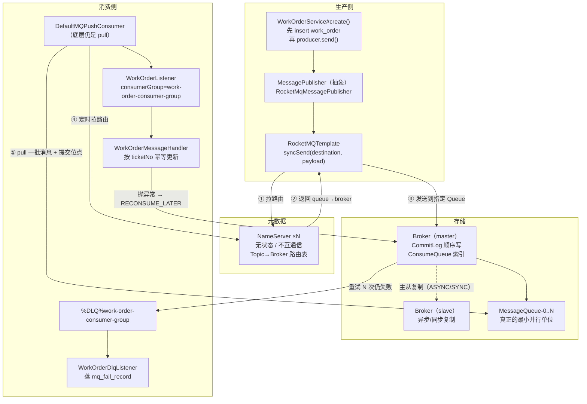
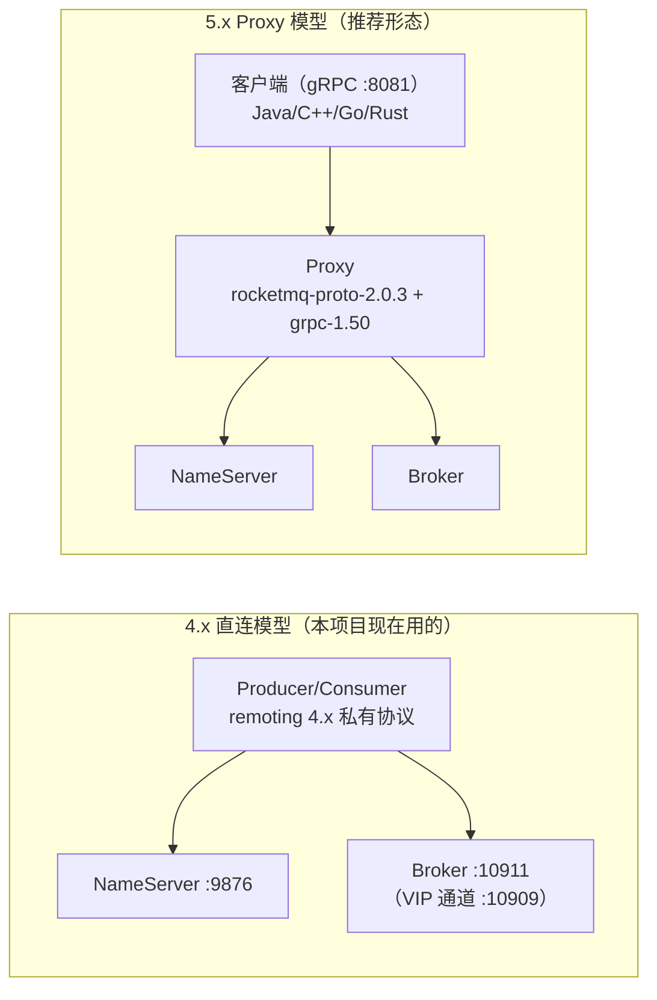
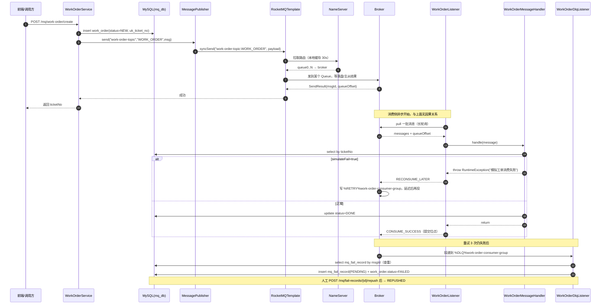

# 04-2 RocketMQ 消息队列：买到的是「解耦 + 削峰」，付出去的是「重复、乱序、丢失」

> **一句话结论**：RocketMQ 只承诺**至少一次投递**（`at least once`）——消息不会在传输路上凭空消失，但**它一定会重复**、**可能乱序**、**业务失败是否重投取决于监听器抛不抛异常**；所以"用 MQ"从来不是接一条线，而是同时欠下三笔账：消费端必须**幂等**（`work_order.uk_ticket_no`、`mq_fail_record.uk_msg_id` 这类唯一键就是账本）、顺序必须靠**同队列 + 顺序消费**换吞吐、丢失只能靠**刷盘 + 主从 + 事务消息 + 对账兜底**四层一起补。
>
> **阅读前置**：读过 [`08-RocketMQ事务消息与死信队列`](./08-RocketMQ事务消息与死信队列.md)（事务消息三步与 DLQ 的基础）、[`12-Kafka与RocketMQ双栈切换`](./12-Kafka与RocketMQ双栈切换.md)（`MessagePublisher` 抽象的由来），以及 `../24-源码分析/01-Spring框架/03-事务管理/01-transactional-事务拦截器与传播行为.md`（`@TransactionalEventListener` 为什么能挂到 `afterCommit`）。
>
> **证据基线**：RocketMQ 5.1.4（`tools/rocketmq/lib/rocketmq-*-5.1.4.jar` 实测存在）、JDK 17、Spring Boot 4.2.0、SCA 2025.1.0.0。本篇 A 级只引 `24-源码分析/assets/source/` 已入库的 3 个 Spring 事务监听器摘录；**RocketMQ 本体源码（Broker/Client/Proxy）未入库**，凡涉及它内部行为的结论一律标注「未入库，依据官方文档 + 本项目代码/配置」。预计阅读 55 分钟。

---

## 0. 先看现象

| 现象 | 你可能的第一反应 | 真正常见的原因 |
| --- | --- | --- |
| 同一张工单被发了两次货 / 同一笔支付回调消费了两次 | "MQ 有 bug，重复投递" | 不是 bug，是**协议**：`maxReconsumeTimes` 内的失败重投、Broker 主从切换后的位点回退、消费者 `RECONSUME_LATER` 都合法地造成重复；真正的 bug 是**消费端没有幂等键** |
| 消费者重启后，那批消息再也没被消费 | "消息丢了" | 监听器 `try/catch` 把异常吞掉只 `log.error`，Broker 收到的是 `CONSUME_SUCCESS` → 位点被推进，**消息永久作废**（它没丢，是被你签收了） |
| Topic 里积压 200 万条，重启消费者 3 小时才追平 | "消费线程不够，加机器" | 并行度上限是 **Queue 数**，不是机器数；`consumeTps` 上不去先看是不是只有 4 个队列、或消费逻辑里有同步 RPC/全表扫描 |

三种现象各自带一条原文，别急着往下翻，先把"我在看什么"对上号：

```text
# ① 重复投递：工单消费失败被 Broker 重投（字面量取自 ai-cs-mq/src/main/java/com/aics/mq/service/WorkOrderMessageHandler.java#L36-L39）
java.lang.RuntimeException: 模拟工单消费失败: ticketNo=WO1732587800123456
# 客户端在同一条消息第 2 次投递时把 reconsumeTimes 置为 1（消息属性 RECONSUME_TIME，中间件源码未入库）

# ② 消息"凭空消失"：消费失败但被吞掉（字面量取自 ai-cs-mq/src/main/java/com/aics/mq/service/WorkOrderMessageHandler.java#L42-L48）
WARN  c.a.mq.service.WorkOrderMessageHandler - 工单不存在，跳过消费: ticketNo=WO1732587800123456
# 没有异常 → 没有 RECONSUME_LATER → 位点推进 → 这条消息永远不会再来

# ③ 积压：/mq/group/{group} 端点返回的字段（字段名取自 ai-cs-mq/src/main/java/com/aics/mq/service/RocketMqAdminService.java#L243-L294；
#    下面是示意拼合，外层结构以实际返回为准，本机无 Broker 未实测）
{ "group": "work-order-consumer-group", "diff": 2000000, "consumeTps": 180.5,
  "queues": [ { "queueId": 0, "brokerOffset": 512000, "consumerOffset": 12000, "diff": 500000 } ] }
# diff = Σ max(0, brokerOffset - consumerOffset)：堆积量；diff 不降且 consumeTps 稳定 = 消费跟不上；diff 不降且 consumeTps=0 = 消费者没连上
```

这些现象指向同一件事：**MQ 卖给你的是「解耦 + 削峰」，代价是它只能保证"至少一次"，于是"重复"是常态、"乱序"是默认、"丢失"靠你自己兜住**。本篇就是把这三笔账一笔笔算清楚。

---

## 1. 整体地图

### 1.1 四大组件与消息的物理路径



> **读图说明**：
> 1. **NameServer 是"黄页"，不是"交换机"**：它只存 `Topic → Broker/Queue` 的路由，节点之间互不通信、不持久化到磁盘之外（重启后由 Broker 心跳重建）。Producer 和 Consumer 都**每 30s 主动拉一次路由**，所以"Broker 挂了但路由没更新"是一个真实窗口。
> 2. **真正决定并行度的是 Queue**：一个 Topic 被切成多个 `MessageQueue`，一个 Queue 在同一消费组内**同一时刻只被一个消费者实例持有**。所以"加 5 台机器但只有 4 个队列"= 第 5 台白站着。
> 3. **写是顺序写 CommitLog，读靠 ConsumeQueue 索引**：Broker 把消息追加到单个 CommitLog（顺序 IO），再异步生成"每个 Queue 的偏移索引"`ConsumeQueue`（定长 20 字节）。这解释了为什么 RocketMQ 的堆积能力远好于"每队列一个文件"的设计。
> 4. **生产侧在本项目里被 `MessagePublisher` 挡住一层**：`ai-cs-mq` 的 `WorkOrderProducer` 拿的是 `MessagePublisher` 而不是 `RocketMQTemplate`（`ai-cs-mq/src/main/java/com/aics/mq/producer/WorkOrderProducer.java#L30-L42`），换 Kafka 时只换实现类；但 `ai-cs-order`、`ai-cs-pay`、`ai-cs-knowledge`、`ai-cs-chat` **仍然直接调 `RocketMQTemplate`**，抽象层只覆盖了 mq 模块（见 `§7`）。
> 5. **消费侧统一是"长轮询 pull"**：`DefaultMQPushConsumer` 名字叫 push，实现是后台线程 pull + 有消息就回调 `onMessage`。理解这点才能理解后面"位点是什么时候提交的"。
> 6. **DLQ 是 Topic，不是队列**：`%DLQ%work-order-consumer-group` 是一个 Topic，需要**再写一个监听器去消费它**（`WorkOrderDlqListener`），否则它就是另一个没人看的黑洞。

### 1.2 5.x 的变化：Proxy 把 Remoting 换成了 gRPC



> **读图说明**：
> 1. **5.x 不是"消息协议变了"，是"接入层变了"**：Broker 内部仍然是 CommitLog + ConsumeQueue；Proxy 把「发送/消费」翻译成 gRPC + Protobuf（`tools/rocketmq/lib/rocketmq-proto-2.0.3.jar`、`grpc-*-1.50.0.jar` 实测存在），因此非 Java 客户端不必再移植 remoting 私有协议。
> 2. **本项目仍走 4.x 式直连**：`docker-compose.yml#L109-L142` 只起了 `namesrv` + `broker`，**没有 proxy 容器**；`ai-cs-mq` 依赖的是 `rocketmq-spring-boot-starter` 的 `RocketMQTemplate`（remoting）。`tools/rocketmq/bin/mqproxy.cmd` 只是一个未启用的分发版脚本。
> 3. 所以本篇所有结论都按**直连模型**讲；Proxy 只作为"未来要换 gRPC/多语言时接口改哪"的扩展点，出现在 `§5`。

### 1.3 组件、责任与调用方

| 组件 | 责任（一句话） | 本项目落点（B 级） | 缺口 / 风险 |
| --- | --- | --- | --- |
| NameServer | Topic 路由注册与发现，无状态、可多副本 | `docker-compose.yml#L109-L142`（1 个，端口 9876） | `deploy/k8s/rocketmq.yaml` 注释写着"生产建议 ≥2"，实际 `replicas: 1` |
| Broker | 存消息、投递消息、管理位点 | 同上（1 个 master，10911/10909） | `deploy/docker-compose/docker-compose-master-slave.yml#L194-L232` 名叫 master-slave，RocketMQ 段**只有 1 个 broker** |
| Producer | 选 Queue、发消息、失败重试 | `ai-cs-mq/src/main/java/com/aics/mq/producer/WorkOrderProducer.java`、`ai-cs-common/src/main/java/com/aics/common/mq/rocketmq/RocketMqMessagePublisher.java` | mq 模块未配 `send-message-timeout`（只有 pay 的 Nacos 配了 10000） |
| Consumer | 拉取、消费、提交位点、失败重投 | 8 个 `@RocketMQMessageListener`（`§6` 有统计命令） | 顺序 / 广播模式**零使用** |
| Dead Letter | 重试耗尽后的兜底 Topic | `%DLQ%work-order-consumer-group` + `WorkOrderDlqListener` | DLQ 监听器自身没有 `maxReconsumeTimes`，失败仍会重试 |
| Admin（运维面） | 查堆积、查路由、查 Broker 运行时 | `RocketMqAdminService`（`DefaultMQAdminExt`）+ `MqController` 6 个端点 | 无"按 msgId 查消息体"能力（消息轨迹未落地） |
| 抽象层 | 屏蔽 RocketMQ / Kafka 差异 | `ai-cs-common/src/main/java/com/aics/common/mq/MessagePublisher.java` | 只被 mq 模块使用；`sendDelayed` 无生产调用方 |

---

## 2. 关键概念与关键类

| 名称 | 位置 | 角色 | 关键方法 / 关键值 |
| --- | --- | --- | --- |
| `Topic` | RocketMQ 一级逻辑分类 | 消息的"大类"，一个 Topic 切成多个 Queue | 本项目真实值全是小写连字符：`work-order-topic`、`order-timeout-topic`、`pay-success-topic`、`chat-message-topic`、`notify-topic`、`knowledge-doc-sync-topic`、`c-product-sync` |
| `MessageQueue` | Broker 侧 | **最小并行单位**；同组内同一时刻只归一个消费者 | 自动创建 Topic 时队列数取 Broker 默认值（本项目未显式设） |
| `Tag` | 消息属性（服务端可过滤） | 二级分类，`selectorExpression` 在 Broker 侧过滤 | `WorkOrderProducer.TAG = "WORK_ORDER"`；`KnowledgeSyncProducer` 把 action 当 tag：`syncSend(TOPIC + ":" + action, ...)` |
| `Key` | 消息属性（哈希索引，可查） | 业务唯一标识，用于 Console/Admin 按 Key 查消息 | `MessagePublisher.send(topic, key, payload)` 的 `key`；RocketMQ 里落到 **Tag**、Kafka 里落到 **Record Key** |
| `RocketMQTemplate` | `rocketmq-spring-boot-starter` | 发送模板，`destination = topic + ":" + tag` | `syncSend` / `convertAndSend` / `sendMessageInTransaction` |
| `MessagePublisher` | `ai-cs-common/src/main/java/com/aics/common/mq/MessagePublisher.java#L22-L46` | 双栈抽象 | `send`、`sendDelayed`、`brokerType` |
| `RocketMqMessagePublisher` | `ai-cs-common/src/main/java/com/aics/common/mq/rocketmq/RocketMqMessagePublisher.java` | 抽象层的 RocketMQ 实现 | `syncSend(destination, payload)`；`resolveDelayLevel()` 把毫秒映射到 18 级延迟 |
| `MessagePublisherAutoConfiguration` | `ai-cs-common/src/main/java/com/aics/common/mq/MessagePublisherAutoConfiguration.java` | 按 `aics.mq.type` 选实现 | `@ConditionalOnProperty(...havingValue="rocketmq", matchIfMissing=true)` |
| `@RocketMQMessageListener` | 注解 | 声明 topic / consumerGroup / 重试次数 / 消费模式 | `maxReconsumeTimes` 默认 **16**（`-1` 表示不限次） |
| `RocketMQListener<T>` | 接口 | 消费回调 | `onMessage(T)`：**正常返回 = 消费成功；抛异常 = 需要重投** |
| `WorkOrderProducer` | `ai-cs-mq/src/main/java/com/aics/mq/producer/WorkOrderProducer.java#L22-L42` | 工单消息生产 | `TOPIC="work-order-topic"`、`TAG="WORK_ORDER"` |
| `WorkOrderListener` | `ai-cs-mq/src/main/java/com/aics/mq/consumer/WorkOrderListener.java#L32-L45` | 工单消费入口 | `maxReconsumeTimes = 3`；委托 `WorkOrderMessageHandler` |
| `WorkOrderMessageHandler` | `ai-cs-mq/src/main/java/com/aics/mq/service/WorkOrderMessageHandler.java#L32-L53` | 真正业务 | 按 `ticketNo` 更新 status → 天然幂等；`simulateFail` 时抛异常 |
| `WorkOrderDlqListener` | `ai-cs-mq/src/main/java/com/aics/mq/consumer/WorkOrderDlqListener.java#L33-L87` | 死信兜底 | 按 `msgId` 查重、落 `mq_fail_record`、工单置 `FAILED` |
| `MqFailRecord` | `ai-cs-mq/src/main/java/com/aics/mq/entity/MqFailRecord.java#L18-L28` | 死信台账 | `status = PENDING/REPUSHED`，`uk_msg_id` 唯一键 |
| `RocketMqAdminService` | `ai-cs-mq/src/main/java/com/aics/mq/service/RocketMqAdminService.java` | 堆积排查实现（309 行） | `examineConsumeStats` / `fetchBrokerRuntimeStats` / `queryTopicConsumeByWho` |
| `DefaultMQAdminExt` | RocketMQ 客户端 | 运维 API 客户端 | 必须 `setInstanceName(UUID)` + `setVipChannelEnabled(false)` 才能与 Broker 正常通信 |

---

## 3. 原理与证据逐段精读

### 3.1 四大组件与 5.x Proxy：为什么 NameServer 敢做成无状态的

**在干什么**：Producer 发消息前先问 NameServer "`work-order-topic` 有几个 Queue、在哪台 Broker 上"，然后自己按负载策略挑一个 Queue 发过去；Consumer 同样先问路由，再对分到的 Queue 发起 pull，并定期把位点（offset）回传给 Broker。

**为什么这么设计**：把"路由"和"存储"拆开，NameServer 就可以做得极轻——它不存消息、不落盘路由（内存 + 定期刷盘），节点间**互不通信**（没有 Raft/ZAB 选主），Broker 每 30s 心跳上报自己的 Topic 列表。好处是扩缩容简单、不会被元数据写入打爆；代价是**路由有延迟窗口**：Broker 刚挂的 30s 内，客户端手里还是旧路由，发送会报"找不到队列"或打到已死地址，靠客户端的 `sendLatencyFaultEnable` 故障规避来兜。

**换写法会怎样**：如果换成 ZooKeeper（Kafka 老路线）或 etcd，路由更改是**强一致 + watch 推送**，元数据延迟从 30s 降到毫秒级；但引入了协调组件的可用性问题——ZK 挂了，即使 Broker 全都活着，客户端也发不了消息。RocketMQ 选的是"元数据弱一致，优先保可用"，和它"削峰"的定位一致。想对比两种路线可以看 `../24-源码分析/04-SpringCloud/01-总览与版本/01-springcloud-体系与版本矩阵.md` 里的注册中心演进部分，以及 `./README.md` 的中间件矩阵。

**常见坑**：
- 只起 1 个 NameServer（本项目就是），NameServer 重启期间**新客户端无法获取路由**，已在跑的客户端还能靠本地缓存撑一会儿。
- 看到 `sendDefaultImpl call timeout` 就以为 Broker 挂了，其实常常是 NameServer 不可达（选不到队列，重试到超时）。客户端源码未入库，这条属于排查经验，判读方法见 `§6`。
- **Proxy 不是"broker 的替代"**：5.x 里 Proxy 是可选接入层，本项目 `docker-compose.yml` 没有 proxy 容器，`RocketMQTemplate` 走的是 remoting 直连——所以网上 5.x "全 gRPC" 的教程直接照抄会连不上。

### 3.2 消息模型：Topic / Queue / Tag / Key 各自解决什么

**在干什么**：一条消息最终被写进 `(Topic, QueueId)` 这个坐标，并带上 Tag、Key、以及 `RECONSUME_TIME` 等系统属性。

**为什么这么设计**：四层的分工非常克制——
- **Topic**：隔离不同业务，也隔离**生命周期**（不同保留时长、不同队列数）；
- **Queue**：决定并行度与顺序边界（同 Queue 内有序，跨 Queue 无序）；
- **Tag**：让过滤发生在 **Broker 端**（`selectorExpression`），省网络；但它是在 ConsumeQueue 里按 hashcode 建索引，**Tag 数量不能爆炸**；
- **Key**：建哈希索引供**事后查询**（Console / Admin `queryMessageByKey`），不参与投递逻辑。

**换写法会怎样**：把过滤全放消费端（Tag 写 `*` 然后 `if` 判断），网络和客户端 CPU 全部浪费；反过来把每个标签拆成独立 Topic，则 Queue 数、路由表、监控面板全部膨胀——一个 Topic 几百个 Queue 后，Rebalance 一次要挪动的队列就够你喝一壶。所以 `KnowledgeSyncConsumer` 选了 `selectorExpression = "*"` 然后在应用层按 action 分发（`ai-cs-knowledge/src/main/java/com/aics/knowledge/mq/KnowledgeSyncConsumer.java#L34-L38`），这是"知道过滤代价后主动放弃服务端过滤"的写法，不算错，但你得知道自己在放弃什么。

**常见坑**：
- **Tag 大小写与拼写不一致 = 消息永远收不到**，且不报错（Broker 侧直接过滤掉了）。本项目 `WorkOrderProducer.TAG = "WORK_ORDER"`，如果哪天有人把发送侧改成 `work_order`，消费侧不会收到任何消息也不会有异常。
- **`destination = topic + ":" + key` 的拼法集中在 `RocketMqMessagePublisher#L73-L75`**，但 `key` 在 RocketMQ 语义里其实是 **Tag**（`MessagePublisher` 的类注释明确写了"在 RocketMQ 是 Tag、在 Kafka 是 Record Key"）。这意味着本项目**没有真正设置 `KEYS` 属性**——按 Key 查消息的能力天然缺失（见 `§3.10`）。
- `autoCreateTopicEnable=true`（`tools/rocketmq/conf/broker-aics.conf` 里真实写着 `true`）看着方便，线上是事故源：Topic 名打错一个字，Broker 会**静默新建一个只有默认队列数的 Topic**，消息全进新 Topic，老消费者零消息——没有任何报错。

**本项目真实的 Topic / 消费组清单（C 级实测，可复现）**：

```pwsh
# 仓库根执行，约 3 秒；先按"声明点"过滤，再人工剔除异常信息里的噪音
Get-ChildItem -Recurse -File -Filter *.java |
  Where-Object { $_.FullName -notmatch '\\target\\' -and $_.FullName -match '\\ai-cs-[^\\]+\\src\\main\\' } |
  Select-String -Pattern 'topic\s*=\s*"|consumerGroup\s*=\s*"|TOPIC\s*=\s*"' |
  ForEach-Object { "{0,-16} {1}" -f ($_.Path -replace '.*\\(ai-cs-[^\\]+)\\.*','$1'), $_.Line.Trim() } |
  Sort-Object -Unique
```

真实输出（节选，已按模块对齐）：

```text
ai-cs-knowledge  topic = "knowledge-doc-sync-topic",
ai-cs-knowledge  consumerGroup = "knowledge-sync-group",
ai-cs-message    topic = "chat-message-topic",   consumerGroup = "chat-consumer-group"
ai-cs-mq         public static final String TOPIC = "work-order-topic";
ai-cs-mq         consumerGroup = "work-order-consumer-group",   # maxReconsumeTimes=3
ai-cs-mq         topic = "%DLQ%work-order-consumer-group",      consumerGroup = "work-order-dlq-consumer-group"
ai-cs-notify     topic = "notify-topic",         consumerGroup = "notify-consumer-group",
ai-cs-order      topic = "order-timeout-topic",  consumerGroup = "order-timeout-consumer-group"
ai-cs-order      topic = "pay-success-topic",    consumerGroup = "pay-success-consumer-group",
ai-cs-pay        public static final String TOPIC = "pay-success-topic";
ai-cs-search     @RocketMQMessageListener(topic = "c-product-sync", consumerGroup = "search-product-cdc-consumer")
```

怎么读：① **一个 Topic 可能有两个生产方**（`pay-success-topic` 的生产端在 `ai-cs-pay`，消费端在 `ai-cs-order`），这正是"解耦"的形状；② `ai-cs-chat` 与 `ai-cs-message` 各有一份 `chat-message-topic`，说明该 Topic 既能被 chat 直接投递、也能被 message 内部投递；③ 输出里混进了 `ai-cs-common` 的两行 `MessagePublishException("Kafka 消息发送失败: topic=" ...)` —— 正则把**异常信息里的字面量**也抓了进来，所以"统计出的数字"必须人工过一遍，别直接当清单用。

### 3.3 "五种"还是"六种"发送方式：三个基础 × 三个特性

官方文档把发送分成 **同步 / 异步 / 单向** 三种基础方式，再叠加 **顺序 / 延迟 / 事务** 三种特性，组合起来是 6 个 API。工程上真正需要记的是"哪个场景用哪个"：

| 发送方式 | 语义 | 失败表现 | 适用场景（本项目的取舍） | 落地情况 |
| --- | --- | --- | --- | --- |
| 同步 `syncSend` | 阻塞等 Broker 落盘/主从复制结果 | 抛 `MessagePublishException`，调用方要处理 | 不允许丢的业务消息：工单创建、订单超时、支付成功 | ✅ 4 处（`RocketMqMessagePublisher`、`PaySuccessMessageProducer`、`KnowledgeSyncProducer`、order 延迟消息） |
| 异步 `asyncSend` | 回调通知结果 | 回调里才知道失败 | 高吞吐、可容忍补偿 | ❌ 全项目 0 处 |
| 单向 `sendOneWay` | 不等结果 | 失败无人知 | 日志、埋点等可丢数据 | ❌ 全项目 0 处 |
| 顺序 `MessageQueueSelector` + `ConsumeMode.ORDERLY` | 同 key 落同 Queue，消费端串行 | 单队列阻塞会拖慢整条链 | 状态机流转（订单状态、库存扣减） | ❌ 未落地（见 `§3.7`） |
| 延迟 `delayLevel` / 定时消息 | 到点才可被消费 | 超上限直接抛参数异常 | 订单超时关闭、超时提醒 | ✅ order 用 `syncSend(...,5000,16)`；抽象层 `sendDelayed` 只有实现无调用方 |
| 事务 `sendMessageInTransaction` | 半消息 + 本地事务 + 回查 | 回查返回 `UNKNOWN` 会反复查 | 本地 DB 与消息必须同时成功 | ✅ pay 模块（见 `./08-RocketMQ事务消息与死信队列.md`） |

**在干什么**（以本项目的同步发送为例）：`WorkOrderProducer.send()` 把 `WorkOrderMessage` 交给 `MessagePublisher`，最终落到 `rocketMqTemplate.syncSend(destination, payload)`，异常被包成 `MessagePublishException("RocketMQ 消息发送失败: destination=...")`（`ai-cs-common/src/main/java/com/aics/common/mq/rocketmq/RocketMqMessagePublisher.java#L40-L49`）。

**为什么这么设计**：同步等结果是**把不确定性挪到调用点**——发送失败时你还在事务/请求上下文里，可以重试、可以回滚、可以报错给用户；异步/单向则是把不确定性推迟到"以后"，必须有对账兜底才能用。项目里 `ChatMessageProducer`、`KnowledgeSyncProducer`、`OrderPaidEventListener` 都在 catch 里只 `log.warn`，等于**把同步发送当异步用**：日志有、消息可能没有。

**换写法会怎样**：`syncSend` 换成 `sendOneWay` 吞吐能翻几倍，但"消息没发出去"变成完全静默；`syncSend` 换成异步 + 本地消息表，则吞吐和可靠性都在，代价是多一张表 + 一个补偿任务（`§5` 的可扩展点）。

**常见坑**：
- **延迟消息的 18 级是硬限制**：`RocketMqMessagePublisher#L83-L94` 的 `resolveDelayLevel()` 取"第一个不早于期望值"的级别，超过 2 小时直接 `IllegalArgumentException("RocketMQ 最大延迟级别为 2 小时…请改用定时任务或延迟队列")`。也就是说"延迟 3 天"这种需求在 4.x 语义下无解。
- **`delayLevel` 在代码里是魔法数字**：`ai-cs-order/src/main/java/com/aics/order/service/impl/OrderCreateTxService.java#L144-L146` 写的是 `syncSend("order-timeout-topic", ..., 5000, 16)`，`16` = 30 分钟，靠注释解释。改 `order.timeout-minutes` 配置**不会**改变延迟级别——配置和实际延迟是两条腿（`#L61` 读的是 `order.timeout-minutes:30`，只用于 DB 里的 `expireTime`）。
- **延迟消息和 DB 到期时间不一致时，谁说了算？** 消费侧 `cancelExpiredOrder` 必须**再校验一次 DB 状态与 `expireTime`**，否则"提前到点"就会误取消——这就是为什么 `OrderTimeoutScheduler` 还要每 5 分钟扫一遍库兜底（`ai-cs-order/src/main/java/com/aics/order/task/OrderTimeoutScheduler.java#L29-L54`）。

### 3.4 推还是拉、集群还是广播、位点是什么，以及"重复"为什么是必然的

**在干什么**：`DefaultMQPushConsumer` 的后台线程对分到的 Queue 发起长轮询 pull，拿到一批消息后**串行回调** `onMessage`；一批消费完成才提交位点（`CONSUME_SUCCESS` 时按批推进，抛异常时按 `RECONSUME_LATER` 走重试）。

**为什么这么设计**：位点提交和业务处理之间**没有分布式事务**。只要出现下面任一情况，"处理成功"和"位点推进"就会不同步，消息必然再投一次：
1. 业务处理完成 → 进程被 kill / 断电 → 位点没提交 → 重启后重新投递；
2. Broker 主从切换，从节点位点落后于主节点 → 一批已消费的消息被再投；
3. 消费超时（默认 `consumeTimeout` 15 分钟）被 Broker 判定失败 → `RECONSUME_LATER`，而业务其实已经成功；
4. 客户端 rebalance 把 Queue 挪给别的实例，旧实例手里那批消息"半消费"后就丢了提交权。

**换写法会怎样**：想做到"恰好一次"，就得把位点存到业务 DB 里（消费与位点同事务），也就是**本地消息表/事务消息**那条路；或者干脆放弃 MQ 语义，改用 CDC + 幂等 upsert（本项目 `ProductCdcConsumer` 就是这种：ES doc id 固定为 `product.id`，重复 upsert 幂等，`ai-cs-search/src/main/java/com/aics/search/cdc/ProductCdcConsumer.java#L43-L65`）。

**两种消费模式（消费组维度的全局开关）**：

| 维度 | 集群消费 CLUSTERING（默认） | 广播消费 BROADCASTING |
| --- | --- | --- |
| 消息分发 | 每个 Queue 只给组内一个实例，消息**只被消费一次** | 每个实例都收到**全量**消息 |
| 位点存哪 | Broker 端（`consumerOffset`，可被 Admin 查到、可 reset） | 客户端本地文件（`%USER_HOME%\.rocketmq_offsets`），**换机即丢位点** |
| 能否水平扩容 | 能（上限 = Queue 数） | 不能"分担"，实例越多总量越大 |
| 典型用途 | 几乎所有业务消费（本项目全部 8 个消费组） | 刷新本地缓存、广播配置变更、灰度观察 |
| 失败重试 | 有（`%RETRY%`） | 语义上没有"重试给谁"，靠各实例自己的逻辑 |
| 本项目 | ✅ 全部消费组默认集群模式（未显式配置） | ❌ 未落地（全项目 `MessageModel` / `BROADCASTING` 零命中） |

**这条消息重复投递会怎样——逐个消费者点名**：

| 消费者 | 重复投递的后果 | 幂等手段 | 证据 |
| --- | --- | --- | --- |
| `PaySuccessListener`（order） | 重复确认支付 | `confirmPay` 自带幂等：已支付直接返回 | `ai-cs-order/src/main/java/com/aics/order/listener/PaySuccessListener.java#L16-L21` |
| `WorkOrderListener`（mq） | 重复更新工单状态 | 按 `ticketNo` 更新为 `DONE`，结果一致 | `ai-cs-mq/src/main/java/com/aics/mq/service/WorkOrderMessageHandler.java#L18-L53` |
| `WorkOrderDlqListener`（mq） | 死信记录重复插入 | 先按 `msgId` `selectCount`，>0 直接 return；DB 侧还有 `uk_msg_id` 兜底 | `ai-cs-mq/src/main/java/com/aics/mq/consumer/WorkOrderDlqListener.java#L51-L56` |
| `OrderTimeoutListener`（order） | 重复发布超时事件 → 重复尝试取消（取消本身幂等） | 取消逻辑查状态再改 | `ai-cs-order/src/main/java/com/aics/order/listener/OrderTimeoutListener.java#L27-L34` |
| `ChatMessageConsumer`（message） | **消息内容重复落库两条** | ❌ 无幂等键：类注释明说"当前以 DB 主键自增 + sessionKey 关联为准"，而自增主键**不防重** | `ai-cs-message/src/main/java/com/aics/message/consumer/ChatMessageConsumer.java#L22-L24` |
| `OrderNotifyConsumer`（notify） | 重复 WebSocket 推送同一句通知 | ❌ 无幂等键，只做转发 | `ai-cs-notify/src/main/java/com/aics/notify/consumer/OrderNotifyConsumer.java#L35-L41` |
| `KnowledgeSyncConsumer`（knowledge） | 重复向量化同一文档 | 部分幂等（`deleteByDocumentId` 后再写），但重复 upsert 会重复计费/覆盖 | `ai-cs-knowledge/src/main/java/com/aics/knowledge/mq/KnowledgeSyncConsumer.java#L56-L77` |
| `ProductCdcConsumer`（search） | ES 重复 upsert / 重复 delete | 天然幂等：doc id = `product.id` | `ai-cs-search/src/main/java/com/aics/search/cdc/ProductCdcConsumer.java#L43-L65` |

**常见坑**：
- **集群消费是默认，广播消费要显式开**：集群模式下同一 Queue 只给一个实例（可水平扩展、但消息只被消费一次）；广播模式下每个实例都收到全量（适合"刷新本地缓存"这类场景）。本项目全项目 grep `MessageModel|BROADCASTING|CLUSTERING` **零命中**——即**广播消费未落地**，所有消费组默认集群模式。
- **位点不是"消息 ID"**：`consumerOffset` 是队列内的**逻辑进度**，`diff = brokerOffset - consumerOffset` 才是堆积量。把 offset 当唯一标识去查消息会查不到。
- **重试消息不保证和原消息同 Queue**（顺序性被打破），如果业务依赖顺序，重试就是乱序的开端。

### 3.5 消费重试与 backoff、死信队列：重试次数不是一个数，是三种语义

**在干什么**：`onMessage` 抛异常 → 客户端回 `RECONSUME_LATER` → Broker 把消息写进 `%RETRY%<consumerGroup>` → 到延迟时间后再投。重试耗尽（`reconsumeTimes > maxReconsumeTimes`）→ 投递到 `%DLQ%<consumerGroup>`。

**为什么这么设计**：重试必须**有间隔且递增**，否则一条毒消息会把整个消费组打成死循环；把它做成 Broker 侧的定时任务，客户端就不必自己 sleep 占线程。

**本项目三处配置，语义完全不同**（这是最容易混的地方）：

| 监听器 | `maxReconsumeTimes` | 实际含义 | 证据 |
| --- | --- | --- | --- |
| `OrderTimeoutListener` | 未写 → 默认 **16** | 最多重试 16 次，约 4 小时后进 `%DLQ%order-timeout-consumer-group` | `ai-cs-order/src/main/java/com/aics/order/listener/OrderTimeoutListener.java#L18-L21` |
| `PaySuccessListener` | **8** | 支付回调更"重要"，多给几次机会 | `ai-cs-order/src/main/java/com/aics/order/listener/PaySuccessListener.java#L27-L31` |
| `WorkOrderListener` | **3** | 教学/演示：快速暴露失败，尽快进 DLQ 让人工介入 | `ai-cs-mq/src/main/java/com/aics/mq/consumer/WorkOrderListener.java#L33-L37` |
| `WorkOrderDlqListener` | 未写 → 默认 **16** | ⚠️ 死信监听器自身失败仍会重试 16 次 | 同上文件 `#L33-L36` |
| Kafka 侧（切 profile 后） | `FixedBackOff(1_000L, 3)` | **刻意对齐 RocketMQ 的 3 次**，固定 1s 间隔 | `ai-cs-mq/src/main/java/com/aics/mq/config/KafkaConsumerConfig.java#L49-L53` |

> 官方 5.x 的默认重试间隔是递增阶梯（10s、30s、1m、2m、3m、4m、5m、6m、7m、8m、9m、10m、20m、30m、1h、2h），本项目 `WorkOrderListener` 的注释也这样写（`#L20-L26`）。⚠️ **中间件源码未入库**，这个阶梯以官方文档《消费重试》章节为准，本机无 Broker 未实测。

**死信的处理链路（本项目是全项目唯一实现了"死信落库 + 人工重推"的地方）**：

```java
// ai-cs-mq/src/main/java/com/aics/mq/consumer/WorkOrderDlqListener.java#L33-L36
@RocketMQMessageListener(
        topic = "%DLQ%work-order-consumer-group",
        consumerGroup = "work-order-dlq-consumer-group"
)
```

`onMessage` 里依次做四件事：① 按 `msgId` 查重（`#L51-L56`，幂等）；② 反序列化失败只告警 return（`#L59-L64`，避免毒消息把 DLQ 也打死）；③ 插入 `mq_fail_record`，`status=PENDING`、`failReason` 写死为"消费重试 N 次仍失败，进入死信队列"（`#L68-L77`）；④ 把工单状态置 `FAILED`（`#L79-L87`）。人工修复后走 `POST /mq/fail-records/{id}/repush` 重推，成功则记录改 `REPUSHED`（`ai-cs-mq/src/main/java/com/aics/mq/service/WorkOrderService.java#L83-L106`）。

**换写法会怎样**：不做 DLQ 落库，失败消息就只剩 Broker 里那个没人订阅的 `%DLQ%` Topic，几天后过期被删——**这才是真正的"消息丢了"**。反过来，把所有消息都无条件重试到 16 次，毒消息会占用消费线程长达数小时。

**常见坑**：
- **DLQ 消费组自己也会进 DLQ**：`work-order-dlq-consumer-group` 失败后会进 `%DLQ%work-order-dlq-consumer-group`，没人监听。Kafka 侧专门为此把死信容器工厂的重试设为 `FixedBackOff(0L, 0)`，注释写明"否则会 `-dlt-dlt` 无限递归"（`ai-cs-mq/src/main/java/com/aics/mq/config/KafkaConsumerConfig.java#L57-L70`）；RocketMQ 侧**没有对应防护**。
- **`maxReconsumeTimes=-1` 不是"无限次"的推荐用法**：它表示不限次数，配合"必失败"的消息 = 该队列永远堵着。
- **死信 Topic 名带 `%` 前缀是系统保留**：`RocketMqAdminService#L39` 的 `SYSTEM_TOPIC_PREFIX` 就把 `%RETRY%`、`%DLQ%`、`RMQ_SYS_`、`TBW102` 列为系统 Topic 过滤掉——这也意味着**你在 `/mq/topics` 里看不到 DLQ**，排查时容易误判"没有死信"。

### 3.6 吞异常 = 主动签收：项目里同时存在两种写法

**在干什么**：`RocketMQListener` 的契约只有一条：**方法正常返回 = `CONSUME_SUCCESS`（位点推进）；抛异常 = `RECONSUME_LATER`（重投）**。任何 `try/catch` + 只打日志的写法，都等价于告诉 Broker "这条我处理好了"。

**为什么这么设计**：Broker 无法知道你的业务是否成功，它只能看你的返回值。这跟 HTTP 200 不代表业务成功的道理一样——**传输层语义与业务语义必须由你在边界上翻译**。

**本项目现状（正反面对照，很有教学价值）**：

```java
// 反面：ai-cs-order/src/main/java/com/aics/order/listener/OrderTimeoutListener.java#L27-L34
public void onMessage(String orderNo) {
    try {
        eventPublisher.publishEvent(new OrderTimeoutEvent(orderNo));
    } catch (Exception e) {
        log.error("订单超时消息处理失败: orderNo={}", orderNo, e);   // ← 只打日志
    }                                                              // ← 正常返回 → 位点推进 → 不重试
}
```

```java
// 正面：ai-cs-message/src/main/java/com/aics/message/consumer/ChatMessageConsumer.java#L51-L58
try {
    messageService.saveMessage(message);
} catch (Exception e) {
    log.error("聊天消息消费失败: sessionId={}", message.getSessionId(), e);
    throw e;                                    // ← 抛出去 → RECONSUME_LATER → 按组配置重试
}
```

`ai-cs-knowledge/src/main/java/com/aics/knowledge/mq/KnowledgeSyncConsumer.java` 更隐蔽：`#L27-L28` 的注释写着"由 RocketMQ 默认重试 16 次后进入死信队列"，但 `#L56-L77` 的 `catch` **没有 rethrow**——**注释描述的行为与实际实现相反**。这类"注释与实现漂移"是线上最难查的一类 bug，因为所有文档都说它会重试。

把项目里 8 个消费者按"异常怎么处理"排一下，能清楚看到三种写法各自的后果：

| 写法 | 代表 | Broker 收到什么 | 后果 | 该不该这么写 |
| --- | --- | --- | --- | --- |
| `throw e`（或干脆不 catch） | `ChatMessageConsumer#L51-L58`、`ProductCdcConsumer#L61-L63` | `RECONSUME_LATER` | 重试到上限进 DLQ，**不丢** | ✅ 业务失败就抛，这是契约本义 |
| `catch` + 只 `log.error` | `OrderTimeoutListener#L29-L33`、`KnowledgeSyncConsumer#L76` | `CONSUME_SUCCESS` | 位点推进，**消息永久作废** | ⚠️ 只有"失败也无所谓"的业务才可以 |
| `if (查不到) return;` | `WorkOrderMessageHandler#L42-L48` | `CONSUME_SUCCESS` | 静默丢弃，**日志只有一条 WARN** | ⚠️ 必须能证明"查不到"等价于"处理完了" |

**换写法会怎样**：把 `OrderTimeoutListener` 改成 `throw e`，重试就恢复了，但要知道**重试 16 次 × 长阶梯 ≈ 4 小时**，业务上更合理的做法是"区分可重试/不可重试异常"：`IllegalArgumentException`（消息格式错）直接进 DLQ 不重试，`SocketTimeoutException`（下游抖动）才重试。RocketMQ 4.x 没有分类重试，需要自己在 catch 里判断后决定抛不抛。

**常见坑**：
- **"查不到就 return"= 静默丢消息**：`WorkOrderMessageHandler#L42-L48` 在工单不存在时 `log.warn` 后 return，注释理由合理（先插库后发消息，理论上不会查不到），但一旦出现了"先发消息后插库"的时序或 DB 主从延迟，消息就被永久吞掉。同一份逻辑在 `OrderCreateTxService#L90-L92` 的注释里被当作"天然幂等安全"的优点来讲——**同一个写法，在超时取消场景是优点，在工单场景是隐患**。
- 吞异常还会破坏**监控**：消费失败率永远是 0，你只会在业务侧发现"工单一直 NEW"。
- 单元测试里如果 mock 了 handler，吞异常的问题**测不出来**（异常没跨过监听器边界）。

### 3.7 顺序消息：前提是"同 key 同队列 + 串行消费"，代价是吞吐被最小队列拖死

**在干什么**：顺序消息分两步，缺一不可——**发送端**用 `MessageQueueSelector` 按业务 key（订单号）选固定 Queue；**消费端**用 `@RocketMQMessageListener(consumeMode = ConsumeMode.ORDERLY)` 对每个 Queue 加锁串行消费。

**为什么这么设计**：RocketMQ 只保证**队列内有序**，跨队列无序。所以"全局顺序"必须把 Topic 压成 **1 个 Queue**——吞吐上限直接掉到单队列单线程水平（几万 TPS 变几千）。工程上的正确答案是**局部顺序**：同订单/同用户有序就够了。

**换写法会怎样**：不想付这个代价，就让消费端自己处理乱序——典型手法是**版本号/状态机幂等**（只有 `status=NEW` 才能变 `DONE`，晚到的旧事件直接丢弃），或者用 DB 的 `UPDATE ... WHERE status = 期望前态` 做乐观并发控制。本项目走的是后者：`WorkOrderMessageHandler` 按 `ticketNo` 更新状态、`confirmPay` 判断已支付直接返回——**用状态机代替顺序保证**，这是绝大多数业务系统的实际选择。

**常见坑**：
- **重试会破坏顺序**：`RECONSUME_LATER` 的消息可能被投到另一个 Queue，与后续消息乱序。顺序消息必须配合"本地重试或允许跳过的策略"。
- **顺序消费时一个队列卡住 = 整个队列卡住**，而且 `consumeTimeout` 到期会触发全队列重平衡（"卡住 → 位点不动 → 重试 → 更卡"的雪崩）。
- ⚠️ **本项目顺序消息完全未落地**：全项目 grep `MessageQueueSelector|ConsumeMode|orderly|Orderly` **零命中**。若真要落地，要改三处：`WorkOrderProducer`（加 `MessageQueueSelector` 或走 `rocketMQTemplate.sendOrderly`）、`WorkOrderListener`（加 `consumeMode = ConsumeMode.ORDERLY`）、以及 `ai-cs-common` 的 `MessagePublisher`（`send` 目前没有顺序参数位）。

### 3.8 刷盘与主从：可靠性的下限由 Broker 配置决定

**在干什么**：消息"落盘"其实是两件事——① **刷盘**：CommitLog 从 PageCache 落到磁盘（`ASYNC_FLUSH` / `SYNC_FLUSH`）；② **复制**：master 把数据同步给 slave（`ASYNC_MASTER` / `SYNC_MASTER`，或 5.x 的 DLedger / Controller 选主）。

**为什么这么设计**：两档组合是**性能与可靠性的连续可调旋钮**：`ASYNC_FLUSH + ASYNC_MASTER` 最快但主机断电会丢最近一批；`SYNC_FLUSH + SYNC_MASTER` 最安全但 TPS 掉一个数量级、且任一从节点慢就拖死主。

**本项目的真实状态（这里必须说清楚，因为文档与部署不一致）**：

| 结论 | 证据 |
| --- | --- |
| `docs/02-基础设施搭建.md#L583-L598` 给了一份 broker.conf 示例：`brokerRole=ASYNC_MASTER`、`flushDiskType=ASYNC_FLUSH`、`autoCreateTopicEnable=true` | 这是**文档示例**，不是实际生效的配置 |
| `deploy/` 下**没有** broker.conf 文件；`docker-compose.yml#L109-L142` 的 broker 命令引用的是**镜像内** `/home/rocketmq/rocketmq-5.1.4/conf/broker.conf` | 即走的是官方默认：`ASYNC_FLUSH` + `ASYNC_MASTER`（默认值来自官方发行版 conf，未入库逐行核对） |
| 仓内真实可用的 broker 配置只有 `tools/rocketmq/conf/broker-aics.conf`（本地开发用）：`brokerId=0`、`autoCreateTopicEnable=true`、`timerWheelEnable=false` | 单机、自动建 Topic、**关掉了时间轮**（5.x 定时消息依赖它） |
| 主从：`deploy/docker-compose/docker-compose-master-slave.yml#L194-L232` 只有 1 namesrv + 1 broker | 文件名里的 master-slave **没有真的从节点** |
| `deploy/k8s/rocketmq.yaml` 的 Broker `replicas: 1`，注释写"生产通常主从/多副本" | 单副本，节点挂 = 消息全部不可用 |

**换写法会怎样 / 代价**：

| 配置组合 | 单机进程挂 | 整机断电 | 磁盘坏 | TPS 代价 |
| --- | --- | --- | --- | --- |
| ASYNC_FLUSH + 单机 | 不丢（PageCache 还在，进程重启可恢复） | **丢最近一批** | 全丢 | 最高 |
| SYNC_FLUSH + 单机 | 不丢 | 不丢 | 全丢 | 中等 |
| ASYNC_FLUSH + ASYNC_MASTER | 切换即用，可能**回退丢一批** | 丢 | 从节点还在 | 高 |
| SYNC_FLUSH + SYNC_MASTER | 不丢（主挂切从） | 不丢 | 从节点还在 | 最低 |
| DLedger / Controller 三副本 | 自动选主 | 不丢（多数派） | 不丢 | 最低，但需 ≥3 节点 |

> DLedger 的配置样例在 `tools/rocketmq/conf/dledger/broker-n0.conf`（真实文件：`enableDLegerCommitLog=true`、`dLegerGroup=RaftNode00`、`dLegerPeers=n0-127.0.0.1:40911;n1-...;n2-...`）——**仓内有样例但未部署**，所以本项目当前是"单 Broker、异步刷盘"，MQ 侧的可靠性下限**低于**它宣称的"消息不丢"。

**常见坑**：
- 只看 application.yml 就断定"消息可靠"是典型误判：**可靠性配置在 Broker 侧，不在客户端 yml 里**。本项目的 `application.yml` 里根本没有 `flushDiskType`、`brokerRole` 这类项（它们属于 Broker）。
- 单机 `ASYNC_FLUSH` 下"进程被 kill -9"**不会丢**（PageCache 由内核持有），但"`docker-compose down` 把容器删了"或"宿主机断电"会丢——很多"消息丢了"的复盘最后都落在这里。
- 真要做到业务级不丢，MQ 只是其中一层：还需要 **`syncSend` + 事务消息/本地消息表 + 对账补偿**（本项目订单超时就有 `OrderTimeoutScheduler` 兜底扫库）。

### 3.9 堆积的定位与扩容，以及"削峰填谷"的正确姿势

**在干什么**：堆积排查只有一个公式——`diff = brokerOffset - consumerOffset`（按队列求和）。`diff` 在涨说明**生产 > 消费**，此时只有三种解法：加消费并行度、提升单条处理速度、降低生产量（限流/合并）。

**为什么这么设计**：因为并行度上限是 **Queue 数**。`RocketMqAdminService` 把这件事做成了端点（`#L243-L294`）：

```bash
# 阻塞排查第一步（B 级：真实端点 + 真实字段；外层 JSON 结构为示意，需服务已启动才有真实返回）
curl -s http://localhost:8090/mq/group/work-order-consumer-group
# {"group":"work-order-consumer-group","diff":2000000,"consumeTps":180.5,
#  "queues":[{"topic":"work-order-topic","queueId":0,"brokerOffset":512000,
#             "consumerOffset":12000,"diff":500000,"lastTimestamp":1732587800000}]}
```

怎么读这段 JSON：
- **`diff` 不降、`consumeTps` ≈ 恒定** → 消费能力到顶，要么加 Queue（改 Topic 队列数 + 重启消费者触发 rebalance），要么优化单条耗时；
- **`diff` 不降、`consumeTps` = 0** → 消费者根本没连上（路由/NameServer/消费组名错），而不是"太慢"；
- **某个 queueId 的 `diff` 独大** → 消息倾斜，`MessageQueueSelector` 或 Tag 分布不均；配合 `lastTimestamp` 看是不是那条队列的消费者卡死了；
- **`diff` 涨得比生产快** → 去看 `WorkOrderMessageHandler` 是不是在重试循环里（同一消息反复 `RECONSUME_LATER` 也会让 `brokerOffset` 增长）。

**削峰填谷的正确姿势（= 生产端不限流，消费端限流）**：

| 手段 | 做法 | 代价 | 本项目 |
| --- | --- | --- | --- |
| 加 Queue | `mqadmin updateTopic -r 8 -w 8` 或建 Topic 时指定 | 需要 rebalance，瞬时抖动 | ❌ 无预创建脚本，靠 `autoCreateTopicEnable` 自动建（默认队列数） |
| 加实例 | 消费者无状态，直接扩容 | 实例数 > 队列数时无效 | 部分（`docker-compose` 单实例） |
| 批量消费 | `consumeMessageBatchMaxSize` + `RocketMQListener<List<T>>` | 单条失败 → 整批重投，放大重复 | ❌ 未配置 |
| 调线程 | `consumeThreadMin/Max`、`pullBatchSize`、`pullThresholdForQueue` | 线程多了 DB 连接池先崩 | ❌ 未配置（全用默认） |
| 消费端限流 | 令牌桶 / Sentinel `@SentinelResource` 包住下游调用 | 需要告警配套 | ❌ 未落地（`./06-Sentinel限流与熔断降级.md` 有机制，但没包 MQ 消费） |

**常见坑**：
- **堆积期间千万不要重启消费者**：重启会触发 rebalance，可能让堆积更集中到少数队列；正确做法是先扩容再生产，或临时降级消费逻辑（只落库不做下游调用）。
- **堆积 ≠ Broker 有问题**：Broker 的 `commitLogDiskRatio`（`RocketMqAdminService#L105-L110` 已暴露）超过 85% 时消息会被拒写，此时现象是发送失败而不是堆积——两个指标要一起看。
- **消费端 sleep 是最常见的"假限流"**：sleep 占住消费线程，等于把并行度按比例砍掉，堆积时更救不回来。

### 3.10 消息轨迹与消息查询：本项目只做了"半个"

**在干什么**：消息轨迹（message trace）是在发送/存储/消费三个阶段各埋一条 trace 记录，供"这条 msgId 到底被谁消费了"的定责；消息查询则是按 `msgId` / `key` / `topic+时间区间` 从 Broker 取回消息体。

**为什么这么设计**：MQ 排查最难的是"消息去哪了"——没有轨迹时你只有 `diff` 和日志，无法回答"是被过滤掉了、还是消费了但业务失败"。

**本项目现状（诚实标注）**：

| 能力 | 状态 | 证据 |
| --- | --- | --- |
| 查 Topic/Group/队列级 offset 与堆积 | ✅ 已落地 | `MqController#L18-L58` 六个端点 + `RocketMqAdminService` |
| 查 Broker 运行时（版本、磁盘比、put 耗时、QPS） | ✅ 已落地 | `RocketMqAdminService#L91-L118` |
| 按 `msgId` / `key` 查消息体 | ❌ **未落地** | `RocketMqAdminService` 里没有 `queryMessage`/`viewMessage`；`MessagePublisher` 只把 `key` 当 Tag 用，没有写 `KEYS` 属性 |
| 消息轨迹（trace topic） | ❌ **未落地** | 全项目无 `enable-msg-trace` / trace topic 配置；`tools/rocketmq/conf/2m-noslave/broker-trace.properties` 是官方样例行，未被任何部署引用 |

**换写法会怎样**：要落地按 msgId 查消息，最小改动是给 `RocketMqAdminService` 加两个方法（`queryMessageByKey(topic, key, maxNum, begin, end)`、`viewMessageById(msgId)`）并在 `MqController` 加 `/mq/message` 端点；要落地轨迹则需在客户端开 `rocketmq.producer.enable-msg-trace=true` 并指定 trace topic，Broker 侧要预留 trace Topic 与够用的磁盘（轨迹量 ≈ 消息量 × 3）。

**常见坑**：
- **不设 `KEYS` 就没有按 key 查**：`RocketMqMessagePublisher#L73-L75` 把 `key` 拼进 `destination` 当 Tag，所以"按业务单号查消息"在本项目**做不到**——这是抽象层为兼容 Kafka 付出的代价（Kafka 里它确实是 Record Key）。
- **按 msgId 查有时效**：消息过期（默认 72 小时，由 Broker `fileReservedTime` 控制）后消息体被清理，只剩位点。所以"事后 3 天复盘"必须靠 `mq_fail_record` 这类**自己落库的台账**。

### 3.11 生产侧与 DB 的一致性：发消息到底该放在事务的哪一步

**在干什么**：`WorkOrderService#create()` 的顺序是**先 `insert` 再 `send`**（`ai-cs-mq/src/main/java/com/aics/mq/service/WorkOrderService.java#L46-L61`）；而 `ai-cs-order` 的支付通知用的是 `@TransactionalEventListener(phase = AFTER_COMMIT)`（`ai-cs-order/src/main/java/com/aics/order/event/OrderPaidEventListener.java#L30-L36`）。两种写法解决的是同一个问题：**不要在事务提交前就把消息发出去**。

**为什么这么设计**：Spring 官方在 `TransactionSynchronization#afterCommit` 的 javadoc 里把这条用途写得非常明确：

[[源码:TransactionSynchronization.java.md#L168-L181]]

```java
// (src: TransactionSynchronization.java.md#L168-L181)
 * <p>Can, for example, commit further operations that are supposed to follow on a successful
 * commit of the main transaction, like confirmation messages or emails.
 * <p><b>NOTE:</b> The transaction will have been committed already, but the
 * transactional resources might still be active and accessible. ...
 * @throws RuntimeException in case of errors; will be <b>propagated to the caller</b>
 */
default void afterCommit() {
}
```

也就是说"确认消息/邮件"这类**副作用**必须在 `afterCommit` 里做；而 `@TransactionalEventListener` 只是一个把业务监听器挂到该回调上的适配器——没有事务时它直接执行、有事务时它注册同步器：

[[源码:TransactionalApplicationListenerMethodAdapter.java.md#L99-L118]]

```java
// (src: TransactionalApplicationListenerMethodAdapter.java.md#L99-L118)
@Override
public void onApplicationEvent(ApplicationEvent event) {
    if (TransactionalApplicationListenerSynchronization.register(event, this, this.callbacks)) {
        // 有事务：注册为 afterCommit/afterCompletion 回调，真正的执行推迟到提交后
    }
    else if (isDefaultExecution()) {
        processEvent(event);            // 无事务：立即执行（fallback）
    }
    else {
        // No transactional event execution at all → 直接跳过
    }
}
```

`phase` 的默认值就是 `AFTER_COMMIT`，这一点在注解定义里写死了：

[[源码:TransactionalEventListener.java.md#L89-L93]]

```java
// (src: TransactionalEventListener.java.md#L89-L93)
 * <p>The default phase is {@link TransactionPhase#AFTER_COMMIT}.
 */
TransactionPhase phase() default TransactionPhase.AFTER_COMMIT;
```

**换写法会怎样**：如果直接在事务方法里 `rocketMQTemplate.convertAndSend(...)`，会出现两个方向的错——**事务回滚但消息已发**（消费方提前看到不存在的订单，被迫做"查不到就 return"的防御，正是 `OrderCreateTxService#L90-L92` 注释描述的场景）；**消息发成功但事务提交失败**时反而没事。所以不是"必须用事件"，而是"**必须让消息晚于提交**"，`WorkOrderService` 的"先 insert 再 send"如果整个方法不在事务里，效果与 afterCommit 等价；一旦哪天给它加了 `@Transactional`，就立刻退化成上面第一种错误。

**常见坑**：
- `@TransactionalEventListener` 只在**同一线程的事务**内生效；异步线程池里发事件会走 fallback（`isDefaultExecution()`），**消息在事务提交前就发了**。
- `OrderPaidEventListener#L38-L40` 的 `catch` 只 `log.warn`：MQ 挂了，通知永远不会发，而这笔支付已经成功——**必须有对账**（本项目这块未落地，属已知缺口）。
- 事务消息（`sendMessageInTransaction`）是另一条路，它把"本地事务"和"消息可见性"绑在 Broker 的半消息机制上，见 `./08-RocketMQ事务消息与死信队列.md`。

---

## 4. 一次完整执行时序：从"创建工单"到"死信重推"



> **读图说明**：
> 1. **1–8 步是"一次 HTTP 请求内的同步链"**：`insert` 与 `send` 之间**没有事务包裹**（`WorkOrderService` 上没 `@Transactional`），所以第 2 步成功、第 5 步失败时，工单会永久停在 `NEW` —— 这正是 `repush` 接口存在的原因。
> 2. **第 9 步之后与生产端完全解耦**：这就是"解耦"买到的东西——消费者挂了不影响下单；也是"最终一致"的来源——DB 与消费结果之间有一段时间窗。
> 3. **第 10–11 步是长轮询 pull**：不是 Broker 主动推，客户端每 30s 拉一次路由、持续 pull；所以"Broker 有消息但消费者没反应"通常是消费者没启动/订阅关系没建立，而不是"推送丢了"。
> 4. **第 14 步的 `RECONSUME_LATER` 由"是否抛异常"决定**，这是全篇最关键的开关：`WorkOrderMessageHandler` 抛、`OrderTimeoutListener` 吞，两者行为天差地别。
> 5. **第 16 步的位点提交是"批量推进"**：一批 32 条里第 30 条抛异常，前 29 条**可能已被处理但位点未推进**，重投时它们会再来一遍——这就是"重复"的主要来源。
> 6. **第 18 步的 DLQ 是一个 Topic**，必须有人订阅；本项目用 `WorkOrderDlqListener` 订阅并落库，是全项目唯一闭环的死信处理。

**哪一步失败会报什么错 / 落到哪**：

| 步骤 | 失败表现（可观测） | 落点 |
| --- | --- | --- |
| 2 `insert` | `Duplicate entry 'WO...' for key 'work_order.uk_ticket_no'` | 请求直接失败，无消息产生 |
| 4 `syncSend` | `MessagePublishException: RocketMQ 消息发送失败: destination=work-order-topic:WORK_ORDER`（原因常是 `sendDefaultImpl call timeout`，中间件源码未入库） | 工单停在 `NEW`，需 `repush` |
| 5 路由 | 抛"找不到 Topic 路由 / service not found"类异常，通常伴随 NameServer 不可达 | 同上 |
| 6 Broker 写入 | 磁盘水位超限时拒写（现象是发送超时/失败） | 同上；看 `commitLogDiskRatio` |
| 10 pull | 消费者侧 `MQClientException`（消费组不存在 / 订阅关系不一致），日志里反复重试 | `diff` 只涨不降、`consumeTps=0` |
| 13 业务异常 | `RuntimeException: 模拟工单消费失败: ticketNo=...` | `RECONSUME_LATER` → `%RETRY%` |
| 15 反序列化 | 消息体不是 `WorkOrderMessage` 的 JSON 时抛 JSON 解析异常 | 同样是 `RECONSUME_LATER`，直到进 DLQ |
| 18 DLQ 处理 | 反序列化失败仅告警（`#L59-L64`），不入库 | 消息在 DLQ 过期后消失（默认 72h） |

---

## 5. 设计取舍

| 取舍点 | 本项目选择 | 买到了什么 | 付出的代价 | 若要改，改哪里 |
| --- | --- | --- | --- | --- |
| 消息中间件 | RocketMQ（团队栈），Kafka 作为可切换实现 | 延迟消息、事务消息、DLQ 开箱即用 | 5.x Proxy/gRPC 生态没吃到；运维比 Kafka 重 | `ai-cs-common/src/main/java/com/aics/common/mq/MessagePublisherAutoConfiguration.java` |
| 抽象层边界 | `MessagePublisher` 只覆盖 `ai-cs-mq`，其他模块直接 `RocketMQTemplate` | 改造成本最小、先跑通双栈 | 换 Kafka 时要改 4 个模块；`sendDelayed` 无人使用 | 把 order/pay/knowledge/chat 的发送点收敛到 `MessagePublisher` |
| 发送可靠性 | 同步发送 + catch 只 `log.warn`（chat/knowledge/notify 三处） | 主流程不被 MQ 拖死 | 消息可能静默丢失，无对账 | 三处 catch 改为落"本地消息表"或至少 ERROR 告警 |
| 消费幂等 | DB 唯一键 + 状态机（`uk_ticket_no`、`uk_msg_id`、`status=DONE`） | 零额外组件、天然可审计 | chat/notify 两个消费者**无幂等键** | 给 `ChatMessage` 加 `msgId` 唯一键；`notify` 加去重表 |
| 重试策略 | 按业务分组配置 3 / 8 / 16 次 | 毒消息快速进 DLQ（3 次组） | 16 次组重试跨度约 4 小时 | `@RocketMQMessageListener.maxReconsumeTimes` |
| 死信处理 | 只有 `work-order` 一条完整闭环（落库 + 人工重推） | 可审计、可重放 | 其余 7 个消费组的 DLQ 无人看管 | 把 `WorkOrderDlqListener` 泛化成通用 DLQ 落库消费者 |
| 顺序性 | 不用顺序消息，用状态机幂等 | 吞吐不受单队列限制 | 依赖"状态机写全"，漏一个分支就乱 | 真要顺序：`MessagePublisher` 加顺序参数 + `ConsumeMode.ORDERLY` |
| Broker 可靠性 | 单 Broker + 默认 ASYNC_FLUSH（deploy 无 broker.conf） | 部署简单、本地开发快 | 断电丢最近一批；无主无从 | `deploy/` 增加真实 broker.conf + 主从/DLedger（样例在 `tools/rocketmq/conf/dledger/`） |
| 运维面 | 自研 Admin 端点（6 个） | 前端已对接、可按需扩展 | 无消息体查询、无轨迹 | `RocketMqAdminService` + `MqController` |

**可扩展点清单**（都在这几个文件上动刀，别到处找）：

1. `ai-cs-common/src/main/java/com/aics/common/mq/MessagePublisher.java` —— 加 `sendOrderly`、真实 `keys` 参数（现在 key 被当 Tag 用）。
2. `ai-cs-mq/src/main/java/com/aics/mq/service/RocketMqAdminService.java` —— 加 `queryMessageByKey` / `viewMessageById`，补上"按单号查消息"。
3. `ai-cs-mq/src/main/java/com/aics/mq/consumer/WorkOrderDlqListener.java` —— 泛化成按 topic 配置的通用 DLQ 消费者。
4. `ai-cs-mq/src/main/java/com/aics/mq/config/KafkaConsumerConfig.java` —— 双栈下的 backoff/线程参数需要与 RocketMQ 侧对齐（现在只有重试次数对齐了）。
5. `deploy/` —— 补 `broker.conf`（`flushDiskType`/`brokerRole`/`autoCreateTopicEnable=false`）与主从或 DLedger 编排。

---

## 6. 踩坑与调试手法

### 6.1 七个真实坑（都在本仓代码里能对上）

1. **吞异常 → 位点推进 → 消息永久作废**：`OrderTimeoutListener#L29-L33`（只 `log.error`）与 `KnowledgeSyncConsumer#L76`（`catch` 不 rethrow，与 `#L27-L28` 注释"会重试 16 次"矛盾）。判据：日志有 ERROR，但 DLQ 里没有消息、`diff` 也不涨。
2. **"查不到就 return"当幂等**：`WorkOrderMessageHandler#L42-L48`。同一个写法在超时取消场景是优点（`OrderCreateTxService#L90-L92` 注释），在工单场景是静默丢消息。
3. **先插库后发消息，却以为有事务保障**：`WorkOrderService#L46-L61`（无 `@Transactional`，`create()` 失败后工单永远 `NEW`，只能靠 `repush`）。生产上应演进为事务消息或本地消息表——`ai-cs-pay` 已有完整事务消息范例。
4. **注释与实现漂移**：`OrderNotifyConsumer#L28-L29` 说"可通过 mq 服务的 `/mq/dead-letter` 接口观测"，但 `MqController#L18-L58` **只有 6 个端点，没有这个路径**。照注释去调接口会 404。
5. **两个 Controller 抢同一个前缀**：`MqController#L18` 与 `WorkOrderController#L30` 都是 `@RequestMapping("/mq")`。功能上能共存（子路径不冲突），但排查时 `curl /mq/xxx` 到底命中哪个类，需要看子路径——`/mq/overview` 与 `/mq/work-order/create` 分属两个类。
6. **DLQ 自己也进 DLQ**：`WorkOrderDlqListener` 未设 `maxReconsumeTimes`（默认 16），失败会进 `%DLQ%work-order-dlq-consumer-group`，没人订阅。Kafka 侧用 `FixedBackOff(0L, 0)` 明确禁止了递归（`KafkaConsumerConfig#L57-L70`），RocketMQ 侧没做。
7. **`autoCreateTopicEnable=true` 掩盖 Topic 名拼错**：`tools/rocketmq/conf/broker-aics.conf` 里是 `true`；Topic 打错 → 静默新建 → 消费组零消息且无报错。线上必须关掉并预创建。

### 6.2 五个调试手法（前三个是本机可跑的，后两个需要 Broker）

**手法 1：静态扫全项目的 Topic / 消费组 / 发送方式分布（C 级，实测输出，本机可跑）**

```pwsh
# 在仓库根目录执行，约 3 秒
$src = Get-ChildItem -Recurse -File -Filter *.java |
       Where-Object { $_.FullName -notmatch '\\target\\' -and $_.FullName -match '\\ai-cs-[^\\]+\src\main\' }
"主源码文件数 = " + $src.Count
"@RocketMQMessageListener = " + ($src | Select-String -Pattern '@RocketMQMessageListener' | Measure-Object).Count
foreach ($api in 'syncSend','asyncSend','sendOneWay','convertAndSend','sendMessageInTransaction','sendDelayed') {
  "{0,-24} = {1}" -f $api, ($src | Select-String -Pattern ("\." + $api + "\s*\(") | Measure-Object).Count
}
"%DLQ% = " + ($src | Select-String -Pattern '%DLQ%' | Measure-Object).Count
```

真实输出（本次实测）：

```text
主源码文件数 = 521
@RocketMQMessageListener = 9
syncSend                 = 4
asyncSend                = 0
sendOneWay               = 0
convertAndSend           = 4
sendMessageInTransaction = 1
sendDelayed              = 0
%DLQ% = 7
```

怎么读：**9 次命中里有 8 个是真注解**（第 9 处是 `OrderNotifyConsumer` 的 javadoc 提及），对应 8 个消费组；`asyncSend=0`、`sendOneWay=0` 说明项目**只用过同步发送**；`sendDelayed=0` 说明抽象层的延迟发送**没有生产调用方**（延迟消息是 order 直接调 `syncSend(...,16)` 绕过去的）；`%DLQ%` 出现 7 次但只有 `work-order` 有对应监听器。

**手法 2：确认本机到底有没有 Broker（C 级，实测输出）**

```pwsh
docker --version            # → 未安装（Get-Command docker 无返回）
foreach ($p in 9876,10911,9092) {
  $c = New-Object System.Net.Sockets.TcpClient
  $ok = $c.ConnectAsync('127.0.0.1',$p).Wait(500)
  if ($ok -and $c.Connected) { "$p : 可连接" } else { "$p : 无监听" }
  $c.Dispose()
}
```

真实输出（本次实测）：`docker: 未安装`、`9876 : 连接失败/超时（无监听）`、`10911 : 无监听`、`9092 : 无监听`。`tools/rocketmq/bin/mqadmin.cmd` 存在（`Test-Path` = `True`），但**没有运行中的 NameServer/Broker**，所以下面手法 3、4 的 mqadmin 命令**本篇未实测**，只给判读方法。

**手法 3：堆积定位的两个入口（需 Broker，未实测）**

```bash
# 入口 A：本项目自研端点（字段已在 RocketMqAdminService 里坐实）
curl -s http://localhost:8090/mq/overview                    # 全局 totalDiff
curl -s http://localhost:8090/mq/group/work-order-consumer-group   # diff + consumeTps + 队列级
curl -s http://localhost:8090/mq/cluster                     # commitLogDiskRatio / putMessageEntireTimeMax

# 入口 B：官方 mqadmin（tools/rocketmq/bin/mqadmin.cmd，本机无 Broker 未实测）
tools/rocketmq/bin/mqadmin.cmd consumerProgress -n 127.0.0.1:9876 -g work-order-consumer-group
tools/rocketmq/bin/mqadmin.cmd topicStatus      -n 127.0.0.1:9876 -t work-order-topic
tools/rocketmq/bin/mqadmin.cmd consumerConnection -n 127.0.0.1:9876 -g work-order-consumer-group
```

判读：`consumerProgress` 里 `Diff Total` 持续增长且各队列分布均匀 → 消费能力不足（加队列/加实例）；只有个别队列 `Diff` 大 → 那条队列的消费者线程卡住；`consumerConnection` 里 `ConsumeType` 是 `CONSUME_PASSIVELY`、`ConsumeModel` 是 `CLUSTERING` 才符合本项目的集群消费预期。

**手法 4：日志关键字（不需要连 Broker，grep 日志即可）**

| 关键字 | 说明什么 | 出处 |
| --- | --- | --- |
| `RECONSUME_TIME` / `reconsumeTimes` | 这条是重投消息，重复消费从这开始查 | 消息系统属性（中间件源码未入库） |
| `%DLQ%` | 已进死信 | `WorkOrderDlqListener#L33-L36` |
| `模拟工单消费失败` | 人为触发的重试路径（教学用开关 `simulateFail`） | `WorkOrderMessageHandler#L36-L39` |
| `工单不存在，跳过消费` | 消息被静默吞掉（最危险的一条） | `WorkOrderMessageHandler#L42-L48` |
| `RocketMQ 消息发送失败: destination=` | 生产端发送失败 | `RocketMqMessagePublisher#L40-L49` |
| `RocketMQ 连接失败` | Admin 端点连不上 NameServer | `RocketMqAdminService#L44-L56` |
| `消费重试 N 次仍失败，进入死信队列` | 死信落库成功（可从 `mq_fail_record.fail_reason` 直接查） | `WorkOrderDlqListener#L68-L77` |

**手法 5：用 DB 台账反查"消息到底处理了没有"（这是最可靠的一条）**

```sql
-- deploy/mysql/mq-workorder-init.sql#L14-L42 建的表，直接查
SELECT ticket_no, status FROM work_order WHERE status <> 'DONE' ORDER BY id DESC LIMIT 100;
SELECT msg_id, biz_key, reconsume_times, status, fail_reason
FROM mq_fail_record WHERE status = 'PENDING' ORDER BY create_time DESC LIMIT 100;
```

判读：`work_order` 里有大量 `NEW` → 生产端发送失败或消费端吞异常；`mq_fail_record` 有 `PENDING` → 有死信待人工重推（`POST /mq/fail-records/{id}/repush`）。**MQ 的监控只能告诉你"有多少没消费"，只有业务台账能告诉你"哪些没处理成功"**——这是排 MQ 问题的最后一道防线。

**手法 6：用 javap / jar 静态核对"这个版本到底有什么"（C 级，实测输出，不需要 Broker）**

仓内 `tools/rocketmq/` 是完整的 5.1.4 发行版，不启动也能回答"5.x 的 Proxy 是不是 gRPC""客户端有没有顺序消费/批量消费 API"这类问题：

```pwsh
# ① 5.x 的 Proxy 是不是 gRPC 实现？（数 jar 里的 grpc 条目）
& jar tf tools\rocketmq\lib\rocketmq-proxy-5.1.4.jar | Select-String -Pattern 'grpc|Grpc' | Measure-Object

# ② 客户端有没有这些调参入口？（javap 反编译类签名）
& javap -cp "tools\rocketmq\lib\rocketmq-client-5.1.4.jar" `
        org.apache.rocketmq.client.consumer.DefaultMQPushConsumer |
  Select-String -Pattern 'setConsumeThreadMax|setPullBatchSize|setMaxReconsumeTimes|setMessageModel'

# ③ 顺序消费的状态枚举长什么样？
& javap -cp "tools\rocketmq\lib\rocketmq-client-5.1.4.jar" `
        org.apache.rocketmq.client.consumer.listener.ConsumeOrderlyStatus
```

真实输出（本次实测）：

```text
rocketmq-proxy-5.1.4.jar 内含 grpc 相关条目 = 69
  public void setConsumeThreadMax(int);
  public void setMessageModel(org.apache.rocketmq.remoting.protocol.heartbeat.MessageModel);
  public void setPullBatchSize(int);
  public void setMaxReconsumeTimes(int);
  public static final org.apache.rocketmq.client.consumer.listener.ConsumeOrderlyStatus SUCCESS;
  public static final org.apache.rocketmq.client.consumer.listener.ConsumeOrderlyStatus SUSPEND_CURRENT_QUEUE_A_MOMENT;
```

怎么读：① 69 个 grpc 条目 + `rocketmq-proto-2.0.3.jar`、`grpc-netty-shaded-1.50.0.jar` 说明 5.1.4 的 Proxy 确实是 gRPC 接入层（`§1.2` 的图有据）；② `setConsumeThreadMax`/`setPullBatchSize`/`setMessageModel` **都在**，但本项目一个都没调 → 全部走默认（`§3.9` 表格里"未配置"那一列的来源）；③ `ConsumeOrderlyStatus.SUSPEND_CURRENT_QUEUE_A_MOMENT` 就是"顺序消费里失败该怎么返回"的答案——**挂起当前队列一会儿**而不是跳过，这正是顺序消息与普通消息在异常语义上的根本差别。


---

## 7. ⚠️ 版本差异

> 提醒：本篇纠正了旧稿（303 行版本）中的若干错误。规范要求"发现旧稿写错不要悄悄删"，因此下面逐条列出"旧文档曾这样写，现在的实际情况是…"。

| 旧写法 / 常见过时说法 | 当前基线（本项目实测） | 变化点 | 迁移动作 |
| --- | --- | --- | --- |
| topic 叫 `ORDER_TIMEOUT`、`PAY_SUCCESS`、`KNOWLEDGE_UPDATE`（旧稿表格） | 真实值：`order-timeout-topic`、`pay-success-topic`、`knowledge-doc-sync-topic`、`chat-message-topic`、`work-order-topic`、`notify-topic`、`c-product-sync` | 团队约定小写连字符 + `-topic` 后缀 | 按 `§6.2` 手法 1 扫一遍真实清单再写代码/文档 |
| 消费组 `order-timeout-group`（旧稿） | `order-timeout-consumer-group`（另有 `pay-success-consumer-group`、`work-order-consumer-group`、`chat-consumer-group`、`notify-consumer-group` 等） | 统一 `-consumer-group` 后缀 | 消费组改名 = 位点从零开始，**必须选低峰并评估重复消费** |
| `rocketmq.producer.send-message-timeout: 3000` + `retry-times-when-send-failed: 2`（旧稿的 application.yml 片段） | `ai-cs-mq` 的 `application.yml#L41-L44` **只有** `name-server` 与 `producer.group`；全项目只有 `ai-cs-pay` 的 Nacos 配置写了 `send-message-timeout: 10000` | 并非所有模块都配发送超时 | 需要严格超时的模块自己补；默认超时由客户端决定（中间件源码未入库） |
| 用 Redis `setIfAbsent` 做消费幂等（旧稿示例） | 实际是 DB 唯一键 + 状态机：`work_order.uk_ticket_no`、`mq_fail_record.uk_msg_id`（`deploy/mysql/mq-workorder-init.sql#L23`、`#L40`） | 项目**未落地** Redis 幂等表 | 若要 Redis 幂等：新增 key `mq:idem:{topic}:{msgId}` + `SET NX EX`，注意与 DB 事务的时序 |
| `@RocketMQTransactionListener(txProducerGroup = "...")` | 2.3.0 起该属性已移除，监听器**默认绑定主 `RocketMQTemplate`**（`ai-cs-pay/src/main/java/com/aics/pay/mq/PaySuccessTransactionListener.java#L33-L34` 注释明确） | RocketMQ Spring 2.3.0 | 删掉 `txProducerGroup`；一个应用要多个事务组需多个 `RocketMQTemplate` |
| `sendMessageInTransaction(msg)` 两参 | 2.3.0 签名是 `(destination, message, arg)`（`PaySuccessMessageProducer#L51-L52`） | 同上 | 补第一个参数 topic |
| 延迟消息只能 18 级、最长 2 小时 | 4.x/5.1 的 `delayLevel` 仍是 18 级（`RocketMqMessagePublisher#L25-L30`）；5.x 另有**定时消息**（任意时刻），但依赖 Broker 时间轮——本项目 `tools/rocketmq/conf/broker-aics.conf` 显式 `timerWheelEnable=false` | 5.0 引入定时消息（官方文档《定时消息》章节，中间件源码未入库） | 要用任意时间延迟：开 `timerWheelEnable=true` 并改用 5.x 定时消息 API，或在应用层做"延迟消息 + 定时任务" |
| `autoCreateTopicEnable` 默认开启（4.x 早期） | 5.x 官方默认关闭；本项目 `tools/rocketmq/conf/broker-aics.conf` 仍写 `true`（本地开发便利） | 默认值收紧，防脏 Topic | 生产用 `mqadmin updateTopic` 预创建（`docs/02-基础设施搭建.md#L614-L629` 有 `-r 4 -w 4` 示例） |
| 客户端与服务端"版本可以随便配" | 5.1.4 的 `rocketmq-client` 与 Broker 必须**同小版本**才稳（DLedger、定时消息等特性跨版本行为不同） | 5.x 引入 Proxy/gRPC 双协议 | 升级时 client 与 broker 一起升；`rocketmq-proto-2.0.3.jar` 只在使用 Proxy 时需要 |
| Kafka 侧用默认无限重试 | `KafkaConsumerConfig#L49-L53` 明确 `FixedBackOff(1_000L, 3)`，"对齐 RocketMQ 侧 maxReconsumeTimes=3" | 双栈需要**语义对齐**，不是"各配各的" | 改重试策略时两边一起改，否则切 profile 后行为突变 |
| 认为"配了 MQ 就不会丢消息" | Broker 侧 deploy 下**没有 broker.conf**，走默认 `ASYNC_FLUSH`；主从编排只有 1 个 broker | 可靠性配置在 Broker，不在客户端 | 见 `§3.8` 的组合表 |
| "把 `consumeThreadMax` 调到 64 就能追上堆积" | 全项目**未配置任何消费参数**（`consumeThreadMin/Max`、`pullBatchSize`、`pullThresholdForQueue` 一个都没设），全走默认；且并行度上限是 Queue 数 | 调线程会先把 DB 连接池打爆，而队列不够时调了也没用 | 先扩 Queue（`mqadmin updateTopic -r`）→ 再评估线程 → 最后才优化单条耗时 |
| `application-kafka.yml` 注释里的文档路径 | 指向 `learning-docs/04-中间件/12-Kafka与RocketMQ多消息中间件切换实战.md`，而仓内真实文件名是 `12-Kafka与RocketMQ双栈切换.md` | 文档改名后代码注释里的链接失效 | 改注释路径；这也是"为什么文档链接要用相对路径"的活教材 |

---

## 8. 面试高频问与答（≥10 问，只列问题）

1. RocketMQ 的 NameServer 为什么可以做成无状态的？客户端拿到的路由过期了会怎样？
2. 5.x 引入 Proxy 之后，客户端与 Broker 之间的关系发生了什么变化？为什么本项目 `RocketMQTemplate` 直连还能用？
3. Topic、Queue、Tag、Key 各自解决什么问题？为什么 Tag 的数量不能爆炸？
4. 一条消息进了哪个队列是由谁决定的？这个决定如何影响顺序性和并行度？
5. 同步、异步、单向发送的本质区别是什么？什么业务场景可以接受单向发送？
6. 事务消息的"半消息"和"回查"分别解决了什么？回查返回 `UNKNOWN` 时 Broker 会怎么做？
7. RocketMQ 的延迟消息为什么只能有 18 个级别？要延迟 3 天怎么办？
8. `DefaultMQPushConsumer` 明明是 pull，为什么叫 push？长轮询挂起发生在服务端还是客户端？
9. 集群消费和广播消费的区别是什么？广播模式下位点存在哪里？
10. 为什么说"重复消费是必然的"？请举出至少三种会导致重复投递的场景。
11. 消费位点（offset）和消息 ID 有什么区别？`diff` 是怎么算出来的？
12. `maxReconsumeTimes` 重试耗尽后消息去哪了？DLQ 里的消息会被自动清理吗？
13. 监听器里 `try/catch` 后只打日志会发生什么？为什么这是线上最常见的"消息丢失"原因？
14. 顺序消息需要哪两个条件同时满足？为什么"全局顺序"的代价这么大？
15. `ASYNC_FLUSH` 与 `SYNC_FLUSH`、`ASYNC_MASTER` 与 `SYNC_MASTER` 两两组合，分别能抗哪种故障？
16. 消费积压 200 万条，你的排查顺序是什么？为什么"加机器"可能完全无效？
17. `@TransactionalEventListener(phase = AFTER_COMMIT)` 与事务消息分别解决什么问题？可以互相替代吗？
18. 消息轨迹能回答哪些问题？没有轨迹时你怎么定位"这条消息被谁消费了"？

---

## 9. 动手练习（含验收标准）

1. **扫出真实清单**：在仓库根用 `§6.2` 手法 1 的命令，导出全部 topic / 消费组 / 发送方式。
   *验收标准*：能列出 8 个 `@RocketMQMessageListener` 的真实 topic+group 组合，并解释为什么命中的是 9 次而不是 8 次。
2. **制造一次重复消费**：用 `POST /mq/work-order/create` 建单，把 `simulateFail` 置为 `true`，观察 `WorkOrderListener` 重试 3 次后进入 `%DLQ%work-order-consumer-group`，再被 `WorkOrderDlqListener` 落库。
   *验收标准*：能在 `mq_fail_record` 里查到该 `msg_id`、`reconsume_times` 递增、`fail_reason` 含"消费重试 N 次仍失败"，并说清"工单状态从 NEW → FAILED"发生在哪一步。
3. **证明"吞异常=丢消息"**：把 `OrderTimeoutListener` 的 catch 临时改成 `throw e`，再对比两者在日志与 DLQ 上的差异（**只允许改本地工作副本，不要提交**）。
   *验收标准*：能写出改动前后"是否出现 `%RETRY%` 记录"和"是否进 DLQ"的对照结论，并说明为什么生产上不推荐一上来就用默认 16 次。
4. **画出你负责的消费者的失败路径**：任选 `ChatMessageConsumer` 或 `KnowledgeSyncConsumer`，画一张"失败 → 重投 → DLQ → 谁收"的图。
   *验收标准*：图上每个箭头都标注了具体类名/方法名/配置项；能指出该消费者**有没有**幂等键，没有的话给出加键的最小改动方案。
5. **补一个 DLQ 泛化方案（设计题，不用写代码）**：让 8 个消费组的死信都落库。
   *验收标准*：写出要改的文件（至少 `WorkOrderDlqListener`、`MqFailRecord`、`MqController`）、topic 与 group 的命名规则、以及"死信监听器自身失败怎么办"的答案。
6. **算出可靠性下限**：结合 `§3.8` 的组合表，判断"本项目当前配置下，宿主机断电会丢什么"。
   *验收标准*：能说清 ASYNC_FLUSH 丢 PageCache 中未刷盘部分、单 Broker 无副本、以及"订单超时靠 `OrderTimeoutScheduler` 扫库兜底"这三层之间的关系。
7. **不启动 Broker，用 javap / jar 做一次能力审计**：跑 `§6.2` 手法 6 的三条命令，回答"5.1.4 的 Proxy 用什么协议""客户端有哪些消费调参入口""顺序消费失败该返回什么状态"。
   *验收标准*：三条命令都能给出真实输出（不连任何服务）；能指出 `ConsumeOrderlyStatus.SUSPEND_CURRENT_QUEUE_A_MOMENT` 与普通消费"抛异常"在语义上的差别。

---

## 小结

- **MQ 卖的是"解耦 + 削峰"，代价是"至少一次"**：重复是协议、乱序是默认、丢失要靠刷盘+主从+事务消息+对账四层补。
- **位点提交与业务处理之间没有分布式事务**，所以"消费成功"和"位点推进"随时可能不同步——这就是重复消费的根本来源，唯一解是**消费端幂等**（本项目用 `uk_ticket_no`、`uk_msg_id` 和状态机）。
- **抛不抛异常决定一切**：`RocketMQListener` 的契约是"返回=签收，抛异常=重投"；`OrderTimeoutListener` 与 `KnowledgeSyncConsumer` 吞异常 = 主动签收，是"消息丢失"的头号原因。
- **并行度上限是 Queue 数**，不是机器数；堆积先看 `diff` 与 `consumeTps` 的组合含义（`/mq/group/{group}` 已能给），再决定加队列、加实例还是优化单条耗时。
- **可靠性配置在 Broker 侧**：本项目 deploy 下没有 broker.conf，走默认 `ASYNC_FLUSH` + 单 Broker，文件名叫 master-slave 的编排其实只有 1 个 broker——"消息不丢"目前是纸面承诺。
- **顺序消息 = 同 key 同 Queue + 串行消费**，代价是吞吐被最小队列拖死；绝大多数业务用"状态机幂等"代替顺序保证，本项目即如此。
- **接口上能查的是"多少没消费"，只有业务台账能答"哪些没成功"**：`mq_fail_record` + `work_order.status` 才是排查的终点。
- 一句话可操作归纳：**看到 MQ 相关的任何异常，按"① 有没有抛异常 ② 有没有幂等键 ③ 队列数够不够 ④ Broker 刷盘/主从什么档位"这四问顺序过一遍**，90% 的 MQ 问题落在前两问里。

---

## 自测题（≥10 题，带折叠答案）

**1. 为什么说 RocketMQ 保证的是"至少一次"而不是"恰好一次"？**

<details><summary>参考答案</summary>因为消费位点的提交与业务处理不在同一个事务里：业务成功后进程被杀、Broker 主从切换导致位点回退、消费超时被判定失败，都会让同一条消息再投一次。要做到"恰好一次"，得把位点写进业务 DB 与处理同事务（本地消息表/事务消息），成本很高，所以工程上都选择"至少一次 + 消费端幂等"。本项目用 `work_order.uk_ticket_no`、`mq_fail_record.uk_msg_id` 和状态机来做幂等。</details>

**2. `WorkOrderListener` 里 `maxReconsumeTimes = 3` 的完整含义是什么？**

<details><summary>参考答案</summary>同一条消息最多重投 3 次（默认是 16），每次重投按 Broker 的递增延迟阶梯执行，第 3 次仍失败后投递到 `%DLQ%work-order-consumer-group`，然后由订阅该 Topic 的 `WorkOrderDlqListener` 处理并落 `mq_fail_record`。注意 DLQ 监听器自身没设 `maxReconsumeTimes`，失败仍会重试 16 次。</details>

**3. 监听器里 `try/catch` 只 `log.error` 不 rethrow，Broker 会怎么理解？**

<details><summary>参考答案</summary>Broker 只看到方法正常返回，等价于 `CONSUME_SUCCESS`，于是推进位点、永不重投。消息并没有"丢在传输路上"，而是被消费方主动签收了。本项目 `OrderTimeoutListener#L29-L33` 就是这么写的，`KnowledgeSyncConsumer#L76` 更隐蔽——注释写着"会重试 16 次"，实际不抛异常。</details>

**4. 为什么"加 5 台消费者机器"可能对堆积毫无帮助？**

<details><summary>参考答案</summary>并行度上限由 Topic 的 Queue 数决定：一个 Queue 在同一消费组内同一时刻只归一个实例，第 5 台实例在只有 4 个队列时只能空转（多出来的实例会闲置，并在 rebalance 时引发额外抖动）。正确顺序是先扩队列（`mqadmin updateTopic -r 8 -w 8`）再加实例，或先优化单条消费耗时。</details>

**5. `/mq/group/work-order-consumer-group` 返回 `diff=2000000` 但 `consumeTps=0`，说明什么？**

<details><summary>参考答案</summary>说明消费者根本没在工作，不是"太慢"。`diff` 是 `Σ max(0, brokerOffset - consumerOffset)`（`RocketMqAdminService#L243-L262`），`consumeTps=0` 表示没有提交进度。常见原因是消费者没启动、消费组名与订阅关系不一致、或 NameServer 不可达。</details>

**6. Tag 和 Key 在本项目里分别是什么？为什么"按单号查消息"做不到？**

<details><summary>参考答案</summary>Tag 是 `WorkOrderProducer.TAG = "WORK_ORDER"`（服务端过滤用），Key 在抽象层里被拼成 `destination = topic + ":" + key`（`RocketMqMessagePublisher#L73-L75`）当 Tag 用了，并没有设置消息的 `KEYS` 系统属性，因此 Admin/Console 无法按 Key 建索引查消息。这是为兼容 Kafka（key 是 Record Key）付出的代价，要补需要改 `MessagePublisher` 接口。</details>

**7. 延迟消息写 `syncSend("order-timeout-topic", msg, 5000, 16)`，`16` 是什么？能延迟 3 天吗？**

<details><summary>参考答案</summary>`16` 是延迟级别，对应 30 分钟（18 级表见 `RocketMqMessagePublisher#L25-L30`）。不能延迟 3 天：4.x/5.1 的 `delayLevel` 最大 2 小时，超了 `resolveDelayLevel()` 直接抛 `IllegalArgumentException("RocketMQ 最大延迟级别为 2 小时…")`。3 天延迟只能用定时任务扫库（本项目 `OrderTimeoutScheduler` 就是干这个的兜底）或 5.x 定时消息（需开 `timerWheelEnable`）。</details>

**8. 事务消息的"回查"为什么必须存在？`checkLocalTransaction` 返回 `UNKNOWN` 会怎样？**

<details><summary>参考答案</summary>因为"半消息发送成功"之后、本地事务提交之前进程可能挂掉，Broker 不知道本地事务到底成没成，只能主动回查。`UNKNOWN` 表示暂时判断不了，Broker 会按间隔继续回查，直到拿到 `COMMIT`/`ROLLBACK` 或超过最大回查次数（默认 15 次）。本项目 `PaySuccessTransactionListener#L55-L68` 按流水状态给出 SUCCESS→COMMIT、PENDING→UNKNOWN、其他→ROLLBACK。</details>

**9. `ASYNC_FLUSH` + 单 Broker 的组合，能抗住哪种故障、抗不住哪种？**

<details><summary>参考答案</summary>能抗"Broker 进程被 kill"（数据还在 OS PageCache，重启可恢复）；抗不住"宿主机断电/容器被删除"（PageCache 未刷盘部分丢失）和"磁盘损坏"（没有副本）。本项目 `deploy/` 下没有 broker.conf，走的就是这个默认档位，所以业务侧必须靠 `OrderTimeoutScheduler` 扫库这类兜底。</details>

**10. 顺序消息需要哪两个条件？为什么本项目不用？**

<details><summary>参考答案</summary>发送端用 `MessageQueueSelector` 保证同业务 key 落同一 Queue，消费端用 `consumeMode = ConsumeMode.ORDERLY` 串行消费。本项目全项目 grep 这两个关键字零命中，用"状态机幂等"（按 `ticketNo` 更新、`confirmPay` 已支付直接返回）代替顺序保证——真正的全局顺序要把 Topic 压成 1 个队列，吞吐代价不可接受。</details>

**11. `%DLQ%work-order-consumer-group` 是一条队列还是一个 Topic？谁来消费它？**

<details><summary>参考答案</summary>是一个保留命名的 **Topic**（`RocketMqAdminService#L39` 把 `%DLQ%`、`%RETRY%`、`TBW102`、`RMQ_SYS_` 视为系统 Topic 过滤掉，所以 `/mq/topics` 里看不到它）。必须自己写监听器订阅，本项目是 `WorkOrderDlqListener`（group = `work-order-dlq-consumer-group`），它按 `msgId` 查重、落 `mq_fail_record`、把工单置 `FAILED`。其它 7 个消费组的 DLQ 目前没人订阅。</details>

**12. `@TransactionalEventListener(phase = AFTER_COMMIT)` 和事务消息，能不能互相替代？**

<details><summary>参考答案</summary>不能完全替代。`AFTER_COMMIT` 解决"消息晚于本地事务提交"（`TransactionSynchronization#afterCommit` 的 javadoc 明确把"确认消息/邮件"列为此处该做的事），但**消息发送失败不会回滚已提交的事务**——所以 `OrderPaidEventListener#L38-L40` 只能 `log.warn`。事务消息解决的是"本地事务与消息可见性原子化"（半消息 + 回查），代价是引入 Broker 依赖与回查实现。生产上常两者并用：事务消息保关键链路，`AFTER_COMMIT` 保非关键通知。</details>

**13. 为什么 `mq_fail_record` 要有 `uk_msg_id` 唯一键？**

<details><summary>参考答案</summary>因为死信 Topic 也可能重复投递（重试/重平衡/主从切换），而 `WorkOrderDlqListener` 的处理是"插入台账 + 改工单状态"。`#L51-L56` 先用 `selectCount` 查重，DB 侧再用 `uk_msg_id`（`deploy/mysql/mq-workorder-init.sql#L40`）兜住并发场景，保证同一 msgId 只落一条记录——这是"至少一次投递"下的标准二层幂等。</details>

**14. 想让"订单支付成功通知"不丢，你会怎么改？**

<details><summary>参考答案</summary>三层：① 发送侧从 `convertAndSend` + `catch log.warn` 改成同步发送并落本地消息表（失败可重试）；② 消费者 `OrderNotifyConsumer` 加重试上限与幂等键（当前两者都没有，只做 WebSocket 转发）；③ 加对账任务，比对已支付订单与通知发送记录，把漏发的补上。只改其中一层都还会漏。</details>
