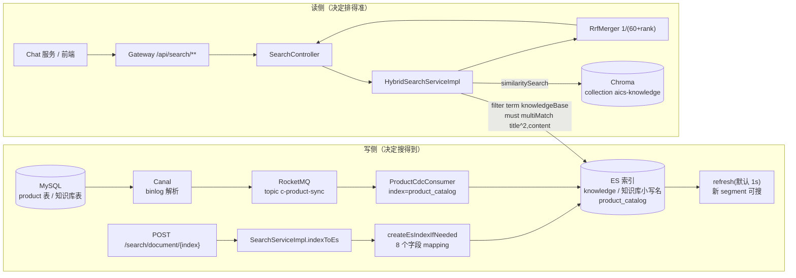
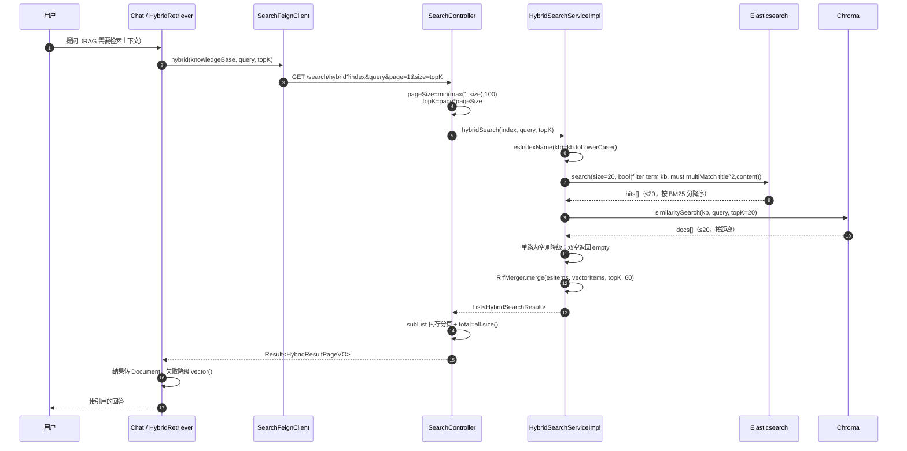
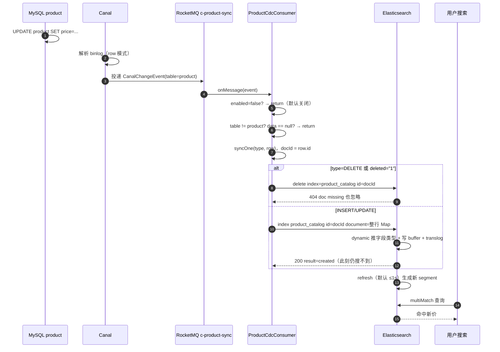

# Elasticsearch 搜索引擎：近实时与相关性打分是两回事，混着写就是"搜不准又搜得慢"

> **一句话结论**：ES 的"搜得到"由写侧决定（mapping 解析、分词器切词、refresh 让段可见），"排序对"由读侧决定（BM25 的 tf / idf / 字段长度归一化），"翻得深"由召回上限决定（`index.max_result_window` 和你自己传的 `size`）——这三件事没有任何耦合。本项目 `ai-cs-search` 里 9 个 ES 调用点一个都没拧过这三个旋钮，全吃默认值，于是症状必然是"搜出一堆噪声、翻两页就空、写完看不到"。
>
> **阅读前置**：看过 [01-Redis缓存实战](01-Redis缓存实战.md) 这类"中间件被业务代码用歪"的视角即可；知道索引 / 文档 / 字段这些名词；不需要读过 Lucene。**ES 本体源码不在 `24-源码分析/assets/source/`**，本篇凡涉及 ES 内部机制一律标注"官方文档 / 本项目代码"，绝不编造类名与文件名。
>
> **证据基线**：ES 8.12（镜像 `elasticsearch:8.12.0`）、elasticsearch-java 8.12.2（`pom.xml#L55`）、Spring AI 2.1.0、JDK 17。A 级只引已入库的 `SearchRequest.java`、`VectorStore.java`；B 级全部为 `ai-cs-search` / `ai-cs-chat` / `deploy` / `tools/nacos-config` 下已核对行号的真实文件；C 级为在本机实跑的静态统计（本机**没有** ES 实例，DSL 与日志文本一律标注"未实测"）。**预计阅读 50~65 分钟。**

## 0. 先看现象

三条症状来自同一份代码，但它们被误判的方向完全不同。

### 现象 1：搜"蓝牙耳机"，命中的是一堆只含"牙"字的文档

知识库里有一条标题为《蓝牙 耳机 配对指南》的文档，用户输入"蓝牙耳机"时它排在第 8 位之后；排在前面的是一堆"耳机线材""蓝牙音箱续航"这类只沾了一个字的段落。开发者的第一反应是"分词器没装，装个 IK 就好了"——这个判断只对了一半，而且改完会发现噪声还在。

代码里能拿到的真实日志格式（格式串来自源码，行号已核对）：

```text
HybridSearchServiceImpl.java:111  ES 检索完成: knowledgeBase={}, 命中={}
HybridSearchServiceImpl.java:72   混合检索完成: knowledgeBase={}, 融合结果={} 条
```

### 现象 2：翻到第 3 页开始返回空数组

`/search/hybrid?index=knowledge&query=蓝牙耳机&page=3&size=10` 返回 `records: []`，但 `total` 显示 20。前端据此画出"共 20 条、当前第 3 页"的分页器，用户点第 3 页就是空白。

如果换一条更"标准"的实现路线（自己拼 `from` + `size`），同样的翻页在更深处会撞上 ES 服务端的硬门槛。ES 8.12 官方文档（《Elasticsearch Guide》→ Search your data → **Paginate search results**）记载的异常原文是：

```text
Result window is too large, from + size must be less than or equal to: [10000] but was [10020].
See the scroll api for a more efficient way to request large data sets.
This limit can be set by changing the [index.max_result_window] index level setting.
```

这段文本是官方文档记录的服务端异常，**本机没有 ES 实例，未复现**，只用于说明"深分页是服务端限制，不是客户端 bug"。

### 现象 3：商品改完价格，前台立刻搜还是旧价；重建索引期间搜索直接报错

两条看起来无关的抱怨，根因是同一个：本项目对"段何时可见"完全没有控制。`ProductCdcConsumer` 把 MySQL 变更写进 `product_catalog` 时没有传 `refresh` 参数（`ai-cs-search/src/main/java/com/aics/search/cdc/ProductCdcConsumer.java#L59`），于是必须等下一次 refresh（默认 1 秒）才可被搜到；而重建索引这条路上，全仓库没有任何 `_alias`（见第 3.9 节的实测统计），也就是没有"新索引建好再切流量"的能力，只能删了再建，删除那一刻搜索侧拿到的是官方文档 **Get index API / 索引不存在** 一节的异常：

```text
index_not_found_exception: no such index [knowledge]
```

三条症状被误判的方向，比症状本身更值得记：

| 症状 | 最常见的第一反应 | 真正常见的根因 |
| --- | --- | --- |
| 中文搜出一堆噪声 | 装 IK 分词器 | `multiMatch` 默认 `operator: OR`，命中一个孤字就算相关；没有 `minimum_should_match`；且 mapping 里的 analyzer 建好就改不动 |
| 老文档搜不到、个别商品搜不到 | "ES 数据丢了" | 写侧异常被 `log.warn` 吞掉；索引名大小写导致写进另一个索引；`product_catalog` 字段类型被 dynamic 推断后写入永久失败 |
| 翻页空白、`total` 对不上 | 前端分页算错 | 召回上限硬编码 20 条，`total` 取的是融合后条数 |
| 改完商品看不到新数据 | "MQ 没消费" | CDC 链路默认关闭（`CANAL_PRODUCT_CDC_ENABLED:false`）+ 写入不带 refresh |
| 重建索引期间搜索报错或变空 | "ES 挂了" | 没有别名，只能删索引重建；`_delete_by_query` 默认不刷新 |

> **这些现象指向同一件事**：本项目把 ES 当成"能全文搜索的 KV 存储"在用——只负责写入和一次 `multiMatch`，却没人对**可见性**（refresh / translog / 重建切换）和**相关性**（分词 / BM25 的输入项）负责。默认值在演示数据上恰好能跑通，因此问题要等到数据量、翻页深度和用户输入变复杂才暴露。

## 1. 整体地图



> **读图说明**：
> 1. 图分左右两半，左半是**写侧**：三条入口（知识库 HTTP 接口、`ProductCdcConsumer` 的 CDC 消息、启动时的 `@PostConstruct` 建索引）最后都落到同一个 ES 索引上，往下再经过 refresh 才"可被搜到"——所以"写成功"和"搜得到"之间隔着一步 refresh，这是本篇第一根主线。
> 2. 右半是**读侧**：入口只有一个 Controller，但内部是**双路召回**（ES 关键词 + Chroma 向量），再由 `RrfMerger` 只按名次融合——所以读侧根本没有"把 BM25 分数当相似度"的机会，这是本项目少有的正确设计。
> 3. 注意 `IDX` 节点被左右两半共享：写侧的分词器、mapping 类型，直接决定读侧 `multiMatch` 能命中什么；两边不共享的是"打分"，那完全发生在读侧。
> 4. 图中没有出现的节点同样是结论：没有别名（alias）、没有 index template、没有 `_reindex` 链路、没有定时对账任务——第 3.9 与 3.11 节会给出"确实为 0"的实测统计。

各组件在本项目里的身份、责任边界和调用方：

| 组件 | 在本项目里的身份 | 它决定什么 | 谁调用它 |
| --- | --- | --- | --- |
| ES 8.12 单节点集群 | 关键词索引存储 | 倒排/正排结构、BM25 打分、段可见性 | 仅通过 `ElasticsearchClient` |
| `ElasticsearchClient`（elasticsearch-java 8.12.2） | 全项目唯一的 ES 客户端 | 把 Java DSL 编成 REST，失败抛 `ElasticsearchException` | 3 个 Bean：见下行 |
| `ai-cs-search/src/main/java/com/aics/search/config/ElasticsearchConfig.java#L35-L49` | `@Bean` 定义处 | 只取 `spring.elasticsearch.uris` 里的**第一个**节点建 `RestClient` | Spring 容器 |
| `SearchServiceImpl` | 写侧主力 | 建索引 mapping、upsert 文档、按知识库 `deleteByQuery` | `SearchController` |
| `HybridSearchServiceImpl` | 读侧主力 | ES 关键词召回 Top-20 + `knowledgeBase` 过滤 | `SearchController` |
| `RrfMerger` | 融合器 | 只搬运名次，不碰分数 | `HybridSearchServiceImpl` |
| `ProductCdcConsumer` | 写侧 CDC | MySQL 行 → `product_catalog` 文档 | RocketMQ |
| Chroma（`aics-knowledge` 集合） | 向量库 | 语义召回（bge-m3） | `SearchServiceImpl` / `HybridSearchServiceImpl` |
| `ai-cs-chat/src/main/java/com/aics/chat/rag/retrieve/HybridRetriever.java#L176-L184` | 上游消费者 | Feign 调 `/search/hybrid`，失败降级纯向量 | Chat 的 RAG 链路 |
| Canal + RocketMQ | 数据管道 | binlog → 消息（默认关闭） | MySQL |

## 2. 关键概念与关键类

先认概念。ES 里所有"为什么慢 / 为什么不准"的问题，答案都落在这张表的某一行上。

| 概念 | 在本项目里的位置 | 角色 | 关键方法 / 参数 |
| --- | --- | --- | --- |
| 倒排索引（inverted index） | ES 内部，未入库 | term → 文档列表；支撑全文检索与 `term` 过滤 | 由分词结果建立，不暴露 API |
| 正排 / `doc_values` | ES 内部，未入库 | 文档 → 字段值；支撑排序、聚合、脚本 | 默认对非 text 字段开启 |
| segment | ES/Lucene 内部，未入库 | 最小可搜索单元，不可变；每次 refresh 产生新段 | 段越多查询越慢，由 merge 收敛 |
| refresh | 未配置，用默认 1s | 让写入的段对搜索可见 | `refresh`、`refresh_interval`、`?refresh=wait_for` |
| flush | 未配置 | 把内存 buffer 落到磁盘并推进 translog 位置 | 默认由 translog 大小/时间触发 |
| translog | 未配置 | 写前日志，保证 refresh 前的数据不丢 | 默认每请求 `fsync` |
| merge | 未配置 | 后台合并小段，回收已删除文档 | 受 `index.merge.policy` 控制 |
| mapping | `ai-cs-search/src/main/java/com/aics/search/service/impl/SearchServiceImpl.java#L203-L213` | 字段类型与分词规则，创建后基本不可改 | `properties`、`dynamic`、`analyzer` |
| analyzer / 分词器 | 全仓库 0 处配置（见 3.4） | 把文本切成 term；写侧 `analyzer`、读侧 `search_analyzer` | `standard`、`ik_max_word`、`ik_smart` |
| BM25 | ES 默认相似度，未配置 | 用 tf、idf、字段长度归一化算分 | `k1=1.2`、`b=0.75` |
| query context | `must` 里的 `multiMatch` | 参与打分 | `must`、`should`、`match` |
| filter context | `filter` 里的 `term` | 只判断是/否，不算分，结果可缓存为位图 | `filter`、`term`、`terms` |
| 别名（alias） | 全仓库 0 处（见 3.9） | 一个名字指向多个索引，用于零停机重建 | `_aliases`、`_reindex` |
| 分片 / 副本 | 全仓库 0 处配置 | 水平切分与高可用；主分片数创建后不可改 | `number_of_shards`、`number_of_replicas` |
| 深分页 | `SearchController` 内存分页（见 3.8） | 越过召回上限后的翻页策略 | `from`+`size`、`scroll`、`search_after` |

再认类。读本项目 ES 相关代码，只需要盯着这几个：

| 名称 | 位置 | 角色 | 关键方法 |
| --- | --- | --- | --- |
| `ElasticsearchConfig` | `ai-cs-search/src/main/java/com/aics/search/config/ElasticsearchConfig.java#L29-L49` | 手写客户端 Bean | `elasticsearchClient(String uris)` |
| `SearchServiceImpl` | `ai-cs-search/src/main/java/com/aics/search/service/impl/SearchServiceImpl.java#L38-L228` | 写侧 + 简单查 | `search`、`indexDocument`、`indexToEs`、`createEsIndexIfNeeded`、`deleteEsDocuments`、`esIndexName` |
| `HybridSearchServiceImpl` | `ai-cs-search/src/main/java/com/aics/search/hybrid/HybridSearchServiceImpl.java#L38-L196` | 双路召回 + 降级 | `hybridSearch`、`esSearch`、`vectorSearch` |
| `RrfMerger` | `ai-cs-search/src/main/java/com/aics/search/hybrid/RrfMerger.java#L1-L98` | RRF 融合 | `merge(list1, list2, topK, k)` |
| `SearchController` | `ai-cs-search/src/main/java/com/aics/search/controller/SearchController.java#L31-L87` | HTTP 契约 | `search`、`hybridSearch`、`createIndex`、`indexDocument`、`deleteIndex` |
| `ProductCdcConsumer` | `ai-cs-search/src/main/java/com/aics/search/cdc/ProductCdcConsumer.java#L20-L66` | CDC 消费者 | `onMessage`、`syncOne` |
| `SearchRequest`（Spring AI） | 已入库 [[源码:SearchRequest.java.md#L44-L60]] | 向量检索请求体 | `builder()`、`topK`、`filterExpression` |
| `VectorStore`（Spring AI） | 已入库 [[源码:VectorStore.java.md#L40-L51]] | 向量库抽象 | `add`、`delete`、`similaritySearch` |

这两处 A 级摘录正好解释了本项目为什么必须**显式**传参数——Spring AI 的默认值是"能跑通 demo"的默认值，不是"能分页"的默认值：

```java (src: SearchRequest.java.md#L56-L60)
	private int topK = DEFAULT_TOP_K;
	private double similarityThreshold = SIMILARITY_THRESHOLD_ACCEPT_ALL;
	private Filter.@Nullable Expression filterExpression;
```

`DEFAULT_TOP_K` 的真实取值是 **4**（[[源码:SearchRequest.java.md#L49-L49]]），阈值默认是 `ACCEPT_ALL = 0.0`（[[源码:SearchRequest.java.md#L44-L44]]）——也就是说"不传就只返回 4 条、且不按相似度过滤"。本项目 `SearchServiceImpl` 里那句 `.topK(Math.max(1, size))` 就是在覆盖它；而 `HybridSearchServiceImpl` 反过来，两条召回路径都把条数钉死成常量 20（ES 侧 `ai-cs-search/src/main/java/com/aics/search/hybrid/HybridSearchServiceImpl.java#L86`，向量侧同文件 `#L127`），调用方传进来的 `topK` 一路被忽略——这就是 3.8 节"翻页必空"的源头。

删向量走的是另一条默认实现：字符串过滤表达式会被先转成 `SearchRequest`，再转成 `Expression` 才真正删除。

```java (src: VectorStore.java.md#L105-L109)
	default void delete(String filterExpression) {
		SearchRequest searchRequest = SearchRequest.builder().filterExpression(filterExpression).build();
		Filter.Expression textExpression = searchRequest.getFilterExpression();
		Assert.notNull(textExpression, "Filter expression must not be null");
		this.delete(textExpression);
	}
```

所以 `deleteIndex` 里那句 `vectorStore.delete("knowledgeBase == '" + index + "'")` 的**引号是表达式语法的一部分**，不是字符串转义的偶然——少一个引号会是语法错误而不是"删错范围"（[[源码:VectorStore.java.md#L95-L95]] 是最终执行的抽象方法）。

最后把本项目**真实建出来的 8 个字段**摊开看，因为后面所有相关性问题的输入项都在这里（`ai-cs-search/src/main/java/com/aics/search/service/impl/SearchServiceImpl.java#L206-L213`）：

| 字段 | 类型 | 分词 | 正排 | 谁在用 | 隐患 |
| --- | --- | --- | --- | --- | --- |
| `documentId` | `keyword` | 不分词 | 有 | 文档标识 | 与 ES 的 `_id` 是两个概念，检索侧从未用它过滤 |
| `title` | `text`（`standard`） | 逐字切（中文） | 无 | `multiMatch` 里 `title^2` | 不能聚合、不能排序；写入时若缺字段被补成空串占位 |
| `content` | `text`（`standard`） | 逐字切 | 无 | `multiMatch` 主命中面 | 同上；单字命中导致噪声 |
| `summary` | `text` | — | 无 | **只存不搜**（检索只用 `title^2,content`） | 以为是摘要检索入口，其实从未参与召回 |
| `tags` | `keyword` | 不分词 | 有 | 预留 | `蓝牙耳机` 与 `蓝牙 耳机` 是两个值，`term` 差一个空格即零命中 |
| `knowledgeBase` | `keyword` | 不分词 | 有 | `filter` 精确过滤 | 大小写不一致会落到两个索引（见 3.9） |
| `docType` | `keyword` | 不分词 | 有 | 预留 | 全代码无人读写，聚合潜力没被用起来 |
| `page` | `integer` | — | 有 | 引用页码 | 上游传字符串时靠 `coerce` 兜底，传 `"3-5"` 会直接写入失败 |

> 这张表的读法：`text` 的两个字段承担"相关性"，`keyword` 的四个字段承担"过滤/聚合"，`page` 只承担"展示"。**ES 的类型一旦建好就不可改**，所以行里"隐患"一列实际上都是"改天要 reindex 的原因"。


## 3. 原理与证据逐段精读

每一小节都按同一节奏走：这段代码/配置**在干什么** → ES 为什么**这么设计** → **换一种写法会怎样** → 落到本项目会踩的**坑**。

### 3.1 倒排与正排：为什么"过滤便宜、排序贵、聚合更贵"

**在干什么**：ES 对每个字段同时维护两种"数据方向"。倒排索引是 `term → 文档号列表`，用来回答"哪些文档含这个词"；正排（`doc_values`，列式存储）是 `文档号 → 字段值`，用来回答"第 7 篇的 price 是多少"。本项目 `title` / `content` / `summary` 声明为 `text`，`documentId` / `tags` / `knowledgeBase` / `docType` 声明为 `keyword`，`page` 是 `integer`（`ai-cs-search/src/main/java/com/aics/search/service/impl/SearchServiceImpl.java#L206-L213`），前三个字段只有倒排（text 默认不开 `doc_values`），后五个两者都有。

**为什么这么设计**：全文检索的本质是"按词找文档"，倒排让一次 `multiMatch` 只扫命中的 posting list 而不是全表；而排序、聚合是按"文档的某个值"比较，必须能随机读字段值，倒排做不到，所以另存一份列式正排。两份结构各付各的存储与写入代价，这是 ES 能在秒级返回全文检索结果的根本原因。

**换一种写法会怎样**：如果为了让 `content` 能排序而把 `doc_values` 打开（或对 `text` 字段设 `fielddata: true`），代价是把整个文本倒排进堆内存做"正向化"，官方文档 **Text type / fielddata** 一节明确写着这会显著吃堆并且不推荐。反过来，如果给 `tags` 用 `text` 而不是 `keyword`，那么"按标签精确过滤"会退化成"分词后 OR 匹配"，`蓝牙耳机` 与 `蓝牙 耳机` 就再也对不上了。

**常见坑**：把 `text` 字段当 `keyword` 用（做 `term` 过滤、做聚合、做排序），是新手最常见的错配；表现不是报错，而是"过滤不生效"或"聚合出来的桶莫名其妙"。

### 3.2 写入四道门：buffer → refresh → flush → merge，这就是"1 秒后才可见"的全部来源

**在干什么**：一次 `index` 请求在 ES 里依次经过：① 写入内存 buffer 并追加 translog（此时数据已安全，但**搜不到**）；② **refresh**——把 buffer 里的文档写成新的 segment 并重开 searcher，此刻才"可被搜到"；③ **flush**——把 segment `fsync` 到磁盘、写 commit point、清空 translog；④ 后台 **merge**——把许多小段合成大段，顺带真正回收被标记删除的文档。refresh 默认每 1 秒一次（官方文档 **Index modules → index.refresh_interval**，默认 `1s`），这就是"近实时（near real-time）"而不是"实时"的原因。

四道门各自有哪些旋钮、本项目实际取什么值（官方文档 **Index modules** 与 **Translog settings** 两节的默认值，本项目侧为 C 级实测）：

| 旋钮 | 官方默认 | 本项目取值 | 调它会发生什么 |
| --- | --- | --- | --- |
| `index.refresh_interval` | `1s` | 未配置（全仓库 0 命中） | 调大→写入吞吐升、可见延迟升；设 `-1` 关闭自动 refresh |
| 写请求 `refresh` 参数 | `false` | 未传（两处写入都是裸 `index`） | `true`→立刻可见但产生大量小段；`wait_for`→挂起到下次 refresh |
| `index.translog.durability` | `request` | 未配置 | 改 `async` 会丢最近 5s 数据（默认 `async` 的刷盘间隔） |
| `index.translog.flush_threshold_size` | `512mb` | 未配置 | 触发 flush 的水位，超过后 Lucene commit |
| `index.merge.policy.*`（tiered） | 自动 | 未配置 | 小段合并频率；影响查询延迟与磁盘峰值 |

**为什么这么设计**：如果每次写都立刻 `fsync` 并重建 searcher，写吞吐会掉一到两个数量级。ES 把"持久性"交给 translog（每请求 `fsync`，可配），把"可见性"交给低频 refresh，把"存储整理"交给异步 merge，三者解耦后写入才能批量化。

**换一种写法会怎样**：写请求带 `refresh=true` → 立刻可见，但每次写生成一个小段，merge 压力与查询延迟都会上去，批量导入场景会明显变慢；`refresh=wait_for` → 请求挂起到下一次 refresh 再返回（最多 1 秒延迟），是"写完立刻要能搜到"最合适的折中；把 `refresh_interval` 设为 `-1` 再在导入末尾手动 `_refresh`，是批量重建索引时的标准手法。

**常见坑**：本项目两处 ES 写入**都没有控制 refresh**——`indexToEs`（`ai-cs-search/src/main/java/com/aics/search/service/impl/SearchServiceImpl.java#L164-L167`）和 `syncOne`（`ai-cs-search/src/main/java/com/aics/search/cdc/ProductCdcConsumer.java#L59`）都是裸 `index`。所以任何"写完立刻断言搜得到"的集成测试都会偶发失败，而且失败率跟机器负载相关，极难复现。`_delete_by_query` 同理：它默认 `refresh=false`，删除后 1 秒内旧文档还能被搜到（`deleteEsDocuments` 就属这种情况）。

### 3.3 mapping 与 dynamic：`new HashMap<>(document)` 是最危险的一行

**在干什么**：`createEsIndexIfNeeded` 只在索引不存在时建 mapping，声明了 8 个字段（`ai-cs-search/src/main/java/com/aics/search/service/impl/SearchServiceImpl.java#L196-L222`）；但真正写入时，`indexToEs` 把调用方传进来的整个 Map 拷一份直接索引：

```java
// ai-cs-search/src/main/java/com/aics/search/service/impl/SearchServiceImpl.java#L160-L167
            // 构建 ES 文档：保留全部字段，补充 knowledgeBase 与默认空 title（multiMatch 需要）
            Map<String, Object> esDoc = new HashMap<>(document);
            esDoc.putIfAbsent("knowledgeBase", knowledgeBase);
            esDoc.putIfAbsent("title", "");
            esClient.index(i -> i
                    .index(indexName)
                    .id(docId != null ? docId : UUID.randomUUID().toString())
                    .document(esDoc));
```

**为什么这么设计**：map 的 8 个字段是"作者想到的字段"，其余字段交给 dynamic mapping 自动推断——这是最快的开发路径，演示阶段确实零成本。ES 的 dynamic mapping 默认 `true`，会按 JSON 值猜类型：数字猜 `long`/`float`、ISO 字符串猜 `date`、对象猜 `object`。

**换一种写法会怎样**：如果改成 `dynamic: false`（不索引未知字段但仍存 `_source`）或 `strict`（未知字段直接报错），那么"上游多送一个字段"会立刻暴露出来而不是悄悄改变类型；如果改成显式列出白名单字段再写入，就要在 `indexToEs` 里做字段裁剪——代价是新增字段必须同步改代码，收益是 mapping 永远可控。

**常见坑**（三条，都与本项目这行代码直接相关）：
1. **类型漂移**：某商品第一次索引 `price: 99` 被推断成 `long`，下个月商家填了 `99.5`，写入直接失败，报官方文档 **Dynamic mapping → 类型冲突** 一节的 `mapper_parsing_exception: failed to parse field [price] of type [long]`。而本项目 catch 里只 `log.warn`（`SearchServiceImpl.java#L169-L171`），于是这条商品永久不在索引里，前端表现为"个别商品搜不到"。
2. **字段爆炸**：`ProductCdcConsumer` 把 MySQL 整行 Map 原样写进 `product_catalog`（`ai-cs-search/src/main/java/com/aics/search/cdc/ProductCdcConsumer.java#L59`），而这个索引**根本没有建 mapping 的代码**——只有 `static final String INDEX = "product_catalog"`（同文件 `#L26`）。一旦某张表加了 JSON 扩展列，每个键都会变成一个字段，最终撞上 `Limit of total fields [1000] has been exceeded`。
3. **mapping 不可改**：`createEsIndexIfNeeded` 第一句就是 `exists` 短路（`#L199-L202`），所以**线上已经存在的索引永远不会因为代码改了 mapping 而更新**。这是本项目最实际的坑：改完 `#L206-L213` 的字段声明重新发布，什么都不会发生。

### 3.4 分词器与中文：`standard` 把"蓝牙耳机"切成四个字，噪声从这里来

**在干什么**：`analyzer` 由 字符过滤器 + 分词器 + token 过滤器 组成，作用是把一段文本变成 term 序列。写侧用 `analyzer`，查询侧用 `search_analyzer`（不配则与 `analyzer` 相同）。本项目的 8 个字段**一个 analyzer 都没配**，`title`/`content`/`summary` 于是走 ES 默认的 `standard`。`standard` 分词器按 Unicode UAX#29 断词，英文按空格，中文没有空格可分，就**逐字切开**："蓝牙耳机" → `蓝`、`牙`、`耳`、`机` 四个 term。

**为什么这么设计**：`standard` 是"不需要词典、任何语言都能跑、永远不报错"的兜底方案；中文分词需要词典（`ik`、`jieba` 等），必然引入词表维护、版本匹配、歧义切分等成本，所以 ES 不内建。

**证据（本项目侧）**：C 级静态统计（范围 `ai-cs-search`、`ai-cs-chat`、`ai-cs-knowledge`、`ai-cs-product`、`ai-cs-common`、`deploy`、`tools/nacos-config`、`docs`，共 **445** 个 `java/yml/yaml/json/xml` 文件，排除 `target/` 与 `node_modules`，用 `Select-String -SimpleMatch` 计数）里 `analyzer`、`ik_max_word`、`ik_smart`、`normalizer`、`match_phrase`、`multi_match` 全部为 **0 命中**——也就是说分词这件事在全仓库从未被配置过。同时 `deploy/docker-compose/docker-compose-all.yml#L81-L96` 里 ES 只有官方镜像和四个环境变量（`discovery.type`、两个 `xpack` 开关、`ES_JAVA_OPTS`），**没有安装任何 analysis 插件**，所以哪怕现在把 `ik_max_word` 写进 mapping，服务端也会报 `analyzer [ik_max_word] has not been configured in mappings`。

**换一种写法会怎样**：给 `content` 配 `analyzer: ik_max_word` + `search_analyzer: ik_smart`（索引侧细粒度切、查询侧粗粒度切，是中文检索的常见组合），"蓝牙耳机" 会被切成 `蓝牙`/`耳机`（或 `蓝牙耳机`），`蓝牙 耳机` 带空格也能命中同一批 term；再配 `minimum_should_match: "75%"`，就能把"只命中一个孤字"的噪声挡掉。**但注意**：mapping 的 `analyzer` 对已存在的字段不能修改，必须 reindex 或换新索引——这正是 3.9 节要讲别名存在的原因。

**常见坑**：
1. 以为装了 IK 就万事大吉——`multiMatch` 默认是 `best_fields` 且 `operator: OR`，"命中任一字即算命中"，噪声来自这里而不是分词器。
2. `tags` 是 `keyword` 字段，它**不做任何分词**：`蓝牙耳机` 与 `蓝牙 耳机` 是两个完全不同的值，用 `term` 精确过滤时差一个空格就是零命中。任务书里"搜'蓝牙耳机'搜不到'蓝牙 耳机'"在**当前 mapping 下不会发生在 `content` 上**（standard 会把它切成同一批单字），真正会漏检的是 `tags` 这类 keyword 字段、以及 `title^2` 的短语期望——这个区分很重要，判断错方向就会去装分词器，然后噪声照旧。

### 3.5 query context 与 filter context：一个算分，一个只答"是/否"，差在可缓存的位图

**在干什么**：`bool` 查询里 `must`/`should` 属于 query context，命中的文档会被打分；`filter`/`must_not` 属于 filter context，只回答"匹配不匹配"，不打分。ES 会把 filter 的结果缓存成位图（bitset），下次相同的过滤条件直接与倒排结果做位运算，不再遍历。本项目 `esSearch` 的写法是教科书式的：

```java
// ai-cs-search/src/main/java/com/aics/search/hybrid/HybridSearchServiceImpl.java#L84-L92
            SearchResponse<Map<String, Object>> response = esClient.search(s -> s
                            .index(indexName)
                            .size(RETRIEVE_TOP_K)
                            .query(q -> q.bool(b -> b
                                    .filter(f -> f.term(t -> t.field("knowledgeBase").value(knowledgeBase)))
                                    .must(m -> m.multiMatch(mm -> mm
                                            .fields("title^2", "content")
                                            .query(query))))),
                    (Class) Map.class);
```

**为什么这么设计**：`knowledgeBase` 是一个**精确的归属条件**，它对"相关性"没有贡献——用户不会因为文档属于 A 知识库就更相关。把它放进 `must` 会让它参与打分，白算一遍 BM25，还污染缓存；放进 `filter` 则享受位图缓存，且不影响 `multiMatch` 的分数。

**换一种写法会怎样**：如果写成 `.must(m -> m.term(...))`（把归属条件塞进 must），功能上仍然能过滤，但每次查询都要参与打分，且无法复用位图；如果写成 `.filter(f -> f.match(t -> t.field("content").value(kb)))`，则 filter 会对 `text` 字段做分析，`knowledgeBase == "IT"` 这种值被小写化后可能匹配不到，且失去缓存意义。

**常见坑**：把"时间窗口过滤"写成精确到秒的 `range`，缓存永不命中（过滤器缓存以查询结构为键）；用超大的 `terms`（几万个 id）做过滤，位图构建成本比查询本身还高，应改为分批或改用 `ids` 查询。

### 3.6 BM25 的三个因子：`title^2` 只是最外面那层乘数

**在干什么**：ES 8 默认相似度是 BM25（官方文档 **Similarity → BM25**），单个 term 的贡献为

```text
score(term) = idf(term) × ( tf × (k1 + 1) ) / ( tf + k1 × (1 - b + b × dl / avgdl) )
默认 k1 = 1.2，b = 0.75
```

三个因子：`tf`（词频，出现越多分越高，但有 `k1` 饱和）、`idf`（逆文档频率，越罕见的词权重越大）、`dl / avgdl`（字段长度归一化，长文档被惩罚）。`multiMatch` 的 `title^2` 是在字段级别乘 boost，即"标题里的命中算两倍"，它**不改变**任何一个因子的语义。

**为什么这么设计**：纯 tf 排序会让"把所有关键词堆 50 遍"的垃圾文档赢；纯 idf 又会让长文档天然吃亏。BM25 用饱和函数 + 长度归一化在两者间取了经验最优点，所以它成了 Lucene 8 之后的默认值（ES 7 起替换 TF-IDF）。

**换一种写法会怎样**：如果业务要"新品优先"或"销量加权"，单靠 boost 不够，要么用 `function_score` 叠加字段权重，要么在应用层重排。如果要跨路融合（BM25 分 + 向量余弦），**绝不能直接相加**——两者的量纲、值域、单调性都不同。本项目 `RrfMerger` 的注释就明确写了这一点，实现上也只用名次：

```java
// ai-cs-search/src/main/java/com/aics/search/hybrid/RrfMerger.java
scores.merge(id, 1.0 / (k + rank), Double::sum);
```

**常见坑**：
1. 拿 BM25 分数当"相似度阈值"做过滤——同一个查询下 12 分是高分，换个查询 3 分可能已是最高分，绝对阈值不可移植。`HybridSearchServiceImplTest` 里断言的 `1.0/61 + 1.0/62` 也提醒我们：RRF 的分数只反映名次。
2. `title^2` 无法弥补分词错误：如果"蓝牙"和"耳机"被切成单字，boost 只是把噪声放大两倍。
3. 忘了 ES 会按分片做 IDF 的近似——分片多、数据倾斜时，同一文档在不同分片上的 idf 不同，分数会有抖动（官方文档 **Search type / query_then_fetch** 有说明）。

### 3.7 聚合与 bucket：本项目一行都没写，但它是"text 不能聚合"的标准答案

**在干什么**：聚合分两类——bucket（分组，如 `terms`、`date_histogram`、`range`）与 metric（统计，如 `avg`、`cardinality`、`percentiles`）。bucket 聚合会在正排上扫 `doc_values` 生成桶，桶里再挂 metric。

**为什么这么设计**：聚合不是"找文档"而是"统计字段值"，所以它绕开倒排直接用列式正排；`text` 字段默认 `fielddata: false`，ES 会直接拒绝聚合请求，异常文本见官方文档 **Text type** 一节：`Fielddata is disabled on text fields by default. Set fielddata=true on [content] ...`。

**证据**：本项目 C 级统计里 `aggs`、`fielddata`、`index_template` 都是 0 命中——**聚合能力完全未落地**（本篇在此明确标注：以下为设计建议，不是既成事实）。若要做"按 `docType` 分组统计知识库文档数"，在现有 mapping 下是可行的，因为 `docType` 已经是 `keyword`。

**换一种写法会怎样**：想对 `title` 做 `terms` 聚合，正确做法是加 multi-field（`title` 为 text、`title.keyword` 为 keyword 并开 `doc_values`）；错误做法是给 `title` 开 `fielddata: true`，代价是把全文加载进堆，几百万文档就能把节点打 OOM。

**常见坑**：`terms` 聚合默认只返回 size=10 个桶，桶里的 `doc_count` 加起来远小于总命中数，被误读成"数据丢了"；`cardinality` 是近似算法（HLL），结果不保证精确；对 `keyword` 字段做高基数字段聚合会吃内存。

### 3.8 深分页三方案：代价表，以及本项目为什么"翻不过第 2 页"

**在干什么**：`from + size` 要求每个分片都取出 `from + size` 条并按分数排序，协调节点再全局排序截断——深翻时每个分片都在做无用功；`scroll` 用游标在服务端保留一份搜索上下文，适合"一次性导出全量"；`search_after` 用上一页最后一条的排序值做游标，配合 PIT（point-in-time）实现无状态深翻。

| 方案 | 机制 | 页数上限 | 单次代价 | 服务端状态 | 适用场景 |
| --- | --- | --- | --- | --- | --- |
| `from` + `size` | 每分片取 `from+size` 再全局排序 | `from+size ≤ index.max_result_window`（默认 10000） | 随 `from` 线性增长 | 无 | 前几页、后台小表 |
| `scroll` | 服务端保存搜索上下文，分批拉取快照 | 无上限 | 首次创建上下文较重，之后每批很便宜 | 有（需手动清理，超时自动释放） | 全量导出、离线任务 |
| `search_after` | 用排序值游标翻页 | 无上限 | 每页恒定 | 无（配合 PIT 保证快照一致） | 用户可见的深翻页、无限滚动 |

本项目**三种都没用**：`SearchController` 把分页完全搬到了内存里——先按 `page × size` 算出一个 `topK`，让两路各召回固定条数，再 `subList` 切页：

```java
// ai-cs-search/src/main/java/com/aics/search/controller/SearchController.java#L48-L58
        int currentPage = Math.max(1, page);
        int pageSize = Math.min(Math.max(1, size), 100);
        // 融合取前 page*size 条，再在内存中分页
        int topK = currentPage * pageSize;
        List<HybridSearchResult> all = hybridSearchService.hybridSearch(index, query, topK);
        int from = (currentPage - 1) * pageSize;
        List<HybridSearchResult> records = from >= all.size()
                ? List.of()
                : all.subList(from, Math.min(from + pageSize, all.size()));
        HybridResultPageVO vo = new HybridResultPageVO();
        vo.setTotal(all.size());
```

**为什么这么写**：避免在 Search 模块同时维护两套分页语义（ES 的 `from/size` 与向量的 `topK`），先用"取够再切"把两路结果对齐，实现最省事。

**换成 `from/size` 会怎样**：一旦 `page × size` 超过 10000，直接撞上现象 2 的 `Result window is too large`；而且每翻一页都要在每个分片上重排 `from+size` 条，深翻时延迟线性上升。换成 `search_after` 则需要稳定排序键（`_score` 相同值多时必须补 tiebreaker，如 `_id`），并把游标透传给前端——协议要改。

**常见坑**：
1. 本项目真正的上限不在 `max_result_window`，而在单路召回：`RETRIEVE_TOP_K = 20`（`ai-cs-search/src/main/java/com/aics/search/hybrid/HybridSearchServiceImpl.java#L41`）是硬编码的，`topK` 参数进得来但**不影响 ES 的 `size`**（`#L86` 写死用常量），所以 `page=3&size=10`（要 30 条）时上游其实只拿到 20 条 → `subList(20, 30)` 落空 → 空页。
2. `vo.setTotal(all.size())` 里的 `total` 是"融合后条数"（最多 40），不是命中总数，前端分页器因此永远算不对。
3. `/search/hybrid` 的 `size` 被 `Math.min(..., 100)` 截断，但 `page` 不设上限，越深越接近"取不到任何东西"的确定状态。

### 3.9 索引别名与零停机重建：全仓库 0 处 `_alias`，所以重建一定有窗口

**在干什么**：别名的本质是"名字 → 索引列表"的映射。零停机重建的标准流程是：建 `knowledge_v2` 并写入 → `_reindex` 或双写补齐 → 一次 `_aliases` 请求原子地把别名 `knowledge` 从 v1 切到 v2（同一次请求里 `remove` + `add`）→ 删 v1。切换的瞬间有 `atomic` 保证，客户端无感。

**为什么这么设计**：因为 mapping 的 `analyzer`、字段类型、主分片数都不可变，业务演进必然需要"新建 + 迁移 + 切换"，别名是唯一能让"名字不变、索引可换"的机制。

**证据**：C 级统计里 `_alias`、`reindex`、`index_template` 均 0 命中；本项目索引名由 `esIndexName()` 直接算出来（`ai-cs-search/src/main/java/com/aics/search/service/impl/SearchServiceImpl.java#L224-L227`，知识库标识小写，null 归 `default`），客户端硬编码这个名字，没有任何间接层。

**所以重建会长什么样**：因为 `createEsIndexIfNeeded` 遇到已存在的索引直接 return（`#L199-L202`），想换 mapping 只能先 `DELETE /index/{index}` 再让它重建——也就是 `SearchServiceImpl.deleteIndex` 那条路径：先 `vectorStore.delete(...)` 删向量，再 `deleteEsDocuments` 走 `_delete_by_query`（`#L175-L190`）。这中间有**两个窗口**：向量已删、ES 未删；以及 ES 删了、索引还在但数据空了。此时搜索侧拿到的是空结果而不是报错——比报错更难排查。

**换一种写法会怎样**：引入 `knowledge`（别名）→ `knowledge_v1` / `knowledge_v2`（真实索引）+ 应用侧写 `knowledge_write` 别名，`createEsIndexIfNeeded` 改成"建版本索引 + 切别名"，重建就变成纯运维动作，应用不用停机。

**常见坑**：切别名后立刻搜索可能看不到新数据（新索引还没 refresh），要显式 `_refresh` 或等 1 秒；用通配符查别名会把所有版本索引的结果叠加，出现重复文档。

### 3.10 分片与副本：为什么"3 分片 1 副本"在小数据上是负优化

**在干什么**：主分片决定索引的水平切分与并行度（创建后不可改，只能 `_split` 或 reindex），副本决定高可用与读吞吐（可随时改）。本项目**没有任何 settings**——C 级统计里 `number_of_shards`、`number_of_replicas` 都是 0 命中，全部吃默认值（ES 8.x 默认 1 主 1 副）。

**为什么这么设计**：分片是最小调度单位，分片太多会让每次查询变成"向 N 个分片发请求再归并"（每个分片都有固定开销），分片太少则无法水平扩展。

**证据（部署侧的真实后果）**：`deploy/docker-compose/docker-compose-all.yml#L81-L96` 与 `deploy/k8s/elasticsearch.yaml` 都是**单节点**。单节点上 1 个副本永远分配不出去，集群健康状态恒为 `yellow`（官方文档 **Cluster health API**：`yellow` = 主分片全部可用、副本未全部分配）。而 compose 的 healthcheck 是 `curl -f http://localhost:9200/_cluster/health`——只要 HTTP 200 就算健康，**不会**因为 `yellow` 而失败，于是"配置了副本却永远不可用"这件事在监控上完全隐形。

**怎么定**：数据量小（< 10GB）且查询并发不高时，1 主 0 副（或单节点下显式 `number_of_replicas: 0`）最省心；单分片建议控制在几十 GB 以内（官方文档 **Size your shards** 的经验区间）；多节点时才把副本调成 1 保 HA。分片数应一起看"总数据量 / 单分片目标大小"和"节点数"，而不是拍一个"3 分片显得专业"。

**常见坑**：把分片数当并行度旋钮调到 12+，结果小数据下每次查询要归并 12 个分片的 Top-K，延迟反而升高；单节点建 1 副本导致集群长期 `yellow`，进而被一些客户端/运维脚本判为"不健康"。

### 3.11 与 MySQL 同步：双写 / Canal / Debezium / 定时补偿，以及"延迟一致性"到底延迟多久

**在干什么**：ES 不是数据源，MySQL 才是。让两边对齐有四种主流方案，本项目的知识库侧和商品侧走了两条不同的路。

| 方案 | 一致性 | 业务侵入 | 失败恢复 | 本项目状态 |
| --- | --- | --- | --- | --- |
| 业务双写（先写库再写 ES） | 弱（非事务，一边失败就长期不一致） | 高（每个写路径都要加） | 靠重试/补偿 | **知识库侧已落地**：`indexDocument` 先写 Chroma 再 `indexToEs`，ES 失败只 `log.warn`（`SearchServiceImpl.java#L169-L171`），即"允许 ES 落后" |
| MQ 异步（业务发消息，消费者写 ES） | 最终一致 | 中 | MQ 重试 + 死信 | 商品侧走 RocketMQ `c-product-sync`（`ai-cs-search/src/main/java/com/aics/search/cdc/ProductCdcConsumer.java#L23`） |
| Canal 订阅 binlog → MQ → 消费者 | 最终一致，业务零侵入 | 低 | MQ 重试，需要位点管理 | **代码已写、默认关闭**：`aics.cdc.product.enabled` 默认 `false`（`ai-cs-search/src/main/resources/application.yml#L54-L58`） |
| Debezium（Kafka Connect） | 最终一致，生态成熟 | 低 | 依赖 Kafka Connect 的 offset | **未落地**（全仓库 0 处）；对比见 [19-Debezium与Canal的CDC对比](19-Debezium与Canal的CDC对比.md) |
| 定时全量对账 | 最终一致，修复兜底 | 低 | 天然幂等 | **未落地**：`ProductCdcConsumer` 的类注释写着"最终一致性由定时对账兜底"（`#L18`），但全模块搜 `@Scheduled`/`reconcil` 只命中这条注释，**没有实现** |

**延迟到底有多少**：一次变更要经过 MySQL 提交 → Canal 抓 binlog → 投递 MQ → 消费者 `index` → **refresh（≤1 秒）** 才可见。所以哪怕 MQ 是毫秒级，端到端 P99 也在"百毫秒到 1 秒+"，且 refresh 那一段是**上界 1 秒的抖动**，不是固定值。这就是为什么"商品改价后立刻搜索必须看到新价"这种需求在 ES 上天生做不到，除非写请求带 `refresh=wait_for`。

**换一种写法会怎样**：改用 Debezium + Kafka 会把运维面从 Canal Server 换成 Kafka Connect + Schema Registry，团队若已有 Kafka 更划算；纯双写方案在代码里最小，但它把"一致性"降级为"尽力而为"——本项目知识库侧现在就处在这个状态。

**常见坑**：
1. **乱序覆盖**：同一商品两次更新若落在不同队列/不同消费者线程，旧值可能后到并覆盖新值。**本项目 `ProductCdcConsumer` 没有做版本号或时间戳校验**，只靠"ES document id 固定为 product.id + 覆盖写"保证幂等（同文件注释 `#L17-L18`），能解决重复但不能解决乱序。
2. **软删**：`syncOne` 用 `row.get("deleted") == "1"` 判断删除（`#L51`），依赖 MySQL 侧有 `deleted` 字段且值恰好是字符串 `"1"`；若上游改成 `1`（数字）或 `true`，删除逻辑静默失效，索引里永久留下脏数据。
3. **ES 不可用不允许静默丢消息**是好的：`syncOne` 抛出 `IllegalStateException` 让 RocketMQ 重试（`#L61-L64`）——这与知识库侧"只 warn"形成鲜明反差，说明两条链路的可靠性等级不同，却都没有文档说明。

## 4. 一次完整执行时序

以"用户在 Chat 里提问，走混合检索"为主干，这是本项目唯一一条真正在跑的 ES 读路径。



> **读图说明**：
> 1. 第 4 步把分页算成 `topK`，第 5 步把这个 `topK` 传进服务层，但第 7 步 ES 请求里的 `size` 是**常量 20**——参数在链路中间被吃掉了，这就是现象 2 的根因，读时序图时要盯住"参数在哪一步失去作用"。
> 2. 第 7 步与第 8 步是**两路并行语义、串行实现**：`hybridSearch` 先 `esSearch` 再 `vectorSearch`，总延迟是两者之和，ES 慢会直接拖长向量检索之前的等待。
> 3. 第 10 步的三条分支（双空、单空、双通）决定了"ES 挂了搜索不挂"，也因此**故障被静默**：ES 全挂时用户仍能搜，只是结果只有向量路，日志里只留一行 warn。
> 4. 第 13 步到第 14 步之间还有一次**跨服务降级**：`HybridRetriever` 若拿到空或异常结果，会再调一次纯向量检索，所以一次用户提问最多可能发起两次向量查询。
> 5. 图中没有任何"写入/refresh"参与——说明读路径完全不感知写侧是否已刷新，这正是"写完立刻搜不到"的结构性原因。

哪一步失败会报什么（前两项是官方异常文本，本机无 ES 未复现；后两项是代码里真实存在的日志格式串）：

| 失败点 | 现象 | 报错 / 日志原文 | 代码兜底 |
| --- | --- | --- | --- |
| 第 3 步 Feign 调不通 | Chat 侧检索变慢 | `RetrieveResult` 走降级分支，`degradeReason="搜索服务无数据"` | `HybridRetriever.java#L180-L184` 降级纯向量 |
| 第 6 步索引不存在（知识库从没写过文档） | 关键词路 0 命中 | `index_not_found_exception: no such index [xxx]` | `esSearch` catch → 空列表 → 单路降级 |
| 第 7 步 mapping 冲突（字段类型与值不符） | 搜索结果缺失某几条 | `search_phase_execution_exception` 包裹 `failed to parse field ...` | 同上，被 catch 成空列表 |
| 第 8 步 Chroma 不可达 | 只剩关键词结果 | `向量检索失败（降级为仅 ES 检索）: knowledgeBase={}, err={}` | `HybridSearchServiceImpl.java#L149-L152` 返回空列表 |
| 两路都空 | 用户搜不到任何东西 | `混合检索两路均无结果: knowledgeBase={}, query={}` | 返回 `Collections.emptyList()` |

### 4.1 写侧时序：一条商品变更要走多久才"可被搜到"

读路径没有 refresh，写路径才是可见性的唯一来源。下面是商品改价这条链路的完整时序（CDC 代码已就位但默认关闭，见 3.11）：



> **读图说明**：
> 1. 第 5 步是本链路最容易忽略的一步：`!enabled` 会让消息**直接 return**（`ai-cs-search/src/main/java/com/aics/search/cdc/ProductCdcConsumer.java#L34-L37`），而配置默认值是 `false`（同文件 `#L29-L30`）——所以"代码写了"和"数据在同步"是两件事，验证时必须先看这条配置。
> 2. 第 10 步的 `index` 返回 200 只代表"写入成功"，第 13 步 refresh 之后才代表"搜得到"。ES 返回的 `result` 字段在新建时是 `created`、覆盖时是 `updated`，但两者都不含可见性信息——这是把"写成功"误当成"同步完成"的根源。
> 3. `document(row)` 传的是 MySQL 整行 Map，索引 `product_catalog` 没有对应的 mapping 创建代码，所以第 11 步的字段类型是 dynamic 推断的；一旦某列类型变化，后续所有写入都会失败并抛 `IllegalStateException`（`#L61-L64`）让 MQ 无限重试。
> 4. 图中没有"对账"节点：类注释（`#L17-L18`）承诺的"定时对账兜底"并未实现，丢消息就是永久丢。

写侧失败点的报错形态（与读侧完全不同，读侧是降级、写侧是抛异常）：

| 失败点 | 会话现象 | 报错 / 日志原文 | 代码行为 |
| --- | --- | --- | --- |
| 第 5 步开关关闭 | 商品永远不更新 | 无任何日志 | 静默 return，**默认状态** |
| 第 7 步无主键 | 该行不同步 | `忽略无主键 CDC 商品事件: {}` | 跳过该行 |
| 第 11 步类型冲突 | 该商品永久搜不到 | `mapper_parsing_exception: failed to parse field [price] of type [long]` | 抛 `IllegalStateException`，MQ 重试直到进死信 |
| ES 整体不可用 | 索引整体停滞 | 同上，异常里包 `ConnectException` | 抛出让 MQ 重试（不静默丢消息） |
| 删除时文档不存在 | 无影响 | `document_missing_exception` | `catch (Exception ignored)` 保持幂等 |

## 5. 设计取舍

本项目的每个选择都有代价，下表把"选了什么、付了什么、什么时候该换"摊开：

| 决策点 | 本项目选择 | 换来什么 | 代价 | 什么时候必须换 |
| --- | --- | --- | --- | --- |
| 检索主路 | Chroma 向量为主，ES 只做关键词补位（`SearchServiceImpl.search` 完全不查 ES） | 语义召回好（"退款"能匹配"退货"） | 精确串（订单号、型号）召回弱 | 需要精确匹配订单号/设备号时 |
| 双路融合 | RRF（`k=60`，只看名次） | 免去分数归一化 | 丢失"分差信息"，第一名与第二名同权 | 需要按相关度阈值截断时 |
| 召回条数 | 硬编码 `RETRIEVE_TOP_K = 20` | 延迟可控 | 分页与深翻失效 | 用户要翻页或要"看全部"时 |
| 分页 | 内存 `subList` | 一套逻辑同时适配两路 | `total` 假、深页空 | `total` 要真实、要翻到 10 页以上 |
| 索引管理 | 索引名从知识库名直接推导，无别名 | 简单直观 | mapping 升级必须删库重建，有窗口期 | 需要在线换 mapping（装 IK 就要换） |
| 分词 | 全默认 `standard` | 零配置、不挑数据 | 中文单字切分，噪声高 | 中文检索效果被投诉时 |
| 写入可靠性 | 知识库侧 warn 忽略、商品侧抛异常重试 | 知识库不被 ES 拖死 | 两条链路可靠性不一致且无文档 | 上线前需要统一 SLA |
| 数据同步 | Canal 代码就位但默认关闭 | 不引入 Canal 也能跑 | 商品索引靠人工/首灌 | 商品变更频繁且要求最终一致 |
| 部署 | 单节点 8.12.0、512m 堆、xpack 关闭 | 本地零摩擦 | 无副本、无认证、堆偏小 | 上线到共享环境之前 |

可扩展点清单（按"改动量 / 收益"排序，前两条收益最大）：

- **把 `RETRIEVE_TOP_K` 变成参数**：`HybridSearchServiceImpl#L41` 与 `#L86` 改为按 `topK` 取 `min(topK, 100)`，即可修掉"第 3 页空"，改动 1 处、无协议变更。
- **给 `content` 装 IK + 配 `minimum_should_match`**：必须走"新索引 + 别名 + reindex"，否则改不动；涉及 `createEsIndexIfNeeded`、`esIndexName`、compose 的插件安装三处。
- **写侧加 `refresh=wait_for`**：`indexToEs` 与 `syncOne` 各加一个参数，能让"改完立刻看到"从不确定变成确定（代价是最多 1 秒延迟）。
- **给 `product_catalog` 补建 mapping**：现在这个索引是 dynamic 的裸索引；补建后可在 `ProductCdcConsumer` 里裁字段。
- **落地定时对账**：类注释承诺过但没实现；一个 `@Scheduled` 全量比对 `product.id` 与 ES doc id 即可兜底丢消息。
- **加 `_alias` 间接层**：`esIndexName` 返回别名，真实索引带版本号。
- **统一两条同步链路的失败语义**：要么都 `warn` 要么都抛，别一半一半。

## 6. 踩坑与调试手法

1. **改了 mapping 不生效**。`createEsIndexIfNeeded` 开头 `exists` 短路（`#L199-L202`），线上索引一旦存在就永远不更新。判断方法：`GET /<index>/_mapping` 看到的字段与代码里 `#L206-L213` 不一致，就是这个坑。
2. **写完立刻搜不到**。两处写入都没带 refresh（`SearchServiceImpl#L164-L167`、`ProductCdcConsumer#L59`）。复现方式是"写后立刻查"的测试偶发失败；定性方式是查 `refresh_interval` 是否被改过（本项目为 0 处配置，即默认 1s）。
3. **翻到第 3 页变空**。`RETRIEVE_TOP_K=20` 是硬上限，而 `topK=page*size` 会持续增长。判断方法：让 `page=3&size=10`，看返回的 `total` 是否恒为 `≤40` 且 `records` 为空。
4. **"ES 挂了搜索却毫无异常"**。三层 catch 把异常降级成了空结果：`esSearch`（`#L113-L116`）、`HybridRetriever`（`#L180-L184`）、`SearchServiceImpl.indexToEs`（`#L169-L171`）。这是设计特性，但排查时必须知道"搜索能返回 ≠ ES 正常"。
5. **商品搜不到个别款**。`ProductCdcConsumer` 直接写整行 Map 且 `product_catalog` 没有 mapping，字段类型第一次被 dynamic 推断后就固定，之后一条类型不符的记录会永久失败（`index` 抛异常 → MQ 重试 → 反复失败进入死信）。
6. **索引名大小写**。`esIndexName` 做了 `toLowerCase`（`#L224-L227`），因为 ES 索引名不允许大写（官方文档 **Index name restrictions**：只能小写）。若前端传 `Knowledge` 而写侧传 `knowledge`，会命中两个不同索引，表现为"有的文档搜得到有的搜不到"。

**真调试手法 A：从源码里的日志关键字反查链路（本机实跑）**。本项目每条 ES 失败路径都有唯一日志串，先把它们当检索词典捞出来：

```powershell
Get-ChildItem -Recurse -File -Filter *.java ai-cs-search\src\main |
  Select-String -Pattern 'log\.(info|warn|error|debug)\("ES' |
  ForEach-Object { "$($_.Filename):$($_.LineNumber) $($_.Line.Trim())" }
```

实跑输出共 **12** 条（下面按"能判断什么"归并，行号为真实输出）：

| 日志原文（截断） | 命中行 | 它说明什么 |
| --- | --- | --- |
| `ES 索引同步失败（不影响 Chroma 结果）` | `SearchServiceImpl.java:170` | 写侧失败被降级成 warn，Chroma 写成功、ES 是残的 |
| `ES 检索失败（降级为仅向量检索）` | `HybridSearchServiceImpl.java:114` | 读侧关键词路已经挂了，用户仍能搜到东西 |
| `ES 路无结果/异常，降级为仅向量结果` | `HybridSearchServiceImpl.java:62` | 同上，但走到了"单路降级"分支（有向量结果） |
| `ES 索引创建失败` | `SearchServiceImpl.java:217` / `:220` | mapping 没建成，后续写入全是 dynamic 推断 |
| `ES 索引不存在，跳过删除` | `SearchServiceImpl.java:180` | 删除是空转，别以为数据清干净了 |
| `ES 文档索引成功` / `ES 检索完成` | `SearchServiceImpl.java:168` / `HybridSearchServiceImpl.java:111` | 写成功 ≠ 已 refresh；命中数才是相关性的第一个读数 |

线上只 grep 这几个串，就能把"哪一侧坏了"定位到代码行——这正是本项目最大的可观测性缺口：ES 出问题时，应用日志里全是 warn 与 info，没有一个 error。

**真调试手法 B：ES 侧的标准四连（本机无 ES 实例，以下命令未实测，只给判读方法）**。

```text
GET /_cat/indices?v&h=index,health,docs.count,store.size   # health=yellow 且单节点 → 副本配了但分配不出
GET /knowledge/_mapping?pretty                              # 字段类型/是否 keyword/有没有 analyzer
GET /knowledge/_analyze {"field":"content","text":"蓝牙耳机"} # 实际切出哪些 term —— 判断"单字切分"的唯一硬证据
GET /knowledge/_search {"query":{"match":{"content":"蓝牙耳机"}},"explain":true,"size":1}
                                                            # explain 里逐项列出 tf/idf/dl 对分数的贡献
```

外加两个常被忽略的端点：`GET /_nodes/stats/indices/refresh,flush,merge`（看 refresh/merge 是否成为瓶颈）、`GET /_tasks?actions=*search*`（看是否有长尾查询）。若开了 slowlog（`index.search.slowlog.threshold.query.warn`），`_search` 的耗时分布比应用侧埋点更接近真相。

## 7. ⚠️ 版本差异

ES 是大版本之间破坏性变更较多的中间件，本项目把基线钉在 8.12，下表列出"网上老教程写法 → 当前基线"的差异点。

| 旧写法（7.x 及更早 / 常见博客） | 当前基线（ES 8.12 + elasticsearch-java 8.12.2） | 变化点 | 迁移动作 |
| --- | --- | --- | --- |
| 索引路径带 type：`/index/doc/_search`、mapping 里写 `"type": "doc"` | 无 type，`/index/_search`；mapping 直接写 `properties` | 8.0 彻底移除 mapping types | 删掉 type 段；本项目 `#L203-L213` 已是无 type 写法，无需改 |
| `include_type_name=true` 兼容参数 | 已移除，传了会报错 | 过渡参数被清理 | 从模板与脚本中删除 |
| 默认无认证，`http://host:9200` 直接可用 | 8.x 默认开启 security（TLS + 账号密码） | 默认从"开放"变"安全" | 本项目在 compose 里显式 `xpack.security.enabled=false`，属于**有意关闭**，上线前必须改回并配账号 |
| `RestHighLevelClient` | 官方新客户端 `elasticsearch-java`（`co.elastic.clients`，本项目用 8.12.2） | 老客户端 7.15 起弃用、8.x 移除 | 本项目已用新客户端（`ai-cs-search/pom.xml#L60-L63`） |
| Spring Data Elasticsearch 的 `ElasticsearchRestTemplate` | 本项目不用 Spring Data，手写 `ElasticsearchClient` Bean | 少一层抽象、少一层自动配置 | 若要分页/审计等能力可再评估引入 |
| TF-IDF 相似度（`similarity: classic`） | 默认 BM25 | 7.0 起默认换 BM25 | 老索引若显式设过 `classic`，分数语义与新版不一致，需 reindex |
| `ik` 插件任意版本随便装 | 插件版本必须与 ES 主版本**严格一致**（8.12.x 对 8.12.x） | 插件与 ES 二进制强耦合 | 装 `analysis-ik 8.12.x`；本项目镜像为 `elasticsearch:8.12.0`，需自建镜像或挂载插件 |
| `_delete_by_query` 认为"删完就没了" | 默认 `refresh=false`，1 秒内仍可搜到 | 一直是这个语义，但常被误解 | 需要立即可见时加 `?refresh=true` |
| `index.max_result_window` 可随手调大 | 默认 10000 不变，但调大只会让堆更危险 | 限制本身未变 | 用 `search_after` 替代，不要调大 |
| `translog` 手调 `flush_threshold_size` | 8.x 用 `index.translog.flush_threshold_size` 与 retention 配置，但 ES 会按磁盘与段情况自适应 | 参数名与默认值在 7.x→8.x 期间有调整 | 除非有明确压测数据，不要手调 |

## 8. 面试高频问与答

只列问题，答案在自测题与正文里。

1. 为什么 ES 是"近实时"而不是实时？1 秒这个数字是从哪来的，能改吗？
2. refresh、flush、merge 三者的职责边界是什么？哪个操作会导致数据丢失风险？
3. 倒排索引和 `doc_values` 各自服务哪类查询？为什么 `text` 字段默认不能聚合？
4. query context 和 filter context 的性能差异根源是什么？什么条件下 filter 缓存会失效？
5. BM25 的三个因子分别解决什么排序问题？为什么不能用 BM25 分数做跨查询的相似度阈值？
6. 中文检索为什么要装 IK？`ik_smart` 与 `ik_max_word` 在索引侧和查询侧应该怎么组合？
7. `from+size`、`scroll`、`search_after` 各自的代价模型是什么？为什么 `scroll` 不适合做用户翻页？
8. 索引别名如何实现零停机重建？切换那一次请求为什么是原子的？
9. 主分片数为什么创建后不能改？分片数与副本数分别应该按什么定？
10. ES 与 MySQL 的数据同步有哪几种方案？双写为什么很难保证一致？
11. 消费者重复消费与消息乱序，分别用什么手段保证 ES 里的数据正确？
12. 一个文档写了却搜不到，你会按什么顺序排查？（提示：写入成功 → refresh → mapping → 分词 → 过滤条件）

## 9. 动手练习

每条都给验收标准，前三条不需要 ES 实例，可直接在本机跑。

1. **静态盘点 ES 调用点**：用 pwsh 统计 `ai-cs-search` 里所有 `esClient.` / `elasticsearchClient.` 调用，按文件分组列出行号。验收标准：能报出"非测试代码共 9 处，其中 `SearchServiceImpl` 6 处、`HybridSearchServiceImpl` 1 处、`ProductCdcConsumer` 2 处"，并指出哪几处没有传 `refresh`。
2. **找出"分页参数在哪一步失效"**：从 `SearchController#L51` 沿着 `topK` 追到 `HybridSearchServiceImpl#L86`，写出参数在各跳的类型与取值。验收标准：能明确说明"`topK` 在 `esSearch` 里被 `RETRIEVE_TOP_K` 覆盖"，并给出一个只改 1 行就能修好的补丁。
3. **静态验证配置缺口**：用 `Select-String -SimpleMatch` 统计全仓库 `_alias`、`refresh_interval`、`ik_max_word`、`number_of_shards`、`search_after` 的命中数。验收标准：能给出 0 命中的实测输出，并说明"0 命中意味着走默认值"而非"功能不存在"。
4. **补一版 mapping 设计**（不要求执行）：给 `content` 配 `ik_max_word` + `search_analyzer: ik_smart`，给 `title` 加 `title.keyword` 子字段，写出完整 JSON 与"为什么必须新建索引 + 别名切换"的三步操作。验收标准：JSON 里没有 `fielddata: true`，步骤里包含 `_reindex` 与 `_aliases` 的原子切换。
5. **验证 refresh 语义**（需本地 ES，本机未做）：起一个单节点 ES，`index` 一条文档后立刻 `_search`，再 `?refresh=wait_for` 重做一次，记录两次的可见性差异。验收标准：能复现"裸 index 后 1 秒内查不到"，并给出 `refresh=wait_for` 的耗时读数。
6. **写一个 search_after 分页原型**：以 `_id` 作为 tiebreaker，写伪代码实现"每页 20 条、翻到第 50 页"。验收标准：能说清为什么必须要 tiebreaker、为什么不能与 `from` 混用。

## 小结

- ES 的三件事必须拆开看：**写侧决定"搜得到"**（mapping、分词、refresh），**读侧决定"排得准"**（BM25 的 tf/idf/归一化），**翻页决定"翻得深"**（`max_result_window` 与你自己的 `size`）。混在一起就只会得出"ES 不好用"这种没法落地的结论。
- "写入 1 秒后才可见"不是 bug，是 refresh 默认 1s 的必然结果；本项目两处写入都没有 `refresh` 控制，所以"写完立刻搜到"没有任何保证。
- 本项目 8 个字段的 mapping 一个 analyzer 都没配，中文走 `standard` 逐字切分；`multiMatch` 默认 OR，于是"命中一个孤字也算相关"——噪声来自这里，只装 IK 不配 `minimum_should_match` 修不好。
- `filter` 用 `term` 过滤 `knowledgeBase` 是本项目少有的正确设计；`must` 里的 `multiMatch` 才参与打分。两者混用会白算分数还丢缓存。
- 深分页三种方案本项目一种都没用，实际是"硬编码召回 20 条 + 内存 `subList`"，所以第 3 页必然空、`total` 必然假。
- 没有别名就没有零停机重建；而 `createEsIndexIfNeeded` 的 `exists` 短路意味着"改了 mapping 也不会生效"，这是最容易被忽略的一条。
- 数据同步上，商品侧 Canal 代码已就位但默认关闭、类注释承诺的"定时对账"并未实现、知识库侧 ES 失败只 warn——两条链路的可靠性等级不同且无文档。
- 可操作的第一刀：把 `RETRIEVE_TOP_K` 常量改成跟随 `topK`（1 处改动），先把"翻页空"这个用户可见的 bug 修掉，再谈分词与别名。

## 自测题

**1. 为什么 ES 被称为"近实时"搜索，而不是实时搜索？**

<details><summary>参考答案</summary>
因为写入的文档先进内存 buffer 与 translog，要等一次 refresh 把它变成新 segment 并重开 searcher 后才可被搜索，refresh 默认间隔 1 秒（官方文档 index.refresh_interval 默认 1s）。这段时间内数据已持久（translog 保证不丢）但不可见，所以是"近实时"。可通过 refresh 参数、refresh=wait_for 或调小 refresh_interval 改变这个延迟，代价是段增多、merge 压力上升。
</details>

**2. refresh、flush、merge 各做什么？哪个最影响搜索延迟？**

<details><summary>参考答案</summary>
refresh 把内存 buffer 写成新 segment 并让搜索可见；flush 把 segment fsync 到磁盘、推进 commit point、清空 translog；merge 在后台把小段合成大段并真正回收已删除文档。最影响搜索延迟的是 refresh 产生的段数量——段越多，每次查询要扫的段越多，所以低频大段永远优于高频小段。
</details>

**3. 本项目 mapping 里 `title` 是 `text`、`tags` 是 `keyword`，这个选择会带来什么行为差异？**

<details><summary>参考答案</summary>
`text` 会被分词（本项目用默认 standard，中文逐字切），支持全文匹配但不支持精确过滤、排序、聚合；`keyword` 整体不切，适合 term 精确过滤和聚合，但 `蓝牙耳机` 与 `蓝牙 耳机` 是两个不同值。见 SearchServiceImpl 的 8 字段声明（#L206-L213）。
</details>

**4. 用户搜"蓝牙耳机"返回大量只沾一个字的噪声，装 IK 就够了吗？**

<details><summary>参考答案</summary>
不够。噪声的直接来源是 multiMatch 默认 best_fields + operator OR（命中任一字即算命中），与分词粒度是两件事。正确做法是装 IK 并在查询上加 minimum_should_match（如 75%），同时让索引侧 ik_max_word、查询侧 ik_smart。另外 mapping 的 analyzer 不可修改，必须新建索引 + reindex + 别名切换。
</details>

**5. 为什么 `knowledgeBase` 的过滤放在 `filter` 而不是 `must`？**

<details><summary>参考答案</summary>
它是精确的归属条件，对相关性没有贡献，放 must 会白算 BM25 分并让过滤器缓存失效；放 filter 只回答是/否，可缓存位图，还能保证不影响 multiMatch 的打分。本项目的 esSearch（HybridSearchServiceImpl#L87-L91）就是这么写的。
</details>

**6. BM25 里 `b` 参数调大调小分别意味着什么？**

<details><summary>参考答案</summary>
b 控制字段长度归一化的强度，默认 0.75。b 越大，长字段被惩罚得越狠（有利于短字段/标题）；b=0 时完全不归一化，长文档只要词频高就能赢。本项目没有改相似度配置，即使用默认 k1=1.2、b=0.75。
</details>

**7. 用户翻到第 11 页时，`from`+`size` 会怎样崩？**

<details><summary>参考答案</summary>
当 from+size 超过 index.max_result_window（默认 10000）时，服务端直接返回 Result window is too large 异常。更深层的原因是每个分片都要取出 from+size 条再全局排序，翻得越深无用功越多，延迟线性上升。深翻应改 search_after + PIT。
</details>

**8. scroll 为什么不能用来做用户翻页？**

<details><summary>参考答案</summary>
scroll 在服务端保留一份搜索上下文快照，数据是创建时刻的视图，用户翻页会看到过期数据；同时上下文占资源，超时才释放，高并发下容易堆积。它适合一次性全量导出，不适合交互式翻页。
</details>

**9. 本项目的 `total` 为什么是假的？**

<details><summary>参考答案</summary>
`vo.setTotal(all.size())` 里 all 是 RRF 融合后的列表，最多约 40 条（两路各 20），不是 ES 的命中总数。前端拿它算总页数必然错。要真实总数需用 track_total_hits 与 ES 的 hits.total（本项目未使用，统计为 0 命中）。
</details>

**10. 单节点 ES 集群健康状态一直是 yellow，是故障吗？**

<details><summary>参考答案</summary>
不是故障。yellow 表示主分片全部可用、副本未全部分配，单节点上永远不会分配副本。影响是失去了副本带来的高可用与读吞吐，不算数据风险。本项目 compose 的 healthcheck 只看 HTTP 200，因此 yellow 在监控上不可见；单节点场景应显式把 number_of_replicas 设为 0。
</details>

**11. 为什么不能把 BM25 分数和向量余弦相似度相加？**

<details><summary>参考答案</summary>
两者量纲、值域与单调性都不同：BM25 是无上界的正分、随查询变化，余弦在 -1~1 之间且含义完全不同。相加会让某一路在数值上压倒另一路。本项目用 RRF 只看名次（1/(60+rank)），天然规避了这个问题，代码注释也写明了这个理由。
</details>

**12. CDC 同步中"重复消费"和"消息乱序"分别怎么防？**

<details><summary>参考答案</summary>
重复消费靠幂等：本项目把 ES 文档 id 固定为 product.id，重放就是覆盖写（ProductCdcConsumer 注释 #L17-L18）。乱序不能靠 id 幂等解决，需要版本号/更新时间戳比较后拒绝旧版本，或按主键哈希到同一队列串行消费。本项目没有做乱序防护，这是已知缺口。
</details>

**13. 一段代码想改用 search_after，最大的坑是什么？**

<details><summary>参考答案</summary>
排序键必须唯一且稳定，否则同分文档在页边界处会重复或遗漏，因此需要 tiebreaker（如 _id 或唯一业务键）并把它写进 sort 数组；另外 search_after 不能与 from 混用，且必须保证两次请求的排序条件与索引快照一致（用 PIT 固定快照）。
</details>
