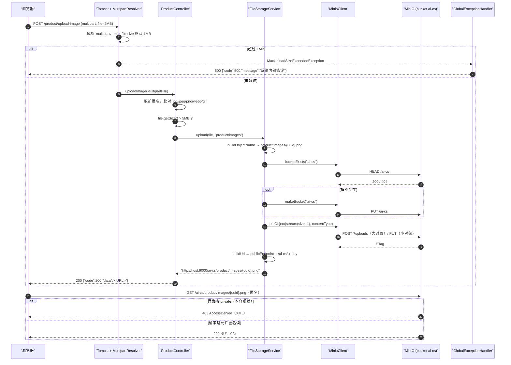

# MinIO 对象存储：它只管"存取一个 key"，权限、生命周期和一致性全是你要补的配置

> **一句话结论**：对象存储把"文件"降维成一个 HTTP 资源——你只拿到一个 `bucket/key` 和一次 `PUT`，剩下的**谁能读、能存多久、多副本在哪、超时怎么办**，它一律不替你决定；本仓 `FileStorageService` 恰好把这四件事全部隐式化了，于是三个现象（大文件 500、私有桶 403、换环境全裂）都能在代码里找到确切的成因。
> **阅读前置**：读过本篇 §0 的现象；知道 HTTP `PUT/GET` 与状态码；了解 Spring 的 `@ConfigurationProperties` 与"自动配置 + 条件装配"（不熟可先看 [自定义 Starter 与自动装配](../02-Spring微服务/10-自定义Starter与自动装配.md)）；不需要任何 S3/MinIO 使用经验。
> **证据基线**：Spring Boot 4.2.0 / JDK 17 / `io.minio:minio` **8.5.12**（`pom.xml#L57`）/ MinIO 服务端镜像 `quay.io/minio/minio:latest`；证据分三级（A 级=24-源码分析 `assets/source` 摘录；B 级=本仓代码与部署清单，行号均已 `read` 核对；C 级=本机 pwsh 实测输出，MinIO 本体不在本机）。**预计阅读 45 分钟**。

---

## 0. 先看现象

三个现象都发生在同一条链路上：`浏览器 → Controller 校验 → FileStorageService → MinioClient → MinIO`，只是断在不同的一环。**下面的报错文本是按真实成因整理的样本，不是本机抓到的原始日志**——本机没有 MinIO、没有 docker（§6.3 有实测探测），每一条都给出"在有环境的机器上怎么复现"。

### 现象 1：一张 2MB 的图，前端收到的不是"大小超限"，而是"系统内部错误"

```text
POST /product/upload-image  HTTP/1.1  →  500
{"code":500,"message":"系统内部错误","data":null}

# 服务端日志（GlobalExceptionHandler 兜底分支打的）
ERROR c.a.c.e.GlobalExceptionHandler - 系统异常 [POST] /product/upload-image
org.springframework.web.multipart.MaxUploadSizeExceededException:
  Maximum upload size exceeded
```

反直觉的地方：`ProductController` 里明明写了"图片大小不能超过 5MB"（`ai-cs-product/src/main/java/com/aics/product/controller/ProductController.java#L53-L55`），可**文件根本到不了这行判断**——Spring Boot 默认 `spring.servlet.multipart.max-file-size=1MB`，超过了在 `MultipartResolver` 解析请求体那一步就抛异常，而 `GlobalExceptionHandler` 只给 `BusinessException` 和其他几个具体异常写了分支，`MaxUploadSizeExceededException` 落进兜底（`ai-cs-common/src/main/java/com/aics/common/exception/GlobalExceptionHandler.java#L149-L154`），于是返回 500 而不是 400。

> 复现方法：任意一个能起服务、能连 MySQL 的环境，`curl -F "file=@2mb.png" http://localhost:8088/product/upload-image`。判据是日志里出现 `MaxUploadSizeExceededException`，且**业务代码里那行 5MB 判断的日志/断点从未命中**。

### 现象 2：桶是私有的，前端 `` 直接 403，接口却"上传成功"

```text
PUT http://minio.example:9000/ai-cs/product/images/xxx.png   → 200（后端 putObject 成功）
GET http://minio.example:9000/ai-cs/product/images/xxx.png   → 403

<Error><Code>AccessDenied</Code><Message>Access Denied.</Message>
<Resource>/ai-cs/product/images/xxx.png</Resource>...</Error>
```

成因在 `buildUrl` 里：上传成功后返回的是 `publicEndpoint + "/" + bucket + "/" + objectName`（`ai-cs-common/src/main/java/com/aics/common/storage/FileStorageService.java#L112-L116`），这是一个**裸的 GET URL，不带任何签名**。它的隐含前提是"这个桶允许匿名读"。而本仓**从来没有设置过桶策略**：全仓 `setBucketPolicy|SetBucketPolicyArgs` 命中 0 处（§6.3 的统计口径），MinIO 新建桶默认 `private`，于是 URL 能拼出来、能存进数据库、能被前端放进 ``，但没人有权限读。

> 复现方法：`mc anonymous get myminio/ai-cs`（应返回 "Access permission ... is `private`"），再 `curl -i <那个 URL>` 看 403 与 `<Code>AccessDenied</Code>`；把桶临时设成 `download` 后同一 URL 立刻 200 —— 这一步能证明问题在策略，不在 URL 拼装。

### 现象 3：换一台机器/换一套环境，历史图片全变成裂图

```text
# 数据库里存的东西（deploy/mysql/demo-data.sql#L128）
http://123.60.31.79:9000/ai-cs/product/images/band-pro.jpg

# 新环境里这本该是
http://minio:9000/ai-cs/product/images/band-pro.jpg      ← k8s 集群内
http://cdn.example.com/ai-cs/product/images/band-pro.jpg ← 生产 CDN
```

三处"写死"叠在一起：① `MinioProperties` 把 `endpoint` 和桶名都给了默认值 `http://123.60.31.79:9000` / `ai-cs`（`ai-cs-common/src/main/java/com/aics/common/storage/MinioProperties.java#L10-L26`）；② 部署清单注入的是 `MINIO_ENDPOINT`（`deploy/k8s/services/knowledge-service.yaml#L70-L75`），而绑定前缀是 `aics.minio`，这两个名字**永远不会**相遇（§3.5 有 A 级源码证据），所以注入是死键，运行期一直用默认值；③ 业务表存的是**完整 URL**而不是 `bucket/key`（`deploy/mysql/product-init.sql#L30` 的 `image VARCHAR(512) COMMENT '商品主图URL'`），环境一换，历史数据里的 host 全部失效，而且改不动——除非写 SQL 批量 replace。

**这些现象指向同一件事：对象存储只保证"这个 key 上有一串字节"，它不保证这串字节对谁可见、能活多久、换到别处还找不找得到——而这些恰好都是配置与设计，不是 API 能力。** 本仓用 5 行 `buildUrl`、1 个默认值字段和三处写死的清单，把这些"配置"省略成了"约定"，于是故障点从"配置错了"变成了"根本不知道有这层配置"。

---

## 1. 整体地图

```mermaid
flowchart TB
    subgraph FE["前端 / 浏览器"]
        U1["<input type=file> 选图"]
        U2["<img src=返回的URL>"]
    end

    subgraph SVC["业务模块（各自 8088 / 8086 / 8082）"]
        C1["ProductController<br/>/product/upload-image"]
        C2["ChatController<br/>/chat/upload-image"]
        C3["KnowledgeBaseController<br/>/upload"]
        C4["KnowledgeBaseService<br/>（读 Resource，不进对象存储）"]
    end

    subgraph COMMON["ai-cs-common（自动配置）"]
        A1["MinioAutoConfiguration<br/>@ConditionalOnClass/@ConditionalOnMissingBean"]
        A2["MinioProperties<br/>prefix = aics.minio"]
        A3["FileStorageService<br/>upload / delete / buildUrl"]
        A4["MinioClient<br/>（minio-java 8.5.12）"]
    end

    subgraph MW["MinIO 服务端（单节点单盘）"]
        B1["Bucket: ai-cs"]
        B2["Prefix: product/images"]
        B3["Prefix: chat/images"]
        B4["Prefix: avatar（仅有种子数据）"]
    end

    U1 -->|"multipart/form-data"| C1
    U1 --> C2
    U1 --> C3
    C1 -->|"校验扩展名 + 5MB"| A3
    C2 --> A3
    C3 --> C4
    A3 -->|"bucketExists / makeBucket"| A4
    A3 -->|"putObject / removeObject"| A4
    A4 -->|"S3 PUT"| B1
    B1 --- B2
    B1 --- B3
    B1 --- B4
    A3 -.->|"返回裸 URL（publicEndpoint 直拼）"| U2
    U2 -.->|"匿名 GET，需桶策略放行"| B1
    A2 -.->|"aics.minio.* 绑定"| A1
    A1 -.-> A3
```



> **读图说明**：
> ① 三条上传入口（`C1/C2/C3`）里**只有两条真的进对象存储**：知识库那条（`C3 → C4`）把 `MultipartFile` 直接转成 `Resource` 喂给 `DocumentLoader`，全程不碰 MinIO——看错这个箭头，你会以为"知识库文档存在桶里"，进而去桶里找不到文件还以为是权限问题。
> ② 实线 `A4 → B1` 是**用凭据签名的 S3 请求**（后端上传，一定成功才有 URL）；虚线 `U2 → B1` 是**匿名 GET**（前端读图，能不能成取决于桶策略）。把这两条混为一谈，就会得出"上传成功但下载 403 是 MinIO 坏了"的错误结论。
> ③ `A2 -.-> A1` 这条虚线是配置绑定的唯一入口：**只有 `aics.minio.*` 能被绑进来**，`MINIO_*` 形式的容器环境变量不在这个圈里（§3.5）。
> ④ `B4 avatar` 用虚线感（无代码写入）表达：`sys_user.avatar` 列存在、`demo-data.sql` 里有值，但全仓没有 `upload(file, "avatar")` 调用点——这是"表结构先有、链路上没有"的典型半落地。
> ⑤ 图中没有 CDN 节点：本仓**未接入 CDN**，生产要加速只能在 `publicEndpoint` 前面挂一层，见 §5。

| 组件 | 责任 | 调用方 |
|---|---|---|
| `MinioProperties` | 承载 `aics.minio.*`（endpoint/accessKey/secretKey/bucket/publicEndpoint），并**自带默认值** | `MinioAutoConfiguration`、`FileStorageService` |
| `MinioAutoConfiguration` | 条件装配 `MinioClient` 与 `FileStorageService`，允许业务模块自定义覆盖 | Spring Boot 自动配置装配期 |
| `FileStorageService` | 上传（UUID 化 key）、删除（按 URL 反解 key）、拼访问 URL | `ProductController`、`ChatController` |
| `MinioClient`（minio-java） | S3 协议客户端：签名、分片、重试、错误码翻译 | `FileStorageService` |
| MinIO 服务端 | 存字节、执行桶策略/生命周期/纠删码 | `MinioClient` 经 S3 API |
| `GlobalExceptionHandler` | 把异常翻译成统一 `Result`；**对上传超限没有专门分支** | 所有 Controller |

---

## 2. 关键概念与关键类

### 2.1 概念对照表

| 名称 | 在本仓哪里体现 | 角色 | 关键点 |
|---|---|---|---|
| Bucket（桶） | `MinioProperties.bucket = "ai-cs"`（单桶） | 命名空间 + **策略/生命周期/配额的挂载点** | 桶名全局唯一、只能小写字母数字与 `-`；桶一旦建好，策略就是它的"权限边界" |
| Object（对象） | `putObject(...)` 上传的那串字节 | 数据本体 + 元数据（Content-Type 等） | 没有"文件句柄"概念，每次都是完整的一次 PUT；同名覆盖是**无条件覆盖** |
| Object Key | `product/images/8f3c...e1.jpg`（`FileStorageService#L106-L110`） | 对象的唯一标识 | 不是路径！`/` 只是 key 里的普通字符，所谓"目录"是控制台按 `/` 折叠出来的 Prefix |
| Prefix（前缀） | `product/images`、`chat/images`、`avatar` | 逻辑分区，用于列表、策略、生命周期按前缀生效 | 前缀是**字符串匹配**，`chat/images` 不会匹配 `chat/images2`（策略按前缀匹配时要注意结尾 `/`） |
| S3 兼容 API | minio-java 8.5.12 走的 HTTP 接口 | 事实标准协议：`PUT /bucket/key` + SigV4 签名 | 兼容意味着可换 AWS S3/OSS/COS，代价是各家扩展（如对象标签、批量删除）行为有差异 |
| Presigned URL | **只有 3 个未使用的 import**（§3.8） | 把"某次读写权限"编码进 URL 的签名串 | 有效期有上限（SigV4 最长 7 天）；权限随签名者，非签名者拿到 URL 也只能在有效期内用 |
| Multipart Upload | `putObject(...).stream(is, size, -1)`（SDK 内部自动分片） | 大对象切成多片并发上传 | 片大小有下限（除最后一片），中断会遗留"未完成的分片"占空间，需要 Abort |
| Erasure Coding | k8s `replicas: 1` + `local-path 10Gi`（未启用纠删码） | 把对象切成数据块 + 校验块分散到多盘 | 单盘单节点 = 无冗余，盘坏即数据没了；纠删码要 ≥4 块盘才有意义 |
| Bucket Policy | 全仓未设置（命中 0 处） | 匿名/跨账号访问规则（`private`/`download`/自定义 JSON） | 默认 `private`；本仓的裸 URL 访问完全依赖它被设成可读 |
| Lifecycle | 未配置 | 按前缀的"转低频/过期删除"规则 | 没有它，删业务记录不会删对象，对象只增不减（§6.7 的孤儿文件） |

### 2.2 关键类

| 名称 | 位置 | 角色 | 关键方法 |
|---|---|---|---|
| `MinioProperties` | `ai-cs-common/src/main/java/com/aics/common/storage/MinioProperties.java` | 配置载体（`@ConfigurationProperties(prefix="aics.minio")`） | getter/setter 由 Lombok `@Data` 生成；`publicEndpoint` 决定"对外 URL 的 host" |
| `MinioAutoConfiguration` | `ai-cs-common/src/main/java/com/aics/common/autoconfigure/MinioAutoConfiguration.java` | 条件装配两个 Bean | `minioClient()`、`fileStorageService()` |
| `FileStorageService` | `ai-cs-common/src/main/java/com/aics/common/storage/FileStorageService.java` | 唯一存储门面 | `upload(MultipartFile, String)`、`delete(String url)`、`ensureBucket()`、`buildObjectName()`、`buildUrl()`、`extractObjectName()` |
| `MinioClient` | 第三方（`io.minio`） | S3 协议客户端 | `putObject`、`removeObject`、`bucketExists`、`makeBucket`（以及未使用的 `getPresignedObjectUrl`） |
| `ProductController#uploadImage` | `ai-cs-product/src/main/java/com/aics/product/controller/ProductController.java#L42-L58` | 商品图入口 | 扩展名白名单 → 5MB → `upload(file,"product/images")` |
| `ChatController#uploadImage` | `ai-cs-chat/src/main/java/com/aics/chat/controller/ChatController.java#L202-L219` | 图片对话前置入口 | 同上一套校验 → `upload(file,"chat/images")` |
| `KnowledgeBaseService#addFile` | `ai-cs-chat/src/main/java/com/aics/chat/service/KnowledgeBaseService.java#L125-L140` | 知识库文档入口 | `file.getResource()` → `DocumentLoader` → 切块入库，**绕过 MinIO** |

---

## 3. 原理与证据逐段精读

### 3.1 对象存储没有目录：`buildObjectName` 造的是一个"看起来像路径"的字符串

**这段在做什么。** `upload` 的第一步不是发网络请求，而是造 key：

```java
// (src: FileStorageService.java#L106-L110)
private String buildObjectName(String directory, String ext) {
    String dir = StringUtils.hasText(directory) ? directory
            : LocalDate.now().format(DateTimeFormatter.ofPattern("yyyy/MM/dd"));
    return dir + "/" + UUID.randomUUID().toString().replace("-", "") + ext;
}
```

（来源：`ai-cs-common/src/main/java/com/aics/common/storage/FileStorageService.java#L106-L110`）

`product/images` + `/` + 32 位无连字符 UUID + `.png`，例如 `product/images/9f2a...c7.png`。调用方传的是"逻辑目录"，函数把它拼进 key 的前缀。

**为什么这么设计。** 三个好处各自对应一个真实故障：① UUID 化让并发上传同名文件不会互相覆盖（`timg.jpg` 撞名的概率归零）；② 去掉 `-` 少 4 个字符、更适合放进 URL；③ 请求里的文件名**从不进入 key**，所以 `../../etc/passwd`、`a%2f..%2fb` 这类路径穿越载荷在存储层直接失效——这是"防路径穿越"最省事的一招，比黑名单过滤路径更可靠。

**换写法会怎样。** 若改成保留原始文件名（`dir + "/" + originalName`），你会立刻得到三个问题：同名覆盖、中文/空格需要 URL 编码、以及必须自己写路径规范化（否则 `..` 能把 key 拼到桶外语义上——对象存储层不会拦，因为它只是字符串）。若改成纯日期分目录（`2026/11/27/uuid.png`），好处是"按天归档/按天设生命周期"非常顺，坏处是**业务维度丢失**：想清理某个商品的所有图，只能扫全桶。

**常见坑。**
- `directory` 参数是**调用方传的常量**（`"product/images"`、`"chat/images"`）。今天它安全，是因为两个 Controller 都写死了字面量；一旦有人把它改成 `@RequestParam String directory` 直接透传，前缀注入就成立了——对象存储不会帮你拦。
- 扩展名取的是 `originalName.substring(lastIndexOf('.'))` 的**小写结果**，所以 `A.JPG` 会变成 `.jpg`（好事）；但 `ProductController` 取扩展名用的是 `substring(lastIndexOf('.')+1)`（去掉点），两处风格不一致，读代码时容易以为有一个是 bug。
- 日期分支写的是 `yyyy/MM/dd`（带斜杠），一旦有人改成 `yyyy-MM-dd`，"按前缀设生命周期"的规则就要跟着改——key 布局是**策略的输入**，不是无关细节。

### 3.2 一次上传其实是三次 RPC：`bucketExists` → 可能 `makeBucket` → `putObject`

**这段在做什么。**

```java
// (src: FileStorageService.java#L52-L59)
try (InputStream inputStream = file.getInputStream()) {
    ensureBucket();
    minioClient.putObject(PutObjectArgs.builder()
            .bucket(properties.getBucket())
            .object(objectName)
            .stream(inputStream, file.getSize(), -1)
            .contentType(file.getContentType() == null ? "application/octet-stream" : file.getContentType())
            .build());
```

（来源：`ai-cs-common/src/main/java/com/aics/common/storage/FileStorageService.java#L52-L59`；`ensureBucket` 见 `#L94-L104`）

`ensureBucket()` 每次都先 `bucketExists`，不存在才 `makeBucket`。所以**每个上传请求至少两条 S3 请求**（正常情况），首传是三条。

**为什么这么设计。** 这是一种"面向本地开发者的容错"：新环境第一次上传不该报 `NoSuchBucket`，本仓 `docker-compose.yml` 也没有任何"建桶"初始化容器（`docker-compose.yml#L150-L171` 只有服务定义）。代价是：① 每次上传多一次网络往返（跨机房时是 10~50ms 级）；② 并发首传时多个请求同时 `makeBucket`，幂等性靠 MinIO 返回 `BucketAlreadyOwnedByYou`——如果代码不 catch，就会出现"偶发上传失败"。这里能容忍，是因为 catch 把一切都变成 `FILE_UPLOAD_FAIL`（`#L61-L64`），代价是**错误信息被压平**：`NoSuchBucket`、`AccessDenied`、`SlowDown`、`ConnectionTimeout` 到前端全是同一句"文件上传失败: ..."。

**换写法会怎样。** 生产上通常反过来：**桶由基础设施创建**（IaC/Terraform、或 `mc mb` 一次性脚本），应用启动时用 `ApplicationRunner` 做一次健康检查（`bucketExists` 失败就快速失败），上传路径里只留 `putObject`。这样上传少一次 RPC，且"桶不存在"从运行期随机故障变成启动期确定性失败。

**常见坑。**
- `stream(inputStream, file.getSize(), -1)` 的第二个参数是 `objectSize`，第三个是 `partSize`。传 `-1` 表示"片大小由 SDK 决定"（依据 minio-java 官方 API 文档 `PutObjectArgs.Builder#stream`；本机无 MinIO，**未实测**）。也就是说**分片上传是被 SDK 自动触发的**，你的代码里看不到 `createMultipartUpload`——但 S3 侧确实会留下 multipart 上传记录，中断时会残留未合并分片，需要 Abort 或等桶的生命周期规则清理。
- `file.getSize()` 依赖 multipart 解析已经把请求体读完（或落盘）。这意味着**"大文件直传后端"的流量和临时磁盘占用发生在你的 Tomcat 上**，而不是对象存储上——这正是 §3.8 要讲的"为什么不要走后端中转"。
- `contentType` 兜底成 `application/octet-stream`：浏览器拿到这种 Content-Type 会**下载而不是内联显示**，图片裂图有时不是 403 而是这个。

### 3.3 自动配置怎么把客户端塞进来：`@ConditionalOnMissingBean` 是"让位"协议

**这段在做什么。** `MinioAutoConfiguration` 三个注解定生死：`@AutoConfiguration`（Boot 4 的自动配置入口）、`@ConditionalOnClass(MinioClient.class)`（classpath 上没有 minio 依赖就整段跳过）、`@EnableConfigurationProperties(MinioProperties.class)`（注册配置 Bean）。两个 `@Bean` 都带 `@ConditionalOnMissingBean`。

**为什么这么设计。** 条件装配的语义在 A 级摘录里就一句话：`OnBeanCondition` 负责"检查某个 bean 的存在或缺失"，它在 `getMatchOutcome` 里对 `ConditionalOnMissingBean` 单独走一个分支：

```java
// (src: OnBeanCondition.java#L134-L138)
if (metadata.isAnnotated(ConditionalOnMissingBean.class.getName())) {
    Spec<ConditionalOnMissingBean> spec = new Spec<>(context, metadata, annotations,
            ConditionalOnMissingBean.class);
    matchOutcome = evaluateConditionalOnMissingBean(spec, matchOutcome.getConditionMessage());
}
```

（摘录：`[[源码:OnBeanCondition.java.md#L134-L138]]`，来源 `org.springframework.boot:spring-boot-autoconfigure:4.2.0`）

**换写法会怎样。** 如果去掉 `@ConditionalOnMissingBean`，业务模块就无法自定义（比如给测试换成指向 `127.0.0.1:9000` 的客户端，或加一层代理做审计），任何覆盖都会变成 `BeanDefinitionOverrideException`（Boot 默认禁止覆盖）。本仓专门为这条语义写了测试：`CommonAutoConfigurationTest` 里 `@DisplayName("业务模块自定义 MinioClient - 自动配置必须让位")`（`ai-cs-common/src/test/java/com/aics/common/autoconfigure/CommonAutoConfigurationTest.java#L46-L52`），说明这个"让位"是被当契约维护的。

**常见坑。**
- `@ConditionalOnMissingBean` 的判断是**按类型**的，且**自动配置的顺序在用户配置之后**——所以你在任何 `@Configuration` 里声明 `MinioClient` 都能赢。但如果你用的是 `@Bean` 方法返回子类/包装类型，类型匹配可能不成立，两套客户端并存。
- `@ConditionalOnClass(MinioClient.class)` 写在自动配置类上时，类本身会被 ASM 读过一遍（`OnClassCondition`），所以在**没有 minio 依赖**的模块里，这个自动配置类**连加载都不会加载**，`aics.minio.*` 配了也没人消费——"配置写了但不生效"的第一嫌疑点。

### 3.4 `buildUrl` 的 5 行代码，把"桶必须公开读"变成了隐式契约

**这段在做什么。**

```java
// (src: FileStorageService.java#L112-L116)
private String buildUrl(String objectName) {
    String base = StringUtils.hasText(properties.getPublicEndpoint())
            ? properties.getPublicEndpoint() : properties.getEndpoint();
    return base + "/" + properties.getBucket() + "/" + objectName;
}
```

（来源：`ai-cs-common/src/main/java/com/aics/common/storage/FileStorageService.java#L112-L116`）

上传成功后返回的是**拼接字符串**，不是一次签名。这就是现象 2 的全部成因，也是"存 URL 不存 key"（现象 3）的起点。

**为什么这么设计。** 它换来了极简：前端拿到就能 ``，不用换 token、不用处理过期、不用二次请求。适用于"图片就是要公开访问"的场景（商品图、聊天图）。但它把三个决策悄悄做掉了：① 桶策略必须是可匿名读；② 对外 host 必须是 `publicEndpoint`（内网 endpoint 直拼会让浏览器拿到 `http://minio:9000/...` 这种不可解析地址）；③ 这个 URL 一旦落库，就和环境绑定。

**换写法会怎样。** 三种主流替代，各有明确代价：
- **私有桶 + 预签名 URL**：`getPresignedObjectUrl` 生成带签名、带有效期的链接。适合私有文件（用户头像、合同、知识库原文）。代价：URL 会过期，前端缓存/分享链接必须重新签发；服务端每次读都要一次签名运算（便宜）或提前批量生成。
- **私有桶 + 后端代理流式转发**：`GET /files/{key}` 由后端 `statObject` + `getObject` 流回。适合需要鉴权审计的场景。代价：**所有读流量走你的 JVM**，带宽与堆外内存都要自己扛。
- **公开桶 + CDN 回源**：最省钱最快。代价：对象一旦公开就是真的公开——URL 泄露无法撤回（只能改名重传）。

**常见坑。**
- `publicEndpoint` 为空时回落到 `endpoint`。容器里 `endpoint` 常是 `http://minio:9000`（集群内 DNS），**拼出来的 URL 前端永远打不开**。本仓恰好把 `endpoint` 默认成公网 IP，所以本地能跑、上 k8s 就裂——两个方向的坑都踩得到。
- 拼接假设 key 不需要 URL 编码。UUID + 扩展名是安全的；一旦 key 里出现空格、中文、`#`、`?`，拼出来的 URL 会被浏览器截断（`#` 后面的部分当 fragment 丢掉）。
- 返回 `String` 而不是结构体（`StoredObject{bucket,key,url}`）：调用方无法在"要签名"和"要裸 URL"之间选择，这也是 §5 可扩展点里"最小改动"的第一条。

### 3.5 `MINIO_ENDPOINT` 为什么永远不会生效：环境变量名到属性名的映射只做一次减法

**这段在做什么。** Spring Boot 把容器环境变量映射成配置属性时，只做"大小写 + 分隔符"的变形，**不加任何前缀**。A 级摘录里的 `convertName` 就是全部逻辑：

```java
// (src: SystemEnvironmentPropertyMapper.java#L60-L72)
private ConfigurationPropertyName convertName(String propertySourceName) {
    try {
        return ConfigurationPropertyName.adapt(propertySourceName, '_', this::processElementValue);
    }
    catch (Exception ex) {
        return ConfigurationPropertyName.EMPTY;
    }
}

private CharSequence processElementValue(CharSequence value) {
    String result = value.toString().toLowerCase(Locale.ENGLISH);
    return isNumber(result) ? "[" + result + "]" : result;
}
```

（摘录：`[[源码:SystemEnvironmentPropertyMapper.java.md#L60-L72]]`，来源 `org.springframework.boot:spring-boot:4.2.0`；类注释 `#L17-L21` 举的例子是 `SERVER_PORT → server.port`）

于是 `MINIO_ENDPOINT` → `minio.endpoint`。而 `MinioProperties` 声明的前缀是 `aics.minio`（`ai-cs-common/src/main/java/com/aics/common/storage/MinioProperties.java#L10`）。`minio.endpoint` 与 `aics.minio.endpoint` 是两个不同的属性名，宽松绑定**不做前缀补全**——想生效必须是 `AICS_MINIO_ENDPOINT`。

**为什么这么设计。** 反过来做（模糊匹配、"猜到最近的前缀"）会让配置空间不可预测：一个 `HOST` 变量可能撞上十个属性的后半段。Boot 的选择是"映射必须是双射"，代价就是**前缀写错就静默失效**——不报错、不打日志、不警告。

**换写法会怎样。** 三条可行路线：① 改清单变量名为 `AICS_MINIO_ENDPOINT/AICS_MINIO_ACCESS_KEY/AICS_MINIO_SECRET_KEY`（最小改动，但存量部署要同步改）；② 改 `MinioProperties` 前缀为 `minio`（影响所有已写的 `aics.minio.*`，且与 `ai-cs-chat.yml` 里已有的 `aics.vision.*` 风格割裂）；③ 在 `application.yml` 里显式写 `aics.minio.endpoint: ${MINIO_ENDPOINT:http://123.60.31.79:9000}` —— **推荐这条**，它把"环境变量名"显式声明出来，谁都能一眼看到绑定关系，且不会推翻现有前缀。

**常见坑。**
- 生效性验证只能在启动后做：`/actuator/env`（若暴露）或启动时打一行 `log.info("minio endpoint={}", properties.getEndpoint())`。**静默失效的配置，唯一可靠的发现手段是把它打出来。**
- 同一个坑在本仓不止一处，`ELASTICSEARCH_URIS` 之类同样对不上 `spring.elasticsearch.uris`；这套"死键"分析在 [多环境配置与漂移治理](../16-云原生与GitOps/07-多环境配置与漂移治理.md) 里有系统性写法，本篇只讲 MinIO 这一段。
- 本仓 12 个模块的 `application.yml` 里**没有任何 `aics.minio.*` 段**（`ai-cs-product/src/main/resources/application.yml#L1-L56` 可作样本，全文只有 server/spring/seata/management），所以运行期行为完全由"Properties 默认值 + 是否有人注入对前缀的变量"决定。

### 3.6 大小限制有两道闸门，本仓只装了靠后那道

**这段在做什么。** 上传链路里真正拦住超大文件的是**第一道**：
1. **容器层**：Spring Boot 的 `MultipartProperties`，默认 `max-file-size=1MB`、`max-request-size=10MB`（依据 Spring Boot 官方文档《Common Application Properties》`spring.servlet.multipart.*` 一节；本项目全仓 grep `multipart|max-file-size|max-request-size` 命中 **0 处**，见 §6.3，故运行期就是默认值）。
2. **业务层**：Controller 里的 `file.getSize() > MAX_IMAGE_SIZE`（5MB）。

**为什么这么设计（以及本仓为什么错位）。** 容器层的限制是"防打爆内存/磁盘"，业务层的是"产品规则"，两者本就该不同值，而且**业务值必须 ≤ 容器值**才有意义。本仓反了：1MB < 5MB，于是 5MB 判断是死代码（对 1~5MB 的文件永远走不到）。更糟的是失败形态：容器层抛 `MaxUploadSizeExceededException`，而 `GlobalExceptionHandler` 没有这个分支（只有 `BusinessException`、几个参数校验异常、`IllegalArgumentException`、`NoHandlerFound`，最后 `Exception` 兜底，`ai-cs-common/src/main/java/com/aics/common/exception/GlobalExceptionHandler.java#L149-L154`），前端看到的是 500"系统内部错误"——**用户以为是服务挂了，其实是文件大了 1MB**。

**换写法会怎样。** 正确姿势是显式声明容器值并给出可读错误：

```yaml
# 建议写法（本仓当前缺失；放各模块 application.yml 或 Nacos 公共配置）
spring:
  servlet:
    multipart:
      max-file-size: 10MB      # 容器闸门：必须 ≥ 业务闸门
      max-request-size: 12MB
```

并补一个 `@ExceptionHandler(MaxUploadSizeExceededException.class)` 返回 413/400。若真是"200MB 视频"这类场景，正确解法是**不走后端**：预签名直传（§3.8），此时容器层限制与业务无关。

**常见坑。**
- 只加业务校验、不改容器值 → 现象 1（用户看到 500）。
- 只改容器值、不写业务校验 → 有人能传 100MB 的"图片"进桶，S3 计费和回源流量一起涨。
- 网关上还有一层：Spring Cloud Gateway 的 `spring.codec.max-in-memory-size` 与 Nginx 的 `client_max_body_size` 都会先于 Tomcat 拒绝，报的错又不一样（413 或连接被重置）。排查时必须**从最外层往里数闸门**，见 §6.1。

### 3.7 删除只接受 URL：`extractObjectName` 与"永远删不掉"的孤儿对象

**这段在做什么。**

```java
// (src: FileStorageService.java#L118-L122)
private String extractObjectName(String url) {
    String marker = "/" + properties.getBucket() + "/";
    int index = url.indexOf(marker);
    return index >= 0 ? url.substring(index + marker.length()) : null;
}
```

（来源：`ai-cs-common/src/main/java/com/aics/common/storage/FileStorageService.java#L118-L122`）

`delete(String url)` 先用 `"/ai-cs/"` 这个字符串在 URL 里找位置，切出 key 再 `removeObject`。

**为什么这么设计。** 因为上传返回的是 URL，调用方手里只有 URL——把 key 反解出来是最自然的对称设计，也解释了为什么"存 URL"这个选择会渗透到删除接口：**一个设计错误会传染整条链路**。

**换写法会怎样。** 这个反解有三个硬毛病：① 桶名换了（`ai-cs` → `ai-cs-prod`），历史 URL 里的 marker 找不到，`extractObjectName` 返回 `null`，`delete` **静默什么都不做**（`#L78-L81` 直接 return）；② CDN 改写 URL（`https://cdn.x.com/product/images/a.png` 抹掉了桶名）→ 同样反解失败，静默；③ URL 里带 query（预签名 URL 一定有 `?X-Amz-Signature=...`）→ 切出来的 key 会带上 query，删除失败。所以正确做法是**业务表存 `bucket + key`，删除只接 key**，URL 在返回给前端时现拼。

**常见坑。**
- **本仓 `fileStorageService.delete(...)` 的调用点是 0 处**（§6.3 统计）：上传有两条链路，删除一条都没有。结果就是"换了商品图，旧图永远躺在桶里"——这类孤儿对象只能靠生命周期规则或对账脚本清理，而本仓也没配生命周期。
- 删除成功不代表可回收：S3 语义里 `DELETE` 是幂等的，删不存在的对象也返回 204——所以"删了但没删掉"从返回值上根本看不出来。

### 3.8 预签名：代码里留了 3 个 import，一次都没调用

**这段在做什么。** `FileStorageService` 的 import 区有 `GetPresignedObjectUrlArgs`、`io.minio.http.Method`、`java.util.concurrent.TimeUnit`（`ai-cs-common/src/main/java/com/aics/common/storage/FileStorageService.java#L6`、`#L11`、`#L21`），但全仓 `getPresignedObjectUrl` 的调用点 **0 处**（只有这一行 import 命中）。

**为什么这么设计（原意）。** 预签名的思路是：不把字节流经后端，而是后端用**自己的凭据**给一个"临时通行证"——把 `bucket/key + 过期时间 + 允许的 method` 放进签名串生成 URL，浏览器拿着它直接对 MinIO 发 `PUT`/`GET`。收益有三个：① 大文件不占 Tomcat 内存/临时盘（现象 1 的 200MB 视频场景就靠它）；② 上传/下载带宽绕过应用服务器；③ 权限是"每次签发时判定"的，天然支持"这个用户只能传自己的目录"。

**换写法会怎样。** 分上传与下载两种：

| 场景 | 后端要做的 | 浏览器要做的 | 代价 |
|---|---|---|---|
| 预签名上传 | 生成 `PUT` 预签名 URL（含 `Content-Type`、有时含 `Content-Length` 约束） | 直接 `PUT` 到该 URL，成功后回调后端登记 key | 前端要处理分片（大文件）与失败重试；后端要防"签了不传"的垃圾 URL |
| 预签名下载 | 生成 `GET` 预签名 URL | `` 或 `location.href` | URL 有效期决定缓存策略，分享出去的链接会过期 |

**常见坑。**
- 有效期**不是随便填**：SigV4 签名的预签名 URL 最长 7 天（604800 秒，依据 AWS S3 官方文档《Authenticating Requests: Using Query Parameters (AWS Signature Version 4)》的签名有效期上限说明；MinIO 兼容该行为）。旧教程里"设 30 天"在 8.x 会直接报错或被截断。本仓旧稿曾写"预签名 7 天"，实际代码里**没有**这段。
- 预签名上传时如果签了 `Content-Type`，浏览器必须发**完全一致**的 header，否则 `SignatureDoesNotMatch`。这是最常见的"签名看着对但 403"。
- 预签名 URL 里的凭据是**签发者的权限**。用 root 凭据签出去的 URL，等于把 root 的读写能力临时外借——生产上应该用只对某个前缀有权限的 access key 来签。

### 3.9 知识库文档为什么不进对象存储：`getResource()` 直接喂给 DocumentLoader

**这段在做什么。**

```java
// (src: KnowledgeBaseService.java#L125-L140 摘要，非逐行原文)
public int addFile(String knowledgeBase, MultipartFile file) {
    // 把 MultipartFile 转成 Spring Resource，交给 DocumentLoader 读取
    Resource resource = file.getResource();
    ...  // isPdf → loadPdf；isTika(docx/xlsx/html) → loadTika；否则 loadText
}
```

（来源：`ai-cs-chat/src/main/java/com/aics/chat/service/KnowledgeBaseService.java#L125-L140`；格式判定在 `#L298-L316`）

**为什么这么设计。** RAG 只关心"文本块 + 向量"，原文留不留、存在哪，对检索没有影响。直接 `getResource()` 少一次上传、少一次下载，本地开发最省事。

**换写法会怎样。** 生产上几乎一定要落对象存储：① 重新向量化需要原文（换了 embedding 模型必须重跑）；② 审计/追责需要"用户到底传了什么"；③ 大文档重解析不应依赖请求线程的临时文件。落地的改动面很清楚：`addFile` 里先 `fileStorageService.upload(file, "knowledge/docs")` 拿到 key，写进知识库文档表（`document`/`file` 记录），再解析。本项目**当前未落地**，本篇涉及"知识库原文归档"的结论都属于"设计建议"而不是现状。

**常见坑。**
- 知识库上传**没有**扩展名白名单与大小校验（`ChatController` 的 5MB/图片白名单只作用于 `/chat/upload-image`），所以知识库这条路径的安全性完全取决于"谁能调到这个接口"。这是与本篇主题（文件安全）直接相关的缺口。
- `isPdf` 只按后缀 `.pdf` 判断（`#L298-L301`），改个后缀就能让 PDF 走文本解析，结果是乱码而不是报错——"按扩展名分派"的通病。

---

## 4. 一次完整执行时序

以 `POST /product/upload-image` 为例（`ai-cs-product/src/main/java/com/aics/product/controller/ProductController.java#L42-L58`）：



> **读图说明**：
> ① 第 2 步是**唯一**会因"文件太大"而失败的闸门（默认 1MB），第 6 步的 5MB 判断在它后面——这就是现象 1 的顺序证据：**闸门在前，提示在后**。
> ② 第 10~14 步是"三次 RPC"：`HEAD /bucket` + 可能的 `PUT /bucket` + 对象上传。首传比后续多一条，跨机房时这部分是纯延迟开销（§3.2）。
> ③ 第 15 步区分了"大对象走 multipart"与"小对象走单次 PUT"，本仓代码里看不到这个分支，是 SDK 依据 `partSize` 自动决定的（§3.2 的常见坑）。
> ④ 末尾两段 `alt` 是**两条互不相干的链路**：签名 PUT（凭据）与匿名 GET（桶策略）。上传成功、下载 403 不矛盾，它们本来就不同权。
> ⑤ 图中没有"删除对象"与"CDN 回源"：前者调用点为 0，后者未接入（§5）。

**哪一步失败，报什么错：**

| 失败位置 | 典型异常/响应 | 怎么认 |
|---|---|---|
| 2 步：超过容器上限 | `MaxUploadSizeExceededException`，最终 500"系统内部错误" | 日志有 `系统异常 [POST] /product/upload-image`；业务 5MB 分支从未命中 |
| 2 步：网关/Nginx 更早拦 | HTTP 413 或连接被重置，服务端无日志 | 从最外层数闸门（§6.1） |
| 6 步：扩展名不在白名单 | `BusinessException(PRODUCT_IMAGE_INVALID 8006)`（`ResultCode.java#L95`） | 报错文案"仅支持 jpg/png/webp/gif 格式" |
| 6 步：超 5MB（若容器值调大） | `PRODUCT_IMAGE_TOO_LARGE 8007`（`ResultCode.java#L96`） | 报错文案"图片大小不能超过 5MB" |
| 10 步：连不上 MinIO | `ConnectException/SocketTimeoutException` → 包成 `FILE_UPLOAD_FAIL 9001`（`ResultCode.java#L101`） | 消息里带 `文件上传失败: ...`，根因被藏在 message |
| 10 步：凭据错 | S3 `SignatureDoesNotMatch` / `InvalidAccessKeyId` → 同上 | 同上（**错误码被压平**，必须看日志的 `文件上传失败: object=...` 里附带的堆栈） |
| 10 步：桶属于别人 | `BucketAlreadyOwnedByYou`/`AccessDenied` → 同上 | 同上 |
| 15 步：返回 URL 但读不到 | 匿名 GET 403 `AccessDenied`（现象 2） | 后端日志"上传成功"，浏览器 403 —— 两侧证据矛盾时以桶策略为准 |
| 15 步：URL host 不对 | 浏览器 `ERR_NAME_NOT_RESOLVED` / `Connection refused` | URL 里出现 `minio:9000` 这类集群内地址（§3.4 坑 1） |

---

## 5. 设计取舍

### 5.1 本仓做了哪些选择

| 决策点 | 本仓选择 | 放弃了什么 | 换来的什么 |
|---|---|---|---|
| 存什么到业务表 | 完整 URL（`product.image VARCHAR(512)` 注释即"商品主图URL"） | 环境可迁移性、CDN/签名切换能力 | 前端零处理、字段可读性好（直接能看到图） |
| 桶的划分 | 单桶 `ai-cs` + 前缀分区（`product/images`、`chat/images`、`avatar`） | 按业务/租户独立配额与策略 | 一套凭据、一处配置；但"删一个业务的所有文件"只能靠前缀扫描 |
| 谁能读 | 依赖桶被设为可匿名读（实际未设，默认 private） | 细粒度权限 | 无签名、无过期、可直接 `` |
| 上传通道 | 后端中转（`MultipartFile` → `putObject`） | 大文件吞吐、应用无状态化 | 校验在一处（扩展名/大小）、实现最短 |
| 删除 | 按 URL 反解 key（`extractObjectName`） | 可靠性（换桶/带 query 即失效） | 接口签名与上传对称；**实际调用点 0 处** |
| 清理 | 无生命周期规则、无对账脚本 | 存储成本可控 | 零运维；代价是孤儿对象永久累积 |
| 冗余 | 单节点单盘（k8s `replicas: 1` + `local-path 10Gi`） | 纠删码/多副本带来的容灾 | 学习环境部署最简；**盘坏即数据丢** |
| 元数据 | 只存 Content-Type，无自定义 metadata、无 MD5 | 完整性校验、内容审计 | 少写代码；代价是无法判断"桶里的字节是否被改过" |

### 5.2 对象存储 vs 本地磁盘 vs NFS（换存储前的对照）

| 维度 | 本地磁盘（`/data/upload`） | NFS 共享盘 | 对象存储（MinIO/S3） |
|---|---|---|---|
| 访问协议 | 文件系统 `open/read` | NFS v3/v4 | HTTP + S3 API（`PUT/GET/HEAD`） |
| 多实例共享 | 不行（各实例各一份） | 可以，但锁与一致性弱 | 天生共享，无状态扩容 |
| 水平扩展 | 受单机磁盘上限 | 受 NAS 性能上限 | 加节点即扩（分布式模式） |
| 大文件 | 简单，直接流式写 | 取决 NAS 带宽 | 分片上传，可并发/断点续传 |
| 权限模型 | OS 用户/ACL，容易配错 | 同左 + export 规则 | 桶策略 + 预签名，可做到"每个请求一次判定" |
| 公网直读 | 需要 Nginx 暴露目录（易配成目录穿越） | 同左 | 原生支持（+CDN） |
| 生命周期/归档 | 自己写脚本 + cron | 自己写 | 桶规则声明式（转低频/过期删） |
| 冗余 | RAID | NAS 自身 RAID/快照 | 纠删码/多副本（需分布式部署） |
| 一致性 | 强（本地） | 弱（缓存/属性延迟） | 读后写强一致；**列表操作最终一致**（S3 语义，MinIO 单机基本即时） |
| 运维成本 | 最低 | 中（依赖 NAS） | 中高（要管集群、凭据、策略、配额） |
| 适合 | 单机 demo、临时文件 | 遗留系统、共享目录型业务 | 图片/文档/附件、需要 CDN 与多实例共享 |

**结论性判断**：本项目是"多微服务 + 前端直读图片"，本地磁盘会在 `product` 与 `chat` 两个模块间产生"文件在哪台机器上"的问题，NFS 会把可用性绑在 NAS 上——对象存储是正确选型，**但选对组件不等于配对了语义**，§0 的三个现象就是"用了对象存储、却按本地磁盘的心智模型在用"。

### 5.3 可扩展点清单（按"改动面从小到大"）

- **改配置就能生效**：`aics.minio.endpoint/publicEndpoint/bucket` 显式写进 `application.yml` 并接 `${MINIO_ENDPOINT:...}`；补 `spring.servlet.multipart.*`；补 `@ExceptionHandler(MaxUploadSizeExceededException.class)`。
- **改一个类**：`FileStorageService` 增加 `uploadPresigned(...)`（签发 PUT URL）与 `presignedGet(key, Duration)`；把 `buildUrl` 抽成 `UrlStrategy`（裸 URL / 预签名 / CDN 前缀三实现）。
- **改表结构**：`product.image` 拆成 `object_bucket + object_key`（或新增列并保留 `image` 做兼容），返回时现拼 URL——这是现象 3 的根治手段。
- **加基础设施**：`mc mb` 建桶 + `mc anonymous set download`（或自定义 policy）；`mc ilm rule add` 配生命周期（如 `chat/images` 90 天过期、`product/images` 转低频）。
- **加安全层**：魔数校验（读前 8 字节比对 JPEG `FF D8 FF` / PNG `89 50 4E 47`）、图片重编码（`ImageIO.read` 后再写，剥离 EXIF 与嵌入脚本）、病毒扫描（ClamAV 侧车 + 上传后异步扫描，扫不过就隔离）。
- **加可观测**：上传/下载耗时与大小打点（Micrometer），桶使用量巡检脚本，孤儿对象对账（DB 里的 key 集合 vs `listObjects` 结果做差集）。

---

## 6. 踩坑与调试手法

### 6.1 现象 1 的排查顺序：从最外层闸门往内数

① 网关/Nginx 是否先拦（看有没有 413 与 `client_max_body_size`）；② 服务端日志里是 `MaxUploadSizeExceededException` 还是业务 `BusinessException`（前者=容器层，后者=业务层）；③ `grep -r "max-file-size" ai-cs-*/src/main/resources` 确认没人配过（本仓 0 处，§6.3）；④ 才去看 Controller 的判断。**顺序错了会白改代码**：改 Controller 的 5MB 常量对 1MB 闸门毫无作用。

### 6.2 现象 2 的排查顺序：分清"上传成功"与"读得到"

① 后端日志确认 `文件上传成功: bucket=..., object=...`；② 用服务端凭据验证对象存在（`mc stat myminio/ai-cs/product/images/x.png`）；③ 用**匿名**方式验证可读（`curl -i <url>` → 403 + `<Code>AccessDenied</Code>` 就是策略问题）；④ `mc anonymous get myminio/ai-cs` 看当前策略；⑤ 若产品不允许公开，改用预签名 URL 对照（同一 key，签名 URL 能读 → 证明对象没问题，是策略/权限问题）。**判据一句话：凭据能读、匿名不能读 = 策略问题；凭据也读不到 = key 或桶错。**

### 6.3 【调试手法】一条命令数清"上传入口、限制常量、MinIO API 用法"的真实分布

```powershell
Get-ChildItem -Recurse -Include *.java -Path ai-cs-*\src\main\java |
  Select-String -Pattern 'MAX_IMAGE_SIZE|ALLOWED_IMAGE_EXT' -Encoding utf8 |
  ForEach-Object { "{0} :: L{1} :: {2}" -f (($_.Path -split '\\src\\main\\java\\')[0]), $_.LineNumber, $_.Line.Trim() }
```

真实输出（本机跑过）：

```text
ai-cs-chat :: L61 :: private static final Set<String> ALLOWED_IMAGE_EXT = Set.of("jpg", "jpeg", "png", "webp", "gif");
ai-cs-chat :: L64 :: private static final long MAX_IMAGE_SIZE = 5 * 1024 * 1024L;
ai-cs-chat :: L211 :: if (!ALLOWED_IMAGE_EXT.contains(ext)) {
ai-cs-chat :: L214 :: if (file.getSize() > MAX_IMAGE_SIZE) {
ai-cs-product :: L33 :: private static final Set<String> ALLOWED_IMAGE_EXT = Set.of("jpg", "jpeg", "png", "webp", "gif");
ai-cs-product :: L36 :: private static final long MAX_IMAGE_SIZE = 5 * 1024 * 1024L;
ai-cs-product :: L50 :: if (!ALLOWED_IMAGE_EXT.contains(ext)) {
ai-cs-product :: L53 :: if (file.getSize() > MAX_IMAGE_SIZE) {
```

同一口径下再统计 MinIO API 与配置：

```text
PutObjectArgs = 2              # 声明 + 使用，实际只有 1 处 putObject
RemoveObjectArgs = 2
MakeBucket = 2
BucketExists = 2
GetPresignedObjectUrl = 1      # 只有 import，无调用
multipart|max-file-size|max-request-size 在 yml/properties 里命中 0 处
```

> **这一版命令是我改过的**：第一版我写 `"docker: " + (if (Get-Command docker ...) {...})`，pwsh 直接报 `无法将"if"项识别为 cmdlet`——**`if` 是语句不是表达式**，得先赋值再判断。命令写错不会让你得到空结果，而是得到一条看起来"没数据"的报错，很容易误读成"本机没有 docker 但有 docker 时也不会输出"。**怎么读这张表**：`MAX_IMAGE_SIZE` 出现 2 次定义 + 2 次使用，说明两个模块各抄了一份（改漏洞要改两处）；`GetPresignedObjectUrl` 只有 import 无调用，说明"预签名"是设计意图而非现状；multipart 命中 0 处，说明现象 1 的根因是"没人配过"而不是"配错了"。

### 6.4 【调试手法】确认配置到底有没有生效：三步静态 + 一步运行期

静态三步（本机可跑，真实输出）：

```text
① Get-ChildItem -Recurse -Include *.yml,*.yaml *.properties -Path ai-cs-*,deploy,tools |
     Select-String 'aics\.minio'           → 命中 0 处（业务配置里根本没写这个前缀）
② Select-String -Path deploy\**\*.yaml 'MINIO_' → 命中 3 处（MINIO_ENDPOINT/ACCESS_KEY/SECRET_KEY）
③ 对照 MinioProperties.java:10 的前缀 aics.minio → ②的名字全不匹配 → 死键
```

运行期一步（**本机无 MinIO，以下命令未实测，只给判读方法**）：

```powershell
# 在有环境的机器上：确认进程环境里到底有没有 MINIO_*
docker exec aics-knowledge-service env | Select-String MINIO
# 确认 Spring 到底吃到了什么（需 management.endpoints.web.exposure.include 含 env）
curl http://localhost:8082/actuator/env/aics.minio.endpoint
# 最能一击定胜负的：启动日志里自己打一行 properties.getEndpoint()
```

判读方法：`env` 有变量、`/actuator/env` 查不到 `aics.minio.endpoint` → 死键；两者都有值但值仍是 `123.60.31.79` → 配置源优先级问题（Nacos/环境变量冲突）。

### 6.5 现象 3 的排查顺序：先分清是"读不到"还是"地址不对"

① 从库里捞一条图片字段看 host（`select image from product limit 3`）；② 判断这个 host 在当前网络里能不能解析（`nslookup`/`curl -I`）；③ 若 host 是旧的公网 IP/集群内 DNS，就是"存了 URL 而非 key"的直接后果；④ 修复分两条路：短期 SQL 批量 replace，长期改存 key（§5.3）。**别先怀疑 MinIO 迁移丢数据**——对象通常还在，只是没人知道它的 key。

### 6.6 【调试手法】数清"数据库里硬编码了多少个对象地址"

```powershell
$hits = Select-String -Path deploy\mysql\demo-data.sql -Pattern '123\.60\.31\.79:9000' -Encoding utf8
"命中行数 = $($hits.Count)"
$hits | ForEach-Object { "L$($_.LineNumber) : 长度 $($_.Line.Length)" }
```

真实输出：`命中行数 = 13`，其中 `L6` 是注释（`-- 图片地址: 使用已配置的 MinIO（http://123.60.31.79:9000，桶 ai-cs）`），其余 12 行是种子数据——`sys_user.avatar`（`L20-L24`，5 行）与 `product.image`（`L128-L134`，7 行），行长度 125~134 字符。

**怎么读**：① 12 条 seed 值全部把"环境地址"烘进了数据，`image` 列 `VARCHAR(512)`（`deploy/mysql/product-init.sql#L30`）只用了约 1/4——说明**列宽不是瓶颈，语义才是**；② 想验证"改配置能不能救回来"，就把这 12 行里的 host 换掉再跑一次前端：能显示说明只是地址问题，不能显示才是权限问题（回到 §6.2）。③ 顺带一个结论：`avatar` 有 5 行数据、却没有任何 `upload(file,"avatar")` 调用点，说明头像链路只做了"存"没做"传"。

### 6.7 扩展名白名单挡不住"改名"，也挡不住图片里藏东西

`ProductController` 只判扩展名（`#L47-L52`），不读魔数、不重编码、不扫毒。于是：`evil.exe` 改名 `evil.png` 能过；`logo.png` 里塞进 `<script>` 的多义文件（polyglot）能过；EXIF 里的 GPS/设备信息原样进桶。补法按成本排序：**读魔数**（8 字节比对，零依赖）→ **重编码**（`ImageIO.read` + `write`，顺手剥 EXIF 与尾随数据）→ **异步扫描**（ClamAV）。三者都不做时，唯一的兜底是"桶永远不公开 + 下载时强制 `Content-Disposition: attachment`"，否则一次 XSS 就够。

### 6.8 路径穿越：现在挡住了，但挡它的是 UUID 不是白名单

`buildObjectName` 用 UUID + 扩展名，请求里的文件名只贡献扩展名，所以 `../` 进不了 key。但要清楚这条防线**只有一个来源**：一旦有人给 `upload` 传了 `@RequestParam` 来的 `directory`，`../../other-bucket` 就能构造出来；一旦有人把返回的 URL 直接拼进本地文件路径做"备份"，穿越又回来了。**判断标准**：凡是"用户输入会进入 key 或本地路径"的地方，都必须过一遍 `Paths.get(x).normalize()` 或以白名单枚举，而不是靠"反正我用了 UUID"。

---

## 7. ⚠️ 版本差异

| 主题 | 旧写法（教程/本文件旧稿） | 当前基线（本仓实测） | 变化点 | 迁移动作 |
|---|---|---|---|---|
| minio-java 版本 | 旧稿写 **8.5.7** | **8.5.12**（`pom.xml#L57`） | 8.5.x 内部对分片、重试、S3 错误码映射有迭代；`PutObjectArgs.Builder#stream` 的 `partSize=-1` 语义以当前版本 API 文档为准 | 别照抄旧稿版本号；升级前比对 release notes 里 multipart 与 TLS 相关条目 |
| 传递依赖冲突 | 旧稿未提 | `pom.xml#L195-L201` 显式钉 `commons-compress 1.28.0`，注释："避免 MinIO 传递的 1.26.0 导致文档格式探测失败" | MinIO SDK 会把 commons-compress 带到较低版本，**与 Spring AI 2.1 的 Tika 4 / POI 5.5.1 冲突**，症状是知识库文档格式探测失败（不是上传失败） | 保持 dependencyManagement 里的 1.28.0；排查"文档解析报 `NoSuchMethodError`"时先看这条依赖树 |
| 配置前缀 | 旧稿写 `minio.endpoint` / `minio.access-key`，桶分 `knowledge`/`avatar` 两个 | `aics.minio.*`（`MinioProperties.java#L10`），**单桶 `ai-cs` + 前缀分区** | 前缀与桶结构都换了；旧稿的 yaml 直接抄进项目会完全不生效 | 配置一律以 `MinioProperties` 的字段名为准；新增桶之前先想清楚"策略/配额是否需要隔离" |
| 访问方式 | 旧稿写"预签名 URL 7 天" | 实际是**裸 URL 直拼**；预签名只剩 3 个未使用 import | 设计意图与实现不一致；SigV4 预签名上限 7 天（AWS S3 官方文档，《Authenticating Requests: Using Query Parameters》） | 真要上线预签名，先确认有效期 ≤ 7 天，并统一 `Content-Type` |
| 服务端镜像 | 旧稿 `minio/minio:latest`（Docker Hub） | compose 用 `quay.io/minio/minio:latest`（`docker-compose.yml#L152`）、k8s 用 `minio/minio:latest`（`deploy/k8s/minio.yaml#L50`） | 官方主推 quay.io；两处 tag 不一致且都是 `latest` | 钉住具体版本 tag；两处统一，否则"同一份代码两个环境行为不同" |
| 凭据环境变量 | 旧稿/Docker Hub README 常见 `MINIO_ACCESS_KEY`/`MINIO_SECRET_KEY` | 服务端用 `MINIO_ROOT_USER`/`MINIO_ROOT_PASSWORD`（`docker-compose.yml#L159-L160`、`deploy/k8s/minio.yaml#L62-L65`）；**客户端**却仍注入 `MINIO_ACCESS_KEY`（`knowledge-service.yaml#L72-L75`） | 服务端变量名换代（官方文档《MinIO Server 环境变量》说明 root 凭据改用 `MINIO_ROOT_*`），客户端注入仍在用旧名——**而且前缀也错**（§3.5） | 服务端保持 `MINIO_ROOT_*`；客户端改用 `AICS_MINIO_ACCESS_KEY`，或在 yml 里显式 `${MINIO_ACCESS_KEY:...}` |
| Spring Boot 版本 | 旧稿假设 Boot 2.x/3.x 的 `spring.servlet.multipart` 与 `@Configuration` 写法 | Boot **4.2.0**：自动配置类用 `@AutoConfiguration`（`MinioAutoConfiguration.java#L15`），`jakarta.servlet` 命名空间 | Boot 4 不再推荐 `spring.factories` 注册；条件装配语义未变（A 级 `OnBeanCondition.java#L134-L138` 仍是同一分支） | 自定义 starter 时用 `@AutoConfiguration` + `AutoConfiguration.imports` |
| 单机 vs 分布式 | 旧稿只讲"docker run 一条命令" | k8s 清单是 `replicas: 1` + `local-path 10Gi`（`deploy/k8s/minio.yaml#L39`、`#L90-L96`），注释直接写"学习环境" | 分布式纠删码模式需要 ≥4 块盘并指定 `MINIO_VOLUMES` 为多路径；单机单盘无任何冗余 | 生产要冗余必须换部署形态（多节点 + 多盘），这是清单层面的改动，不是应用代码能补的 |

---

## 8. 面试高频问与答

1. 对象存储的 Bucket、Object、Prefix 分别是什么？为什么说"对象存储没有目录"？
2. 为什么对象存储适合存图片/文档，而不适合存"需要随机改几个字节"的文件？
3. S3 兼容 API 的兼容性边界在哪？换到 AWS S3 或阿里 OSS 时哪些行为会不一样？
4. 预签名 URL 的签名里包含什么？为什么它能做到"不给对方凭据也能让他上传"？
5. 预签名 URL 的有效期上限是多少？为什么不能无限长？
6. 为什么大文件上传不要走后端中转？预签名直传后你怎么确认"文件真的传上来了"？
7. 分片上传（Multipart Upload）的片大小有什么约束？上传中断会留下什么垃圾，怎么清理？
8. 桶策略（Bucket Policy）和对象 ACL 有什么区别？默认策略是什么？
9. 生命周期规则能做什么？为什么"删了数据库记录"不等于"删了对象"？
10. 纠删码（Erasure Coding）和多副本有什么区别？单节点单盘部署下数据可靠性如何？
11. 为什么业务表应该存 `bucket + key` 而不是完整 URL？
12. 用户上传一张图，你要在哪几层做安全校验？只看扩展名为什么不够？
13. CDN 回源对象存储时，缓存 key 怎么设计？预签名 URL 和 CDN 能一起用吗？

---

## 9. 动手练习

**练习 1（必做，验证 §3.6 与现象 1）**：给 `ai-cs-product` 的 `application.yml` 加 `spring.servlet.multipart.max-file-size: 10MB` 与 `max-request-size: 12MB`，再补一个 `@ExceptionHandler(MaxUploadSizeExceededException.class)` 返回 400/413。
验收标准：传 2MB 图片不再 500；传 15MB 文件时返回你定义的错误码（而不是"系统内部错误"）；日志里不再出现 `系统异常 [POST] /product/upload-image`。

**练习 2（验证 §3.5）**：把 `deploy/k8s/services/knowledge-service.yaml#L70-L75` 的三个变量名改成 `AICS_MINIO_ENDPOINT`/`AICS_MINIO_ACCESS_KEY`/`AICS_MINIO_SECRET_KEY`，并在 `application.yml` 里写出等价的 `${MINIO_ENDPOINT:...}` 显式绑定版本，两者对比。
验收标准：能说出"哪一种在 `/actuator/env` 里能看到 `aics.minio.endpoint`"；写出 3 行说明为什么宽松绑定不做前缀补全（引用 `SystemEnvironmentPropertyMapper#L60-L72`）。

**练习 3（只读分析，验证 §3.4 + §3.7）**：对着 `FileStorageService.java#L74-L122` 与 `deploy/mysql/product-init.sql#L30`，列出"删一个商品"时需要删掉哪些对象、当前代码能不能做到。
验收标准：能指出 ① `delete()` 调用点 0 处；② URL 反解在"换桶名/带 query/CDN 改写"三种情况下失效；③ 给出"改存 key"的最小表结构改动（2 列或 1 个 JSON 字段）。

**练习 4（验证现象 2）**：在一台有 MinIO 的机器上建桶 `ai-cs`，故意保持 `private`，跑一次上传并访问返回的 URL；再把桶改成 `download` 重试。
验收标准：记录两次响应状态码与响应体（403 + `<Code>AccessDenied</Code>` 对比 200）；用 `mc anonymous get` 输出证明策略确实变了；一句话总结"上传成功与可读是两件事"。

**练习 5（验证 §3.8，动手但不上线）**：在 `FileStorageService` 里加 `presignedGet(String key, Duration ttl)`，用**已存在**的 3 个 import（`GetPresignedObjectUrlArgs`/`Method`/`TimeUnit`）实现，先只写单元测试用 Mockito 校验参数。
验收标准：签名方法调用一次、`Method.GET` 与 `expiry` 参数值正确；能说出传入 `Duration.ofDays(30)` 会发生什么（对照 7 天上限）。

**练习 6（验证 §6.7）**：写一个 `MagicNumberValidator`：读前 8 字节，比对 JPEG(`FF D8 FF`)/PNG(`89 50 4E 47 0D 0A 1A 0A`)/GIF(`47 49 46 38`)/WebP(`RIFF....WEBP`)，接到两个 `upload-image` 入口。
验收标准：`.exe` 改名成 `.png` 被拒；正常 jpg/png/webp 通过；拒绝时返回可读错误码（不要复用 `BAD_REQUEST` 的通用文案）。**只改这两个 Controller 与本模块新增类，不碰别的模块。**

---

## 小结

- 对象存储只提供"按 key 存取字节"，**可见性（桶策略）、寿命（生命周期）、冗余（纠删码/多副本）、地址（endpoint/CDN）全部是配置**——本仓四个都没配，于是它们变成了三个现象。
- 本仓真实链路只有两条：`/product/upload-image` 与 `/chat/upload-image` → `FileStorageService` → MinIO 单桶 `ai-cs`；知识库上传**不进对象存储**（`KnowledgeBaseService#addFile` 直接 `getResource()`），头像只有列和种子数据、没有上传接口。
- 三个致命的"隐式契约"：`buildUrl` 假设桶可匿名读；`MinioProperties` 的默认 endpoint 假设公网 IP 可用；`minio:9000` 的容器变量假设前缀叫 `minio`（A 级 `SystemEnvironmentPropertyMapper#L60-L72` 证明它永远映射成 `minio.endpoint`）。
- 两道闸门必须一起看：容器层默认 `1MB/10MB`（本仓未覆盖）在前，Controller 的 `5MB`（`MAX_IMAGE_SIZE`）在后，所以"超过 5MB"的用户体验实际是 500 而不是提示。
- 存 URL 不存 key 的代价是**不可迁移**：`product.image` 与 `sys_user.avatar` 存的是完整地址，换环境只能批量 replace；拆成 `bucket + key` 是唯一根治手段。
- 预签名、分片直传、图片重编码、防毒、生命周期、CDN、纠删码——本仓**全部未落地**，只留了 3 个未使用的 import；这些是设计建议，不是现状。
- **可操作的一条**：接手任何"文件上传"代码，先跑 §6.3 那条命令（数上传入口与限制常量）+ §6.4 的三步静态检查（数 `aics.minio` 命中与 `MINIO_*` 命中），五分钟内就能判断出"这道闸门在哪、配置到底生不生效"。

---

## 自测题

**1. 为什么说对象存储没有"目录"？`product/images/x.png` 里的 `/` 是什么？**
<details><summary>参考答案</summary>`/` 只是 object key 这个字符串里的普通字符，不是文件系统分隔符；`product/images` 是控制台/策略按 `/` 折叠出来的 Prefix（前缀）。所以"移动目录"其实是重写 key（copy + delete），不存在原子 rename。</details>

**2. `buildObjectName` 用 UUID 化文件名，同时解决了哪三个问题？**
<details><summary>参考答案</summary>同名并发上传互相覆盖、文件名含中文/空格导致 URL 编码问题、请求里的 `../` 造成路径穿越（用户输入不进入 key）。代价是丢失"按原始文件名查找"的能力，需要靠业务表记录。</details>

**3. 上传一次文件，`FileStorageService` 实际发了几条 S3 请求？首传与后续有什么差别？**
<details><summary>参考答案</summary>后续上传是 `bucketExists` + `putObject` 两条；首传多一条 `makeBucket`，共三条。每次上传都做一次 `bucketExists` 是把"桶不存在"的运行期故障换成固定延迟，生产更常见的是桶由基础设施创建 + 启动期健康检查。</details>

**4. `@ConditionalOnMissingBean` 在本仓解决了什么问题？去掉会怎样？**
<details><summary>参考答案</summary>让业务模块可以自定义 `MinioClient`/`FileStorageService` 覆盖自动配置（`CommonAutoConfigurationTest` 里专门有让位测试）。去掉后同一类型出现两个 bean 会冲突（Boot 默认禁止 bean 覆盖）或注入不确定，测试里要换成 `127.0.0.1` 的客户端也没法做。</details>

**5. `MINIO_ENDPOINT=minio:9000` 为什么不会把值绑到 `aics.minio.endpoint`？**
<details><summary>参考答案</summary>环境变量映射只做"去非法字符 + 小写 + `_`→`.`"，`MINIO_ENDPOINT` → `minio.endpoint`，不会补任何前缀（A 级 `SystemEnvironmentPropertyMapper#L60-L72`）。要生效必须 `AICS_MINIO_ENDPOINT`，或在 yml 里显式写 `aics.minio.endpoint: ${MINIO_ENDPOINT:...}`。</details>

**6. 用户上传 2MB 图片却返回 500"系统内部错误"，根因在哪一层？**
<details><summary>参考答案</summary>在 Spring Boot 的 `MultipartProperties` 默认值 `max-file-size=1MB`（本仓全仓未覆盖）：`MultipartResolver` 解析请求时抛 `MaxUploadSizeExceededException`，而 `GlobalExceptionHandler` 只有 `Exception` 兜底分支，于是包装成 `INTERNAL_ERROR(500)` 返回。业务里的 5MB 判断根本走不到。</details>

**7. 上传成功但浏览器 403，你怎么三步定位？**
<details><summary>参考答案</summary>① 后端日志/`mc stat` 确认对象存在；② 用服务端凭据能读、匿名 `curl -i` 得 403 与 `<Code>AccessDenied</Code>`；③ `mc anonymous get myminio/ai-cs` 看策略是否为 `private`。凭据能读而匿名不能读，就是桶策略问题，与 URL 拼装无关。</details>

**8. 预签名 URL 的有效期上限是多少？为什么会有这个上限？**
<details><summary>参考答案</summary>SigV4 预签名最长 7 天（604800 秒，AWS S3 官方文档的签名有效期上限），MinIO 兼容该行为。上限源于"URL 一旦泄露就是可重放的凭据"，只能靠到期来自动收回。</details>

**9. 为什么大文件（如 200MB 视频）不该走后端中转？替代方案要配合什么？**
<details><summary>参考答案</summary>中转意味着字节流经 Tomcat（内存/临时盘）、占线程、受容器 `max-file-size` 限制，还会被网关/反代再拦一次。替代是预签名直传：后端只签发 PUT URL，浏览器直传对象存储，传完回调后端登记 key（并可选做 `statObject` 校验大小/类型）。</details>

**10. 为什么业务表要存 `bucket + key` 而不是完整 URL？**
<details><summary>参考答案</summary>URL 里的 host 与桶名随环境变化（`minio:9000`/公网 IP/CDN 域名），存 URL 等于把环境烘进数据，换环境要批量改数据；存 key 则 URL 在返回时现拼，可自由切换裸 URL/预签名/CDN，也便于按 key 做删除与对账。</details>

**11. 只看扩展名白名单有什么风险？补什么最划算？**
<details><summary>参考答案</summary>`evil.exe` 改名 `evil.png` 能通过，polyglot 文件里的脚本也可能随下载执行。最便宜的第一步是读魔数（前 8 字节比对 JPEG/PNG/GIF/WebP 头），其次是图片重编码（`ImageIO.read` 后重写，顺手剥 EXIF 与尾随数据），再是异步病毒扫描。同时保证桶不公开、下载带 `Content-Disposition: attachment`。</details>

**12. 单节点单盘部署的 MinIO 有什么可靠性问题？怎么补？**
<details><summary>参考答案</summary>k8s 清单是 `replicas: 1` + `local-path 10Gi`（注释就写"学习环境"），没有纠删码也没有副本，盘坏/节点丢即数据全丢。补法是换部署形态（多节点多盘，纠删码才有意义）、加定期 `mc mirror` 备份到异地桶，业务侧则要接受"删了就是删了、无法靠存储层恢复"。</details>

**13. 生命周期规则能替代应用层删除吗？**
<details><summary>参考答案</summary>不能替代但能兜底。应用层删数据库记录不会删对象（本仓 `delete()` 调用点 0 处），生命周期按前缀把"超过 N 天的对象"自动清掉，能控制成本但无法表达"这条业务记录被删了"这种语义。正确组合是：业务删除时显式删 key + 生命周期兜住漏网的孤儿对象。</details>
