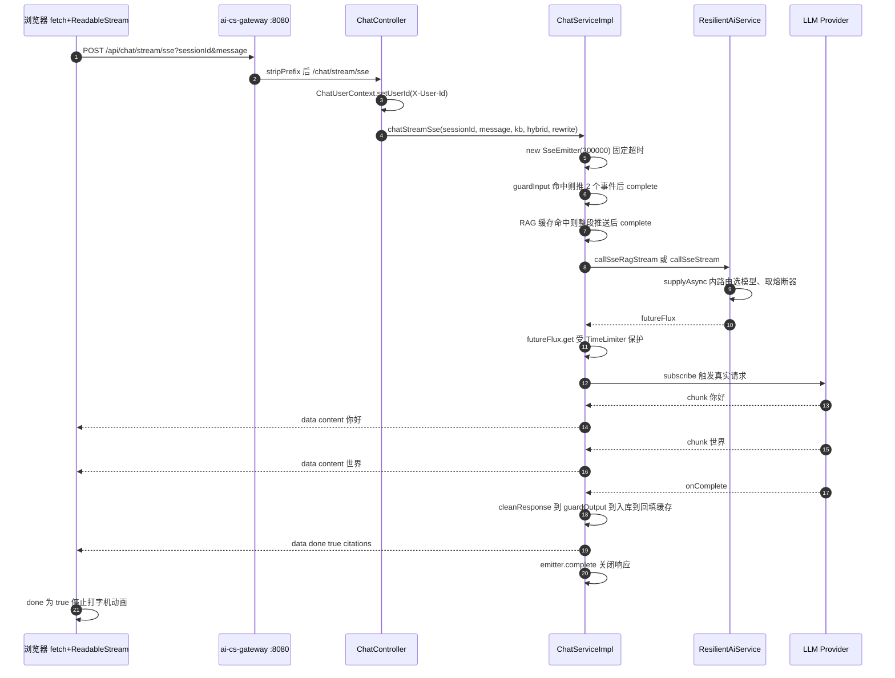

# SSE 与 WebSocket 实时通信：逐字输出的"桥"与通知推送的"线"

> **一句话结论**：AI 的逐字输出用 SSE —— 单向、一个 HTTP 响应、天然能过代理，代价是必须把 Reactor 的 `Flux` 手工桥到 Servlet 的 `SseEmitter`；服务端主动通知用 WebSocket/STOMP —— 双向、长连接，代价是鉴权、心跳、多实例路由全得自己管。本项目两条链都落地了，但都踩在同一个错位上：SSE 链上每一跳都在偷偷攒数据（代理攒、容器攒、前端的读法也攒），通知链则同时存在"STOMP + Principal"和"静态 `SESSION_MAP`"两套路由，后者在多实例下必丢消息。
> **阅读前置**：[04-SpringMVC/01-dispatcherservlet-一次请求的完整旅程](../24-源码分析/01-Spring框架/04-SpringMVC/01-dispatcherservlet-一次请求的完整旅程.md)（要先知道一个请求怎么走到 `HandlerMethod` 的返回值）、[06-SpringAI/01-chatclient-链式api源码](../24-源码分析/06-SpringAI/01-ChatClient与模型抽象/01-chatclient-链式api源码.md)（`.stream()` 从哪来）、[13-Nginx与OpenResty反向代理](./13-Nginx与OpenResty反向代理.md)（缓冲问题的另一半）。
> **证据基线**：Spring Boot 4.2.0 / Spring Framework 7.1.0 / Spring AI 2.1.0 / JDK 17。A 级 2 处（`HandlerMethodReturnValueHandlerComposite`、`StreamingChatModel`，均来自 `24-源码分析/assets/source/`，已逐行核对）；B 级 20+ 处本项目真实代码与配置（`ai-cs-chat`、`ai-cs-notify`、`ai-cs-frontend`、`deploy/`）；C 级 2 段本机实测（node SSE 分块对照实验、grep 静态统计）。⚠️ **SSE/WebSocket 的框架实现类（`SseEmitter`、`ResponseBodyEmitterReturnValueHandler`、`StompEndpointRegistry`、`SimpMessagingTemplate`）不在 `assets/source/` 里，本文提到它们时只给类名与官方文档出处，不给编造的行号。**
> **预计阅读**：45 分钟。

## 0. 先看现象

| 现象 | 你可能的第一反应 | 真正常见的原因 |
| --- | --- | --- |
| AI 回答要等 20 秒，然后"唰"一下整段出现，打字机效果完全没有 | 模型太慢 | 模型其实 300ms 就开始吐 token 了；是中间某一跳把数据攒住了（代理 buffering、前端的 `await res.text()`、或 `SseEmitter` 建错了） |
| 本地 `npm run dev` 有打字机效果，一上 Nginx / 过网关就变整段 | 后端代码在服务器上不一样 | Nginx `proxy_buffering` 默认就是 `on`；网关/代理不刷就走缓冲 |
| 断网重连后中间几条通知没了；`/api/notify/online` 永远返回 `0` | 消息发失败了 | 通知链根本没有"我从哪丢的"锚点（无 `Last-Event-ID`），且 STOMP 的在线计数实现直接 `return 0` |

三个现象背后是同一份代码里的三处细节，先把证据摆出来，后面 §3 再逐段拆。

**证据 1：前端专门为 SSE 关过一次缓冲，注释写得很直白** —— 说明这个坑在本项目里已经踩过一遍：

```javascript
// ai-cs-frontend/vite.config.js#L26-L41
proxy: {
  // 开发期把 /api 代理到网关：前端代码里就能写相对路径，和线上 Nginx 行为一致，
  // 也就不会出现"本地能跑、上线跨域"的经典问题（见 06/09 与 06/16）
  '/api': {
    target: gateway,
    changeOrigin: true,
    // SSE（/api/chat/stream/sse、/api/agent/stream/sse）必须关闭缓冲，
    // 否则 token 会被攒成一坨再返回，打字机效果消失
    configure: (proxy) => {
      proxy.on('proxyRes', (proxyRes) => {
        proxyRes.headers['cache-control'] = 'no-cache, no-transform'
        delete proxyRes.headers['content-encoding']
      })
    },
  },
},
```

注意它只修了 **dev server**：`deploy/` 目录下没有任何 Nginx 配置（`deploy` 只有 `docker-compose`、`k8s`、`mysql`、`observability`、`redis`、`scripts`、`testdata`），所以**生产侧关缓冲这件事在本仓是未落地的**，只有一句提示在 `deploy/scripts/check-local.ps1#L714` 里："生产环境走 Nginx 静态托管"。

**证据 2：断网丢消息的根因，是一条还在用静态 Map 的旧通道** —— 订单通知走的不是 STOMP，而是一个 `static ConcurrentHashMap`：

```java
// ai-cs-notify/src/main/java/com/aics/notify/consumer/OrderNotifyConsumer.java#L34-L42
@Override
public void onMessage(Map<String, String> message) {
    String userId = message.get("userId");
    String content = message.get("message");
    log.info("收到订单通知消息: userId={}, message={}", userId, content);
    if (userId != null && content != null) {
        NotifyWebSocketHandler.sendMessageToUser(userId, content);
    }
}
```

`sendMessageToUser` 查的是**本 JVM 进程内**的连接表（`ai-cs-notify/src/main/java/com/aics/notify/websocket/NotifyWebSocketHandler.java#L24-L25`），而 RocketMQ 是按消费组把消息分摊到不同实例的。两个实例 = 一半的推送查不到 session，日志只会留一句 `用户不在线，无法发送消息: userId={}`（同文件 `#L101`）。

**证据 3：在线数恒为 0** —— STOMP 通道把在线计数明确实现成了空返回：

```java
// ai-cs-notify/src/main/java/com/aics/notify/service/impl/NotifyServiceImpl.java#L33-L37
@Override
public int getOnlineCount() {
    // STOMP simple broker 不公开跨 session 在线计数；监控以 broker/session 指标替代。
    return 0;
}
```

前端 `ai-cs-frontend/src/views/NotifyView.vue#L103-L110` 拿这个值渲染"在线用户数"，所以页面上永远是 0——不是没人连，是这个数没实现。

**这些现象指向同一件事：实时通信的难点根本不在"能不能推出去"，而在两处收尾——数据在每一跳有没有被"攒住"（缓冲），以及连接断了以后有没有一个能续上的锚点（`Last-Event-ID` / 稳定的用户身份）。** 前者决定"看起来像不像实时"，后者决定"丢了知不知道"。

## 1. 整体地图

```mermaid
flowchart TD
    subgraph SSE["SSE 链路：一个 HTTP 响应撑到底，单向"]
        B1["浏览器 fetch + ReadableStream<br/>ai-cs-frontend/src/utils/sse.js"]
        G1["ai-cs-gateway :8080<br/>/api/chat/** stripPrefix(1)"]
        C1["ChatController /chat/stream/sse<br/>返回 SseEmitter"]
        S1["ChatServiceImpl.chatStreamSse<br/>new SseEmitter(300000)"]
        R1["ResilientAiService.callSseStream<br/>CompletableFuture of Flux"]
        L1["LLM：Spring AI .stream().content()"]
    end
    subgraph WS["通知链路：长连接，双向"]
        B2["浏览器 NotifyView.vue<br/>new WebSocket"]
        N2["ai-cs-notify :8086<br/>/ws-stomp 与 /ws/notify"]
        I2["StompConnectAuthInterceptor<br/>CONNECT 取 Bearer 建 Principal"]
        T2["NotifyServiceImpl<br/>convertAndSendToUser"]
        M2["RocketMQ notify-topic<br/>OrderNotifyConsumer"]
        H2["NotifyWebSocketHandler<br/>静态 SESSION_MAP"]
    end
    B1 -->|"POST /api/chat/stream/sse"| G1
    G1 --> C1 --> S1 --> R1 --> L1
    L1 -.->|"token chunk 回流"| R1
    R1 -.->|"emitter.send 逐条"| C1
    C1 -.->|"chunked 分块"| G1
    G1 -.->|"chunked 分块"| B1
    B2 -->|"STOMP CONNECT"| N2
    N2 --> I2
    T2 -->|"Principal 定向"| N2
    N2 -.->|"MESSAGE 帧"| B2
    M2 -->|"MQ 分摊到实例"| H2
    H2 -.->|"只有同进程连接能收到"| B2
```



> **读图说明**：
> 1. 上半区（SSE）只有**一条**箭头出去的请求，和一条**反向**的数据流——它不是"服务端主动推"，而是"一个 HTTP 响应体在慢慢变长"。看错这一点，就会去找"服务端怎么发起请求"，那是 WebSocket 的思路。
> 2. `G1`（网关）在这条链上是**最容易被忽略的一跳**：它自己就是一层缓冲/聚合。图上把 `G1` 画成透明管道，是为了让你在 §3.2 意识到它并不透明——`Transfer-Encoding: chunked` 要一路传到浏览器才有效果。
> 3. `S1` 到 `R1` 那条线是本文的技术核心：Servlet 世界的 `SseEmitter` 和 Reactive 世界的 `Flux` 之间**没有自动适配**，是 `flux.subscribe(...)` 手工接的（§3.4）。把这条线当成框架自动完成，就会误以为"Spring 会帮我流式"。
> 4. 下半区右下的 `M2 -> H2` 是虚线，表示**这条链路在集群下是断的**：MQ 把消息分给任意实例，`H2` 只看得到自己进程里的连接。看错这条，会以为"MQ 保证了投递，所以推送一定成功"。
> 5. `T2` 走的是 `N2` 的 STOMP 通道，`H2` 走的是 `/ws/notify` 通道——**同一个服务里两条推送路径**，它们共享不了 session 表。图上把它们并列画出来，是对齐这个现状。

| 组件 | 位置 | 责任 | 谁调用它 |
| --- | --- | --- | --- |
| `ChatController#chatStreamSse` | `ai-cs-chat/src/main/java/com/aics/chat/controller/ChatController.java#L166-L180` | 声明 `text/event-stream` 端点，把 `X-User-Id` 放进 `ChatUserContext`，返回 `SseEmitter` | 浏览器经网关；`ai-cs-gateway` 的 `ai-cs-chat` 路由 |
| `ChatServiceImpl#chatStreamSse` | `ai-cs-chat/src/main/java/com/aics/chat/service/impl/ChatServiceImpl.java#L520-L838` | 建 `SseEmitter`、组装历史、订阅 `Flux`、逐 chunk `send`、收尾入库与缓存 | `ChatController` |
| `ResilientAiService#callSseStream` | `ai-cs-chat/src/main/java/com/aics/chat/service/impl/ResilientAiService.java#L148-L152` | 路由选模型 + `CompletableFuture` 包住 `Flux`，熔断/超时期间返回"软错误" `Flux` | `ChatServiceImpl`、`AgentController` |
| `AgentController#agentStream` | `ai-cs-chat/src/main/java/com/aics/chat/agent/AgentController.java#L130-L140` | 编排类 SSE：先返 `emitter`，工作线程里推进度事件 | 浏览器经 `/api/agent/stream/sse` |
| `StompWebSocketConfig` | `ai-cs-notify/src/main/java/com/aics/notify/config/StompWebSocketConfig.java#L21-L37` | 开 `@EnableWebSocketMessageBroker`，注册 `/ws-stomp`、simple broker、user 前缀、入站拦截器 | Spring 启动期 |
| `StompConnectAuthInterceptor` | `ai-cs-notify/src/main/java/com/aics/notify/config/StompConnectAuthInterceptor.java#L26-L42` | 在 STOMP `CONNECT` 帧上做 JWT 鉴权，把 `userId` 塞进 `Principal` | Spring 消息通道（`clientInboundChannel`） |
| `NotifyServiceImpl` | `ai-cs-notify/src/main/java/com/aics/notify/service/impl/NotifyServiceImpl.java#L21-L31` | `convertAndSendToUser` / `convertAndSend` 两种投递 | `NotifyController`、`NotifyHandoffServiceImpl` |
| `NotifyWebSocketHandler` | `ai-cs-notify/src/main/java/com/aics/notify/websocket/NotifyWebSocketHandler.java#L22-L132` | 灰度通道：自己维护 `userId -> session`，自己处理 `ping`/`pong` | `WebSocketConfig`（`/ws/notify`）、`OrderNotifyConsumer` |
| 前端流式读取器 | `ai-cs-frontend/src/utils/sse.js#L4-L8` | 用 `fetch` + `ReadableStream` 手工分帧，逐 `data:` 回调 | 对话页 |
| 前端通知客户端 | `ai-cs-frontend/src/views/NotifyView.vue#L112-L129` | `new WebSocket('ws://localhost:8085/ws/notify')` 收通知 | 通知演示页 |

## 2. 关键概念与关键类

| 名称 | 位置 | 角色 | 关键方法 / 字段 |
| --- | --- | --- | --- |
| **SSE**（Server-Sent Events，服务器发送事件） | WHATWG HTML Living Standard §9.2 Server-sent events（未入库，依据规范） | 用 `text/event-stream` 响应体持续推送的**单向**协议；浏览器有原生 `EventSource` 自动重连 | 帧字段 `event:` / `data:` / `id:` / `retry:`，帧以空行结束 |
| `SseEmitter` | `org.springframework.web.servlet.mvc.method.annotation`（**未入库**，Spring Framework 7.1.0 官方 API） | Servlet 栈上把异步响应包装成 SSE 发射器 | `send(SseEventBuilder)`、`complete()`、`completeWithError(e)`、`onTimeout(Runnable)`、`onCompletion(Runnable)`、`onError(Consumer)` |
| `ResponseBodyEmitterReturnValueHandler` | `org.springframework.web.servlet.mvc.method.annotation`（**未入库**） | 把控制器返回的 `SseEmitter` 变成真正的异步响应：注册到 `WebAsyncManager`，让请求进入 async dispatch | `supportsReturnType`、`handleReturnValue`（本仓未收录源码，只有接口侧证据） |
| `HandlerMethodReturnValueHandlerComposite` | `24-源码分析/assets/source/HandlerMethodReturnValueHandlerComposite.java.md`（**已入库**） | Spring MVC 返回值处理器的"调度员"，`SseEmitter` 就是被它挑中的 | `handleReturnValue`、`selectHandler`、`isAsyncReturnValue` |
| `StreamingChatModel` | `24-源码分析/assets/source/StreamingChatModel.java.md`（**已入库**） | Spring AI 的流式模型契约，`Flux<ChatResponse>` 的文字化就在这里 | `stream(Prompt)`、`default stream(String)`、`default stream(Message...)` |
| `Flux` | `reactor.core.publisher`（Reactor 3，未入库） | 0..N 个元素的响应式流；**lazy**——不订阅就不发请求 | `subscribe(onNext, onError, onComplete)`、`doOnNext`、`doFinally` |
| `TextWebSocketHandler` | `org.springframework.web.socket.handler`（**未入库**） | 裸 WebSocket 的回调骨架 | `afterConnectionEstablished`、`handleTextMessage`、`afterConnectionClosed`、`handleTransportError` |
| `@EnableWebSocket` vs `@EnableWebSocketMessageBroker` | 分别在 `WebSocketConfig.java#L22`、`StompWebSocketConfig.java#L15`（B 级） | 前者只注册 handler（裸帧），后者引入 STOMP 语义（destination/subscription/Principal） | 二者可共存，但**互不共享 session 表** |
| `StompHeaderAccessor` / `ChannelInterceptor` | `org.springframework.messaging.*`（**未入库**） | 在 STOMP 帧上读写头、在消息通道上做拦截 | `wrap(message)`、`getFirstNativeHeader("Authorization")`、`setUser(Principal)` |
| `SimpMessagingTemplate` | `org.springframework.messaging.simp`（**未入库**） | 服务端往 destination 投递消息的出口 | `convertAndSendToUser(user, dest, payload)`、`convertAndSend(dest, payload)` |
| `Last-Event-ID` | SSE 规范里的**请求头** | 断线重连时浏览器自动带上"我收到的最后一条 `id:`"，供服务端补发 | 本仓**未实现**（grep 无命中） |
| **STOMP**（Simple Text Oriented Messaging Protocol 1.2） | STOMP 1.2 规范（未入库，依据规范） | 在 WebSocket 之上加一层"目的地/订阅"语义的文本协议 | 命令 `CONNECT`、`SUBSCRIBE`、`SEND`、`MESSAGE`、`ACK`；头 `destination`、`id`、`heart-beat` |

> ⚠️ **本文的诚实边界**：`SseEmitter` 自身、`ResponseBodyEmitterReturnValueHandler`、STOMP 的 `StompEndpointRegistry`/`SimpMessagingTemplate` 都**没有**被收进 `assets/source/`。所以凡是讲"框架内部怎么做的"，本文只给两样东西：已入库的**接口侧证据**（返回值处理器复合器、Spring AI 流式接口），和**可复现的行为**（§3.1 的本机字节级实测）。凡是"本项目怎么用的"，一律给 `文件#L行`，你可以直接跳过去看。

## 3. 原理与证据逐段精读

### 3.1 SSE 的线协议：四个字段 + 一个空行

**在干什么**：把 HTTP 响应体当成一条"消息队列"，每条消息由若干 `字段: 值` 行组成，**用空行分隔**。四个字段各管一件事：`data:` 是负载（可多行，会被拼成一条）、`event:` 是事件名（决定前端监听哪个 handler）、`id:` 是游标（重连时浏览器用它填 `Last-Event-ID`）、`retry:` 告诉浏览器断线后隔多久重连。

本机实测（不依赖本项目、不联网、2 秒内跑完）：一个每 300ms `res.write()` 一次的 Node 服务和它的客户端，看到的**字节**长这样：

```text
=== GET /sse ===
status: 200 | transfer-encoding: chunked | content-type: text/event-stream
  [+ 322ms] chunk#1 44B  "id: 1\nevent: token\ndata: {"content":"你"}\n\n"
  [+ 626ms] chunk#2 44B  "id: 2\nevent: token\ndata: {"content":"好"}\n\n"
  [+ 936ms] chunk#3 44B  "id: 3\nevent: token\ndata: {"content":"，"}\n\n"
  [+1245ms] chunk#4 44B  "id: 4\nevent: token\ndata: {"content":"世"}\n\n"
  [+1558ms] chunk#5 44B  "id: 5\nevent: token\ndata: {"content":"界"}\n\n"
  [+1869ms] chunk#6 33B  "event: done\ndata: {"done":true}\n\n"
  → 共 6 个 TCP 分块到达客户端
```

（脚本全文见 §9 练习 1，可直接 `node sse-demo.mjs` 复跑；上面是本机真实输出。）

**为什么这么设计**：SSE 要在"一个 TCP 连接"上划出消息边界，作者选了**文本 + 空行**这种最便宜的分帧方式——不需要长度前缀，不需要二进制解析，`curl` 直接看得懂。`id:`/`retry:` 两个字段是为了解决"断了怎么办"：这是 SSE 相对裸 `WebSocket` 的最大优势，浏览器原生帮你重连、还替你记游标。

**换写法会怎样**：如果改成"响应体一直写、不分帧"，客户端就不知道一条消息在哪结束，只能靠超时猜；如果用 JSON Lines（每行一个 JSON），就丢掉了 `event:`/`id:`/`retry:` 的语义，`EventSource` 也用不了，得自己写重连。

**常见坑**：① `data:` 后面**必须**有一个空格（`data: {"content":"你"}`），且每帧结尾是 `\n\n`——只有一个 `\n` 时客户端会一直等下一帧，表现为"前端收到半条 JSON"；② 本项目**没有**用 `Data:`/`data :` 这些变体，也没用 BOM，别照着老教程加；③ 本项目的 `id:` 只用了单帧自增（`id: 1`…），**服务端从不读 `Last-Event-ID`**（`grep Last-Event-ID` 在仓内零命中）——也就是说重连续传只"发了一半"：浏览器会带，服务端不认。

### 3.2 为什么 SSE 在 Nginx 下必须关 buffering

**在干什么**：`proxy_buffering on`（Nginx 默认值）的意思是"先把上游响应收进缓冲区，攒够了再发给客户端"。对普通 JSON 这是优化，对 SSE 是**灾难**：它把"很多次小写"合并成"一次大写"，打字机效果直接消失。

本机用同一份脚本模拟了这件事——`/buffered` 端点先 `await upstream.text()` 把整条流读干、再一次性 `res.end()`：

```text
=== GET /buffered ===
status: 200 | transfer-encoding: chunked | content-type: text/event-stream
  [+3740ms] chunk#1 253B  "id: 1\nevent: token\ndata: {"content":"你"}\n\nid: 2\n...event: done\ndata: {"done":true}\n\n"
  → 共 1 个 TCP 分块到达客户端
```

对照很干净：**同一份字节，6 个分块 vs 1 个分块；1.87 秒 vs 3.74 秒才见到第一个字节**。这就是"等 20 秒一次性出现"的最小可复现模型。

**为什么这么设计（缓冲本身没错）**：反向代理要保护上游、要复用后端的慢连接、要做 gzip，就必须能攒。SSE 是这类代理眼里"最不友好"的流量形态，所以两边的解法都是显式退出：Nginx 侧 `proxy_buffering off;`（`ngx_http_proxy_module` 文档「proxy_buffering」节），或让**上游自己声明** `X-Accel-Buffering: no`（同文档「proxy_ignore_headers」节说明该响应头会被识别）——后者更好用，因为改代码比改运维配置容易发布。

**换写法会怎样**：只在 Nginx 关、不在应用声明，换一个网关（比如本项目的 `ai-cs-gateway`，Spring Cloud Gateway / Netty）就又得重新排查一遍；只声明不关，某些 CDN 不认这个头。实践里是"应用侧声明 + 网关侧兜底"。

**常见坑**：① 本项目**应用侧没有声明** —— `ChatController.java#L166-L180` 的响应里没有 `X-Accel-Buffering`（控制器只设了 `produces`），全仓 `grep X-Accel-Buffering` 零命中；② 唯一做对的地方是 dev 代理：`ai-cs-frontend/vite.config.js#L32-L38` 把 `cache-control` 改成 `no-cache, no-transform` 并删掉 `content-encoding`（删 `content-encoding` 是为了不让浏览器按 gzip 去解一段没 gzip 的数据）；③ 生产侧完全空白：`deploy/` 下没有任何 Nginx 配置，这条**未落地**，上线必须补（补法见 §9 练习 3）。

### 3.3 Spring MVC 怎么把 `SseEmitter` 变成响应：先被"挑中"

**在干什么**：控制器方法 `return new SseEmitter(...)` 之后，Spring MVC 要决定"谁来处理这个返回值"。这个"挑人"的动作在 `HandlerMethodReturnValueHandlerComposite` 里，本仓已收录源码，可以直接看：

```java
// (src: HandlerMethodReturnValueHandlerComposite.java#L69-L101)
@Override
public void handleReturnValue(@Nullable Object returnValue, MethodParameter returnType,
        ModelAndViewContainer mavContainer, NativeWebRequest webRequest) throws Exception {
    HandlerMethodReturnValueHandler handler = selectHandler(returnValue, returnType);
    if (handler == null) {
        throw new IllegalArgumentException("Unknown return value type: " + returnType.getParameterType().getName());
    }
    handler.handleReturnValue(returnValue, returnType, mavContainer, webRequest);
}

private @Nullable HandlerMethodReturnValueHandler selectHandler(@Nullable Object value, MethodParameter returnType) {
    boolean isAsyncValue = isAsyncReturnValue(value, returnType);
    for (HandlerMethodReturnValueHandler handler : this.returnValueHandlers) {
        if (isAsyncValue && !(handler instanceof AsyncHandlerMethodReturnValueHandler)) {
            continue;
        }
        if (handler.supportsReturnType(returnType)) {
            return handler;
        }
    }
    return null;
}

private boolean isAsyncReturnValue(@Nullable Object value, MethodParameter returnType) {
    for (HandlerMethodReturnValueHandler handler : this.returnValueHandlers) {
        if (handler instanceof AsyncHandlerMethodReturnValueHandler asyncHandler &&
                asyncHandler.isAsyncReturnValue(value, returnType)) {
            return true;
        }
    }
    return false;
}
```

**在干什么（细化）**：`SseEmitter`（继承自 `ResponseBodyEmitter`）会被判定成"async value"，于是 `selectHandler` 在 `isAsyncValue == true` 时**跳过所有非 async 的处理器**——这一步很重要：它保证了 `SseEmitter` 不会被 `RequestResponseBodyMethodProcessor`（那个负责 `@ResponseBody` + Jackson 的）抢走，否则你会得到一个"把 emitter 对象本身序列化成 JSON"的 200。

**为什么这么设计**：Spring MVC 的返回值千奇百怪（`String` 当视图名、`Map` 当 JSON、`DeferredResult` 当异步…），用"一系列 `supportsReturnType` 排他匹配 + 复合器统一入口"比写一个巨型 `switch` 可扩展得多。`AsyncHandlerMethodReturnValueHandler` 这个额外的标记接口，是用类型给"异步族"划边界。

**换写法会怎样**：如果去掉 `isAsyncValue` 那段 `continue`，`SseEmitter` 就会落进按 `returnType` 匹配的普通处理器，出现"响应已提交后又写 body"或"emitter 被当成普通对象"的诡异现象——这正是很多人写的"`SseEmitter` 返回了 200 但前端收不到任何事件"的成因之一。

**常见坑**：① 这个复合器只负责"挑人和转交"，**真正发响应的是 `ResponseBodyEmitterReturnValueHandler`**（`org.springframework.web.servlet.mvc.method.annotation`，**未入库**）——它会调用 `WebAsyncManager.startDeferredResultProcessing` 之类的异步路径把请求转成 async dispatch。想知道"为什么返回 emitter 后方法能立刻返回"，答案在它身上，不在控制器里；② 一旦走了 async，**Servlet 线程就被释放了**，但**连接没释放**：连接数上限是容器的 `maxConnections` 管的，不是线程池。想当然地"加大 tomcat 线程数解决 SSE 打满"是无效的。

### 3.4 `Flux` → `SseEmitter`：这段桥是手写的

**在干什么**：本项目是 **Spring MVC（Servlet 栈）**，不是 WebFlux。这一点决定了 `Flux` 不能当返回值直接流出去，代码里对此有明确注释（`ChatServiceImpl.java#L627-L629`）："本项目是 Spring MVC（Servlet 容器），不是 WebFlux（Netty 容器）。Spring MVC 无法直接将 Flux 渲染为 SSE 响应，必须通过 SseEmitter 手动桥接。"

桥的两头，一头是 Spring AI 的流式契约（本仓已收录）：

```java
// (src: StreamingChatModel.java#L29-L49)
@FunctionalInterface
public interface StreamingChatModel extends StreamingModel<Prompt, ChatResponse> {

	default Flux<String> stream(String message) {
		Prompt prompt = new Prompt(message);
		return stream(prompt).map(response -> Optional.ofNullable(response.getResult())
			.map(Generation::getOutput)
			.map(AssistantMessage::getText)
			.orElse(""));
	}

	default Flux<String> stream(Message... messages) {
		Prompt prompt = new Prompt(Arrays.asList(messages));
		return stream(prompt).map(response -> Optional.ofNullable(response.getResult())
			.map(Generation::getOutput)
			.map(AssistantMessage::getText)
			.orElse(""));
	}

	@Override
	Flux<ChatResponse> stream(Prompt prompt);

}
```

这段说明了一件事：`Flux<ChatResponse> -> Flux<String>` 的转换是**框架默认方法做的**，本项目 `ResilientAiService.java#L150` 里的 `.stream().content()` 就是在用这一层（`.content()` 只取文本，丢弃 `tool_calls` 等元数据）。

另一头是本项目的桥接代码，三个回调各有分工：

```java
// ai-cs-chat/src/main/java/com/aics/chat/service/impl/ChatServiceImpl.java#L645-L705（节选）
StringBuilder full = new StringBuilder();
flux.subscribe(
        chunk -> {
            if (chunk != null && !chunk.isEmpty()) {
                if (chunk.startsWith("[ERROR]")) {          // 软错误：降级不抛异常
                    String errorMsg = chunk.substring(7);
                    log.warn("SSE流式降级: sessionId={}, msg={}", sessionId, errorMsg);
                    try {
                        emitter.send(SseEmitter.event().data(Map.of("error", errorMsg)));
                    } catch (Exception ignore) {
                        // ignore
                    }
                    emitter.complete();                      // 用 complete 而非 completeWithError
                    return;
                }
                full.append(chunk);                          // 累积，供结束后入库
                try {
                    emitter.send(SseEmitter.event().data(Map.of("content", chunk)));
                } catch (Exception e) {
                    log.warn("SSE发送失败: sessionId={}, err={}", sessionId, e.getMessage());
                }
            }
        },
        error -> { /* onError：见 §3.5 */ },
        () -> { /* onComplete：见 §3.5 */ }
);
```

**为什么这么设计**：`Flux` 是 lazy 的——**不订阅就不发请求**（`ResilientAiService.java#L271` 注释写着"返回 Flux，此时还没真正请求 LLM（lazy），订阅后才开始"）。所以"谁订阅"决定了"谁承担 IO 回调线程"。本项目在控制器线程调用 `flux.subscribe(...)`，真正的 token 由 Reactor 的 HTTP 客户端线程回调进来，`emitter.send()` 因此**不在请求线程上**执行——这正好绕开了"不能在 IO 线程上阻塞"的问题（`send` 是写响应体，不是阻塞等下游）。

顺带一个设计细节：`[ERROR]` 这种"软错误"（用 `Flux.just("[ERROR]AI 助手暂时繁忙，请稍后重试。")` 发射，见 `ResilientAiService.java#L261`）让熔断/超时走 `onNext` 而不是 `onError`，好处是流仍能正常结束、前端能显示友好提示；代价是**业务层必须认得这个前缀**，否则错误文本会被当成正文拼进回答。

**换写法会怎样**：换成 `SseEmitter emitter = ...; Flux.from(...).map(chunk -> emitter.send(chunk)).subscribe();` 这类"在 map 里发"，异常会被吞进 Flux 管道变成 `onError`，你就分不清"模型挂了"和"客户端断开了"。而如果换成 WebFlux（`@GetMapping(produces = TEXT_EVENT_STREAM_VALUE) Flux<String>`），`Flux` 能直接当返回值，一行桥接代码都不要——这也是很多教程说"SSE 很简单"的原因：他们在 WebFlux 里写的。

**常见坑**：① `StringBuilder` 非线程安全，这里能这么写是因为 Reactive Streams 规范要求 `onNext` **串行**调用（`ChatServiceImpl.java#L636-L637` 的注释就是这么论证的）；把它换成 `parallel()` 或 `publishOn` 多线程就等着拼串；② 订阅失败必须自己关 emitter，否则连接挂到超时（§3.5）；③ `emitter.send` 抛异常**不能中断订阅**——LLM 还在生成，`onComplete` 里还要把完整回答入库。本项目 `#L700-L702` 的注释写得很清楚："不中断 Flux 订阅，因为 LLM 仍在生成内容，后续的 onComplete 仍需要把完整回复入库（即使前端已断开）"。

### 3.5 三条收尾路径：正常完成、异常、超时

**在干什么**：SSE 最容易漏的不是"推"，是"关"。本项目把三条路径都写了：

```java
// ai-cs-chat/src/main/java/com/aics/chat/service/impl/ChatServiceImpl.java#L758-L806（节选）
() -> {
    String response = cleanResponse(full.toString());     // 去 <thinking>
    String guardedResponse = guardOutput(response);       // 输出审核
    boolean outputBlocked = !guardedResponse.equals(response);
    response = guardedResponse;
    try {
        chatHistoryService.append(sessionId, "assistant", response);   // 入库
        if (hasKb && !outputBlocked) {
            cacheRagAnswer(knowledgeBase, message, new ChatRagResponseDTO()
                    .setContent(response).setCitations(citations));    // 回填缓存
        }
        streamHistory.add(new AssistantMessage(response));
        Map<String, Object> doneEvent = new HashMap<>();
        doneEvent.put("done", true);
        doneEvent.put("citations", citations);
        if (outputBlocked) {
            doneEvent.put("warning", "回答未通过安全审核，已拦截");
        }
        emitter.send(SseEmitter.event().data(doneEvent));
    } catch (Exception e) {
        log.warn("SSE完成事件发送失败: sessionId={}, err={}", sessionId, e.getMessage());
    }
    emitter.complete();
}
```

以及方法尾部的两个兜底回调：

```java
// ai-cs-chat/src/main/java/com/aics/chat/service/impl/ChatServiceImpl.java#L828-L837
// 设置 SSE 超时回调，超时时自动清理
emitter.onTimeout(() -> {
    log.warn("SSE连接超时: sessionId={}", sessionId);
    emitter.complete();
});
emitter.onError(throwable -> {
    log.warn("SSE连接异常: sessionId={}, err={}", sessionId, throwable.getMessage());
    emitter.complete();
});
```

**为什么这么设计**：三种"结束"在运维意义上完全不同——正常结束要**持久化 + 缓存回填**（数据要在推完才完整）；`onError` 要**记录真实原因**并 `completeWithError`；超时是"客户端可能已经走了"，只清理不断言业务结果。把它们混在一起（比如都在 `finally` 里 `complete()`）就会出现"回答没入库"或"半截回答被缓存"。

**换写法会怎样**：如果把入库放在 `onNext` 里逐 chunk 做，一台实例每个 token 一次 Redis/MySQL 写，QPS 立刻爆；如果把入库放在 `onTimeout` 里，用户看完整段回答就关标签页的场景下数据永远丢。所以"**入库挂在 onComplete、清理挂在 onTimeout**"是这类流式接口的默认正确姿势。

**常见坑**：① **超时值不能是 0**。`new SseEmitter(0L)` 在 Spring MVC 里是"用容器默认"，很多容器默认就是无限，连接从此不回收。本项目踩过并改掉了：`ChatServiceImpl.java#L156` 定义 `SSE_EMITTER_TIMEOUT = 5 * 60 * 1000L`，`#L524-L525` 注释"使用合理的超时时间，替代原来的 0L（永不超时）"。Agent 那条链是 `AgentController.java#L117` 的 `AGENT_STREAM_TIMEOUT = 120_000L`（2 分钟）——**两条链超时不一致**（5 分钟 vs 2 分钟），排查时别记混。② `emitter.complete()` 之后**再 `send` 会抛 `IllegalStateException`**（`ResponseBodyEmitter` 的约定），本项目 `#L802-L803` 的注释记着这一点。③ **降级路径有个静态可推的隐患**（未实测，按代码顺序推导）：`[ERROR]` 分支在 `onNext` 里 `complete()` 并 `return`，但 `Flux.just(...)` 是同步的，紧接着**还会触发 `onComplete`** —— 此时 `full` 为空，于是会 `append(sessionId, "assistant", "")`（**空回答入库**）、`hasKb` 时把空内容写进缓存，然后再 `send(doneEvent)` 撞上已 `complete` 的 emitter，落一条 `SSE完成事件发送失败` 的 warn。真机上表现为"降级之后会话历史里多一条空回答"。修法见 §9 练习 4。

### 3.6 WebSocket 握手与帧结构（框架未入库，只讲协议）

**在干什么**：HTTP `Upgrade: websocket` + `Sec-WebSocket-Key` → 服务端用固定 GUID `258EAFA5-E914-47DA-95CA-C5AB0DC85B11` 做 SHA-1 + Base64，回 `101 Switching Protocols` 和 `Sec-WebSocket-Accept`。连接建立后不再是 HTTP：数据变成帧，帧头 2~14 字节，含 `FIN`（是否分片结尾）、`opcode`（`1` 文本 / `2` 二进制 / `8` 关闭 / `9` ping / `10` pong）、`MASK`（客户端必须掩码）、7/16/64 位长度。（RFC 6455 §4.2.2 握手、§5.2 帧格式；**框架未入库，依据 RFC**。）

**为什么这么设计**：`Sec-WebSocket-Key` 不是用来加密的，是一个"随机数挑战"，配合固定 GUID 让握手的响应**不可被普通 HTTP 请求伪造**（同时挡住中间缓存把它当普通 GET 缓存下来）。客户端必须掩码，是为了防止攻击者构造恶意 payload 污染中间的代理缓存。

**换写法会怎样**：不做 `Upgrade`、改为"HTTP 长轮询"——每次都要重新握手 TLS + 请求头，成本高一个数量级，这也是长轮询在"通知"场景输给 WebSocket 的根本原因（见 §5 对比表）。

**常见坑**：① 很多"国内教程版"的 WebSocket 只在 `onopen` 里发一帧 `{type:"auth", token}` 做鉴权——**本项目不这么干**，鉴权放在 STOMP `CONNECT` 帧上（§3.7）；② 裸帧通道没有重连语义，浏览器 `WebSocket` 也**不会**自动重连（这点和 `EventSource` 正好相反），本项目前端 `NotifyView.vue#L122-L125` 的 `onclose` 只打了一行日志、没有重连逻辑；③ 握手阶段**没有** `HandshakeInterceptor` 实现（全仓 grep 零命中），所以"握手时怎么取 token"在本项目里根本不成立——token 在 STOMP 帧里。

### 3.7 STOMP 语义：destination / subscription / 心跳 / Principal

**在干什么**：把 WebSocket 当传输层，在它上面跑一套"目的地（destination）+ 订阅（subscription）"的文本协议。服务端配置就三段：开 broker 前缀、注册端点、挂拦截器：

```java
// ai-cs-notify/src/main/java/com/aics/notify/config/StompWebSocketConfig.java#L21-L37
@Override
public void configureMessageBroker(MessageBrokerRegistry registry) {
    registry.enableSimpleBroker("/topic", "/queue");
    registry.setApplicationDestinationPrefixes("/app");
    registry.setUserDestinationPrefix("/user");
}

@Override
public void registerStompEndpoints(StompEndpointRegistry registry) {
    registry.addEndpoint("/ws-stomp")
            .setAllowedOriginPatterns("${AICS_ALLOWED_ORIGINS:http://localhost:5173}");
}

@Override
public void configureClientInboundChannel(ChannelRegistration registration) {
    registration.interceptors(stompConnectAuthInterceptor);
}
```

含义：浏览器连 `/ws-stomp`，`SUBSCRIBE` 到 `/user/queue/notify`（`user` 前缀 + `queue` 前缀 = 用户私有队列），服务端用 `convertAndSendToUser(userId, "/queue/notify", msg)` 投递，Spring 把 `userId` 换成当前 `Principal` 的 session 定向发出——**不需要你自己维护 session 表**。

**为什么这么设计**：裸 WebSocket 是"一堆 frame 的收发"，业务层要自己发明 `{type:"sub", topic:"notify"}` 这类协议；STOMP 直接给出通用语义，Spring 再把 `Principal` 接到 user destination 上，就地把"给某个用户推"做了抽象。本项目的 `NotifyServiceImpl.java#L21-L25` 因此只有一行有效代码：

```java
// ai-cs-notify/src/main/java/com/aics/notify/service/impl/NotifyServiceImpl.java#L21-L25
@Override
public void sendToUser(String userId, String message) {
    log.info("STOMP 定向通知: userId={}", userId);
    messagingTemplate.convertAndSendToUser(userId, USER_NOTIFY_DESTINATION, message);
}
```

**换写法会怎样**：`enableSimpleBroker` 是**内存**实现（Spring Framework Reference「WebSocket Support → STOMP → Simple Broker」；框架未入库，依据官方文档）。它有两个硬边界：**不跨实例**（两个 notify 实例各自一份订阅表）、**不支持 STOMP 的可靠投递/事务**。要跨实例，要么换外部 broker（RabbitMQ/ActiveMQ 的 STOMP relay），要么自己用 Redis pub/sub 或 MQ 扇出（见 §5 可扩展点）。本仓 `grep RedisMessageListener|ChannelTopic|PubSub` 在 notify/chat 里**零命中**，即跨实例广播**未落地**。

**常见坑**：① `setAllowedOriginPatterns("${AICS_ALLOWED_ORIGINS:http://localhost:5173}")` 这种写法**不能**写成 `"*"`：本项目的裸通道注释把理由写死了——`WebSocketConfig.java#L27-L28`："禁止 `*`：跨站连接可携带伪造 userId 查询参数，生产须显式白名单"。② 心跳：STOMP 的 `heart-beat` 头是**协商**出来的，Spring 的 simple broker 默认不主动 ping 客户端，本项目裸通道里只实现了"客户端发 `ping` → 服务端回 `pong`"（`NotifyWebSocketHandler.java#L43-L46`），**服务端不主动探测**——所以半开连接（NAT 超时、休眠唤醒）不会被及时发现，只能等 TCP keepalive 或写失败。③ 鉴权只做在 `CONNECT` 上，意味着 `SUBSCRIBE`/`SEND` 帧依赖同一个 session 的已有 `Principal`；如果中间断线重连，浏览器必须**重新 `CONNECT` 带 token**，否则拿不到 user destination。

### 3.8 两套通道并存：为什么它是当前最大的技术债

**在干什么**：同一个 `ai-cs-notify` 里同时开着 `@EnableWebSocketMessageBroker`（STOMP，`/ws-stomp`）和 `@EnableWebSocket`（裸 handler，`/ws/notify`）。前者是"新通道"，后者注释写着灰度保留：

```java
// ai-cs-notify/src/main/java/com/aics/notify/config/WebSocketConfig.java#L25-L31
@Override
public void registerWebSocketHandlers(WebSocketHandlerRegistry registry) {
    // 旧 /ws/notify 保留一版灰度期；新客户端应使用 STOMP /ws-stomp。
    // 禁止 "*"：跨站连接可携带伪造 userId 查询参数，生产须显式白名单。
    registry.addHandler(new NotifyWebSocketHandler(), "/ws/notify")
            .setAllowedOriginPatterns("${AICS_ALLOWED_ORIGINS:http://localhost:5173}");
}
```

问题在于：**灰度期没有收尾，而 MQ 消费者还挂在旧通道上**。`OrderNotifyConsumer.java#L40` 调的是 `NotifyWebSocketHandler.sendMessageToUser`（静态 `SESSION_MAP`），`NotifyServiceImpl`/`NotifyHandoffServiceImpl` 走的是 STOMP。于是"订单通知"和"转人工通知"用两套互不相通的 session 表。

**为什么这么设计**：这是一次典型的"中途迁移"。裸 handler 简单、能跑通 demo；STOMP 才有多实例与 Principal 的正确姿势。先并存、后切流量是合理的过渡策略——但**必须给旧通道一个下线和 MQ 侧切换的收尾动作**，否则技术债永久化。

**换写法会怎样**：把 `OrderNotifyConsumer` 改成调 `NotifyService.sendToUser(userId, content)`，多实例场景下**立刻**从"一半丢"变成"每台实例都投给自己持有的 session"——但 simple broker 仍不跨实例，真正修好还要加广播层（Redis pub/sub：每个实例订阅同一个 channel，收到后本地 `convertAndSendToUser`）。要点是**MQ 消费组 → 广播**这一步语义变了：消费组内部是"分摊"，广播是"人人一份"，所以不能简单地把消费组拆成多份。

**常见坑**：① 两条通道**端口和路径都不同**，前端只要写错一个就静默失败（下一节第 4 条就是这个坑的实例）；② 裸通道的 `userId` 来自 query 参数（`NotifyWebSocketHandler.java#L120-L132` 自己 `split("&")` 解析），**完全可伪造**——这是取消 `"*"` 白名单的真正原因，白名单只是缓解，不是根治；③ `getOnlineCount()` 在 STOMP 侧返回 0，在裸通道侧返回 `SESSION_MAP.size()`，两个数含义不同，别混着报警。

## 4. 一次完整执行时序



> **读图说明**：
> 1. 第 5 步 `new SseEmitter(300000)` 一旦执行，**响应就已经进入 async 模式**——注意此时还没有任何字节写给客户端，浏览器看到的是"连接已建立、等待响应体"，Network 面板里显示 Pending。看不到"Pending"，说明你打的不是 SSE 端点。
> 2. 第 7、8 两步是**短路返回**：命中安全拦截或 RAG 缓存时也会走 SSE（推 1~2 个事件后 `complete`）。所以"SSE 端点 = 一定是逐字的"不成立，日志里看到 `SSE流式命中缓存` 就是走了这条路（`ChatServiceImpl.java#L543-L566`）。
> 3. 第 13 步 `subscribe` 是**真正开始 IO 的地方**，它之前 `RA` 只是"选好了模型、包了个 Future"。把耗时归因搞错的人会去优化第 11 步，其实首 token 延迟由第 13 步之后决定。
> 4. 第 14~17 步的循环**可能在写库之前就断掉**（客户端关页面），此时 `emitter.send` 抛异常只记 warn，循环不中断——所以"前端只收到一半"和"历史里是完整回答"可以同时成立，这不是 bug。
> 5. 第 19 步先入库再发 `done`：顺序反了（先发 done 再入库）就会出现"前端提示完成、刷新后历史里没有这条"。

**哪一步失败，报什么错（日志原文来自代码里的格式串，不是运行期抓取）**：

| 失败点 | 后端日志（真实格式串） | 前端看到 | 该去查什么 |
| --- | --- | --- | --- |
| 第 10 步路由选不到模型 / 熔断打开 | `SSE流式降级: sessionId={}, msg={}` | `{"error":"AI 助手暂时繁忙，请稍后重试。"}` | `ResilientAiService.java#L261`、`#L339` 的 `Flux.just("[ERROR]…")` |
| 第 12 步 `futureFlux.get()` 抛 `ExecutionException` | `SSE流式初始化异常: sessionId={}, cause={}` | `{"error":"…"}`（`getFriendlyMessage` 产物） | `ChatServiceImpl.java#L807-L817` |
| 第 14~17 步 `emitter.send` 失败 | `SSE发送失败: sessionId={}, err={}` | 无（已断开） | `#L696-L703`，客户端断开属正常 |
| 第 19 步发 `done` 时 emitter 已 complete | `SSE完成事件发送失败: sessionId={}, err={}` | 可能缺 `done`，动画不停 | `#L797-L801`；最常见成因是 §3.5 的降级路径 |
| 整体超过 5 分钟 | `SSE连接超时: sessionId={}` | 连接被关闭 | `#L829-L832`、`#L156` 的超时值 |
| 连接层异常 | `SSE连接异常: sessionId={}, err={}` | 连接被关闭 | `#L833-L836` |
| STOMP 握手缺 token | 服务端抛 `IllegalArgumentException("STOMP CONNECT 缺少 Bearer Token")` | CONNECT 被拒 | `StompConnectAuthInterceptor.java#L31-L33` |
| STOMP token 过期 | `IllegalArgumentException("STOMP CONNECT Token 无效或已过期")` | CONNECT 被拒 | 同文件 `#L35-L37` |
| 通知目标不在本进程 | `用户不在线，无法发送消息: userId={}` | 什么都没收到 | `NotifyWebSocketHandler.java#L101`（多实例必现） |

## 5. 设计取舍

| 决策点 | 本项目的选法 | 替代方案 | 代价 / 什么时候该换 |
| --- | --- | --- | --- |
| 逐字输出用什么 | SSE（`text/event-stream` + `SseEmitter`） | WebSocket、长轮询、短轮询 | SSE 单向、不需要额外协议、能过大多数代理、浏览器原生重连；要双向（用户边生成边插话）才换 WebSocket |
| Web 栈 | Spring MVC（Servlet） | WebFlux（Netty） | MVC 里 `Flux` 必须手桥 `SseEmitter`（§3.4）；若整服务改 WebFlux，`Flux` 可直接当返回值，桥接代码全删，但会牵动全模块线程模型 |
| 通知通道 | STOMP（`/ws-stomp`）+ 灰度裸通道（`/ws/notify`） | 纯裸 WebSocket / 纯 STOMP / SSE | STOMP 有 Principal 定向与订阅语义，但要客户端库；裸通道简单但 session 表自管、userId 可伪造 |
| 连接鉴权位置 | STOMP `CONNECT` 帧的 `Authorization` 头 → `Principal` | 握手拦截器取 query token、首个业务帧发 token | 本项目无 `HandshakeInterceptor`（grep 零命中）；帧上鉴权的好处是不用污染 URL，坏处是握手本身不设防（靠 Origin 白名单兜） |
| broker | `enableSimpleBroker`（内存） | 外部 broker relay（RabbitMQ/ActiveMQ）、Redis pub/sub、MQ 扇出 | 内存 broker 单实例有效；**上多实例必须换**，否则 `convertAndSendToUser` 打到别的实例等于丢消息 |
| 超时 | chat 5 分钟（`#L156`）、agent 2 分钟（`AgentController.java#L117`） | `0L`（容器默认/无限） | 0 会泄漏连接；5 分钟对"长回答"够用但对网关的 idle timeout 未必够——要在网关/代理侧也有对应设置 |
| 断点续传 | **未实现**（不发 `id:`、不读 `Last-Event-ID`） | 服务端按 `id` 补发、或前端重发整轮请求 | 现在重连 = 从头再问一次，已生成的 token 全废；成本是服务端要缓存"已发到第几块" |
| 入库时机 | `onComplete` 一次性写 | 逐 chunk 写、定时 flush | 一次性写省 IO，但"用户看一半关页面"时仍能入库（因为订阅不中断），这是它的优点 |
| 在线计数 | STOMP 侧 `return 0`，裸通道侧 `SESSION_MAP.size()` | `SessionConnectEvent` 监听、Redis Set 维护、Micrometer gauge | 现有实现两个都不可用于告警；要真做得挂 `ApplicationListener<SessionConnectedEvent>` 自己维护 |

**可扩展点清单**（按"改动面从小到大"排）：

1. **补 SSE 的应用侧反缓冲声明**：在控制器上加 `X-Accel-Buffering: no` 响应头（`ChatController`、`AgentController` 各一处），不改任何业务逻辑。
2. **生产 Nginx 配置入库**：在 `deploy/` 下新增 nginx 站点配置，对 `/api/chat/stream/sse`、`/api/agent/stream/sse` 设 `proxy_buffering off; proxy_cache off; proxy_read_timeout 300s;`（写法参照 [23-Nginx应用实战与域名IP配置](./23-Nginx应用实战与域名IP配置.md)）。
3. **统一超时口径**：把 `AGENT_STREAM_TIMEOUT` 与 `SSE_EMITTER_TIMEOUT` 收进配置类（`@ConfigurationProperties`），避免两条链各自硬编码。
4. **把 MQ 消费者从静态 Map 切到 `NotifyService`**：`OrderNotifyConsumer` 一行改动 + 测试，先把"分片丢消息"的范围缩小到单实例。
5. **加一层广播**：`ai-cs-notify` 内订阅 Redis pub/sub 或独立 MQ 广播 topic，收到后本地 `convertAndSendToUser`；STOMP 也可以直接换外部 broker relay（配置级改动，`enableStompBrokerRelay`）。
6. **实现 SSE 续传**：`SseEmitter.event().id(seq)` 发游标，控制器读 `Last-Event-ID` 头，服务端用 Redis 存"本轮已生成内容"，重连时先补发再续流。
7. **在线数**：监听 `SessionConnectedEvent`/`SessionDisconnectEvent` + Micrometer `Gauge`，或 Redis `Set` 记 userId。
8. **心跳**：给 STOMP 配 `TaskScheduler` 让 simple broker 发心跳（`registry.enableSimpleBroker(...).setHeartbeatValue(...)`），给裸通道加服务端定时 ping。

## 6. 踩坑与调试手法

**坑 1（真调试手法）：用 `curl -N` 看"是不是真的在流"**。`-N` 关掉 curl 自己的输出缓冲，逐块打印：

```bash
# 只发请求不落盘；观察是否有多个小块陆续出现
curl -N -sS -X POST "http://localhost:8080/api/chat/stream/sse?sessionId=demo&message=你好" \
  -H "Accept: text/event-stream"
```

判读法：① 输出**一次性全出**且时间戳一致 → 中间有缓冲（代理/Nginx/CDN）；② 每 200~500ms 出一行 `data:` → 链路是通的，问题在前端读法；③ 30 秒无任何字节但连接不断 → `emitter` 建了但从没 `send`（检查是否走了缓存/拦截短路路径）。⚠️ 本机没有启动本项目服务，**以上命令未实测**；同一套判读法已在 §3.1 的 node 服务上验证过（`/sse` 6 块 vs `/buffered` 1 块）。

**坑 2（真调试手法）：浏览器 Network → 该请求 → "EventStream" 页签 + 看 `Transfer-Encoding`**。Chrome/Edge 对 `text/event-stream` 响应有专用 EventStream 面板，能逐条显示 `message` 和到达时间；如果面板不存在，说明响应头不是 `text/event-stream`（可能被网关改成了 `application/json`）。同时看 Response Headers：没有 `Transfer-Encoding: chunked` 且 `Content-Length` 有具体值 → **一定是被攒齐了才发的**，因为流式响应不可能知道长度（§3.1 的两次输出里 `transfer-encoding` 都在，但分块数 6 vs 1）。

**坑 3：日志关键字按"结局"grep，别按"过程"grep**。SSE 的问题几乎都能从 5 个关键字定位：

```bash
# 在 chat 服务日志里按顺序扫这几个串（都是代码里的真实格式串）
grep -nE "SSE流式对话请求|SSE流式降级|SSE发送失败|SSE完成事件发送失败|SSE连接超时" chat.log
```

`SSE流式对话请求` 之后**没有**任何 `SSE完成事件发送失败`/`SSE连接超时` 且前端已经断了 → 客户端主动关闭（正常）；`SSE流式降级` 紧跟 `SSE完成事件发送失败` → 就是 §3.5 那个空回答入库的隐患。

**坑 4：前端连错端口，而且是"消息服务"的端口**。`ai-cs-frontend/src/views/NotifyView.vue#L114` 写的是 `ws://localhost:8085/ws/notify`，但 notify 服务的端口在 `ai-cs-notify/src/main/resources/application.yml#L1-L3` 是 **8086**，8085 是消息服务（`deploy/docker-compose/docker-compose-all.yml#L263-L269` 注释与端口都写着"消息服务 (8085)"，notify 在 `#L284-L290` 是 `8086:8086`）。核对命令：

```bash
grep -n "port:" ai-cs-notify/src/main/resources/application.yml
grep -rn "8085\|8086" deploy/docker-compose/docker-compose-all.yml
```

后果是浏览器直接连到没有 WebSocket handler 的服务上，`onerror` 静默、页面只显示"已断开"。**这是本仓当前真实存在的配置错位，修法见 §9 练习 5。**

**坑 5：降级路径把空回答写进历史**（§3.5 的静态推导）。表现是"偶尔有一条空的助手消息"，触发条件是熔断/路由失败走到 `Flux.just("[ERROR]…")`。定位：`grep -n "SSE流式降级" chat.log` 之后看会话历史条数。

**坑 6：`await res.text()` 把流读成一坨**。前端如果用 `const body = await res.text()` 再解析，就等于自己当了一次 §3.2 里的 `/buffered` 代理。本项目的正确做法写在 `ai-cs-frontend/src/utils/sse.js#L4-L8`：`fetch` + `ReadableStream` 逐块读、按 W3C 规范子集分帧。同时它也回答了"为什么不用 `EventSource`"——**`EventSource` 只支持 GET、不能自定义请求头**，而本项目的流式接口是 POST + JSON body + `Authorization`。

**坑 7：半开连接没人管**。`NotifyWebSocketHandler.java#L43-L46` 只做"客户端 ping → 回 pong"，服务端不主动探测；STOMP 侧 simple broker 也没配心跳。移动端切后台、NAT 表项超时之后，服务端仍以为连接活着，`sendMessageToUser` 走到 `session.isOpen()` 为 true 但发送超时。定位手法：看 `WebSocket连接建立` 与 `WebSocket连接关闭`（同文件 `#L32`、`#L54`）两条日志的**配对率**，只建不关就是在漏。

**坑 8：把 `"*"` 当"省事"的跨域配置**。`WebSocketConfig.java#L27-L28` 把禁令写进注释了：允许 `"*"` 时，任何站点都能带着伪造的 `?userId=` 连上来收别人的通知。现在两处都改成 `setAllowedOriginPatterns("${AICS_ALLOWED_ORIGINS:http://localhost:5173}")`，**这本身就是一次版本差异**（§7）。

**坑 9：本机没有中间件，别硬跑**。探测结果：`docker`、`redis-cli`、`redis-server`、`mysql` 全部 MISSING；`java`/`javap`（JDK 17.0.19）、`node`（v24.16.0）、`curl` 可用。所以本篇所有"需要起服务/连中间件"的命令都标了"未实测"，能实测的只有：node 起本地 SSE 服务（§3.1/§3.2，已跑）、静态统计（下面这段）。

```bash
# C 级静态统计：本仓两条实时链的规模（只有 main，排除 test）
cd D:/Projects/Persion/ai-customer-service
grep -rn --include=*.java "SseEmitter" ai-cs-chat ai-cs-notify | grep -v "/test/" | wc -l
grep -rn --include=*.java "TEXT_EVENT_STREAM_VALUE" ai-cs-chat | wc -l
grep -rn "Last-Event-ID\|X-Accel-Buffering\|HandshakeInterceptor" --include=*.java --include=*.vue --include=*.js . | wc -l
```

同口径在 Windows 上跑出来的真实结果（`Select-String -SimpleMatch` 统计，仅 `main`）：`SseEmitter` 出现 **44 次 / 6 个文件**；`TEXT_EVENT_STREAM_VALUE` **3 次 / 2 个文件**；`flux.subscribe` **3 次 / 1 个文件**；`SimpMessagingTemplate` **4 次 / 2 个文件**；`convertAndSendToUser` **2 次 / 2 个文件**；`@EnableWebSocketMessageBroker` **1 处**（`StompWebSocketConfig.java#L15`）、`@EnableWebSocket` **1 处**（`WebSocketConfig.java#L22`）。判读：SSE 是"一个服务、两个端点、一个实现类"的集中式结构；通知是"两套并存"的分散结构——**改通知链路时永远要问"我改的是哪一套"**。

## 7. ⚠️ 版本差异

| 旧写法（旧文档/旧代码） | 当前基线 | 变化点 | 迁移动作 |
| --- | --- | --- | --- |
| SSE 端点 `@PostMapping("/stream")` 直接返回 `Flux<String>` | `/chat/stream` 返回 `Result<Map<String,Object>>` 占位提示；真端点 `/chat/stream/sse` 返回 `SseEmitter`（`ChatController.java#L144-L149`、`#L166-L180`） | MVC 栈里 `Flux` 不能直接当返回值；占位端点是为了兼容旧前端路径 | 客户端改打 `/chat/stream/sse`；新代码别在 MVC 里返回 `Flux` |
| 手写 `map(data -> "data: " + data + "\n\n")` 拼帧 | `SseEmitter.event().data(Map.of("content", chunk))`，由消息转换器序列化 | 手拼帧容易漏空格/漏空行，且自己处理 JSON 转义 | 一律用 `SseEmitter.event()`，需要 `event:`/`id:` 时链式 `.name("token").id(seq)` |
| `new SseEmitter()` / `new SseEmitter(0L)`（永不超时） | `new SseEmitter(5 * 60 * 1000L)`（`ChatServiceImpl.java#L156`、`#L524-L525`）；agent 侧 `120_000L` | 0 会泄漏连接；注释明确"替代原来的 0L（永不超时）" | 超时值显式给定，并与代理/网关的 idle timeout 对齐 |
| `WebSocketConfig` 用 `setAllowedOrigins("*")` | `setAllowedOriginPatterns("${AICS_ALLOWED_ORIGINS:http://localhost:5173}")`（两处通道都改了） | 允许 `*` 时跨站连接可携带伪造 `userId` | 生产用环境变量 `AICS_ALLOWED_ORIGINS` 显式白名单，**不要**回退到 `*` |
| 前端 `new EventSource('/api/chat/stream?message=你好')` | `fetch` + `ReadableStream` 手工分帧（`ai-cs-frontend/src/utils/sse.js#L4-L8`） | `EventSource` 只支持 GET、不能带 `Authorization`，与 POST + JSON body 的接口天然不兼容 | 换 `fetch` 读流；重连自己写（`EventSource` 的自动重连因此也没了） |
| 推送通道只有 `NotifyWebSocketHandler`（静态 `SESSION_MAP`） | STOMP `/ws-stomp` 为主（`convertAndSendToUser` + Principal），`/ws/notify` 灰度保留 | 引入 `@EnableWebSocketMessageBroker` 后，用户定位从"自己查 Map"变成"Principal 定向" | 新功能一律走 `NotifyService`；MQ 消费者待切换（§5 扩展点 4） |
| 连接鉴权靠 URL 里的 `?userId=` | STOMP `CONNECT` 帧的 `Authorization: Bearer <JWT>` → `Principal`（`StompConnectAuthInterceptor.java#L29-L39`） | 身份从"客户端自称"变成"服务端验签" | 裸通道仍留 `?userId=` 解析（`NotifyWebSocketHandler.java#L120-L132`），迁移完应删除 |
| 教程式"WebSocket 握手拦截器取 token" | 本仓**没有** `HandshakeInterceptor` 实现（grep 零命中） | 鉴权点上移到 STOMP 帧，握手期只靠 Origin 白名单 | 别照教程补一个 `HandshakeInterceptor`；要加固就在 `ChannelInterceptor` 上加 SUBSCRIBE 校验 |
| 无 SSE 反缓冲声明 | 只有 dev 侧 `vite.config.js#L32-L38` 处理；应用侧与生产 Nginx **均未落地** | 上线即回退成"整段返回" | 应用加 `X-Accel-Buffering: no`；`deploy/` 补 Nginx 站点配置 |

## 8. 面试高频问与答

1. SSE 和 WebSocket 的本质区别是什么？为什么 AI 对话场景更常选 SSE？
2. SSE 的帧格式里 `data:`、`event:`、`id:`、`retry:` 各解决什么问题？为什么帧之间必须是空行？
3. 为什么 Nginx 默认配置会把 SSE 变成"一次性返回"？`proxy_buffering off` 和 `X-Accel-Buffering: no` 有什么区别？
4. 为什么浏览器不自动重连的 WebSocket 需要自己实现重连，而 SSE 不用？各自的代价是什么？
5. `EventSource` 为什么不能用于 POST + 自定义请求头的接口？替代方案怎么写？
6. Spring MVC 里 `SseEmitter` 是怎么被选中的？返回值处理器链在哪一步分流"异步返回值"？
7. MVC 项目里能直接把 `Flux` 作为返回值做流式吗？为什么必须 `subscribe` 到 `SseEmitter`？
8. `flux.subscribe(onNext, onError, onComplete)` 里三个回调各自该做什么？为什么 `send` 失败不能中断订阅？
9. `SseEmitter(0L)` 有什么风险？超时、异常、完成三条收尾路径分别该做什么？
10. 为什么说在 IO 线程上做阻塞操作是 SSE/WebSocket 实现里最典型的性能事故？本项目怎么绕开的？
11. 连接数和内存怎么估算？开 1 万个 SSE 连接会不会把线程池打满？
12. 慢消费者（背压）在 SSE 里怎么表现？服务端该限流、丢弃还是断开？
13. STOMP 的 `destination`、`subscription id`、`user destination prefix` 分别是什么语义？
14. `enableSimpleBroker` 为什么不能用于多实例？要跨实例有哪几种做法，各自代价？
15. WebSocket 的连接鉴权有哪几个可插入点？为什么本项目选 STOMP `CONNECT` 帧而不是握手拦截器？
16. 半开连接（half-open）怎么检测？心跳该由客户端发还是服务端发？
17. `Last-Event-ID` 的完整断点续传链路需要服务端配合做什么？

## 9. 动手练习

**练习 1：跑通 §3.1 的字节级对照实验。**

```javascript
// 保存为 sse-demo.mjs，`node sse-demo.mjs`，约 2 秒跑完，不联网、不依赖本项目
import http from 'node:http';

const TOKENS = ['你', '好', '，', '世', '界'];
const server = http.createServer((req, res) => {
  if (req.url === '/sse') {
    res.writeHead(200, {
      'Content-Type': 'text/event-stream',
      'Cache-Control': 'no-cache, no-transform',
      'X-Accel-Buffering': 'no',
    });
    let i = 0;
    const timer = setInterval(() => {
      if (i < TOKENS.length) {
        res.write(`id: ${i + 1}\nevent: token\ndata: ${JSON.stringify({ content: TOKENS[i] })}\n\n`);
        i++;
      } else {
        clearInterval(timer);
        res.write('event: done\ndata: {"done":true}\n\n');
        res.end();
      }
    }, 300);
    req.on('close', () => clearInterval(timer));
    return;
  }
  if (req.url === '/buffered') {            // 模拟开了 buffering 的代理
    fetch('http://127.0.0.1:' + port + '/sse').then(async (up) => {
      const body = await up.text();         // 把流读干、攒成一整块
      res.writeHead(200, { 'Content-Type': 'text/event-stream' });
      res.end(body);
    });
    return;
  }
  res.writeHead(404).end();
});

const port = await new Promise((r) => server.listen(0, '127.0.0.1', () => r(server.address().port)));
const t0 = Date.now();
for (const path of ['/sse', '/buffered']) {
  const res = await fetch('http://127.0.0.1:' + port + path);
  console.log(`\n=== GET ${path} === transfer-encoding: ${res.headers.get('transfer-encoding')}`);
  let n = 0;
  for await (const chunk of res.body) {
    n++;
    console.log(`  [+${Date.now() - t0}ms] chunk#${n} ${chunk.length}B`);
  }
  console.log(`  → 共 ${n} 个 TCP 分块`);
}
server.close();
```

验收标准：`/sse` 打印 6 个分块且时间间隔约 300ms；`/buffered` 只有 1 个分块、且第一个字节出现时间接近前者的最后一块；两次 `transfer-encoding` 都是 `chunked`（说明"有分块传输"并不等于"没被攒"）。

**练习 2：给 `/chat/stream/sse` 加上反缓冲声明。** 在 `ChatController.java#L166-L180` 的方法上加一个 `HttpServletResponse` 参数并 `response.setHeader("X-Accel-Buffering", "no")`（或返回 `ResponseEntity` 包装 emitter）。验收标准：控制器方法里能看到该响应头设置；补充一条单测断言 `produces` 是 `text/event-stream`；`node tools/check-doc.mjs` 与你无关（这是代码练习），但要说明"生产 Nginx 侧仍需 `proxy_buffering off`，本仓 `deploy/` 目前无 Nginx 配置"。

**练习 3：补一份生产 Nginx 站点配置。** 在 `deploy/` 下新增 nginx 配置（新建目录），对两个 SSE 路径写 `proxy_buffering off; proxy_cache off; proxy_read_timeout 300s; proxy_http_version 1.1;`，并说明为什么 `proxy_read_timeout` 要 ≥ `SSE_EMITTER_TIMEOUT`。验收标准：配置里能指出 4 个指令的位置与作用；能解释"为什么 `gzip on` 也会毁掉流式"（压缩需要攒）。

**练习 4：修掉降级路径的空回答入库。** 在 `ChatServiceImpl.java#L670-L687` 的 `[ERROR]` 分支里加一个已降级的标记（如 `AtomicBoolean degraded`），在 `onComplete` 开头判断并直接 `return`（或 `emitter.complete()`）；同时补一个单测：mock `ResilientAiService.callSseStream` 返回 `Flux.just("[ERROR]boom")`，断言 `chatHistoryService.append` **未**被调用、且只发了一个 `error` 事件。验收标准：测试通过；日志里降级之后不再出现 `SSE完成事件发送失败`。

**练习 5：修掉前端通知端口错位。** 把 `NotifyView.vue#L114` 的 `8085` 改成 `8086`，并改成从环境变量取（如 `import.meta.env.VITE_NOTIFY_WS`），顺带把 `onclose` 加个带退避的重连。验收标准：能说出 8085 是谁的端口（消息服务，见 `deploy/docker-compose/docker-compose-all.yml#L263-L269`）；页面在 notify 起停时能自动重连；`grep -rn "8085" ai-cs-frontend/src` 结果里不再有 WebSocket 相关行。

**练习 6：给 SSE 加断点续传。** 服务端在每次 `send` 时带 `.id(seq)`，控制器读 `Last-Event-ID` 请求头，用一个 Redis（或内存）结构存"本轮 sessionId → 已生成文本"，重连时先补发再续流。验收标准：能画出重连时序图；能解释"为什么续传必须让服务端知道 seq 与内容的对应关系"；明确标注这是**未落地**的设计，落点涉及 `ChatController`、`ChatServiceImpl` 与新增的缓存组件三处。

**练习 7：把订单通知从静态 Map 切到 `NotifyService`。** 改 `OrderNotifyConsumer.java#L40` 调 `NotifyService#sendToUser`。验收标准：单测里断言 `NotifyService` 被调用；能说明"这只解决了'同一实例内换了正确通道'，跨实例仍需广播层（§5 扩展点 5）"。

## 小结

- SSE 不是"服务端主动推"，而是**一个 HTTP 响应体在慢慢变长**：`data:` + 空行分帧，`id:` 给游标，`retry:` 给重连间隔。
- 流式"看起来不实时"，十次里有八次是**某一跳在攒数据**：Nginx `proxy_buffering on`（默认）、网关聚合、前端 `await res.text()`。本机实测同一份字节可以是 6 个分块也可以是 1 个。
- Spring MVC 里 `Flux` **不能**直接当返回值，必须 `flux.subscribe(onNext, onError, onComplete)` 手桥到 `SseEmitter`；`SseEmitter` 之所以不被 Jackson 抢走，是因为 `HandlerMethodReturnValueHandlerComposite` 对异步返回值只交给 `AsyncHandlerMethodReturnValueHandler`。
- 三条收尾路径各有职责：`onComplete` 入库 + 回填缓存，`onError` 记真因并 `completeWithError`，`onTimeout` 只清理；`new SseEmitter(0L)` 等于不回收连接。
- WebSocket 用协议换来双向：握手是 `Upgrade` + 固定 GUID 的挑战应答，帧有 `opcode`/`FIN`/掩码规则；浏览器**不**自动重连，心跳与半开检测要自己补。
- STOMP 把"给某个用户推"抽象成 `Principal + user destination`，本项目因此能一行 `convertAndSendToUser` 投递；但 `enableSimpleBroker` 是内存实现，**不跨实例**，本仓也没有 Redis pub/sub 或 broker relay。
- 本仓最大的技术债是**两套通道并存**：STOMP 走 Principal，MQ 消费者仍走静态 `SESSION_MAP`，多实例下必丢消息；`getOnlineCount()` 在 STOMP 侧干脆 `return 0`。
- 下一步动作（按性价比）：先给 SSE 加 `X-Accel-Buffering: no` 并在 `deploy/` 补 Nginx 关缓冲配置，再把 `OrderNotifyConsumer` 切到 `NotifyService`，最后考虑广播层与 `Last-Event-ID` 续传——顺序反了会在错误的地方花时间。

## 自测题

**1. SSE 的响应体里，一条消息的结束标志是什么？**
<details><summary>参考答案</summary>一个空行（即连续两个换行 `\n\n`）。这是 SSE 唯一的分帧标志，`data:` 之后缺了空行，客户端会一直等下一行，表现为"收到半条 JSON"。</details>

**2. 为什么 `EventSource` 用不了本项目的流式接口？**
<details><summary>参考答案</summary>`EventSource` 只支持 GET，且不能自定义请求头；本项目的流式接口是 POST + JSON body + `Authorization` 头（见 `ai-cs-frontend/src/utils/sse.js#L4-L8` 的注释）。所以前端改用 `fetch` + `ReadableStream` 手工按规范分帧。</details>

**3. Nginx 把 SSE 攒成一大块，最直接的原因是什么？**
<details><summary>参考答案</summary>`proxy_buffering` 默认为 `on`，代理会先收进缓冲、攒够再下发，于是多次小写被合并成一次大写。解法是 `proxy_buffering off` 或让上游返回 `X-Accel-Buffering: no`。</details>

**4. 本项目 `ChatController` 里 `/chat/stream` 和 `/chat/stream/sse` 有什么区别？**
<details><summary>参考答案</summary>`/chat/stream` 返回 `Result<Map<String,Object>>` 的占位提示（`status=streaming`，提示改用 `/chat/stream/sse`）；`/chat/stream/sse` 才返回 `SseEmitter`（`produces = TEXT_EVENT_STREAM_VALUE`）。前者是兼容路径，不是流。</details>

**5. 为什么 Spring MVC 里不能直接 `return Flux<String>` 做 SSE？**
<details><summary>参考答案</summary>MVC 是 Servlet 栈，没有把 Reactive 流渲染成响应体的返回值处理器；`Flux` 只能在 WebFlux 里直接当返回值。本项目因此显式 `flux.subscribe(...)` 桥接到 `SseEmitter`（`ChatServiceImpl.java#L627-L629` 的注释原文说了这点）。</details>

**6. `SseEmitter` 返回后，为什么不会立刻被 Jackson 序列化成 JSON？**
<details><summary>参考答案</summary>因为 `HandlerMethodReturnValueHandlerComposite.selectHandler` 先算 `isAsyncReturnValue`，为 true 时跳过所有非 `AsyncHandlerMethodReturnValueHandler`，`SseEmitter` 于是被异步族的处理器接走，而不是被 `@ResponseBody` 那个处理器序列化。</details>

**7. `flux.subscribe` 的 `onNext` 里 `emitter.send` 抛异常，为什么只记 warn 不中断？**
<details><summary>参考答案</summary>因为 LLM 仍在生成内容，`onComplete` 里还要把完整回答入库；中断订阅会导致"用户关页面后历史里没有这条回答"。见 `ChatServiceImpl.java#L696-L703` 的注释。</details>

**8. `new SseEmitter(0L)` 的风险是什么？**
<details><summary>参考答案</summary>表示"用容器默认超时"，很多容器默认是无限等待，连接不会回收。本项目把超时改成 5 分钟（`SSE_EMITTER_TIMEOUT`），注释明确"替代原来的 0L（永不超时）"。</details>

**9. SSE 连接数很多，会不会把 Tomcat 线程池打满？**
<details><summary>参考答案</summary>不会。`SseEmitter` 走异步请求，Servlet 线程在返回 emitter 后就被释放了；被占用的是**连接/文件描述符和 emitter 注册对象**，受容器 `maxConnections` 与内存约束。盲目加线程数无效。</details>

**10. 本项目通知链的"连接鉴权"发生在哪一步？**
<details><summary>参考答案</summary>STOMP 的 `CONNECT` 帧上：`StompConnectAuthInterceptor.preSend` 读 `Authorization: Bearer …`，`JwtUtil.validateToken` 校验后用 subject 造 `Principal`。全仓没有 `HandshakeInterceptor` 实现，握手期只靠 Origin 白名单。</details>

**11. `enableSimpleBroker` 上线多实例会怎样？**
<details><summary>参考答案</summary>每个实例只有自己那份内存订阅表，`convertAndSendToUser` 打到"用户没连的那台"就等于丢消息。要么换外部 broker relay，要么自己加 Redis pub/sub 或 MQ 广播层，收到后在本实例 `convertAndSendToUser`。</details>

**12. `OrderNotifyConsumer` 现在推消息为什么可能丢？**
<details><summary>参考答案</summary>它调的是 `NotifyWebSocketHandler.sendMessageToUser`，查的是本进程静态 `SESSION_MAP`；RocketMQ 按消费组把消息分摊到不同实例，用户连接不一定在拿到消息的那台上，于是只留下 `用户不在线，无法发送消息` 的日志。</details>

**13. `NotifyView.vue` 连 `ws://localhost:8085/ws/notify` 有什么问题？**
<details><summary>参考答案</summary>端口错了：notify 服务是 8086，8085 是消息服务（见 `ai-cs-notify/src/main/resources/application.yml#L1-L3` 与 `deploy/docker-compose/docker-compose-all.yml` 的端口注释），连过去根本没有 `/ws/notify` handler，表现是立刻断开。</details>

**14. `Last-Event-ID` 的续传链路要服务端配合做什么？**
<details><summary>参考答案</summary>服务端必须给事件发 `id:`，并在重连请求里读 `Last-Event-ID`，据此把自己缓存的"已生成内容"补发再续流。本项目两者都没做（grep 零命中），所以断线重连等于重新问一次。</details>

**15. STOMP 的心跳默认是谁发？本项目的缺口在哪？**
<details><summary>参考答案</summary>STOMP 的 `heart-beat` 是双方协商的，Spring 需要显式配 `TaskScheduler`/`setHeartbeatValue` 才会发。本项目 STOMP 侧没配心跳，裸通道只实现"客户端 ping → 回 pong"，服务端不主动探测，因此半开连接难以及时发现。</details>

**16. 为什么说 SSE 的"背压"问题在服务端表现为"慢消费者"？**
<details><summary>参考答案</summary>SSE 没有应用层流控：模型吐 token 的速度与服务端 `send` 的速度解耦，若客户端读得慢（弱网/后台标签页），写缓冲会堆积，最终 `send` 阻塞或抛异常。处理手段是设写超时、限制单连接缓冲、必要时断开并用 `id:`/`Last-Event-ID` 续传。</details>
